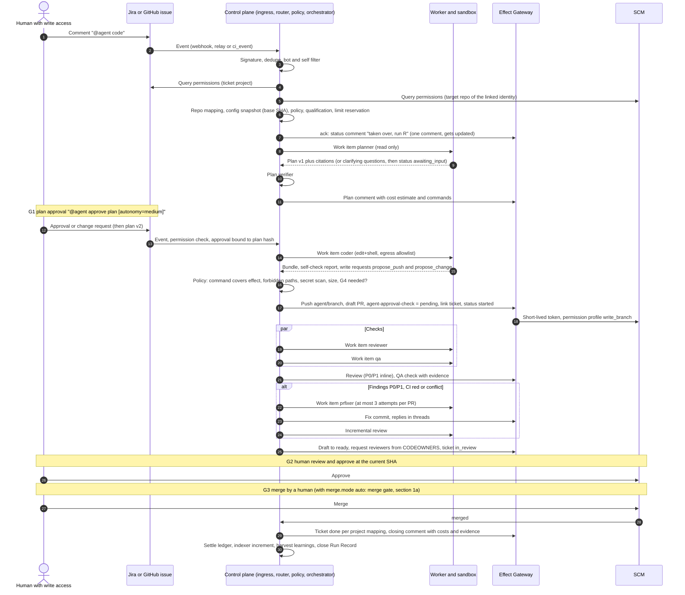
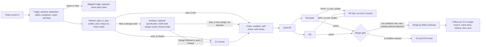

<!--
SPDX-License-Identifier: Apache-2.0
SPDX-FileCopyrightText: The Guildwork Authors
-->
# 03 Flow and orchestration

Source keys and classifications as in the [README](README.md). The bot handle is configurable per installation; here it is `@agent`. Expansion stages as in [08](08-roadmap.md).

## 1. End to end: ticket with mention to merged PR

The diagram shows autonomy `medium` with human approval at G1, G2, and G3. The run without human wait points is described in section 1a.

**Variants:**
- Without planner (`on_disabled: skip` or `@agent code --no-plan` with a G1 exception per policy): steps 8 to 14 are dropped.
- With architect (section 1a): between plan verifier and plan comment a work item `architect` runs; G1 approves plan and design together.
- Autonomy `full`: G1 automatic, G2 and G3 replaced by the merge gate, as far as the configuration allows (section 1a).
- Without reviewer, QA, or PR fixer: the respective step follows the pipeline's `on_disabled` ([04](04-configuration-and-limits.md)). With `human` the status comment states that a human takes over this check.
- From GitHub instead of Jira: identical flow; the WorkItemProvider is then `github-issues`. One E2E test per input proves the equivalence (suite S5).

## 1a. Autonomous run

Every step is optional, up to the autonomous run from the incoming issue to the merge.

**Principle: chain of specialized services, no all-in-one agent.**
1. The run is controlled by the orchestrator. It is deterministic code without an LLM. It decides every transition based on stored facts (artifacts, checks, findings, limits, configuration), never based on model text.
2. Every step is a separate service with its own work item, its own fresh sandbox, its own prompt and model, its own permissions (section 0 in [02](02-services.md)), and its own gates. No agent sees the permissions or the context of the whole chain.
3. Handovers happen only via typed, versioned artifacts: `TriageArtifact`, `PlanArtifact`, `DesignArtifact`, `ChangeProposal`, `ReviewArtifact`, `QAReport`, `FixResult`. The reviewer checks the coder independently, in a different run and, if desired, with a different model. It sees only diff, ticket, plan, and design, never the coder's transcript.
4. Every step must be allowed to run `live` on its own: Gate A and Gate B or an adopted reference qualification ([07](07-eval.md), ADR-47); for auto-merge only that counts, never the operator deviation (merge gate condition 2). The run is as good as its weakest qualified step, not like a single large prompt.

**Triggers without mention** (optional, per repo via `routing`): ticket created (`work_item.created`), label set (`agent:auto`), assignment to the bot, triage completed (`item.triaged`). For auto triggers, G0 applies to the **ticket author**: they need the minimum permissions of the command. If these are missing, the run ends after triage with `done` and the note "waiting for a command from an authorized person"; a later `@agent code` starts a new run that reuses the stored `TriageArtifact` of the same ticket version.

**Flow with `autonomy: full`:**

**Triage (optional, `on_disabled: skip`):** The service `triage` classifies the issue ([02](02-services.md)). It has no shell and proposes instead of acting: it sets labels, assignees, and links per property only with `auto_apply`, otherwise as a proposal ([04](04-configuration-and-limits.md)). If it classifies the issue as spam or slop, the run ends with `Skipped(triage_rejected)`, without a plan and without further costs. The issue stays open; it gets a label or comment according to the configuration. Closing is only possible with `auto_close: true` (O25 decided: option, default off), with a comment and reason, reopenable. Reason: a wrongly closed issue of an outsider does more harm than an open spam issue ([`ebenen-landkarte`](../research/ebenen-landkarte.md) section 4). Issue text is `Untrusted` (suite S1).

**Architect (optional, `on_disabled: skip`):** It runs after the planner when `services.architect.required_if` applies. Default: `plan.risk == 'high'`, plan touches `protected_paths`, or planner reports a design need (`plan.design_needed`). The result is a `DesignArtifact`: requirements in the EARS pattern, ADR drafts, design review against C4 and arc42 checkpoints, threat model following STRIDE, reconciliation with the plan ([`ebene-planung-und-architektur`](../research/ebene-planung-und-architektur.md) section 3 point 1). If the design review reports `blocked`, the run waits for G1 by a human, even with `autonomy: full`. G1 binds plan hash and design hash together.

**Automatic plan approval (G1 auto):** Only when `services.planner.approval.auto_if` is met ([04](04-configuration-and-limits.md)). Starting rule:
- Plan verifier green, no open `questions[]`.
- A plan critique by a fresh model without planner context finds no objection of level "blocked".
- `risk` not `high`, no `protected_paths`. If the architect ran, its design review is not `blocked`.
- Estimated consumption below the threshold (in tokens, because tokens are measurable for every credential kind, USD is not).

If a condition is missed, the run waits for G1 by a human. There is no waving through after a timeout.

**Merge gate (replaces G2 and G3 with `merge.mode: auto`):** It is a deterministic check in the orchestrator, not an agent and not a write request. No service has a `propose_merge`. All conditions apply at the current head SHA:
1. Pipeline with `autonomy: full`, `merge.mode: auto` allowed on all config layers and no tightening entry in `repo_overrides` ([04](04-configuration-and-limits.md) section 1).
2. Every service that contributed content or approvals in this run runs `live` with a qualified row (Gate A and all Gate B required parts, per part or scope, or reference qualification; [10](10-standards-per-layer.md) section 1.2), and that for exactly the `qualification_key` that the run's config snapshot stores for it: all models per role, `prompt_v` per step, plugin versions, and marked config keys ([07](07-eval.md) section 2, ADR-66). Library calls (such as the coder's self-review) count toward the profile of the calling service. If a field of the profile deviates from every qualified row, such as a swapped verifier model, the condition is missed. These are always coder and reviewer, plus every further service with an artifact, commit, or approval in the Run Record: QA, PR fixer, architect, `docs`, the planner with automatic plan approval (G1 auto), and `triage` if it started the run (`item.triaged`). No service of the chain ran only `shadow`. A row that runs `live` only via the operator deviation "Standard not proven" (ADR-47) never counts, not even for a single part (such as PR fixer source `merge_conflict`); a service with "Gate B open" ([10](10-standards-per-layer.md) section 1.2 point 6) therefore sends the run to G2 and G3. Reason: without humans in the flow, the level must be evidenced.
3. Reviewer run at the head SHA with 0 open P0 and P1 (threshold can be tightened per repo, such as also P2).
4. QA `pass` (or QA off and `on_disabled: skip` allowed); a `fail` of class `flake` or `environment` leads to a retry or `blocked`, never to a merge; an open catch finding P0 or P1 with the checker verdict "real bug" blocks ([02](02-services.md) section 5). All required checks of the host green.
5. Self-check bundle green, hard gates 0 violations; once analyzers run, the platform gate `quality-gate` at the head SHA is green (ADR-36, ADR-40, [10](10-standards-per-layer.md) section 13).
6. No path from `protected_paths` touched, unless G4 was granted by a CODEOWNER at the current SHA.
7. Diff below `merge.max_diff_lines`, no new dependencies without a green osv check.
8. No human "request changes", no `@agent stop`, no `@agent hold`, and no open handoff (`handed_off`), budget not exhausted, `mergeable` without conflict.
9. The waiting window `merge.veto_window_min` has expired without objection. After that, everything is checked again at the then current SHA; `hold`, `stop`, and "request changes" are read once more immediately before the merge call.
10. The PR is an agent PR on `agent/*`, in the repo itself or in the installation's agent fork (ADR-59), and comes from no other fork.
11. Every commit between base and head was pushed by the Effect Gateway itself (SHA chain from `effects`). A foreign commit, even from a human with write access, sends the run to `awaiting_human_review`, because otherwise human code would reach the target branch without human review. This also applies after `@agent resume` (section 2.4).
12. **Provenance (ADR-60):** All `Untrusted` inputs from persons that a service of the run has seen (ticket text, comments, PR text, thread replies, linked issues) come from persons with write access and from the state before the trigger. Otherwise the Run Record carries the marker `foreign_input_seen` ([05](05-security.md) section 8), and the run goes to G2 and G3. Reason: conditions 3 and 4 are model judgments; a foreign input that coder and reviewer see at the same time can steer both in the same direction, and a backdoor in an allowed push is not an effect outside the command.

**No auto-merge for `external_code` (ADR-60, Ruling R-D):** The resolver rejects `merge.mode: auto` for repos of class `external_code` ([05](05-security.md) section 3), that is, for every public repo; the orchestrator rechecks the class on every claim, a repo that has since become public falls back to `human`. A relaxation for public repos needs a new decision and requires at least: agent branches treated like fork code (ADR-59), condition 12, the approve conditions from ADR-61, and own S7 cases.

**Branch protection for `merge.mode: auto`** (in [09](09-decisions.md) section 4):
- Pushing to `agent/*` is allowed only for the platform's app (in the repo and in the agent fork).
- The CI treats agent branches like fork code (ADR-59, [05](05-security.md) section 3); this applies already to coder, QA, and PR fixer, not only to `auto`. The platform never writes to human branches; fixes to human PRs come as a stacked PR, also in watch mode (ADR-71).
- The required check `agent-approval-check` is bound to the platform's app as the only source, so that no workflow in the repo can set it green. Whether GitHub allows this for rulesets is unverified and will be clarified in stage 5; without this binding the repo stays on `human`.
- On human PRs the platform sets the check only after a human approve at the current SHA.

**Merge:** It is executed by the Effect Gateway with permission profile `merge`, either via the merge API with the `sha` of the checked head (409 if the head deviates; [gh-merge] VERIFIED) or via the host's merge queue, where one exists. The merge method comes from the repo configuration. The platform never uses bypass rights; the host's branch protection applies unchanged.

**Follow-up:** If the CI on the target branch turns red after an auto-merge, the platform opens a revert PR and notifies the humans. The orchestrator writes an entry `merge.mode: human` for the repo into the table `repo_overrides` of the control plane. The table only tightens and applies after all config layers ([04](04-configuration-and-limits.md) section 1 rule 7); a repo file with `auto` does not lift it. Only an admin can lift it in the admin UI, with an audit entry. Reason: the repo file lives in the repo and applies at the base SHA; without a platform-side location the fallback would be overwritten again on the next run. After that, `docs` runs in mode `sync` if it is on; docs PRs never go through the merge gate but always to a human.

**Shadow mode of the merge gate:** With `merge.mode: shadow` the gate makes and stores its decision, but the merge is done by the human. The accuracy compared with the human decisions is the eval for `auto` ([07](07-eval.md) suite S7).

**Handoff to humans:** Every run can go to a human at any time without losing work (section 2.4). The chain is therefore never a closed box: clarifying question, steering, takeover, and `stop` are available in every state with a running agent.

## 2. State machine

### 2.1 Run (ADR-67)

The state machine is a table of state times event; it is its only source. In the code it lives as a versioned, machine-readable file from which orchestrator and test read. Every non-final state has an entry for the four **mandatory events** `stop`, `budget_exhausted`, `error_after_retries`, and `deadline`: a target state or "not applicable" with a reason. An event that is not in the table for a state does not change the state; it is discarded with an audit entry and answered visibly ("not possible in this state"). In final states (`done`, `skipped`, `cancelled`, `expired`, `failed`) the platform answers commands with "no running run" ([04](04-configuration-and-limits.md) section 3).

**Active states** execute a step; there `deadline` is the wall-clock limit (`wall_min`) and acts like `budget_exhausted`. An expired lease is retried according to the rules from section 2.2; after N attempts that is `error_after_retries`. **Waiting states** hold no lease and consume nothing; there `budget_exhausted` and `error_after_retries` do not apply.

| State | Kind | Domain events and target | `stop` | `budget_exhausted` | `error_after_retries` | `deadline` |
|---|---|---|---|---|---|---|
| `received` | input | rule, permissions, bot, duplicate, service off: `skipped`; object lock taken: delivery to the active run (section 2.5), this input `skipped(delivered_to_run)`; policy and reservation ok: `queued` | `cancelled` | reservation rejected: `paused_budget` (origin `queued`) | `failed` | not applicable (immediate decision) |
| `queued` | waits for lease | lease granted: first step of the pipeline (`triaging`, `planning`, or without planner `coding`) or of the single-service run | `cancelled` | not applicable (reservation exists) | `failed` (such as sandbox creation) | no suitable pool or drain: stays `queued`, after the deadline status `neutral` (section 5) |
| `triaging` | active | spam or slop: `skipped(triage_rejected)`; triage only (routing, G0 of the author, single-service run): `done`; otherwise `planning` | `cancelled` | `paused_budget` | `failed` | like `budget_exhausted` |
| `planning` | active | clarifying question: `awaiting_input`; architect's `required_if`: `designing`; G1 by humans needed: `awaiting_plan_approval`; G1 automatic (`auto_if`): `coding` | `cancelled` | `paused_budget` | `failed` | like `budget_exhausted` |
| `designing` | active | clarifying question: `awaiting_input`; G1 by humans needed or design `blocked`: `awaiting_plan_approval`; G1 automatic: `coding` | `cancelled` | `paused_budget` | `failed` | like `budget_exhausted` |
| `awaiting_input` | waiting | answer from an authorized person: stored origin state (`planning`, `designing`, or `coding`) | `cancelled` | not applicable | not applicable | `ask_timeout_h`: `expired`, for the coder intermediate state as `agent/<key>-wip` |
| `awaiting_plan_approval` | waiting | change request: `planning` (new version); G1 granted: `coding` | `cancelled` | not applicable | not applicable | `approvals.plan_expiry_days`: `expired` |
| `coding` | active | clarifying question: `awaiting_input` (snapshot, lease released); G4 needed: `awaiting_risk_approval`; `handoff`: `handed_off`; bundle ready: `proposing`; self-check red after `repair_rounds`: `failed` | `cancelled` | `paused_budget` | `failed` | like `budget_exhausted` |
| `awaiting_risk_approval` | waiting | G4 granted: `coding` | `cancelled` | not applicable | not applicable | deadline like approvals (`approvals.plan_expiry_days`): `expired`, bundle stays in the BlobStore, nothing pushed |
| `handed_off` | waiting | `resume`: `coding`; human sets PR to ready: `awaiting_human_review` | `cancelled` | not applicable | not applicable | `services.coder.ask_timeout_h`: `expired`, branch stays |
| `proposing` | active, deterministic | draft PR open: `verifying`; policy requires G4: `awaiting_risk_approval`; policy rejects: `failed` with rule ID | `cancelled` (a push already applied stays as a draft PR with status) | not applicable (no LLM consumption) | effect `failed` after N attempts: `failed` | not applicable |
| `verifying` | active | findings P0/P1, CI red, conflict: `fixing`; green with `merge.mode` `human` or `shadow`: `awaiting_human_review`; green with `auto`: `merge_gate`; events on the PR are delivered (section 2.5) | `cancelled` | `paused_budget` | `failed` (draft PR stays, status `neutral`) | like `budget_exhausted` |
| `fixing` | active | fix pushed: `verifying`; attempts or `max_rounds` exhausted, conflict rejected, change outside the request: `awaiting_human_review`; `handoff`: `handed_off` | `cancelled` | `paused_budget` | `failed` | like `budget_exhausted` |
| `merge_gate` | active, deterministic | all conditions met, waiting window without objection: `merging`; condition missed or `hold`: `awaiting_human_review` (with reason); new push: `verifying` | `cancelled` (PR stays open for humans) | not applicable (no LLM consumption) | `awaiting_human_review`, never `merging` | end of the waiting window: recheck at the current SHA (condition 9) |
| `merging` | active, effect | merge at the checked SHA: `merged`; 409 (head deviating): `merge_gate`, recheck at the new SHA, if a reviewer or QA run is missing there, this counts as a new push (`verifying`); 405: `awaiting_human_review` | `cancelled`, as long as the merge call has not been issued (condition 9 reads `stop` immediately before it); after that the result decides | not applicable | effect `failed` after N attempts: `awaiting_human_review` | not applicable |
| `awaiting_human_review` | waiting | human merges: `merged`; PR closed: `cancelled` | `cancelled` (PR stays open) | not applicable | not applicable | no deadline: the run ends with merge or closing of the PR; upgrades lift it (section 6) |
| `paused_budget` | waiting | `continue` by an authorized person (G5): stored origin state, new reservation, continuation at the last confirmed step | `cancelled` | not applicable (stays paused) | not applicable | deadline like approvals (`approvals.plan_expiry_days`): `expired`, for the coder intermediate state as `agent/<key>-wip` |
| `merged` | completion | completion and settlement: `done` | not applicable (merge has happened, reply "run completed") | not applicable | settlement is retried, then `done` with a note | not applicable |

**Origin state:** `awaiting_input` and `paused_budget` store the state they came from (`resume_state`) and lead back only there. After `continue` the run repeats no confirmed work: a granted plan approval remains valid as long as the plan hash is the same, and a coder continues from the snapshot.

`verifying` covers reviewer and QA (in parallel). **Single-service runs** (review only, triage only, QA only, `@agent fix` and the route `pipeline.ci_failed`, `architect` as a PR review, `ask`, `docs`, `release`) use a shortened pipeline with the same states and mandatory events. They end in `done` after their last effect and do not stay bound to the PR; `awaiting_human_review`, `merge_gate`, and `merging` exist only in pipelines that opened an agent PR themselves. Runs of `docs` and `release` open their PR and then end in `done`; the PR goes to a human, never into the merge gate.

**Test (S6):** completeness of the table: every cell state times mandatory event has an entry, every non-final state reaches a final state, every target exists; plus one case per cell that checks exactly the stored, audited, and visible behavior.

### 2.2 Step, work item, effect

| Object | States | Rules |
|---|---|---|
| Step | `pending`, `leased`, `running`, `succeeded`, `failed`, `cancelled`, `timed_out` | retry with attempt counter; result idempotent via lease ID |
| Work item | `available`, `leased`, `completed`, `failed`, `revoked` | lease with expiry time; heartbeat extends; an expired lease makes the item `available` again at the last confirmed step |
| Effect | `pending`, `applied`, `failed`, `rejected_policy`, `shadowed` | idempotency key per effect (unique); `shadowed` in shadow mode; `failed` is retried with increasing backoff, after N attempts a status comment |
| Approval | `requested`, `granted`, `denied`, `expired` | bound to SHA or plan hash (and design hash if the architect ran) |

The state machines are versioned; an upgrade lifts open runs to the new version (section 6). Implementation in Postgres tables plus pg-boss ([06](06-operations-and-deployment.md), ADR-04).

### 2.3 Status comment

For each ticket and each PR there is exactly one status comment with a hidden marker. The marker lists **all active runs** of the object (per run `run_id`, service or pipeline, state, version; section 2.5); each run updates only its own row, following a compare-and-swap rule on the comment version, so that concurrent runs do not overwrite each other. It is updated, not posted anew. Content per active run: state, next possible commands, costs so far, links into the admin UI (Run Record). If a participating service runs `live` only via the operator deviation, it visibly says "Standard not proven" there with the service name (ADR-47). In Linear the agent session replaces the comment ([linear-agents] VERIFIED).

### 2.4 Clarifying question, steering, and handoff

Basis: [`ebene-coding`](../research/ebene-coding.md) section 3 (gaps L1 to L3); the leading coding agents offer all three functions.

- **Clarifying question from coding:** The coder issues `request_human_input`. The worker stores `snapshot(tag)` of the sandbox and the session reference in the BlobStore and releases the lease; the run goes to `awaiting_input`. No sandbox lives on without a lease. The answer of an authorized person (trigger author or write access in the repo) starts a new work item that restores the snapshot and continues the session via `resume()` ([01](01-plugin-interfaces.md) sections 6 and 8). Deadline `services.coder.ask_timeout_h`; after that `expired`, the intermediate state remains as branch `agent/<key>-wip`. If the harness cannot `RESUME`, the coder asks no clarifying question but ends with a report.
- **Steering:** `@agent say <text>` produces the event `run.steer { text, actor }`. The text is an instruction only from this actor; all other content stays `Untrusted`. If the harness can `STEER`, the worker passes the message into the running session; otherwise the next work item of the run picks it up (next fix round, next resume). A steering instruction is never discarded: in state `proposing` or `verifying` it goes into the next fix round. The state does not change. Switch off per repo with `allow_steer: false`.
- **Handoff to a human:** `@agent handoff` pushes the intermediate state to `agent/<key>-wip`, stores the transcript bundle in the BlobStore, and posts a continuation instruction for a local tool. The run goes to `handed_off`, no agent works on the branch anymore. `@agent resume` takes over the branch including human commits as the new base; because of merge gate condition 11, no auto-merge is possible afterwards, only G2 and G3. If the human sets the PR to ready themselves, the run goes to `awaiting_human_review`. Switch off per repo with `allow_handoff: false`. Whether a transcript can be taken over into a local Claude Code is unverified; otherwise the platform hands over branch plus summary.

### 2.5 Multiple runs on the same object (ADR-68)

An object is a ticket or a PR; a pipeline run holds its ticket and, as soon as it opens it, its agent PR.
- **Object lock:** Per object and service there is at most one active (not finished) run; a pipeline run takes the lock for every service of its steps. Enforced in Postgres with a unique partial index over (object, service) for all runs outside the final states, set in the same step as the transition from `received` to `queued`.
- **Deliver instead of restart:** If an event hits an object held by a running pipeline, the router starts no new run but delivers the event to this pipeline. Examples: `pipeline.ci_failed` on `agent/*` is the transition to `fixing` in `verifying` and is taken into the running fix round in `fixing`; a push acts like "new push" in table 2.1; `@agent review` or `@agent fix` on this PR becomes an event of the pipeline, not a second reviewer or PR fixer run. Routes with `services:` start only if no pipeline holds the object ([04](04-configuration-and-limits.md) section 3).
- **Same service without pipeline:** If a single-service run of the same service is already running for the object, the new event is merged: it waits as exactly one follow-up request and starts after the end of the active run on the then current SHA (for the reviewer incrementally); further events replace this follow-up request instead of piling up.
- **Control commands:** The orchestrator assigns a command to the matching active run: `approve plan` to the run in `awaiting_plan_approval`, `approve risk` to the one in `awaiting_risk_approval`, `continue` to the one in `paused_budget`, `resume` to the one in `handed_off`, `say`, `handoff`, and `hold` to the pipeline, otherwise to the only active run. `stop` ends every active run of the object (section 4). If several runs match, the platform replies with the list from the status comment and waits for `run=<run_id>` in the command; the command then acts only on that run.

Tests: S5 (a command with two active runs reaches exactly the matching run; `ci_failed` during `verifying` creates no second run) and S6 (concurrent events for the same object create exactly one active run per service; the status comment lists both runs after parallel updates).

## 3. Approval points

| Point | When | Default | Configurable |
|---|---|---|---|
| **G0 Triggering** | Every event with a command | Human with write access in the ticket project **and** in the target repo (linked identity); bots, fork authors, and the own bot identity never trigger. Exception: automatic triage of new issues runs for every human author; the author cannot trigger a command or request an effect in doing so, which properties are applied automatically (`auto_apply`, `auto_close` per O25) is determined solely by the configuration at the base SHA (section 1a; detailed design 12 FE-1254) | minimum role per command and layer, tightening only |
| **G1 Plan** | after `plan.ready` or after the design, if the architect ran | mandatory for ticket inputs with autonomy `low` and `medium`; with `high` and `full` automatic if `services.planner.approval.auto_if` is met (section 1a), otherwise human; always human if the design review reports `blocked` | `services.planner.approval.required_if`, `services.planner.approval.auto_if`, `services.architect.required_if`, cap `max_autonomy` |
| **G1b Clarifying question** | planner, architect, or coder uncertain | run waits with a deadline; after that `expired`, claim released, comment; for the coder the intermediate state remains as a WIP branch | deadline per service (`ask_timeout_h`) |
| **G2 Review** | agent PR becomes ready | mandatory with `merge.mode: human` and `shadow`: `agent-approval-check` turns green only when a human with write access has approved at the current SHA; with `merge.mode: auto` the merge gate sets the check (section 1a) | `merge.mode` (platform default `human`; `auto` only if the installation allows it as a ceiling, O8) |
| **G3 Merge** | | with `human` and `shadow` a human; with `auto` the Effect Gateway after the merge gate, never an agent | `merge.mode`, `merge.method`, `merge.veto_window_min`, `merge.max_diff_lines` |
| **G4 Risk paths** | diff touches `protected_paths` (auth, payment, migrations, infrastructure) | approval by CODEOWNERS before pushing; label `agent-risk` | path lists per repo |
| **G5 Budget** | limit exhausted | run `paused_budget`, status `neutral` with reason; continue only with `@agent continue` by the budget owner | who may continue, per layer |

## 4. Commands in ticket and PR

| Command | Where | Effect | Minimum permission (default) |
|---|---|---|---|
| `@agent triage` | Ticket | triage run: duplicates, labels, assignees, spam and slop; proposals only, except properties with `auto_apply` | triage permission in the repo (GitHub role `triage` or higher) or write in the ticket project |
| `@agent plan` | Ticket | planner run | write in the ticket project and read in the repo |
| `@agent architect [spec\|adr\|review]` | Ticket, PR | architect run: specification, ADR draft, or design review | in the ticket like `plan`; on the PR write in the repo |
| `@agent code [--no-plan]` | Ticket | pipeline `ticket-to-pr` | write in ticket and repo |
| `@agent approve plan [autonomy=low\|medium\|high]` | Ticket | G1 for the current plan and design version | write in ticket and repo |
| `@agent approve risk` | PR; ticket before the first push (status comment) | G4, also for deleted or skipped tests | CODEOWNER of the affected paths or of the test paths |
| `@agent approve dependency <id>` | Ticket, PR | approval of a non-allowed dependency per ADR-64 | write in the repo |
| `@agent review [full]` | PR | reviewer run, incremental by default | write in the repo |
| `@agent qa [unit\|repro\|e2e]` | PR | QA run | write in the repo |
| `@agent fix [thread\|review\|pr\|ci]` | PR, thread | PR fixer run | write in the repo |
| `@agent docs [docstrings\|sync]` | PR | docs run: docstrings as a follow-up PR or docs reconciliation | write in the repo |
| `@agent release [<version>]` | Ticket, PR | release notes and changelog as a PR or draft; publishing only by a human | write in the repo |
| `@agent ask <question>` | Ticket, PR | single-service run of the `indexer`; answer with citations (KB or agentic) as `propose_comment` or `propose_reply`, no other effects ([02](02-services.md) section 0) | read |
| `@agent remember <fact>` | PR, thread | creates a learning (lifecycle [02](02-services.md) section 7) | write in the repo |
| `@agent pause` | PR | pause auto-review for this PR; `@agent review` resumes | write in the repo |
| `@agent say <text>` | Ticket, PR | steering of the running run (section 2.4) | trigger author of the run or write in the repo |
| `@agent handoff` | Ticket, PR | handoff to a human (section 2.4) | trigger author of the run or write in the repo |
| `@agent resume` | PR | taking back a handoff | write in the repo |
| `@agent continue` | Ticket, PR | G5 | budget owner |
| `@agent stop` | Ticket, PR | aborts every run of the object | trigger author or write in the repo |
| `@agent hold` | PR | objection to the auto-merge: the merge gate goes to a human (G2, G3), the run otherwise continues | write in the repo |
| `@agent config` | PR | shows the effective configuration (diff for config PRs) | read |
| `@agent ignore` | PR | reviewer and PR fixer off for this PR | write in the repo |
| `@agent help` | everywhere | command list | read |

`@agent triage` requires more than read, even though the service only proposes. Reason: on public repos anyone may read, and every run costs; the automatic triage of new issues covers outsiders anyway. Answers to clarifying questions are not a separate command: the next comment of an authorized person in the ticket or PR counts as the answer.

All commands of this table, including the control commands `approve`, `say`, `handoff`, `resume`, `stop`, and `continue`, run via the `routing` of the configuration; the minimum permissions per command are there as `command_permissions` and correspond to this table ([04](04-configuration-and-limits.md) section 3). The orchestrator assigns control commands to the matching active run of the object (section 2.5). Test: suite S5 (Jira approval G1 leads to `coding`).

Further origins of the same command: label (`agent:review`), assignment or delegation to the bot (Linear, Jira, GitLab), check button (`check_run.requested_action`, at most 3 per check [gh-checks] VERIFIED), dispatch. Only the command is an instruction; the rest of the comment text is `Untrusted`, except for the text of `@agent say` (section 2.4).

## 5. Failure and abort paths

For every row there is a test (suite S6) that checks exactly the stored, audited, logged, and visible behavior.

| Failure or abort | Stored | Audit | Log and metric | What the user sees |
|---|---|---|---|---|
| Signature invalid | raw payload in quarantine, no run | yes (source, reason) | counter `ingress_rejected`, alarm on accumulation | nothing |
| Duplicate (delivery ID) | nothing new | no | counter `ingress_duplicate` | nothing |
| Permissions missing | event with `Skipped(permission)` | yes | counter per reason | reply to the trigger author "no permission", if configured |
| Service `off` | event with `Skipped(service_disabled)` | yes | counter | "Service X is off for this repo" |
| Triage: spam or slop | `TriageArtifact` with classification and rationale, run `Skipped(triage_rejected)` | yes | counter per classification | label or comment according to configuration; issue stays open, unless `auto_close` is on |
| Repo cannot be resolved | event `skipped(repo_unresolved)`, no run (table section 2.1 has no transition from `received` to `awaiting_input`; detailed design 02 FE-209) | yes | | clarifying question in the ticket with repo suggestions; the answer is a new event |
| Reservation rejected (limit) | ledger entry `rejected`, run `paused_budget` | yes | counter per limit key | status `neutral` with reason, pointer to `@agent continue` |
| Budget exhausted during the run | usage up to the abort, reservation released, transcript | yes | heartbeat cancel logged | status `neutral`, comment with state and costs |
| Lease expired (worker gone, network) | item `available` again, result of the old lease is discarded | yes | counter `lease_expired` per pool | nothing, as long as the next attempt succeeds |
| Harness: schema invalid or empty | transcript, no effect | yes | `schema_invalid` per provider | check `neutral` "Run failed", never silent green |
| Provider 429 or 5xx | `rate_limited` with `resetsAt` | yes | per provider | after retries status `neutral`; fallback provider only if it is qualified for the service |
| Provider auth error | `auth_failed` | yes | alarm (token expired, such as a subscription token after one year) | status `neutral`, admin notification |
| Policy rejects write request | request plus rule ID | yes | counter per rule | comment "blocked by rule X"; for a risk path approval request G4 |
| Design review `blocked` | `DesignArtifact` with findings | yes | counter | run waits for G1 by a human, comment names the findings |
| Effect fails (provider error) | effect `failed` with error, retry with idempotency key | yes | per plugin | after N attempts status comment |
| Fallback level used | `fallbackUsed` on the effect | yes | counter per capability | notice in the summary |
| Self-check red after `repair_rounds` | bundle and report in the BlobStore, no push | yes | | comment with the last test run, run `failed` |
| PR fixer unsuccessful after 3 attempts | commits so far, report | yes | | reply in the thread, run `awaiting_human_review` (single-service run: `done` with report, section 2.1) |
| PR fixer: error not caused by the PR | `FixResult` `not_caused_by_pr` with class, at most one rerun per commit | yes | counter per class | reply with rationale, 0 code changes |
| PR fixer: conflict rejected or change outside the request needed | `aborted_conflict` or `outOfScopeSuggestions[]` with patch text, no commit | yes | counter | comment with reason or patch proposal for a human, run `awaiting_human_review` (single-service run: `done`) |
| Limit of rounds between reviewer and PR fixer reached (`max_rounds`) | round counter, last state | yes | counter | status comment, run `awaiting_human_review` |
| Snapshot for clarifying question or handoff fails | intermediate state as branch `agent/<key>-wip`, report | yes | counter per pool | comment with branch, run `failed` |
| Answer after the deadline | answer on the expired run | yes | | notice that a new run starts from the WIP branch |
| `@agent stop` | lease revoked, worker aborts via `AbortSignal`, sandbox destroyed, nothing pushed | yes | | status `cancelled`, confirmation in the comment |
| Text edited after the trigger (TOCTOU) | event with `editedAfterTrigger` | yes | | clarifying question, the new text is not used as a command |
| Approval deadline expired | run `expired`, reservation released | yes | | comment with a hint on restarting |
| Sandbox creation fails | step `failed`, `destroy` in finally | yes | per pool | after retries status `neutral` |
| No pool with the required isolation (ADR-48) | item stays `available`, reason on the item | yes | counter per repo class, alarm after deadline | status `neutral` "no suitable pool" |
| No safe CI path for agent branches (ADR-59) | item stays put with reason `no_safe_ci`, check result per workflow at the base SHA | yes | counter per repo | status `neutral` "The repo's CI runs agent code with secrets", pointer to the variants in [05](05-security.md) section 3 |
| Config file invalid (ADR-65) | error with key and line; effective configuration from the last valid version or the strictest level, marked in the snapshot | yes | counter per repo | visible notice on the PR or ticket and in the admin UI, until a valid file is at the base SHA |
| Effect violates the visibility rule (ADR-63) | request with citation and visibilities, no effect | yes | counter per service | status `neutral` with reason "citation from a source with narrower visibility" |
| KB missing or outdated | run proceeds without KB | no | counter | summary names the KB state |
| Webhook at the provider disabled or expired | `health()` reports, reconciler catches up | yes | alarm | admin notification |
| Merge gate: condition missed | gate result per condition at the SHA | yes | counter per condition | status comment names the missed condition, run `awaiting_human_review` |
| Merge rejected (409 head deviating, 405 not mergeable) | effect `failed` with response | yes | counter per code | with 409 new check at the new SHA, with 405 run `awaiting_human_review` with reason |
| CI on the target branch red after auto-merge | merge SHA, CI result, revert PR, entry in `repo_overrides` | yes | alarm | revert PR, notification, the repo's `merge.mode` falls back to `human` |
| Control plane restarted | inbox and outbox durable in Postgres | | | nothing; runs continue at the last step |
| Worker version not supported (section 6) | claim rejected with `upgrade_required`, item stays `available` | yes | counter per worker version, alarm | nothing, as long as a matching worker claims; otherwise after the deadline status `neutral` |
| Work API in drain mode | events in the inbox, runs stay `queued` | yes (drain on and off) | duration of the drain | status "waiting for end of maintenance" after the deadline |

**Principle:** An abort is always visible (`neutral` with reason), never silent green. Nothing is discarded without reason and time being in the audit.

## 6. Behavior during upgrade

The upgrade procedure (releases, database migrations, stop points) is in [11](11-installation-and-hosting.md). This section covers only what running runs and workers experience during it (DERIVED from [`hosting-und-installation`](../research/hosting-und-installation.md) section 3.5).

1. **Open runs are lifted (ADR-67).** Every run stores the version of its state machine (table in section 2.1) and its config snapshot. The control plane of version N runs runs of version N and N-1. Every release ships a mapping of each state of the previous version to a state of the new version (including `resume_state`); a state without a mapping is a release blocker. Before the migration to N+1, control plane N lifts all open runs of version N-1 to N via the mapping, idempotently and with an audit entry per run; in drain mode (point 2) no run holds a lease during this. Waiting runs (`awaiting_*`, `handed_off`, `paused_budget`) are lifted the same way; the operator does not have to end any run, and a long-open PR blocks no upgrade. `doctor` names the lifted runs. The config snapshot stays unchanged; if the new version cannot read it, rule 4 from [04](04-configuration-and-limits.md) section 1 applies (fail closed).
2. **Drain mode of the Work API.** Before replacing the control plane, the operator switches on `drain`: `claim` grants no new leases (reply with `retry_after`), running leases run until their end or expiry. The ingress keeps accepting events; they lie durably in the inbox, runs stay `queued`. After migration and start of the new version the drain ends, and the work continues. Leases that expire during the drain follow the normal rule (item `available` again at the last confirmed step).
3. **Worker versions N-1.** Workers run distributed and are updated later. Control plane N accepts claims from workers of versions N and N-1; the version is in the claim. Older workers get `upgrade_required`, the item stays `available`. A work item that needs a capability of version N goes only to workers that report it. The work item envelope is versioned.
4. **Plugins, drivers, and configuration.** Plugin and driver `apiVersion` are valid in the current and the previous major version ([01](01-plugin-interfaces.md) rule 6). A configuration with an older `version` field is read by the resolver via a migration; an unknown version is an error as in [04](04-configuration-and-limits.md) section 1 rule 4.

Test: an upgrade N-1 to N with a running run, a waiting run (one case per waiting state, including `awaiting_human_review` and `paused_budget`), and a worker N-1 in the portability test; afterwards a second upgrade N to N+1 without operator intervention ([11](11-installation-and-hosting.md)); stored, audited, and visible as in section 5.

## 7. Campaigns (sketch for stage 10)

Only a sketch, built only in stage 10 ([`ebenen-landkarte`](../research/ebenen-landkarte.md) section 3.3 point 3).
- A parent run carries the plan and recipe list (such as a migration across many repos). Per repo a child run of the normal pipeline with all gates is created.
- Shared budget as a separate limit key `campaign` in the ledger; every child run additionally reserves there.
- Abort rule: if the failure rate of the child runs exceeds a threshold, the parent run starts no further children and reports the state (threshold open, after eval).
- No auto-merge for child runs until a separate eval for campaigns is green.
