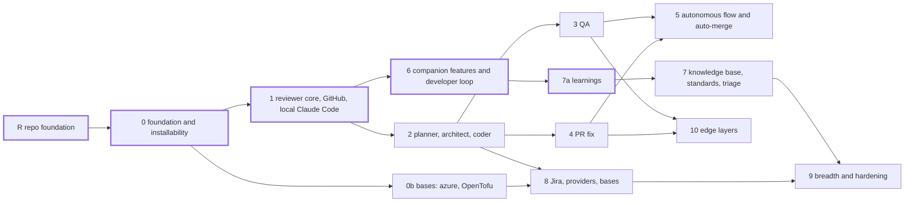

<!--
SPDX-License-Identifier: Apache-2.0
SPDX-FileCopyrightText: The Guildwork Authors
-->
# 08 Roadmap

Source keys and classifications as in the [README](README.md). This file describes the expansion stages of the platform as a project. When a specific installation puts which stage into operation is up to its operator; the rollout of the reference installation is in the private ops repo and is not part of the public repo.

## 1. Order and principles

The goal is the autonomous flow from ticket to optional auto-merge as a chain of specialized services ([03](03-flow-and-orchestration.md) section 1a), installable on any base ([11](11-installation-and-hosting.md)) and per service at the standard of its field ([10](10-standards-per-layer.md)); this standard is a measurement target, not a build condition (ADR-56). The stages form a **dependency graph**, not a chain (section 3, ADR-54). This results in the order:
- **Core first:** The first goal with real benefit is the reviewer including its companion features (walkthrough, comments, chat, learnings, optional auto-approve) on GitHub, `single-host`, with one credential path. These are stages R, 0 (without sub-stage 0b), 1, 6, and sub-stage 7a. Stage 6 depends only on stage 1 and may be built directly after it (Ruling R-A of the project, 2026-10-31);
- first the public repo with its check tools (stage R), then control plane and installability (stage 0), because every later stage is measured on a freshly installed platform;
- then reviewer, GitHub, and local Claude Code (stage 1); the reviewer remains the first functional stage because the coder uses it as self-review, the merge gate rests on its findings, and public review benchmarks with a free license are available ([07](07-eval.md) section 3.1);
- after that, also in parallel to the core, the chain of planner and architect, coder, QA, PR fix, and the autonomous flow (stages 2 to 5);
- knowledge base, further providers, hosters, and bases, and finally the edge layers (stages 7 to 10), each according to its dependencies in the graph. All credential kinds, providers, and bases remain part of the architecture ([01](01-plugin-interfaces.md), [11](11-installation-and-hosting.md)); they are built when a stage needs them.

**Principles:**
1. A stage starts as soon as all stages it depends on in the graph (section 3) are done; stages without mutual dependency may run in parallel. **Done** means, according to [10](10-standards-per-layer.md) section 1.2 item 6 (ADR-55): built, the required suites and Gate A green, Gate B measured and reported, each with evidence (command and output or eval report).
2. Per stage at most one new harness and one new provider; new services first go `shadow`, then `live` after qualification with Gate A and Gate B ([07](07-eval.md) section 2, ADR-47). Gate B decides only about `live` and the merge gate, never about whether building continues: "done, Gate B red", "done, Gate B not decidable", and "done with Gate B open" ([10](10-standards-per-layer.md) section 1.2 item 6) do not block any subsequent stage. The service then runs at most `shadow` without an operator deviation and never counts in the merge gate; for "open" the license clarification is part of the done criterion as an owner step. Every stage publishes its qualification rows with Gate B status as a reference qualification (ADR-52).
3. Plugin and driver contracts only become binding (`v1alpha1` frozen) when a stage uses them; the others remain a sketch. The API group is `guildwork-dev.github.io/v1alpha1` (O17, decided 2026-10-31).
4. Before every live run, also in shadow mode with real costs, ledger, policy, and limits are in place on all levels (no CI-only variant in live operation, ADR-27).
5. Every stage ends with a release: suite S8 (installation and upgrade) green, upgrade from the previous release tested ([07](07-eval.md) section 5).
6. Changing the credential of an installation (personal operator mode to API key, WIF, or cloud provider) is a configuration change by the operator; afterwards the qualification is measured again for the new combination or a matching reference qualification is adopted.
7. **Only Claude through the subscription in the project (O28):** The project builds, measures, and runs its dogfooding only through the owner's Claude subscription (`subscription`, ADR-72, ADR-73). Functions for other vendors, harnesses, hosters, and clouds remain product scope; the project tests them with contract tests against fixtures built from the public documentation. Live runs with own accounts are optional owner tasks and never a done criterion of a stage; this also applies to Claude through Bedrock, Vertex, and Foundry.

**Effort:** The figures in weeks are **estimates** for 1 to 2 people with Claude Code and are not verified; the real effort is measured per stage and the next estimate is corrected accordingly.

## 2. Stages

Epics, tasks, and subtasks of every stage with dependencies, order, and done criteria are in the work plan ([docs/plan/](../plan/README.md)), the how is in the detailed design ([docs/design/](../design/README.md)). The work plan adopts the edges from section 3; `plan.py check` verifies this.

| Stage | Content | Done criterion (with evidence) | Estimate |
|---|---|---|---|
| **R repo foundation** | Public product repo following the bothy pattern ([`bothy-vorlage-projekt-setup`](../research/bothy-vorlage-projekt-setup.md) 3.1 and 3.2; details in [12](12-open-source-and-project.md)): name, API group, license, licensor, and documentation language fixed (O16, O17, O20, O21 decided: Guildwork, Apache-2.0 with DCO, founder privately, English); scaffold with `LICENSE`, `NOTICE`, `CONTRIBUTING.md` (DCO), `SECURITY.md`, `GOVERNANCE.md`; `make check` equal to CI with one required check `ci-ok` (format, lint, types, tests, commitlint with DCO, gitleaks, Opengrep with own rules including rule tests, osv, license gate, deny list scanner against the private list in the ops repo); CodeQL and OpenSSF Scorecard; only GitHub-hosted standard runners; Red Team over the whole state, **one** root commit, push, public immediately (ADR-38); ruleset for `main`, private vulnerability reporting, secret scanning with push protection, Renovate app. Steps R1 to R10 in [12](12-open-source-and-project.md) section 6. No CodeRabbit and no SonarQube (O18, O19 decided: not connected, no request); checks are done by the own reviewer in dogfooding (from stage 1, rules in [12](12-open-source-and-project.md) section 5.4), CodeQL, Opengrep, and the linters. Account steps (repo, org, environments) and V0 (chain of rights to the employer, O27, ADR-69) are done by the project owner | V0 proven (document in the ops repo, [12](12-open-source-and-project.md) section 2.5); `ci-ok` green on the trial PR, all jobs on standard runners (job log); fork PR green with reduced checks; PR without sign-off fails on `ci-ok`; deny scan over content and history of the first push with 0 hits; ScanCode and license gate green; CodeQL and Scorecard ran. Money: 0 with standard runners of public repos ([gh-runners] VERIFIED) | 1 to 2 weeks |
| **0 foundation and installability** | Control plane: ingress with inbox and dedupe, router, orchestrator (run state machine as a table with required events and object lock, ADR-67, ADR-68, plus pg-boss), minimal policy (deny by default, command covers effect), limit ledger with reservation, config resolver with base SHA, schema, and fail closed on an invalid file (ADR-65), Work API with lease, platform MCP with item token, Effect Gateway with outbox and mode `record`, Credential Broker with its own OIDC issuer, audit with hash chain and daily anchor into a `BlobStore` with Object Lock or via SCMProvider into a repo. Drivers (ADR-41, assignment as in [11](11-installation-and-hosting.md)): `BlobStore` `fs`, `s3`, `azure-blob`; `SecretStore` `file`, `env`, `azure-keyvault`; `CloudIdentity` `self-issuer` (`azure-managed-identity` only in stage 8). Admin UI login through a generic OIDC client plus emergency admin. Worker binary with sandbox lifecycle for pool `self-hosted` (Sysbox or gVisor, ADR-48); on `single-host` the worker behind a socket proxy with an allowlist, separate sandbox networks, worker without `secrets/` and without DB network (ADR-62). Installation package (ADR-42): signed images amd64 and arm64, Compose bundle with SeaweedFS (ADR-43), installer CLI with `install`, `doctor`, `upgrade`, `backup`, `restore`, `worker register`, `github-app create`, and setup wizard; OpenTofu modules `generic-vm` and `azure` as the first cloud; telemetry off, air-gap mode (ADR-44). Eval package: ReviewBench and Harbor adapters, download scripts with pinned commit, eval runner with `origin` block and binding of private sets to the data path ([07](07-eval.md) section 1, ADR-70). Contracts `v1alpha1` binding for TriggerSource, SCMProvider, AgentRuntime, ModelProvider, ExecutionBackend, and the three drivers; WorkItemProvider, KnowledgeStore, Notifier, Analyzer as a sketch. Supply chain: signed images with SBOM and attestation, license gate ([05](05-security.md) section 10, [12](12-open-source-and-project.md) section 5.2). **Sub-stage 0b bases** (depends only on 0, not in the core, does not block stage 1): drivers `azure-blob`, `azure-keyvault` and the OpenTofu modules `generic-vm` and `azure`; the core only needs `single-host` (Compose bundle with `fs` or `s3` on SeaweedFS, `file`, `env`, `self-issuer`) | A dummy service runs end to end: comment, event, lease, worker, sandbox, write request, effect in mode `record`. Tests green: lease expiry, dedupe, limit abort (S3), reservation, sandbox `destroy` in the failure path, effect idempotency, audit chain with daily anchor, S2 case "faulty config file" (ADR-65), S6 cases "completeness of the run state machine" and "object lock" (ADR-67, ADR-68), S6 case "worker and sandbox do not reach `secrets/`, Postgres, and the Docker socket" on `single-host` with `doctor` green for the separation (ADR-62; rootless daemon only after its own contract test). Contract suites of the five plugin kinds with recorded GitHub responses and of the drivers against containers or recordings green. **Portability test** (S8) on a fresh machine amd64 and arm64: installation via the documented command, `doctor` green, smoke run, backup and restore. 0b: contract suites of the drivers `azure-blob`, `azure-keyvault`, `tofu validate` and `plan` for `azure` green; a real apply in a throwaway environment only with owner go (O22). PITR or restore proven once. License gate counter-test "image with the package `@anthropic-ai/claude-agent-sdk` is red" green (ADR-39). Contract test "start with `subscription`" green (ADR-57; [01](01-plugin-interfaces.md) section 6): token only from the host file as `CLAUDE_CODE_OAUTH_TOKEN`, model call succeeds, secret scan finds the token in no table, no work item envelope, no snapshot, and no log. First signed release with SBOM and attestation, license gate green ([12](12-open-source-and-project.md) section 5.2); trial run in `shadow` from the setup wizard on a fresh installation ([11](11-installation-and-hosting.md) section 10) | 5 to 7 weeks |
| **1 reviewer core, GitHub, local Claude Code** | Reviewer complete (gate to increment, findings in the DB), analyzer in mode `ingest` (SARIF from CI as a candidate signal, ADR-40). Plugins `github` (trigger `webhook` plus `reconcile`, SCM, issues read-only; app via manifest flow, ADR-45) and `claude-code` (pinned version with checksum installed at the operator, ADR-39) are already built by stage 0 (contract suites, start with `subscription`); stage 1 adds the credential kind API key through the credential relay (M103); `subscription` only as personal operator mode, blocked by default (ADR-51). The profile `operator_test` with egress proxy and inspection proxy ([05](05-security.md) section 6 condition 9) is only needed by a reviewer **with** build verifier; the reviewer without build runs in personal operator mode without a shell. ModelProvider for gate and verifier (in personal operator mode `claude-cli`, ADR-58). Admin UI with Run Record, costs, kill switch. Flow: offline on R1 (human_labeled), R2, R4, R5, then `shadow` on own repos, then `live` as soon as Gate B is green (otherwise only by operator deviation, ADR-47) | Reviewer Gate A (R1, R5) green; **Gate B (R2 under the Claude judges of the file as a stated deviation according to O28, R4 according to [10](10-standards-per-layer.md) section 3) measured and reported**, status according to [10](10-standards-per-layer.md) section 1.2 item 6; ReviewBench reference value read before the first Gate B run (otherwise B3 is not decidable); qualification row with its Gate B status published as the first reference qualification; S1, S2, S4, S6, S8 green; contract test "start with API key through the relay" green against a stub of the Messages API, built from the public documentation (a run with a real API key is an optional owner task, O28); for the project the personal operator mode is the path (O28), therefore required: S4 case "reviewer alone on with `subscription`" (gate through `claude-cli`, ADR-58), contract test "start with `subscription` behind the inspection proxy" (CA trust, required paths), S1 case "exfiltrate subscription token" with 0 hits outside the LLM endpoint, S2 cases "trigger or ticket author not equal to operator", "repo not in `operator_repos`", and "without `acknowledge_terms`" result in 0 subscription runs; permissions test against the real app permissions (no `workflows`, no approve, no bypass) | 4 to 6 weeks |
| **2 planner, architect, coder** | Planner (read-only, plan verifier, plan critique, consistency analysis, versions, G1 by hand and automatic); architect (ADR-46) first in mode `review` in `shadow` on architecture PRs of the own repo, then `spec` (EARS), `adr`, threat model following STRIDE; coder with blueprint sandbox, self-check bundle, hard gates, egress proxy, draft PR following the repo's PR template, `agent-approval-check`, G4, clarifying question during coding (L1), steering with `@agent say` (L2), and agent-led environment setup (L4); analyzer contract `v1alpha1` binding, analyzer in mode `run` with platform gate `quality-gate` for self-check and merge gate. CI on agent branches like fork code with `security.agent_ci` (`agent_fork` or `guarded_workflows`), check in `doctor` and per claim, otherwise `no_safe_ci` (ADR-59); registry cache offline from the lockfile, `propose_dependency`, sandbox without DNS resolver (ADR-64); attribute `foreign_input_seen` in the Run Record (ADR-60). Pipeline `ticket-to-pr` from GitHub Issues, auto trigger via label `agent:auto`. PR fixer stage `on_disabled: human` until stage 4. Sets P1 to P4, AR1 to AR4, C1p, coder basket B1 to B4 | Gate A green and the Gate B required parts according to [10](10-standards-per-layer.md) measured and reported for planner (section 4: Loc-Bench, "plan does no harm" on a non-saturated C1p subset), architect (section 5: method conformance, AR3 against STRIDE GPT), and coder (section 6: C1p, B1 on SWE-Bench Pro V2 Full for the first combination; unit of the Scale values read before the first run); hard gates 0 violations; S1 cases "CI on agent branches" and "package name and DNS" as well as S2 case `no_safe_ci` green; contract test `agent_fork` against GitHub (secrets withheld, workflow approval for PRs from the agent fork, opened by the app), until then only `guarded_workflows`; S5 up to draft PR for GitHub Issues; automatic plan approval measured in shadow against the human decision (S7 c) | 6 to 8 weeks |
| **3 QA** | Reproduction tests, unit tests with TestGen and mutation filters, discovery check, test paths only; E2E following the Playwright agents pattern; failure classification (`product_bug`, `test_bug`, `flake`, `environment`); report as a check; stacked test PRs; as sub-stage 3b catching (finding instead of test commit); mutants as a hint in the review (QA creates them, the reviewer shows them; detailed design 11 FE-1113) | Gate A (Q1, filters, Q3) green; Gate B required parts according to [10](10-standards-per-layer.md) section 7 measured and reported (Q1 on TDD-Bench Verified; Q4 before `live` of sub-stage 3b; SWT-bench Verified remains a report part, owner step: license request to the maintainers, status in the report); false healing 0; discovery check 100%; flake rate 0 over 20 runs; acceptance rate measured | 3 to 4 weeks |
| **4 PR fix** | PR fixer for review threads (also human ones), CI failures, conflicts, and security findings with a mandatory rescan; check buttons; watch mode for agent PRs; `ticket-to-pr` with fix loop | Gate A according to [10](10-standards-per-layer.md) section 8 green (F1, F1x, F2, F3, F4, F6); Gate B according to [10](10-standards-per-layer.md) section 1.2 item 6: today without a required part, therefore "done with Gate B open" (PR fixer does not count in the merge gate); owner step: license request for the public PR fix sets made, status in the report; prohibitions 0 violations; at most 3 attempts tested; no-op correct | 3 to 4 weeks |
| **5 autonomous flow and auto-merge** | `autonomy: full`, merge gate with condition 12 "origin" and block of `auto` for `external_code` (ADR-60, Ruling R-D), `merge` in the SCM contract with profile `merge`, waiting window, `@agent hold`, revert PR, and fallback to `human`; first `merge.mode: shadow`, then `auto` per repo; watch mode of the PR fixer on human PRs as opt-in per PR (O9) with delivery only as a stacked PR (ADR-71). Clarify how branch protection lets agent PRs merge without an approve, without bypass ([05](05-security.md) section 2 item 5) | S7 completely green (among them: backdoor in a third-party comment leads to G2 and G3, condition 12; a service with "Gate B open" in the run, such as the PR fixer, leads to G2 and G3, [03](03-flow-and-orchestration.md) section 1a condition 2), part (c) with the starting set from [07](07-eval.md) section 5 (at least 100 agent PRs, upper error bound about 3%, stated in the report); E2E ticket to merge on a test repo; permissions test: merge token only at the verified SHA, 409 on a moved head | 2 to 3 weeks plus shadow time for 100 agent PRs |
| **6 reviewer companion features and developer loop** (depends only on stage 1, core) | Walkthrough with change table, sequence diagrams, effort, related issues and PRs, label and reviewer suggestions, built-in and custom pre-merge checks, chat in the thread with `@agent remember` (lifecycle of the learnings in sub-stage 7a), `@agent pause` and resuming via `@agent review`; local review via CLI (NDJSON for coding agents), developer MCP (read, "mark as resolved"); review analytics with export; automatic approval of human PRs (O24 decided): `services.reviewer.auto_approve`, platform default off, optional SCM method `approve` only for human PRs, SHA-bound, only through the Effect Gateway ([01](01-plugin-interfaces.md) section 5), with conditions (a) to (d) and `withdrawApprove` on every new push (ADR-61, done M84); visibility rule for `related[]` and citation check in the Effect Gateway (ADR-63) | R6 gates according to [10](10-standards-per-layer.md) (such as every named file exists in the diff, Mermaid 100% parsable without invented participants, pre-merge checks without wrong verdicts, local review with the same P0/P1 fingerprints as the PR review); analytics values reconciled against the ledger; S1 for CLI and MCP input green; permissions test `approve`: only at the verified head SHA, 0 approvals on agent PRs and on human PRs with commits by the PR fixer (watch mode), with an open P0/P1, above the risk cap, or on `protected_paths`; S1 cases "auto-approve" (pushing after the approve, withdrawal by the author, injection) and "visibility" green; contract test `approvalProtection` (rulesets readable without `administration`, otherwise `auto_approve` stays without effect) | 4 to 6 weeks |
| **7 knowledge base, standards, triage** | **Sub-stage 7a learnings** (core, depends only on stage 6): indexer L0 and L5 with the lifecycle of the learnings from [02](02-services.md) section 7 (scope, PR binding, approval delay, voting, expiry, secret redaction, citation check), retrieval per repo and path without vector search; qualified through the reviewer's gates. After that indexer L1, then L2 and L3 only with an eval gain (retrieval of the learnings then also via vector search); MCP tools `kb.*`; guideline loader for all third-party formats; standards service with rule PRs and rule compilation (Opengrep or ast-grep with a test case); service `triage` (ADR-46: duplicates, labels, assignees, spam and slop, without a shell, duplicate search only in sources with matching visibility according to ADR-63, suggestion instead of closing by default; `auto_close` as a repo opt-in after a green T1, O25), because the duplicate search needs vector search; contract suite of the GitHub capabilities `SET_LABELS`, `CREATE_ISSUE`, `LINK_ITEMS`, `RELATED_SEARCH` | 7a: learnings tests from [02](02-services.md) section 7 green, citation validity 100%, S1 with injection via learning content green. Stage 7: K1 gain for reviewer or coder, otherwise the KB stays off for this service; Gate B required parts according to [10](10-standards-per-layer.md) sections 9, 10, and 12 measured and reported (K4; K3 after license clarification; T1 against gh-aw only after license verification of gh-aw, until then `triage` "done with Gate B open" according to section 1.2 item 6); increment chain equal to full rebuild; watermark failure path; citation validity 100%; ST1 according to [10](10-standards-per-layer.md); T1 and T2 green with 0 automatic closings without `auto_close`; S1 with triage injection green | 4 to 5 weeks, of which 7a 1 to 2 weeks |
| **8 Jira, further providers and bases** | `jira-cloud` as TriggerSource (`relay` via Automation, HMAC) and WorkItemProvider (service account, ADF rendering, transitions via `status_mapping`, remote link), `identity_links`, `@agent ask` from Jira. One provider per step: Claude API via WIF, Bedrock, Microsoft Foundry, Google Vertex; second harness `codex`. Bases: Helm chart, OpenTofu `aws`, `gcp`, `hetzner`, drivers `gcs`, `aws-secretsmanager`, `gcp-secretmanager`, identities `azure-managed-identity`, `aws`, `gcp` (`openbao` and `k8s-projected-token` from stage 9 as needed); backend `ci-dispatch` (worker as a job of a CI system with a nested sandbox and an enforced egress proxy). Price tables per provider | E2E: a Jira mention produces the same flow as the GitHub mention (S5); permissions AND check (ticket and repo); out-of-order and repetition test with Jira fixtures; contract test "start with `<kind>`" per credential kind against fixtures from the public documentation (for WIF: exchange in the worker, `--bare`, model call through the relay, no real credential in the sandbox); data path policy test against every new provider resolution (S2); qualification per new combination only where an optional owner run with an own account took place, otherwise noted as not measured in the stage report (O28); S8 for Helm on kind or k3d and `tofu validate`/`plan` per module green; real applies, Jira test site, and runs against real provider accounts are optional owner tasks (O22, O28); `ci-dispatch`: nested sandbox with enforced proxy tested (Backlog M4), slot limit takes effect | 5 to 7 weeks |
| **9 breadth and hardening** | GitLab (fallback chains), Linear (Agent Session), Azure DevOps, Bitbucket, Gitea/Forgejo; notifier Teams or Slack; harnesses OpenCode, Gemini CLI, OpenHands SDK; MicroVM backend as a requirement before third-party code (ADR-48); subprocess plugins and third-party services with a published manifest and an example service package; injection detector; handoff to humans (`@agent handoff`, `resume`), decomposition into child runs, best-of-N; SARIF upload to the hoster; Zoekt as an optional `KnowledgeStore` | Contract suite per new plugin green (against fixtures from the public documentation or against Gitea and Forgejo in a container; recordings from test accounts only from optional owner runs, O28); capability matrix in the admin UI; per plugin one E2E test against these fixtures; S1 on MicroVM green; pen test report before third-party code; an example plugin and an example service of a third party run only through the published contracts | per plugin 1 to 2 weeks |
| **10 edge layers** | Service `docs` (docstrings, documentation sync after merge, release notes deterministic plus readable text, ADR-46); PR fixer modes `dependency_update` and `ci_doctor`; input `incident-handoff` (Sentry Seer and a generic signed webhook, no own SRE agent, ADR-49); analyzers axe-core and Infracost; campaigns across many repos | DO1 to DO4 according to [10](10-standards-per-layer.md) (release notes: 0 lines without a PR); `docs` without a Gate B required part, therefore "done with Gate B open" ([10](10-standards-per-layer.md) section 1.2 item 6; owner step: license request CodeWikiBench and DocAgent); F4 green; E2E for `incident-handoff` with a signed fixture; AN1 per new analyzer green | per layer 1 to 3 weeks |

## 3. Dependencies between stages

An edge means: the later stage needs a result of the earlier one (ADR-54). The core (section 1) has a thick border. The edges are justified functionally (DERIVED from the contents of the stages): the coder uses the reviewer as self-review (1 to 2); QA and PR fix build on `ticket-to-pr` (2 to 3 and 4); the autonomous flow needs QA and PR fix (3 and 4 to 5); `@agent remember` from stage 6 creates the learnings (6 to 7a); Jira E2E runs through `ticket-to-pr`, further cloud modules build on 0b (2 and 0b to 8); Zoekt as `KnowledgeStore` and new hosters need the knowledge base and the provider state (7 and 8 to 9); the edge layers use QA (axe-core in the E2E stage) and PR fix (3 and 4 to 10). Gate B of a stage is never an edge (section 1 principle 2).

No owner item is open. O27 (chain of rights to the employer, V0, ADR-69) was decided on 2026-10-31 with the evidence of private creation and closed on 2026-11-01 (the Claude accounts are private as well); the project permanently uses no resources of the employer. O28 (2026-11-01): the project uses only Claude through the owner's subscription (principle 7). O7, O9, O10, O16 to O28 are decided (2026-10-31, [DECISIONS.md](../DECISIONS.md) section 3.2) and are therefore no longer in the graph; their consequences are incorporated into the stages: O24 in stage 6, O25 in stage 7, O22 (no budget cap, applies only through the GitHub environment with a required reviewer) in stages 0, 1, and 8. O18 and O19 do not block any stage: permanently dropped are the connection of CodeRabbit and SonarQube, the `vendor_output` sets ([07](07-eval.md) section 1), and the further evaluation of their documentation for the rebuild ([10](10-standards-per-layer.md) section 16).

**Note on the order:** Until stage 4 is done, a human takes over the fix stage in `ticket-to-pr` (`on_disabled: human`); until stage 5 is done, a human merges. The graph applies to the project; an installation can use plugins of a later stage only once that stage is done. Connecting an organization to an installation is not a platform stage; for the reference installation it follows after stage 8 and is described in the private ops repo.

## 4. What is built first (stage R and stage 0 in detail)

**Stage R** (flow following bothy, [`bothy-vorlage-projekt-setup`](../research/bothy-vorlage-projekt-setup.md) 3.2):
1. V0 proven (owner, O27, [12](12-open-source-and-project.md) section 2.5; done 2026-10-31). O16, O17, O20, and O21 are decided; the product repo and the private ops repo (name in the reference installation) were created as private (2026-10-31); the organization `guildwork-dev` was created (owner, 2026-11-01, in the web form, no API path on github.com, O17) and has held the product repo `guildwork-dev/guildwork` since 2026-11-01; in the repo the project is called Guildwork (the planning documentation continues to say "the platform").
2. Locally without a remote: scaffold, `make bootstrap` and `make check` green, deny list in the private ops repo, text rules (no em or en dashes), gitleaks, workflow policy check with tests. Check the workflow set once locally against the policy before the first push (bothy lesson: the first CI run broke).
3. Red Team over the whole state with `Urteil: JA`; one root commit; deny scan over content and history, gitleaks over all commits, license gate, and ScanCode green in a fresh clone.
4. Empty repo public, then push as `main`; repo settings and ruleset; CodeQL and Scorecard on `main`.
5. Dropped: no CodeRabbit app and no SonarQube Cloud (O18, O19 decided).
6. Trial run: PR from the repo, PR from a fork, PR without sign-off.

**Stage 0:**
1. Postgres schema: `tenants`, `plugin_instances`, `identities`, `identity_links`, `inbox`, `events`, `runs`, `steps`, `work_items`, `leases`, `effects`, `approvals`, `artifacts`, `findings`, `finding_feedback`, `buckets`, `reservations`, `usage`, `config_snapshots`, `audit`, `eval_suites`, `eval_cases`, `eval_runs`, `qualification`, `merge_gate_decisions`; migrations forward only (expand/contract), schema version checked at startup.
2. Drivers `fs`, `s3`, `file`, `env`, `self-issuer` with contract suites; `azure-blob`, `azure-keyvault` in sub-stage 0b.
3. Work API and worker with sandbox lifecycle, dummy service, effect in mode `record`.
4. GitHub plugin (trigger, SCM, issues) with a contract suite from recorded responses; GitHub App via manifest flow.
5. `claude-code` runtime: installation at the operator with pinned version and checksum, own empty config directory, managed settings, `--setting-sources user`, `--strict-mcp-config`, `disableAllHooks`, schema output, budget abort, OTel pass-through; credential relay in the egress proxy; start path `subscription` with token from the host file of the worker user (ADR-57).
6. Compose bundle and installer CLI with `doctor`; portability test amd64 and arm64 on fresh runners; OpenTofu modules `generic-vm` and `azure` with `validate` and `plan` in sub-stage 0b.
7. Eval package: adapters, download scripts for R2, R4, R5, eval runner with `origin` block and data path binding (ADR-70); human labels for R1 on bothy.
