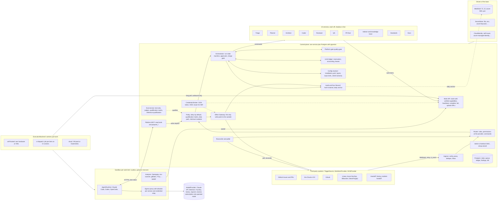

<!--
SPDX-License-Identifier: Apache-2.0
SPDX-FileCopyrightText: The Guildwork Authors
-->
# Target architecture of the platform (as of 2026-10-31)

This folder is the binding target architecture of a modular, self-hostable agent platform for the software lifecycle. The project is called **Guildwork** (O17, [DECISIONS.md](../DECISIONS.md) section 3.2); the planning continues to call it "the platform". API group `guildwork-dev.github.io/v1alpha1`. This folder becomes public after neutralization ([12](12-open-source-and-project.md) section 4.2). What a particular installation has chosen (base, accounts, values) is in the private ops repo of its operator (ADR-38).

## 1. Goal

- **Build instead of buy**, strictly modular: inputs, code hosting, agent runtime, model providers and third-party tools are plugins; limits are configurable per org, repo, user, service, provider and pool.
- **Every layer at the level of the global standard of its field**, measured instead of claimed: for PR review the feature set according to the capability table and the accuracy of the top group, for planning, architecture, coding, QA, PR fix, knowledge, triage, docs and static analysis the leading vendors or methods there ([10](10-standards-per-layer.md)). The level is a **measurement goal, not a build condition**: results are published as measured and honestly, including "Gate B red" or "not decidable", only on sets that can distinguish the level (ADR-56). The first goal with real benefit is the reviewer together with its companion features on GitHub ([08](08-roadmap.md), ADR-54).
- **Core flow** from the ticket mentioning the bot through triage, planning, architecture, coding, review and QA to the PR, plus PR fix. The goal is an **autonomous run-through** up to the optional auto-merge, as a chain of specialized services, not as one agent that does everything. Planning and merge can happen automatically. **Everything is optional**: every service can be switched on and off individually and combined.
- **Open source and self-hostable:** a public project, not tailored to one company. Anyone installs the platform on their own base (a Linux host, Kubernetes, Azure, AWS, Google Cloud, Hetzner, own hardware) and attaches their own plugins, drivers and services ([11](11-installation-and-hosting.md), [12](12-open-source-and-project.md)).
- All provider and data paths remain in the architecture; which one an installation uses is decided by its operator.

## 2. Guiding idea

1. **Small core without an LLM.** The control plane knows events, capabilities, policies, budgets and artifacts, but no models and no provider names.
2. **Everything domain-specific is a plugin or a service, everything at the base is a driver.** Plugins are adapters to third-party systems (9 plugin kinds including `Analyzer`, [01](01-plugin-interfaces.md)). Services are domain building blocks (10 services, [02](02-services.md)). Drivers connect the base (3 driver kinds: `BlobStore`, `SecretStore`, `CloudIdentity`, ADR-41). Services talk to each other only through typed artifacts and events.
3. **Reading and acting are separated.** The agent reads untrusted content but holds no write credential to the outside. It only expresses write requests. They are executed solely by the **Effect Gateway**, deterministically, according to policy, idempotently and audited. A write request is only allowed if the triggering command covers it: a review job cannot produce a push.
4. **Work is pulled, never pushed.** All execution locations (own hardware, CI runners, cloud workers) fetch work items via long poll with a lease over outbound HTTPS. Reason: execution locations are often behind NAT or a firewall without inbound connections (ADR-05).
5. **Capabilities are negotiated and verified.** Every plugin and every driver reports capabilities with level `native`, `fallback` or `none`; for every capability there is a fallback chain, and every fallback level is recorded in the audit. Workers report their isolation as a self-verified capability, not according to configuration (ADR-48).
6. **Runtime has two axes:** harness (Claude Code, Codex, OpenCode, ...) times credential/provider (API key, WIF, Bedrock, Foundry, Vertex, OpenAI, ...; subscription only as a personal operator mode, ADR-51).
7. **Quality is proven, not claimed.** Every combination of service, harness, provider, model and prompt version needs Gate A and the required parts of Gate B ([10](10-standards-per-layer.md)) or an adopted reference qualification. Only then does it run `live`, before that only `shadow` ([07](07-eval.md)); a deviation is only possible via operator configuration with the visible label "standard not proven" (ADR-47).
8. **Configuration from the base SHA.** A PR or ticket cannot change how the platform treats it.
9. **Autonomy is a chain, not an all-in-one agent.** A deterministic orchestrator pushes the ticket through triage, planner, architect, coder, reviewer, QA and PR fixer; every stage is its own service with its own sandbox, its own permissions and its own qualification. Plan approval and merge can happen automatically, but only through deterministic gates at the verified SHA ([03](03-flow-and-orchestration.md) section 1a).
10. **Open and self-hostable.** Every function has a path without a paid service and without proprietary software in the distribution (ADR-39, ADR-50); every installation runs with `fs`, `file` and `self-issuer` without a cloud account; telemetry is off by default (ADR-44); company, person and host values are never in the product but in the operator's ops repo ([12](12-open-source-and-project.md) section 1).

## 3. Architecture diagram

## 4. Reading order

| File | Content | for whom first |
|---|---|---|
| README.md | Goal, guiding idea, diagram, glossary, sources, precedence | everyone |
| [01-plugin-interfaces.md](01-plugin-interfaces.md) | 9 plugin kinds with signatures, event schema, capabilities, versioning, provider matrices, analyzers, drivers, service manifest for third parties | core and plugin development |
| [02-services.md](02-services.md) | 10 services: purpose, inputs and outputs, stages, on/off, definition of done | service development, product |
| [03-flow-and-orchestration.md](03-flow-and-orchestration.md) | Ticket to PR, autonomous run-through, state machine, approvals, commands, failure paths, upgrade behavior | everyone |
| [04-configuration-and-limits.md](04-configuration-and-limits.md) | Config schema, hierarchy, `installation.yaml`, provider choice, limits, base branch rule | operators, admins |
| [05-security.md](05-security.md) | Separation of privileges, sandbox and isolation, injection, secrets, personal operator mode, tenants, audit, supply chain | everyone, required before every merge into the core |
| [06-operations-and-deployment.md](06-operations-and-deployment.md) | Operations core, topologies, technology choice, observability, retention, cost levers, artifacts | operations |
| [07-eval.md](07-eval.md) | Eval infrastructure, test sets, qualification matrix, reference qualification, cross-cutting suites S1 to S8 | service development |
| [08-roadmap.md](08-roadmap.md) | Expansion stages R and 0 to 10 as a dependency graph with the core first, done criteria | Owner, planning |
| [09-decisions.md](09-decisions.md) | ADR-01 to ADR-73, owner decisions (most recently O28), technically open items | Owner |
| [10-standards-per-layer.md](10-standards-per-layer.md) | Standard per layer, capability checklist, Gate A and Gate B with reference values | service development, product |
| [11-installation-and-hosting.md](11-installation-and-hosting.md) | Installation package, profiles per base, drivers, attaching, upgrade, backup, telemetry, test matrix | operators |
| [12-open-source-and-project.md](12-open-source-and-project.md) | License, name, two repos, publication, development repo with check tools, stage R, terms of use, governance | Owner, contributors |
| [backlog-minors.md](backlog-minors.md) | collected small items for the next run in the area | assignees |
| [docs/design/](../design/README.md) | Buildable detailed design per building block: packages, interfaces as types, schema, endpoints, state tables, failure paths, test cases; stages 8 to 10 in documents 13 to 15; component catalog (`components/*.toml`) with docking points per component, checked by `plan.py`; from it the tool generates the build book (`build-book.md`) in build order | build team |
| [docs/plan/](../plan/README.md) | Work plan: epics, tasks and subtasks per stage with dependencies, order and done criteria; checked and rendered into the overview by `plan.py`; mirrored as GitHub Issues in the product repo (decisions KE and GE in `catalog-and-issues-draft.md`) | build team, Owner |
| [docs/research/](../research/README.md) | Research from 2026-10-31, dated and not binding; evidence and derivations that the files above refer to by section | as needed |

## 5. Glossary (binding terms in all files)

| Term | Meaning |
|---|---|
| **Control plane** | The one central service (called Control Plane in English) with ingress, router, orchestrator, policy, limit ledger, work API, platform MCP, Effect Gateway, Credential Broker, audit, eval service and admin UI. Only state: Postgres with pgvector plus object storage via `BlobStore`. |
| **Plugin** | Adapter to a third-party system, one of the 9 plugin kinds: `TriggerSource`, `WorkItemProvider`, `SCMProvider`, `AgentRuntime`, `ModelProvider`, `ExecutionBackend`, `KnowledgeStore`, `Notifier`, `Analyzer`. A package may implement several kinds (GitHub = Trigger, WorkItem and SCM). Manifest with SPDX license and `distribution: bundled \| operator_supplied`. |
| **Analyzer** | Plugin kind for deterministic third-party tools (SAST, dependencies, secrets, IaC, accessibility, cost); result in **SARIF** 2.1.0; always runs in the sandbox; operating modes `ingest` (read foreign results) and `run` (execute itself) (ADR-40). |
| **Driver** | Connection to the base, counted separately from plugins: `BlobStore`, `SecretStore`, `CloudIdentity` (ADR-41). Same framework as plugins (manifest, capabilities, contract suite). No queue port, no database abstraction. |
| **Service** | Domain building block, 10 of them: `planner`, `architect`, `coder`, `reviewer`, `qa`, `prfixer`, `indexer`, `standards`, `triage`, `docs`. Per service a mode `off`, `shadow` or `live`. |
| **architect** | Service for architecture and design: specification with requirements in the EARS pattern, ADR drafts, design review against C4 and arc42 checkpoints, threat model per STRIDE, plan conformance (findings `plan_deviation`); output `DesignArtifact` (ADR-46). |
| **triage** | Service for issue triage: duplicates, labels, assignees, spam and slop; without a shell; suggests instead of closing, closing only as repo opt-in `auto_close`, off by default (ADR-46, O25). |
| **docs** | Service for docstrings, docs sync after merge and release notes (deterministic plus readable text); docs PRs always go to a human (ADR-46). |
| **Service manifest** | Published, versioned contract with which third parties attach their own services ([01](01-plugin-interfaces.md) section 14). |
| **Self-check bundle** | List of analyzer instances plus tests and diff policy with which coder and PR fixer check every push (`self_check.analyzers`). |
| **Guideline loader** | Part of `standards` that reads rules and foreign rule formats (AGENTS.md, CLAUDE.md, Copilot instructions, ...) at the base SHA for all services. |
| **Catching mode** | QA scope `catch`: tests that are supposed to fail at the head, with a checker against false alarms; the result is a finding, never a test commit ([02](02-services.md) section 5). |
| **Learning** | Remembered fact or preference from review threads, with quote verification, voting and expiry date (lifecycle in the indexer, [02](02-services.md) section 7). |
| **Pipeline** | Template that chains services, for example `ticket-to-pr`. Per stage `on_disabled: skip, fail or human`. |
| **Run** | One pass of a pipeline or of a single service, with state according to [03](03-flow-and-orchestration.md); this includes `handed_off` (handed over to a human, `@agent handoff`). |
| **Step** | One step of a run, belongs to exactly one service. |
| **Work item** | An agent or compute step that a worker fetches via a lease. |
| **Lease** | Time-limited claim of a worker on a work item, extended by heartbeat. |
| **Drain mode** | State of the work API before an upgrade: no new claims, running leases finish or expire ([03](03-flow-and-orchestration.md) section 6). |
| **Worker** | A binary that fetches work items, builds the sandbox, starts the agent and reports results. Runs in a pool and reports its version and its **verified capabilities** (`WorkerCaps.verified`) on `claim`. |
| **Pool** | Group of workers of the same kind with capabilities and a hard upper limit on parallelism. Pools are named after their kind: `self-hosted` (permanent workers on the operator's hardware or VMs), `ci-dispatch` (job per item on CI runners), `cloud` (VM pool or Kubernetes). Pools are defined in `installation.yaml`. |
| **Sandbox** | Fresh, isolated container or MicroVM per work item, always destroyed after the run. Isolation levels `sysbox`, `gvisor` (equivalent), `microvm`. |
| **Repo class and minimum isolation** | `private_own` (private repo, all authors with write access) needs at least `sysbox` or `gvisor`; `external_code` (public, fork, foreign authors) needs `microvm` for services that execute repo code. Without a matching pool the item stays pending (ADR-48). |
| **Harness** | The agent runtime as a program (`claude-code`, `codex`, `opencode`, ...), plugin kind `AgentRuntime`; installed at the operator with a pinned version and checksum, never in the image (ADR-39). |
| **Credential kind** | How a harness authenticates to the model: `api_key`, `wif`, `bedrock`, `vertex`, `foundry`, `gateway`, `openai`, `azure_openai`; in addition `subscription` and `chatgpt` only as a personal operator mode. |
| **Personal operator mode** | Credential kinds `subscription` (Claude subscription) and `chatgpt`: locked by default, enabled in `credentials.personal_modes` with `acknowledge_terms`; only one operator, only their own runs, token only on the worker host, never in the control plane (ADR-51, ADR-57, [05](05-security.md) section 6). For the project itself the only credential path (O28). |
| **Profile `operator_test`** | Exception in personal operator mode: services with a shell on the subscription, only on the operator's private repos or in the operator's eval case runs on public sets (ADR-72), with inspection proxy and all conditions from [05](05-security.md) section 6. |
| **Inspection proxy** | Part of the egress proxy on the operator's worker host that, with a subscription, checks traffic to the LLM endpoint with the same filters as the credential relay and passes the auth header through unchanged (ADR-18). |
| **Local Claude Code** | Harness `claude-code` as an unmodified CLI on the operator's hardware (pool `self-hosted` or `ci-dispatch`), as opposed to cloud workers. The credential kind is independent of this. |
| **Credential relay** | Part of the egress proxy outside the sandbox: inserts the real LLM credential only when forwarding; inside the sandbox there is only a placeholder ([01](01-plugin-interfaces.md) section 6, [05](05-security.md) section 3). |
| **Write request** | Effect expressed by the agent via the platform MCP (`propose_comment`, `propose_review`, `propose_push`, `propose_labels`, ...). Never executed directly. |
| **Effect** | A write action to the outside, executed by the Effect Gateway, with an idempotency key. |
| **Effect Gateway** | The only component with write permissions to the outside. |
| **Fallback chain** | Ordered list of fallback paths when a capability is missing at the provider (for example batch review, otherwise draft notes, otherwise individual inline comments, otherwise summary only). |
| **Qualification matrix** | Table with gate status per `qualification_key`, the hash of a canonical qualification profile (service, harness, credential kind, provider, all models per role, prompt version per stage, plugin versions, config keys marked in the schema; library calls inherit the caller's profile; ADR-66). Only qualified rows may run `live`. |
| **Gate A** | Paired, not worse than the bare harness with the same model and a simple prompt ([10](10-standards-per-layer.md) section 1.1). |
| **Gate B** | Level of the standard of the field against an externally comparable **reference value** (published value, own remeasurement of an open reference or published definition). Consists of **required parts** (must be green for `live`, per part or scope) and **report parts** (measured, without threshold) (ADR-47). Status green, red, not decidable or open; decides only about `live` and the merge gate, never about the build (ADR-55, ADR-56). |
| **Standard not proven** | Visible label of a service that runs `live` without a green Gate B via the installation's `qualification.allow_unproven_live`; shown in the admin UI, status comment, check and Run Record (ADR-47). |
| **Reference qualification** | Qualification matrix on public sets published by the project per release, which an installation may adopt under conditions, with remeasurement in shadow (ADR-52). |
| **Platform gate** | Deterministic core function with check `quality-gate`: quality gate on new code from analyzer results, coverage and duplication (ADR-40). |
| **Shadow mode** (`shadow`) | The service runs fully, but the Effect Gateway writes nothing to the outside, only to the eval log. |
| **Run Record** | Evidence of a run: trigger, permissions, config hash, versions, isolation, repo class, tool calls, policy decisions, cost, effects. |
| **Limit ledger** | Own bookkeeping of runs, tokens, cost and parallelism per key, source of truth for limits. |
| **Approval point** | Point at which a human decides: G0 to G5, see [03](03-flow-and-orchestration.md). G1 can happen automatically with autonomy `high` and `full`, G2 and G3 with `merge.mode: auto` through the merge gate. |
| **Autonomy** | Level of a pipeline: `low`, `medium`, `high`, `full`. Upper limit per installation (`max_autonomy`), platform default `medium`. |
| **Merge gate** | Deterministic check in the orchestrator that, with `merge.mode: auto`, decides instead of a human about the merge of an agent PR at the head SHA ([03](03-flow-and-orchestration.md) section 1a). |
| **`repo_overrides`** | Control plane table with platform-side, only tightening entries per repo (such as falling back to `merge.mode: human`), applied after all config layers ([04](04-configuration-and-limits.md) section 1). |
| **`installation.yaml`** | Configuration of the base of an installation: drivers, public URL, SSO, pools, minimum isolation, upper limits, `personal_modes`, `allow_unproven_live`, analyzer allowlist, telemetry, air gap ([04](04-configuration-and-limits.md) section 7). Belongs to the operator, lives outside the repos. |
| **Base SHA** | Commit of the target branch from which configuration, rules, AGENTS.md, CLAUDE.md and REVIEW.md are read. |
| **Finding** | A result from the reviewer or architect with fingerprint, severity P0 to P3, origin (`llm`, `analyzer:<id>`, `architect`) and evidence level `proven`, `plausible` or `unsupported`. |
| **Untrusted** | Marked foreign content (ticket, PR text, code, comments, CI logs, SARIF messages) that is never an instruction. |
| **Topology** | Structure of an installation from operations core plus pools (`single-host`, `kubernetes`, cloud profiles, add-ons), [06](06-operations-and-deployment.md) section 2. |
| **Profile** | Verified mapping of building blocks to a base (`single-host`, `kubernetes`, `azure`, `aws`, `gcp`, `hetzner`); supported only once it is in the test matrix ([11](11-installation-and-hosting.md) section 3). |
| **Operating mode `public` / `private`** | With a public HTTPS address (webhooks) or without a public inbound path (only `poll` and `reconcile`) ([11](11-installation-and-hosting.md) section 1.1). |
| **Air-gap mode** | Egress only to configured SCM, ticket and LLM targets plus the operator's mirrors, enforced in the egress proxy (ADR-44). |
| **Operator** | Whoever sets up and runs an installation; decides base, credential kinds, data path and deviations. |
| **Ops repo** | Private repo per installation with instance configuration, runbooks, deny list, private eval sets (ADR-38). |
| **Reference installation** | The project's first installation (test operation of the project owner); described in the private ops repo, not part of the public repo (ADR-38). |

## 6. Classification and source keys

**Classification** of every statement about third-party products and providers:
- **VERIFIED:** primary docs, changelog, paper, license file or code of the vendor.
- **CLAIMED:** vendor blog, marketing figure, third-party report.
- **DERIVED:** own conclusion from evidence.
- **ASSUMED:** plausible, without direct evidence.
- **unverified:** open, not read or not retrievable.

Whatever stands without a classification is an architecture decision of this folder (DERIVED, reasons in [09](09-decisions.md)). Statements about contracts and licenses are not legal advice but the reading of the cited texts with their location.

**Origin of the evidence:** The web sources of the first two rounds were retrieved by four team research runs on 2026-10-31 (providers, adapters, best vendor per service, infrastructure); their tools deliver a summary by a small model, so quotes from them are paraphrased. The research of the third round is in [docs/research/](../research/README.md) (dated, not binding); license and contract quotes were confirmed by a cross-check against the original text ([`gegenpruefung-lizenz-und-recht`](../research/gegenpruefung-lizenz-und-recht.md), takes precedence over the license report). Read ourselves, verbatim: [cc-legal], [an-consumer] and [an-commercial] (via `curl`, 2026-10-31), [cc-sdkplan], [an-wif], [an-residency], the golden comments in [mcr-repo] (173, counted ourselves according to [`ebene-review`](../research/ebene-review.md) section 2.2).

**Private preliminary work** of the project is not public (ADR-38) and is not evidence in this folder.

**Vendor documentation of CodeRabbit and SonarSource** is not listed as a source in this folder ([10](10-standards-per-layer.md) section 16, O18, O19); only their contract texts and third-party sources are cited.

**Research of the third round** (local, dated, not binding; keys only where a file uses them):
- [HI] [`hosting-und-installation`](../research/hosting-und-installation.md)
- [bothy-vorlage] [`bothy-vorlage-projekt-setup`](../research/bothy-vorlage-projekt-setup.md)
- without key, as a link: [`ebene-review`](../research/ebene-review.md), [`ebene-planung-und-architektur`](../research/ebene-planung-und-architektur.md), [`ebene-coding`](../research/ebene-coding.md), [`ebene-qa-und-tests`](../research/ebene-qa-und-tests.md), [`ebene-pr-fix-und-ci`](../research/ebene-pr-fix-und-ci.md), [`ebene-wissen-standards-doku`](../research/ebene-wissen-standards-doku.md), [`ebene-statische-analyse-und-security`](../research/ebene-statische-analyse-und-security.md), [`ebenen-landkarte`](../research/ebenen-landkarte.md), [`open-source-lizenz-und-recht`](../research/open-source-lizenz-und-recht.md), [`gegenpruefung-lizenz-und-recht`](../research/gegenpruefung-lizenz-und-recht.md)

**Web sources (retrieved 2026-10-31):**

Anthropic and Claude Code:
- [cc-auth] https://code.claude.com/docs/en/authentication
- [cc-legal] https://code.claude.com/docs/en/legal-and-compliance
- [cc-sdkplan] https://support.claude.com/en/articles/15036540-use-the-claude-agent-sdk-with-your-claude-plan
- [an-credits] https://support.claude.com/en/articles/17154008-monthly-api-credits-for-max-ultra-and-team-plans (caps Max 100 $, Ultra 200 $, Team up to 500 $, no rollover; VERIFIED according to the cross-check; alias [cc-credits])
- [cc-headless] https://code.claude.com/docs/en/headless
- [cc-permissions] https://code.claude.com/docs/en/permissions (section "What runs before you trust a folder")
- [cc-sdk-ts] https://code.claude.com/docs/en/agent-sdk/typescript
- [cc-sdk-overview] https://code.claude.com/docs/en/agent-sdk/overview
- [cc-features] https://code.claude.com/docs/en/feature-availability
- [cc-gateway] https://code.claude.com/docs/en/llm-gateway
- [cc-appsgw] https://code.claude.com/docs/en/claude-apps-gateway
- [cc-costs] https://code.claude.com/docs/en/costs
- [cc-sandbox] https://code.claude.com/docs/en/sandboxing
- [cc-monitoring] https://code.claude.com/docs/en/monitoring-usage
- [cc-bedrock] https://code.claude.com/docs/en/amazon-bedrock
- [cc-cloud] https://code.claude.com/docs/en/claude-code-on-the-web.md
- [cc-license] https://github.com/anthropics/claude-code/blob/main/LICENSE.md
- [cc-npm] https://raw.githubusercontent.com/anthropics/claude-code/main/LICENSE.md (npm `@anthropic-ai/claude-code` 2.1.316, "All rights reserved")
- [sdk-npm] https://www.npmjs.com/package/@anthropic-ai/claude-agent-sdk (0.3.316; platform packages contain the native CLI, cross-check item 7)
- [an-ratelimits] https://platform.claude.com/docs/en/api/rate-limits
- [an-structured] https://platform.claude.com/docs/en/build-with-claude/structured-outputs
- [an-wif] https://platform.claude.com/docs/en/manage-claude/workload-identity-federation
- [an-residency] https://platform.claude.com/docs/en/manage-claude/data-residency
- [an-managed-sh] https://platform.claude.com/docs/en/managed-agents/self-hosted-sandboxes
- [an-consumer] https://www.anthropic.com/legal/consumer-terms (EEA version "Effective Oct 8, 2025")
- [an-commercial] https://www.anthropic.com/legal/commercial-terms ("Effective Jun 17, 2025"; A.1, B, D.4)
- [an-aup] https://www.anthropic.com/legal/aup (page shows "Effective Nov 12, 2026"; version in force today unverified)
- [an-ccsec] https://www.anthropic.com/news/claude-code-security
- [press-2026-02] https://www.theregister.com/2026/02/20/anthropic_clarifies_ban_third_party_claude_access (CLAIMED)
- [limits-2026] https://alexcloudstar.com/blog/claude-code-usage-limits-2026/ (CLAIMED)

Other runtimes and abstractions:
- [codex-auth] https://learn.chatgpt.com/docs/auth
- [codex-exec] https://learn.chatgpt.com/docs/non-interactive-mode
- [codex-cloud] https://learn.chatgpt.com/docs/environments/cloud-environment
- [codex-gh] https://learn.chatgpt.com/docs/third-party/github
- [codex-repo] https://github.com/openai/codex (Apache-2.0)
- [cx-sec] https://learn.chatgpt.com/docs/security
- [codex-azure] https://codex.danielvaughan.com/2026/04/23/codex-cli-custom-model-providers-configuration-guide/ (CLAIMED)
- [codex-bon] https://codex.danielvaughan.com/2026/04/01/codex-cloud-exec-best-of-n-attempts/ (CLAIMED)
- [gemini-auth] https://geminicli.com/docs/get-started/authentication/
- [gemini-tos] https://geminicli.com/docs/resources/tos-privacy/
- [gemini-headless] https://geminicli.com/docs/cli/headless/
- [gemini-cache] https://ai.google.dev/gemini-api/docs/caching
- [opencode] https://opencode.ai/docs/cli/ and https://opencode.ai/docs/providers/
- [openhands-sdk] https://docs.openhands.dev/sdk
- [oh-sdk-repo] https://github.com/OpenHands/software-agent-sdk (MIT)
- [oh-lic] https://github.com/OpenHands/OpenHands/blob/main/LICENSE (plus `cloud-1.47.1/enterprise/LICENSE` under PolyForm Free Trial)
- [goose] https://goose-docs.ai/docs/guides/running-tasks
- [aider] https://aider.chat/docs/scripting.html
- [acp] https://agentclientprotocol.com/overview/introduction and /overview/agents
- [litellm] https://docs.litellm.ai/docs/proxy/users and /tutorials/claude_responses_api
- [openrouter] https://openrouter.ai/docs/use-cases/usage-accounting
- [aisdk] https://ai-sdk.dev/docs/foundations/providers-and-models
- [openai-rl] https://developers.openai.com/api/docs/guides/rate-limits
- [pullfrog] Code `pullfrog/pullfrog@9acb864` (`agents/shared.ts`, `agents/claude.ts`, `agents/codex.ts`, `utils/agent.ts`)

Inputs and code hosting:
- [gh-webhooks] https://docs.github.com/en/webhooks/using-webhooks/best-practices-for-using-webhooks
- [gh-checks] https://docs.github.com/en/rest/checks/runs
- [gh-reviews] https://docs.github.com/en/rest/pulls/reviews
- [gh-events] https://docs.github.com/en/actions/reference/workflows-and-actions/events-that-trigger-workflows
- [gh-insttoken] https://docs.github.com/en/apps/creating-github-apps/authenticating-with-a-github-app/generating-an-installation-access-token-for-a-github-app
- [gh-manifest] https://docs.github.com/en/apps/sharing-github-apps/registering-a-github-app-from-a-manifest
- [gh-oidc] https://docs.github.com/en/actions/reference/security/oidc
- [gh-limits] https://docs.github.com/en/actions/reference/limits
- [gh-runners] https://docs.github.com/en/actions/reference/runners/github-hosted-runners
- [gh-kvm] https://github.blog/changelog/2024-04-02-github-actions-hardware-accelerated-android-virtualization-now-available/ (CLAIMED, search excerpt)
- [gh-merge] https://docs.github.com/en/rest/pulls/pulls#merge-a-pull-request (parameter `sha`, 409 if the head differs)
- [gh-sarif] https://docs.github.com/en/code-security/code-scanning/integrating-with-code-scanning/sarif-support-for-code-scanning
- [gh-ghes-orgs] https://docs.github.com/en/enterprise-server@latest/rest/enterprise-admin/orgs (`POST /admin/organizations`, "only available to authenticated site administrators", read 2026-11-01)
- [gh-org-new] https://docs.github.com/en/organizations/collaborating-with-groups-in-organizations/creating-a-new-organization-from-scratch (creation only in the web form, read 2026-11-01)
- [gh-transfer] https://docs.github.com/en/repositories/creating-and-managing-repositories/transferring-a-repository (transfer: issues move along, redirects, private repos on the Free plan without branch protection, no repo of the same network at the target; read 2026-11-01)
- [gh-proj-link] https://docs.github.com/en/issues/planning-and-tracking-with-projects/managing-your-project/adding-your-project-to-a-repository (only projects of the same owner can be linked; read 2026-11-01)
- [gl-webhooks] https://docs.gitlab.com/user/project/integrations/webhooks/
- [gl-draftnotes] https://docs.gitlab.com/api/draft_notes/
- [gl-reviews] https://docs.gitlab.com/user/project/merge_requests/reviews/
- [gl-commits] https://docs.gitlab.com/api/commits/
- [gl-statuschecks] https://docs.gitlab.com/api/status_checks/
- [gl-codequality] https://docs.gitlab.com/ci/testing/code_quality/
- [gl-pat] https://docs.gitlab.com/user/project/settings/project_access_tokens/
- [gl-duo] https://docs.gitlab.com/user/duo_agent_platform/triggers/
- [bb-webhooks] https://support.atlassian.com/bitbucket-cloud/docs/manage-webhooks/
- [bb-insights] https://support.atlassian.com/bitbucket-cloud/docs/code-insights/
- [ado-webhooks] https://learn.microsoft.com/en-us/azure/devops/service-hooks/services/webhooks?view=azure-devops
- [ado-threads] https://learn.microsoft.com/en-us/rest/api/azure/devops/git/pull-request-threads/create?view=azure-devops-rest-7.1
- [ado-status] https://learn.microsoft.com/en-us/rest/api/azure/devops/git/pull-request-statuses/create?view=azure-devops-rest-7.1
- [gitea] https://docs.gitea.com/usage/webhooks
- [forgejo] https://forgejo.org/docs/latest/user/webhooks/
- [jira-webhooks] https://developer.atlassian.com/cloud/jira/platform/webhooks/
- [jira-automation] https://support.atlassian.com/cloud-automation/docs/jira-automation-actions/
- [forge-events] https://developer.atlassian.com/platform/forge/events-reference/jira/
- [forge-trigger] https://developer.atlassian.com/platform/forge/manifest-reference/modules/trigger/
- [rovo] https://developer.atlassian.com/platform/forge/manifest-reference/modules/rovo-agent/
- [adf] https://developer.atlassian.com/cloud/jira/platform/apis/document/structure/ and /nodes/mention/
- [jira-devinfo] https://developer.atlassian.com/cloud/jira/software/rest/api-group-development-information/
- [atl-sa] https://support.atlassian.com/user-management/docs/create-oauth-2-0-credential-for-service-accounts/
- [jira-dc] https://confluence.atlassian.com/adminjiraserver112/managing-webhooks-1688896467.html (CLAIMED, search excerpt)
- [linear-agents] https://linear.app/developers/agents, /agent-interaction, /agent-best-practices
- [pr-agent] Code `qodo-ai/pr-agent@7bb7a68`, `pr_agent/git_providers/`, `servers/`
- [oh-cloud] Code OpenHands tag `cloud-1.47.1`, `enterprise/integrations/` (idea only, license see [oh-lic])
- [oh-automation] Code `OpenHands/automation` (main), `schemas.py`, `providers.py`
- [kodus] Code `kodus-ai@dcf0fd5` (AGPL plus EE, idea only)

Review (standard and benchmarks):
- [mcr-repo] https://github.com/withmartian/code-review-benchmark (MIT; golden comments, judge pipeline, `online/etl`; replaces the former [martian])
- [mcr-method] https://github.com/withmartian/code-review-benchmark/blob/main/methodology/summary.md
- [greptile-martian] https://www.greptile.com/content-library/greptile-martian-code-review-benchmark (online values as of 2026-07-30, CLAIMED)
- [rb-readme] https://github.com/review-bench/ReviewBench (MIT, leave-producer-out)
- [rb-contract] https://github.com/review-bench/ReviewBench/blob/main/AGENT_CONTRACT.md
- [rb-method] https://github.com/review-bench/ReviewBench/blob/main/docs/METHODOLOGY.md (section 5.5 producer mix, retrieved 2026-10-31)
- [rb-judging] https://github.com/review-bench/ReviewBench/blob/main/docs/JUDGING.md (leave-producer-out scoring, retrieved 2026-10-31)
- [rb-blog] https://github.blog/ai-and-ml/reviewbench-an-open-benchmark-for-ai-code-review/
- [tns-rb] https://thenewstack.io/github-reviewbench-code-review/ (CLAIMED)
- [swe-prbench-hf] https://huggingface.co/datasets/foundry-ai/swe-prbench (CC-BY-4.0)
- [aacr-gh] https://github.com/alibaba/aacr-bench (Apache-2.0)
- [gh-60m] https://github.blog/ai-and-ml/github-copilot/60-million-copilot-code-reviews-and-counting/ (CLAIMED)
- [gh-ccr-doc] https://docs.github.com/en/copilot/concepts/agents/code-review
- [greptile] https://www.greptile.com/docs/code-review/custom-standards and /greptile-config (subset: [greptile-std])
- [greptile-approve] https://www.greptile.com/docs/code-review/auto-approve-prs.md
- [greptile-cli] https://www.greptile.com/docs/code-review/greptile-cli.md
- [greptile-tiers] https://www.greptile.com/docs/code-review/review-tiers.md
- [cubic-llms] https://docs.cubic.dev/llms.txt
- [qodo-overview] https://docs.qodo.ai/code-review/overview
- [devin-review] https://docs.devin.ai/work-with-devin/devin-review.md
- [devin-bots] https://docs.devin.ai/product-guides/bot-comment-settings (CLAIMED, search excerpt)
- [cursor-bugbot] https://cursor.com/docs/bugbot

Planning and architecture:
- [kiro-specs] https://kiro.dev/docs/specs/
- [kiro-feature] https://kiro.dev/docs/specs/feature-specs/
- [speckit-repo] https://github.com/github/spec-kit (MIT)
- [jules] https://jules.google/docs/running-tasks
- [jules-changelog] https://jules.google/docs/changelog/
- [factory-spec] https://docs.factory.com/cli/user-guides/specification-mode
- [factory-missions] https://docs.factory.com/missions/planning.md
- [copilot-plan] https://github.blog/changelog/2026-03-31-research-plan-and-code-with-copilot-cloud-agent
- [devin-ask] https://docs.devin.ai/work-with-devin/ask-devin.md
- [locagent] https://github.com/gersteinlab/LocAgent (Apache-2.0; paper https://arxiv.org/abs/2503.09089)
- [locbench-hf] https://huggingface.co/datasets/czlll/Loc-Bench_V0.1 (Apache-2.0; V1 without license)
- [plan-to-action] https://arxiv.org/abs/2604.12147
- [ambig-swe] https://arxiv.org/abs/2502.13069
- [ambig-swe-repo] https://github.com/sani903/InteractiveSWEAgents (MIT)
- [swe-rpg] https://arxiv.org/abs/2608.09072
- [swe-rpg-repo] https://github.com/Xin-Zhou-smu/SWE-RPG-Bench (no license file)
- [devbench] https://github.com/open-compass/DevBench (Apache-2.0 according to https://raw.githubusercontent.com/open-compass/DevBench/main/LICENSE; paper https://arxiv.org/abs/2403.08604)
- [arc42] https://arc42.org/overview (CC BY-SA 4.0, link only)
- [c4-checklist] https://c4model.com/diagrams/checklist
- [adr] https://adr.github.io/
- [madr-license] https://raw.githubusercontent.com/adr/madr/main/LICENSE (MIT OR CC0-1.0)
- [iso42010] https://www.iso.org/standard/74393.html (403 on retrieval, content CLAIMED)
- [atam] https://resources.sei.cmu.edu/library/asset-view.cfm?assetid=513908 (CLAIMED, not read ourselves)
- [ms-stride] https://learn.microsoft.com/en-us/azure/security/develop/threat-modeling-tool-threats
- [tm-manifesto] https://www.threatmodelingmanifesto.org/
- [ears] https://alistairmavin.com/ears (CLAIMED; DOI 10.1109/RE.2009.9)
- [stride-gpt] https://github.com/mrwadams/stride-gpt (MIT)
- [threat-designer] https://github.com/awslabs/threat-designer (Apache-2.0)

Coding:
- [copilot-agent] https://docs.github.com/en/copilot/concepts/agents/coding-agent/about-coding-agent (alias [cp-about])
- [copilot-env] https://docs.github.com/en/copilot/how-tos/use-copilot-agents/coding-agent/customize-the-agent-environment
- [copilot-validate] https://github.blog/changelog/2025-10-28-copilot-coding-agent-now-automatically-validates-code-security-and-quality/, .../2026-03-18-configure-copilot-coding-agents-validation-tools/, .../2026-06-09-security-validation-for-third-party-coding-agents
- [cursor-cloud] https://cursor.com/docs/cloud-agent (alias [cu-cloud])
- [devin-adv] https://docs.devin.ai/work-with-devin/advanced-capabilities.md
- [devin-tools] https://docs.devin.ai/work-with-devin/devin-session-tools.md
- [devin-blueprints] https://docs.devin.ai/onboard-devin/environment/blueprints.md
- [scale-lb] https://labs.scale.com/leaderboard (SWE-Bench Pro V2 and SWE Atlas; replaces the former [swebench-pro])
- [scale-pro-repo] https://github.com/scaleapi/SWE-bench_Pro-os
- [scale-atlas] https://labs.scale.com/papers/sweatlas (CLAIMED; dataset QnA https://huggingface.co/datasets/ScaleAI/SWE-Atlas-QnA)
- [harbor] https://github.com/laude-institute/harbor
- [openai-verified] https://openai.com/index/why-we-no-longer-evaluate-swe-bench-verified/ (403, CLAIMED)
- [epoch-verified] https://epoch.ai/benchmarks/swe-bench-verified
- [swe-rebench] https://arxiv.org/abs/2505.20411 (CLAIMED; https://huggingface.co/datasets/nebius/SWE-rebench-V2-PRs)
- [swe-sharp] https://arxiv.org/abs/2511.02352 (CLAIMED, license unverified)
- [tbench] https://www.tbench.ai/ (table not loaded)
- [oh-index] https://huggingface.co/datasets/OpenHands/openhands-index
- [oh-index-api] https://index.openhands.dev/api/leaderboard (data as of 2026-10-22)
- [openhands-action] https://docs.openhands.dev/openhands/usage/run-openhands/github-action
- [amplifying-autonomy] https://amplifying.ai/coding-agents/autonomy
- [aidev] https://github.com/SAILResearch/AI_Teammates_in_SE3 (CLAIMED, data up to 2025)

QA and tests:
- [factory-qa] https://docs.factory.com/automations/automated-qa.md
- [devin-testing] https://docs.devin.ai/work-with-devin/testing-and-recordings.md
- [testgen] https://arxiv.org/abs/2402.09171
- [ach] https://arxiv.org/abs/2501.12862
- [jit] https://arxiv.org/abs/2601.22832
- [google-mut] https://research.google/pubs/practical-mutation-testing-at-scale-a-view-from-google/
- [qodo-cover] https://github.com/qodo-ai/qodo-cover
- [qodo-sunset] https://docs.qodo.ai/sunsetting-legacy-v1-commands
- [playwright-agents] https://playwright.dev/docs/test-agents
- [meticulous] https://www.meticulous.ai/how-it-works (CLAIMED)
- [momentic-llms] https://momentic.ai/docs/llms.txt
- [ms-polyglot] https://devblogs.microsoft.com/dotnet/polyglot-unit-testing-agent/ (CLAIMED)
- [ms-skills] https://github.com/dotnet/skills (MIT, commit 95e7d0c)
- [ms-vs-test] https://devblogs.microsoft.com/dotnet/github-copilot-testing-for-dotnet-available-in-visual-studio/
- [swt-lb] https://swtbench.com/
- [swt-repo] https://github.com/logic-star-ai/swt-bench (MIT according to the README)
- [tdd-bench] https://github.com/IBM/TDD-Bench-Verified (Apache-2.0)
- [xrepotest] https://github.com/solis-team/XRepoTest (code MIT; paper https://arxiv.org/abs/2608.25939)
- [testgeneval] https://raw.githubusercontent.com/facebookresearch/testgeneval/main/LICENSE (CC BY-NC 4.0)

PR fix and CI:
- [copilot-merge] https://github.blog/changelog/2026-10-28-agent-merge-watches-and-fixes-pull-requests-in-the-cloud and .../2026-03-26-ask-copilot-to-resolve-merge-conflicts-on-pull-requests/
- [copilot-anypr] https://github.blog/changelog/2026-03-24-ask-copilot-to-make-changes-to-any-pull-request/
- [cursor-autofix-blog] https://cursor.com/blog/bugbot-autofix (CLAIMED)
- [gh-autofix] https://docs.github.com/en/code-security/concepts/code-scanning/autofix-for-code-scanning
- [gh-depagent] https://github.blog/changelog/2026-04-07-dependabot-alerts-are-now-assignable-to-ai-agents-for-remediation
- [nx-shci] https://nx.dev/docs/features/ci-features/self-healing-ci.md
- [gitar-ci] https://docs.gitar.ai/features/ci-failure-analysis.md
- [ci-repair-bench] https://arxiv.org/abs/2604.27148
- [lca-ci] https://huggingface.co/datasets/JetBrains-Research/lca-ci-builds-repair
- [bump] https://github.com/chains-project/bump (code MIT; Byam https://arxiv.org/abs/2505.07522, CLAIMED)
- [c-crab] https://arxiv.org/abs/2603.23448
- [merge-bench] https://arxiv.org/html/2605.25890 (CLAIMED)
- [renovate] https://github.com/renovatebot/renovate (AGPL-3.0)
- [renovate-rebase] https://docs.renovatebot.com/updating-rebasing/ (CLAIMED, search excerpt)
- [dependabot-core] https://github.com/dependabot/dependabot-core (MIT)

Knowledge, standards, docs, triage:
- [devin-wiki] https://docs.devin.ai/work-with-devin/deepwiki.md
- [devin-memory] https://docs.devin.ai/product-guides/memory.md
- [devin-knowledge] https://docs.devin.ai/product-guides/knowledge
- [copilot-memory] https://docs.github.com/en/copilot/concepts/agents/copilot-memory
- [copilot-instr] https://docs.github.com/en/copilot/concepts/prompting/response-customization
- [sg-deepsearch] https://sourcegraph.com/docs/deep-search (via search)
- [zoekt] https://github.com/sourcegraph/zoekt (Apache-2.0)
- [sweqa-gh] https://github.com/peng-weihan/SWE-QA-Bench (Apache-2.0)
- [qodo-dcb-hf] https://huggingface.co/datasets/Qodo/deep_code_bench/blob/main/README.md (Apache-2.0)
- [contextbench-gh] https://github.com/EuniAI/ContextBench (code Apache-2.0, data license open)
- [coir] https://github.com/CoIR-team/coir
- [repoqa] https://github.com/evalplus/repoqa (Apache-2.0)
- [agentsmd] https://agents.md/
- [greptile-std] https://www.greptile.com/docs/code-review/custom-standards (part of [greptile])
- [qodo-miner] https://docs.qodo.ai/governance/rule-enforcement/rule-miner
- [mintlify] https://github.com/mintlify/docs/pull/2094/files and https://github.com/mintlify/docs/pull/2056/files (CLAIMED, docs diffs only)
- [swimm] https://docs.swimm.io/features/code-coupling-suggestions (CLAIMED)
- [relnotes] https://deployhq.com/git/generating-changelogs-with-ai (CLAIMED, third-party source)
- [codewiki] https://arxiv.org/abs/2510.24428 (CLAIMED; repo https://github.com/FSoft-AI4Code/CodeWiki)
- [docagent] https://arxiv.org/abs/2504.08725 (CLAIMED; repo https://github.com/facebookresearch/DocAgent, license unverified)
- [linear-triage] https://linear.app/docs/triage-intelligence
- [gh-aw] https://github.github.com/gh-aw/
- [gh-aw-tut] https://tenki.cloud/blog/github-agentic-workflows-tutorial (CLAIMED)

Static analysis and security:
- [sarif] https://docs.oasis-open.org/sarif/sarif/v2.1.0/sarif-v2.1.0.html (OASIS standard with Errata 01)
- [gartner-ast] https://www.gartner.com/en/documents/7027498 (CLAIMED, search excerpt)
- [codeql-lic] https://github.com/github/codeql-cli-binaries/blob/main/LICENSE.md (OSI codebases only, CI only on GitHub.com; alias [codeql])
- [opengrep] https://github.com/opengrep/opengrep (engine LGPL-2.1, license https://github.com/opengrep/opengrep/blob/main/LICENSE)
- [opengrep-rules] https://github.com/opengrep/opengrep-rules/blob/main/LICENSE (Commons Clause on LGPL-2.1, selling is prohibited; cross-check item 24)
- [semgrep-rules] https://semgrep.dev/legal/rules-license/ ("Last updated: December 13th, 2024")
- [semgrep-ai] https://semgrep.dev/blog/2025/building-an-appsec-ai-that-security-researchers-agree-with-96-of-the-time/ (CLAIMED)
- [juliet] https://samate.nist.gov/SARD/test-suites/112 (CC0; Java suite /111)
- [ossf-cve] https://github.com/ossf-cve-benchmark/ossf-cve-benchmark (MIT, LICENSE read 2026-10-31; "over 200" CVEs according to the README)
- [iris] https://arxiv.org/abs/2405.17238 (CWE-Bench-Java https://github.com/iris-sast/cwe-bench-java, MIT, LICENSE read 2026-10-31)
- [realvuln] https://arxiv.org/abs/2604.13764
- [owasp-bench] https://owasp.org/www-project-benchmark/ (GPL-2.0, load only at runtime)
- [cybergym] https://github.com/sunblaze-ucb/cybergym (Apache-2.0; paper https://arxiv.org/abs/2506.02548)
- [kudelski-cr] https://kudelskisecurity.com/research/how-we-exploited-coderabbit-from-a-simple-pr-to-rce-and-write-access-on-1m-repositories (2025-08-19; remote code execution via a `.rubocop.yml` in the PR; read 2026-11-01)

Edge layers:
- [sentry-fix] https://docs.sentry.io/product/ai-in-sentry/seer/issue-fix
- [az-sre] https://learn.microsoft.com/en-us/azure/sre-agent/faq
- [dd-bits] https://docs.datadoghq.com/bits_ai/bits_investigation/
- [axe-core] https://github.com/dequelabs/axe-core (MPL-2.0)
- [infracost] https://github.com/infracost/infracost (Apache-2.0)
- [openrewrite] https://github.com/openrewrite/rewrite
- [aws-transform] https://aws.amazon.com/documentation-overview/transform/
- [codeflash] https://github.com/codeflash-ai/codeflash (BSL-1.1)

Law, license and project:
- [cr-tos] https://www.coderabbit.ai/legal/terms-of-service ("Updated: April 20, 2026"; 4.2 (ii), (iv), (vi), 5.4; 1.9 according to the Red Team check 2026-10-31, wording unverified)
- [tm-cr-uspto] https://tsdr.uspto.gov/statusview/sn98229118 (CODERABBIT, reg. no. 7548845, service mark with design element)
- [sonar-aup] https://www.sonarsource.com/legal/aup/ ("Last updated November 7, 2025"; §5, §6)
- [ssal] https://raw.githubusercontent.com/SonarSource/sonar-java/master/LICENSE.txt (SSALv1, "Last Updated November 13, 2024"; definition (c))
- [sonar-oss] https://community.sonarsource.com/t/introducing-the-new-free-oss-plan-in-sonarqube-cloud/176923 (CLAIMED; answer from 2026-03-09: public plus open source license)
- [apache2] https://www.apache.org/licenses/LICENSE-2.0.txt (§4, §5, §6)
- [osd] https://opensource.org/osd (item 6)
- [bsl] https://mariadb.com/bsl11/
- [dco] https://developercertificate.org/ (DCO 1.1)
- [reuse-spec] https://reuse.software/spec-3.3/
- [scorecard] https://github.com/ossf/scorecard-action

Installation and infrastructure:
- [bothy-repo] public reference project bothy, read `origin/main` 4485084b8, deliberately without a link ([12](12-open-source-and-project.md) section 4.4); locations in [`bothy-vorlage-projekt-setup`](../research/bothy-vorlage-projekt-setup.md)
- [temporal] https://docs.temporal.io/workers and /self-hosted-guide/visibility
- [temporal-up] https://docs.temporal.io/self-hosted-guide/upgrade-server
- [hatchet] https://docs.hatchet.run/self-hosting and https://github.com/hatchet-dev/hatchet
- [dbos] https://docs.dbos.dev/architecture
- [pg-boss] https://github.com/timgit/pg-boss
- [bullmq] https://docs.bullmq.io/bullmq-pro/groups
- [restate] https://github.com/restatedev/restate/blob/main/LICENSE
- [inngest] https://github.com/inngest/inngest/blob/main/LICENSE.md
- [sysbox] https://github.com/nestybox/sysbox
- [sysbox-distro] https://github.com/nestybox/sysbox/blob/master/docs/distro-compat.md
- [gvisor] https://gvisor.dev/docs/
- [gvisor-plat] https://gvisor.dev/docs/architecture_guide/platforms/
- [firecracker] https://github.com/firecracker-microvm/firecracker
- [e2b] https://github.com/e2b-dev/infra
- [daytona] https://github.com/daytonaio/daytona
- [openbao] https://openbao.org/
- [eso] https://external-secrets.io/latest/
- [az-pgvector] https://learn.microsoft.com/en-us/azure/postgresql/extensions/how-to-use-pgvector (search excerpt)
- [pgv-docker] https://hub.docker.com/r/pgvector/pgvector
- [cnpg-img] https://github.com/cloudnative-pg/postgres-containers
- [rds-ext] https://docs.aws.amazon.com/AmazonRDS/latest/PostgreSQLReleaseNotes/postgresql-extensions.html
- [aca-priv] https://learn.microsoft.com/en-us/azure/container-apps/containers (search excerpt, CLAIMED)
- [fargate] https://docs.aws.amazon.com/AmazonECS/latest/developerguide/fargate-tasks-services.html
- [cloudrun-env] https://docs.cloud.google.com/run/docs/configuring/execution-environments (search excerpt, CLAIMED)
- [hz-cloud] https://www.hetzner.com/cloud
- [hz-kvm] https://mvm-deployment-docs.pages.dev/providers/hetzner/ (third-party report, CLAIMED)
- [minio] https://github.com/minio/minio
- [seaweed] https://github.com/seaweedfs/seaweedfs
- [garage-s3] https://garagehq.deuxfleurs.fr/documentation/reference-manual/s3-compatibility/
- [otel-genai] https://github.com/open-telemetry/semantic-conventions-genai/blob/main/docs/gen-ai/README.md
- [langfuse] https://langfuse.com/self-hosting and https://github.com/langfuse/langfuse/blob/main/LICENSE
- [lf-tel] https://langfuse.com/self-hosting/security/telemetry
- [coder-tel] https://coder.com/docs/admin/setup/telemetry
- [n8n-iso] https://docs.n8n.io/hosting/configuration/configuration-examples/isolation/
- [ph-self] https://posthog.com/docs/self-host
- [sentry-rel] https://develop.sentry.dev/self-hosted/releases/
- [gl-up] https://docs.gitlab.com/update/upgrade_paths/
- [go-plugin] https://github.com/hashicorp/go-plugin
- [extism] https://github.com/extism/extism

**Replaced keys:** [martian] (blog by Kilo and Greptile, CLAIMED) by [mcr-repo] and [greptile-martian]; [swebench-pro] (aggregator MorphLLM, CLAIMED) by [scale-lb].

## 7. Status and precedence

- **Status:** 2026-10-31, third round. The basis is the draft "plugin-core" from the architecture round, extended by all adoptions of the reviewers from "secure-quality" and "ops-lean"; the mapping is in [09](09-decisions.md) section 1.
- **Second round:** autonomous run-through, auto-merge, merge gate and test operation incorporated (ADR-35, ADR-36, O8).
- **Third round:** standard per layer with measurable Gate B ([10](10-standards-per-layer.md), ADR-47), open source with two repos ([12](12-open-source-and-project.md), ADR-37 to ADR-39, ADR-53), installation on any base with drivers ([11](11-installation-and-hosting.md), ADR-41 to ADR-45, ADR-48), analyzers (ADR-40, ADR-50), three new services (ADR-46), no SRE agent (ADR-49), personal operator mode (ADR-51), public eval sets and reference qualification (ADR-52), expansion stages R and 0 to 10 ([08](08-roadmap.md)). Company, person and host references are removed from this folder and live in the private ops repo of the installation (ADR-38).
- **Fourth round (2026-10-31):** owner decisions O16 and O18 to O26 incorporated: no CodeRabbit and no SonarQube, no requests to vendors (O18, O19, O26), optional approval of human PRs (`review.auto_approve`, ADR-14, O24), automatic closing by `triage` as an option (O25), no budget cap (O22). Fifth round (2026-10-31): name Guildwork (O17) and O7, O9, O10 decided as recommended; at that time no owner item of the project was open any more; since the architecture and law package, O27 is open ([DECISIONS.md](../DECISIONS.md) section 3.1).
- **Red Team on the overall idea (2026-10-31), package roadmap, gates and quality claim:** rulings R-A to R-C of the project incorporated: core first (reviewer together with companion features on GitHub, `single-host`, one credential path), roadmap as a dependency graph with sub-stages 0b and 7a (ADR-54); done criterion of a stage without a Gate B block (ADR-55); Gate B as a measurement goal with a one-sided non-inferiority test, margin, minimum power, "not decidable", neutral judge and cleaned sets (ADR-56; [10](10-standards-per-layer.md) sections 1.2 to 1.5).
- **Red Team on the overall idea (2026-10-31), package LLM runtime and subscription operation (findings 2, 3, 10):** start path `subscription` with `setup-token` from a host file of the worker user, only as `CLAUDE_CODE_OAUTH_TOKEN` in the `claude` process, no `/login`, contract test in stage 0 (ADR-57); ModelProvider `claude-cli` for single calls on the subscription and resolver rule for unreachable model references (ADR-58); Agent SDK including the main package never in the image and not a dependency of the project (ADR-39, ADR-03).
- **Red Team on the overall idea (2026-10-31), package security of autonomous effects (ruling R-D, findings 4, 5, 6, 7, 11, 12, 13):** CI on agent branches treated like fork code, otherwise no coder, QA or PR fixer (ADR-59); merge gate condition 12 "origin" and no auto-merge for `external_code` (ADR-60); conditions (a) to (d) for approving human PRs (ADR-61); separation of worker and control plane on `single-host` (ADR-62); visibility rule across repo boundaries (ADR-63); registry cache offline and DNS only in the egress proxy (ADR-64); fail closed on an invalid config file (ADR-65).
- **Red Team on the overall idea (2026-10-31), package architecture and law (ruling R-E, findings 8, 9, 14, 15, 16):** qualification profile as the key of the qualification matrix (ADR-66); run state machine as a table with required events and promotion of open runs on upgrade (ADR-67); object lock, one active run per object and service (ADR-68); chain of rights to the employer as required item V0 before publication (ADR-69, open owner step O27); eval runner bound to the data path (ADR-70).
- **Fifth round (2026-10-31):** O27 decided (V0 covered by evidence of private origin); product and ops repo created on the founder's account, the organization now only secures the API group (O17); detailed design ([docs/design/](../design/README.md)) and work plan ([docs/plan/](../plan/README.md)) before the first product code.
- **Sixth round (2026-11-01):** component catalog with docking points and checking by `plan.py` (`docs/design/components/`, decisions KE-1 to KE-5) and the build book generated from it; detailed design of stages 8 to 10 deepened to the depth of stages 0 and 1 (documents 13, 14, 15); work plan as GitHub Issues with milestones, labels, dependencies and project (decisions GE-1 to GE-10, [draft](../plan/catalog-and-issues-draft.md)), V7 also checks issues, comments and project; O28 "Only Claude, via the subscription" with ADR-72 (operator eval on public sets via `subscription`) and ADR-73 (benchmark judge via `claude-cli`); V0 finally closed, the Claude accounts are private too (O27); approval to create the organization `guildwork-dev` (O17).
- **Precedence:** decisions of the project owner ([DECISIONS.md](../DECISIONS.md) section 3) take precedence. After that, this folder applies before the research in `docs/research/` and before all private preliminary work. Within this folder, [10](10-standards-per-layer.md) holds the gate values, [04](04-configuration-and-limits.md) the key names, [09](09-decisions.md) the decisions.
- **Superseded first draft** (not published): its still valid parts are reformulated here: layer model L0 to L5 and increment chain ([02](02-services.md) section 7), finding schema and reviewer stages ([02](02-services.md) section 4), failure paths ([03](03-flow-and-orchestration.md) section 5), cost levers ([06](06-operations-and-deployment.md) section 7). Superseded are its decisions 1, 5 and 6 (ADR-13, ADR-11, ADR-12).
- **Numbers:** all numbers without a source are estimates or starting values and are marked as such. Stage 0 sets fixed values after measurement.
