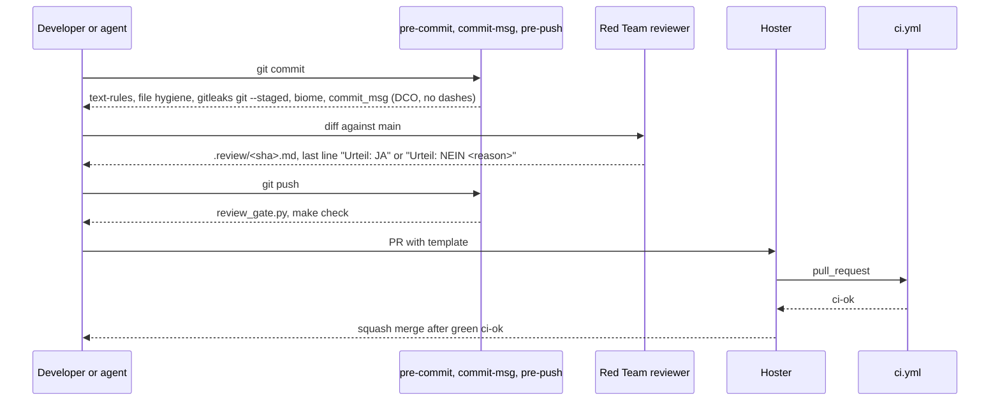
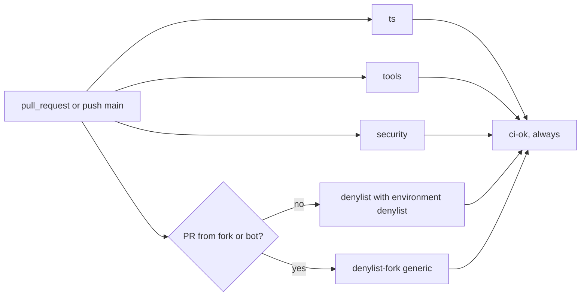
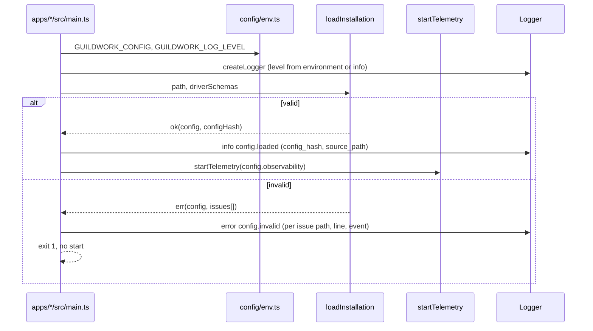
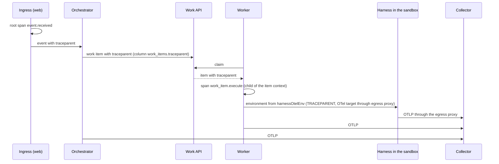
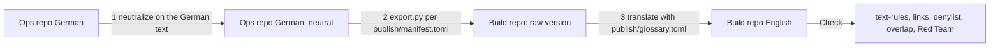
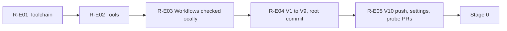

<!--
SPDX-License-Identifier: Apache-2.0
SPDX-FileCopyrightText: The Guildwork Authors
-->
# 00 Codebase and conventions

Detailed design for stage R (repo foundation) and the foundations of stage 0 (Epics `0-E01` codebase foundations and `0-E19` observability). Rulings of this document: FE-001 to FE-099. Precedence, keys and classifications as in the [README](README.md) of the detailed design. What is marked "unverified" here is checked by the named task before it builds on it.

All files in the product repo are in English from publication onward (O21, ADR-53). This document describes content in German; identifiers, message texts, help texts, templates and documentation in the product repo are written in English by the building task.

---

## 1. Purpose and sources

This document defines how the product repo is structured and how work is done in it, so that every later task can build without questions of principle:

- Monorepo layout with all packages from the [README](README.md) section 2 and their dependency rules, enforced by a tool (sections [2.1](#21-monorepo-layout), [2.2](#22-packages-and-dependency-rules)).
- Toolchain (Node, pnpm, TypeScript, Biome, Vitest, Python tools) and `make` targets (sections [2.3](#23-toolchain), [2.4](#24-make-targets)).
- Code conventions: error and result types, IDs, time, logging with redaction, configuration loader of the installation (sections [2.5](#25-package-core) to [2.8](#28-configuration-loader-of-the-installation), [2.12](#212-code-conventions)).
- Interface of the services to the platform: package `sdk-service` (section [2.13](#213-package-sdk-service)).
- Observability in all roles with required alerts that the control plane computes itself (section [2.9](#29-observability-and-required-alerts)).
- All check tools with inputs and outputs and the CI workflows with the single required check `ci-ok` (sections [2.10](#210-check-tools), [2.11](#211-ci-workflows)).
- Test strategy (section [8](#8-tests)), commit and PR conventions (section [4.1](#41-contribution-branch-commit-pr)).
- Neutralization and translation of the documentation and the publication checklist V0 to V10 (sections [4.6](#46-neutralization-and-translation), [4.7](#47-publication-checklist-v0-to-v10)).

**Sources:**

| Source | What this document implements from it |
|---|---|
| [12](../architecture/12-open-source-and-project.md) sections 2 to 8 | License, DCO, required files, two repos, path status (4.2), deny list scanner (4.3), checklist (4.4), ground rules and gates (5.1, 5.2), dogfooding rules (5.4), steps R0 to R10 (6), governance (8) |
| [Research reference project setup](../research/bothy-vorlage-projekt-setup.md) sections 2 and 3.1 | Pattern for `make check` equal to CI, workflow policy, deny list, Red Team gate, license gate, Renovate, Scorecard (VERIFIED there) |
| [06](../architecture/06-operations-and-deployment.md) sections 1, 3, 4 | Roles, technology choice, observability, required alerts |
| [05](../architecture/05-security.md) section 10 | Supply chain of the project (Actions by SHA, license gate, gitleaks, deny list, reporting channel) |
| [04](../architecture/04-configuration-and-limits.md) section 7 | Keys of `installation.yaml` |
| [01](../architecture/01-plugin-interfaces.md) sections 1.1, 10, 13 | `Result`, `PluginError`, `SecretValue`, `HealthReport`, notifier, drivers |
| [08](../architecture/08-roadmap.md) stage R, sections 3 and 4 | Done criteria of stage R, principle 1 |
| [09](../architecture/09-decisions.md) | ADR-03, ADR-21, ADR-37, ADR-38, ADR-39, ADR-41, ADR-44, ADR-50, ADR-53, ADR-69; O16 to O21, O27; section 4 (licenses of the tools in stage R) |
| [backlog-minors](../architecture/backlog-minors.md) | M37, M51, M52, M53, M59, M68, M71, M96, M99, M102, M126, M138 (inclusion in tasks, section 9 and plan) |

---

## 2. Modules and responsibility

### 2.1 Monorepo layout

One repo, pnpm workspaces, one `make check`. Top-level directories:

```text
.
├── apps/
│   ├── control-plane/          # roles web, orchestrator, migrate (06 section 1)
│   ├── worker/                 # worker binary of all pools
│   ├── cli/                    # command `guildwork` (11 section 2.2)
│   └── admin-ui/               # React with Vite as SPA, served by `web`
├── packages/
│   ├── core/                   # result and error types, IDs, time, hash, logging, metric and trace facade
│   ├── contracts/              # plugin contracts v1alpha1, manifest and event schema (content: detailed design 05)
│   ├── config/                 # configuration loader of the installation; org/repo resolver (detailed design 02)
│   ├── db/                     # Kysely types, migrator, migrations, repositories (detailed design 01)
│   ├── telemetry/              # OTel SDK start per role (FE-008)
│   ├── testkit/                # containers, fixtures, FakeClock, log capture, secret check
│   ├── sdk-service/            # building blocks for services (detailed design 03 and 05)
│   └── ...                     # packages of later stages (agent-step from stage 2, scm-common from stage 9 etc.), list in README section 2
├── plugins/                    # github, claude-code, model-anthropic, model-claude-cli
├── drivers/                    # blob-fs, blob-s3, secret-file, secret-env, identity-self-issuer
├── services/                   # dummy, reviewer, later planner etc.
├── eval/                       # core, runner, adapters/*, scorers/*, suites/* (detailed design 07)
├── deploy/                     # compose, tofu/<module>, later helm
├── tools/                      # check tools in Python (section 2.10), plan tool
│   ├── bootstrap/              # tools.toml, fetch.py
│   ├── ci/                     # check_workflows.py, ci_ok.py, check_layers.py, license_check.py, ...
│   ├── hooks/                  # commit_msg.py, text_rules.py, links.py, review_gate.py
│   ├── denylist/               # scan.py
│   └── plan/                   # plan.py (FE-037)
├── quality/                    # data of the gates (section 3.5): gates.toml, layers.toml, ci/, licenses/, text/, denylist/
├── .opengrep/                  # rules/*.yaml, tests/<rule>/*
├── docs/                       # architecture/, design/, plan/, adr/, quality/, reference/, research/, DECISIONS.md
├── LICENSES/                   # license texts per REUSE 3.3
├── .github/                    # workflows/, CODEOWNERS, PULL_REQUEST_TEMPLATE.md, ISSUE_TEMPLATE/, labels.yml
├── LICENSE  NOTICE  THIRD_PARTY_NOTICES  README.md  CONTRIBUTING.md  GOVERNANCE.md
├── SECURITY.md  SUPPORT.md  CODE_OF_CONDUCT.md  CHANGELOG.md
├── Makefile  package.json  pnpm-workspace.yaml  pnpm-lock.yaml  .npmrc  .node-version
├── tsconfig.base.json  tsconfig.json  biome.json  eslint.config.js  vitest.config.ts
├── pyproject.toml  uv.lock  .python-version
├── .pre-commit-config.yaml  .gitleaks.toml  renovate.json
└── .editorconfig  .gitattributes  .gitignore
```

**Structure of a TypeScript package** (the same for `packages/*`, `plugins/*`, `drivers/*`, `services/*`, `apps/*`, `eval/*`):

```text
<package>/
├── package.json          # name @guildwork/<name>, "type": "module", "private": true, exports (below)
├── tsconfig.json         # extends ../../tsconfig.base.json, composite, references to used packages
├── README.md             # purpose, public API, reference to the detailed design
├── src/
│   ├── index.ts          # only public API (named exports)
│   ├── <module>.ts
│   └── <module>.test.ts  # unit tests next to the code
└── test/
    ├── integration/*.int.test.ts
    ├── contract/*.contract.test.ts
    └── fixtures/         # own test data; recorded responses under fixtures/recorded/
```

`package.json` per package (form, FE-001):

```json
{
  "name": "@guildwork/core",
  "version": "0.0.0",
  "private": true,
  "type": "module",
  "license": "Apache-2.0",
  "exports": {
    ".": {
      "@guildwork/source": "./src/index.ts",
      "types": "./dist/index.d.ts",
      "import": "./dist/index.js"
    }
  },
  "files": ["dist"],
  "scripts": { "build": "tsc -b" }
}
```

Deep imports (`@guildwork/core/src/...`) are excluded because `exports` only exposes `.`; packages with several entry points (such as plugins with a write side, FE-030) name each subpath explicitly in `exports`.

New packages are created only through the generator `pnpm new:package <location>/<name>` (`tools/ci/new_package.py`, task R-E01-T08): it creates the files above with SPDX headers and enters the package in `quality/layers.toml` (`may_import = ["@guildwork/core"]` as a start, location from the first path segment); without an entry, `make layers` fails. Invalid name (not `^[a-z][a-z0-9-]{1,62}$`), unknown location or existing directory: exit code 2, nothing written.

**SPDX header from a single source** (FE-053): text and comment form of the header (section 2.12) live only in `tools/ci/spdx_header.py` (`HEADER_LINES`, `MAX_LINE`, `COMMENT_PREFIX` per extension, `render(path) -> str`, `has_header(path, text) -> bool`, `header_tags(path, text)` for adopted headers). R-E01-T08 creates the module because the generator writes headers before the license gate exists; the test `test_new_package.py::TestNewPackage::test_generated_package_passes_layers_and_license_headers` checks the generated files with `has_header`. R-E02-T06 imports the same module in `license_check.py` and then checks all files retroactively, including those from R-E01-T03 to R-E01-T08; `quality/licenses/header.toml` contains only the exceptions (`exempt`) and the adopted files with a third-party license (`adopted`, section 3.5); extension list, line limit and header text live in `spdx_header.py` (since R-E02-T06).

### 2.2 Packages and dependency rules

Allowed dependencies between workspace packages. A row may only use the packages of the column "may import"; anything else is an error of `make layers`. External npm packages are governed by the license gate, not by this table.

| Package | Kind | may import | Purpose and boundary |
|---|---|---|---|
| `@guildwork/core` | library | nothing from the workspace | base types; externally only `pino`, `@opentelemetry/api` |
| `@guildwork/contracts` | library | `core` | contracts, schemas (TypeBox), validator factory |
| `@guildwork/config` | library | `core`, `contracts` | loader of `installation.yaml`, resolver of the org/repo layers |
| `@guildwork/db` | library | `core`, `contracts` | schema, migrator, repositories; only the control plane and eval use it |
| `@guildwork/telemetry` | library | `core`, `config` | OTel SDK start; only `apps/*` use it |
| `@guildwork/sdk-service` | library | `core`, `contracts` | building blocks for services |
| `@guildwork/testkit` | test only | `core`, `contracts`, `config` | only as a `devDependency` and only in test files |
| `@guildwork/scm-common` | library (from stage 9) | `core`, `contracts` | pure hoster helpers without network for all SCM plugins ([14](14-stage-9-breadth-and-hardening.md) FE-1402); direction `core` < `contracts` < `scm-common` < `plugins/*` |
| Service libraries `agent-step`, `blueprint`, `clarity`, `method-check`, `sarif`, `quality-gate` | library (from stage 2) | `core`, `contracts`, `sdk-service`; among each other only what [10](10-planner-architect-coder.md) section 2.1 names | building blocks for controllers and step handlers of the services ([10](10-planner-architect-coder.md) FE-1000, FE-1066); never `db`, never an app |
| `registry-cache`, `workflow-guard` | library (from stage 2) | `core`, `contracts` | only apps use them (worker and control plane respectively, [10](10-planner-architect-coder.md) section 2.1) |
| `plugins/*` | plugin | `core`, `contracts`, from stage 9 `scm-common` | no other plugin (exceptions only with a Ruling, such as 14 FE-1421), no `db`, no app |
| `drivers/*` | driver | `core`, `contracts` | like plugins |
| `services/*` | service | `core`, `contracts`, `sdk-service`, from stage 2 the service libraries (row above) | never `db`, never an app, never a plugin directly (only through contracts); what the control plane provides comes through `ControllerHost` and its extension per service (section 2.13, FE-057) |
| `apps/control-plane` | app | `core`, `contracts`, `config`, `db`, `telemetry`, `sdk-service`, libraries of later stages, `plugins/*`, `drivers/*`, `services/*` (entry point `controller`, FE-058), `eval/core`, `eval/scorers/*` ([07](07-eval-and-qualification.md) FE-742) | the only place with `db` in operation |
| `apps/worker` | app | `core`, `contracts`, `config`, `telemetry`, `sdk-service`, libraries of later stages, `plugins/*`, `drivers/*`, `services/*` (entry point `jobs`, FE-058), `eval/adapters/harbor` (worker step, [07](07-eval-and-qualification.md) section 2.5) | **never `db`** (ADR-62: worker without DB network, here also without DB code) |
| `apps/cli` | app | `core`, `contracts`, `config`, `telemetry` | calls the control plane over HTTP, never `db` |
| `apps/admin-ui` | app | `contracts` only via `import type` | SPA, talks only to the HTTP API |
| `eval/core` | eval | `core`, `contracts`, `config` only via `import type` ([07](07-eval-and-qualification.md) FE-750) | pure statistics, gates, types; no app |
| `eval/runner`, `eval/adapters/*`, `eval/scorers/*` | eval | `core`, `contracts`, `config`, `db`, `sdk-service`, `eval/core` | |
| `eval/suites/*` | test | everything except `apps/admin-ui` | cross-cutting suites S1 to S8 ([07](../architecture/07-eval.md) section 5) |

**Services in the apps** (FE-058): the apps import the bundled service packages so that the service loader and the worker can load the `ServiceDefinition`s (section 2.13). The control plane uses the controller factory and the input and output schemas of the `jobs` from them (check of `StepRequest.input`), the worker only `jobs`. The reverse direction stays forbidden: no service imports an app. The list of bundled services is kept per app in `src/services.ts` (one file, static imports), so that `check_layers.py` checks it like any import.

Enforcement: `tools/ci/check_layers.py` (FE-007) reads `quality/layers.toml` and checks (a) the `dependencies`, `devDependencies` and `peerDependencies` of every `package.json` against the table, (b) every import specifier in `*.ts`, `*.tsx`, `*.mts` (static, dynamic, `export ... from`, `import type`) against the table and against relative paths that cross a package boundary, (c) that `@guildwork/testkit` is imported only in test files (`*.test.ts`, `test/**`, `eval/suites/**`), (d) that `apps/admin-ui` uses only `import type` from `contracts`, (e) that the workspace graph is acyclic, (f) that subpaths from `[test_only].subpaths` (start: `@guildwork/db/testing`, [01](01-data-model.md) FE-130) are imported only in test files (comparison of the full import specifier, FE-052). A package under `apps/`, `packages/`, `plugins/`, `drivers/`, `services/` or `eval/` without a matching entry in `layers.toml` is a configuration error: exit code 2, message `layers.unknown_package` with path (test `test_check_layers.py::TestLayers::test_package_missing_in_layers_toml_exits_2`). Additional rules within a package (Effect Gateway, environment variables, clock) are enforced by Opengrep (section 2.10).

`quality/layers.toml` (form):

```toml
# Single source for workspace dependency rules. Checked by tools/ci/check_layers.py.
[groups]
lib = ["packages/core", "packages/contracts", "packages/config", "packages/db", "packages/telemetry", "packages/sdk-service"]
service_lib = ["packages/agent-step", "packages/blueprint", "packages/clarity", "packages/method-check",
               "packages/sarif", "packages/quality-gate"]   # from stage 2 (FE-1000); the task that creates the package enters it

[[package]]
path = "packages/core"
may_import = []

[[package]]
path = "plugins/*"
may_import = ["@guildwork/core", "@guildwork/contracts"]   # from 9-E01: plus "@guildwork/scm-common"

[[package]]
path = "services/*"
may_import = ["@guildwork/core", "@guildwork/contracts", "@guildwork/sdk-service", "group:service_lib"]

[[package]]
path = "eval/core"
may_import = ["@guildwork/core", "@guildwork/contracts", "@guildwork/config"]
type_only = ["@guildwork/config"]

[[package]]
path = "apps/admin-ui"
may_import = ["@guildwork/contracts"]
type_only = ["@guildwork/contracts"]

[test_only]
packages = ["@guildwork/testkit"]
subpaths = ["@guildwork/db/testing"]       # FE-052: test callback from 01 FE-130
file_globs = ["**/*.test.ts", "**/test/**", "eval/suites/**", "**/vitest.config.ts", "**/global-setup.ts"]
```

An entry `group:<name>` in `may_import` stands for all packages of the group from `[groups]`; a group member whose directory does not exist yet is not an error (the group may exist before the package). The group `service_lib` and the entries for `scm-common`, `eval/core` and the service entry points of the apps are set by the task that creates the affected package, through the generator (section 2.1); until then `make layers` rejects the import.

`vitest.config.ts` and the global setup count as test files because that is where the migration callback from `@guildwork/db/testing` is passed to testkit (section 2.7).

### 2.3 Toolchain

| Tool | Purpose | Decision | License (as of planning) |
|---|---|---|---|
| Node.js | runtime | 22 LTS (ADR-03), exact version in `.node-version` and `engines.node` | MIT according to the vendor, unverified |
| pnpm | workspaces, lockfile | exact version in the field `packageManager`, invoked through Corepack | MIT, unverified |
| TypeScript | types, build | pinned exactly; `tsc -b` with project references | Apache-2.0, unverified |
| Biome | format and lint | pinned exactly; the only formatter | MIT or Apache-2.0, unverified |
| ESLint with typescript-eslint | only type-aware rules (FE-002) | pinned exactly | MIT, unverified |
| Vitest | tests, coverage (v8) | pinned exactly | MIT, unverified |
| Testcontainers for Node | Postgres in tests | pinned exactly | MIT, unverified |
| Python | check tools | 3.12 in `.python-version` | PSF-2.0 |
| uv | Python dependencies of the tools (FE-004) | pinned exactly through `tools/bootstrap/tools.toml` | MIT or Apache-2.0, unverified |
| ruff, mypy | lint and types of the tools | in `uv.lock` | MIT, unverified |
| pre-commit | hooks | in `uv.lock` | MIT according to the reference project |
| pre-commit-hooks | file hygiene in `.pre-commit-config.yaml` (conflict markers, large files, case conflicts, TOML and YAML readable, end of file, trailing whitespace, LF) | 6.0.0 in `uv.lock` (R-E02-T11) | MIT, checked 2026-11-01 (`docs/quality/toolchain.md`) |
| gitleaks | secrets | binary through `tools.toml` | MIT according to the reference project |
| Opengrep | rule SAST | binary through `tools.toml` | engine LGPL-2.1 ([12](../architecture/12-open-source-and-project.md) 5.2) |
| actionlint, zizmor | workflows | binary or `uv.lock` respectively | MIT according to the reference project |
| osv-scanner | vulnerabilities | binary through `tools.toml` | Apache-2.0 according to the reference project |
| check-jsonschema | `renovate.json`, schemas | 0.38.2 in `uv.lock` (R-E03-T04) | Apache-2.0, checked 2026-11-01 (`docs/quality/toolchain.md`) |
| ScanCode Toolkit | license texts in the tree | PyPI `scancode-toolkit-mini` 32.5.0 plus `pylibmagic` 0.5.0 (libmagic), exact with hashes in `tools/bootstrap/scancode/requirements.txt` (R-E02-T07); runs in the Docker Official Image `python`, pinned by digest in `tools/bootstrap/tools.toml` (`[images.scancode]`), because ScanCode does not publish its own image, or without a container in `.tools/scancode` (section 2.4) | Apache-2.0 AND CC-BY-4.0, the package metadata additionally name `LicenseRef-scancode-other-permissive` and `LicenseRef-scancode-other-copyleft` (embedded third-party packages); development only, exception in `dev-exceptions.txt` |
| Docker | Testcontainers, ScanCode (path `container`) | provided by the developer or the runner respectively | not shipped |

The license column is checked at the source in task R-E01-T07 and kept in `docs/quality/toolchain.md` with retrieval date and location (M51, [09](../architecture/09-decisions.md) section 4: also Caddy, restic and OTel Collector). A tool whose license is not on the allowlist and that is not only a development tool fails the license gate and is replaced ([detailed design README](README.md) section 2).

**`tsconfig.base.json`** (values; check the option names against the pinned version):

```json
{
  "compilerOptions": {
    "target": "ES2023",
    "lib": ["ES2023"],
    "module": "NodeNext",
    "moduleResolution": "NodeNext",
    "customConditions": ["@guildwork/source"],
    "strict": true,
    "noUncheckedIndexedAccess": true,
    "exactOptionalPropertyTypes": true,
    "noImplicitOverride": true,
    "noPropertyAccessFromIndexSignature": true,
    "noFallthroughCasesInSwitch": true,
    "useUnknownInCatchVariables": true,
    "verbatimModuleSyntax": true,
    "isolatedModules": true,
    "composite": true,
    "declaration": true,
    "declarationMap": true,
    "sourceMap": true,
    "skipLibCheck": true,
    "forceConsistentCasingInFileNames": true,
    "resolveJsonModule": true,
    "types": ["node"]
  }
}
```

`apps/admin-ui` has its own `tsconfig.json` with `lib: ["ES2023", "DOM"]`, `moduleResolution: "Bundler"` and `jsx: "react-jsx"`. Whether `customConditions` takes effect with `NodeNext` is unverified (R-E01-T05 proves it with a test, otherwise FE-001 fallback: build before tests).

**`biome.json`** (core): formatter with 2 spaces, line width 100, double quotes, semicolons, trailing commas; linter `recommended` plus as errors: no `any`, no `console`, no default export, no non-null assertion, `import type` for pure types, no reassignment of parameters. Check the rule names against the pinned version (unverified).

**`eslint.config.js`** (FE-002): only `typescript-eslint` with type information and exactly these rules as errors: `no-floating-promises`, `no-misused-promises`, `switch-exhaustiveness-check`, `await-thenable`, `require-await`. No style, no formatting.

**pnpm settings** (measured in R-E01-T05 with pnpm 12): pnpm 12 reads install settings only from `pnpm-workspace.yaml`, from `.npmrc` only registry and access. Therefore `engineStrict`, `saveExact`, `strictPeerDependencies` and `linkWorkspacePackages` live in `pnpm-workspace.yaml`; `.npmrc` pins only the registry. Install scripts of dependencies are off; allowed only through the list `allowBuilds` in `pnpm-workspace.yaml` (successor of `onlyBuiltDependencies`), every entry with a reason in `docs/quality/toolchain.md`.

**`vitest.config.ts`:** projects by file suffix (FE-003): `unit` (`src/**/*.test.ts`), `integration` (`test/integration/**/*.int.test.ts`, with global setup from `testkit`), `contract` (`test/contract/**/*.contract.test.ts`), `e2e` (`**/*.e2e.test.ts`, not in `make check`). `retry: 0`, `ssr.resolve.conditions` with `@guildwork/source` plus the default conditions of Vite (measured in R-E01-T05: `resolve.conditions` alone has no effect in Vitest), `pool: "forks"` for integration. Coverage via v8, thresholds from `quality/coverage.json` (named values per area, start value set in R-E01-T05, held by the test `coverage thresholds come from quality/coverage.json`).

**Python tools:** `pyproject.toml` with `[tool.ruff]` (rule set `E,F,I,B,UP,S,SIM`), `[tool.mypy]` `strict = true`, package path `tools`. Tools use only the standard library; exceptions (such as `pre-commit`, `zizmor`, `check-jsonschema`) are development tools, not runtime dependencies of the scripts. Tests with `unittest` (`python -m unittest discover -s tools -p 'test_*.py'`).

**Binaries** (FE-005): `tools/bootstrap/tools.toml` lists per tool the version, URL template per operating system and architecture and SHA-256; `tools/bootstrap/fetch.py` downloads to `.tools/bin/` (git-ignored), checks the checksum and aborts on mismatch. No `sudo`, no system package managers ([11](../architecture/11-installation-and-hosting.md) section 1 principle 7).

```toml
# tools/bootstrap/tools.toml (format from R-E01-T04: the vendors name platforms differently)
[gitleaks]
version = "<exact>"
url = "https://github.com/gitleaks/gitleaks/releases/download/v{version}/gitleaks_{version}_{target}.tar.gz"
member = "gitleaks"
source = "<URL of the vendor's checksum file>"
retrieved = "<date>"
target = { linux_x64 = "linux_x64", linux_arm64 = "linux_arm64", darwin_arm64 = "darwin_arm64" }
sha256 = { linux_x64 = "<hex>", linux_arm64 = "<hex>", darwin_arm64 = "<hex>" }
```

### 2.4 Make targets

`make check` is identical locally and in CI ([12](../architecture/12-open-source-and-project.md) 5.1). The list of gates lives only in `quality/gates.toml` (FE-006); the Makefile, `ci.yml` and `docs/quality/gates.md` are checked against it (`tools/ci/gates.py`, test `gates.toml matches Makefile and ci.yml`).

| Target | Command (simplified) | Inputs | Output, exit code | CI job | Fork PR |
|---|---|---|---|---|---|
| `bootstrap` | `fetch.py`, `corepack pnpm install --frozen-lockfile` (pnpm through Corepack with `COREPACK_HOME=.tools/corepack`, no `corepack enable`, nothing system-wide; package store and metadata cache through `storeDir` and `cacheDir` in `pnpm-workspace.yaml` under `.tools/pnpm-store` and `.tools/pnpm-cache`), `uv sync --frozen` (`UV_CACHE_DIR=.tools/uv-cache`), `pre-commit install -t pre-commit -t commit-msg -t pre-push` | `tools.toml`, lockfiles | `.tools/`, `node_modules/`, `.venv/`, hooks | `ts`, `tools`, `security` (own step); not the deny jobs and not `advisories.yml` | same |
| `check` | all gates with `in_check = true` in `gates.toml` (`gates.py run`) | | first error aborts; summary per gate; a selected gate without a rule in the Makefile is exit code 2 | all | same |
| `fmt` | `biome format --write .`, `ruff format tools` | | writes | no | |
| `fmt-check` | `biome format .`, `ruff format --check tools` | | 0 clean, 1 deviation | `ts` | same |
| `lint` | `biome lint .`, `eslint .`, `ruff check tools` | | 0, 1 | `ts` | same |
| `typecheck` | `tsc -b`, `mypy tools` | | 0, 1 | `ts` | same |
| `test` | `vitest run --project unit --project integration --project contract` with the reporters `default` and `junit` (`.reports/junit/test.xml`) | Docker for integration | 0, 1 | `ts` | same |
| `test-tools` | `tools/ci/junit_unittest.py --start-dir tools --top-level-dir .` (unittest discovery under `tools/`, R-E03-T01) | | 0, 1; JUnit to `.reports/junit/test-tools.xml` | `tools` | same |
| `coverage` | `vitest run --coverage` with thresholds from `quality/coverage.json` | | 0, 1 | `ts` | same |
| `layers` | `check_layers.py` | `quality/layers.toml`, `package.json`, sources | 0, 1, 2 config error | `ts` | same |
| `text-rules` | `text_rules.py` over all tracked text files | `quality/text/*` | `pfad:zeile:spalte regel`; 0, 1, 2 | `tools` | same |
| `links` | `links.py` (relative links and anchors in Markdown) | `docs/**`, `*.md` | 0, 1, 2 | `tools` | same |
| `commitlint` | `commit_msg.py --range $(COMMIT_RANGE)` | commits in the range (default `COMMIT_RANGE=main..HEAD`, in CI the commits of the PR), `quality/commits/bots.txt`, `quality/commits/limits.toml` | 0, 1, 2 | `tools` | same |
| `workflows` | `check_workflows.py`, then `check-jsonschema --builtin-schema vendor.renovate $(RENOVATE_CONFIG)` (schema in the package, without network, R-E03-T04), then `actionlint -shellcheck= -pyflakes=` and `zizmor --offline` over the workflow files; without workflow files, actionlint and zizmor are skipped (otherwise both end with exit code 3) | `quality/ci/policy.toml`, `.github/workflows/*.yml`, `renovate.json` | 0, 1, 2 | `tools` | same |
| `opengrep` | `opengrep scan --config .opengrep/rules --error --disable-version-check --json-output=.reports/opengrep.json .` (without version check, so without a network call; `.semgrepignore` replaces the built-in exclusion list of the engine), then `tools/ci/opengrep_test.py` (rule tests, section 2.10) | `.opengrep/`, `.semgrepignore` | 0, 1, 2 (rule tests: configuration or engine error) | `tools` | same |
| `plan` | `python tools/plan/plan.py check` | `docs/plan/` | 0, 1 | `tools` | same |
| `migration-lint` | `tools/migration-lint/lint.py packages/db/migrations` (from 0-E02, [01](01-data-model.md) section 4.4, FE-132) | migration files | 0, 1, 2 | `tools` | same |
| `gitleaks` | `gitleaks git --config .gitleaks.toml --redact --log-opts "$(GITLEAKS_LOG_OPTS)"` | default `GITLEAKS_LOG_OPTS=origin/main..HEAD`, without `origin/main` (build repo without a remote, FE-031) `--all`; V4: `--all` | 0, 1 | `security` | same |
| `osv` | `osv_diff.py --base "$(OSV_BASE)"` calls `osv-scanner` on `pnpm-lock.yaml` and `uv.lock` (command section 2.10); with `OSV_BASE=<ref>` only new findings | lockfiles, `quality/osv/osv-scanner.toml`, base ref | 0, 1, 2 | `security` | same |
| `licenses` | `license_check.py` | `LICENSE`, headers, lockfiles, `quality/licenses/*` | 0, 1 | `security` | same |
| `notices` | `third_party_notices.py --write` or `--check` in `licenses` respectively | lockfiles, `node_modules` | `THIRD_PARTY_NOTICES` | (through `licenses`) | same |
| `denylist` | `denylist/scan.py $(DENYLIST_FLAGS) --json .reports/denylist.json --range "$(COMMIT_RANGE)" tree commits`, plus the mode `pr` only if `PR_TITLE` is set in the environment (then `PR_BODY` must be set too, otherwise exit 2); one call, one report, one exit code | `DENYLIST_FILE`, `ALLOW_AUTHORS_FILE`, `PR_TITLE`, `PR_BODY` (only through the environment, never on the make command line), `COMMIT_RANGE` | 0, 1, 2 (list or identities missing, configuration or Git error); `make check` therefore ends with 2 without `DENYLIST_FILE` and `ALLOW_AUTHORS_FILE`, locally without a private list `DENYLIST_FLAGS=--allow-missing` | `denylist` or `denylist-fork` respectively | `DENYLIST_FLAGS=--allow-missing` |
| `denylist-history` | `denylist/scan.py $(DENYLIST_FLAGS) --json .reports/denylist-history.json --all history tree` | as above | 0, 1, 2 | `denylist-main.yml` (from the first push) | no |
| `scancode` | `scancode_policy.py --runner $(SCANCODE_RUNNER)`: writes the files of HEAD raw through `git ls-tree` and `git cat-file --batch` into a temp directory (not `git archive`, which omits `export-ignore` files and converts content according to attributes), runs ScanCode and checks its JSON output (section 2.10); `SCANCODE_RUNNER=container` (default, image by digest through `SCANCODE_DOCKER`, default `docker`) or `local` (the make target first installs `.tools/scancode` with uv) | files of HEAD; `[images.scancode]` from `tools.toml`, `tools/bootstrap/scancode/requirements.txt`, `allowed.txt` and `scancode-exceptions.txt`, all from the scanned commit (exception: the path `local` installs `.tools/scancode` from the `requirements.txt` of the working tree) | 0, 1, 2 (configuration or runtime error); `.reports/scancode-scan.json`, `.reports/scancode_policy.json` | not in `check` (before release and V6); daily in the job `scancode` of `advisories.yml` with `SCANCODE_RUNNER=container` (R-E03-T03); the container path is built, its first real run is pending (probe: `advisories.yml` via `workflow_dispatch` after V10, R-E05-T04). A documentation change with license names is therefore caught only in the daily run, not before the merge | |
| `workflows-dry-run` | `ci_ok.py` against fixtures, `check_workflows.py --strict` | `tools/ci/tests/fixtures/` | 0, 1 | not in `check` (step R4) | |
| `review-gate` | `review_gate.py` | `.review/<sha>.md`, `REVIEW_SKIP` | 0, 1 | no (pre-push) | `REVIEW_SKIP=1` |

Group targets for CI: `check-ts`, `check-tools`, `check-security` combine the gates with the respective `ci_job` and write a JUnit report per job with `gates.py run --junit .reports/junit-<job>.xml` (section 2.11). `make help` lists all targets with an English line from `gates.toml`.

### 2.5 Package core

`packages/core/src/`:

```text
index.ts          result.ts       errors.ts       ids.ts         hash.ts
time.ts           random.ts       secret.ts       json.ts        assert.ts
log/logger.ts     log/redact.ts   log/secret-patterns.ts
telemetry/facade.ts               telemetry/catalog.ts
redaction/rules.ts                redaction/redact.ts              redaction/markdown.ts   (0-E08-T01)
```

Later, `visibility.ts` and `references.ts` are added (stage 6, types in [09](09-reviewer-companion-features-and-learnings.md) section 2.2). Canonical JSON exists only once, as `canonicalJson` in `hash.ts` (0-E01-T02); a second file `jcs.ts` is not created.

**Result and error** (FE-010, FE-011):

```ts
// result.ts
export type Result<T, E = AppError> =
  | { readonly ok: true; readonly value: T }
  | { readonly ok: false; readonly error: E };
export function ok<T>(value: T): Result<T, never>;
export function err<E>(error: E): Result<never, E>;
export function isOk<T, E>(r: Result<T, E>): r is { readonly ok: true; readonly value: T };
export function map<T, U, E>(r: Result<T, E>, f: (v: T) => U): Result<U, E>;
export function andThen<T, U, E>(r: Result<T, E>, f: (v: T) => Result<U, E>): Result<U, E>;
export function unwrapOr<T, E>(r: Result<T, E>, fallback: T): T;
export async function fromPromise<T>(p: Promise<T>, onError: (e: unknown) => AppError): Promise<Result<T>>;

// errors.ts
export type ErrorCode =
  | "invalid" | "not_found" | "conflict" | "permission" | "auth"
  | "rate_limited" | "transient" | "unsupported"            // these eight as PluginError in 01 section 1.1
  | "limit_exceeded" | "config" | "internal";
export interface AppError {
  readonly code: ErrorCode;
  readonly event: string;                       // stable event name, dot.case, such as "config.unknown_key"
  readonly message: string;                     // English, without secrets and without third-party content
  readonly details?: Readonly<Record<string, JsonValue>>;
  readonly retryAfterMs?: number;
  readonly providerRequestId?: string;
  readonly cause?: unknown;                     // never serialized, never logged except for code "internal"
}
export const RETRYABLE: ReadonlySet<ErrorCode>;  // { "rate_limited", "transient" } (01 rule 3)
export function appError(code: ErrorCode, event: string, message: string, extra?: Partial<AppError>): AppError;
export class GuildworkError extends Error {      // only at places that must throw (Fastify hooks)
  readonly error: AppError;
}
export function toProblem(e: AppError, ctx: { requestId: string; traceId?: string }): Problem;   // section 3.2
export function exitCodeFor(e: AppError): 0 | 1 | 2;                                             // 2 only for "invalid" from options
```

```ts
// assert.ts
export function assertNever(x: never): never;                                   // exhaustive switch
export function invariant(cond: unknown, event: string, message: string): asserts cond;   // throws GuildworkError with code "internal"
// json.ts
export type JsonValue = null | boolean | number | string | readonly JsonValue[] | { readonly [k: string]: JsonValue };
export function parseJson(text: string): Result<JsonValue>;                      // "invalid" with details.position
```

Rules: expected errors are `Result`, never exceptions. Programming errors (violated invariant) throw; the boundary (HTTP handler, job run, CLI `main`) catches them, converts them to `internal` and logs the stack and the event `error.unhandled`. `assertNever` for exhaustive `switch`, `invariant` for invariants.

`exitCodeFor` (exit codes per [11](../architecture/11-installation-and-hosting.md) section 2.2: `0` success, `1` step failed, `2` invalid option): returns `2` exactly when `code` equals `invalid` and `details.source` equals `"options"` (the CLI sets this when checking its arguments), otherwise `1`; `0` never comes from an error, only from `main` on success. `parseJson` reports `details.position` as a character index (0-based).

**IDs and hash** (FE-012):

```ts
declare const brand: unique symbol;
export type Id<B extends string> = string & { readonly [brand]: B };
export function newId<B extends string>(clock: Clock, random: Random): Id<B>;   // UUIDv7 per RFC 9562, lowercase
export function parseId<B extends string>(raw: string): Result<Id<B>>;          // "invalid" on wrong form or version
export type Slug = string & { readonly [brand]: "Slug" };                       // ^[a-z][a-z0-9-]{1,62}$ for plugin, service, pool IDs
export function parseSlug(raw: string): Result<Slug>;
export function sha256Hex(data: string | Uint8Array): string;
export function canonicalJson(value: JsonValue): string;                         // RFC 8785 (JCS); JsonValue from json.ts
```

Domain ID types (`RunId`, `WorkItemId`, ...) are defined by the package that owns the term (`contracts` or `db`), as `Id<"run">` etc. Idempotency keys are `sha256Hex(canonicalJson(...))`.

`newId` fills the 48 bits of time from `clock.now()` and all remaining bits from `random.bytes` (without a counter for monotonicity within a millisecond); ordering is guaranteed only across different milliseconds. `parseId` accepts only the canonical form: 36 characters, lowercase letters, version 7, variant `10`; everything else is `invalid` with the event `id.invalid`. `canonicalJson` rejects numbers that are not finite (`invariant`, because `JsonValue` is not supposed to allow them).

**Time and randomness** (FE-013):

```ts
export type Timestamp = string & { readonly [brand]: "Timestamp" };   // "2026-10-31T12:00:00.000Z", always UTC with milliseconds
export interface Clock {
  now(): Date;
  timestamp(): Timestamp;
  monotonicMs(): number;
  sleep(ms: number, signal?: AbortSignal): Promise<void>;
}
export const systemClock: Clock;
export function toTimestamp(d: Date): Timestamp;
export function parseTimestamp(raw: string): Result<Timestamp>;        // only RFC 3339 with "Z" or offset, normalized to "Z"
export function parseDuration(raw: string): Result<number>;            // "250ms" | "30s" | "5m" | "1h" | "7d" -> milliseconds
export function formatDuration(ms: number): string;
export interface Random { bytes(n: number): Uint8Array; int(maxExclusive: number): number }
export const cryptoRandom: Random;
```

Durations are named `...Ms` or `...S` in code (like `ttlS` in [01](../architecture/01-plugin-interfaces.md)), and written as text in configurations (`"30s"`). `parseDuration` accepts exactly one unit: `^(0|[1-9][0-9]*)(ms|s|m|h|d)$` (no combination such as `1h30m`, no spaces, no fractions); error `invalid` with the event `duration.invalid`. `formatDuration` picks the largest unit that divides the value without remainder (`90000` yields `"90s"`, `3600000` yields `"1h"`), so that `parseDuration(formatDuration(x)) === x` holds (test `core/time > formatDuration round-trips through parseDuration`).

**Secrets** (matches `SecretValue` in [01](../architecture/01-plugin-interfaces.md) section 13):

```ts
export class SecretValue {
  constructor(value: string);
  reveal(): string;                    // the only place where the plaintext comes out
  toString(): "[REDACTED]";
  toJSON(): "[REDACTED]";
  // util.inspect.custom also returns "[REDACTED]"
}
```

**Logging** (FE-014, FE-015):

```ts
export type LogLevel = "trace" | "debug" | "info" | "warn" | "error" | "fatal";
export type LogFields = Readonly<Record<string, JsonValue | SecretValue | AppError | Error | undefined>>;
export interface Logger {
  trace(event: string, fields?: LogFields): void;
  debug(event: string, fields?: LogFields): void;
  info(event: string, fields?: LogFields): void;
  warn(event: string, fields?: LogFields): void;
  error(event: string, fields?: LogFields): void;
  fatal(event: string, fields?: LogFields): void;
  child(bindings: LogFields): Logger;
  isLevelEnabled(level: LogLevel): boolean;
}
export interface LoggerOptions {
  level: LogLevel;
  base: { service: string; version: string; role?: string; installation?: string };
  destination?: NodeJS.WritableStream;   // default stdout
  clock?: Clock;
  traceContext?: () => { traceId: string; spanId: string } | undefined;   // from the trace facade
  extraRedactions?: () => readonly string[];   // registered plaintexts (Credential Broker, 04 section 2.3.2), read anew per line (FE-059)
}
export function createLogger(opts: LoggerOptions): Logger;   // pino underneath, format section 3.1
export function redactValue(value: unknown, limits?: Partial<RedactLimits>): JsonValue;   // structure: keys and patterns (FE-046)
export interface RedactLimits { maxDepth: number; maxString: number; maxArray: number }  // named values LOG_LIMITS
export const SECRET_PATTERNS: readonly { id: string; re: RegExp }[];   // from 0-E08-T01 derived from REDACTION_RULES
export const REDACTED = "[REDACTED]";
export function untrustedSummary(u: { readonly untrusted: true; value: unknown; origin: string; sha256: string })
  : { origin: string; sha256: string; length: number };   // structurally equal to Untrusted<T> from contracts (05 section 2.3); core does not import contracts
```

Redaction in three stages, all in every log line: (0) registered values (FE-059): if `extraRedactions` is set, the logger calls it once per line and replaces every exact occurrence of a returned value in every text of the line with `[REDACTED]`; from 0-E08-T01 this goes through `redact(text, extra)` with `ruleId "registered"`. If the callback throws, the line is written without fields as `log.redaction_failed`, never unredacted; (1) by key: every key at any depth that matches `/(^|[_.-])(token|secret|password|passwd|authorization|cookie|set-cookie|api[_-]?key|private[_-]?key|client[_-]?secret|pem|credential)s?$/i` becomes `[REDACTED]`; (2) by pattern: every text is checked against `SECRET_PATTERNS`, matches are replaced. Start list of the patterns (test values in `quality/secrets/samples.txt`, synthetic):

| ID | Pattern (simplified) | Source |
|---|---|---|
| `anthropic` | `sk-ant-[A-Za-z0-9_-]{8,}` | prefix family from [12](../architecture/12-open-source-and-project.md) 5.2 |
| `github-token` | `gh[opsur]_[A-Za-z0-9]{20,}`, `github_pat_[A-Za-z0-9_]{20,}`, `ghs_[A-Za-z0-9_-]{8,}\.[A-Za-z0-9_-]{8,}\.[A-Za-z0-9_-]{8,}` (stateless installation token `ghs_<App-ID>_<JWT>` of the GitHub App, from 2026-04-27; `gh[opsur]_` and `jwt` miss it) | formats checked against the vendor documentation in R-E02-T03 (build repo `docs/quality/toolchain.md`, section "Secret scanning"; gitleaks rule `github-app-token-stateless`); test value in `samples.txt` |
| `private-key` | `-----BEGIN [A-Z ]*PRIVATE KEY-----` to `END` | |
| `jwt` | three Base64url parts, the first starts with `eyJ` | |
| `bearer` | `Bearer\s+\S{16,}` | |
| `url-credentials` | `://[^/\s:@]+:[^/\s@]+@` | |

Third-party content (`Untrusted<T>` from [01](../architecture/01-plugin-interfaces.md)) is never logged in plaintext, only `{ origin, sha256, length }` through `untrustedSummary()` (`length` in bytes of the UTF-8 encoding for text, otherwise the length of `canonicalJson(value)`). Limits: depth, text length and array length as named values `LOG_LIMITS` in `log/redact.ts` with the start values `maxDepth: 8`, `maxString: 4096` (characters), `maxArray: 100`; deeper values become `"[TRUNCATED]"`, longer texts are cut after `maxString` characters with `"...[TRUNCATED]"` appended, longer arrays are cut after `maxArray` entries with the entry `"[TRUNCATED]"`. Redaction runs before truncation, so that a cut secret does not remain as a remainder.

**Redaction for texts** (`redaction/`, built in 0-E08-T01; content of the rules and users in [04](04-effects-audit-credentials.md) section 6, FE-418, FE-420): one rule source for logger, Effect Gateway, worker and audit (FE-046).

```ts
// redaction/rules.ts
export interface RedactionRule { id: string; re: RegExp; origin: "gitleaks" | "guildwork" }
export const REDACTION_RULES: readonly RedactionRule[];         // sk-ant-oat, sk-ant-api, AWS, GitHub tokens, PEM, gwph_, gwpk_, ...
// redaction/redact.ts
export interface RedactionHit { ruleId: string; start: number; end: number }   // never the matched text
export function scan(text: string, extra?: readonly string[]): RedactionHit[];  // extra: registered values, exact search, ruleId "registered"
export function redact(text: string, extra?: readonly string[]): { text: string; hits: RedactionHit[] };   // matches replaced by REDACTED
// redaction/markdown.ts
export function stripExternalLinks(markdown: string, allowHosts: readonly string[])
  : { markdown: string; removed: number };                     // external links and images removed (FE-420)
```

From 0-E08-T01, `SECRET_PATTERNS` (logger) is the view `REDACTION_RULES.map(({ id, re }) => ({ id, re }))`; `log/secret-patterns.ts` then no longer holds its own patterns. The test values stay in `quality/secrets/samples.txt` (same file as gitleaks, R-E02-T03).

**Metric and trace facade** (FE-009): only on `@opentelemetry/api`; without a started SDK, all calls have no effect. Plugins and services receive it through `PluginContext` ([01](../architecture/01-plugin-interfaces.md) section 1.1).

```ts
export type MetricName = keyof typeof METRICS;                  // catalog section 3.3, in telemetry/catalog.ts
export type Attrs<N extends MetricName> = { [K in (typeof METRICS)[N]["attrs"][number]]: string };
export interface Metrics {
  count<N extends MetricName>(name: N, attrs: Attrs<N>, value?: number): void;
  record<N extends MetricName>(name: N, value: number, attrs: Attrs<N>): void;   // histogram
  gauge<N extends MetricName>(name: N, value: number, attrs: Attrs<N>): void;
}
export interface Span { setAttribute(k: string, v: string | number | boolean): void; recordError(e: AppError): void }
export interface Tracer {
  span<T>(name: string, attrs: Record<string, string | number | boolean>, fn: (s: Span) => Promise<T>): Promise<T>;
  traceparent(): string | undefined;                            // W3C, for work items and harness
  withTraceparent<T>(traceparent: string | undefined, fn: () => Promise<T>): Promise<T>;
}
export function createMetrics(): Metrics;                         // on the global MeterProvider
export function createTracer(scope: string): Tracer;
```

`span` always ends the span; if `fn` throws, the facade sets the status `ERROR` with `error.type = "internal"` and rethrows. Expected errors (`Result` with `ok: false`) are reported by the caller itself with `recordError` (sets `error.type` to `AppError.code`, never the message). `traceparent()` returns `undefined` without an active span or without an SDK; `withTraceparent` with `undefined` or an invalid value starts without a parent context and logs nothing.

### 2.6 Package contracts (scaffold)

In `0-E01`, only the scaffold is created (0-E01-T06); the contracts themselves are written by detailed design 05 (Epic `0-E13`), which builds on this scaffold ([05](05-plugins-and-contracts.md) FE-542): `SUPPORTED_API_VERSIONS` is an alias of `API_VERSIONS` there, `Result<T>` from 01 is `PluginResult<T>` below, and `PluginError` is extended additively by `detail`. The names here stay valid; 0-E13-T01 does not create the package anew but extends it.

```ts
export const API_GROUP = "guildwork-dev.github.io" as const;
export const API_VERSIONS = ["guildwork-dev.github.io/v1alpha1"] as const;   // O17, 01 section 1.1
export type ApiVersion = (typeof API_VERSIONS)[number];

export type PluginErrorCode = Extract<ErrorCode,
  "auth" | "permission" | "not_found" | "rate_limited" | "conflict" | "unsupported" | "transient" | "invalid">;
export interface PluginError { code: PluginErrorCode; message: string; retryAfterMs?: number; providerRequestId?: string }
export type PluginResult<T> = Result<T, PluginError>;             // in 01 "Result<T>"

export interface Validator<T> {
  readonly schema: TSchema;
  validate(input: unknown): Result<T, AppError>;                  // code "invalid", details.errors = [{ path, message }]
}
export function compileSchema<S extends TSchema>(schema: S): Validator<Static<S>>;
export function toJsonSchema(schema: TSchema, id: string): JsonValue;   // Draft 2020-12, with $id
```

Ajv options fixed: `strict: true`, `allErrors: true`, `coerceTypes: false`, `useDefaults: false`, `removeAdditional: false`, `allowUnionTypes: true`; formats through `ajv-formats`. Object schemas set `additionalProperties: false` unless explicitly justified otherwise. Name and version of the TypeBox package are unverified (the package has changed its npm name, not proven according to the research); R-E01-T07 fixes it in `toolchain.md`.

### 2.7 Package testkit

```ts
// Postgres (decision README: real container or local service, never mocked)
export interface PgServer { adminUrl: string; version: 17 | 18; stop(): Promise<void> }
export interface PgHandle {
  url: string;                         // administrator connection of the test database
  ownerUrl?: string; appUrl?: string;  // roles guildwork_owner and guildwork_app (01 FE-112); only with roleUrls (FE-052)
  database: string; close(): Promise<void>;
}
export interface StartPostgresOptions {
  version?: 17 | 18;                                     // default 17
  image?: string;                                        // default: digest from quality/test/images.toml per version
  migrate?: (adminUrl: string) => Promise<void>;         // runs once against gw_template; from @guildwork/db/testing migrateForTests
  roleUrls?: (databaseUrl: string) => { ownerUrl: string; appUrl: string };   // from @guildwork/db/testing roleUrls
}
export function startPostgres(opts?: StartPostgresOptions): Promise<PgServer>;
export function freshDatabase(server: PgServer): Promise<PgHandle>;   // CREATE DATABASE gw_test_<uuidv7 without hyphens> TEMPLATE gw_template

// time, randomness
export class FakeClock implements Clock { constructor(start: Timestamp); set(t: Timestamp): void; advance(ms: number): void }
export function seededRandom(seed: number): Random;

// logs and secrets
export interface CapturedLog { level: LogLevel; event: string; fields: Record<string, JsonValue> }
export function captureLogs(): { logger: Logger; records: CapturedLog[]; expectEvent(event: string, where?: Partial<CapturedLog>): CapturedLog };
export function expectNoSecrets(haystack: string | Uint8Array, extra?: readonly string[]): void;   // SECRET_PATTERNS plus concrete values

// HTTP fixtures and network lock
export function replayFixtures(dir: string, opts?: { strict?: boolean }): Dispatcher;   // undici MockAgent, strict: every fixture entry must be used
export function guardNetwork(allow: readonly string[]): () => void;                   // blocks everything except localhost ports of the containers
export function tmpDir(): Promise<{ path: string; cleanup(): Promise<void> }>;
```

Rules: the global setup of the Vitest project `integration` starts a Postgres container (image `pgvector/pgvector` by digest from `quality/test/images.toml`), runs the migrations once in `gw_template` (callback from `@guildwork/db`, no dependency `testkit -> db`) and gives every test file a fresh database. If `GUILDWORK_TEST_PG_URL` is set, testkit uses that service instead of a container. testkit creates and drops only databases with the prefix `gw_test_` and the template `gw_template` (exact name) and refuses any other with the event `testkit.refused_database` (FE-039). `close()` drops the database of the test file; the global setup drops all `gw_test_*` and `gw_template` of the same server at the end, and at start with `GUILDWORK_TEST_PG_URL` first drops leftover ones. The roles `guildwork_owner` and `guildwork_app` are not created by testkit but by `migrateForTests` from `@guildwork/db/testing` ([01](01-data-model.md) FE-130); testkit only passes through the two callbacks that `vitest.config.ts` hands over. Without `roleUrls`, `ownerUrl` and `appUrl` are missing in `PgHandle`; tests that check row-level security then fail with `testkit.role_urls_missing` instead of silently running as administrator. Without Docker and without `GUILDWORK_TEST_PG_URL`, integration tests fail with the event `testkit.postgres_unavailable`; they are not skipped.

**Recordings** (`fixtures/recorded/<provider>/<scenario>/`): one file `NNN.json` per exchange, plus `manifest.json` with SHA-256 per file and an overall hash. The format applies to tests without a plugin contract (apps, services, tools). Plugins and drivers record only as cassettes `guildwork-cassette/1` per [05](05-plugins-and-contracts.md) section 2.10; `contractSuite.fixturesHash` in the manifest is exclusively `fixturesHash(pluginDir)` from `contracts` (05 FE-552), never the overall hash of this format.

```json
{
  "request": { "method": "GET", "url": "https://api.github.com/repos/example-org/example/pulls/7",
               "headers": { "authorization": "[REDACTED]", "accept": "application/vnd.github+json" }, "body": null },
  "response": { "status": 200, "headers": { "content-type": "application/json" }, "body": { "number": 7 } },
  "recordedAt": "2026-11-02T10:00:00.000Z"
}
```

The recording tool (`pnpm fixtures:record`, built by the plugin that first needs it) redacts with `redactValue()` and fails if `expectNoSecrets` still finds a match afterwards.

`startPostgres` and `freshDatabase` are created in 0-E01-T07; 0-E02-T01 adds `version` (17 or 18, default 17) and the callback `roleUrls`; the roles themselves are created by `migrateForTests` (0-E02-T02, 01 FE-130), so that every fresh database returns both URLs. The sentence in the description of 0-E02-T01 ("creates roles") is superseded by FE-130; this section is authoritative (plan text reported to area 01).

**Further building blocks** (FE-048): tests of other areas need fakes and check helpers. They live in `@guildwork/testkit` so that no area copies them; they are built by the task that first needs them. The domain rules (what is checked) are in the named documents, the signatures here; if an area defines the signature of a building block itself ([06](06-installation-operations-ui.md) section 2.17, [04](04-effects-audit-credentials.md) section 2.1.6), only the reference is here, and in the component catalog the area provides the interface, not `testkit` (FE-060). Contract harness (`src/contract/`, [05](05-plugins-and-contracts.md) section 2.10) and E2E stack (`src/e2e/`, [06](06-installation-operations-ui.md) section 8.5) are separate components in the same package.

```ts
// secret-scan.ts (0-E08-T05; cases 03 section 8)
export interface SecretScanTargets {
  db?: PgHandle;                                 // all text and JSON columns, work_items.envelope, config_snapshots
  blobs?: { list(prefix: string): AsyncIterable<string>; get(key: string): Promise<Uint8Array | null> };
  logFiles?: readonly string[];
}
export interface SecretScanFinding { where: "table" | "blob" | "log"; location: string; ruleId: string }   // never the value
export function scanForSecrets(values: readonly SecretValue[], targets: SecretScanTargets): Promise<SecretScanFinding[]>;
// searches each value exactly, Base64- and URL-encoded, plus REDACTION_RULES
// follow-up list 0-E08-T05: the test secrets.no_token_in_any_table from 01 section 6 uses the provisional
// helper packages/db/test/helpers/scan.ts until then; 0-E08-T05 switches it to scanForSecrets and deletes the helper.

// effects.ts (0-E09-T03): expectRecordedEffects(runId) with signature and storage only in 04 section 2.1.6 (FE-060);
// no second form here. The type RecordedEffect is defined by 04 (07 section 2.16.1 has its own form, alignment open,
// section 10).

// fake-worker.ts, fake-runtime.ts (0-E12-T09; types from 03 section 2.6 and 05 section 2.11.4)
export function fakeWorker(opts: { controlUrl: string; poolKey: SecretValue; caps: WorkerCaps }): FakeWorkApiClient;
// FakeWorkApiClient: structurally equal to WorkApiClient (03 section 2.6), own declaration because testkit imports no app
export interface FakeRuntimeScript { events: RuntimeEvent[]; outcome: { result: AgentRunResult } | { throws: AppError } | { hang: true } }
export function fakeRuntime(script: FakeRuntimeScript): AgentRuntime;

// docker-fixture.ts (0-E12-T10; networks from 06 section 2.3, checks 03 section 6)
export interface DockerTopology { networks: Record<"core" | "edge" | "worker-uplink" | "worker-egress" | "egress-out", string>;
                                  socketProxyPath: string; stop(): Promise<void> }
export function startDockerTopology(): Promise<DockerTopology>;

// fake-platform-mcp.ts (0-E16-T02; tools from 03 section 2.5)
export function startFakePlatformMcp(opts: { itemToken: string; tools: Readonly<Record<string, (args: JsonValue) => JsonValue>> })
  : Promise<{ url: string; calls: { tool: string; args: JsonValue }[]; stop(): Promise<void> }>;   // wrong token: 401

// fake-anthropic/ (0-E16-T07), test-idp/ (0-E17-T02), telemetry-sink/ (0-E18-T16), azure-recorder/ (0b-E01-T02),
// e2e/ and fixture-server/ (0-E16-T03): signatures only in 06 section 2.17 (FE-060); no second form here.

// dns-sink.ts (2-E01-T08; 10 section 2.5)
export function startDnsSink(network: string): Promise<{ packets(): { udp: number; tcp: number }; stop(): Promise<void> }>;
```

### 2.8 Configuration loader of the installation

Location: `packages/config/src/installation/`. It reads `installation.yaml` ([04](../architecture/04-configuration-and-limits.md) section 7) once at the start of every role and returns an immutable object. The resolver of the org, repo group and repo layers belongs to detailed design 02 (Epic `0-E06`).

```ts
export interface LoadOptions {
  path?: string;                                       // default: env GUILDWORK_CONFIG, otherwise /etc/guildwork/installation.yaml
  env?: Readonly<Record<string, string | undefined>>;  // only for GUILDWORK_CONFIG and GUILDWORK_LOG_LEVEL
  driverSchemas: Readonly<Record<DriverSchemaKey, TSchema>>;   // "BlobStore:s3" -> schema from the driver manifest
  maxBytes?: number;                                   // named value INSTALLATION_MAX_BYTES, default 1 MiB
}
// Own declaration, because DriverKind from contracts (05, 0-E13-T05) is created only after 0-E01-T08;
// a type test in the driver loader (0-E03-T01) keeps both equal (FE-051).
export type DriverClass = "BlobStore" | "SecretStore" | "CloudIdentity";
export type DriverSchemaKey = `${DriverClass}:${string}`;
// class per section: blob -> BlobStore, secrets -> SecretStore, cloud_identity[] -> CloudIdentity
export interface LoadedInstallation {
  readonly config: DeepReadonly<InstallationConfig>;
  readonly configHash: string;                         // sha256Hex(canonicalJson(config)) for snapshots
  readonly sourcePath: string;
}
export interface ConfigIssue { path: string; line?: number; column?: number; message: string; event: string }
export function loadInstallation(opts: LoadOptions): Promise<Result<LoadedInstallation, AppError & { code: "config" }>>;
// details.issues: ConfigIssue[]

// env.ts: the only place that reads process.env of the platform (FE-016)
export interface PlatformEnv { configPath?: string; logLevel?: LogLevel; testMode: boolean }   // testMode from GW_TEST_MODE (section 7)
export function readPlatformEnv(env: Readonly<Record<string, string | undefined>>): Result<PlatformEnv>;
// "invalid" for an unknown level or GW_TEST_MODE other than "0" and "1"; if GW_TEST_MODE is missing, testMode is false

// startup.ts: helper for apps/*/src/main.ts (flow section 4.3)
export function startupConfig(opts: { logger: Logger; driverSchemas: LoadOptions["driverSchemas"];
                                      exit: (code: 1) => never }): Promise<LoadedInstallation>;
// logs config.loaded (config_hash, source_path) or config.invalid per issue and calls exit(1); returns only with a valid configuration

export type SecretRef = string & { readonly [brand]: "SecretRef" };   // ^secret://[a-z0-9][a-z0-9/_.-]*$
// State after 0-E01-T08. Every later task adds its keys here and in sections/ (table below, FE-051);
// authoritative for the full list is the generated installation.schema.json, not this excerpt.
export interface InstallationConfig {
  version: 1;
  installation: Slug;
  public_url: string;                                    // https, without path query
  database: { url_ref: SecretRef };
  blob: { driver: "fs" | "s3" | "azure-blob"; [k: string]: unknown };   // rest per driverSchemas
  secrets: { driver: "file" | "env" | "azure-keyvault"; [k: string]: unknown };
  cloud_identity: { driver: "self-issuer" | "azure-managed-identity"; [k: string]: unknown }[];
  audit_anchor: { sink: "blob" } | { sink: "scm"; repo: string };
  admin_sso: { oidc?: OidcConfig; break_glass: { enabled: boolean } };
  pools: PoolConfig[];
  isolation_min: Record<"private_own" | "external_code", { runs_repo_code: Isolation[]; no_repo_code: Isolation[] }>;
  max_autonomy: "low" | "medium" | "high" | "full";
  merge: { max_mode: "human" | "shadow" | "auto" };
  credentials: { personal_modes: Partial<Record<"subscription" | "chatgpt", { acknowledge_terms: string }>> };
  qualification: { allow_unproven_live: { service: string; scope?: string; reason: string }[] };
  analyzers_allowlist: { id: Slug; image: string; license: string }[];
  bundled_licenses: string[];
  telemetry: { product: "off" | "on"; update_check: "off" | "on" };
  air_gap: boolean;
  registry_mirror: string | null;
  trigger?: { poll_interval?: string };
  migrate?: { recent_backup_max_age?: string };
  backup?: { restore_test?: { schedule?: string } };
  install?: { min_cpu?: number; min_mem_gb?: number; min_disk_gb?: number };
  pool?: { slot_mem_gb?: number };
  observability?: ObservabilityConfig;                   // new, FE-017, section 7
  alerts?: AlertsConfig;                                 // new, FE-017, section 7
}
type Isolation = "sysbox" | "gvisor" | "microvm";
interface PoolConfig { id: Slug; plugin: string; max_concurrency: number; isolation: Isolation[]; enabled?: boolean; single_operator?: boolean; [k: string]: unknown }
```

Check steps in this order, every error with a JSON path and, where possible, line and column: (1) read the file, limit the size; (2) parse YAML 1.2 with the core schema, without custom tags, without the merge key `<<`, duplicate keys are errors; (3) `version` present and known; (4) check the schema (unknown keys are errors, [04](../architecture/04-configuration-and-limits.md) section 1 rule 4); (5) driver-specific keys against `driverSchemas`, an unknown driver name is an error; (6) static cross-checks: pool IDs unique, `personal_modes` per entry with non-empty `acknowledge_terms`, `allow_unproven_live` per entry with `reason`, `public_url` with `https`, all `secret://` references syntactically valid; (7) deep-freeze and compute `configHash`. The loader never resolves secrets; references stay references (resolution in the Credential Broker, ADR-22). Checks that need capabilities at runtime (such as `sink: blob` requiring `OBJECT_LOCK`) are done by the start of the control plane or by `doctor`, not by the loader.

**Sections of other areas** (FE-051): because unknown keys are errors, every key that another area introduces in `installation.yaml` (such as `work.*` from 03, `effects.*` from 04, `admin.*` and `admin_sso.oidc` from 06, `db.*` from 01) needs an entry in the schema before an installation may set it. The path is the same for all:

```ts
// packages/config/src/installation/sections/index.ts
export interface InstallationSection {
  key: string;                       // top-level key, such as "work"; unique
  schema: TSchema;                   // TypeBox with default per key and description (English)
  required: boolean;                 // required section yes or no
  owner: string;                     // detailed design document, such as "03"
  crossCheck?: (cfg: InstallationConfig) => ConfigIssue[];   // static cross-check only within the file
}
export const INSTALLATION_SECTIONS: readonly InstallationSection[];   // static list, no registration at runtime
```

The task that introduces a key creates or extends `sections/<key>.ts`, enters the section in `INSTALLATION_SECTIONS`, extends `InstallationConfig` and regenerates the schema and the reference (`gen:schema`); in 0-E01-T08 the sections from [04](../architecture/04-configuration-and-limits.md) section 7 as well as `observability` and `alerts` are created. Types such as `OidcConfig`, `PoolConfig` (rest through `[k: string]: unknown` only until the owner's section) and the fields of `work`, `effects` etc. are defined by the section of their owning document; until then the schema accepts only the keys from 04 section 7 at these places. Tests: `config/installation > every section key is unique and registered`, `config/installation > section defaults appear in the reference doc`. Default values live only as `default` in the section schema; the loader inserts them when freezing (Ajv stays at `useDefaults: false`; the insertion is done by a separate step after step 6, so that `configHash` covers the effective values).

**Who enters which section** (stage 0 and 0b; keys, types and default values live only in section 7 of the owner, here only the assignment). Until the named task has run, the loader rejects the key as unknown; an installation may set it only afterwards. Later stages follow the same rule: the task that first reads a key enters it, unless section 7 of the owner names another.

| Top-level key | Owner | Task |
|---|---|---|
| keys from [04](../architecture/04-configuration-and-limits.md) section 7 (type above), `observability`, `alerts` | this document (section 7) | 0-E01-T08 |
| `database.*`, `db.pool_max`, `db.statement_timeout_ms`, `db.startup_wait_s` | [01](01-data-model.md) section 7 | 0-E02-T01 |
| `migrate.lock_wait_s`; `migrate.recent_backup_max_age` (if not yet present) | 01 section 7 | 0-E02-T02; 0-E02-T03 |
| `retention.*`, `db.partition_months_ahead` | 01 section 7 | 0-E02-T10 |
| `ingress.*`, `router.*`, `orchestrator.*`, `status_comment.*`, `ledger.*`, `config.cache_ttl_s`, `alerts.rules.<Regeln aus 02>` | [02](02-control-plane.md) section 7 | 0-E06-T01 (annotations and keys in `packages/config/src/installation/`, 02 FE-237) |
| `work.*`, `mcp.*`, `sandbox.*`, `egress.*`, `relay.*`, extension of `blob` | [03](03-execution.md) section 7 | task that first reads the key (03 names none) |
| `effects.*`, `broker.*`, `audit.*`, driver keys of `blob`, `secrets`, `cloud_identity`, `audit_anchor` | [04](04-effects-audit-credentials.md) section 7 | as above (04 names none); driver keys through the `driverSchemas` of the driver |
| `plugins.init_timeout_ms`, `plugins.call_timeout_ms`, `plugins.health_interval_s`, `plugins.uncaught_*`, `plugins.retry.*` | [05](05-plugins-and-contracts.md) section 7 | 0-E13-T06 (loader), 0-E13-T09 (`retry`), 0-E13-T10 (`call_timeout_ms`, `uncaught_*`) |
| `trigger.reconcile_interval`, `trigger.reconcile_overlap_s`, `trigger.poll_interval` | 05 section 7 | 0-E14-T05 |
| `harness_pins`, `claude_code.kill_grace_ms`, `subscription.token_warn_days`, `pricing.max_age_days` | 05 section 7 | 0-E15-T02, 0-E15-T04, 0-E15-T05; `pricing` the task that reads the price table |
| `public_url`, `ingress.mode`, `admin.*`, `admin_sso.oidc`, `install.*`, `pool.*`, `backup.*`, `upgrade.*`, `doctor.*`, `support.*`, `telemetry.*`, `ops.*`, `setup.*`, `release.*` | [06](06-installation-operations-ui.md) section 7 | task that first reads the key; measured defaults 0-E18-T19 |
| `eval.*`, `qualification.*` | [07](07-eval-and-qualification.md) section 7 | 0-E06-T01 or the eval task that first reads the key, respectively |

Worker-local keys (`worker.yaml`, `egress.yaml`, [03](03-execution.md) sections 2.6 and 2.9) do not belong in this schema.

Publication of the schemas ([02](02-control-plane.md) FE-237): the installation schema has its single source in `packages/config/src/installation/`; org, group and repo schemas live in `packages/config/src/schema/`, service keys per service in `packages/config/src/schema/services/<id>.ts`. All JSON files are generated in `packages/config/schema/` through `pnpm --filter @guildwork/config gen:schema` (`installation.schema.json` from 0-E01-T09, `org.schema.json` and `repo.schema.json` from 0-E06-T01); the test `committed installation.schema.json equals generated schema` keeps the installation schema in sync; the check of the org and repo files is defined by 02 section 4.6. `docs/reference/installation.md` is generated from schema, descriptions and default values and is the authoritative list of the default values (test `installation reference doc is up to date`).

### 2.9 Observability and required alerts

Implementation of ADR-21 and [06](../architecture/06-operations-and-deployment.md) section 4. Three parts:

**(a) `@guildwork/telemetry`** (FE-008): starts the OTel SDK in every role (`web`, `orchestrator`, `migrate`, `worker`, `cli` only with `--trace`) before other code loads.

```ts
export interface TelemetryOptions {
  service: "control-plane" | "worker" | "cli" | "egress-proxy";
  role?: "web" | "orchestrator" | "migrate";
  version: string;
  installation: string;
  config: ObservabilityConfig;            // from installation.yaml; if missing, the default values apply (export off)
  logger: Logger;
}
export interface TelemetryHandle { shutdown(timeoutMs: number): Promise<void>; dropped(): number }
export function startTelemetry(opts: TelemetryOptions): Promise<TelemetryHandle>;
export function harnessOtelEnv(input: { traceparent?: string; endpoint: string; serviceName: string }): Record<string, string>;
```

`shutdown` is called by `main.ts` on exit with `TELEMETRY_SHUTDOWN_TIMEOUT_MS` (start value 5000, constant in the package); afterwards the process ends even without a complete export. Without `observability.otlp.endpoint`, `startTelemetry` starts no SDK, returns a handle whose `dropped()` stays 0, and logs `telemetry.disabled` once (level `info`).

Resource attributes: `service.name` (`guildwork-control-plane`, `guildwork-worker`, ...), `service.version`, `service.instance.id` (UUIDv7 per process), `guildwork.role`, `guildwork.installation`. Export via OTLP (`http/protobuf`) to the Collector; if the export is off or the Collector is unreachable, the role keeps running, discarded data is counted by `guildwork.telemetry.dropped`. Traces: ingress opens a root span per event; orchestrator and Work API carry the context forward; the work item stores `traceparent`; the worker sets the context and OTel variables for the harness through `harnessOtelEnv` (integration in `0-E15`). The variable names for Claude Code are in [06](../architecture/06-operations-and-deployment.md) section 4 (`TRACEPARENT`, `CLAUDE_CODE_ENHANCED_TELEMETRY_BETA=1`); further names (activation of telemetry, endpoint) are unverified and are proven in `0-E19-T01` against [cc-monitoring]. The telemetry endpoint for the harness is a target of the worker's egress allowlist, never a direct exit from the sandbox. GenAI conventions: version of the package `@opentelemetry/semantic-conventions` pinned, attribute names only through its constants, renaming in the Collector ([06](../architecture/06-operations-and-deployment.md) section 4).

**(b) Collector in the Compose bundle** (FE-045): `deploy/compose/observability/otel-collector.yaml` and the Compose fragment `deploy/compose/observability.compose.yaml` (included by the bundle in `0-E18` via `include`). Distribution `otel/opentelemetry-collector-contrib` by digest (check the license in R-E01-T07). Receiver OTLP HTTP only in the internal network; processors `memory_limiter`, `batch`, `transform` (renaming GenAI attributes); exporters `prometheus` (internal network only) and `file` for traces with rotation (size and count as named values); optionally `otlphttp` to a backend of the operator (`observability.forward`). Start values as named values in `otel-collector.yaml` with a comment, held by the test `telemetry/collector > collector config keeps the named limits`: `memory_limiter` with `limit_mib: 400` and `spike_limit_mib: 100`, `check_interval: 1s`; file exporter `/data/traces/traces.jsonl` with rotation at 100 MiB and at most 5 files; Prometheus exporter on port 8889 only in the network `core` (port in the container, no host port).

**(c) Required alerts** (FE-018, FE-019): the control plane (role `orchestrator`) computes them itself. Location: `apps/control-plane/src/alerts/`.

```ts
export type AlertSeverity = "warning" | "critical";
export interface AlertSignal {
  subject: string;                      // subject, such as pool ID, provider ID, "installation"
  value: number;
  threshold: number;
  labels: Readonly<Record<string, string>>;
  summary: string;                      // English, without secrets, without third-party content
}
export interface AlertRuleContext { db: Db; clock: Clock; config: AlertsConfig; health: HealthSource; log: Logger }   // Db = Kysely<DB> from @guildwork/db (01 section 2)
export interface AlertRule {
  id: AlertRuleId;                      // table below
  severity: (s: AlertSignal) => AlertSeverity;
  pendingFor: number;                   // ms a signal must be present before it fires (0 = immediately)
  evaluate(ctx: AlertRuleContext): Promise<Result<AlertSignal[]>>;
}
export interface AlertSink {
  id: "log" | "webhook" | "notifier";
  deliver(n: AlertNotification): Promise<Result<void>>;
}
export interface AlertNotification {
  alertId: string; ruleId: AlertRuleId; subject: string; severity: AlertSeverity;
  state: "firing" | "resolved"; summary: string; firedAt: Timestamp; resolvedAt?: Timestamp; installation: string;
}
export interface HealthSource {                // from 0-E13 (plugins) and 0-E03 (drivers), polled regularly
  latest(): Promise<{ kind: "plugin" | "driver"; id: string; report: HealthReport; checkedAt: Timestamp }[]>;
}
```

| Rule ID | Alert ([06](../architecture/06-operations-and-deployment.md) section 4) | Source | Condition (key in `alerts.rules`) | Severity | Data from Epic |
|---|---|---|---|---|---|
| `queue_age` | queue age | oldest waiting work items per pool | age above `queue_age.warn` or `.critical` respectively | warning, critical | `0-E11` |
| `lease_expiries` | lease expiries | expired leases per pool in the window | count above `lease_expiries.max` per `window` | warning | `0-E11` |
| `provider_error_rate` | error rate per provider | model calls with errors per provider in the window | rate above `provider_error_rate.max`, at least `min_calls` calls | warning, critical | `0-E07` |
| `budget_threshold` | budget at 80 % | fill level per bucket from the ledger | fill level at least `budget_threshold.ratio` (start value 0.8 according to 06) | warning; from 1.0 critical | `0-E07` |
| `webhook_unhealthy` | webhook disabled or expiring | `HealthReport.disabledByProvider` or `expiresAt` of the TriggerSource respectively | disabled, or expiry within `expiry_warn` | critical or warning respectively | `0-E13`, `0-E14` |
| `token_expiry` | token expiry (subscription after one year, GitLab PAT) | `HealthReport.expiresAt` per plugin, per pool from the claim report | expiry within `expiry_warn` | warning; expired critical | `0-E13`, `0-E11` |
| `audit_chain` | audit chain broken or daily anchor missing | result of the daily anchor job ([04](04-effects-audit-credentials.md) FE-440), visible as `guildwork.audit.chain_ok` and `guildwork.audit.anchor_age`; the rule reads the same facts from the database (latest audit entry `audit.verify_failed` after the last anchor, age of the last row in `audit_anchors`), because the state machine only evaluates stored facts | break, or anchor older than `audit_chain.anchor_max_age` | critical | `0-E08` |
| `break_glass_login` | login of the emergency admin | audit entry of the login | every login, fires immediately, ends only after acknowledgment | critical | `0-E17` |
| `backup_failed` | Postgres backup failed | table `backup_runs` (section 3.4) | last run failed, or last success older than `backup_failed.max_age` | critical | `0-E02` (table); writer `0-E18` |
| `driver_unhealthy` | (M37) driver reports errors | `HealthReport` per driver | `ok: false` longer than `pendingFor` | critical | `0-E03` |
| `worker_outdated` | (M96) worker older than N-1 | version at claim | minor version lower than that of the control plane | warning; two minors behind critical | `0-E11` |
| `alerting_stalled` | meta alert | heartbeat of the evaluation | no run for three intervals; additionally `/readyz` "degraded" | critical | this Epic |
| `partition_missing` | monthly partition missing soon ([01](01-data-model.md) section 2.2) | `dbAlertSignals().partitionLeadMonths` | a value below 2 | critical | `0-E02` (signal); rule `0-E19-T10` (01 FE-134) |
| `retention_stuck` | deletion stuck (01 section 2.2) | `dbAlertSignals().retentionStuck` | value above 0 | warning | as above |
| `audit_anchor_gap` | due audit partition without complete anchors (01 section 2.2) | `dbAlertSignals().auditPartitionsWithoutAnchors` | list not empty, subject per partition | warning | as above |
| `app_too_old` | role too old for the schema (01 section 4.2) | `schema_state.min_app_release` against the release of the running orchestrator | release lower than `min_app_release`; subject `installation` | critical | `0-E02` (table); rule `0-E19-T10` |

The rules `partition_missing`, `retention_stuck`, `audit_anchor_gap` and `app_too_old` are built by 0-E19-T10 in the alert state machine, not by the area that supplies the signal: a rule in 0-E02 would create a cycle in the plan, because 0-E19-T04 depends on 0-E02 ([01](01-data-model.md) FE-134, FE-061). `app_too_old` (FE-061): in the state `app_too_old` from `startCheck` (01 section 4.2), only the job `alerts-evaluate` still runs in the role `orchestrator`, and only with this rule and the sinks `log` and `webhook`; it suspends all other rules (their tables may have been changed by a contract migration, the alert tables only grow additively). The former alert `audit_tamper_attempt` is dropped ([01](01-data-model.md) FE-135): a violation of the append-only triggers is a programming error with an error log and a counter; a real manipulation is reported by `audit_chain`.

**Rules of other areas** (FE-049): each is an `AlertRule` per this section with an entry in `ALERT_RULE_IDS` and `ALERT_RULES`. Condition, severity and building task are only at the named place; the building task enters the rule and adds the rule ID to this table if it is missing. The test `alerts/rules > ALERT_RULE_IDS matches ALERT_RULES and the rule table` requires for every ID a row in the table above or a mention in this one.

| Area | Rule IDs | Place |
|---|---|---|
| 02 control plane | `job_dead_letter`, `ingress_rejected_burst`, `router_permission_lookup_failed`, `settlement_retried` (built by 0-E05-T13) | [02](02-control-plane.md) section 5.2 |
| 04 effects | rules for checkers with `alert: true` (`guildwork.effect.check_alerts`); the ID is defined by the task of the checker, which enters it here | [04](04-effects-audit-credentials.md) section 2.1.7 |
| 05 plugins | `plugin_unhealthy` | [05](05-plugins-and-contracts.md) section 2.5 |
| 07 eval | `eval_judge_calibration_stale`, `eval_judge_unavailable`, `eval_profile_drift`, `qualification_fallback_shadow` | [07](07-eval-and-qualification.md) section 2.16.5 |
| 09 companion features | `analytics_rollup_failed`, `analytics_ledger_mismatch`, `devmcp_auth_failures`, `auto_approve_failed`, `auto_approve_withdraw_failed`, `kb_layer_failed` | [09](09-reviewer-companion-features-and-learnings.md) section 5.1 |
| 10 stage 2 (Planner, Architect, Coder) | `snapshot_secret_found`, `egress_not_enforced`, `sandbox_dns_rejected`, `hard_gate_disagreement` | [10](10-planner-architect-coder.md) section 5.2 |
| 11 QA, PR fixer, auto-merge | `post_merge_red`, `revert_conflict` | [11](11-qa-prfix-automerge.md) section 5 |
| 12 expansion stage 7 | `kb_layer_failed` (extended), `embedder_unavailable` | [12](12-expansion.md) section 5.1 |
| 13 stage 8 | `wif_exchange_failed`, `llm_grant_refused`, `harness_pin_mismatch`, `ci_dispatch_failing`, `ci_oidc_rejected`, `ci_dispatch_expired`, extension of `driver_unhealthy` | [13](13-stage-8-providers-and-bases.md) section 5.2 |
| 14 stage 9 | `driver_unhealthy` (threshold `drivers.unhealthy_after`), `static_token_rotation_failed`, `ack_latency_exceeded` | [14](14-stage-9-breadth-and-hardening.md) section 5.2 |
| 15 stage 10 | `campaign_halted_failure_rate`, `campaign_halted_budget` | [15](15-stage-10-edge-layers.md) section 5.2 |

**Registration** (FE-049): rules live in a static list, no registration at runtime. A new rule is a file under `rules/`, an entry in `ALERT_RULE_IDS` and in `ALERT_RULES`; a test checks that both lists are equal and that every ID appears in one of the two tables above.

```ts
// apps/control-plane/src/alerts/rules/index.ts
export const ALERT_RULE_IDS = ["queue_age", "lease_expiries", "provider_error_rate", "budget_threshold", "webhook_unhealthy",
  "token_expiry", "audit_chain", "break_glass_login", "backup_failed", "driver_unhealthy", "worker_outdated",
  "alerting_stalled"] as const;            // further IDs (including partition_missing etc. from 0-E19-T10) are added by the task that builds the rule
export type AlertRuleId = (typeof ALERT_RULE_IDS)[number];
export const ALERT_RULES: readonly AlertRule[];
```

**Webhook payload** (sink `webhook`): `POST` to the configured HTTPS URL, `Content-Type: application/json`, the body is exactly one `AlertNotification` as JSON (without further fields). Signature per Standard Webhooks with the headers `webhook-id` (equal to `<alertId>:<state>`, so that receivers recognize repetitions), `webhook-timestamp` (Unix seconds) and `webhook-signature` (`v1,<Base64 des HMAC-SHA256 über id.timestamp.body>`); header names and format against the specification are unverified, 0-E19-T05 proves them. A 2xx response counts as delivered, anything else as a failure.

Evaluation: pg-boss job `alerts-evaluate` (queue name per 02 section 4.9) at the interval `alerts.evaluate_interval`, at most one instance at a time (singleton key). Every rule runs with its own time limit; if it fails, `guildwork.alert.rule_failures` counts and the event `alert.rule_failed` is logged, the other rules keep running. State and transitions: section [4.5](#45-alert-state-machine). Delivery: sink `log` always (event `alert.fired` or `alert.resolved` respectively); sink `webhook` optional (signed per Standard Webhooks with HMAC-SHA256, secret via `secret://`); sink `notifier` as soon as a notifier plugin is configured (delivery then through the Effect Gateway, as [01](../architecture/01-plugin-interfaces.md) section 10 requires); the admin UI reads the table `alerts` through `GET /admin/api/v1/alerts`. Delivery errors never block the evaluation; they are retried with growing pauses up to `alerts.delivery.max_attempts`.

Named values of the state machine (constants in `apps/control-plane/src/alerts/limits.ts`, checked by the test `alerts/engine > named limits match the design`):

| Name | Start value | Effect |
|---|---|---|
| `RULE_TIMEOUT_MS` | 10 000 | time limit per rule and run; exceeding it counts as a failed rule (`alert.rule_failed` with `reason: "timeout"`) |
| `STALLED_AFTER_INTERVALS` | 3 | `alerting_stalled` if `alerting_heartbeat.last_run_at` is older than this multiple of `alerts.evaluate_interval` |
| `DELIVERY_BACKOFF` | base 30 s, factor 2, at most 30 min, without jitter | pause before attempt n: `min(30 s * 2^(n-1), 30 min)`; `next_attempt_at` is set accordingly |
| `WEBHOOK_TIMEOUT_MS` | 10 000 | time limit per webhook call; exceeding it is a failure with `last_error_event = "alert.webhook_timeout"` |
| `HEALTH_POLL_INTERVAL_MS` | 60 000 | interval of the health polling of the plugins in `health-source.ts` (drivers report through the schedule `drivers-health` from 0-E03) |
| `ALERT_DELIVERIES_RETENTION_DAYS` | 90 | `alerts-evaluate` deletes once per day delivered or abandoned rows that are older, at most 1000 per run |
| `ALERTS_PAGE_MAX` | 200 | upper limit of `limit` in `GET /admin/api/v1/alerts`; default 50 |

Delivery per sink: every row in `alerts.sinks` has an identifier (`log`, `webhook:<index in the list>`, `notifier:<instance>`). On the transition to `firing` or `resolved`, the evaluation creates a row in `alert_deliveries` per sink (in the same transaction as the state change); a delivery step in the same job then processes all rows with `next_attempt_at <= now`. Success sets `delivered_at` and `next_attempt_at = NULL`; after `max_attempts` failures, `next_attempt_at = NULL` is set and `alert.delivery_abandoned` is logged. A severity change in `firing` overwrites the open row for `firing` (attempts reset to 0). The sink `log` always writes immediately and counts as delivered. The webhook URL must be `https` (check in the section `alerts` at load time); the secret is read through the SecretStore per delivery and never stored.

**Sink `notifier` before stage 9** (FE-056): as long as no notifier plugin of the kind `alert` is loaded, the loader does not reject the configuration, but the start of the role `orchestrator` logs `alert.sink_unavailable` (warning) once per such sink, creates no delivery rows for it, and `doctor` reports it as `warn`. Once such a plugin is loaded, the sink delivers through `EffectGateway.submitPlatform` with the platform effect of the notifier kind (the type name is defined by detailed design 04 together with the notifier in stage 9).

HTTP of the role `web` (admin UI, role `viewer` reads, `admin` acknowledges):

| Method and path | Request | Response | Errors |
|---|---|---|---|
| `GET /admin/api/v1/alerts?state=firing\|pending\|resolved&limit=` | | `200 { items: Alert[], nextCursor }` | `401`, `403` |
| `POST /admin/api/v1/alerts/{id}/ack` | `{ note?: string }` | `200 Alert` | `401`, `403`, `404`, `409` (already acknowledged or resolved) |

The endpoints belong to the admin API ([06](06-installation-operations-ui.md) section 2.6: prefix `/admin/api/v1`, login, errors as `problem+json`); `limit` at most 200 (named value), `cursor` as there.

```ts
// apps/control-plane/src/alerts/types.ts (response form of the admin API)
export interface Alert {
  id: string; ruleId: AlertRuleId; subject: string; severity: AlertSeverity;
  state: "pending" | "firing" | "resolved";
  firstSeenAt: Timestamp; firedAt?: Timestamp; lastSeenAt: Timestamp; resolvedAt?: Timestamp;
  lastValue: number; threshold: number; labels: Readonly<Record<string, string>>; summary: string;
  acknowledgedBy?: string; acknowledgedAt?: Timestamp;
}
```

Every acknowledgment writes an audit entry `alert.acknowledged` with admin, alert and note hash.

### 2.10 Check tools

All tools: exit code `0` without a finding, `1` with a finding, `2` on a usage or configuration error; findings as `pfad:zeile:spalte regel-id meldung` on stdout; with `--json <file>` additionally machine-readable to `.reports/<tool>.json` (git-ignored). Every tool has tests under `tools/<area>/tests/` with positive and negative cases.

| Tool | File | Inputs | Checks | Outputs | Source |
|---|---|---|---|---|---|
| Text rules | `tools/hooks/text_rules.py` | tracked text files; `quality/text/exempt-paths.txt`, `glossary.toml`, `english-only.toml`, `english-exceptions.toml` | `no-dash`: U+2012 to U+2015 (FE-022); `english-only` in public documentation except `docs/research/` (umlauts and sharp s outside of code and link destinations; German marker words from `quality/text/english-only.toml` from `max_per_paragraph` matches per paragraph, start 2); `glossary`: superseded terms according to `glossary.toml`; `instance-data`: reads the same generic patterns from `quality/denylist/generic.toml` as the deny scanner, through `load_generic()` from `tools/denylist/scan.py` (one source, no copy of the rules); `text-encoding`: a text file that is not UTF-8 (cp1252, UTF-16), once per file, because no rule can read it (R-E02-T01); character references (named, decimal, hexadecimal) count as the character they represent | findings; exit code | [12](../architecture/12-open-source-and-project.md) 5.1 text rules, OS8 |
| Link check | `tools/hooks/links.py` | `*.md` | relative links point to existing files, anchors to existing headings; no links into private paths (list in `quality/text/private-path-patterns.txt`) | findings | 12 4.2 consequence for references |
| Commit check | `tools/hooks/commit_msg.py` | message (hook) or `--range` | Conventional Commits (types section 4.1), subject at most 72 characters (named value), at least one `Signed-off-by:` equal to the author identity, exception exactly the addresses in `quality/commits/bots.txt`, `Co-Authored-By:` allowed, trailer `Plan-Task:` with a valid ID if present (form `^(R\|0b\|7a\|10\|[0-9])-E[0-9]{2}-T[0-9]{2}$`, equal to the task ID of the plan tool; whether the task exists is not checked by the hook); no dash U+2012 to U+2015 in subject or body (`message-dash`, R-E02-T11) | findings | 12 2.2, FE-020, FE-021 |
| gitleaks | `.gitleaks.toml` | Git history in the range | default rules (`[extend] useDefault = true`) plus `anthropic-credential-any` (`sk-ant-`) and `github-app-token-stateless` (`ghs_<App-ID>_<JWT>`, section 2.5), allowlist only exact test values from `quality/secrets/samples.txt` with justification | findings (value masked, `--redact`), `.reports/gitleaks.json` | 12 5.2, 05 section 10 point 6 |
| Opengrep | `.opengrep/rules/*.yaml` (one rule per file, ID equal to the file name), `.opengrep/tests/`, `.semgrepignore`, `tools/ci/opengrep_test.py` | sources | rules below. Rule tests (test command proven in R-E02-T04, `docs/quality/toolchain.md` "Opengrep rule tests"): `opengrep_test.py` calls the test mode of the engine once per rule, `opengrep test --config <regeldatei> <bad_*.ts und good_*.ts>` (with several rules at once, the annotations of one rule count as missing findings of the others); annotations `ruleid: <id>` (comment on the line before) and `ok: <id>`; per rule at least one `bad_*.ts` with `ruleid:` and one `good_*.ts` without. The test mode ignores the `paths:` filter of a rule; path-dependent cases therefore live under `.opengrep/tests/<id>/paths/<repo-path>`, the script copies them into a scratch directory with an empty `.semgrepignore` and compares `opengrep scan --json` with their annotations. The repo's `.semgrepignore` replaces the built-in exclusion list of the engine (which skips `test/`, `tests/` and `node_modules/`) and excludes only `.opengrep/tests/`, so that rules without a test exception also see test code. Without type information, the rules see types only where the same file declares them. Exit code 2 on a configuration error (`opengrep_test.config_invalid`), missing binary or engine error | findings; per rule `opengrep_test.passed` or `opengrep_test.failed rule=<id>` respectively | 12 5.2 |
| Workflow policy | `tools/ci/check_workflows.py` | `.github/workflows/*.yml` and `*.yaml`, `quality/ci/policy.toml` | rules below; reads the workflows with its own YAML subset reader (standard library only, FE-004: block and flow collections, plain and quoted scalars, block scalars, comments); anchors, aliases, tags, merge keys, multiple documents and multi-line plain scalars are outside of it and yield exit code 2 (`workflows.unparsable`); full YAML is checked by actionlint and zizmor | findings | 12 5.1, 05 section 10 point 3 |
| actionlint, zizmor | binaries | workflows | syntax, expressions, template injection, `artipacked`; actionlint without its shellcheck and pyflakes integration (`-shellcheck= -pyflakes=`), because these use whatever tool happens to be installed; both run only if workflow files exist | findings | 12 5.2 |
| Layers | `tools/ci/check_layers.py` | `quality/layers.toml`, `package.json`, sources | section 2.2 | findings | FE-007 |
| License gate | `tools/ci/license_check.py`, `tools/ci/license_inventory.py` | `LICENSE`, `quality/licenses/*`, lockfiles, `LICENSES/`; npm dependencies from `pnpm --recursive licenses list --json` over the whole workspace, once for all and once with `--prod` for the runtime (format proven in R-E02-T06: JSON object per license expression, values are lists of packages with `name`, `versions`, `paths`, `license`, `author`; reads `node_modules`, `make bootstrap` must have run); Python dependencies from `uv.lock` with the license from the metadata in `.venv` (`License-Expression`, otherwise a single-line `License`) | (1) `LICENSE` byte-for-byte equal to Apache-2.0 (SHA-256 in `quality/licenses/license.sha256`); (2) SPDX header `SPDX-License-Identifier` and `SPDX-FileCopyrightText` in the first 5 lines (`MAX_LINE` in `spdx_header.py`, FE-053) of every tracked or non-ignored file whose extension or name has a comment form there; adopted files with a third-party header and an `Origin` line only with a license from `allowed.txt` or an `[[adopted]]` entry in `header.toml` (section 3.5); (3) every runtime dependency with a license from `allowed.txt`; development dependencies from `allowed.txt` or `dev-exceptions.txt` with a reason (FE-028); (4) every SPDX ID used in a header or by a runtime dependency has `LICENSES/<id>.txt` (FE-029); (5) counter-test ADR-39: no package of the name lists `FORBIDDEN_NPM` (`@anthropic-ai/claude-code`, `@anthropic-ai/claude-code-*`, `@anthropic-ai/claude-agent-sdk*`) and `FORBIDDEN_PYPI` (`claude-agent-sdk`, `claude-code-sdk`) in a lockfile (`pnpm-lock.yaml`, `uv.lock`, `package-lock.json`, `yarn.lock` at any depth); (6) `THIRD_PARTY_NOTICES` up to date (`third_party_notices.py --check`). Rule IDs: `license-file-modified`, `spdx-header-missing`, `adopted-license-not-allowed`, `runtime-license-not-allowed`, `dev-license-needs-exception`, `license-text-missing`, `forbidden-package`, `notices-outdated`; exit code 2 on a configuration error (`licenses.config_invalid`) or an unreadable inventory (`licenses.inventory_failed`) | findings | 12 2.3, 5.2; ADR-39, ADR-50 |
| ScanCode policy | `tools/ci/scancode_policy.py` | JSON output of ScanCode over the files of HEAD (raw, section 2.4), or with `--scan <file>` an existing output; `allowed.txt` and `scancode-exceptions.txt` from the scanned commit | every license found (detection or clue) in `allowed.txt` or as an exception with a reason in `scancode-exceptions.txt` (per file and license expression, `scancode-license-not-allowed`); an exception without a match (`scancode-exception-unused`), a scan error (`scancode-scan-error`) and a tracked file missing from the output (`scancode-file-not-scanned`, except the VCS files that ScanCode always skips) are findings; `scancode-exceptions.txt` itself is not checked. Exit code 2: `scancode.config_invalid`, `scancode.output_invalid`, `scancode.env_missing`, `scancode.run_failed` | findings | 12 4.4 V6 |
| Deny list scanner | `tools/denylist/scan.py [--allow-missing] [--json <file>] [--range <area>] [--all] <mode> ...` | `DENYLIST_FILE` (private list), `ALLOW_AUTHORS_FILE` (needed only for `commits` and `history`), `PR_TITLE`, `PR_BODY` (only through the environment), Git; `quality/denylist/generic.toml`, `quality/denylist/exceptions.toml`, `quality/commits/bots.txt` | content, file and folder names, commit messages, author and committer, ref names, PR title and body; modes `tree`, `commits --range`, `history --all`, `pr`; several modes in one call yield one report and one exit code. Author and committer of every commit must exactly equal a line of `ALLOW_AUTHORS_FILE` (otherwise `identity-not-allowed`); an allowed identity is not checked for terms, not even in its trailers `Signed-off-by:` and `Co-authored-by:`; every other identity is checked for terms. The generic rules do not apply to identities, the mail rule skips the two trailers. Exceptions apply only to file content. `--allow-missing` applies only to an unset variable (then the generic rules run alone and identities are not checked); a set variable without a readable file is exit code 2 even with it | findings **without the term and without the matched text** (FE-023): `<location>:<line>:<column> <id> <kind>`. IDs: `term-<sha256[:12]>` over the whole list line as written (without surrounding whitespace, including the prefix `re:` or `word:`), `generic-home-path`, `generic-private-ipv4`, `generic-mail-address`, `identity-not-allowed`. Locations: `<path>` (tree), `<object>:<path>` (content in `commits` and `history`), `<commit>:<path>` (name), `<commit>:message`, `<commit>:author`, `<commit>:committer`, `ref-<sha256(name)[:12]>`, `pr-title`, `pr-body` (SHA 12 characters each); a path that itself matches becomes `path-<sha256(pfad)[:12]>`; line 0 means a match in the file or ref name. With `--json` the same findings, for content with `line_sha256` (reports `.reports/denylist.json`, `.reports/denylist-history.json`). Exit code 2 with an event name without content of the private files (such as `denylist.list_missing`, `denylist.authors_missing`, `denylist.pr_env_missing`, `denylist.range_invalid`, `denylist.internal_error`) | 12 4.3 |
| osv | `osv-scanner`, `tools/ci/osv_diff.py` | lockfiles; configuration `quality/osv/osv-scanner.toml` (section 3.5); `OSV_BASE` | known vulnerabilities; in the PR only findings that the PR newly introduces (pair of package with ecosystem, name, version and vulnerability ID); command per state `osv-scanner scan source --format json --config quality/osv/osv-scanner.toml --output-file <file> -L pnpm-lock.yaml -L uv.lock`; scanner exit codes 0 and 1 count as a completed scan, any other (such as 127 network error, 128 no packages) is exit code 2 | findings `<lockfile>:1:1 osv-vulnerability <id> in <name>@<version> (<ecosystem>)` | 12 5.2 |
| Review gate | `tools/hooks/review_gate.py` | `.review/<HEAD-sha>.md`, `REVIEW_SKIP` | file present (`review-missing`), last non-empty line exactly `Urteil: JA` (`review-verdict`, FE-041), pushed commit equal to the checked-out `HEAD` (`review-not-head`); skipped only with `REVIEW_SKIP=1` (exactly `1`, message `review_gate.skipped`; any other value does not count) | findings, exit code | 12 5.1 Red Team gate |
| `ci-ok` | `tools/ci/ci_ok.py` | `NEEDS_JSON` (environment) | section 4.2 | exit code, summary | FE-027 |
| Gate list | `tools/ci/gates.py` | `quality/gates.toml`, `Makefile`, `ci.yml` | same gates in all three; generates `docs/quality/gates.md`. Rules for `ci.yml` (a job calls a target if a `run:` step contains `make <target>` at the start of a line or after `;`, `&`, `\|`, `(`): `ci-missing`, `ci-missing-gate` (gate of `make check` not called in the job of its `ci_job`, neither directly nor through `check-<ci_job>`), `ci-missing-fork-gate` (gate with `fork = generic` not in the job `<ci_job>-fork`, R-E03-T02), `ci-wrong-job` (target of another job; a fork job calls only the gates of its job with `fork = generic`), `ci-ok-missing`, `ci-ok-needs` (`ci-ok` needs exactly all other jobs), `ci-ok-always`. `run` builds the selected gates with make in the order of `gates.toml` (exit code 2 for a gate without a rule in the Makefile); `run --junit <file>` writes a JUnit report per job from the reports of the gates with tests under `.reports/junit/` and one `testcase` per remaining gate | findings | FE-006 |
| Commit range of the CI | `tools/ci/commit_range.py` (R-E03-T02) | environment only: `EVENT_NAME`, `PR_BASE_SHA`, `PR_HEAD_SHA`, `PUSH_BEFORE`, `PUSH_AFTER` | prints `COMMIT_RANGE`: `pull_request` `<base>..<head>`, `push` `<before>..<after>` or only `<after>` if `before` consists of zeros (push that creates the branch), every other event `origin/main..HEAD`; exit code 2 on an empty value (`commit_range.env_missing`) or an invalid SHA (`commit_range.sha_invalid`) | one line on stdout | FE-026 |
| Queue time measurement | `tools/ci/measure_queue.py` (R-E05-T10) | Actions API (GET only): `--repo`, time period `--since` and `--until` (filter `created`), optional `GITHUB_TOKEN` | queue time per run and job, concurrent PR runs | `.reports/queue-runs.csv` (`run_id,workflow,event,pr,created_at,started_at,completed_at,wait_s,duration_s,conclusion`), `.reports/queue-jobs.csv` (`run_id,job,runner_label,started_at,completed_at,wait_s,duration_s,conclusion`) and a summary on stdout (median and maximum of the queue time, highest number of concurrent PR runs and jobs); definitions of the columns in the module docstring; exit code 2 on an API error (`measure_queue.api_error`), an invalid period and more than 1000 runs in the period, which the API does not list (`measure_queue.period_too_large`) | 12 5.1 concurrency, FE-025 |
| Package generator | `tools/ci/new_package.py` (`pnpm new:package <location>/<name>`) | location, name | creates the package scaffold from section 2.1 with SPDX headers and enters it in `quality/layers.toml`; exit code 2 for an existing package or an invalid name | new package | FE-007 |
| Settings read-back | `tools/ci/check_settings.py --expected <file> --repo <owner/name>` | expected-state file (form section 3.5), hoster API GET only | ruleset of `main`, environments (names, required reviewers, branch rules, never secret values), repo variables, security settings, SHA pinning of the Actions; every deviation is a finding | findings, evidence as text | R7, R-E05-T06 |
| Plan | `tools/plan/plan.py check \| generate \| stage-graph --json` | `docs/plan/` (English keys, FE-037), component catalog | cycles, dependencies, references, catalog as in the ops repo; `stage-graph --json` prints the stage graph as `{ "<stage>": ["<predecessor>", ...] }` (standard library only, added in 0-E09-T10 for the guard test of the effect catalog, [04](04-effects-audit-credentials.md) FE-442) | findings; generated overview; stage graph as JSON | FE-037 |
| Migration linter | `tools/migration-lint/lint.py` (from 0-E02) | `packages/db/migrations/*.sql` | rules and header lines per [01](01-data-model.md) section 4.4 | findings | 01 FE-132 |

**Opengrep rules** (own rules under Apache-2.0, no registry or collection rules, [12](../architecture/12-open-source-and-project.md) 5.2, ADR-50):

| Rule ID | forbids | allowed only in | Reason |
|---|---|---|---|
| `gw-scm-write-only-in-effect-gateway` | import of a write subpath `@guildwork/plugin-*/write` or `plugins/*/src/write/**` respectively | `apps/control-plane/src/effects/executors/**` ([04](04-effects-audit-credentials.md) FE-428) and the tests of the plugin | ADR-06, [01](../architecture/01-plugin-interfaces.md) rule 5 (FE-030) |
| `gw-no-model-credential-env` | reading `ANTHROPIC_*` or `CLAUDE_*` from the process environment, also in tests: dot, bracket with literal, destructuring, `in`, `!`; through `process`, `globalThis.process`, `require("node:process")` and imports from `node:process`; through aliases (variable, parameter default value, parameter of type `NodeJS.ProcessEnv`, renamed or assigned `env`). Not detected: an alias without this type, a destructuring as a parameter default value, `schema.parse(process.env)` (outside the loader modules, `gw-process-env-only-in-loaders` reports it there) | nowhere; the worker sets these names only as keys in the environment object of the child process: writing into a parameter of type `NodeJS.ProcessEnv` and `delete` on it stay allowed | [12](../architecture/12-open-source-and-project.md) 5.2, ADR-57 |
| `gw-process-env-only-in-loaders` | every read of `process.env` | `packages/config/src/env.ts`, `packages/telemetry/src/**`, `apps/*/src/main.ts`, `apps/worker/src/runtime-env/**` (only writing into the child environment), test files and the loader modules from section 7 "Variables outside the roles of the control plane" (each from the task that builds it) | one source of configuration (FE-016, FE-063) |
| `gw-no-direct-clock` | `Date.now()`, `new Date()` without an argument, `performance.now()` | `packages/core/src/time.ts`, tests | testability (FE-013) |
| `gw-no-untrusted-in-log` | passing a value of type `Untrusted` or a value derived from it (field `.value`, intermediate variable, template string) to a logger. Taint mode: sources are variables and parameters declared as `Untrusted` or `Untrusted<T>` in the same file (a type from another file stays invisible); sinks are `trace` to `fatal` and `child` on receivers whose name ends with `log` or `logger`; `untrustedSummary()`, `.origin`, `.sha256`, `.sanitized`, `.untrusted` and `.length` end the taint | nowhere, not even in tests | [01](../architecture/01-plugin-interfaces.md) `Untrusted<T>`, FE-014 |
| `gw-plugin-write-only-in-executors` (from 0-E09-T05) | call of a write method of the plugins (method list from [04](04-effects-audit-credentials.md) section 6 "Single write path", equal to `WRITE_METHODS` from [05](05-plugins-and-contracts.md) section 2.8) as a method call `$X.<method>(...)` | `apps/control-plane/src/effects/executors/**`, the plugins themselves (`plugins/*/src/**`) and tests | ADR-06, 04 FE-428 (FE-054) |

The method list of `gw-plugin-write-only-in-executors` is a pattern in the YAML rule; the test `opengrep/rules > write method list equals WRITE_METHODS` (TypeScript, reads the YAML file and compares with `WRITE_METHODS`) keeps both equal, so that a new write method does not silently slip through the rule. The rule recognizes method names without type information. General names (`push`, `merge`, `update`, `reply`, `transition`, `assign`, `approve`) therefore count only on receivers whose name is or ends with `scm`, `provider`, `plugin`, `notifier` or `trigger` (case-insensitive); `array.push` and similar stay allowed and are cases in `.opengrep/tests/gw-plugin-write-only-in-executors/good_*.ts`. Calls that are allowed only because of their path (under `executors/`) are not in `good_*.ts` but are a path case under `.opengrep/tests/gw-plugin-write-only-in-executors/paths/apps/control-plane/src/effects/executors/`, because the test mode ignores `paths:` (R-E02-T04). The runtime lock `withCaller` from 05 remains the second line. The type-aware test formerly planned in 04 FE-439 is dropped ([04](04-effects-audit-credentials.md) FE-445).

A finding that only our own reviewer (from stage 1) or a human finds and that a maintainer confirms becomes a new rule with a test ([12](../architecture/12-open-source-and-project.md) 5.3 replacement).

**Workflow policy rules** (`check_workflows.py`, values in `quality/ci/policy.toml`, FE-024):

| Rule ID | Content |
|---|---|
| `runner-label` | `runs-on` is a literal from `allowed_runners` (`ubuntu-24.04`, `ubuntu-24.04-arm`); no expressions, no lists, no `self-hosted`, no `*-latest`; jobs that call a reusable workflow with `uses:` have no `runs-on` and are skipped |
| `action-pin` | `uses:` with a full 40-character commit SHA and the comment `# v<version>`; local `./` actions allowed; `docker://` only with `@sha256:` |
| `job-timeout` | every job has `timeout-minutes` from 1 to `max_timeout_minutes`; jobs with `uses:` (reusable workflow) cannot set it and are skipped |
| `top-permissions` | top level exactly `permissions: { contents: read }` |
| `job-permissions` | job permissions only from `job_permissions.<workflow>.<job>` (such as `codeql.yml` `analyze`: `security-events: write`, `actions: read`; `scorecard.yml` `analysis`: `security-events: write`, `id-token: write`) |
| `no-actions-write` | `actions: write` nowhere |
| `no-dangerous-triggers` | no `pull_request_target`, no `workflow_run` |
| `push-main-only` | `on.push` only in `ci.yml`, `denylist-main.yml`, `codeql.yml` and only `branches: [main]` |
| `no-expr-in-run` | no `${{` in `run:`; values only through `env:` |
| `checkout-no-persist` | `actions/checkout` always with `persist-credentials: false` |
| `secrets-need-environment` | `secrets.*` except `GITHUB_TOKEN` only in jobs with `environment:` |
| `public-only-guard` | jobs in `public_only_workflows` have `if:` with `github.event.repository.visibility == 'public'`, for `schedule` additionally `vars.GUILDWORK_VISIBILITY == 'public'` |
| `pr-concurrency` | workflows with `pull_request` have `concurrency` at the top with a group and `cancel-in-progress: true` or `${{ github.event_name == 'pull_request' }}`; the rule does not check the content of the group |
| `max-jobs` | workflows with `pull_request` have at most `max_jobs_per_run` jobs (start value 6, [12](../architecture/12-open-source-and-project.md) 5.1); a literal matrix counts as an upper bound the product of its axes plus the `include` entries (`exclude` is not subtracted), a matrix from an expression is not countable and is a finding; a job with `uses:` counts as 1 |

`check_workflows.py --strict` (only in `make workflows-dry-run`, R-E03-T05) additionally checks: `known-workflow`: every file under `.github/workflows/` is in `known_workflows` of `policy.toml` (a new file needs a policy line); `make-target-exists`: every call `make <target>` in a `run:` step names a target from `quality/gates.toml` or a group target from section 2.4; `job-env-known`: every environment variable that a job passes to a `make` call is in the list of make variables from section 7. Without `--strict`, only the rules of the table run.

### 2.11 CI workflows

| Workflow | Trigger | Jobs | Permissions | Purpose |
|---|---|---|---|---|
| `ci.yml` | `pull_request` (`opened`, `synchronize`, `reopened`, `edited`), `push` to `main`, `workflow_dispatch` | `ts`, `tools`, `security`, `denylist`, `denylist-fork`, `ci-ok` (FE-026) | `contents: read` | all gates; `ci-ok` is the only required check |
| `denylist-main.yml` | `push` to `main` | `scan` with `environment: denylist` | `contents: read` | private list over the pushed commits (`make denylist` with `before..after` from `commit_range.py`; on the first push, `before` of zeros, `make denylist-history` over the whole history) and the tree; without `concurrency`, so that every push is scanned and none is cancelled; without bootstrap and cache |
| `codeql.yml` | `pull_request`, `push` to `main`, weekly, `workflow_dispatch` | `analyze` (matrix `javascript-typescript`, `actions`, `python`, suite `security-extended`, `build-mode: none`) | job: `security-events: write`, `actions: read` | public only ([12](../architecture/12-open-source-and-project.md) 5.2) |
| `scorecard.yml` | `branch_protection_rule`, weekly, `workflow_dispatch` | `analysis` with `publish_results: true` | job: `security-events: write`, `id-token: write` | public only; requirements of the Action (no workflow `env`, only allowed Actions, no `run` steps) |
| `advisories.yml` | daily, `workflow_dispatch` | `osv-full` (`fetch.py --only osv-scanner`, then `make osv` without `OSV_BASE`), `scancode` (`make scancode SCANCODE_RUNNER=container`, Python image by digest from `tools.toml`, artifact `scancode` with both reports, `if: always()`); no `make bootstrap` | `contents: read` | full scans of `main` independent of a change: vulnerabilities and licenses (V6); a finding turns the run red; also runs in the private repo (not in `public_only_workflows`) |

Guard of the workflows from `public_only_workflows` (rule `public-only-guard`): `if: github.event.repository.visibility == 'public' || (github.event_name == 'schedule' && vars.GUILDWORK_VISIBILITY == 'public')`; scheduled runs carry no `repository` object in the event, for them the repo variable decides (R-E03-T03).

Actions are pinned by the commit SHA of a release tag, retrieved 2026-11-01 through the vendor's API (annotated tags followed to the commit): `actions/checkout` v7.0.1, `actions/setup-node` v7.1.0 (with `package-manager-cache: false`), `actions/cache` v6.1.0, `actions/upload-artifact` v7.0.2, `github/codeql-action` v4.39.1, `ossf/scorecard-action` v2.5.0. The SHAs are listed with the date in the header of every workflow.

Job contents of `ci.yml`:

| Job | `make` target | Condition | Special feature |
|---|---|---|---|
| `ts` | `check-ts` | always | Docker for Testcontainers; cache of `.tools/pnpm-store` and `.tools/uv-cache` (key from `pnpm-lock.yaml`, `uv.lock`, `.python-version`; the checksums of the lockfiles apply only when downloading, not when restoring, and only a run on `main` writes a cache that other runs read; justification in the header of `ci.yml`); artifact `junit-ts` |
| `tools` | `check-tools` | always | `fetch-depth: 0` for `commitlint` over the commits of the run: the job sets `COMMIT_RANGE` from `commit_range.py` (section 2.10), because the default `main..HEAD` needs a local `main` that does not exist in the CI clone; cache like `ts`; artifact `junit-tools` |
| `security` | `check-security` | always | `fetch-depth: 0`; `GITLEAKS_LOG_OPTS` per event: PR `<base>..<head>`, `push` `<before>..<after>` (first push, `before` of zeros: `--all`), otherwise `--all`; `OSV_BASE` only in the PR (base SHA), otherwise empty (full scan); cache like `ts`; artifact `junit-security` |
| `denylist` | `denylist` | PR from the same repo whose author is not a bot (`github.event.pull_request.user.type != 'Bot'`), or `push`, or `workflow_dispatch` | `environment: denylist`; list from the secret `DENYLIST`, identities from `ALLOW_AUTHORS` in files with mode `0600` under `$RUNNER_TEMP` (only one step sees the secrets); `PR_TITLE`, `PR_BODY` through `env`, removed outside of `pull_request`; `COMMIT_RANGE` from `commit_range.py` and `fetch-depth: 0`, because `make denylist` always also runs the mode `commits` (section 2.4); without `make bootstrap` and without cache (the scanner needs only the system `python3`) |
| `denylist-fork` | `denylist` with `DENYLIST_FLAGS=--allow-missing` | PR from a fork or with a bot author (`user.type == 'Bot'`, such as Renovate) | no `environment`, no secrets; generic rules; `COMMIT_RANGE` and `fetch-depth: 0` as in the job `denylist`, without bootstrap and cache |
| `ci-ok` | `ci_ok.py` | `if: always()`, `needs` all five | `NEEDS_JSON: ${{ toJSON(needs) }}` through `env` |

**Test reports as an artifact** (FE-062): the jobs `ts`, `tools` and `security` write their test results as JUnit XML to `.reports/junit-<job>.xml` (Vitest with the reporter `junit` next to the default reporter; Python tests through `tools/ci/junit_unittest.py`, a small runner on `unittest` and `xml.etree` from the standard library; gates without tests as one `testcase` per gate with the exit code as the result) and upload the file with `actions/upload-artifact` (pinned by SHA) as the artifact `junit-<job>`, with `if: always()`, so that a red run also has its report. The test name in the report is `classname` plus `name` of the `testcase` as in section 8.3. The reader is the acceptance check `tools/acceptance/check.py` ([06](06-installation-operations-ui.md) section 2.18, 0-E22-T02), which loads the artifacts of the last run on `main`. Further jobs of later stages whose tests are named by an acceptance criterion upload their report following the same pattern.

`concurrency: { group: ci-${{ github.event.pull_request.number || github.ref }}, cancel-in-progress: ${{ github.event_name == 'pull_request' }} }`. All jobs `ubuntu-24.04`, `timeout-minutes` per job from `policy.toml`. No path filter at the workflow level, so that `ci-ok` never stays pending (lesson from the reference project).

`renovate.json`: `config:best-practices`, schedule early on Monday, `minimumReleaseAge` 7 days, majors only via dashboard approval, grouped, at most 5 open PRs (values from [12](../architecture/12-open-source-and-project.md) 5.2), digest pins for Actions and container images, `tools/bootstrap/tools.toml` through a regex manager. Checked in `make workflows` with `check-jsonschema --builtin-schema vendor.renovate` against the Renovate schema shipped in the package (option proven against `check-jsonschema --help` of the pinned 0.38.2 on 2026-11-01, build repo `docs/quality/renovate.md`; the schema allows unknown keys, therefore `test_renovate_schema.py` additionally checks the values by name). Rulings from R-E03-T04 (justification per rule in the field `description` and in `renovate.md`):

- Binaries from `tools.toml`: the regex manager changes only `version`; the checksums are taken over by hand from the vendor (PR note), until then `bootstrap.checksum_mismatch` keeps CI red; own group.
- Container images from `tools.toml`: tag and digest together.
- ScanCode: `requirements.txt` off for Renovate (compiled with the pins of ScanCode as constraints); the direct pins in `requirements.in` only after approval in the dashboard, with the steps for recompiling in the PR note.
- Lock file maintenance off: Renovate does not apply `minimumReleaseAge` there; transitive versions change with the manifest update that needs them.
- Waiting time: a package rule restores 7 days for major, minor and patch of all packages, because `config:best-practices` sets 3 days for npm through a package rule; `internalChecksFilter: strict`.
- Python stays on 3.12 (`allowedVersions`), runner labels are not updated (fixed in `policy.toml`).

### 2.12 Code conventions

| Topic | Rule | Enforced by |
|---|---|---|
| Modules | ESM only; `node:` prefix for built-in modules; file names kebab-case; only named exports; public API only through `src/index.ts` | Biome, `exports` |
| Types | no `any`, `unknown` at boundaries followed by validation (TypeBox and Ajv); no `enum`, but string unions; `readonly` for data; exhaustive `switch` with `assertNever` | Biome, tsc, ESLint |
| Errors | `Result` for expected errors; exceptions only for invariants (section 2.5) | review, tests |
| State | no global mutable state, no singletons; dependencies through context objects (Logger, Clock, Metrics, DB) | review |
| Time, randomness | only through `Clock` and `Random` | Opengrep `gw-no-direct-clock` |
| Environment | `process.env` only in loader modules | Opengrep `gw-process-env-only-in-loaders` |
| Logging | no `console`; event name dot.case as the first argument; no secrets, no third-party content | Biome, Opengrep, redaction |
| Asynchrony | `async`/`await`; no floating promise; cancellation through `AbortSignal` | ESLint |
| Third-party content | always `Untrusted<T>` ([01](../architecture/01-plugin-interfaces.md)) | types, Opengrep |
| SQL | only Kysely or SQL migrations in `@guildwork/db`; no string concatenation with inputs | layers, review |
| SPDX | every handwritten file starts with `SPDX-License-Identifier: Apache-2.0` and `SPDX-FileCopyrightText: The Guildwork Authors` as a comment | license gate |
| Adopted parts | SPDX header of the source and the line `Origin: <owner>/<repo>@<commit>:<pfad>, modified` ([12](../architecture/12-open-source-and-project.md) 2.4) | license gate, review |
| Language | identifiers, messages, comments, documentation in English; no dashes | text rules |
| Named values | every threshold, deadline or limit is a named value (constant or config key), never a number in running text without a test | review |

### 2.13 Package sdk-service

`@guildwork/sdk-service` is the only place through which a service (`services/*`) talks to the platform (FE-047). It contains only types, ports and small helpers; the control plane and the worker implement the ports. Every service package has two entry points ([10](10-planner-architect-coder.md) section 2.1): `controller` (role `orchestrator`, zone Z0, deterministic, never a model call) and `jobs` (step handlers in the worker, zone Z1). Domain controller interfaces of the services (such as `QAController` in [11](11-qa-prfix-automerge.md)) are the internal structure of the service; externally only `ServiceController` counts.

```text
packages/sdk-service/src/
  index.ts        define.ts       controller.ts    jobs.ts
  envelope.ts     mcp-client.ts   testing.ts       # testing: in-memory host for unit tests of the services
```

```ts
// define.ts
export interface ServiceDefinition {
  manifest: ServiceManifest;                                   // from @guildwork/contracts (05)
  controller?: (host: ControllerHost) => ServiceController;   // missing only for pure job services
  jobs?: Readonly<Record<JobKind, JobHandler>>;                // key "<service-id>.<name>", such as "reviewer.prepare"
}
export type JobKind = `${string}.${string}`;
export function defineService(def: ServiceDefinition): Result<ServiceDefinition>;
// "invalid" if a JobKind does not start with "<manifest.id>." or a handler has no input or output schema

// controller.ts: controller side (role orchestrator)
export interface ServiceRun {
  runId: string; tenantId: string; service: ServiceId; state: string;   // RunState from 02 section 4.4
  trigger: ResolvedEvent; snapshotId: string; config: JsonValue;         // effective configuration services.<id> from the snapshot
  repo?: RepoRef; change?: ChangeRef; workItem?: WorkItemRef; baseSha?: string;
}
export interface StepRequest {
  step: string;                                        // domain name, such as "find"; unique per run with index
  job: JobKind;                                        // handler in the worker
  kind: WorkItemKind;                                  // "agent" | "model_call" | "check" | "dummy" (03 section 2.3)
  input: JsonValue;                                    // is checked against the input schema of the handler
  untrusted?: readonly { id: string; origin: string; mediaType: string; data: string }[];   // become InlineInputV1
  sandbox?: { image: string; nativeTools: "none" | "read" | "edit" | "edit+shell"; egress: string[] };
  budget: { maxUsd?: number; maxTurns: number; maxWallMs: number; maxOutputTokens?: number };
  platformMcpTools?: string[];                         // the control plane enforces the intersection with the manifest
}
export interface CompletedStep { stepId: string; step: string; job: JobKind; output: JsonValue; usage: UsageReportV1; artifacts: ArtifactRefV1[] }
export interface FailedStep { stepId: string; step: string; job: JobKind; error: StepErrorV1 | { code: "lease_expired" }; attemptsLeft: number }
export type ControllerDecision =                       // same cases as ControllerOutcome in 02 section 4.4 (FE-050)
  | { kind: "steps"; steps: StepRequest[] }            // further steps of the same stage (parallel)
  | { kind: "event"; type: string; payload?: JsonValue }   // domain event of table B (02 section 4.4), such as "service_completed"
  | { kind: "wait"; wakeAt?: Timestamp };              // wait for open steps; with wakeAt the orchestrator calls onWake afterwards (FE-057, from 1-E06-T02)
export type ServiceStepEvent =
  | { type: "completed"; step: CompletedStep }         // from StepEvent item.completed
  | { type: "failed"; step: FailedStep };              // from item.failed (attemptsLeft > 0) and item.exhausted (attemptsLeft 0)
export interface ServiceRunEvent { type: string; payload: JsonValue }   // RunEvent without app types, such as "new_push"
export interface ServiceController {
  enter(run: ServiceRun): Promise<Result<ControllerDecision>>;                        // run reaches the active state of the service
  onStepEvent(run: ServiceRun, e: ServiceStepEvent): Promise<Result<ControllerDecision>>;
  onRunEvent?(run: ServiceRun, e: ServiceRunEvent): Promise<Result<ControllerDecision | null>>;   // null: event not for this service
  onCancel?(run: ServiceRun, reason: "stop" | "budget_exhausted" | "deadline"): Promise<void>;   // cleanup only, no effects
  // from 1-E05-T02 (FE-057): result of a write request of the run, from EffectEvent (04 section 2.1.2)
  onEffectSettled?(run: ServiceRun, e: EffectSettled): Promise<Result<ControllerDecision>>;
  // from 1-E06-T02 (FE-057): wake-up call after { kind: "wait", wakeAt }, such as waiting for CI (08 section 4.14)
  onWake?(run: ServiceRun): Promise<Result<ControllerDecision>>;
}
export interface EffectSettled {
  effectId: string;
  proposalKey: string;                                 // key of the write request from propose
  state: "applied" | "failed" | "rejected" | "shadowed";   // effect.applied, .failed, .rejected, .shadowed from EffectEvent
  result?: JsonValue;                                  // result of the executor, such as ReviewOutcome (08 FE-839); never secrets
}
export interface ControllerHost {                      // implemented by the control plane (02)
  readonly log: Logger; readonly clock: Clock; readonly metrics: Metrics; readonly tracer: Tracer;
  propose(run: ServiceRun, proposal: { type: string; payload: JsonValue }): Promise<Result<{ proposalId: string;
          state: "accepted" | "rejected_policy" | "invalid"; ruleId?: string }>>;   // EffectGateway.submit with origin "step_result"
  blobs: { get(ref: string): Promise<Result<Uint8Array>>; put(kind: string, data: Uint8Array): Promise<Result<string>> };
  statusRow(run: ServiceRun, text: string): Promise<Result<void>>;   // one line in the status comment
  scm(run: ServiceRun): Result<ReadonlySCM>;           // SCMProvider with token profile read; never write methods
}
export type ReadonlySCM = Pick<SCMProvider, "getFile" | "compare" | "getChange" | "listChangedFiles" | "getThreads"
  | "mergeStatus" | "checkEvidence" | "repoInfo" | "codeowners" | "getPermission"
  | "ciArtifact" | "codeScanningSarif">;   // read methods from 05 section 2.11.3; the last two optional (from 1-E06-T02 and 1-E06-T03 respectively); extension additive

// jobs.ts: worker side
export interface JobHandler<I = JsonValue, O = JsonValue> {
  inputSchema: TSchema; outputSchema: TSchema;
  run(ctx: JobContext<I>): Promise<Result<O>>;         // errors as AppError; the worker builds StepErrorV1
}
export interface JobContext<I> {
  readonly envelope: WorkItemEnvelopeV1; readonly input: I;           // input already checked against inputSchema
  readonly untrusted: readonly Untrusted<string>[];                   // from inputs with untrusted: true
  readonly log: Logger; readonly clock: Clock; readonly metrics: Metrics; readonly tracer: Tracer;
  readonly signal: AbortSignal;                                        // stop, deadline, lease loss
  readonly sandbox?: SandboxHandle;                                    // ExecutionBackend (05 section 2.11.6)
  readonly runtime?: AgentRuntime;                                     // only kind "agent" (05 section 2.11.4)
  readonly model?: { generate(req: GenerateRequest): Promise<Result<GenerateResult>> };   // only kind "model_call", through the relay
  readonly mcp?: PlatformMcpClient;                                    // only if the manifest names tools
  artifact(kind: ArtifactKind, name: string, data: Uint8Array): Promise<Result<ArtifactRefV1>>;   // redacted before upload
}

// envelope.ts
export function readInputs(envelope: WorkItemEnvelopeV1): Result<{ input: JsonValue; untrusted: Untrusted<string>[] }>;
// "invalid" if the sha256 of an inline input does not match

// mcp-client.ts: platform MCP for jobs and tools in the sandbox (tools 03 section 2.5)
export interface PlatformMcpClient {
  call(tool: string, args: JsonValue): Promise<Result<JsonValue>>;     // 401, 403 as "auth" or "permission" respectively
  readFile(path: string, ref?: "base" | "head"): Promise<Result<Untrusted<string>>>;   // repo.read_file
  context(inputId?: string): Promise<Result<JsonValue>>;                               // run.context
  propose(type: string, payload: JsonValue): Promise<Result<{ proposalId: string; state: "accepted" | "rejected_policy" | "invalid" }>>;
}
export function createPlatformMcpClient(opts: { url: string; itemToken: SecretValue; fetch?: typeof fetch; clock?: Clock })
  : PlatformMcpClient;                                 // Streamable HTTP, Bearer item token, never in the log
```

The worker selects the handler through the job kind of the work item; the envelope needs a field `job: JobKind` for this (open point at [03](03-execution.md) section 2.3). The control plane loads all bundled `ServiceDefinition`s at startup (service loader), checks them with `defineService` and registers one `ServiceControllerModule` per service with the orchestrator ([02](02-control-plane.md) section 4.4, FE-240); the worker loads only the `jobs`.

**Service loader** (FE-050): location `apps/control-plane/src/orchestrator/service-loader.ts`, built with the first service (0-E16-T01). `loadServices(defs: ServiceDefinition[], deps): ServiceControllerModule[]` translates the service side from `sdk-service` into the hook point from 02; services never see `Tx`, `EffectGateway` or other app types in doing so.

| 02 (`ServiceControllerModule`) | sdk-service (`ServiceController`) | Translation |
|---|---|---|
| `enter(ctx)` | `enter(run)` | `ServiceRun` from `ctx.run`, `ctx.snapshotId` and `ctx.snapshot.services[<id>]` (as `config`) |
| `onStepEvent(ctx, item.completed)` | `onStepEvent(run, { type: "completed" })` | `CompletedStep` from the `steps` row and the result of the step (`StepResultV1`) |
| `onStepEvent(ctx, item.failed)`, `item.exhausted` | `onStepEvent(run, { type: "failed" })` | `attemptsLeft` from `orchestrator.step_max_attempts` minus attempts; 0 for `item.exhausted` |
| `onStepEvent(ctx, item.leased \| item.blocked \| item.revoked)` | no call | result `{ kind: "wait" }` |
| `onRunEvent(ctx, e)` | `onRunEvent?(run, { type, payload })` | without method: `null` |
| Required event `stop`, `budget_exhausted`, `deadline` (table A, 02) | `onCancel?(run, reason)` | call after the transition, outside the transaction; errors only logged (`service.cancel_failed`) |
| `ControllerOutcome` `steps` | `ControllerDecision` `steps` | one `PlannedStep` per `StepRequest`: `name = step`, `workItem` from `kind`, `input`, `untrusted`, `sandbox`, `budget`, `platformMcpTools` and `job` (envelope field, see above); `input` is checked beforehand against the input schema of the handler |
| `ControllerOutcome` `event` or `wait` respectively | `ControllerDecision` `event` or `wait` respectively | unchanged; an event outside table B is discarded by the orchestrator (02 FE-223) |
| `EffectEvent` of the run (`effect.applied`, `.failed`, `.rejected`, `.shadowed`; 04 section 2.1.2) | `onEffectSettled?(run, e)` | from 1-E05-T02: `proposalKey` from the effect row; without method like `wait`; `effect.awaiting_approval` calls nothing |
| `wait` with `wakeAt` | `onWake?(run)` | from 1-E06-T02: the orchestrator creates a delayed job on `orchestrator-event` (`startAfter = wakeAt`, key `wake:<runId>:<wakeAt>`), a newer `wakeAt` replaces the older one; without method, `wakeAt` is invalid: event `service.decision_invalid`, handled like a controller error |

Failure paths: if the controller returns `err(AppError)` or throws, the loader logs `service.controller_error` (service, run, `code`, event; for `internal` with stack), counts `guildwork.service.controller_errors` and returns `{ kind: "event", type: "error_after_retries" }`, so that table A ends the run; the error is not retried (controllers are deterministic). If `input` does not pass the input schema, the same applies with the event `service.step_input_invalid`. A `StepRequest` with the `job` of another service is `invalid` and is handled the same way. The loader implements `ControllerHost` per call: `propose` through `EffectGateway.submit` with `origin = "step_result"` in the transaction of the transition, `blobs` through the BlobStore, `statusRow` through the run's line in the status comment (02 section 4.4), `scm` through the SCMProvider with token profile `read`.

**What a service needs beyond that** (FE-057): port types of the control plane (`Ledger`, `EffectGateway`, `WorkItemService`, `AuditWriter`, storage per service) live in `apps/control-plane` and are **not** re-exported through `sdk-service`. A service that needs more than `ControllerHost` declares a narrow extension `<Service>Host extends ControllerHost` with its own shapes in its package; the control plane implements it in `apps/control-plane/src/services/<id>/host.ts`, and the controller factory checks at startup that it is present (pattern and first example: `ReviewerHost` in [08](08-reviewer.md) section 2.8, FE-843, FE-848). The same applies in the worker: services beyond `JobContext` come as types from a service library, such as `AgentJobContext` in `@guildwork/agent-step` ([10](10-planner-architect-coder.md) section 2.3, FE-1066), and the worker implements them.

The package is built in parts: the types of the controller side (`define.ts`, `controller.ts`) as a separate task 0-E13-T11 before orchestrator and policy (it does not depend on 0-E05 and 0-E06, so that 0-E05-T09 and 0-E06-T08 can use the types), `testing.ts` and the service loader with the dummy service (0-E16-T01), the platform MCP client with its job (0-E16-T02), the job side with the reviewer (1-E01-T02); `onEffectSettled` and `EffectSettled` with 1-E05-T02, `onWake` with `wakeAt` and `ciArtifact` in `ReadonlySCM` with 1-E06-T02, `codeScanningSarif` with 1-E06-T03, each in the same PR as the service loader ([08](08-reviewer.md) open point 10.16). `testing.ts` provides `inMemoryHost()` and `runJob(handler, input)` for unit tests of the services without a control plane.

---

## 3. Data

### 3.1 Log record

One JSON line per entry on stdout (FE-015):

```json
{"time":"2026-11-02T10:00:00.000Z","level":"info","event":"config.loaded","service":"control-plane","role":"orchestrator",
 "version":"0.1.0","installation":"example","trace_id":"4bf92f3577b34da6a3ce929d0e0e4736","span_id":"00f067aa0ba902b7",
 "run_id":"01928f3e-...","config_hash":"9f2c..."}
```

Required fields: `time`, `level`, `event`, `service`, `version`. Optional fields with a fixed meaning: `role`, `installation`, `trace_id`, `span_id`, `run_id`, `work_item_id`, `plugin`, `driver`, `pool`, `err` (`{ code, event, message }`, stack only for `internal`), `msg` (free English text). `level` as text, not as a number.

### 3.2 Errors as an HTTP response

`Content-Type: application/problem+json` (RFC 9457):

```ts
export interface Problem {
  type: `urn:guildwork:error:${ErrorCode}`;
  title: string;                 // fixed short form per code
  status: number;
  detail: string;                // AppError.message
  code: ErrorCode;
  event: string;
  requestId: string;
  traceId?: string;
  errors?: { path: string; message: string }[];   // for "invalid" and "config"
  retryAfterMs?: number;
}
```

| `code` | HTTP | `title` | Header |
|---|---|---|---|
| `invalid` | 400 | `Invalid request` | |
| `auth` | 401 | `Unauthorized` | |
| `permission` | 403 | `Forbidden` | |
| `not_found` | 404 | `Not found` | |
| `conflict` | 409 | `Conflict` | |
| `limit_exceeded` | 429 | `Limit exceeded` | `Retry-After`, if known |
| `rate_limited` | 429 | `Rate limited` | `Retry-After` |
| `unsupported` | 501 | `Not supported` | |
| `transient` | 503 | `Service unavailable` | `Retry-After`, if known |
| `config` | 500 | `Configuration error` | |
| `internal` | 500 | `Internal error` | |

`Retry-After` in seconds, rounded up from `retryAfterMs`. For `internal` and `config`, `detail` equals `title` and `errors` is missing; `AppError.message`, `details` and `cause` then appear only in the log (`error.unhandled` or the event of the error respectively), never in the response. For all other codes, `detail` equals `AppError.message`, `errors` comes from `details.errors` or `details.issues` respectively (only `path` and `message`).

### 3.3 Metrics catalog

Start catalog from [06](../architecture/06-operations-and-deployment.md) section 4 (minimum set). Attributes only from fixed sets; never repo, user, run or item IDs (FE-044). New metrics come with the PR that measures them, in `core/src/telemetry/catalog.ts`.

Form of a catalog entry (0-E01-T05):

```ts
export const METRICS = {
  "guildwork.queue.wait": { kind: "histogram", unit: "s", attrs: ["pool"], buckets: "duration_s" },
  // ...
} as const satisfies Record<string, MetricDef>;
export interface MetricDef {
  kind: "counter" | "histogram" | "gauge";
  unit?: "s" | "USD" | "tokens" | "1";
  attrs: readonly string[];
  buckets?: keyof typeof BUCKETS;                 // only for histogram, required
  values?: Readonly<Record<string, readonly string[] | "installation">>;   // allowed values per attribute
}
export const BUCKETS = {
  duration_s: [0.1, 0.5, 1, 5, 10, 30, 60, 300, 900, 1800, 3600],
  usd: [0.001, 0.01, 0.05, 0.1, 0.5, 1, 5, 10, 50],
  tokens: [100, 1000, 5000, 10000, 50000, 100000, 500000, 1000000],
} as const;
```

`values` names per attribute a fixed list (enums of the measuring package, such as `outcome`) or `"installation"`: then the allowed values are the IDs of the installation (pools, plugin instances, drivers, providers, services), which `@guildwork/telemetry` takes over from the loaded configuration at startup (`registerAttributeValues(attr, values)`). A value outside the set becomes `other` at runtime and counts `guildwork.telemetry.attr_overflow` (0-E19-T02); without `values`, an attribute counts as `"installation"`. The start values of the limits are held by the test `telemetry/catalog > every catalog metric is registered with its unit`.

| Name | Kind, unit | Attributes | Source (Epic) |
|---|---|---|---|
| `guildwork.queue.wait` | histogram, s | `pool` | `0-E11` |
| `guildwork.ci_dispatch.wait` | histogram, s | `pool` | stage 8 |
| `guildwork.lease.expired` | counter | `pool` | `0-E11` |
| `guildwork.claim.isolation_mismatch` | counter | `pool`, `required` | `0-E12` |
| `guildwork.effect.failures` | counter | `plugin`, `effect`, `code` | `0-E09` |
| `guildwork.capability.fallback` | counter | `plugin`, `capability`, `level` | `0-E13` |
| `guildwork.event.skipped` | counter | `reason` | `0-E04` |
| `guildwork.run.duration` | histogram, s | `service`, `provider`, `outcome` | `0-E05` |
| `guildwork.run.cost` | histogram, USD | `service`, `provider` | `0-E07` |
| `guildwork.run.tokens` | histogram, tokens | `service`, `provider`, `kind` | `0-E07` |
| `guildwork.ledger.fill_ratio` | gauge | `key_kind` | `0-E07` |
| `guildwork.health.ok` | gauge 0 or 1 | `component`, `id` | `0-E13`, `0-E03` |
| `guildwork.health.expires_in` | gauge, s | `component`, `id` | `0-E13` |
| `guildwork.result.neutral` | counter | `service`, `reason` | services |
| `guildwork.alert.active` | gauge | `rule`, `severity` | `0-E19` |
| `guildwork.alert.rule_failures` | counter | `rule` | `0-E19` |
| `guildwork.alert.delivery_failures` | counter | `sink` | `0-E19` |
| `guildwork.telemetry.dropped` | counter | `signal` | `0-E19` |
| `guildwork.telemetry.attr_overflow` | counter | `metric`, `attr` | `0-E19` |
| `guildwork.service.controller_errors` | counter | `service`, `code` | `0-E16` (service loader, FE-050) |

`reason`, `outcome`, `code` are enums of the respective package; `id` for health is the plugin or driver ID respectively (fixed set per installation). `guildwork.health.ok` is written by two places with the same definition: for drivers `pollDriverHealth` from 0-E03-T01 ([04](04-effects-audit-credentials.md) section 2.4.1), for plugins `health-source.ts` from 0-E19-T08; in the component catalog `treiber-lader` provides it, the alert state machine uses it.

**Metrics of other areas:** the table above is the start catalog of this document. Further metrics are defined by the area that measures them, with name, kind, attributes and building task in its detailed design; the building task enters them in `core/src/telemetry/catalog.ts` (one source in code, no copy of the tables here). Places: [01](01-data-model.md) section 2.4 (`guildwork.db.*`, `guildwork.migrate.*`, `guildwork.retention.*`, `guildwork.app.not_ready`), [02](02-control-plane.md) section 5.1 (ingress, router, queues), [04](04-effects-audit-credentials.md) section 2.5 (`guildwork.effect.*`, `guildwork.audit.chain_ok`, `guildwork.audit.anchor_age`, `guildwork.broker.*`), [07](07-eval-and-qualification.md) section 2.16.5 (`guildwork.eval.*`, `guildwork.qualification.*`), [09](09-reviewer-companion-features-and-learnings.md) section 5.1, [10](10-planner-architect-coder.md) section 5.1 (stage 2), [12](12-expansion.md) section 5.1, [13](13-stage-8-providers-and-bases.md), [14](14-stage-9-breadth-and-hardening.md) and [15](15-stage-10-edge-layers.md) each section 5.1. [08](08-reviewer.md) and [11](11-qa-prfix-automerge.md) so far name their metrics only in short form in section 5; their OTel names are defined by the measuring task following the pattern of the named sections. The test `telemetry/catalog > every catalog metric is registered with its unit` checks the code catalog, not this list.

### 3.4 Tables for alerts and backups

The columns of `alerts`, `alert_deliveries` and `alerting_heartbeat` are defined bindingly by this document; `0-E19-T04` creates them as migration 0011 ([01](01-data-model.md) section 3.1a, FE-128). `backup_runs` is specified with DDL in 01 section 3.8; the alert rule `backup_failed` reads `state` and `finished_at` there.

| Table | Column | Type | Meaning |
|---|---|---|---|
| `alerts` | `id` | `uuid` (v7) | alert ID |
| | `rule_id` | `text` | rule ID from section 2.9 |
| | `subject` | `text` | subject |
| | `severity` | `text` | `warning` or `critical` |
| | `state` | `text` | `pending`, `firing`, `resolved` |
| | `first_seen_at`, `fired_at`, `last_seen_at`, `resolved_at` | `timestamptz` | |
| | `last_value`, `threshold` | `double precision` | |
| | `labels` | `jsonb` | fixed keys per rule |
| | `summary` | `text` | English, without secrets |
| | `acknowledged_by`, `acknowledged_at` | `uuid`, `timestamptz` | acknowledgment |
| | index | | unique `(rule_id, subject)` where `state in ('pending','firing')` |
| `alert_deliveries` | `alert_id` | `uuid`, foreign key to `alerts.id` | alert |
| | `sink` | `text` | sink identifier from `alerts.sinks` (`log`, `webhook:<n>`, `notifier:<instance>`) |
| | `state_sent` | `text` | `firing` or `resolved` |
| | `attempts` | `integer`, default 0 | attempts so far |
| | `next_attempt_at` | `timestamptz`, NULL after success or abandonment | next attempt |
| | `last_error_event` | `text`, NULL | event name of the last error, never response text |
| | `delivered_at` | `timestamptz`, NULL | success |
| | key | | primary key `(alert_id, sink, state_sent)` |
| `alerting_heartbeat` | `instance` | `text`, primary key | `service.instance.id` of the orchestrator |
| | `last_run_at` | `timestamptz` | last complete evaluation |
| | `rules_ok`, `rules_failed` | `integer` | number of rules in the last run |

Retention: `alerts` and `backup_runs` permanently like runs ([06](../architecture/06-operations-and-deployment.md) section 5); `alert_deliveries` 90 days (named value, deletion job of the control plane).

### 3.5 File formats of the check tools

```toml
# quality/gates.toml
[[gate]]
name = "layers"
make = "layers"
ci_job = "ts"
in_check = true
fork = "same"              # same | generic | skip
tool = "tools/ci/check_layers.py"
description = "Workspace dependency rules from quality/layers.toml"
```

```toml
# quality/ci/policy.toml
allowed_runners = ["ubuntu-24.04", "ubuntu-24.04-arm"]
max_timeout_minutes = 30
max_jobs_per_run = 6
public_only_workflows = ["codeql.yml", "scorecard.yml"]
push_workflows = ["ci.yml", "denylist-main.yml", "codeql.yml"]
known_workflows = ["ci.yml", "denylist-main.yml", "codeql.yml", "scorecard.yml", "advisories.yml"]   # --strict
[job_permissions."codeql.yml".analyze]
security-events = "write"
actions = "read"
[job_permissions."scorecard.yml".analysis]
security-events = "write"
id-token = "write"
```

Files of the license gate (R-E02-T06, R-E02-T07; header text only in `tools/ci/spdx_header.py`, FE-053):

```toml
# quality/licenses/header.toml (header text, comment form per extension and line limit 5 only in tools/ci/spdx_header.py, FE-053)
[exempt]                                       # path globs without a header (`**/` any folders, `*` within one path segment)
paths = ["LICENSE", "LICENSES/**", "NOTICE", "THIRD_PARTY_NOTICES", "quality/licenses/license.sha256",
         "**/pnpm-lock.yaml", "uv.lock", "**/*.json", "**/fixtures/**"]
[[adopted]]                                    # adopted file with a third-party header and Origin line, license not in allowed.txt
path = "CODE_OF_CONDUCT.md"                    # exact path
license = "CC-BY-SA-4.0"                       # SPDX expression of the header, exact
reason = "Contributor Covenant 3.0 ..."        # reason, not empty; without a reason exit code 2
```

The comment forms in `spdx_header.py` (`COMMENT_PREFIX`): `//` for `.ts`, `.tsx`, `.mts`, `.js`, `.mjs`; `#` for `.py`, `.sh`, `.toml`, `.yml`, `.yaml`, `Makefile`, `Dockerfile`; `<!-- -->` for `.md`; `--` for `.sql`. Files without a comment form (such as `NOTICE`, `*.sha256`, `.gitignore`) are not checked by the gate; `exempt` names them anyway where the decision should be visible. `CHANGELOG.md` is not exempt and carries the header. Keys other than `exempt.paths` and `adopted` (`path`, `license`, `reason`) are a configuration error.

`quality/licenses/allowed.txt`: exactly one SPDX ID per line, `#` starts comments. `dev-exceptions.txt` and `scancode-exceptions.txt`: three fields per line, separated by a tab: `<package>@<version>` or `<path>` respectively, SPDX expression, reason (not empty); an entry without a reason is a configuration error (exit code 2). In `scancode-exceptions.txt`, `<path>` names exactly one file relative to the root (no glob, no folder, no `..`), the expression must exactly equal the one reported by ScanCode, a duplicate entry is a configuration error (R-E02-T07). `quality/text/english-only.toml`: exactly the keys `markers = [...]` (German marker words, lowercase, whole words), `max_per_paragraph = 2`, `paths` (globs of the public documentation, currently `**/*.md` and `.github/ISSUE_TEMPLATE/**`) and `skip` (globs within `paths` that stay untranslated, currently `docs/research/**`, ADR-53); any other or missing key is a configuration error (R-E02-T01); `english-exceptions.toml` per exception `path`, `line_sha256` and `reason` as with the deny list.

Configuration of osv-scanner (R-E02-T10; vendor format, `osv_diff.py` passes it with `--config` for every lockfile):

```toml
# quality/osv/osv-scanner.toml
[[IgnoredVulns]]
id = "GHSA-..."                 # identifier of the vulnerability
ignoreUntil = 2026-12-01        # required: every exception expires
reason = "..."                  # required, not empty: why the vulnerability does not apply here and when the exception ends
```

An entry without `id`, `reason` or `ignoreUntil` is a configuration error (exit code 2, `osv.config_invalid`).

`quality/secrets/samples.txt` (R-E02-T03): one synthetic test value per line with three fields, separated by whitespace: `<pattern-id> <gitleaks-rule-id> <value>`. Column 1 is the ID of the pattern redaction from section 2.5 (users: `core`, 0-E01-T04, 0-E08-T01), column 2 the gitleaks rule that must find the value (`test_gitleaks.py`), column 3 the value in real form with the marker `EXAMPLE`; `#` starts comments. `.gitleaks.toml` allows exactly these values (`^<value>$`). Values must not contain a stop word of the global gitleaks allowlist (such as the alphabet `abcdefghijklmnopqrstuvwxyz`), otherwise gitleaks discards the finding.

Private deny list (ops repo, never in the product repo):

```text
# one term per line; literal and case-insensitive unless prefixed
# re:<python regex>   regular expression
# word:<term>         whole word only
example-company
re:\b10\.42\.\d{1,3}\.\d{1,3}\b
word:examplehost
```

Literal and `word:` entries match case-insensitively, `re:` entries as they are written (so without `(?i)` case-sensitively). Empty lines and `#` lines do not count; an entry without text, an invalid regular expression or an entry that matches empty text is a configuration error (exit code 2, `denylist.list_invalid` with line number, without content). The finding ID is `term-` plus the first 12 hex characters of SHA-256 over the whole line without surrounding whitespace, including the prefix.

Expected state of the repo settings (`publish/settings-expected.json` in the ops repo, R-E05-T01; input of `check_settings.py`, R-E05-T06):

```json
{
  "version": 1,
  "repository": "guildwork-dev/guildwork",
  "repo": { "visibility": "public", "allow_squash_merge": true, "allow_merge_commit": false, "allow_rebase_merge": false },
  "security": { "secret_scanning": "enabled", "secret_scanning_push_protection": "enabled",
                "private_vulnerability_reporting": true },
  "actions": { "permissions": { "allowed_actions": "selected", "sha_pinning_required": true },
               "workflow": { "default_workflow_permissions": "read" } },
  "variables": { "GUILDWORK_VISIBILITY": "public" },
  "environments": { "denylist": { "secrets": ["ALLOW_AUTHORS", "DENYLIST"], "reviewers": [] },
                    "release": { "reviewers": [{ "type": "Team", "slug": "maintainers" }],
                                 "deployment_branch_policies": [{ "name": "v*", "type": "tag" }] } },
  "rulesets": { "main": { "enforcement": "active", "bypass_actors": [],
                          "rules": { "deletion": {}, "non_fast_forward": {}, "required_linear_history": {},
                                     "required_signatures": {},
                                     "pull_request": { "allowed_merge_methods": ["squash"],
                                                       "required_approving_review_count": 0,
                                                       "require_code_owner_review": false },
                                     "required_status_checks": { "required_status_checks":
                                         [{ "context": "ci-ok", "integration_id": 15368 }] } } } }
}
```

An excerpt; the file additionally has `organization`, `teams`, `sources` and `evidence` (per expected value the sources, cost 0 and rationale, kept by `publish/tests/test_settings_expected.py`), values and rationale in `publish/settings-sheet.md`. Field names and values are those of the GET responses of the GitHub REST API; only the shape is condensed: rules of the ruleset as an object per `type` with its `parameters`, environment secrets as a list of names, reviewers as `type` and `slug`, `security.secret_scanning*` as `status` from `security_and_analysis`, `security.private_vulnerability_reporting` as `enabled` of its own endpoint. `check_settings.py` maps only this shape, no names. Code owner approval off, 0 approvals and no bypass list while there is one maintainer (`publish/settings-sheet.md` B3, section 6 item CODEOWNERS). Secrets are compared only by name.

`allow-authors.txt` (ops repo): one `Name <mail>` per line, the identities allowed as author and committer in the product repo (exact comparison; `#` starts comments); not checked in the mode `generic`. An identity in this file is not checked for terms of the private list, not even in its trailers `Signed-off-by:` and `Co-authored-by:`, and its address counts as allowed for the mail rule. The file additionally contains `GitHub <noreply@github.com>`, the committer identity of squash and merge commits through the web interface (GitHub `web-flow`, measured 2026-11-01 on public commits, build repo `docs/quality/push-discipline.md`); if a required identity is missing, `denylist-main.yml` reports every such commit on `main` as `identity-not-allowed`. A squash merge keeps the person as the author; a merged PR of another contributor or of a bot therefore turns the scan of the push to `main` red. Ruling (R-E03-T02, decided by the project): a maintainer takes over third-party contributions with their own commit instead of extending `ALLOW_AUTHORS` per contributor.

Exceptions of the deny list in the product repo (`quality/denylist/exceptions.toml`), per value and place, never per file:

```toml
[[exception]]
term = "term-3f9a1c2b7d10"            # finding ID as printed: term-<sha256(list line)[:12]> or generic-<rule>
line_sha256 = "<sha256 of the exact line>"   # from the --json report of the finding
path = "docs/architecture/12-open-source-and-project.md"
reason = "Public trademark reference, see PR #12"
```

Exceptions apply only to file content (modes `tree`, `commits`, `history`), not to names, commit messages, identities, refs and PR texts.

Generic rules (`quality/denylist/generic.toml`, apply even without a private list): home paths (`/Users/<name>/`, `/home/<name>/`, `C:\Users\<name>\`), private IPv4 ranges (RFC 1918 and the Shared Address Space from RFC 6598) except the documentation ranges (192.0.2.0/24, 198.51.100.0/24, 203.0.113.0/24), mail addresses except `example.com`, `example.org`, `example.net` and the addresses in `bots.txt` or `allow-authors.txt` respectively.

---

## 4. Flows

### 4.1 Contribution: branch, commit, PR

- **Branch:** `<type>/<topic>`, for a plan task `<type>/<task-id>-<topic>` (such as `feat/0-e01-t04-logger`). One writer per task ([plan README](../plan/README.md) section 4).
- **Commit:** Conventional Commits with the types `feat`, `fix`, `docs`, `refactor`, `test`, `build`, `ci`, `chore`, `perf`, `revert`; scope optional, then a package or area name (`core`, `config`, `tools`, `ci`, `plan`, ...). Subject in English in the imperative, without a period. Trailers: `Signed-off-by:` (required, DCO 1.1), `Co-Authored-By:` for agents, `Plan-Task: <ID>` for plan tasks (FE-021). An agent writes the commit, the responsible human gives the sign-off ([12](../architecture/12-open-source-and-project.md) 2.2).
- **Before the push:** `make check` green (pre-push), review evidence `.review/<sha>.md` with the last line `Urteil: JA` (pre-push), fork contributors `REVIEW_SKIP=1` and `DENYLIST_FLAGS=--allow-missing`; whoever works locally without a private list likewise sets `DENYLIST_FLAGS=--allow-missing` in the environment (otherwise `make check` ends with exit code 2, section 2.4). The pre-push hook never chooses the reduced check itself: without `DENYLIST_FILE`, `ALLOW_AUTHORS_FILE` and `DENYLIST_FLAGS` it ends with the exit code of `make check` and prints a hint about `DENYLIST_FLAGS=--allow-missing` (R-E02-T11, build repo `docs/quality/push-discipline.md`).
- **PR:** one PR per task; title as a Conventional Commit (becomes the squash subject); body per `.github/PULL_REQUEST_TEMPLATE.md`. Squash merge, linear history, signed commits (ruleset R7).

PR template (content, in English in the repo):

```markdown
## Summary
<what and why, one paragraph>

## Plan task
Plan-Task: <ID>   (or "none" with reason)

## Evidence
<each done criterion of the task: command and output, or test name and result>

## Docs and follow-up list
<every place that names a changed fact: updated, or left with reason>

## Review
Reviewed commit: <sha>. Verdict: <JA|NEIN>. Corrections in own words: <...>

## Checklist
- [ ] Commits signed off (DCO)
- [ ] `make check` green locally
- [ ] No instance data, no dashes
```



### 4.2 CI run and ci-ok



Decision of `ci_ok.py` from `NEEDS_JSON`:

| Situation | Result |
|---|---|
| `ts`, `tools`, `security` each `success`, exactly one of `denylist`/`denylist-fork` `success`, the other `skipped` | green |
| a job `failure` | red, the message names the job |
| a job `cancelled` | red (superseded run; the new run counts) |
| both deny jobs `skipped` or both `success` | red ("denylist mode not decided") |
| `ts`, `tools` or `security` `skipped` | red |
| `NEEDS_JSON` missing or not JSON | red, exit code 2 |

### 4.3 Loading the configuration



### 4.4 Trace from event to harness



### 4.5 Alert state machine

Per `(rule_id, subject)`:

| State | Event | Condition | Next state | Effect |
|---|---|---|---|---|
| (none) | signal present | `pendingFor = 0` | `firing` | create row, `fired_at`, delivery `firing` |
| (none) | signal present | `pendingFor > 0` | `pending` | create row, `first_seen_at` |
| `pending` | signal present | at least `pendingFor` since `first_seen_at` | `firing` | `fired_at`, delivery `firing` |
| `pending` | signal absent | | (deleted) | remove row, deliver nothing |
| `firing` | signal present | severity changed | `firing` | new `severity`, delivery `firing` with the new severity |
| `firing` | signal present | otherwise | `firing` | `last_seen_at`, `last_value` |
| `firing` | signal absent | rule without acknowledgment requirement | `resolved` | `resolved_at`, delivery `resolved` |
| `firing` | signal absent | `break_glass_login` | `firing` | stays until acknowledgment |
| `firing` | acknowledgment | `break_glass_login` | `resolved` | `acknowledged_*`, audit, delivery `resolved` |
| `firing` | acknowledgment | other rule | `firing` | `acknowledged_*`, audit; no further reminder |
| `resolved` | signal present | | new row as for "(none)" | the resolved row stays unchanged (history); the unique partial index applies only to `pending` and `firing` |
| any | rule disabled (`alerts.rules.<rule>.enabled: false`) | | open rows `resolved` | `resolved_at`, delivery `resolved`, event `alert.rule_disabled` |
| any | rule fails | | unchanged | `alert.rule_failed`, counter; no resolving because of missing data |

A failing rule never resolves an open alert, because missing data is not an all-clear signal.

### 4.6 Neutralization and translation

Purpose: what becomes public contains no company, person or host details, no local paths, no references to private sources, and is in English (OS2, OS8, ADR-38, ADR-53). Flow in three stages, each with a check step (FE-033, FE-034):



**Paths and targets** (status from [12](../architecture/12-open-source-and-project.md) section 4.2, targets FE-032):

| Source in the ops repo | Status | Target in the product repo | Special notes | Check step |
|---|---|---|---|---|
| `docs/architektur/README.md` | after neutralization | `docs/architecture/README.md` | check the reason in 12 4.2 against the current text (M68); source list without private keys | marker search, deny scan, links |
| `docs/architektur/01` to `08` | after neutralization | `docs/architecture/01-plugin-interfaces.md` to `08-roadmap.md` | align 08 stage R with 12 5.4 (M71) | as above |
| `docs/architektur/09-entscheidungen.md` | after neutralization | `docs/adr/NNNN-<titel>.md` (MADR, one file per ADR), `docs/DECISIONS.md` (owner decisions without verbatim owner quotes), `docs/architecture/09-decisions.md` (index) | [12](../architecture/12-open-source-and-project.md) section 8 | as above, plus completeness ADR-01 to ADR-73 |
| `docs/architektur/10`, `11`, `12` | after neutralization | `docs/architecture/10-standards-per-layer.md`, `11-installation-and-hosting.md`, `12-open-source-and-project.md` | in 12 the rows about private paths and the rejected drafts from 5.3 are dropped; in 10 the rows marked as affected in section 16 and the sources `[cr-*]`, `[sonar-qg]` are dropped (FE-036, M126) | as above, plus deny patterns for vendor documentation |
| `docs/architektur/backlog-minors.md` | after neutralization | `docs/architecture/backlog-minors.md` | phrase entries with pool names and host references neutrally | as above |
| `docs/feinentwurf/*` | after neutralization (new, FE-032) | `docs/design/*` | file names in English | as above |
| `docs/plan/*` | after neutralization (new, FE-032, FE-037) | `docs/plan/` (TOML with English keys), `tools/plan/plan.py` | keys and messages translated, tests adapted; the issue sync (tool, test and configuration) stays private in the ops repo (R-E04-T16) | `plan.py check` |
| `docs/recherche/README.md`, `ebene-*.md`, `ebenen-landkarte.md`, `hosting-und-installation.md`, `open-source-lizenz-und-recht.md`, `gegenpruefung-lizenz-und-recht.md`, `bothy-vorlage-projekt-setup.md` | after neutralization, **not translated** | `docs/research/` with the header "dated, not binding" (ADR-53) | replace local checkout paths with references to the public repo with commit, without the repo URL ([architecture 12](../architecture/12-open-source-and-project.md) section 4.4); rows about private files in the index are dropped | marker search, deny scan, links; `english-only` does not apply here |
| remaining research files, the documents of a specific installation, `docs/*.md` without a subfolder, `data/` (individually in the manifest) | private | nothing | | manifest, V7 |
| every file without an entry in the manifest | private (default) | nothing | | `export.py` fails on unlisted files under `docs/` |

**Neutralizing** (stage 1, on the German text in the ops repo): remove company, person, host and account names, local paths and network ranges, or replace them with placeholders from the documentation ranges (`example-org`, `example.org`, 192.0.2.0/24); replace keys of private sources and every note that marks a private source as a placeholder until publication (both lists in `publish/neutral.toml`) with a public source, or delete the statement; delete references to private paths. Check: `publish/check_neutral.py` (marker and key search, list in `publish/neutral.toml`; private paths from the manifest) and deny scan with the private list, 0 matches each. `publish/export.py` checks every file to be copied itself beforehand with `check_neutral.py` and copies nothing on a match; `publish/linkmap.toml` is generated from the targets of the manifest (`export.py --linkmap`), `export.py --check` checks completeness and currency.

**Translating** (stage 3, in the build repo): per file complete, same meaning, glossary from `publish/glossary.toml` (German term, English term, identifiers never translated); tables, code blocks and anchors stay structurally the same; links rewritten to the English file names (`publish/linkmap.toml`). Check: `make text-rules` (`english-only`, `no-dash`, `glossary`), `make links`, spot-check comparison per file (number of headings, tables and code blocks equal, script `publish/structure_diff.py`).

**Plan and catalog in English** (FE-037, FE-055; R-E04-T06): the mapping of keys and values is fixed; IDs (`R-E01-T03`, component IDs, interface names) and file name anchors stay unchanged, texts are translated. After the translation, the table is a section in the English plan README; `tools/plan/test_plan.py` checks that every German version has exactly the number of Epics, tasks, subtasks, components, `bietet` and `nutzt` of the English one.

| Place | German | English |
|---|---|---|
| Files | `docs/plan/aufgaben/stufe-<s>[.<bereich>].toml`, `uebersicht.md`, `docs/feinentwurf/komponenten/`, `baubuch.md` | `docs/plan/tasks/stage-<s>[.<area>].toml`, `overview.md`, `docs/design/components/`, `build-book.md` |
| Stage | `stufe`, `titel`, `haengt_an` | `stage`, `title`, `depends_on_stages` |
| Epic | `epic`, `id`, `titel`, `ziel`, `quellen`, `abhaengig_von` | `epic`, `id`, `title`, `goal`, `sources`, `depends_on` |
| Task | `aufgabe`, `beschreibung`, `feinentwurf`, `ergebnis`, `fertig`, `wer`, `schaetzung_h`, `status`, `notiz`, `teil` | `task`, `description`, `design`, `result`, `done`, `owner`, `estimate_h`, `status`, `note`, `part` |
| Values `wer` | `agent`, `owner`, `agent+owner` | unchanged |
| Values `status` | `offen`, `in_arbeit`, `blockiert`, `fertig`, `entfällt` | `open`, `in_progress`, `blocked`, `done`, `dropped` |
| Component | `titel`, `art`, `pfad`, `paket`, `stufe`, `zweck`, `feinentwurf`, `gebaut_von`, `bietet`, `nutzt` | `title`, `kind`, `path`, `package`, `stage`, `purpose`, `design`, `built_by`, `provides`, `uses` |
| Interface | `name`, `art`, `titel`, `definiert_in`, `ab_aufgabe`; `schnittstelle`, `wozu` | `name`, `kind`, `title`, `defined_in`, `from_task`; `interface`, `purpose` |
| Values `art` (component) | `paket`, `programm`, `rolle`, `plugin`, `treiber`, `service`, `eval`, `auslieferung`, `werkzeug`, `ui`, `prozess` | `package`, `program`, `role`, `plugin`, `driver`, `service`, `eval`, `delivery`, `tool`, `ui`, `process` |
| Values `art` (interface) | `ts-api`, `http`, `mcp-tool`, `event`, `tabelle`, `queue`, `cli`, `konfig`, `vertrag`, `datei`, `ui`, `prompt`, `metrik` | `ts-api`, `http`, `mcp-tool`, `event`, `table`, `queue`, `cli`, `config`, `contract`, `file`, `ui`, `prompt`, `metric` |

**After publication:** the English files in the product repo are the source; `docs/architektur/`, `docs/feinentwurf/` and `docs/plan/` in the ops repo receive a header "frozen, the source is the product repo" and are no longer changed (FE-033).

### 4.7 Publication checklist V0 to V10

Order and content from [12](../architecture/12-open-source-and-project.md) section 4.4. Every piece of evidence lives in the ops repo as `publish/evidence/V<n>.txt` with date, checked commit, command and complete output.

| No. | Command or step | Green means | Who | Task |
|---|---|---|---|---|
| V0 | evidence of private origin in the ops repo | proven 2026-10-31 (O27) | Owner | R-E01-T01 |
| V1 | `grep -rnE --exclude-dir=research "[<]projekt\|[<]Projekt\|[@]OWNER\|[<]projekt-domain[>]" .` in the build repo; O16, O17, O20, O21 in `docs/DECISIONS.md` as decided; trademark register query (M99) | 0 matches; query without collision or replacement name chosen from O17. The pattern is written in bracket form so that it does not match itself in this row, in [12](../architecture/12-open-source-and-project.md) section 4.4, in the plan file and in their versions under `docs/design/`, `docs/architecture/` and `docs/plan/`; `docs/research/` is excluded (FE-065) | agent, Owner (trademark) | R-E04-T07, R-E04-T08 |
| V2 | manifest complete, neutralization and translation per 4.6 | all check steps from 4.6 with 0 matches | agent | R-E04-T02 to R-E04-T06 |
| V3 | in a fresh clone of the root commit: `make denylist DENYLIST_FILE=<ops>/denylist.txt`, `make denylist-history` | 0 matches | agent | R-E04-T13, R-E04-T15 |
| V4 | in a fresh clone: `make gitleaks GITLEAKS_LOG_OPTS=--all` | 0 findings | agent | R-E04-T13 |
| V5 | `git rev-list --count HEAD`; `git log --format='%an <%ae> %cn <%ce>'` | `1`; only identities from `allow-authors.txt` | agent prepares and checks, Owner commits | R-E04-T11, R-E04-T12, R-E04-T13 |
| V6 | `make licenses`, `make scancode`, `third_party_notices.py --check`, review of `NOTICE` | green, no unexpected license | agent | R-E04-T13 |
| V7 | deny scan with leak terms (ops list `leak-terms.txt`), `publish/overlap.py` against the private preliminary work, `test ! -e data`, deny patterns for vendor documentation (M126); plus `publish/issues_scan.py` over issues, comments (including on PRs) and project items of the product repo with the deny list and leak terms (FE-064) | 0 matches; no word sequence of 12 or more words equal to a private preliminary work (FE-035); 0 matches in issues, comments and project | agent | R-E04-T13, R-E04-T15 |
| V8 | list of all secrets that ever appeared in planning files or logs (gitleaks with the `.gitleaks.toml` of the build repo over the history of the ops repo and the log locations that the ops repo names); cross-check of the list itself: gitleaks without Git history over the list file with the same configuration, `gitleaks dir --config .gitleaks.toml <file>` (subcommand of the pinned version proven in R-E02-T03, build repo `docs/quality/toolchain.md`), 0 findings (`testkit` does not exist yet in stage R; the phrase "`expectNoSecrets` pattern" in R-E04-T09 means this cross-check); rotation | every line with the date of rotation, cross-check 0 findings | agent (list), Owner (rotation) | R-E04-T09, R-E04-T10 |
| V9 | Red Team over the whole state of the root commit | `.review/<sha>.md`, last line `Urteil: JA` | agent (independent reviewer) | R-E04-T14 |
| V10 | make the empty product repo public, then push as `main` (on the Free plan, environments exist only in public repos, R-E05-T01) | repo public, `main` equal to the root commit | Owner | R-E05-T03 |

A NEIN in V9 leads to a correction in the build repo, a new root commit (again exactly one, R-E04-T12) and the repetition of V3 to V7 and V9 on the new commit.

### 4.8 Stage R before the first push

Until V10 there is no remote for the product (R2 "local without a remote"). Therefore (FE-031):

- Building happens in a local **build repo** (`git init`, no remote). A task is a branch; after review it is merged locally into `main` of the build repo. A PR is created only after V10.
- The root commit is created anew from the tree of the build repo in a fresh directory (V5). The history of the build repo is never pushed; it is stored as a `git bundle` in the ops repo under `publish/archive/`, so that review and plan status stay traceable.
- The workflows do not run before the push. Replacement: `make workflows` and `make workflows-dry-run` (R4, lesson from the reference project: the first CI run broke).
- Stage 0 starts only when stage R is done (principle 1 in [08](../architecture/08-roadmap.md), FE-038, M138).



---

## 5. Failure and abort paths

| Error | Stored | Audited | Logged (event) | Visible to | Behavior |
|---|---|---|---|---|---|
| `installation.yaml` missing or unreadable | nothing | no | `config.unreadable` | operator (startup log, exit 1) | role does not start |
| YAML error, duplicate key, unknown key, schema error, unknown `version` | nothing | no | `config.invalid` per issue with `path`, `line`, `event` | operator; `guildwork config validate` shows the same issues | role does not start; never with a partial configuration |
| driver key invalid | nothing | no | `config.driver_invalid` | operator | as above |
| unexpected exception in the handler or job | error state of the run or job respectively (detailed design 02) | only if an effect is affected | `error.unhandled` with stack | user: `problem+json` with `internal`, without details | process keeps running |
| redaction encounters a structure that is too deep or too large | nothing | no | field replaced by `[TRUNCATED]` | | line is written |
| OTLP target unreachable | nothing | no | `telemetry.export_failed` at most once per minute | operator (log, `guildwork.telemetry.dropped`) | role keeps running, data discarded |
| telemetry shutdown exceeds the time limit | nothing | no | `telemetry.shutdown_timeout` | | process ends anyway |
| alert rule fails | heartbeat with `rules_failed` | no | `alert.rule_failed` | admin UI (rule status), metric | other rules run; open alerts stay |
| evaluation does not run | heartbeat outdated | no | `alert.evaluation_stalled` at the next start | `/readyz` "degraded", alert `alerting_stalled` | |
| delivery to a sink fails | `alert_deliveries.attempts`, `next_attempt_at` | no | `alert.delivery_failed` | metric, admin UI | retry with growing pauses up to `max_attempts`, then `alert.delivery_abandoned` |
| acknowledgment of a resolved alert | nothing | no | | admin: `409` | |
| webhook delivery exceeds `WEBHOOK_TIMEOUT_MS` | `alert_deliveries.last_error_event = "alert.webhook_timeout"` | no | `alert.delivery_failed` | metric | like a delivery error |
| sink `notifier` without a loaded notifier plugin (FE-056) | nothing | no | `alert.sink_unavailable` (once per start) | operator, `doctor` warn | sink skipped, other sinks deliver |
| rule disabled | `alerts` open rows `resolved` | no | `alert.rule_disabled` (warning) | admin UI | rule no longer runs |
| service controller returns `err` or throws (FE-050) | run ends through `error_after_retries` (table A in 02) | like every transition | `service.controller_error`, counter `guildwork.service.controller_errors` | status comment of the run | no retry |
| `StepRequest.input` violates the input schema or names a foreign `job` | as above | as above | `service.step_input_invalid` | as above | no work item created |
| `onCancel` fails | nothing | no | `service.cancel_failed` | | run stays in the final state |
| `ControllerDecision` with `wakeAt`, but controller without `onWake` (FE-057) | run ends through `error_after_retries` | like every transition | `service.decision_invalid`, counter `guildwork.service.controller_errors` | status comment of the run | no retry |
| `extraRedactions` of the logger throws (FE-059) | nothing | no | line without fields as `log.redaction_failed` | operator (log) | never an unredacted line |
| package without an entry in `layers.toml` | nothing | | `layers.unknown_package` with path | developer, CI | exit code 2 |
| license exception without a reason | nothing | | file and line | developer, CI | exit code 2 |
| integration test without Docker and without `GUILDWORK_TEST_PG_URL` | nothing | | `testkit.postgres_unavailable` | developer | test fails (FE-039) |
| testkit is asked to drop a foreign database | nothing | | `testkit.refused_database` | developer | refused |
| deny list or identities missing without `--allow-missing`, or a set variable names no readable file (also with `--allow-missing`) | nothing | | event name with variable name, without path and content | CI log | exit 2, `ci-ok` red |
| deny match | `.reports/denylist.json` (hash identifiers only) | | location and identifier (`term-<hash>`, `generic-<rule>`, `identity-not-allowed`) | CI log | exit 1, `ci-ok` red |
| osv-scanner fails (scanner exit code other than 0 and 1, such as 127 network error, 128 no packages), output unreadable, base ref unknown, configuration missing or exception without `reason` or `ignoreUntil` respectively | nothing | | `osv.scanner_error scan=<head\|base> exit=<code>`, `osv.output_invalid`, `osv.base_invalid`, `osv.config_missing`, `osv.config_invalid` on stderr | developer, CI log | exit 2, `ci-ok` red; never counted as a green scan |
| workflow policy, gitleaks, license gate, Opengrep, text rules with a finding | `.reports/<tool>.json` | | findings | CI log | exit 1, `ci-ok` red |
| tool binary with a wrong checksum | nothing | | `bootstrap.checksum_mismatch` with tool and expected sum | developer, CI | abort, file deleted |
| `review_gate.py` without a report, with `Urteil: NEIN` or for a commit other than `HEAD` | nothing | | path of the expected report and rule (`review-missing`, `review-verdict`, `review-not-head`) | developer | push rejected |
| `commit_range.py` without an event value or with an invalid SHA | nothing | | `commit_range.env_missing` or `commit_range.sha_invalid` respectively with variable name on stderr | CI log | exit 2, job red, `ci-ok` red |
| `ci_ok.py` with an unclear situation (section 4.2) | nothing | | table of the `needs` | PR | `ci-ok` red |
| V item red | `publish/evidence/V<n>.txt` with output | | | Owner in the report | checklist stops; no push |

---

## 6. Security

- **Private deny list:** lives only in the ops repo and as a secret of the environment `denylist`. The scanner never prints the term or the matched text (CI logs of public repos are public), only `term-<sha256[:12]>` and the location (FE-023). The list is written into a file with mode `0600` under `$RUNNER_TEMP` and never passed as an argument. Fork and bot PRs never receive it (`denylist-fork`).
- **Workflows:** top-level permissions only `contents: read`; job permissions only from the policy; no `pull_request_target`, no `workflow_run`, no `actions: write`; Actions by SHA; `persist-credentials: false`; untrusted values (PR title, body, branch names) only through `env` (FE-024). Repo setting "Require actions to be pinned to a full-length commit SHA" in addition (R7).
- **DCO and identity:** sign-off in every commit, locally and in `ci-ok`; signed commits through the ruleset; commits only with the private identity (O27, ADR-69).
- **Red Team gate:** before every push and local merge; checklist with the security rules from [05](../architecture/05-security.md): Effect Gateway the only write point, no credential in the sandbox, command covers effect ([12](../architecture/12-open-source-and-project.md) 5.1).
- **Code rules related to security:** Opengrep rules from section 2.10 (write client only in the Effect Gateway, no model credentials from the environment, `process.env` only in loader modules, no third-party content in the log); layer rule "worker without `db`".
- **Logs and telemetry:** redaction by key and pattern in every log line; `SecretValue` never serializes the plaintext; metrics without IDs; traces carry no content (only IDs, states, durations); GenAI attributes with prompt or response text are removed in the Collector through `transform` until an operator explicitly enables them (ADR-44: quiet by default).
- **Alert sinks:** webhook only to configured HTTPS targets, signed, without secrets and without third-party content in the text; the sink is infrastructure egress of the control plane like OTLP, not an effect (FE-019); the notifier sink runs through the Effect Gateway.
- **Supply chain:** binaries only with SHA-256 from `tools.toml`; install scripts of npm packages off except for a justified list; lockfiles frozen in CI (`--frozen-lockfile`, `--frozen`); Renovate with a waiting time of 7 days and without lock file maintenance (section 2.11).
- **Tests:** no real secrets in fixtures; `expectNoSecrets` on every recording; gitleaks allowlist only per exact test value; network lock in unit and integration tests.
- **CODEOWNERS:** `tools/`, `quality/`, `.github/`, `.opengrep/`, `.gitleaks.toml`, `Makefile`, `LICENSE`, `NOTICE` belong to the maintainer; changes to them need the maintainer's approval. As long as there is one maintainer, the maintainer's merge is this approval: authors cannot approve their own pull requests, and a bypass in the ruleset would also skip `ci-ok`; the ruleset therefore requires code owner approval only from the second maintainer on, without a bypass (R-E05-T01).

---

## 7. Configuration

**New keys in `installation.yaml`** (FE-017; schema in `@guildwork/config`, default values authoritative in `docs/reference/installation.md`, here start values as an estimate):

| Key | Type | Default (estimate) | Effect |
|---|---|---|---|
| `observability.otlp.endpoint` | URL or `null` | `null` (export off) | target for traces and metrics; in the Compose bundle the Collector |
| `observability.otlp.protocol` | `http/protobuf` | `http/protobuf` | |
| `observability.otlp.headers_ref` | `secret://` or `null` | `null` | headers for an external backend |
| `observability.traces.sample_ratio` | number 0 to 1 | `1` | sampling of the root spans |
| `observability.metrics.interval` | duration | `"30s"` | export interval |
| `observability.logs.level` | `LogLevel` | `"info"` | can be overridden by `GUILDWORK_LOG_LEVEL` |
| `observability.harness.enabled` | bool | `true` | OTel variables to the harness |
| `observability.forward` | URL or `null` | `null` | the Collector additionally forwards to a backend of the operator |
| `alerts.evaluate_interval` | duration | `"60s"` | interval of the evaluation |
| `alerts.sinks` | list `{ kind: log }`, `{ kind: webhook, url, secret_ref }`, `{ kind: notifier, instance }` | `[{ kind: log }]` | delivery |
| `alerts.delivery.max_attempts` | number | `8` | |
| `alerts.rules.queue_age.warn`, `.critical` | duration | `"10m"`, `"30m"` | |
| `alerts.rules.lease_expiries.max`, `.window` | number, duration | `3`, `"15m"` | |
| `alerts.rules.provider_error_rate.max`, `.min_calls`, `.window` | number, number, duration | `0.2`, `20`, `"15m"` | |
| `alerts.rules.budget_threshold.ratio` | number | `0.8` ([06](../architecture/06-operations-and-deployment.md) section 4) | |
| `alerts.rules.expiry_warn` | duration | `"14d"` | webhooks and tokens |
| `alerts.rules.audit_chain.anchor_max_age` | duration | `"36h"` | |
| `alerts.rules.backup_failed.max_age` | duration | `"36h"` | |
| `alerts.rules.<rule>.enabled` | bool | `true` | disabling only with a warning in the log |

**Environment variables** (FE-016):

| Variable | Effect | Who reads it |
|---|---|---|
| `GUILDWORK_CONFIG` | path to `installation.yaml` | `config/env.ts` |
| `GUILDWORK_LOG_LEVEL` | log level before and after loading | `config/env.ts` |
| `GW_TEST_MODE` | `0` or `1`, default `0`; allows the `fail` variants of the dummy service and fixture base URLs ([06](06-installation-operations-ui.md) section 7, FE-063) | `config/env.ts` (`PlatformEnv.testMode`) |
| `GUILDWORK_TEST_PG_URL` | Postgres for integration tests instead of a container | testkit |
| `OTEL_*` | not read; the configuration comes only from `installation.yaml` (exception: the harness receives `OTEL_*` from `harnessOtelEnv`) | |

**Variables outside the roles of the control plane** (FE-063): FE-016 applies to the roles `web`, `orchestrator` and `migrate`. Other programs, drivers and test tools have their own variables; each belongs to exactly one loader module and is documented with its meaning in the document of its owner. The Opengrep rule `gw-process-env-only-in-loaders` names each of these modules in its allowlist; a new module is added with a reason to the rule and to this table.

| Variables | Owner | Loader module (allowed in `gw-process-env-only-in-loaders`) |
|---|---|---|
| `GW_WORK_API_URL`, `GW_POOL`, `GW_POOL_KEY_FILE` | worker package ([06](06-installation-operations-ui.md) section 2.4.6) | `apps/worker/src/main.ts` |
| `GW_SECRET_<NAME>` | driver `secret-env` ([04](04-effects-audit-credentials.md) FE-415) | `drivers/secret-env/src/**` |
| `GUILDWORK_SERVER`, `GUILDWORK_TOKEN` | CLI ([09](09-reviewer-companion-features-and-learnings.md) FE-949) | `apps/cli/src/main.ts` |
| `GUILDWORK_EVAL_URL`, `GUILDWORK_EVAL_SESSION_FILE`, `GUILDWORK_EVAL_CACHE_DIR` | eval runner ([07](07-eval-and-qualification.md) section 7) | entry point of the command `guildwork-eval` in `eval/runner` |
| `GUILDWORK_CONTRACT_RECORD`, `GUILDWORK_FAKE_TRANSCRIPT` | contract harness ([05](05-plugins-and-contracts.md) section 2.10) | `packages/testkit/src/contract/**`, `fake-claude` |
| `GUILDWORK_PLUGIN_COOKIE` | plugin host from stage 9 ([14](14-stage-9-breadth-and-hardening.md) section 2.5.2) | entry point of the plugin process |
| `GW_EMBEDDER_*` | embedder from stage 7 ([12](12-expansion.md)) | entry point of the embedder service |
| `GW_TEST_DOCKER`, `GW_TEST_RUNTIME` | isolation tests ([03](03-execution.md) section 8) | test files only |
| `GW_IMAGE_<NAME>`, `GW_CONFIRM` | Compose bundle and CI ([06](06-installation-operations-ui.md) sections 2.3 and 8) | not in TypeScript code (Compose or script respectively) |

**Make variables:** `DENYLIST_FLAGS` (`--allow-missing` for forks and locally without a private list; without a list and without this value, `make check` ends with exit code 2, also in the pre-push hook, which never sets the value itself), `DENYLIST_FILE`, `ALLOW_AUTHORS_FILE`, `REVIEW_SKIP=1` (forks), `GITLEAKS_LOG_OPTS` (default `origin/main..HEAD`, without `origin/main` `--all`; V4 `--all`; CI sets it per event, section 2.11), `COMMIT_RANGE` (default `main..HEAD`; CI sets it from `commit_range.py`, because there is no local `main` there), `OSV_BASE` (only in the PR), `RENOVATE_CONFIG` (default `renovate.json`), `SCANCODE_RUNNER` (`container` or `local`), `SCANCODE_DOCKER` (default `docker`).

**Repo variables and secrets** (Owner, R-E05): variable `GUILDWORK_VISIBILITY=public`; environment `denylist` with the secrets `DENYLIST` and `ALLOW_AUTHORS`; environment `release` with a required reviewer (secrets from the first release, `0-E21`).

**Files under `quality/`** (named values): `gates.toml`, `layers.toml`, `coverage.json`, `ci/policy.toml`, `commits/bots.txt`, `commits/limits.toml` (subject length), `licenses/allowed.txt`, `licenses/dev-exceptions.txt`, `licenses/scancode-exceptions.txt`, `licenses/license.sha256`, `licenses/header.toml` (exceptions `exempt` and adopted files `adopted`; extensions and line count 5 in `tools/ci/spdx_header.py`, FE-053), `osv/osv-scanner.toml` (exceptions with reason and expiry date), `text/exempt-paths.txt`, `text/glossary.toml`, `text/english-only.toml`, `text/english-exceptions.toml`, `text/private-path-patterns.txt`, `denylist/generic.toml`, `denylist/exceptions.toml`, `secrets/samples.txt`, `test/images.toml`. In `GOVERNANCE.md` and `SECURITY.md` as named values: deadline for lazy consensus, target times for acknowledgment of receipt, assessment, fix and first triage (M52).

---

## 8. Tests

### 8.1 Layers

| Layer | Location | What | Dependencies | In `make check` |
|---|---|---|---|---|
| Unit | `src/**/*.test.ts` | pure logic | none; `FakeClock`, `seededRandom`, network lock | yes |
| Integration | `test/integration/*.int.test.ts` | with real Postgres, file system, Collector container | Docker or `GUILDWORK_TEST_PG_URL` | yes |
| Contract | `test/contract/*.contract.test.ts` | plugins and drivers against recordings or containers ([01](../architecture/01-plugin-interfaces.md) rule 1) | fixtures, containers | yes |
| E2E | `**/*.e2e.test.ts` | Compose bundle end to end | Docker Compose | no (stage 0, `0-E16`) |
| Suites S1 to S8 | `eval/suites/s<n>/` | cross-cutting ([07](../architecture/07-eval.md) section 5) | per suite | no (acceptance per stage) |
| Tools | `tools/**/tests/test_*.py` | check tools with positive and negative cases | none | yes |
| Rule tests | `.opengrep/tests/` | every Opengrep rule | Opengrep | yes |

### 8.2 Containers, fixtures, determinism

- Postgres only as a real service (README decision); image by digest in `quality/test/images.toml`; one database per test file from a template.
- Third-party HTTP only from recordings (`replayFixtures`, strict mode in contract tests); no live calls in `make check`.
- No clock and no randomness without injection; `FakeClock` and `seededRandom` with a fixed seed per test.
- No automatic retries (`retry: 0`). A flake is an error; in CI at most one rerun per flake, then a fix.
- Failure paths have their own tests that check what is stored, audited and logged (`captureLogs().expectEvent(...)`).

### 8.3 Naming convention

- TypeScript: `describe("<package>/<module>")`, `it("<verhalten im Präsens, englisch>")`. The full test name `<package>/<module> > <behavior>` is the name that done criteria in the plan cite.
- Python: class `Test<tool><area>`, method `test_<behavior_snake_case>`; cited as `<file>::<class>::<method>`.
- Rule tests: one directory per rule ID, files `bad_<case>.ts` and `good_<case>.ts`; path-dependent cases under `paths/<repo-path>` (section 2.10).
- Suites: `S<n>-<kurzname>` as in [07](../architecture/07-eval.md).

### 8.4 Test cases per module

**core** (`0-E01`):

| Test name | Checks |
|---|---|
| `core/result > map and andThen keep the error` | combinators |
| `core/errors > toProblem maps every ErrorCode to the documented status` | table 3.2 complete |
| `core/errors > internal errors never expose cause in problem detail` | failure path |
| `core/errors > RETRYABLE contains exactly rate_limited and transient` | 01 rule 3 |
| `core/ids > newId returns a version 7 uuid ordered by time` | UUIDv7 |
| `core/ids > parseId rejects uuid v4 and malformed input` | failure path |
| `core/hash > canonicalJson matches RFC 8785 vectors` | test vectors from RFC 8785 |
| `core/time > parseTimestamp normalizes offsets to Z` | |
| `core/time > parseDuration rejects unknown units` | failure path |
| `core/secret > SecretValue never serializes its value` | `JSON.stringify`, `String()`, `util.inspect` |
| `core/log > redacts values under secret-like keys at any depth` | key redaction |
| `core/log > redacts every sample in quality/secrets/samples.txt` | pattern redaction |
| `core/log > truncates beyond LOG_LIMITS and still writes the line` | failure path |
| `core/log > untrustedSummary logs only origin hash and length` | FE-014 |
| `core/log > adds trace_id and span_id when a span is active` | correlation |
| `core/telemetry > facade calls are no-ops without an SDK` | FE-009 |
| `core/telemetry > metric attributes outside the catalog fail typecheck` | type test (`expectTypeOf`) |
| `core/redaction > scan returns rule ids without matched text` | 0-E08-T01, FE-046 |
| `core/redaction > SECRET_PATTERNS is derived from REDACTION_RULES` | one rule source (FE-046) |
| `core/time > formatDuration round-trips through parseDuration` | section 2.5 |
| `core/errors > exitCodeFor returns 2 only for invalid options` | `exitCodeFor` |
| `core/errors > toProblem uses the title as detail for internal and config` | table 3.2 |
| `core/log > redacts registered values from extraRedactions` | FE-059 (0-E01-T04) |
| `core/log > failing extraRedactions writes log.redaction_failed without fields` | failure path FE-059 (0-E01-T04) |

**sdk-service** (0-E13-T11 for `sdk-service/define`, 0-E16-T01, 0-E16-T02, 1-E01-T02):

| Test name | Checks |
|---|---|
| `sdk-service/define > rejects job kinds without the service prefix` | `defineService` |
| `sdk-service/define > rejects a handler without input or output schema` | `defineService` |
| `sdk-service/envelope > readInputs rejects an inline input with a wrong sha256` | failure path |
| `sdk-service/envelope > untrusted inputs stay wrapped` | `Untrusted` |
| `sdk-service/mcp-client > maps 401 and 403 to auth and permission` | error mapping |
| `sdk-service/mcp-client > never logs the item token` | `captureLogs` plus `expectNoSecrets` |
| `sdk-service/testing > inMemoryHost records proposals without effects` | test helper |
| `orchestrator/service-loader > maps enter, step events and run events to the service controller` | FE-050, table in section 2.13 (0-E16-T01) |
| `orchestrator/service-loader > controller error ends the run via error_after_retries` | failure path FE-050 |
| `orchestrator/service-loader > step input violating the handler schema creates no work item` | failure path FE-050 |
| `orchestrator/service-loader > delivers settled effects to onEffectSettled with proposalKey` | FE-057 (1-E05-T02) |
| `orchestrator/service-loader > wait with wakeAt calls onWake once after the time` | FE-057 (1-E06-T02) |
| `orchestrator/service-loader > wakeAt without onWake ends the run with service.decision_invalid` | failure path FE-057 (1-E06-T02) |

**contracts** (`0-E01`): `contracts/schema > compileSchema rejects additional properties`, `contracts/schema > validation errors carry JSON pointer paths`, `contracts/schema > toJsonSchema emits draft 2020-12 with $id`, `contracts/version > API_VERSIONS contains only guildwork-dev.github.io/v1alpha1`.

**testkit** (`0-E01`): `testkit/postgres > freshDatabase isolates two test files`, `testkit/postgres > refuses databases without gw_test_ prefix`, `testkit/postgres > fails with testkit.postgres_unavailable without docker and url`, `testkit/fixtures > strict replay fails on unused fixture`, `testkit/fixtures > manifest hash changes when a fixture changes`, `testkit/network > guardNetwork blocks non-local hosts`, `testkit/secrets > expectNoSecrets finds each sample`, `testkit/clock > FakeClock advance drives sleep`. From 0-E02-T01: `testkit/postgres > handle carries owner and app urls only with roleUrls`, `testkit/postgres > global setup removes leftover gw_test databases`.

**config** (`0-E01`):

| Test name | Checks |
|---|---|
| `config/installation > loads the example from 04 section 7` | example from [04](../architecture/04-configuration-and-limits.md) valid |
| `config/installation > rejects unknown key with path and line` | rule 4 |
| `config/installation > rejects duplicate keys and merge keys` | YAML strictness |
| `config/installation > rejects unsupported version` | |
| `config/installation > rejects personal_modes entry without acknowledge_terms` | ADR-51 |
| `config/installation > rejects allow_unproven_live entry without reason` | ADR-47 |
| `config/installation > validates driver keys against the driver schema` | ADR-41 |
| `config/installation > rejects unknown driver name` | |
| `config/installation > never resolves secret refs` | ADR-22 |
| `config/installation > configHash is stable across key order` | snapshot |
| `config/installation > returned config is deeply frozen` | |
| `config/installation > logs config.invalid with every issue and exits 1` | failure path (through the `apps/*/main` test helper) |
| `config/schema > committed installation.schema.json equals generated schema` | publication |
| `config/schema > installation reference doc is up to date` | reference documentation |
| `config/installation > every section key is unique and registered` | FE-051 |
| `config/installation > section defaults appear in the reference doc` | FE-051 |
| `config/installation > defaults are applied before configHash` | FE-051 |
| `config/env > GW_TEST_MODE accepts only 0 and 1` | FE-063 (0-E01-T08) |

**telemetry and alerts** (`0-E19`):

| Test name | Checks |
|---|---|
| `telemetry/start > exports spans and metrics to a collector container` | integration with the Collector |
| `telemetry/start > keeps running and counts drops when the collector is down` | failure path |
| `telemetry/start > sets resource attributes for each role` | |
| `telemetry/harness > harnessOtelEnv passes traceparent and endpoint only` | no secrets, only allowed variables |
| `telemetry/catalog > every catalog metric is registered with its unit` | catalog |
| `telemetry/collector > collector removes genai content attributes by default` | security |
| `telemetry/collector > prometheus endpoint shows guildwork_queue_wait` | Compose fragment |
| `telemetry/collector > collector config keeps the named limits` | named values (b) |
| `telemetry/start > without endpoint starts no sdk and logs telemetry.disabled` | off by default |
| `alerts/engine > pending alert fires after pendingFor` | state machine |
| `alerts/engine > pending alert disappears when the signal stops` | state machine |
| `alerts/engine > failing rule keeps open alerts and logs alert.rule_failed` | failure path |
| `alerts/engine > only one evaluator runs at a time` | singleton |
| `alerts/engine > stalled evaluation fires alerting_stalled and degrades readyz` | meta alert |
| `alerts/sinks > webhook payload is signed and contains no secrets` | sink |
| `alerts/sinks > delivery failure retries with backoff and never blocks evaluation` | failure path |
| `alerts/rules > queue_age warns and escalates per pool` | rule |
| `alerts/rules > lease_expiries counts expiries in the window` | rule |
| `alerts/rules > provider_error_rate needs min_calls` | rule |
| `alerts/rules > budget_threshold fires at ratio and is critical at full` | 80 % from 06 |
| `alerts/rules > webhook_unhealthy fires on disabledByProvider` | rule |
| `alerts/rules > token_expiry warns before expiresAt` | rule |
| `alerts/rules > audit_chain fires on broken chain and on old anchor` | rule |
| `alerts/rules > break_glass_login stays firing until acknowledged` | rule |
| `alerts/rules > backup_failed fires on failed run and on old success` | rule |
| `alerts/rules > driver_unhealthy fires for an unhealthy driver` | M37 |
| `alerts/rules > worker_outdated warns at N-1 and is critical at N-2` | M96 |
| `alerts/rules > partition_missing fires when the lead drops below two months` | 01 FE-134 (0-E19-T10) |
| `alerts/rules > retention_stuck fires for stuck blob deletes` | 01 FE-134 (0-E19-T10) |
| `alerts/rules > audit_anchor_gap fires per partition without anchors` | 01 FE-134 (0-E19-T10) |
| `alerts/rules > app_too_old fires and only alerts-evaluate keeps running` | FE-061 (0-E19-T10) |
| `alerts/api > ack writes audit alert.acknowledged` | API |
| `alerts/api > ack on resolved alert returns 409` | failure path |
| `alerts/rules > ALERT_RULE_IDS matches ALERT_RULES and the rule table` | registration (FE-049) |
| `alerts/sinks > webhook id is stable per alert and state` | repetitions recognizable |
| `alerts/engine > named limits match the design` | named values section 2.9 |
| `alerts/engine > resolved alert reopens as a new row` | state machine 4.5 |
| `alerts/engine > disabling a rule resolves its open alerts` | state machine 4.5 |
| `alerts/sinks > notifier sink without plugin logs alert.sink_unavailable once` | FE-056 |
| `alerts/sinks > webhook timeout counts as failed attempt` | failure path |
| `telemetry/catalog > unknown attribute values are bucketed as other` | FE-044 (0-E19-T02) |

**Tools** (stage R), selection per tool (complete list in the tests of the tool):

| Test name | Checks |
|---|---|
| `test_text_rules.py::TestTextRulesDash::test_flags_en_and_em_dash` | U+2013, U+2014 |
| `test_text_rules.py::TestTextRulesDash::test_ignores_exempt_paths` | exceptions only through the list |
| `test_text_rules.py::TestTextRulesEnglish::test_flags_german_paragraph_in_docs` | `english-only` |
| `test_text_rules.py::TestTextRulesEnglish::test_research_dir_is_exempt` | ADR-53 |
| `test_links.py::TestLinks::test_flags_missing_anchor` | |
| `test_commit_msg.py::TestCommitMsg::test_rejects_missing_signoff` | DCO |
| `test_commit_msg.py::TestCommitMsg::test_signoff_must_match_author` | DCO |
| `test_commit_msg.py::TestCommitMsg::test_accepts_exact_bot_address_without_signoff` | bot exception |
| `test_commit_msg.py::TestCommitMsg::test_rejects_non_conventional_subject` | |
| `test_gitleaks.py::TestGitleaksRules::test_detects_every_sample` | rule `anthropic-credential-any` and patterns from `samples.txt` |
| `test_gitleaks.py::TestGitleaksRules::test_allowlist_is_exact_values_only` | |
| `test_gitleaks.py::TestGitleaksRules::test_samples_are_marked_synthetic` | every test value carries `EXAMPLE` |
| `test_gitleaks.py::TestGitleaksRules::test_real_config_allows_samples_and_finds_near_values` | real `.gitleaks.toml`: test values allowed, altered values found |
| `test_check_workflows.py::TestPolicy::test_<rule_id>_flags_violation` per rule from 2.10 | every rule positive |
| `test_check_workflows.py::TestPolicy::test_repo_workflows_pass` | own workflow set green (R4) |
| `test_ci_ok.py::TestCiOk::test_<situation>` per row from 4.2 | decision table |
| `test_check_layers.py::TestLayers::test_worker_importing_db_fails` | ADR-62 structurally |
| `test_check_layers.py::TestLayers::test_testkit_in_production_file_fails` | |
| `test_check_layers.py::TestLayers::test_relative_import_across_packages_fails` | |
| `test_license_check.py::TestLicense::test_modified_license_file_fails` | sha256 |
| `test_license_check.py::TestLicense::test_missing_spdx_header_fails` | |
| `test_license_check.py::TestLicense::test_gpl_runtime_dependency_fails` | allowlist |
| `test_license_check.py::TestLicense::test_agent_sdk_in_lockfile_fails` | ADR-39 counter-test (lockfile) |
| `test_license_check.py::TestLicense::test_forbidden_names_cover_npm_and_pypi` | ADR-39 name lists npm and PyPI |
| `test_scan.py::TestDenylist::test_finding_never_prints_term_or_text` | FE-023 |
| `test_scan.py::TestDenylist::test_checks_identities_against_allow_authors` | |
| `test_scan.py::TestDenylist::test_pr_title_and_body_from_env_only` | |
| `test_scan.py::TestDenylist::test_missing_list_exits_2_without_allow_missing` | failure path |
| `test_scan.py::TestDenylist::test_exception_matches_exact_line_only` | exceptions per value |
| `test_review_gate.py::TestReviewGate::test_requires_exact_last_line` | |
| `test_osv_diff.py::TestOsvDiff::test_only_new_vulnerabilities_fail` | |
| `test_check_layers.py::TestLayers::test_db_testing_subpath_in_production_file_fails` | FE-052 |
| `test_check_layers.py::TestLayers::test_package_missing_in_layers_toml_exits_2` | config error |
| `test_check_workflows.py::TestStrict::test_unknown_workflow_file_fails` | `--strict` |
| `test_check_workflows.py::TestStrict::test_unknown_make_target_fails` | `--strict` |
| `test_license_check.py::TestLicense::test_exception_without_reason_exits_2` | exceptions with a reason |
| `test_measure_queue.py::TestMeasure::test_computes_wait_from_recorded_runs` | CSV columns section 2.10 |
| `opengrep/rules > write method list equals WRITE_METHODS` | FE-054 (0-E09-T05) |
| `test_gates.py::TestGates::test_gates_toml_matches_makefile_and_ci` | FE-006 |
| `test_junit_unittest.py::TestJunit::test_writes_testcase_per_test_with_failure` | FE-062 (R-E03-T01) |
| `.opengrep/tests/<rule-id>/` | per rule one bad and one good case, path-dependent cases under `paths/`; `tools/ci/tests/test_opengrep_test.py` checks the test script |

---

## 9. Rulings

| No. | Decision | Reason | Rejected alternative |
|---|---|---|---|
| FE-001 | Workspace packages export their sources through the condition `@guildwork/source`; tests and type checking need no build. If `customConditions` does not take effect with `NodeNext`, `tsc -b` before the tests applies | short loop, one source | build before every test; path aliases in `tsconfig` (do not work at runtime) |
| FE-002 | Biome for format and lint; ESLint only with five type-aware rules. Deviates from the [README](README.md) ("one tool"); dropped as soon as a test proves that Biome finds floating promises equally well (R-E01-T05) | floating promises are a frequent real error in an asynchronous core; Biome coverage unverified. [12](../architecture/12-open-source-and-project.md) 5.2 names ESLint anyway | Biome only; ESLint with the full rule set |
| FE-003 | Vitest projects by file suffix; `retry: 0` | layers can be started separately; flakes become visible | folder per layer; automatic retry |
| FE-004 | Check tools in Python with the standard library; uv pins tool dependencies | proven in the reference project; decision in the README | port to TypeScript; pip without a lockfile |
| FE-005 | Binaries through `tools.toml` with SHA-256 to `.tools/bin`, without `sudo` | reproducible, the same in CI and locally | system package manager; setup Actions per tool |
| FE-006 | `quality/gates.toml` is the only list of the gates; Makefile, `ci.yml` and `docs/quality/gates.md` are checked against it | one piece of information, one home; `make check` equal to CI becomes checkable | list in the Makefile and documentation by hand |
| FE-007 | Layer check with its own script `check_layers.py` | no further dependency, rules as data, same tool language | dependency-cruiser; Biome import rules (do not cover `package.json`) |
| FE-008 | New package `@guildwork/telemetry` next to the package list of the README | the OTel SDK is heavy and belongs only in apps; `core` stays slim | SDK in `core`; startup code copied per app |
| FE-009 | Metric and trace facade in `core` only on `@opentelemetry/api`, catalog with types in `core` | every package can measure without depending on the SDK or on `0-E19`; dependencies of the other Epics stay at `0-E01` | facade in `telemetry` (every Epic would depend on `0-E19`) |
| FE-010 | `Result<T, E = AppError>` in `core`; `contracts` specializes it to `PluginError` (`PluginResult<T>`, in 01 `Result<T>`); exceptions only for invariants | one type, structurally equal to 01 | own result type per package; exceptions everywhere |
| FE-011 | Error codes: the eight from 01 plus `limit_exceeded`, `config`, `internal`; HTTP as `problem+json` with `type` as a URN | 01 stays a subset; the URN depends on no website | own codes per service; `type` as a URL under the Pages domain |
| FE-012 | IDs as UUIDv7 without a prefix, in Postgres `uuid`; branded types per term | sorted by time (index-friendly), standard, compact | ULID; text IDs with a prefix |
| FE-013 | Time only through `Clock`; timestamps as UTC text with milliseconds; `Date.now()` blocked by Opengrep | testability of deadlines, leases and alerts | free use of `Date` |
| FE-014 | Logger with the event name as the first argument; redaction by key and pattern; `Untrusted` only as origin, hash and length | stable events are testable and alertable; secrets and injection texts stay out of logs | free message text; pino path redaction alone (no patterns) |
| FE-015 | Logs only as JSON on stdout; no OTel log export in stage 0 | simple, every base can collect stdout; correlation through `trace_id` | OTLP logs immediately |
| FE-016 | The only environment variables of the roles of the control plane: `GUILDWORK_CONFIG` and `GUILDWORK_LOG_LEVEL`, plus `GW_TEST_MODE` (FE-063); no override of individual keys through the environment; driver-specific keys through a schema registry | one source of configuration; unknown keys stay errors for drivers too | `GUILDWORK_*` per key; pass driver keys through unchecked |
| FE-017 | New sections `observability` and `alerts` in `installation.yaml` | [04](../architecture/04-configuration-and-limits.md) section 7: further named values belong in the same schema | separate file for observability; fixed values in code |
| FE-018 | Required alerts as a separate state machine with the table `alerts`, evaluation as a pg-boss job; sinks `log`, `webhook`, admin UI, later `notifier` | ADR-21: no third-party backend needed; the notifier is only a sketch in stage 0 | ship Prometheus Alertmanager; notifier only |
| FE-019 | Alert sinks `log` and `webhook` are infrastructure egress like OTLP, not effects; only the notifier sink runs through the Effect Gateway | alerts must be deliverable even when the Effect Gateway or policy is disrupted | all sinks through the Effect Gateway |
| FE-020 | Commit check including DCO as its own Python script, the target is still called `commitlint` | one tool language for hooks, no npm dependency in the hook | commitlint (npm) plus DCO Action |
| FE-021 | Trailer `Plan-Task: <ID>` in commits and PRs for plan tasks | plan and history linked, checkable | ID only in the branch name |
| FE-022 | `no-dash` blocks U+2012 to U+2015; `english-only` applies to public documentation except `docs/research/` | text rule of the project; ADR-53 (research untranslated) | only U+2013 and U+2014; English only through review |
| FE-023 | The deny scanner never prints the term or the matched text, only `term-<sha256[:12]>` and the location; exceptions per term hash and exact line | CI logs of public repos are public; printing the match publishes exactly what is forbidden | print matches; exceptions per file (12 4.3 forbids this) |
| FE-024 | Policy values in `quality/ci/policy.toml`; `${{` in `run:` forbidden; `persist-credentials: false` required; `workflow_run` forbidden | supply chain, template injection, token leaks through artifacts | zizmor only |
| FE-025 | Enforced are at most 6 jobs per run and cancellation of superseded runs; "at most 2 concurrent PR runs" is measured (`measure_queue.py`), not enforced | GitHub concurrency groups hold only one waiting run per group; a global group would discard runs of other PRs (DERIVED from the behavior of `concurrency`, unverified at the hoster) | global concurrency groups by PR number modulo 2 |
| FE-026 | Job split `ts`, `tools`, `security`, `denylist`, `denylist-fork`, `ci-ok` | 6 jobs per run, fork separation without secrets | one job per gate (above the limit) |
| FE-027 | `ci-ok` evaluates `needs` by script with table 4.2; exactly one deny variant must be green | skipped jobs must not produce green | `if: success()` alone |
| FE-028 | The license gate also checks development dependencies (exceptions with a reason); lockfile counter-test for ADR-39 already in stage R | 12 5.2 names all dependencies; the forbidden package should never get into the lockfile | runtime only; counter-test only on the image (`0-E21` remains in addition) |
| FE-029 | REUSE core (`LICENSES/<id>.txt`, SPDX headers) through its own check, without the REUSE tool | license of the tool unverified ([12](../architecture/12-open-source-and-project.md) 2.3); the core is easy to check | REUSE tool as a required gate |
| FE-030 | Plugins export write methods only through the subpath `./write`; Opengrep allows its import only in the Effect Gateway | makes ADR-06 statically checkable | check through method names (unreliable) |
| FE-031 | Stage R builds in a local build repo without a remote; task equals branch with local merge; archive as `git bundle` in the ops repo | R2 requires "local without a remote"; V5 requires one root commit | push into a private product repo before V10 |
| FE-032 | The root commit contains the code scaffold, tools, community files, architecture, detailed design and plan in English, as well as the public research files untranslated with the header "dated, not binding" | the team works through the plan in the product repo (one PR per task); ADR-53 allows untranslated research; M102 is adopted only for the research | scaffold only without documentation (M102 fully); translate the research |
| FE-033 | Neutralization happens on the German text in the ops repo, translation into the build repo; afterwards the German planning files are frozen | one source per point in time, no double maintenance after V10 | neutralize only in the English version |
| FE-034 | Export tool and manifest live in the ops repo under `publish/` | the manifest names private paths | export tool in the product repo |
| FE-035 | V7 checks verbatim overlap against the private preliminary work by word shingles (12 words, named value; URLs do not count as text, since they name public sources, ruling R-E04-T13) | ADR-69: no verbatim texts from the private preliminary work; a review alone is not checkable | review only |
| FE-036 | The rejected drafts from 12 section 5.3 and the rows marked as affected in 10 section 16 do not go into the public version | M126: the public documentation should not document an evaluation of vendor documentation | publish drafts with a note |
| FE-037 | The plan tool moves to `tools/plan/`; TOML keys become English | tools belong in `tools/`; the repo is in English | German keys in the English repo |
| FE-038 | `0-E01` additionally depends on `R-E05`: stage 0 starts only after stage R | principle 1 in [08](../architecture/08-roadmap.md); code of stage 0 should not go into the root commit; M138 | stage 0 in parallel in the build repo |
| FE-039 | testkit uses only databases with the prefix `gw_test_`; without Docker and without a URL, integration tests fail | no accidental deletion of foreign data; no silent green | skip tests |
| FE-040 | pre-push runs the review evidence check and the full `make check` | simple and equal to CI; the partial plan of the reference project pays off only with a long runtime | check only affected parts |
| FE-041 | The final line of the Red Team report stays `Urteil: JA` also in the English repo | the reviewer skill delivers exactly this line; the hook compares exactly | translate to `Verdict: YES` |
| FE-042 | Code of Conduct: Contributor Covenant in the newest version at build time, version stated in the file; deadline for lazy consensus and target times as named values in `GOVERNANCE.md` or `SECURITY.md` respectively (M52) | 12 section 8 | leave the version open |
| FE-043 | Workspace packages are `private` and are not published on npm until stage 9 releases contracts for third parties | the artifacts are images and the CLI ([06](../architecture/06-operations-and-deployment.md) section 8) | publish immediately |
| FE-044 | Metric attributes only from fixed sets; no repo, user, run or item IDs | cardinality and data protection; IDs are in traces and logs | free attributes |
| FE-045 | Collector in the contrib distribution; Prometheus exporter internal only; traces in files with rotation; forwarding optional | [06](../architecture/06-operations-and-deployment.md) section 3 minimum stack; `transform` exists only in contrib (unverified) | core distribution; shipped Prometheus and Grafana containers |
| FE-046 | One redaction rule source: `REDACTION_RULES` in `core/src/redaction/` (0-E08-T01); the logger derives `SECRET_PATTERNS` from it. The structure redaction of the logger is called `redactValue`, the text redaction `redact` (name from [04](04-effects-audit-credentials.md)); canonical JSON only as `canonicalJson` in `hash.ts` | two pattern lists drift apart; two exports named `redact` from `core` would be a name conflict; two JCS implementations could yield different hashes | separate lists for log and gateway; separate file `jcs.ts` |
| FE-047 | Services talk to the platform only through `@guildwork/sdk-service`: `ServiceController` with `ControllerHost` on the control plane side, `JobHandler` with `JobContext` in the worker, `PlatformMcpClient` for jobs; the package contains only types, ports and helpers, built by its first users (0-E16-T01, 0-E16-T02, 1-E01-T02) | the layer rule "services never `db`, never an app" (section 2.2) needs an interface; without it every service defines its own path; the package was in the package list without content | controllers import control plane modules directly; a separate build task before the first user (scaffold without a check against real need) |
| FE-048 | Fakes and check helpers for tests of other areas live in `@guildwork/testkit` with the signatures from section 2.7; built by the first task that needs them. `startPostgres` receives the version and the two DB roles from 0-E02-T01 | one home per test helper, no copies in services; the roles from 01 FE-112 must already apply in tests | helpers per package under `test/`; roles only in the Compose bundle |
| FE-049 | Alert rules in a static list `ALERT_RULES` with `ALERT_RULE_IDS`, checked against the rule table; the webhook payload is exactly `AlertNotification`, signed per Standard Webhooks with `webhook-id = <alertId>:<state>` | rules of other areas (01, 02) dock in without runtime registration; receivers recognize repetitions | registration at runtime; own payload format per sink |
| FE-050 | The service side in `sdk-service` has the same cases as the hook point from 02 FE-240 (`enter`, `onStepEvent`, `onRunEvent`; result `steps`, `event`, `wait`), but without app types; the service loader of the control plane translates between the two per the table in section 2.13. A controller error ends the run through `error_after_retries`, without retry | 00 and 02 had two different forms for the same place; services must not import `Tx` and `EffectGateway` (section 2.2); domain events such as `new_push` need an entry | own cases `end: done/skipped/failed` in sdk-service (did not fit table B); `ServiceControllerModule` directly in the service (violates the layer rule) |
| FE-051 | `installation.yaml` is extended through a static list `INSTALLATION_SECTIONS`; every area brings its section with default values in the schema; `config` declares `DriverSchemaKey` itself, a type test keeps it equal to `DriverKind` | unknown keys are errors, so every new key needs a fixed path into the schema; `contracts` with `DriverKind` is created only after the loader | one big schema in 0-E01-T08 with all future keys; registration of sections at runtime |
| FE-052 | testkit only passes through the callbacks `migrate` and `roleUrls` from `@guildwork/db/testing`; `db` creates the roles (01 FE-130). `check_layers.py` blocks the subpath `@guildwork/db/testing` outside of test files | 01 FE-130 decided that testkit should not know the role rules; the subpath should not end up in production code, a review rule alone is not checkable | create roles in testkit; review rule only |
| FE-053 | Header text and comment form of the SPDX headers live only in `tools/ci/spdx_header.py` (from R-E01-T08); `license_check.py` uses the same module | the generator writes headers before the license gate; two copies would drift apart | header text in `header.toml` and in the generator |
| FE-054 | The rule "single write path" (04 section 6) is the Opengrep rule `gw-plugin-write-only-in-executors` with the method list from `WRITE_METHODS`, kept equal by a test; confirmed by [04](04-effects-audit-credentials.md) FE-445 (the type-aware test from FE-439 is dropped) | one checking engine for code rules within packages (section 2.10); Biome cannot restrict method calls to paths (unverified) | Biome rule; own script in `tools/` |
| FE-055 | Fixed mapping of the German plan and catalog keys to English ones (section 4.6); IDs stay | R-E04-T06 refers to a mapping that did not exist; without a fixed table the translation invents names | translate keys freely |
| FE-056 | The alert sink `notifier` stays configurable until the notifier plugin (stage 9) but is skipped with a warning | a configuration should become effective without change on the upgrade to stage 9; the start of the role must not fail because of it | forbid the sink in the schema; abort the start |
| FE-057 | Services receive from the platform only what `sdk-service` carries as a type; anything beyond that is declared by the service as a narrow extension `<Service>Host extends ControllerHost` (pattern 08 FE-848), implemented in `apps/control-plane/src/services/<id>/`. `ServiceController` grows additively by `onEffectSettled` (result of a write request) and `onWake` with `wait.wakeAt`; `ReadonlySCM` by `ciArtifact` and `codeScanningSarif` | layer rule "services never `db`, never an app" (section 2.2); the reviewer needs effect results, wake-up calls and CI data (08 open point 10.16); `wait` with a point in time fits into the cases of FE-050 without introducing a new kind of decision | re-export port types of the control plane through `sdk-service` (pulls app types into all services); new decision `{ next, wakeAt }` from 08 (a different form than FE-050) |
| FE-058 | `apps/control-plane` and `apps/worker` may import `services/*` (list per app in `src/services.ts`); services never import an app | the service loader loads the `ServiceDefinition`s, the worker the `jobs` (section 2.13); without this permission the layer table contradicted the loader | loading at runtime through package names from the configuration (escapes the layer check) |
| FE-059 | `LoggerOptions.extraRedactions` returns registered plaintexts that the logger redacts exactly in every line (from 0-E01-T04; from 0-E08-T01 through `redact(text, extra)`); an error in the callback writes `log.redaction_failed` without fields | 04 section 2.3.2 requires the registration of resolved secrets with the logger; a wrapper around the logger in 0-E10-T01 would be a second redaction path | wrapper per role in 0-E10-T01; registration only from 0-E08-T01 |
| FE-060 | Test building blocks whose signature another area defines (06 section 2.17, 04 section 2.1.6) are in 00 only as a reference; in the component catalog the defining area provides them, not `testkit` | two signatures of the same function had already drifted apart (`startTestIdp`, `startFakeAnthropic`, `azureRecorder`, `expectRecordedEffects`); one provider per interface (catalog rule) | keep signatures twice |
| FE-061 | The alert rules from database signals (`partition_missing`, `retention_stuck`, `audit_anchor_gap`, `app_too_old`) are built by 0-E19-T10; in the state `app_too_old`, only `alerts-evaluate` with this rule and the sinks `log` and `webhook` runs in the role `orchestrator` | 01 FE-134 (cycle in the plan if 0-E02 builds the rules); an orchestrator that is too old is often the only evaluator on a host, without this exception the alert would never fire; other rules read tables that a contract migration may have changed | rules in 0-E02-T10; alert only through the startup log |
| FE-062 | The CI jobs `ts`, `tools`, `security` upload their test results as the JUnit artifact `junit-<job>` (also on a red run); Python tests through an own runner from the standard library | the acceptance check `tools/acceptance/check.py` (06 section 2.18) reads test names and results from these artifacts; FE-004 (standard library only) | parse test names from the log; `pytest` only for JUnit |
| FE-063 | `GW_TEST_MODE` is the third variable of the roles of the control plane (read in `config/env.ts`); variables of other programs, drivers and test tools each belong to one loader module, are listed in the table in section 7 and in the allowlist of `gw-process-env-only-in-loaders` | 06 section 7 needs a test switch that is not in `installation.yaml` (an installation should not set it permanently); worker, CLI, eval runner and `secret-env` have their own variables that FE-016 did not cover | test switch as a key in `installation.yaml`; leave FE-016 unchanged and silently tolerate the variables |
| FE-064 | V7 also checks issues, comments and the project of the product repo (plan draft GE-10, architecture 12 section 4.4 V7): `publish/issues_scan.py` in the ops repo reads all issues with title and body, all comments on issues and PRs and the items of the project `Guildwork Arbeitsplan` read-only through the REST and GraphQL API (`gh api`, only GET or queries without `mutation` respectively) and checks them with the same deny list and the same leak terms as V3 and V7; output per match issue number, comment ID and term, never the text; exit code 1 on a match | with making public (V10), all issues and comments become public; the leak gate of the issue sync checks only the generated texts before writing, not the comments of the team | review by hand (not repeatable); only the leak gate when writing (comments unchecked) |
| FE-065 | V1 searches for placeholders with `grep -rnE --exclude-dir=research "[<]projekt\|[<]Projekt\|[@]OWNER\|[<]projekt-domain[>]" .`: every literal in bracket form, same set of matches as the earlier pattern; the directory `docs/research/` is excluded | The literal pattern matches itself in every file that describes V1 (section 4.7, [12](../architecture/12-open-source-and-project.md) section 4.4, plan file stage R), also after the export (R-E02-T11); the dated research files (ADR-53: not translated, not binding) quote earlier placeholders as findings and are not rewritten | Excluding `docs/design/`, `docs/architecture/` and `docs/plan/` (would miss real placeholders in the exported documents); rewriting the research files (falsifies dated findings) |

---

## 10. Open points

| Point | Resolved by |
|---|---|
| Unverified tool facts (licenses of the toolchain, of Caddy, restic, OTel Collector, npm name `typebox` and Biome rule names resolved in R-E01-T05 and R-E01-T07, `docs/quality/toolchain.md` in the build repo; `customConditions` with `NodeNext` and pnpm `allowBuilds` instead of `onlyBuiltDependencies` resolved in R-E01-T05); output format of `pnpm licenses list --json` resolved in R-E02-T06 (section 2.10, row license gate); commands and exit codes of osv-scanner resolved in R-E02-T10 (section 2.10, row osv: `scan source --format json --config ... --output-file ... -L <lockfile>`, exit codes 0, 1, 127, 128); test command of Opengrep resolved in R-E02-T04 (section 2.10, row Opengrep: `opengrep test --config <rule-file> <cases>` per rule through `tools/ci/opengrep_test.py`, path-dependent cases through `opengrep scan --json`); ScanCode image resolved in R-E02-T07 (the vendor publishes no image of its own; Docker Official Image `python` by digest, ScanCode installed in it with hashed pins, sections 2.3 and 2.4); `check-jsonschema --builtin-schema vendor.renovate` resolved in R-E03-T04 (0.38.2, 2026-11-01, section 2.11, build repo `docs/quality/renovate.md`); CI job for the container path built in R-E03-T03 (`advisories.yml`, job `scancode`); open: the first real run of the ScanCode container (probe: `advisories.yml` via `workflow_dispatch` after V10) | R-E01-T05, R-E01-T07, R-E02-T04, R-E02-T07, R-E03-T03, R-E03-T04 (resolved); open: R-E05-T04 (first run of the ScanCode container) |
| Whether environment secrets are withheld for fork PRs and whether an environment without a branch rule can be used for PR runs from the repo: proven against the GitHub documentation in R-E03-T02 (both yes, build repo `docs/quality/push-discipline.md`, retrieved 2026-11-01); open: the trial run | R-E05-T09 (trial run) |
| Whether push protection at the repo level and GHCR for public images are free of charge (M53): verified against the GitHub documentation in R-E05-T01 (both yes for public repos and packages, retrieved 2026-11-01; a new package is private, the owner makes it public in 0-E21-T10, which cannot be undone) | R-E05-T01 |
| Exact commit address of the Renovate app for `bots.txt` | R-E05-T09 |
| resolved 2026-11-01: terms of use and permissions of the hosted Renovate app ([12](../architecture/12-open-source-and-project.md) 5.2), decision sheet `publish/renovate-sheet.md` in the ops repo | R-E05-T07 |
| done in the consistency run 2026-11-01: notifier kind `alert` in [01](../architecture/01-plugin-interfaces.md) section 10 and in the sketch of detailed design 05 section 2.12; until the notifier is binding (stage 9), the sinks `log` and `webhook` apply | |
| Expiry of the `subscription` token lives only on the worker host; report to the control plane without the token (only `expiresAt`) through the claim report | detailed design 03 (Epic `0-E11`), then `0-E19-T08` |
| Adopt the packaging of the plugin write side as the subpath `./write` (FE-030) in detailed design 05 | detailed design 05 |
| Prove further OTel variables for Claude Code (activation, endpoint) against [cc-monitoring] | 0-E19-T01 |
| If another area enters a dependency on the Epic `0-E19`, a cycle easily arises through the alert rules (which depend on `0-E07`, `0-E08`, `0-E11`, `0-E13`, `0-E17`); metrics therefore only through the facade in `core` (FE-009, Epic `0-E01`) | merging of the plan areas (`plan.py check`) |
| M87 (spike on three load-bearing assumptions before stage R) does not belong to this area; the assumptions concern `0-E15` and stage 5 | areas execution and auto-merge |
| Envelope without a job kind: `WorkItemEnvelopeV1` needs a field `job: JobKind` so that the worker selects the handler from `sdk-service` (section 2.13) | detailed design 03 (0-E11) |
| done 2026-11-01: in the catalog the service loader belongs to the component `sdk-service` (built with 0-E16-T01, interface `sdk-service/controller-api`); a service receives its own tables and port types of the control plane through a host extension per service (FE-057, pattern 08 FE-843, FE-848), not through `sdk-service` | |
| Type test `DriverClass` from `config` equal to `DriverKind` from `contracts` (FE-051) | 0-E03-T01 |
| done 2026-11-01: names in the contracts scaffold, 05 FE-542 builds on `API_VERSIONS` (alias `SUPPORTED_API_VERSIONS`, section 2.6) | |
| Two forms of `RecordedEffect`: 04 section 2.1.6 (`expectRecordedEffects(runId)`, type without a definition, source of database and storage open) and 07 section 2.16.1 (`eval/core`); define one form with one home that both `testkit` and `eval/core` may import (such as `contracts`) | detailed design 04 with 07 (0-E09-T03, 0-E20-T01) |
