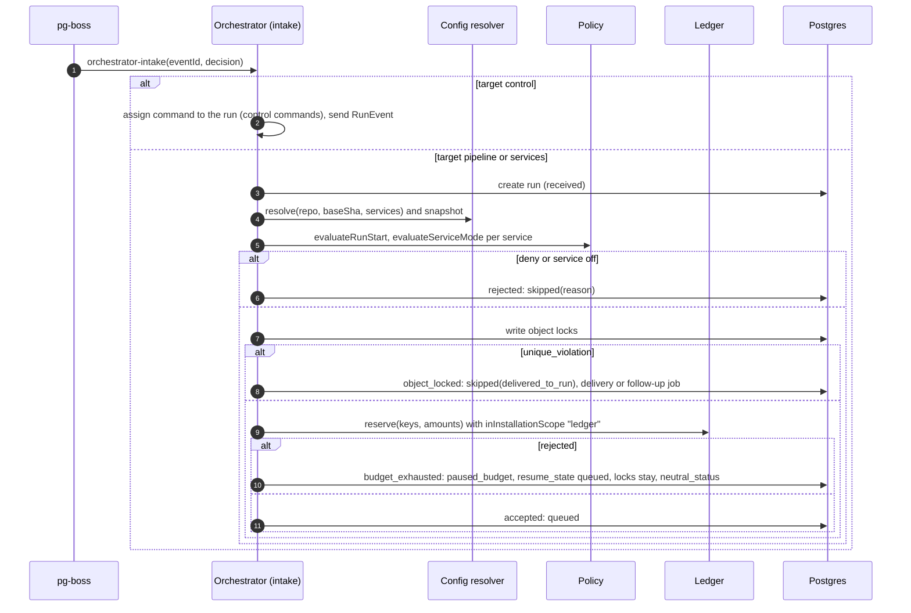

<!--
SPDX-License-Identifier: Apache-2.0
SPDX-FileCopyrightText: The Guildwork Authors
-->
# 02 Control plane

Detailed design for ingress, inbox, router, orchestrator with the run state machine, config resolver, policy and limit ledger, plus the roles `web` and `orchestrator`. Precedence and abbreviations as in [README](README.md). Rulings of this document: FE-200 to FE-299. Tables are in [01-data-model.md](01-data-model.md).

## 1. Purpose and sources

| Source | Content implemented here |
|---|---|
| [01](../architecture/01-plugin-interfaces.md) sections 1 to 3 | Plugin frame (`Result`, capabilities), normalized event schema, TriggerSource with `verify` before `parse`, `reconcile`, `poll`, `isSelf` |
| [02](../architecture/02-services.md) section 0 | `mode: off \| shadow \| live`, `on_disabled`, allowed write requests per service, command covers effect, qualification profile |
| [03](../architecture/03-flow-and-orchestration.md) in full | Flow, run state machine (section 2.1), step, work item, effect, approval (2.2), status comment (2.3), clarifying question, steering, handover (2.4), several runs on the same object (2.5), approval points (3), commands (4), failure paths (5), upgrade (6) |
| [04](../architecture/04-configuration-and-limits.md) in full | Hierarchy, inheritance rules 1 to 8, base SHA rule, `routing`, `command_permissions`, pipelines, consistency checks, provider choice, limits, installation configuration, JSON Schema with `x-qualification` |
| [05](../architecture/05-security.md) sections 2, 7, 8 | Separation of rights, command covers effect, permission profiles, tenants, visibility, Run Record |
| [06](../architecture/06-operations-and-deployment.md) | Roles `web`, `orchestrator`, `migrate`; pg-boss; metrics and alerts |
| [07](../architecture/07-eval.md) section 2 | Qualification profile, `qualification_key`, modes and gates |
| [08](../architecture/08-roadmap.md) stage 0 | Done criteria dedupe, reservation, limit abort (S3), S2 "faulty config file", S6 "completeness of the run state machine" and "object lock" |
| ADR-04, ADR-06, ADR-08, ADR-16, ADR-17, ADR-27, ADR-47, ADR-58, ADR-60, ADR-65, ADR-66, ADR-67, ADR-68 | Own state machine with pg-boss, deny by default, webhook with `reconcile`, ledger, base SHA, ledger and policy before every live run, `live` only when qualified, resolver rule ModelProvider, provenance, fail closed, profile, automaton as a table, object lock |

Not here: Work API, platform MCP, worker, sandbox (03-execution), Effect Gateway, audit chain, Credential Broker (04-effects-audit-credentials), plugin contracts other than the event schema (05-plugins-and-contracts), admin UI (06-installation-operations-ui). The control plane reaches these areas only through the ports from section 2.3.

## 2. Modules and responsibility

### 2.1 Directories

```
packages/contracts/src/services/<id>-config.ts -- TypeBox module of the keys services.<id> (FE-248), created by the task
                                -- that introduces the service; importable by @guildwork/config and by the service
packages/contracts/src/events/  -- event schema, routingName, objectKey, dedupeKey: single definition in detailed design 05
                                -- section 2.11.1 (FE-501), built in 0-E13-T02; this document uses them (FE-205, FE-206, FE-211)
packages/db/src/queue/        -- pg-boss foundation (section 4.9.1, 0-E02-T13), exported via @guildwork/db
  boss.ts                     -- QueueRuntime: start in schema pgboss, create queues, handlers, schedules
  send-in-tx.ts               -- sendInTx; if needed, forwarder from job_outbox (FE-271)
packages/config/src/
  installation/               -- loader and schema of installation.yaml: detailed design 00 section 2.8 (0-E01-T08);
                              -- 0-E06-T01 adds x-merge, x-qualification and the keys from section 7 there (FE-237)
  schema/org.ts, repo.ts, common.ts, services/<id>.ts -- TypeBox with x-qualification and x-merge; services/<id>.ts per service
                              -- re-exports the module from packages/contracts/src/services/<id>-config.ts (FE-248)
  schema/export.ts            -- writes org.schema.json, repo.schema.json to packages/config/schema/ (FE-237)
  expr/lexer.ts, parser.ts, eval.ts, contexts.ts      -- expression language for filter, required_if, auto_if, until, when (FE-207)
  load.ts                     -- read files, parse YAML, check schema with line numbers
  merge.ts                    -- hierarchy according to x-merge
  failclosed.ts               -- ADR-65
  consistency/*.ts            -- one file per consistency rule from 04 section 3, all following ConsistencyRule (FE-238)
  rules/                      -- resolver rules of the plugin areas (detailed design 05 section 2.18), also ConsistencyRule
  overrides.ts                -- setOverride, liftOverride, listOverrides (0-E06-T10)
  store.ts                    -- port ConfigStore and ConfigSources (FE-239); @guildwork/config never imports db
  qualification/               -- profile and qualification_key: detailed design 07 section 2.10 (FE-702), built in 0-E20-T05
  resolver.ts                 -- public interface
apps/control-plane/src/
  main.ts                     -- role selection (FE-200)
  roles/web.ts, roles/orchestrator.ts, roles/migrate.ts   -- roles/ops.ts belongs to detailed design 06 (FE-608)
  http/server.ts, http/health.ts
  plugins/lookup.ts           -- PluginLookup via PluginRegistry.get (FE-214, 0-E04-T02)
  plugins/context.ts          -- LoaderDeps of the control plane: makeContext and building the InstanceDecl (section 2.4, FE-216, 0-E05-T10)
  blobs/tracked.ts            -- BlobStorePort: object and blob_refs row (FE-215, 0-E04-T02)
  config/store.ts, config/sources.ts, config/caps.ts   -- KyselyConfigStore (0-E06-T05), ConfigSources via SCMProvider
                              -- (0-E06-T03), RuleCaps via PluginRegistry and drivers (0-E06-T06); FE-239
  ingress/routes.ts           -- POST /v1/ingress/:instanceId
  ingress/store.ts            -- raw body into BlobStore, inbox row
  ingress/process.ts          -- job ingress-process: verify result, parse, events, dedupe
  ingress/reconcile.ts        -- jobs trigger-reconcile, trigger-poll
  router/route.ts             -- job router-route
  router/match.ts             -- routes, commands, filters
  router/permissions.ts       -- G0, command_permissions, cache
  router/repo-mapping.ts      -- ticket to repo
  router/permissions-and.ts   -- rights AND check for ticket systems outside the SCM ([13] section 2.1.7, 8-E01-T08)
  router/route-actors.ts      -- route actors integration and bot_allowlist ([15] section 2.2 K1, 10-E02-T01, 10-E03-T01)
  orchestrator/automaton/run-automaton.v1.json        -- single source of the run automaton (ADR-67)
  orchestrator/automaton/schema.ts, load.ts, types.ts
  orchestrator/engine.ts      -- transition in one transaction
  orchestrator/side-effects.ts -- implementation of the side effects (SideEffect) per task, table in 4.4 (FE-243)
  orchestrator/intake.ts      -- job orchestrator-intake: create or deliver run, object lock
  orchestrator/create-run.ts  -- createRun for intake and eval service (FE-241, 0-E05-T03)
  orchestrator/controllers.ts, orchestrator/controller-host.ts   -- mount point and ControllerHost for
                              -- ServiceController from @guildwork/sdk-service (FE-240, FE-242, 0-E05-T09)
  orchestrator/service-loader.ts -- service loader: loadServices, registration of the controllers, McpManifestSource
                              -- ([00] FE-050, FE-244, 0-E16-T01)
  orchestrator/commands.ts    -- assign control commands to the run
  orchestrator/pipelines.ts   -- pipeline definition, stage sequence, on_disabled, single-service mapping
  orchestrator/steps.ts       -- create steps and work items, take over results
  orchestrator/deadlines.ts   -- deadlines and sweepers
  orchestrator/status-comment.ts
  orchestrator/upgrade-lift.ts
  policy/engine.ts, policy/rules/*.ts, policy/effects-table.ts, policy/service-mode.ts
  ledger/keys.ts, ledger/reserve.ts, ledger/usage.ts, ledger/settle.ts, ledger/windows.ts
  queues/names.ts             -- queue definitions (table 4.9); start and sending in the transaction from @guildwork/db (packages/db/src/queue/, 0-E02-T13)
  queues/payloads.ts          -- JobPayload (section 3); each variant is created by the task that sends it first (FE-275)
  queues/register.ts          -- registration of the handlers of all areas (section 4.9.2)
  queues/dead-letter.ts       -- handler of the queue dead-letter (0-E05-T05)
  alerts/rules/job-dead-letter.ts, ingress-rejected-burst.ts, router-permission-lookup-failed.ts, settlement-retried.ts
                              -- alert rules of this area (section 5.2, FE-274, 0-E05-T13); frame from 00 section 2.9
  ports.ts                    -- interfaces to other areas (section 2.3)
```

### 2.2 Public interfaces

```ts
// TriggerEvent, ResolvedEvent, StoredEvent, RoutingName, routingName(), objectKey(), dedupeKey():
// packages/contracts/src/events/, definition in detailed design 05 section 2.11.1 (FE-501).

// packages/config/src/resolver.ts
export interface ResolveRequest {
  tenantId: string;
  repo: RepoRef;                     // resolved target repo
  baseSha: string;                   // FE-236
  services: ServiceId[];             // services of the run (profile per service)
  userIdentityId?: string;           // user level (only preferences and tighter limits; absent until clarified, section 10)
  onUnreadable?: "error" | "fallback";   // provider error while reading: error "unavailable" (default) or fallback (4.6)
  only?: ("routing" | "command_permissions" | "services" | "pipelines")[];   // router: only these parts, no profile (4.3 step 4)
  evalConfigRef?: string;            // only case runs of the eval service: BlobStore key eval/configs/<sha256>.yaml replaces
                                     // org, group and repo level (FE-246, 07 section 2.17.2; built in 0-E20-T08)
}
export type SourceStatus = "valid" | "fallback_last_valid" | "strictest" | "absent";
export interface ResolvedSource { level: ConfigLevel; ref: string; path: string; sha: string | null; status: SourceStatus;
                                  errors?: ConfigError[] }
export type ConfigLevel = "platform" | "installation" | "org" | "repo_group" | "repo" | "path" | "user" | "override";
export interface ConfigError { key: string; line: number; column: number; message: string;
                               code: "schema" | "unknown_key" | "version" | "consistency" | "yaml" | "secret_inline" | "unavailable" }
// secret_inline: value looks like a secret (section 6); unavailable: source not readable at the provider (line, column 0)
export interface ResolveResult {
  effective: EffectiveConfig;        // typed from the schema
  hash: string;                      // sha256 over JCS(effective)
  sources: ResolvedSource[];
  fallbackUsed: boolean;
  overridesApplied: { keyPath: string; value: unknown; reason: string }[];
  warnings: { code: "loosening_ignored" | "deprecated_key"; keyPath: string; level: ConfigLevel }[];
  profiles: Record<ServiceId, { profile: QualificationProfile; qualificationKey: string }>;
}
export interface Resolver {
  resolve(req: ResolveRequest): Promise<Result<ResolveResult, ConfigError[]>>;   // errors only: consistency errors of the installation, unavailable,
                                                                                   // invalid profile file of an eval run (FE-246)
  validateFile(level: Exclude<ConfigLevel, "platform" | "path" | "user" | "override">, yamlText: string)
    : { ok: true; value: unknown } | { ok: false; errors: ConfigError[] };       // for CLI "config validate" and doctor
  snapshot(tx: StoreTx, r: ResolveResult): Promise<{ snapshotId: string }>;      // config_snapshots, deduplicated via hash
}
export function createResolver(deps: { store: ConfigStore; sources: ConfigSources; installation: LoadedInstallation;
                                       rules: ConsistencyRule[]; caps: RuleCaps; clock: Clock;
                                       services: ReadonlyMap<ServiceId, ResolverServiceInfo> }): Resolver;
export interface ResolverServiceInfo {                // per registered service, supplied by the service loader (FE-244, FE-247)
  promptStages: string[];                             // from the service manifest; empty: no contribution needed
  plugins: Record<string, string>;                    // AgentRuntime, ModelProvider, Analyzer of the service: plugin ID to version
  contribution?: ServiceProfileContribution;          // 07 section 2.10 (FE-741)
}
// resolve() reads and writes config_last_valid via deps.store in a transaction of the store's own (the error
// note remains even if the run fails afterwards); snapshot() writes in the caller's transaction.

// packages/config/src/store.ts (FE-239): @guildwork/config may only import core and contracts (00 section 2.2);
// storage and provider access go through these ports, implemented in apps/control-plane/src/config/.
export type StoreTx = unknown;                        // opaque: the app passes its Kysely tx through
export interface LastValid { sha: string; content: unknown; schemaVersion: number }
export interface ConfigStore {
  lastValid(level: "org" | "repo_group" | "repo", sourceKey: string): Promise<LastValid | null>;
  recordValid(level: "org" | "repo_group" | "repo", sourceKey: string, v: LastValid): Promise<void>;   // clears error*
  recordInvalid(level: "org" | "repo_group" | "repo", sourceKey: string, sha: string, errors: ConfigError[])
    : Promise<{ newErrorSha: boolean }>;              // true only on the first note of this error_sha; then audit config.invalid
  putSnapshot(tx: StoreTx, s: { hash: string; schemaVersion: number; effective: unknown; sources: ResolvedSource[];
              fallbackUsed: boolean; overridesApplied: unknown[]; profiles: unknown; warnings: unknown[] }): Promise<{ snapshotId: string }>;
  activeOverrides(repoKey: string): Promise<RepoOverride[]>;
  insertOverride(tx: StoreTx, o: OverrideInput, by: OverrideActor): Promise<Result<{ id: string }, { code: "conflict" }>>;
  liftOverride(tx: StoreTx, id: string, by: OverrideActor): Promise<Result<void, { code: "not_found" | "already_lifted" }>>;
}
export interface ConfigSources {                      // implemented via PluginLookup.scm (FE-214) with token profile read
  getFile(repo: RepoRef, path: string, sha: string): Promise<Result<string | null, PluginError>>;   // null = file missing
  defaultHead(repo: RepoRef): Promise<Result<string, PluginError>>;    // HEAD of the default branch (FE-230, FE-236)
  groupOf(repo: RepoRef): Promise<Result<string | null, PluginError>>; // group from agents_group or topic (FE-232, section 10)
  centralRepo(orgKey: string): RepoRef;               // <org>/.agents-platform
  evalConfig(ref: string): Promise<Result<string | null, PluginError>>;   // profile file of an eval run via BlobStorePort.get
                                                      // (FE-246, 0-E20-T08); null = object missing
}
export interface RuleCaps {                           // what consistency rules may know about plugins and drivers
  pluginLoaded(pluginId: string): boolean;            // ready or degraded (05 section 2.5)
  blobCaps(): ReadonlySet<string>;                    // capabilities of the BlobStore driver, such as OBJECT_LOCK
  repoInfo(repo: RepoRef): Promise<Result<{ visibility: "public" | "internal" | "private"; fork: boolean }, PluginError>>;
}
// QualificationProfile, buildProfile(), qualificationKey(), EffectiveServiceConfig, ResolvedInstallation,
// ServiceProfileContribution: packages/config/src/qualification/, definition in detailed design 07 section 2.10 (FE-702,
// FE-704, FE-741, FE-750); the resolver fills the inputs and calls them per service (section 4.6, FE-247).

// packages/config/src/consistency/rule.ts (FE-238): one shape for the rules from consistency/ and rules/ (05 section 2.18)
export interface EffectiveConfigView {               // read-only view of the merged configuration before the snapshot
  readonly level: ConfigLevel;                        // level whose file is currently being loaded
  readonly effective: DeepReadonly<EffectiveConfig>;
  readonly repo: RepoRef | null;                      // null for installation.yaml and the org file
  readonly installation: DeepReadonly<InstallationConfig>;   // 00 section 2.8
}
export interface ConsistencyRule {
  id: string;                                         // file name without extension, such as "data-path", "model-reachability"
  levels: ConfigLevel[];                              // levels during whose loading it runs
  check(view: EffectiveConfigView, caps: RuleCaps): Promise<ConfigError[]>;         // code "consistency"; empty = valid (FE-239)
  scope: "installation" | "service" | "runtime" | "analyzer" | "pipeline";        // what an error rejects (table 4.6)
}

// packages/config/src/expr/index.ts (FE-207)
export type ExprContext = "route.filter" | "approval.required_if" | "approval.auto_if" | "pipeline.when" | "pipeline.until"
                        | "architect.required_if" | "automaton.guard";            // paths per location in contexts.ts
export interface CompiledExpr { readonly source: string; readonly context: ExprContext; readonly paths: string[] }
export function compileExpr(source: string, context: ExprContext): Result<CompiledExpr, ConfigError>;   // unknown path: error
export function evalExpr(e: CompiledExpr, facts: Record<string, unknown>): Result<boolean, { code: "type" | "missing_fact"; path: string }>;

// packages/config/src/overrides.ts (04 section 1 rule 7, 01 section 3.6)
export interface OverrideInput { repoKey: string; keyPath: string; value: unknown; reason: string }
export type OverrideActor = { kind: "admin"; identity: string } | { kind: "orchestrator"; rule: string; ref: string };
export interface Overrides {                          // via ConfigStore; the audit is written by KyselyConfigStore (FE-239)
  set(tx: StoreTx, i: OverrideInput, by: OverrideActor): Promise<Result<{ id: string }, { code: "loosening" | "unknown_key" | "rule_not_allowed" | "conflict" }>>;
  lift(tx: StoreTx, id: string, by: OverrideActor): Promise<Result<void, { code: "not_found" | "already_lifted" }>>;
  list(repoKey?: string, opts?: { includeLifted?: boolean }): Promise<RepoOverride[]>;   // rows from repo_overrides
}
// set: "loosening" (value loosens according to x-merge), "unknown_key" (key_path not in the schema), "rule_not_allowed" (actor
// orchestrator with a rule outside ORCHESTRATOR_OVERRIDE_RULES), "conflict" (active override on the same
// key_path, partial index repo_overrides_active). ORCHESTRATOR_OVERRIDE_RULES = ["target_branch_red", "post_merge_red"]
// (11 section 3.1); further rules are added by the task that introduces them. Audit: config.override_set, config.override_lifted.

// apps/control-plane/src/policy/engine.ts
export type PolicyDecision =
  | { decision: "allow"; ruleId: PolicyRuleId }
  | { decision: "deny"; ruleId: PolicyRuleId; reason: string }
  | { decision: "require_approval"; ruleId: PolicyRuleId; gate: "G4" }
  | { decision: "shadow"; ruleId: PolicyRuleId; reason: string };
export type PolicyRuleId = `POL-${number}`;
export interface EffectPolicyInput {
  run: { id: string; kind: "pipeline" | "single_service"; pipeline?: string; state: RunState; command?: CommandName;
         repoClass: "private_own" | "external_code"; foreignInputSeen: boolean;
         commandOrigin?: string };   // events.command.origin of the triggering event (05 section 2.11.1), such as "cli" (POL-013)
  origin: "mcp" | "step_result" | "platform";   // like SubmitContext.origin (04 section 2.1.2)
  service?: ServiceId;               // for origin mcp and step_result
  serviceMode: "off" | "shadow" | "live";
  effect: { type: EffectType; target: EffectTarget; paths?: string[] };   // EffectType, EffectTarget: 04 section 2.1.1
  snapshot: EffectiveConfig;
}
export interface RunStartInput {                   // POL-050, POL-051
  run: { id: string; kind: "pipeline" | "single_service"; pipeline?: string; command?: CommandName;
         repoClass: "private_own" | "external_code" };
  services: ServiceId[];
  trigger: { actorIdentityId: string | null; isOperator: boolean };     // operator according to credential.operator
  credentialKinds: Partial<Record<ServiceId, CredentialKind>>;          // CredentialKind: 05 section 2.11.4
  ledgerReady: boolean; limitsResolved: boolean;                        // ADR-27
  dataPath: { service: ServiceId; regions: string[] }[];                // runtime and model regions per service
  snapshot: EffectiveConfig;
}
export interface ServiceModeInput {                // POL-031, POL-040 (FE-253)
  service: ServiceId; repoKey: string; qualificationKey: string; snapshot: EffectiveConfig;
  decision: ModeDecision | null;   // QualificationMatrix.decideMode (07 section 2.11), read beforehand by the intake (FE-255);
                                   // null only for mode off in the snapshot (then no call)
}
export interface WorkItemPolicyInput {             // POL-060, POL-061
  runId: string; service: ServiceId; repoClass: "private_own" | "external_code"; runsRepoCode: boolean;
  pool: { id: string; isolation: ("sysbox" | "gvisor" | "microvm")[] };
  agentCi: "checked" | "missing" | "not_required";
  snapshot: EffectiveConfig;
}
export type PolicySubject = "run_start" | "service_mode" | "command" | "effect" | "work_item" | "config";   // = CHECK in policy_decisions
export interface Policy {
  evaluateRunStart(i: RunStartInput): PolicyDecision;
  evaluateServiceMode(i: ServiceModeInput): PolicyDecision & { mode: "off" | "shadow" | "live"; unproven: boolean };
  evaluateEffect(i: EffectPolicyInput): PolicyDecision;
  evaluateWorkItem(i: WorkItemPolicyInput): PolicyDecision;        // isolation, data path, pool
  record(tx: Tx, subject: PolicySubject, input: unknown, d: PolicyDecision, ctx: { runId?: string; stepId?: string }): Promise<string>;
  readonly version: string;          // POLICY_VERSION, in the Run Record
}

// apps/control-plane/src/ledger/reserve.ts
export type BucketKeyKind = "org" | "repo_group" | "repo" | "user" | "service" | "provider" | "pool";
                                     // from 10-E05-T01 additionally "campaign" (section 4.8, FE-266, [15] FE-1534)
export interface BucketKey { kind: BucketKeyKind; value: string }
export interface ReservationRequest {
  runId: string; stepId?: string;
  keys: BucketKey[];                 // key chain from the snapshot (FE-260)
  amounts: { usd?: number; tokens: number; runs: number; concurrency: number; turns: number; wallMin: number };
  ttlS: number;
}
export type ReservationResult =
  | { ok: true; reservationId: string }
  | { ok: false; reservationId: string; rejected: { key: BucketKey; metric: "usd" | "runs" | "tokens" | "concurrency"; limit: number; used: number; reserved: number } };
export interface UsageReport {       // from the heartbeat or relay, cumulative per lease (FE-262)
  leaseId: string; source: "heartbeat" | "relay" | "model_call";
  byModel: Record<string, { provider: string; in: number; out: number; cacheRead: number; cacheWrite: number; reasoning?: number;
                            usd?: number; costSource: CostSource }>;
}
export type CostSource = "provider" | "client_estimate" | "price_table" | "subscription_utilization" | "none";
export interface Ledger {
  reserve(tx: Tx, r: ReservationRequest): Promise<ReservationResult>;
  recordUsage(tx: Tx, u: UsageReport): Promise<{ cancel: boolean; reason?: "budget_exhausted"; exceeded?: BucketKey }>;
                                     // on cancel, recordUsage itself sends the RunEvent budget_exhausted in tx (FE-265)
  settle(tx: Tx, reservationId: string): Promise<{ usd: number | null; tokens: number }>;
  release(tx: Tx, reservationId: string, reason: "cancelled" | "expired" | "failed"): Promise<void>;
  status(tx: Tx, keys: BucketKey[]): Promise<BucketStatus[]>;   // admin UI, status comment, doctor
}
export interface BucketStatus {                    // one row from buckets, window updated lazily (FE-264)
  key: BucketKey; metric: "usd" | "runs" | "tokens" | "concurrency";
  window: "hour" | "day" | "month" | "rolling_5h" | "none";
  limit: number; used: number; reserved: number; windowStart: string | null; warnedAt: string | null;
}
export function createLedger(deps: { clock: Clock; audit: AuditWriter;
                                     prices?: PriceLookup }): Ledger;   // from 8-E06-T01 ([13] section 2.6, FE-266)

// apps/control-plane/src/ledger/keys.ts (FE-260)
export interface KeyChainInput {
  orgKey: string; repoGroup: string | null; repoKey: string; userIdentityId: string | null;
  service: ServiceId; provider: string; pool: string;
}
export function keyChain(snapshot: EffectiveConfig, i: KeyChainInput): BucketKey[];             // fixed order of table 4.8
export function ensureBuckets(tx: Tx, keys: BucketKey[], snapshot: EffectiveConfig, snapshotHash: string): Promise<void>;
```

### 2.3 Ports to other areas

The control plane calls other areas only through these interfaces. Each is defined in exactly one place (consistency run 2026-11-01); `ports.ts` only re-exports them. Tests use fakes from `@guildwork/testkit`; the real wiring is created in the dummy service epic 0-E16.

| Port | Definition | Built in |
|---|---|---|
| `AuditWriter`, `AuditActor`, `AuditEntryInput` | [04](04-effects-audit-credentials.md) section 2.2.1 | 0-E08 |
| `EffectGateway` (`submit`, `submitPlatform`, `release`), `EffectType`, `EffectTarget` | [04](04-effects-audit-credentials.md) sections 2.1.1 and 2.1.2 | 0-E09 |
| `WorkItemService` (`enqueue`, `revoke` with `RevokeReason`), `WorkItemEnvelopeV1`, `StepEvent` | [03](03-execution.md) sections 2.3 and 2.4.1 | 0-E11 |
| Alert rules (`AlertRule`), table `alerts` | [00](00-codebase-and-conventions.md) section 2.9 | 0-E19 |
| `ServiceController`, `ControllerHost`, `ServiceDefinition`, `StepRequest` | [00](00-codebase-and-conventions.md) section 2.13 | 0-E16-T01 |
| `QualificationMatrix.decideMode`, `ModeDecision` | [07](07-eval-and-qualification.md) section 2.11 | 0-E20-T17 |
| `PluginRegistry` (`get`, `list`) | [05](05-plugins-and-contracts.md) section 2.5 | 0-E13-T06 |
| `LoadedDrivers` (BlobStore with capabilities), `pollDriverHealth` | [04](04-effects-audit-credentials.md) section 2.4 or driver loader | 0-E03-T01 |
| `McpManifestSource` (implemented by the service loader, FE-244) | [03](03-execution.md) section 2.5 | 0-E11-T06 (port), 0-E16-T01 (implementation) |
| `PluginContext`, `LoaderDeps`, `InstanceDecl` (implemented in `plugins/context.ts`, FE-216) | [05](05-plugins-and-contracts.md) sections 2.3 and 2.5 (FE-551) | 0-E13-T06 (port), 0-E05-T10 (implementation) |
| `KillSwitchGate.match` | [06](06-installation-operations-ui.md) section 2.16 (FE-625) | 1-E08-T04 |
| `IdentityLinkService.resolve`, `AndPermissionChecker` | [13](13-stage-8-providers-and-bases.md) sections 2.1.6 and 2.1.7 | 8-E01-T07, 8-E01-T08 |
| `PriceLookup` | [13](13-stage-8-providers-and-bases.md) section 2.6 | 8-E06-T01 |
| `IncidentIntake` (`handle`, `onTicketApplied`) | [15](15-stage-10-edge-layers.md) section 2.5.3 | 10-E03-T01 |

The order of the plan does not allow every port to have its provider built before its first user: `WorkItemService` and `StepEvent` (0-E11 depends on the whole epic 0-E05), `EffectType` and `EffectTarget` (0-E09 depends on the whole epic 0-E06) and the types from `@guildwork/sdk-service` (0-E16-T01 depends on 0-E05) are created after the tasks 0-E05-T06, 0-E05-T09 and 0-E06-T08 that need them. Section 10 recorded this as an open point with a proposal; since the catalog reconciliation of 2026-11-01 the plan implements the proposal (0-E05-T06 and 0-E05-T09 depend on 0-E11-T01 and 0-E11-T02 respectively, 0-E06-T08 on 0-E09-T01, both on 0-E13-T11 for the types from `sdk-service`), so the providers are created before the users.

```ts
// apps/control-plane/src/ports.ts
export type { AuditWriter } from "./audit/writer.js";           // 04 section 2.2.1
export type { EffectGateway } from "./effects/gateway.js";      // 04 section 2.1.2; platform effects via submitPlatform (FE-251)
export type { WorkItemService } from "./work/service.js";       // 03 section 2.4.1
export type { Clock } from "@guildwork/core";                    // in tests FakeClock from @guildwork/testkit
export type { PluginLookup } from "./plugins/lookup.js";
export type { BlobStorePort, BlobClass } from "./blobs/tracked.js";
// Alerts of this area are rules of the alert automaton (AlertRule, 00 section 2.9) that read stored facts
// and write to alerts; there is no separate alert port (section 5.2).

// apps/control-plane/src/plugins/lookup.ts (FE-214, built in 0-E04-T02): narrow view of the control plane on the
// PluginRegistry from 05 section 2.5; all areas of the control plane obtain plugins only through this.
export interface PluginLookup {
  triggerSource(pluginInstanceId: string): Result<TriggerSource, { code: "not_loaded" | "wrong_kind" }>;
  scm(pluginInstanceId: string): Result<SCMProvider, { code: "not_loaded" | "wrong_kind" }>;
  workItems(pluginInstanceId: string): Result<WorkItemProvider, { code: "not_loaded" | "wrong_kind" }>;
  scmFor(repo: RepoRef): Result<{ instanceId: string; scm: SCMProvider }, { code: "no_instance" }>;   // instance from repo.instance
}
export function createPluginLookup(registry: PluginRegistry): PluginLookup;
// PluginRegistry.get throws when failed or not loaded; lookup catches that and returns not_loaded. Callers treat
// not_loaded like a provider error with retryable = true (router: permission_lookup_failed, ingress: 503).

// apps/control-plane/src/blobs/tracked.ts (FE-215, built in 0-E04-T02)
export type BlobClass = "raw" | "quarantine" | "transcript" | "log" | "diff" | "bundle" | "artifact" | "sarif"
                      | "screenshot" | "evidence" | "export" | "audit_detail" | "eval";   // = CHECK blob_refs.class (01)
export interface BlobStorePort {
  // Order: first the blob_refs row in a separate transaction that is committed immediately (withTenant), then
  // BlobStore.put. So there is never an object without a row: if put or the caller's later transaction fails,
  // the retention job (01 section 3.11) deletes row and object after retainUntil; a missing object counts as deleted there.
  putTracked(tenantId: string, key: string, data: Uint8Array, cls: BlobClass, retainUntil: Date | null,
             meta?: { runId?: string }): Promise<{ sha256: Uint8Array; bytes: number }>;   // error: AppError "unavailable"
  get(key: string): Promise<Uint8Array | null>;          // null if the object is missing or deleted
}
export function createBlobStorePort(deps: { db: Db; blob: BlobStore; clock: Clock }): BlobStorePort;
// retainUntil per class: raw = now + retention.raw_days, quarantine = now + retention.quarantine_days (01 section 7),
// otherwise the caller's deadline. Keys: raw/<tenant>/<yyyy>/<mm>/<inboxId>, quarantine/<tenant>/<yyyy>/<mm>/<inboxId>.
// Whether the retention job treats a missing object as deleted is not specified in 01 (section 10).
```

### 2.4 Roles and processes

| Role | Runs | Start sequence | Ready when |
|---|---|---|---|
| `web` | Fastify: ingress (`/v1/ingress/*`), health; in addition it mounts the Work API and platform MCP (0-E11) and the admin API (0-E17) | `startCheck` (01 section 4.2), load configuration, load plugin registry, open HTTP | `startCheck` ok, installation configuration valid, BlobStore reachable |
| `orchestrator` | pg-boss workers of all queues from section 4.9 with `QueueDef.role = orchestrator`, schedules, sweepers; exactly one instance per installation (FE-217) | `startCheck`, load plugin registry, service loader (FE-244), start pg-boss (schema `pgboss`), create queues, register workers (handlers of the areas and `drivers-health` with `pollDriverHealth`, 04 FE-439) | `startCheck` ok, pg-boss ready |
| `migrate` | Migrator (01 section 4.1), then exit; `main.ts` builds `MigrateRoleInput` ([01](01-data-model.md) section 2.5, see below) | | |
| `ops` | Backup, restore test, subcommands `blob-init`, `pitr` ([06](06-installation-operations-ui.md) FE-608) | as there | as there |

**Invocation (FE-200):** `control-plane <roles> [<subcommand>]`, as in the Compose bundle ([06](06-installation-operations-ui.md) section 2.3): `<roles>` is one role or a comma-separated list (`web,orchestrator`); `all` stands for `web,orchestrator`. `migrate` and `ops` only run alone. Unknown role or a list containing `migrate` or `ops`: exit code 2 with a message. `main.ts` only selects the roles; the role `ops` itself is built by detailed design 06. Besides the roles, `main.ts` accepts as the first argument standalone commands that run without a role and may only stand alone: `audit-verify [--from <seq>] [--to <seq>] [--no-anchors] [--json]` passes the remaining arguments unchanged to `auditVerifyMain(argv, deps)` and ends the process with its exit code ([04](04-effects-audit-credentials.md) section 2.2.2, FE-425; the entry in `main.ts` is made by 0-E08-T03, the table of commands is created by 0-E05-T10). For this, `main.ts` holds a table `COMMANDS: Record<string, (argv, deps) => Promise<number>>`; a name that is both a role and a command makes the build fail (test `roles.argument_forms`).

**Wiring the role `migrate` (0-E05-T10):** `main.ts` loads `installation.yaml` (`startupConfig`), loads the drivers (`loadDrivers`, driver loader from 04) and resolves `database.migrate_url_ref` and `database.url_ref` with `SecretStore.get` of the loaded driver (values as `SecretValue`, never logged; the Credential Broker is not started in this role). From this, `MigrateRoleInput` is created ([01](01-data-model.md) section 2.5): `ownerUrl` and `appUrl` from the two references, `release` from the build constant, `lockWaitS` from `migrate.lock_wait_s`, `backupMaxAgeS` from `migrate.recent_backup_max_age`, `haltPoints` from `release.json` (empty until 0-E18-T12), `dryRun` from `--dry-run`. If a reference is missing or cannot be resolved, the process ends with exit code 2 and log `migrate.invalid_input` (like a missing key in 01), without calling `runMigrateRole`. `MigrateRoleDeps` come from `@guildwork/core` (logger, metrics, clock) and the audit sink from 01.

**Plugin context of the control plane (FE-216):** `plugins/context.ts` implements `LoaderDeps` from [05](05-plugins-and-contracts.md) section 2.5 for the roles `web` and `orchestrator`; both load the plugin registry at startup with the same deps. `makeContext(decl, manifest)` provides `http` with the egress allowlist from manifest and instance, `secrets` via `CredentialBroker.resolveSecret` (only references declared in the manifest and named in the instance, 04), `audit` via the `AuditWriter`, and in addition, according to 05 FE-551: for every instance of kind `SCMProvider`, `blob = { get }` via `BlobStorePort.get` (read only, for `push` of the bundle), for every `WorkItemProvider` instance with configuration key `scm` (such as `github-issues`), `scmTokens = { read(repo) }` via `CredentialBroker.mintScmToken` with profile `read` of the instance named in `scm`; all other instances lack `blob` and `scmTokens`. The same file builds the `InstanceDecl` of each instance from `org.yaml` or `installation.yaml`; for an instance of the plugin `github` it sets `config.audit_anchor_branch = installation.audit_anchor.branch` if `audit_anchor.sink` equals `scm`, otherwise `null` (05 section 7, 04 FE-407). Tests: `plugins.context_blob_only_for_scm`, `plugins.context_scm_tokens_only_with_scm_key`, `plugins.instance_decl_audit_anchor_branch`.

`control-plane all` starts both roles in one process (Compose bundle, [11](../architecture/11-installation-and-hosting.md) section 2.4); separate processes are the same codebase with one role per process (FE-200).

**Number of instances (FE-217):** The role `web` may run in any number of instances (the rate per plugin instance then applies per process, section 4.1). The role `orchestrator` runs with exactly one instance per installation. The correctness of the runs does not depend on this (transitions with `FOR UPDATE` and `run_transitions`, idempotent handlers, schedules via pg-boss), but the in-memory state of the process does: the last `HealthReport` per driver from `pollDriverHealth` (source of the alert rule `driver_unhealthy`), the plugin health state and the router's caches. The single instance is enforced by the delivery (Compose: one service `orchestrator` or `all`; Helm: `replicas` with schema `const 1` and `strategy: Recreate`, [13](13-stage-8-providers-and-bases.md) FE-1347). Allowing several instances first requires moving this state into the database; that is not part of any planned step.

**Mounting into the role `web` (FE-213):** Work API, platform MCP ([03](03-execution.md)) and admin API ([06](06-installation-operations-ui.md)) are Fastify plugins that the role `web` mounts through this interface; the wiring is created in 0-E16.

```ts
// apps/control-plane/src/roles/web.ts
export interface WebMountContext { db: Db; installation: LoadedInstallation; log: Logger; clock: Clock; plugins: PluginLookup }
export interface WebMount {
  name: string;                              // "ingress", "work-api", "platform-mcp", "oidc", "admin-api", "admin-ui"
  prefix: `/${string}`;                      // "/v1/ingress", "/work/v1", "/mcp/v1", "/oidc", "/admin/api/v1", "/admin"
                                             // ("oidc": Credential Broker, 04 FE-441, 0-E10-T02); later areas
                                             // register their mount in their own detailed design, Caddy routes in 06
  plugin: (app: FastifyInstance, ctx: WebMountContext) => Promise<void>;
  ready?(): Promise<string | null>;          // reason for /readyz 503, null = ready
}
export function startWebRole(ctx: WebMountContext, mounts: WebMount[]): Promise<{ close(graceMs: number): Promise<void> }>;
// Prefixes must not overlap; otherwise the role does not start (test roles.mount_prefix_unique).
```

**On shutdown** (`SIGTERM`): HTTP accepts no new requests, pg-boss finishes running jobs up to `orchestrator.shutdown_grace_s`, open transactions are rolled back; an aborted job is redelivered by pg-boss and is harmless thanks to idempotency.

## 3. Data

| Module | reads | writes |
|---|---|---|
| Ingress | `plugin_instances` | `inbox`, `blob_refs` |
| Ingress processing | `inbox`, `plugin_instances`, `identities` | `events`, `event_dedupe`, `identities`, `inbox.state` |
| Router | `events`, `config_snapshots` (cache), `identity_links`, `runs` (read only) | `events.state`, `events.resolved` |
| Orchestrator | all flow tables | `runs`, `run_transitions`, `run_object_locks`, `run_followups`, `run_steer_messages`, `steps`, `approvals`, `artifacts` (references), `status_comments`, `repo_overrides` (fallbacks only) |
| Config resolver | files via `SCMProvider.getFile`, `config_last_valid`, `repo_overrides` | `config_snapshots`, `config_last_valid` |
| Policy | snapshot, `qualification` and `qualification_parts` via `decideMode` ([07](07-eval-and-qualification.md) section 2.11) | `policy_decisions` |
| Ledger | `buckets`, `reservations`, `usage` | the same, `reservation_lines` |

**Queue payloads** are small and carry only IDs; content comes from the DB. Every payload has `v: 1`. The type `JobPayload` is in `apps/control-plane/src/queues/payloads.ts`; each variant is created by the task that sends it first (`ingress-process` 0-E04-T02, `router-route` 0-E04-T04, `orchestrator-intake` 0-E04-T05, `trigger-*` 0-E04-T07, `orchestrator-event` 0-E05-T02, `status-comment-render` 0-E05-T02, `orchestrator-deadline` 0-E05-T06, `ledger-settle` 0-E05-T06). In the component catalog a queue belongs to the producer if producer and handler are in different components and the producer is built earlier; the handler uses it (FE-275). A handler checks `v` and `q`; an unknown version is an error without retry (job to `dead-letter`).

```ts
type JobPayload =
  | { q: "ingress-process"; v: 1; inboxId: string; tenantId: string }
  | { q: "router-route"; v: 1; eventId: string; receivedAt: string; tenantId: string }
  | { q: "orchestrator-intake"; v: 1; eventId: string; receivedAt: string; tenantId: string; decision: RouteDecision }
  | { q: "orchestrator-intake"; v: 1; tenantId: string; start: EvalRunStartV1 }   // case runs of the eval service (4.5, FE-245);
                                     // EvalRunStartV1: 07 section 2.17.2, variant created by 0-E20-T08 (FE-275)
  | { q: "orchestrator-event"; v: 1; tenantId: string; runId: string; event: RunEvent }
  | { q: "orchestrator-deadline"; v: 1; tenantId: string; runId: string; runVersion: number; deadlineAt: string }
  | { q: "status-comment-render"; v: 1; tenantId: string; objectKey: string }
  | { q: "ledger-settle"; v: 1; tenantId: string; reservationId: string }
  | { q: "trigger-reconcile" | "trigger-poll"; v: 1; tenantId: string; pluginInstanceId: string };

interface RouteDecision {
  objectKey: string | null;
  actorIdentityId: string | null;
  target:
    | { kind: "pipeline"; pipeline: string }
    | { kind: "services"; services: ServiceId[] }
    | { kind: "control"; command: "approve_plan" | "approve_risk" | "say" | "handoff" | "resume" | "stop" | "continue" | "hold"; args: Record<string, string> }
    | { kind: "incident"; route: { index: number; pipeline?: string; services?: ServiceId[] } | null };   // from 10-E03-T01 (4.3, FE-279)
  permissions: { scm?: PermissionLevel; workItem?: PermissionLevel; checkedAt: string; source: string };
  repo: RepoRef; baseSha: string | null;
}

interface RunEvent {
  type: RunEventType;                // section 4.4
  key: string;                       // idempotency key, unique per run (run_transitions.event_key)
  source: "router" | "work_api" | "ledger" | "effect_gateway" | "timer" | "command" | "scm" | "orchestrator"
        | "killswitch";              // kill switch (06 section 2.16, from 1-E08-T04): only stop, actorIdentityId empty, FE-218
  actorIdentityId?: string;
  payload: Record<string, unknown>;  // only IDs, hashes, numbers; never foreign text
}
```

**Idempotency key `RunEvent.key`** per source (unique per run, `run_transitions.event_key`; the same fact always yields the same key):

| Source | Events | `key` |
|---|---|---|
| Intake | `accepted`, `rejected`, `object_locked`, `budget_exhausted` (reservation) | `intake:<eventId>` or, for `createRun` without an event, `intake:<runId>` |
| `command` | Control commands, `say`, `answer` | `cmd:<eventId>` |
| `work_api` | from `StepEvent` | `step:<itemId>:<t>:<leaseId or attempt>` |
| `work_api` | Result of `operatorClaimGuard` on claim (FE-249) | `operator:<itemId>:<result>` |
| `killswitch` | `stop` when a kill switch is triggered (FE-218) | `kill:<killSwitchId>` |
| `effect_gateway` | from `EffectEvent` | `effect:<effectId>:<status>` |
| `ledger` | `budget_exhausted` during the run, `settled`, settlement failed | `budget:<reservationId>`, `settle:<reservationId>`, `settle_failed:<reservationId>` |
| `timer` | `deadline` | `deadline:<runVersion>` |
| `orchestrator` | Events from controllers and guards (`g1_auto`, `design_required` etc.) | `ctl:<stepId or runVersion>:<type>` |
| `scm` | `new_push`, `ci_failed`, `pr_closed`, `merged_by_human` (delivered) | `scm:<eventId>` |
| Raise | `upgrade_lift` | `lift:<N>` |
| Dead letter handler | `error_after_retries` | `dead:<jobId>` |

## 4. Flows

### 4.1 Ingress

```mermaid
sequenceDiagram
  autonumber
  participant P as Provider (e.g. GitHub)
  participant W as Role web
  participant B as BlobStore
  participant DB as Postgres
  participant Q as pg-boss
  P->>W: POST /v1/ingress/{instanceId} (raw body, headers)
  W->>DB: ingress_instance(instanceId), without tenant context (01-data-model FE-123)
  alt unknown or not active
    W-->>P: 404 (empty body)
  end
  W->>W: size <= ingress.max_body_bytes, otherwise 413; rate per instance, otherwise 429
  W->>W: TriggerSource.verify(headers, rawBody, webhook_secret_ref) on the raw body, before any parsing
  alt signature invalid
    W->>B: raw body to quarantine/ (only up to ingress.quarantine_max_bytes and rate)
    W->>DB: inbox state quarantined, audit ingress.rejected, counter ingress_rejected
    W-->>P: 401 (empty body)
  end
  W->>DB: BlobStorePort.putTracked: commit blob_refs row (class raw)
  W->>B: put raw/<tenant>/<yyyy>/<mm>/<inboxId>
  W->>DB: BEGIN; INSERT inbox ON CONFLICT (plugin_instance_id, delivery_id) WHERE state <> 'quarantined' DO NOTHING; send ingress-process in the same transaction; COMMIT
  alt delivery ID already present
    W-->>P: 200 {"status":"duplicate"}, counter ingress_duplicate
  end
  alt BlobStore or DB not reachable
    W-->>P: 503 (provider redelivers; reconcile catches up)
  end
  W-->>P: 202 {"status":"accepted","id":"<inboxId>"}
  Q->>W: job ingress-process (role orchestrator)
```

**Endpoint** (FE-201):

| Method and path | Purpose | Responses |
|---|---|---|
| `POST /v1/ingress/{instanceId}` | Webhook, relay (such as Jira Automation) and `ci_event`; the operating mode and the signature scheme come from the plugin instance, never from the request | `202` accepted, `200` duplicate, `401` signature invalid, `404` instance unknown or not active, `413` too large, `429` rate exceeded, `503` storage not reachable |
| `GET /healthz` | Process is alive | `200` |
| `GET /readyz` | Role ready (section 2.4) | `200` or `503 {"reason": "..."}` |

Size and rate are checked before `verify`: the size via `Content-Length` and while reading the body (abort when exceeded), the rate as a token bucket per plugin instance in the process memory (`ingress.rate_per_instance_per_min`, not shared across several `web` processes; with n processes at most n times the rate applies). Error responses carry no text that reveals internals; the reason is in the log with `inboxId` or correlation ID. The response comes within `ackDeadlineMs` of the TriggerSource (GitHub 10,000 ms, 01 section 3); that is why the role `web` does not parse (FE-204).

**Headers for `verify` and `parse`:** The ingress passes the request headers unchanged (names in lower case) to `TriggerSource.verify`; for `parse` it stores only the allowlisted headers in `inbox.headers` (01, signature headers redacted), and `x-guildwork-peer` belongs to this allowlist. The header `x-guildwork-peer` is the source IP of the TCP connection: only the reverse proxy in front of the role `web` sets this header, overwriting any value sent along (Caddy in the Compose bundle, the operator's ingress in Helm operation; [13](13-stage-8-providers-and-bases.md) FE-1302, FE-1316). The ingress itself never reads it, never sets it and derives no value from `X-Forwarded-For`; a TriggerSource with an IP allowlist treats a missing header as an IP outside the list (13 FE-1316). Test `ingress.peer_header_passed_to_verify` (0-E04-T02): a set `x-guildwork-peer` reaches `verify` unchanged, a missing one stays missing.

**Processing** `ingress-process` (role `orchestrator`, caller `ingress_process` in the installation scope, because inbox and event can belong to different tenants): inbox row to `processing`, `TriggerSource.parse(headers, rawBody)` from the BlobStore; `Skipped` yields `inbox.state = skipped` with a reason; each `TriggerEvent` is stored with `objectKey`, `routingName`, `dedupeKey`. Dedupe in `event_dedupe` via `INSERT ... ON CONFLICT DO UPDATE SET hits = hits + 1 RETURNING (xmax = 0)`: only the first entry creates an event with `state = new` and the job `router-route`, later ones increase `hits` and the counter `ingress_duplicate{kind="dedupe_key"}`. `identities` is maintained by upsert over `(plugin_instance_id, provider_user_id)`; `is_self` from `TriggerSource.isSelf`.

**Tenant per event (FE-212):** The inbox row belongs to the tenant of the plugin instance. If the instance is an org instance, the event also belongs to this org tenant. If it is installation-wide (such as a GitHub App for several organizations), the processing determines the org tenant from the normalized event: `org_key = <scm>/<instance>/<where.repo.owner>` or the project of the ticket, looked up in `tenants` (`kind = 'org'`). If there is no such tenant (org not connected to the installation), the inbox row ends with `skipped` and reason `org_not_onboarded`, audit and counter `ingress_skipped{reason="org_not_onboarded"}`; no event is created. Identities, events and everything after them carry the `tenant_id` of the org tenant; every follow-up job runs with `withTenant` of this tenant.

**Reconcile and poll:** Schedule per instance (`trigger.reconcile_interval`, in operating mode `private` `trigger.poll_interval`). The job calls `reconcile(since)` or `poll(cursor)` and writes each event into the inbox the same way: raw data into the BlobStore, `delivery_id = "reconcile:" + dedupeKey` (FE-205). A caught-up event that already arrived via webhook ends at `event_dedupe`. The cursor or `since` is stored in `plugin_instances.health` (field `cursor`).

### 4.2 Event schema and normalization

The schema is `TriggerEvent` from [01](../architecture/01-plugin-interfaces.md) section 2 as a TypeBox schema in `@guildwork/contracts`, defined in [05](05-plugins-and-contracts.md) section 2.11.1 (FE-501) and built in 0-E13-T02; ingress, router and all TriggerSource plugins import it from there. Rules of this detailed design that were adopted there:

| Field | Rule |
|---|---|
| `id` | Delivery ID of the provider; for `reconcile` and `poll` `reconcile:<dedupeKey>` (FE-205) |
| `dedupeKey` | Formula in 05 section 2.11.1 according to FE-211: the object key (`where.workItem`/`change`) extends the formula from 01 so that the same action on two objects does not collide; JCS is `canonicalJson` from `@guildwork/core` ([00](00-codebase-and-conventions.md) section 2.5) |
| `text` | never in the DB, only `text_ref` and `text_sha256` (01-data-model FE-107) |
| `actor.email` | is removed before storing |
| `rawRef` | BlobStore key of the inbox |
| `editedAfterTrigger` | set by the router after a fresh re-read (section 4.3 step 3) |

Normalization test cases are fixtures under `packages/contracts/test/fixtures/events/` (recorded payloads, expectation as JSON); every new TriggerSource supplies its fixtures in its contract suite.

### 4.3 Router

```mermaid
sequenceDiagram
  autonumber
  participant Q as pg-boss
  participant R as Router
  participant C as Config resolver
  participant S as SCMProvider / WorkItemProvider
  participant DB as Postgres
  Q->>R: router-route(eventId)
  R->>DB: read event (state = new, otherwise end without effect)
  R->>R: 1 cheap filters: routingName known, bot, own identity, fork author
  R->>R: 2 repo mapping (repo_mapping, GitHub issue: same)
  R->>S: 3 fresh re-read (getItem or getChange, comment): TOCTOU
  R->>C: 4 configuration at the base SHA (only routing, command_permissions, services.*.mode, pipelines)
  R->>DB: 4a kill switch: KillSwitchGate.match per service of the target (from 1-E08-T04), hit: skipped(kill_switch)
  R->>R: 5 choose route: on, source, actor, filter, enabled; command only with a route (deny by default)
  R->>R: 6 service mode off: skipped(service_disabled)
  R->>S: 7 rights at the provider (cache router.permission_cache_s), ticket AND repo for ticket commands
  R->>DB: event routed, resolved (permission, identity), job orchestrator-intake in the same transaction
```

Every abort sets `events.state = skipped` with `skip_reason` (list below), counts `router_skipped{reason}` and writes an audit entry, except for `bot`, `self` and `no_route` without a command (noise; counter only). Visible replies exist only if the trigger was a human with a command and `routing.reply_on_skip` provides for it for that reason; the reply is a platform effect (FE-251).

| `skip_reason` | Step | Audit | Visible reply (default) |
|---|---|---|---|
| `unroutable` | 1 | no | no |
| `bot`, `self` | 1 | no | no |
| `fork_author` | 1 | yes | no |
| `repo_unresolved` | 2 | yes | Clarifying question in the ticket with repo suggestions (FE-209) |
| `edited_after_trigger` | 3 | yes | Clarifying question "Text changed after the command, please send the command again" |
| `config_unavailable` | 4 | yes | Notice on the object if the strictest level switches the service off (section 4.6) |
| `no_route` | 5 | only with a command | with a command: "Command X is not available here" |
| `filter_false` | 5 | no | no |
| `service_disabled` | 6 | yes | "Service X is off for this repo" |
| `permission` | 7 | yes | "no permission" if `routing.reply_on_skip.permission: true` |
| `permission_lookup_failed` | 7 | yes | no; event stays `new`, job is retried; after `router.max_attempts` `skipped` with an alert (section 5.2) |
| `kill_switch` | 4a (from 1-E08-T04) | yes | "Service X is halted by kill switch" ([06](06-installation-operations-ui.md) section 2.16) |
| `identity_not_linked` | 7 (from 8-E01-T08) | yes | "Account not linked" with a link ([13](13-stage-8-providers-and-bases.md) section 2.1.7, `routing.reply_on_skip.identity_not_linked`) |
| `bot_not_allowlisted` | 5 (from 10-E02-T01) | yes | no (the trigger is not a human; [15](15-stage-10-edge-layers.md) FE-1515) |
| `weak_signature` | 7 (from 10-E03-T01) | yes | no; a route with `actor: integration` falls back to "ticket only" ([15](15-stage-10-edge-layers.md) section 2.5.3) |
| `no_active_run` | Intake (control command without a matching run) | yes | "no running run" or "nothing to approve" (table of control commands in 4.4) |

**Retry and last attempt:** Provider errors with `retryable = true` and `not_loaded` from `PluginLookup` throw in the handler so that pg-boss retries with growing backoff; the event stays `new`. The handler knows the attempt from `Job.attempt`; in the last attempt (`attempt == router.max_attempts`) it sets `skipped(permission_lookup_failed)` with audit and counter instead of throwing. Errors with `retryable = false` (such as `not_found` during the fresh re-read) immediately yield `skipped(repo_unresolved)` or `skipped(edited_after_trigger)` if the object was deleted.

**Visible replies** are platform effects `comment` (`EffectGateway.submitPlatform`, `SubmitContext.origin = platform`, rule `POL-103`) with idempotency key `platform:skip:<eventId>` (04 FE-435), so at most one reply per event; the target is the object of the event. The reply has no run and no service; `EffectPolicyInput.serviceMode` is therefore `live`, and `POL-030` and `POL-031` do not apply (they check the mode of the service that an effect serves). In the installation mode `effects.mode: record`, the reply lands in the record like every effect (04 section 2.1.3 step 6).

**Mapping `routing.on` to the event (FE-206, resolved M38 in the detailed design):** The table is in one place together with `RoutingName` and `routingName()`, in [05](05-plugins-and-contracts.md) section 2.11.1 (consistency run 2026-11-01: merged there with the rows `change.labeled` and `push.default`). `null` yields `skipped(unroutable)` in step 1.

The list `on` of a route may join several names with `|` (04 section 3). A name outside this table is a schema error of the configuration.

**Filter expressions (FE-207):** `filter`, `required_if`, `auto_if`, `until` and `when` use a small expression language: literals (text in single quotes, numbers, `true`, `false`, lists), paths (`actor.kind`, `change.draft`, `item.labels`, `plan.estimate.tokens`), operators `== != < <= > >= && || !`, `in`, `contains`, functions `starts_with(a, b)`, `ends_with`, `len`. No `eval`, no loops, no side effects; an unknown path is an error when loading the configuration, not at runtime. The available paths per expression location are a schema in `packages/config/src/expr/contexts.ts`.

**Rights (G0):**
- Bots, own identity and fork authors never trigger (step 1). Exception: a route with `actor: any` and filter `actor.kind == 'human'` for automatic triage.
- Minimum right: entry in `command_permissions` for the command, otherwise `min_permission` of the route (04 section 3). Forms: `{ scm: <level> }`, `{ work_item: <level> }`, both together (AND), `any_of: [...]` (OR), `run_trigger` (trigger of the run that the command targets; checked in the orchestrator, because only it knows the run), `codeowner_of: touched_protected_paths` (checked in the orchestrator at the head SHA), `role: budget_owner` (`approvals.budget_owner`, login or team).
- Ticket commands with code consequences need both rights: ticket project via the WorkItemProvider of the ticket identity, repo via the SCMProvider of the linked SCM identity (`identity_links`, only active OAuth link). For GitHub Issues it is the same identity.
- Automatic triggers (`actor: item_author`): the ticket author is checked (03 section 1a).
- Cache: `(tenant, plugin_instance, identity, scope)` for `router.permission_cache_s`; an error at the provider is never counted as a right.
- Ticket systems outside the SCM (from 8-E01-T08): for events with `where.workItem` and empty `where.repo`, step 7 calls `AndPermissionChecker.check` from `router/permissions-and.ts` ([13](13-stage-8-providers-and-bases.md) section 2.1.7); the target repo comes from step 2, the SCM identity via `IdentityLinkService.resolve`. Result `ok` sets `RouteDecision.permissions` with `source = "<plugin>+identity_links"`, `skip` yields the `skip_reason` of the same name.

**Kill switch (step 4a, from 1-E08-T04):** After the configuration and before the route choice, the router calls `KillSwitchGate.match(tx, { tenant, service, org, repo })` ([06](06-installation-operations-ui.md) section 2.16) for every service that a matching route or the command would hit (for pipelines every service of their stages); on a hit the event ends with `skipped(kill_switch)`, audit and a visible reply according to `routing.reply_on_skip.kill_switch`. The router does not check control commands (`stop`, `hold`, `approve ...`) against the kill switch; `stop` must always go through. Creating a run without the router (`createRun`, 4.5) is checked by the intake with the same function in step 2a.

**Route actors and expression context of later stages (FE-279, [15](15-stage-10-edge-layers.md) section 2.2 K1, K2):** Besides `any` and `item_author`, `routing[].actor` knows the values `bot_allowlist` (from 10-E02-T01) and `integration` (from 10-E03-T01; required field `responsible`, exactly one login, optional `autonomy_cap` `low` or `medium`). Step 1 still discards actors of kind `bot`, `app` and `automation`, except for routes with one of these two actors: such an event continues up to step 5, and only a route with a matching `actor` can take it. `bot_allowlist`: the author of the PR is read fresh (`getChange`) and must be listed in `services.prfixer.bot_allowlist` and must not be the platform's own app, otherwise `skipped(bot_not_allowlisted)`. `integration`: `source.signature.strength` must be `strong` (otherwise `skipped(weak_signature)` for code runs), the target repo must be in `repos` of the instance, and step 7 checks the rights according to `min_permission` freshly for `responsible`; the resolved trigger is then `responsible` with `viaRule = "<route-index>:<instance>"`, and `foreignInputSeen` is always set. From 10-E03-T01 the expression context `route.filter` gets the paths `incident.severity`, `incident.repo` and `incident.source` from the event field `incident` ([15](15-stage-10-edge-layers.md) K14) in `contexts.ts`; without this field a path `incident.*` is `missing_fact` at runtime and the route does not match. The router never ends events with `routingName = alert.handoff` with `no_route`, but passes them with `target.kind = incident` (route or `null`) to the intake, which calls `IncidentIntake.handle` (4.5 step 1a).

**Result:** `RouteDecision` to `orchestrator-intake`. The router does not start a run and knows no object lock (FE-210); the orchestrator decides that.

### 4.4 Orchestrator and run state machine

**File and format (FE-220):** `apps/control-plane/src/orchestrator/automaton/run-automaton.v1.json` is the single source. The orchestrator and tests read it; TypeScript types of the states and events are generated from it at build time (`automaton/generated.ts`, a test compares). Schema:

```ts
interface AutomatonFile {
  automatonVersion: number;
  states: Record<RunState, {
    kind: "intake" | "waiting_for_lease" | "active" | "active_deterministic" | "active_effect" | "waiting" | "closing" | "end";
    mandatory?: Record<"stop" | "budget_exhausted" | "error_after_retries" | "deadline",
      ({ to: RunState; resume?: "origin" | RunState; guard?: string; effects?: SideEffect[] }
       | { stay: true; guard?: string; effects: SideEffect[] }
       | { na: string; guard?: string })[]>;      // first variant with a true guard applies, as with "on"
    on: Record<string, { to: RunState | "$resume"; guard?: string; effects?: SideEffect[]; endReason?: string }[]>;
  }>;
  upgradeFrom?: { version: number; map: Record<string, { to: RunState; resume?: RunState }> };
}
type SideEffect =
  | "release_object_locks" | "revoke_leases" | "release_reservation" | "settle_reservation" | "new_reservation"
  | "create_step" | "status_comment" | "request_approval" | "expire_approval" | "push_wip_branch" | "keep_draft_pr"
  | "neutral_status" | "audit_only" | "start_followup" | "schedule_deadline" | "emit_item_triaged"
  | "acquire_object_locks" | "recheck_merge_gate" | "store_steer_message";
```

`guard` is an expression of the language from FE-207 over the run facts (`run.kind`, `run.service`, `pipeline.has_stage`, `merge.mode`, `review.at_head`). Several entries per event are checked in order; the first with a true guard applies.

**States:** 18 non-end states (`received`, `queued`, `triaging`, `planning`, `designing`, `awaiting_input`, `awaiting_plan_approval`, `coding`, `awaiting_risk_approval`, `handed_off`, `proposing`, `verifying`, `fixing`, `merge_gate`, `merging`, `awaiting_human_review`, `paused_budget`, `merged`) and 5 end states (`done`, `skipped`, `cancelled`, `expired`, `failed`).

**Table A: mandatory events** (03 section 2.1, ADR-67). "n/a" means: the event is discarded with an audit entry, the state stays; the reason is in the file under `na`.

| State | `stop` | `budget_exhausted` | `error_after_retries` | `deadline` |
|---|---|---|---|---|
| `received` | `cancelled` | `paused_budget`, `resume_state = queued` (reservation rejected) | `failed` | n/a (immediate decision) |
| `queued` | `cancelled` | n/a (reservation exists) | `failed` (such as sandbox creation) | stays `queued`; side effect `neutral_status` "no suitable pool" or "waiting for end of maintenance" |
| `triaging` | `cancelled` | `paused_budget`, `resume_state = triaging` | `failed` | like `budget_exhausted` (wall time `wall_min`) |
| `planning` | `cancelled` | `paused_budget`, `resume_state = planning` | `failed` | like `budget_exhausted` |
| `designing` | `cancelled` | `paused_budget`, `resume_state = designing` | `failed` | like `budget_exhausted` |
| `awaiting_input` | `cancelled` | n/a (waiting, no lease) | n/a | `expired` (`ask_timeout_h`); with origin `coding` side effect `push_wip_branch` |
| `awaiting_plan_approval` | `cancelled` | n/a | n/a | `expired` (`approvals.plan_expiry_days`) |
| `coding` | `cancelled` | `paused_budget`, `resume_state = coding` | `failed` | like `budget_exhausted` |
| `awaiting_risk_approval` | `cancelled` | n/a | n/a | `expired` (`approvals.plan_expiry_days`), bundle stays in the BlobStore, nothing pushed |
| `handed_off` | `cancelled` | n/a | n/a | `expired` (`services.coder.ask_timeout_h`), branch stays |
| `proposing` | `cancelled`, side effect `keep_draft_pr` (a push already applied stays as a draft PR with status) | n/a (no LLM consumption) | `failed` | n/a |
| `verifying` | `cancelled` | `paused_budget`, `resume_state = verifying` | `failed`, side effects `keep_draft_pr`, `neutral_status` | like `budget_exhausted` |
| `fixing` | `cancelled` | `paused_budget`, `resume_state = fixing` | `failed` | like `budget_exhausted` |
| `merge_gate` | `cancelled` (PR stays open) | n/a (no LLM consumption) | `awaiting_human_review`, never `merging` | stays `merge_gate`, side effect re-check at the current SHA (end of the waiting window, condition 9) |
| `merging` | `cancelled` only with guard `!merge.call_sent`; otherwise n/a, the result decides | n/a | `awaiting_human_review` | n/a |
| `awaiting_human_review` | `cancelled` (PR stays open) | n/a | n/a | n/a (no deadline; run ends with merge or close) |
| `paused_budget` | `cancelled` | n/a (stays paused) | n/a | `expired` (`approvals.plan_expiry_days`); with origin `coding` side effect `push_wip_branch` |
| `merged` | n/a (reply "run completed") | n/a | `done`, `end_reason = settlement_retried` (settlement retried, then with a note) | n/a |

Every transition into an end state has the side effects `release_object_locks`, `revoke_leases` (if active), `release_reservation` or `settle_reservation`, `status_comment`, `start_followup`. Every transition to `paused_budget` has `revoke_leases`, `release_reservation`, `neutral_status` with a hint to `@agent continue`; the object locks stay because `paused_budget` is not an end state (FE-225). The cell `merging`/`stop` carries the guard `!merge.call_sent` (otherwise `na`), the cell `merge_gate`/`deadline` the side effect `recheck_merge_gate` with `stay: true`.

**Table B: domain events** (03 sections 2.1, 2.4, 2.5). `$resume` means: stored `resume_state`.

| State | Event (`RunEventType`) | Source | Guard | Target | Side effects |
|---|---|---|---|---|---|
| `received` | `rejected` | Orchestrator (intake) | | `skipped` | `end_reason = skipped(<reason>)`: `rule`, `permission`, `bot`, `duplicate`, `service_disabled`, `policy`; later `kill_switch` (from 1-E08-T04), `campaign_budget` (from 10-E05-T01) |
| `received` | `object_locked` | Intake | | `skipped` | `end_reason = skipped(delivered_to_run)`; event delivered to the active run |
| `received` | `accepted` | Intake (policy ok, lock obtained, reservation ok) | | `queued` | `acquire_object_locks` in the same transaction (FE-225), `create_step` first stage, `status_comment` (ack) |
| `queued` | `lease_granted` | Work API | `run.kind == 'single_service'` | State of the service (FE-221) | `schedule_deadline` |
| `queued` | `lease_granted` | Work API | Pipeline | first stage: `triaging`, `planning` or, without a planner, `coding` | `schedule_deadline` |
| `triaging` | `triage_rejected` | Step result | | `skipped` | `end_reason = skipped(triage_rejected)` |
| `triaging` | `triage_only_done` | Step result | Single-service run or G0 of the author missing | `done` | `end_reason` "waiting for a command from an authorized person" when G0 is missing |
| `triaging` | `triage_done` | Step result | Pipeline | `planning` | `emit_item_triaged`, `create_step` |
| `planning` | `ask_human` | Step result | | `awaiting_input` | `resume_state = planning`, lease released |
| `planning` | `design_required` | Orchestrator (`services.architect.required_if`) | | `designing` | `create_step` |
| `planning` | `g1_human_required` | Orchestrator (`approval.required_if` or `auto_if` not met) | | `awaiting_plan_approval` | `request_approval` G1 on the plan hash |
| `planning` | `g1_auto` | Orchestrator (`auto_if` met) | | `coding` | Approval `decided_by_kind = auto_if` |
| `planning` | `service_completed` | Step result | `run.kind == 'single_service'` | `done` | Plan artifact stays for reuse (FE-228) |
| `designing` | `ask_human` | Step result | | `awaiting_input` | `resume_state = designing` |
| `designing` | `g1_human_required`, `design_blocked` | Orchestrator | | `awaiting_plan_approval` | G1 binds plan and design hash |
| `designing` | `g1_auto` | Orchestrator | | `coding` | |
| `designing` | `service_completed` | Step result | `run.kind == 'single_service'` | `done` | |
| `awaiting_input` | `answer` | Command (next comment of an authorized person) | | `$resume` | new reservation, new work item with snapshot reference |
| `awaiting_plan_approval` | `change_request` | Command | | `planning` | new plan version |
| `awaiting_plan_approval` | `g1_granted` | Command `approve plan` | Plan and design hash equal to the current version | `coding` | Approval `granted` |
| `coding` | `ask_human` | Step result | Harness reports `RESUME` | `awaiting_input` | `resume_state = coding`, snapshot, lease released |
| `coding` | `g4_required` | Policy | | `awaiting_risk_approval` | `request_approval` G4 on the head SHA |
| `coding` | `handoff` | Command | `allow_handoff` | `handed_off` | `push_wip_branch` |
| `coding` | `bundle_ready` | Step result | | `proposing` | |
| `coding` | `self_check_failed` | Step result | after `repair_rounds` | `failed` | Bundle and report stay, no push |
| `coding` | `service_completed` | Step result | Single service `docs`, `release` | `proposing` | |
| `awaiting_risk_approval` | `g4_granted` | Command `approve risk` | CODEOWNER of the touched paths, SHA equal | `coding` | |
| `handed_off` | `resume` | Command | | `coding` | Branch including human commits as the new base; marker "foreign commit" for condition 11 |
| `handed_off` | `pr_ready_by_human` | SCM | | `awaiting_human_review` | |
| `proposing` | `draft_pr_open` | Effect Gateway | Pipeline | `verifying` | set `pr_object_key`, locks also for the PR |
| `proposing` | `draft_pr_open` | Effect Gateway | Single service `docs`, `release` | `done` | PR goes to humans, never into the merge gate |
| `proposing` | `policy_requires_g4` | Policy | | `awaiting_risk_approval` | |
| `proposing` | `policy_rejected` | Policy | | `failed` | `end_reason = failed(policy:<rule_id>)` |
| `verifying` | `needs_fix` | Step results (P0/P1, CI red, conflict) | Pipeline | `fixing` | `create_step` PR fixer or `on_disabled` |
| `verifying` | `ci_failed` | SCM (delivered) | Pipeline | `fixing` | like `needs_fix` |
| `verifying` | `green` | Step results | `merge.mode in ['human','shadow']` | `awaiting_human_review` | with `shadow` additionally store the merge gate decision (from stage 5) |
| `verifying` | `green` | Step results | `merge.mode == 'auto'` | `merge_gate` | |
| `verifying` | `new_push` | SCM (delivered) | | `verifying` | check steps redone at the new SHA |
| `verifying` | `service_completed` | Step result | `run.kind == 'single_service'` (reviewer, QA, `ask`) | `done` | |
| `fixing` | `fix_pushed` | Effect Gateway | | `verifying` | |
| `fixing` | `fix_exhausted` | Step result | Pipeline (attempts, `max_rounds`, conflict rejected, outside the assignment) | `awaiting_human_review` | |
| `fixing` | `fix_exhausted` | Step result | `run.kind == 'single_service'` | `done` | Report |
| `fixing` | `ci_failed` | SCM (delivered) | | `fixing` | taken into the running fix round, no state change |
| `fixing` | `handoff` | Command | `allow_handoff` | `handed_off` | |
| `fixing` | `service_completed` | Step result | `run.kind == 'single_service'` | `done` | |
| `merge_gate` | `gate_passed` | Orchestrator (all conditions, waiting window without objection) | | `merging` | |
| `merge_gate` | `gate_failed` | Orchestrator | | `awaiting_human_review` | Reason per condition in the status comment |
| `merge_gate` | `hold` | Command | | `awaiting_human_review` | |
| `merge_gate` | `new_push` | SCM | | `verifying` | |
| `merging` | `merged` | Effect Gateway | | `merged` | |
| `merging` | `head_moved_409` | Effect Gateway | Reviewer and QA run at the new SHA present | `merge_gate` | |
| `merging` | `head_moved_409` | Effect Gateway | otherwise | `verifying` | counts as a new push |
| `merging` | `not_mergeable_405` | Effect Gateway | | `awaiting_human_review` | Reason in the status comment |
| `awaiting_human_review` | `merged_by_human` | SCM | | `merged` | |
| `awaiting_human_review` | `pr_closed` | SCM | | `cancelled` | |
| `paused_budget` | `continue` | Command (G5, budget owner) | | `$resume` | `new_reservation`; a granted plan approval stays valid with the same plan hash |
| `merged` | `settled` | Ledger | | `done` | |
| every non-end state | `say` | Command | `allow_steer` | same state | `store_steer_message` (`run_steer_messages`); in active states to the running session if the harness supports `STEER`, otherwise and in waiting states to the next work item of the run (next fix round, next resume); never discarded (03 section 2.4) |
| every non-end state except `merge_gate` | `hold` | Command | Pipeline with agent PR | same state | `runs.hold = true` (condition 8 in the later merge gate) |

**Discarded events (FE-223):** If an event for the state is not in table A or B or no guard is true, the state does not change; `run_transitions` gets a row with `outcome = rejected_not_in_table` or `rejected_guard`, the audit entry `run.event_rejected`. If the trigger was a command from a human (`RunEvent.source = command`), the platform replies visibly "not possible in this state" (at most one reply per object and `orchestrator.reply_rate_window_s`): platform effect `comment` with idempotency key `platform:rejected:<objectKey>:<floor(epochSeconds / reply_rate_window_s)>`, so one reply per object and time window; further rejections in the window are returned by `submitPlatform` as `duplicate`. Internal events (such as a late `lease_granted`) get only audit and log.

**Single-service runs (FE-221):** A single-service run uses the same states; after `queued` it goes into the state of its service and ends after the last effect with `service_completed` in `done`.

| Service or command | Active state | End |
|---|---|---|
| `triage` | `triaging` | `triage_only_done` or `triage_rejected` |
| `planner` (`@agent plan`) | `planning` | `service_completed`, plan reusable (FE-228) |
| `architect` (`@agent architect`) | `designing` | `service_completed` |
| `reviewer` (`@agent review`, route `change.*`), `qa`, `indexer` (`@agent ask`) | `verifying` | `service_completed` |
| `prfixer` (`@agent fix`, `pipeline.ci_failed`) | `fixing` | `service_completed` or `fix_exhausted` |
| `docs`, `release` | `coding`, then `proposing` | `draft_pr_open` |
| Third-party services and `guildwork/dummy` (stage 0) | `verifying` | `service_completed` |

**Transition in one transaction (FE-222):**
1. `SELECT ... FROM runs WHERE id = $1 FOR UPDATE`.
2. `INSERT INTO run_transitions ... ON CONFLICT (run_id, event_key) DO NOTHING`; if the conflict hits, the event is a duplicate (pg-boss delivers at least once): end without effect, counter `orchestrator_duplicate_event`.
3. Determine the target from the automaton file (table A before table B, because mandatory events take precedence).
4. `UPDATE runs SET state, resume_state, version = version + 1, deadline_at, ended_at, end_reason`.
5. Carry out the side effects that only write to the DB (locks, reservation, steps, approvals), and send follow-up jobs to pg-boss in the same transaction (FE-271).
6. `AuditWriter.append(run.transition)`.
7. `COMMIT`. Only then do follow-up jobs run; if the commit fails, there is neither a state change nor a follow-up job.

**Side effects (FE-243):** `side-effects.ts` holds one function `(ctx: ControllerContext, t: TransitionInfo) => Promise<void>` per `SideEffect`, which only writes in the transaction of the transition or sends jobs via `sendInTx`; outbound calls (providers, workers) never run in the side effect itself, but via the Effect Gateway, the Work API or a follow-up job. The engine from 0-E05-T02 calls the functions through a table; a side effect whose task is still open does not throw when the automaton file is loaded, but when it is called (`AppError "not_implemented"` with the name of the side effect, the transaction rolls back, pg-boss retries). The test `engine.side_effects_complete` in 0-E05-T11 checks that every side effect with a stage 0 task is implemented in the table.

| `SideEffect` | Implementation | Port or table | Task |
|---|---|---|---|
| `audit_only` | only audit `run.transition` | `AuditWriter` | 0-E05-T02 |
| `status_comment` | `sendInTx(status-comment-render, { objectKey })` with `singletonKey = objectKey` | Queue | 0-E05-T02 (sending), 0-E05-T07 (handler) |
| `neutral_status` | like `status_comment`, plus row "neutral: <reason>" on the run (reason from the event) | Queue | 0-E05-T07 |
| `schedule_deadline` | `deadline_at` from the deadline table, `sendInTx(orchestrator-deadline, startAfter)` | Queue | 0-E05-T06 |
| `acquire_object_locks` | rows `run_object_locks` per service (section "Object lock") | Table | 0-E05-T03 |
| `release_object_locks` | `released_at = now()`, `release_reason = <end_state>` of all locks of the run in `run_object_locks` | Table | 0-E05-T03 |
| `new_reservation` | `keyChain`, `ensureBuckets`, `Ledger.reserve`; rejection yields the follow-up event `budget_exhausted` with `key = intake:<runId>:<runVersion>` | `Ledger` | 0-E05-T03 |
| `release_reservation` | `Ledger.release(reservationId, cancelled \| expired \| failed)` per target state; on the transition to `paused_budget` reason `cancelled` | `Ledger` | 0-E05-T06 |
| `settle_reservation` | `sendInTx(ledger-settle, { reservationId })` | Queue | 0-E05-T06 |
| `revoke_leases` | `WorkItemService.revoke(itemId, reason)` for every open work item of the run; `reason` from the event (`stop`, `budget_exhausted`, `deadline`) | `WorkItemService` | 0-E05-T06 |
| `create_step` | step row and `WorkItemService.enqueue` per `PlannedStep` with `workItem` (section "Steps and work items") | `WorkItemService` | 0-E05-T09 |
| `start_followup` | read and delete the `run_followups` row of the object, `createRun` with the head SHA current at that time | Table, `createRun` | 0-E05-T03 |
| `store_steer_message` | row `run_steer_messages` (text only as reference `text_ref`) | Table | 0-E05-T04 |
| `request_approval`, `expire_approval` | row `approvals` (G1 on the plan hash, G4 on the head SHA) or `state = expired` | Table | 0-E05-T04 (table), functionally from 2-E02-T09 |
| `emit_item_triaged` | event `item.triaged` as an automatic trigger according to [12](12-expansion.md) FE-1221 | as there | 7-E04-T05, 9-E06-T05 |
| `push_wip_branch` | step `coder.wip_push` via `create_step` (push to `agent/<key>-wip` without a PR, [10](10-planner-architect-coder.md) FE-1059) | `WorkItemService` | Stage 2 (coder, FE-1059) |
| `keep_draft_pr` | no write: the draft PR stays, the status comment names it | Queue `status-comment-render` | Stage 2 |
| `recheck_merge_gate` | re-check at the current SHA | Merge gate | 5-E01-T07 |

Side effects of later stages are reachable in stage 0 only for cells that concern states of later stages; until then their cases in `S6.automaton.cell.*` (0-E05-T11) do not check the throw with `not_implemented`, only state, `run_transitions` and audit, and mark the case with the task that builds the side effect.

**Object lock (FE-225, ADR-68):** In the intake the orchestrator sets the lock **before** the reservation and in the same transaction as the transition out of `received` (to `queued` or, if the reservation is rejected, to `paused_budget`). This way a paused run (not an end state) also keeps its lock, `continue` needs no new one, and an event for a locked object is delivered even with an empty budget (03 section 2.1, row `received`: delivery before reservation). Per service of the run it writes one row into `run_object_locks` (pipeline: every service of its stages, except stages with `on_disabled` and service `off` in the snapshot). A `unique_violation` on `run_object_locks_active` means: another run holds the object. Then the transaction rolls back, and a new transaction sets the run to `skipped(delivered_to_run)` via `object_locked` and delivers the event:
- if a pipeline holds the object: as a `RunEvent` to the pipeline (`ci_failed`, `new_push`, `@agent review`, `@agent fix` become events of the pipeline);
- if a single-service run of the same service holds the object: upsert into `run_followups` (one follow-up job, later ones replace it, `replaced_count + 1`); when the blocking run ends, `start_followup` starts a new run on the SHA current at that time (incrementally for the reviewer).
When a pipeline opens its agent PR, `draft_pr_open` additionally creates locks for `pr_object_key`. End states release all locks.

**Control commands (FE-227, 03 section 2.5):**

| Command | Targets | If several runs match | If none matches |
|---|---|---|---|
| `approve plan` | Run in `awaiting_plan_approval` | Clarifying question with a list from the status comment, waits for `run=<run_id>` | "nothing to approve" |
| `approve risk` | Run in `awaiting_risk_approval` | as above | "nothing to approve" |
| `continue` | Run in `paused_budget` | as above | "no paused run" |
| `resume` | Run in `handed_off` | as above | "no handover open" |
| `say`, `handoff`, `hold` | the pipeline of the object | (at most one pipeline per object) | otherwise the only active run, otherwise "no running run" |
| `stop` | every active run of the object | all | "no running run" |
| Answer to a clarifying question | Run in `awaiting_input` | like `approve plan` | Notice "deadline expired, a new run starts from the WIP branch" for an expired run |
| with `run=<run_id>` | exactly this run | | "run not found or ended" |

The router checks minimum rights from `command_permissions`; the orchestrator checks `run_trigger` and `codeowner_of`, because only it knows the run and head SHA.

**Stop by the kill switch (FE-218, from 1-E08-T04):** `KillSwitchGate.activate` ([06](06-installation-operations-ui.md) section 2.16) sends, per active run in scope, via `sendInTx` a `RunEvent { type: "stop", source: "killswitch", key: "kill:<killSwitchId>", payload: { killSwitchId } }` without `actorIdentityId`. The orchestrator accepts it like a `stop` from table A (same target states and side effects, `RevokeReason` `kill_switch`), without a rights check (`run_trigger` and `command_permissions` apply only to `source = command`) and without the visible reply "not possible" according to FE-223 (no human command); `end_reason = cancelled(kill_switch:<killSwitchId>)`, audit `run.transition` with actor `killswitch:<id>` (`AuditActor` of kind `system`, 04 section 2.2.1). In `merging` with a merge call already sent, the guard `!merge.call_sent` applies as with every `stop`.

**Result of the operator guard on claim (FE-249):** Before claiming an item with runtime kind `subscription`, the Work API calls `operatorClaimGuard` ([05](05-plugins-and-contracts.md) section 2.19, stage 1; call in the claim, 03 section 2.4.2). Result `wait`: nothing to the orchestrator. Result `blocked`: event `StepEvent item.blocked` with `reason = operator_blocked` (row `item.blocked` of the table below: state stays, `neutral_status`). Result `skipped`: `RunEvent { type: "error_after_retries", source: "work_api", key: "operator:<itemId>:skipped", payload: { reason: "operator_only", detail } }`, that is table A with `end_reason = failed(operator_only)` and a status comment; there is no separate transition from `queued` to `skipped` (the automaton stays unchanged, FE-209).

**Steps and work items:** Per active stage, `create_step` creates a step (`steps`) and, via `WorkItemService.enqueue` ([03](03-execution.md) section 2.4.1), a work item (pool, required capabilities and envelope from the snapshot and the policy `evaluateWorkItem`). `EnqueueWorkItem.maxAttempts` is `orchestrator.step_max_attempts`; the Work API counts the retries, and its `item.exhausted` is the mandatory event `error_after_retries` (03 section 2.4.1). Results arrive as `StepEvent` via `orchestrator-event` (`RunEvent.source = work_api`) and are translated as follows:

| `StepEvent` | Check | Effect in the orchestrator |
|---|---|---|
| `item.leased` | | `steps.state = leased`, `attempt` from the event; in state `queued`, for the first step, event `lease_granted` (table B) |
| `item.completed` | `steps.result_lease_id` is empty and `leaseId` is the current lease of the work item (`leases`, 03), otherwise audit `step.result_ignored` without effect | `steps.state = succeeded`, set `result_lease_id`, take over artifact rows, `ServiceController.onStepCompleted` |
| `item.failed` | as above | `ServiceController.onStepFailed` with `attemptsLeft`; with `attemptsLeft > 0` the orchestrator waits for the next attempt |
| `item.exhausted` | | `steps.state = failed`, `error_after_retries` (table A) |
| `item.blocked` | | no state change; side effect `neutral_status` with `reason` (such as `no_qualified_pool`, `no_safe_ci`) |
| `item.revoked` | | only `steps.state = cancelled`; the cause (stop, deadline, budget, kill switch) has its own event |

**Mount point of the service controllers (FE-240, FE-242, FE-244):** Services only implement `ServiceController` from `@guildwork/sdk-service` ([00](00-codebase-and-conventions.md) section 2.13), because according to 00 section 2.2 they must not import any app; the service-specific interfaces (such as `ReviewerController` in 08, `QAController` and `PrFixerController` in 11, `IndexerController` in 12) sit behind it. So there are two shapes of the same place: `ServiceController` (00, `enter`, `onStepEvent`, `onRunEvent`, `onCancel`, without app types) towards the outside and `ServiceControllerModule` (below, with `ControllerContext` and `Tx`) only in the orchestrator. `adaptServiceController(def, host)` (0-E05-T09) maps one onto the other, exactly according to the table "Service loader" in 00 section 2.13 (FE-050); the orchestrator only calls `ServiceControllerModule`, in the process of the role `orchestrator` and in the transaction of the transition.

| `ControllerDecision` (00) | `ControllerOutcome` | Event or side effect in the orchestrator |
|---|---|---|
| `{ kind: "steps", steps }` with at least one entry | `steps` | `create_step` per `StepRequest` (mapping below) |
| `{ kind: "steps", steps: [] }` or `{ kind: "wait" }` | `wait` | none; open steps continue |
| `{ kind: "event", type: "service_completed" }` | `event` | Single-service run: `service_completed` (table B); pipeline: stage result to the pipeline runner ([10](10-planner-architect-coder.md), from 2-E07-T01), in stage 0 `AppError "not_implemented"` |
| `{ kind: "event", type: "service_completed", payload: { skipped: <reason> } }` | `event` | as above; the run ends `done` with `end_reason = done(skipped:<reason>)` (the automaton knows no transition from active states to `skipped`) |
| `{ kind: "event", type: <other event of table B> }` | `event` | `RunEvent` with `source = orchestrator`, `key = ctl:<stepId or runVersion>:<type>`; a type outside table B is discarded according to FE-223 |
| `{ kind: "event", type: "error_after_retries", payload: { reason } }` | `event` | Mandatory event from table A, `end_reason = failed(<reason>)` |
| `err(AppError)` or an error thrown by the controller | `event` | like the row above with `reason = controller_error:<code>`, log `service.controller_error`, counter `guildwork.service.controller_errors`, no retry (00 FE-050) |

`onCancel` is not a shape of `ControllerOutcome`: the orchestrator calls it after the commit of a transition into an end state through `stop`, `budget_exhausted` or `deadline` (see below).

**Service loader (FE-244, built in 0-E16-T01):** `orchestrator/service-loader.ts` is the place where the role `orchestrator` loads all bundled `ServiceDefinition`s at startup ([00](00-codebase-and-conventions.md) section 2.13). The role `web` loads it as well, but only for `McpManifestSource`.

```ts
// apps/control-plane/src/orchestrator/service-loader.ts
export interface LoadedServices {
  modules: ServiceControllerModule[];                       // per service with a controller, via adaptServiceController
  manifests: ReadonlyMap<ServiceId, ServiceManifest>;       // current manifest per service (for POL-010 and routes)
  manifestSource: McpManifestSource;                        // 03 section 2.5: allowed(service) from manifests
  resolverInfo: ReadonlyMap<ServiceId, ResolverServiceInfo>;   // for createResolver (section 2.2, FE-247)
}
export function loadServices(defs: ServiceDefinition[], deps: { host: (service: ServiceId) => ControllerHost;
                             plugins: PluginLookup; log: Logger; metrics: Metrics }): Result<LoadedServices>;
// bundled.ts: export const BUNDLED_SERVICES: readonly ServiceDefinition[]   // one entry per service package in the PR of the service
```

Flow: per entry `defineService(def)` (00); `invalid` makes the start of the role fail with exit code 1 and log `service.definition_invalid`. A duplicate `manifest.id` is the same error. A manifest with commands but without `controller` also makes the start fail (like `registerControllers`); pure job services without a command have no controller (00). `manifestSource.allowed(service)` returns `{ tools: manifest.platformMcpTools, effects: manifest.effects }` of the loaded manifest, `null` for an unknown service; the list only changes with a restart of the role (service packages are part of the build). Internal services of the eval service (`eval-bare`, `eval-judge`, 07 section 2.17.3) are additionally loaded by the loader from the list `INTERNAL_SERVICES` in `apps/control-plane/src/eval/internal-services.ts` (entered by 0-E20-T08 and 0-E20-T16 respectively); they have neither a command nor a route nor keys under `services.*` and can only be started via `EvalRunStartV1` (4.5). Tests (0-E16-T01): `services.loader_rejects_duplicate_id`, `services.loader_manifest_source_matches_manifest`, `services.loader_unknown_service_null` as well as the cases from 00 section 8 (`orchestrator/service-loader > ...`).

`StepRequest` becomes `EnqueueWorkItem`: `envelope` from `job`, `kind`, `input`, `untrusted` (as `InlineInputV1`), `sandbox`, `budget` and `platformMcpTools` intersected with the manifest; pool and isolation from `Policy.evaluateWorkItem` (rejection `no_qualified_pool` or `no_safe_ci` yields `error_after_retries` with this reason, no work item); `wallMs = budget.maxWallMs`; `maxAttempts = orchestrator.step_max_attempts`. The orchestrator calls `onCancel` on the transition into an end state through `stop`, `budget_exhausted` or `deadline` after the commit (errors in it are only logged).

**ControllerHost** (`controller-host.ts`, 0-E05-T09) implements the ports from 00 section 2.13 as follows: `propose` calls `EffectGateway.submit` with `SubmitContext.origin = step_result`, the `service` of the run and the step whose result is currently being processed (in the transaction of the transition); `blobs.put(kind, data)` stores via `BlobStorePort.putTracked` under `runs/<runId>/svc/<service>/<uuid>` with class `artifact` and returns the key, `blobs.get` reads via `BlobStorePort.get`; `statusRow(run, text)` stores the row as an artifact (`kind = artifact`, `type = StatusRow`, `summary = { text }`, text after `redact` and `stripExternalLinks` from `@guildwork/core`, at most 200 characters, the most recent version per run applies) and sends `status-comment-render`; `scm(run)` provides via `PluginLookup.scmFor(run.repo)` only the read methods from `ReadonlySCM`; `log`, `clock`, `metrics`, `tracer` come from `@guildwork/core`. `ServiceRun.config` is `snapshot.effective.services.<id>`.

```ts
// apps/control-plane/src/orchestrator/controllers.ts
export interface ControllerContext {
  tx: Tx; tenantId: string; clock: Clock;
  run: { id: string; kind: "pipeline" | "single_service"; state: RunState; objectKey: string | null; repo: RepoRef;
         baseSha: string | null; command?: CommandName; snapshotId: string };
  snapshot: EffectiveConfig;
  effects: EffectGateway;                                  // write requests with origin "step_result" (04 section 2.1.2)
}
export interface PlannedStep {
  name: string;                                            // step name of the service, such as "reviewer.find"
  workItem: Omit<EnqueueWorkItem, "tenantId" | "runId" | "stepId"> | null;   // null: step without a worker (controller only)
}
export type ControllerOutcome =
  | { kind: "steps"; steps: PlannedStep[] }                // further steps of the same stage
  | { kind: "event"; type: RunEventType; payload?: Record<string, unknown> }   // domain event of table B
  | { kind: "wait" };                                      // wait for further results of parallel steps
export interface ServiceControllerModule {
  service: ServiceId;
  enter(ctx: ControllerContext): Promise<ControllerOutcome>;                  // entry into the state of the service (create_step)
  onStepEvent(ctx: ControllerContext, e: StepEvent): Promise<ControllerOutcome>;   // StepEvent: 03 section 2.4.1
  onRunEvent?(ctx: ControllerContext, e: RunEvent): Promise<ControllerOutcome | null>;   // such as new_push, answer in the thread
}
export function registerControllers(mods: ServiceControllerModule[]): void;   // service with manifest but without controller: role orchestrator does not start
export function adaptServiceController(def: ServiceDefinition, host: ControllerHost): ServiceControllerModule;   // FE-242
```

**Deadlines (FE-224):** Every transition sets `runs.deadline_at` from the configuration of the state (`wall_min` of active states, `ask_timeout_h`, `plan_expiry_days`, end of the waiting window, deadline for `queued`) and sends `orchestrator-deadline` with `startAfter = deadline_at` and `runVersion`. The job checks `runs.version`; if the run has moved since then, it ends without effect. In addition, the sweeper `orchestrator-sweep` (every minute) finds overdue runs via the index `runs_deadline`, so that no lost job swallows a deadline.

**Status comment (FE-116 in 01, 03 section 2.3):** Every transition with the side effect `status_comment` sends `status-comment-render` (pg-boss `singletonKey = objectKey`, debounce `status_comment.debounce_ms`). The job reads all active runs of the object, renders the comment (per run: state, next commands, cost so far, link into the admin UI, "standard not proven" with service names in case of a deviation) and a hidden marker `<!-- guildwork:status v1 <base64url(JSON {runs:[{run_id, svc, state, v}]})> -->`, increments `status_comments.version` by compare-and-swap and requests via `EffectGateway.submitPlatform` ([04](04-effects-audit-credentials.md) section 2.1.2) the platform effect `status_comment` with the rendered text (the executor writes it by marker as an upsert, 04 section 2.1.5); idempotency key `status:<objectKey>:<version>`. On a CAS conflict the job renders again.

**Raise on upgrade (FE-229, ADR-67):** The file of version N carries `upgradeFrom` with a mapping of every state of N-1. The job `orchestrator-upgrade-lift` (manually via `guildwork upgrade` before the next migration, in drain mode) raises all open runs with `automaton_version = N-1` to N: one transaction per run with a `run_transitions` row `event_type = upgrade_lift`, audit per run; idempotent via `event_key = lift:<N>`. A state without a mapping makes the build fail (test `automaton.upgrade_map_complete`). `doctor` lists the raised runs.

**Extensions of the automaton in later stages (FE-258):** Every change to states, events or side effects is a new file `run-automaton.v<N>.json` with `upgradeFrom` pointing to `N-1` (FE-229); the task that is merged first creates `v2`, the next one `v3`. The number is therefore not part of the specification, only the rows. Known are:

| Task | Source | States | Rows (table B or A) | New side effects and facts |
|---|---|---|---|---|
| 9-E06-T03 | [14](14-stage-9-breadth-and-hardening.md) section 2.6.3 (FE-1439) | none | `proposing` / `draft_pr_open` / guard `run.integration_conflict && services.prfixer.live` to `fixing`, side effect `create_step` (step `prfixer.conflict`); `proposing` / `draft_pr_open` / guard `run.integration_conflict` to `awaiting_human_review`, side effect `status_comment` with conflict report. Both rows come before the existing rows `proposing` / `draft_pr_open` (the first row with a true guard applies) | Facts `run.integration_conflict` (column `runs.integration_conflict`, 14 section 3) and `services.prfixer.live` (controller `prfixer` registered and `evaluateServiceMode` yields `live`) in the context `automaton.guard` |
| 9-E06-T01, 9-E06-T02 | 14 sections 2.6.1 and 2.6.2 (`POL-080`, `POL-081`) | none | no new rows, but changed guards: `verifying` / `green` to `merge_gate` only with `merge.mode == 'auto' && !run.injection_suspected && !run.human_commits_seen`, otherwise the row to `awaiting_human_review` (guard extended by `\|\| run.injection_suspected \|\| run.human_commits_seen`). G1: if `run.injection_suspected` is set, the orchestrator always sends `g1_human_required` after `planning` or `designing`, never `g1_auto` (decision before the event, no row) | Facts `run.injection_suspected`, `run.human_commits_seen` (columns in `runs`, 14 section 3) in the context `automaton.guard`; the guard change is a new automaton version; the policy rules themselves are in 4.7 |
| 10-E05-T01 | [15](15-stage-10-edge-layers.md) section 4.9 (FE-1530) | new waiting state `campaign_running` (kind `waiting`) | the seven rows of the table in 15 section 4.9 for the pipeline `campaign`; table A for `campaign_running`: `stop` to `cancelled`, `error_after_retries` to `failed`, `deadline` to `expired` (`campaign.max_days`), each with `cancel_campaign_children`; `budget_exhausted` `na` (the parent run consumes nothing). `upgradeFrom` is the identity | `SideEffect` `start_campaign_children` and `cancel_campaign_children` (implementation `CampaignController.tick` or `stop`, 15 section 2.7.2); CHECK of `runs.state` extended by `campaign_running` (15 K6) |

Each of these tasks adds, in the same PR, to the table "Side effects" above, the cases `S6.automaton.cell.*` for new cells and the tables A and B of this document; the tests `automaton.completeness.*`, `automaton.states_match_db_check` and `automaton.upgrade_map_complete` apply to every version.

### 4.5 Run start (intake)



Resolver, policy, lock and reservation run in one transaction with the transition out of `received`, so that lock, reservation and state apply together or are missing together. On `unique_violation` the transaction rolls back; a second transaction sets the run to `skipped(delivered_to_run)` and delivers.

**Order in the intake** (each step with the result on rejection):
1. `target.kind = control`: assign the control command according to the table in 4.4; hits yield one `RunEvent` per run (`source = command`, `key = cmd:<eventId>`), `events.state = delivered`; no hit yields `skipped(no_active_run)` with a reply, several yield `delivered` with a clarifying question. End.
1a. `target.kind = incident` (from 10-E03-T01, FE-279): `IncidentIntake.handle(tx, ev, target.route ? decision : null)` ([15](15-stage-10-edge-layers.md) section 2.5.3) in the same transaction; the result `ticket` or `fix_request` sets `events.state = delivered`, `skipped` sets `events.state = skipped` with the reason from the result and audit. The pipeline run on the ticket is only created after `effect.applied` of the ticket via `IncidentIntake.onTicketApplied`, which calls `createRun` with `trigger.kind = event`. End.
2. Create the run in `received` (`runs`, `automaton_version` of the loaded file, `trigger_event_id`, `events.state = run_started`).
2a. From 1-E08-T04, for every `createRun` outside the router path (eval service, probe run, campaign, `IncidentIntake.onTicketApplied`): `KillSwitchGate.match` per service; a hit yields `rejected` with reason `kill_switch` (events are checked by the router in step 4a).
3. `Resolver.resolve` (repo, base SHA, services of the target); an error (only consistency errors of the installation) yields `rejected` with reason `rule`. For every source with `status` `fallback_last_valid` or `strictest`, the intake sends the notice from 4.6 after the commit (platform effect `comment`, idempotency key `platform:config_hint@<error_sha>:<objectKey>`), so once per file SHA and object.
4. Per service read `QualificationMatrix.decideMode(service, scope, requested, qualificationKey, installation)`, then `Policy.evaluateServiceMode` with this decision (FE-255); a service with mode `off` yields `rejected` with reason `service_disabled`.
5. `Policy.evaluateRunStart`; `deny` yields `rejected` with reason `policy` and the comment "blocked by rule X".
6. `Resolver.snapshot` in the transaction, `runs.config_snapshot_id`.
7. Object locks (side effect `acquire_object_locks`); `unique_violation` as above.
8. `keyChain`, `ensureBuckets`, `Ledger.reserve` with `inInstallationScope(tx, "ledger", ...)`; rejection yields `budget_exhausted` (table A, row `received`), otherwise `accepted`.

**Run without an event (FE-241):** The eval service ([07](07-eval-and-qualification.md) section 4.2) and the probe run of the setup wizard start runs through the same steps 2 to 8:

```ts
// apps/control-plane/src/orchestrator/create-run.ts
export interface CreateRunRequest {
  tenantId: string;
  target: RouteDecision["target"];                  // pipeline or services, never control
  repo: RepoRef | null;                             // null only for eval-judge (FE-245)
  baseSha: string | null; objectKey: string;
  actorIdentityId: string | null;
  trigger: { kind: "event"; eventId: string } | EvalTriggerV1;        // EvalTriggerV1: 07 section 2.16.5
  effectSink: "live" | "record";                    // record: all effects of the run only as a record (Effect Gateway, 04)
  modeOverride?: { service: ServiceId; mode: "shadow" }[];             // probe run (06 section 2.8): before step 4 sets
                                                    // off to shadow, never live; audit run.mode_override
  eval?: {                                          // only from EvalRunStartV1 (FE-245, 0-E20-T08)
    subjectService?: ServiceId | "dummy";           // eval-bare: model, sandbox and data path of this service
    instances: { scm: string | null; workItem: string | null };   // "eval-fixture:<eval_run_id>" instead of the instance from repo
    configRef: string;                              // ResolveRequest.evalConfigRef (FE-246)
    pool: string;                                   // eval.pool: the only pool of the run's work items
    inputRefs: string[];                            // fixture or judge inputs, in the Run Record
  };
}
export interface Orchestrator {
  createRun(tx: Tx, r: CreateRunRequest): Promise<Result<{ runId: string; state: RunState },
    { code: "rejected"; reason: string }>>;          // result of steps 3 to 8; RunEvent key intake:<runId>
}
```

The intake calls `createRun` with `trigger.kind = event` and `effectSink = live`.

**Case runs of the eval service via `orchestrator-intake` (FE-245, built in 0-E20-T08):** Per case, arm and repetition, the eval service sends the payload `{ q: "orchestrator-intake", v: 1, tenantId, start: EvalRunStartV1 }` ([07](07-eval-and-qualification.md) section 2.17.2, FE-746) via `sendInTx`. The handler recognizes the variant by `start` (instead of `eventId` and `decision`) and calls `createRun` with:

| Field of `CreateRunRequest` | from `EvalRunStartV1` |
|---|---|
| `target` | `{ kind: "services", services: [start.service] }`; `start.service` may be an internal service (`eval-bare`, `eval-judge`), only on this path |
| `repo`, `baseSha`, `objectKey` | `start.repo`, `start.baseSha`, `start.objectKey` (for `eval-judge` without a repo: `repo` stays empty, object lock only via `objectKey`) |
| `actorIdentityId` | `null` |
| `trigger` | `start.trigger` (`EvalTriggerV1` or `EvalJudgeTriggerV1`); `runs.trigger_event_id` stays empty (column according to section 10) |
| `effectSink` | `record`; any other value is an error of the payload (job to `dead-letter`, audit `eval.run.failed` by the eval service) |
| `eval` | `subjectService`, `instances = { scm: start.scmInstance, workItem: start.workItemInstance }`, `configRef`, `pool`, `inputRefs` |

Deviations from the intake with an event: (a) `PluginLookup.scmFor(run.repo)` and the `ControllerHost` use `eval.instances` for this run instead of the instance from `repo.instance`, so always the fixture instance (07 section 2.17.1); (b) step 3 calls `Resolver.resolve` with `evalConfigRef = eval.configRef` (FE-246); (c) step 4: with `effectSink = record` and for internal services the effective mode is `live` without calling `decideMode`, `unproven` stays `false` (the case run is precisely measuring the qualification; according to 04 FE-403 every effect lands only in the record); `POL-031` still applies if the profile file sets `mode: off`; (d) `Policy.evaluateWorkItem` gets only `eval.pool` as a candidate; a pool that does not meet the isolation yields `no_qualified_pool` as usual; (e) the ledger chain contains the keys of the installation and `pool` (07 section 2.17.2), no org, repo or user key. Failure paths: rejection in steps 3 to 8 yields `skipped(<reason>)` as always; the eval service reads the end state from `runs` (`eval-advance`). Tests (0-E20-T08): `intake.eval_start_record_sink_enforced`, `intake.eval_start_uses_fixture_instance`, `intake.eval_start_internal_service_only_via_eval`. The Run Record carries `trigger` and `effectSink`; the Effect Gateway reads `effectSink` per run and treats `record` like `effects.mode: record` of the installation. The columns for this in `runs` (trigger without an event, `effect_sink`) are missing in [01](01-data-model.md), as is the evaluation per run in 04 (section 10).

### 4.6 Config resolver

**Sources and locations (FE-230, FE-232):**

| Level | Location | Read at |
|---|---|---|
| Platform defaults | `packages/config/src/defaults.ts` (in code, versioned) | Build |
| Installation | `installation.yaml` (file on the host or secret in the cluster) | Start and on change (signal `SIGHUP` or admin UI), error: abort start |
| Org | `<org>/.agents-platform/org.yaml` in the central repo of the org | HEAD of the default branch at run start, SHA pinned in the snapshot |
| Repo group | `<org>/.agents-platform/groups/<group>.yaml`; membership via the custom property `agents_group` of the repo, alternatively topic `agents-group-<group>`, at most one group per repo | like org |
| Repo | `.agents/config.yaml` | Base SHA (FE-236) |
| Path globs | within the repo file (`path_instructions`, `protected_paths`, rules) | Base SHA |
| Service level | `services.<id>` within each level | like the level |
| User | Preferences (only language, notification, tighter limits); there is no table for this in either 01 or 06, so the level is always `absent` until clarified (section 10) | Run start |
| Overrides | `repo_overrides` | Run start, applied last |

**Base SHA (FE-236):** PR runs: `ChangeRef.baseSha` at the trigger, pinned in the snapshot; ticket runs without a PR: HEAD of the default branch at run start. All files are read via `SCMProvider.getFile(repo, path, sha)`, never from the PR head.

**Flow per file:** parse YAML (errors with line and column), `version` required, check against the JSON Schema of the level (unknown keys are an error), compile expressions, check consistency rules of the level. On success update `config_last_valid` with SHA and content (clear error fields, `ConfigStore.recordValid`); on error set the error fields (`ConfigStore.recordInvalid`, audit `config.invalid` and counter only if `error_sha` is new). A missing file (`getFile` returns `null`) is not an error but `status = absent`. A provider error while reading (`PluginError`) never changes `config_last_valid`. With `ResolveRequest.onUnreadable = "error"` (default) `resolve` then returns `err` with `code = "unavailable"`; intake and router throw on it so that pg-boss retries. In the last attempt of their job (`Job.attempt` equal to the retry limit) they call with `onUnreadable = "fallback"`: the source gets `status = fallback_last_valid` or `strictest` as for an invalid file, without audit `config.invalid` and without a notice on the object (only log and counter `config_invalid{level}`); the resolver never retries itself. The visible notice from point 3 below is not sent by the resolver (package without Effect Gateway), but by the intake (4.5 step 3).

**Fail closed (ADR-65):** If an org, repo group or repo file is invalid:
1. If there is a valid version in `config_last_valid`, it applies (`status = fallback_last_valid`).
2. Otherwise the strictest level applies to the affected repos: all services at most `shadow`, `merge.mode: human`, `autonomy: low` (`status = strictest`).
3. The snapshot notes both (`fallback_used = true`); the control plane posts a visible notice on the PR or ticket once per file SHA (platform effect) and the admin UI shows it until a valid file is present at the base SHA.
4. The level is never silently omitted.
An invalid `installation.yaml` prevents the start of the role (the operator sees the error immediately); an invalid version at runtime (reload) keeps the running version and reports the error.

**Merging (FE-233):** Every key carries `x-merge` in the schema:

| `x-merge` | Meaning | Examples |
|---|---|---|
| `override` | inner level replaces | Prompts, `path_instructions`, `profile`, language, notifications |
| `min` | smallest value wins | Limits (`usd_*`, `runs_*`, `tokens_day`, `concurrency`, `turns`, `wall_min`) |
| `max` | largest value wins | `min_permission`, minimum isolation, entries in `command_permissions` |
| `ordered_min` | smallest value of a fixed order | `autonomy` (`low < medium < high < full`), `merge.mode` (`human < shadow < auto`), `mode` (`off < shadow < live`) |
| `union` | union | `forbidden_paths`, `protected_paths` |
| `intersect` | intersection | Provider allowlist, `allowed_regions`, pools, `analyzers` against the allowlist of the installation |
| `choose_within` | choice within the outer list | Provider or runtime choice per service |
| `installation_only` | only valid in `installation.yaml` | `qualification.allow_unproven_live`, `credentials.personal_modes`, `max_autonomy`, `merge.max_mode`, `standards.auto_activate` |

The org may only shorten `allow_unproven_live` (`intersect`); `lock: true` on a service of the org fixes `mode` for all inner levels. If an inner level tries to loosen (such as a higher limit), the outer value stays, the snapshot gets `warnings[].code = loosening_ignored`, and `@agent config` shows it (FE-231). `repo_overrides` are applied last and only to tighten; a loosening override is rejected on write.

**Consistency checks** (one file each in `consistency/`, test in S2; all reject on load):

| Rule | Source | Effect on violation |
|---|---|---|
| Data path: every runtime and every model of a service lies in `allowed_regions` of the repo class | 04 section 3 | Service rejected for the repo |
| `subscription`, `chatgpt` only with `personal_modes.<kind>.acknowledge_terms`; only services with `nativeTools` at most `read`, except `operator_test` | ADR-51, 04 section 3 | Runtime rejected |
| `operator_test`: all conditions from 05 section 6 point 9 (pool `single_operator`, `operator_only`, `operator_repos`, egress without open internet, `llm_inspection_proxy: required`, `acknowledge_risk`) | 04 section 3a | Runtime rejected |
| `verifier.build: true` only with a runtime that allows shell | 02 section 4 | Reviewer rejected |
| Model references point to reachable ModelProviders; a required single call without a reference needs an entry in `models` | ADR-58 | Service rejected |
| `merge.mode: auto` not for `external_code` (class via `SCMProvider.repoInfo`) | ADR-60 | Value set to `human`, notice |
| Coder, QA, PR fixer only with `security.agent_ci`; `agent_fork` requires `fork_owner` | ADR-59 | Service rejected (`no_safe_ci` at runtime) |
| Analyzers only from the allowlist of the installation with identical digest and license; `bundled` only with a license from `bundled_licenses` | ADR-50 | Analyzer rejected |
| Pipeline with `docs` has `merge.mode: human` | 04 section 3 | Pipeline rejected |
| `auto_close`, `auto_approve` only effective under their conditions | 04 section 3 | without effect, with a notice (no error) |
| `audit_anchor.sink: blob` requires a BlobStore with `OBJECT_LOCK` | 04 section 7 | Installation rejected |

Rules that need a plugin capability (such as `OBJECT_LOCK`, `repoInfo`) query it via `RuleCaps` (FE-239). Stage 0 builds all rules; rules for services of later stages already check their keys, even if the service does not run yet.

**Snapshot and qualification profile (ADR-66, FE-234):** Per service of the run, the resolver calls `buildProfile` and `qualificationKey` from `packages/config/src/qualification/` ([07](07-eval-and-qualification.md) section 2.10, FE-702, FE-704, built in 0-E20-T05): canonical profile with resolved model references, spelled-out default values and all keys with `x-qualification: true`; key with prefix `qk1-`.

**Inputs of `buildProfile` (FE-247, 0-E06-T07):** The resolver fills the input types from 07 FE-750 as follows: `EffectiveServiceConfig.effective` is `ResolveResult.effective`; `marked` are all keys of the composed schema with `x-qualification: true` as JSON Pointer with default value (from the schema, computed once per build); `runtime` is the entry from `plugins.runtimes[]` named by `services.<id>.runtime`, with harness and version from `pinned:<x.y.z>` and `credential_kind` of this entry and `provider`/`model` according to the provider choice from 04 section 5; `model_refs` are all roles from `services.<id>.models.*`, `gate_model` and `notes_model`; `plugins` and `prompt_stages` come from `ResolverServiceInfo` of the service (supplied by the service loader, FE-244). The resolver fills `ResolvedInstallation` from `LoadedInstallation`: `platform_release` from the build constant, `models` from `models[]` by `id`, `harness_pins` from `harness_pins`, `allow_unproven_live` from `qualification.allow_unproven_live`. As the third argument it passes `ResolverServiceInfo.contribution` of the service (`ServiceProfileContribution`, 07 FE-741), so that `prompt_v`, `derived` (such as `verifierModeEffective`, 08 FE-835) and `library_calls` go into the key; if the contribution is missing for a service with prompt stages, `buildProfile` rejects with `QUAL_CONTRIBUTION_MISSING`, and the resolver passes the error on as a `ConfigError` with `code = consistency` for this service (service rejected, run `rejected` with reason `rule`). Test `qualification_key.contribution_included` (0-E06-T07): a contribution with a different `prompt_v` yields a different key.

**Profile file of an eval run (FE-246, built in 0-E20-T08):** With `ResolveRequest.evalConfigRef` the resolver reads the file via `ConfigSources.evalConfig(ref)` (BlobStore, content-addressed) and treats it like a repo file (schema `repo.schema.json`, `version` required, consistency rules of the level `repo`), restricted to `services.<service>`, `limits` and path globs; any other top-level key is a load error `schema`. Org, group and repo levels are not read for this run (`sources[]` with `status = absent`, the fixture repo belongs to no org of the installation), `repo_overrides` do not apply; platform defaults and installation apply unchanged. `sources[]` gets a row `{ level: "repo", ref: "eval", path: <ref>, sha: <sha256 from the key> }`. An invalid or missing profile file has no fallback (`config_last_valid` is neither read nor written): `resolve` returns `err` with `code = schema` or `unavailable`, the run ends `skipped(rule)`, and the eval service counts the case as an error. Test `config.eval_config_replaces_repo_levels` (0-E20-T08). JCS is `canonicalJson` from `@guildwork/core` (RFC 8785, built in 0-E01-T02); the snapshot hash uses the same function. The snapshot (`config_snapshots`) is deduplicated via `(tenant_id, hash)`; the run references it and no longer changes when the configuration changes.

**JSON Schema (FE-237):** TypeBox definitions for org, repo group and repo in `packages/config/src/schema/`, keys of a service in `packages/config/src/schema/services/<id>.ts`; the schema of `installation.yaml` has exactly one source, `packages/config/src/installation/schema.ts` ([00](00-codebase-and-conventions.md) section 2.8), and 0-E06-T01 adds the annotations and the keys from section 7 there. `pnpm --filter @guildwork/config gen:schema` (as in 00) writes `installation.schema.json` (file from 00 section 2.8, built in 0-E01-T09, extended by the additions from 0-E06-T01), `org.schema.json` and `repo.schema.json` (Draft 2020-12, new from 0-E06-T01) to `packages/config/schema/`, published per release.

**Location of the service keys (FE-248):** The TypeBox module of the keys `services.<id>` is in `@guildwork/contracts` under `packages/contracts/src/services/<id>-config.ts` (export `<Id>ConfigSchema` and type `<Id>Config`, with `x-merge` and `x-qualification`); `packages/config/src/schema/services/<id>.ts` re-exports it and mounts it into the org, group and repo schema. This way the service (`ServiceRun.config` as `<Id>Config`, check with `compileSchema`) and the manifest field `configSchema` import the same module without importing `@guildwork/config` (00 section 2.2 allows services only `core`, `contracts`, `sdk-service`). The task that introduces a service creates both files (reviewer: 1-E01-T01; resolves 08 open point 10.15 according to its proposal). Keys outside `services.*` stay solely in `packages/config/src/schema/`. Test `schema.service_modules_from_contracts` (0-E06-T01): every module under `schema/services/` is a re-export from `@guildwork/contracts`.

**Sections with their own interface in the catalog:** The following parts of the schema are read specifically by other areas; they are created with 0-E06-T01 (examples from 04 sections 3, 3a and 7) or the named task:

| Section | Level and `x-merge` | Users |
|---|---|---|
| `approvals.protected_paths`, `approvals.plan_expiry_days`, `approvals.budget_owner` (04 section 3) | Org, group, repo, path; `protected_paths` `union`, `plan_expiry_days` `min`, `budget_owner` `override` | Policy `POL-021`, router (`role: budget_owner`), deadlines (4.4), reviewer router (depth `deep`), PR fixer (deterministic rejection) |
| `analyzers` (list of analyzer instances with `id`, `image` by digest, `license`, `distribution`, `rules`; 04 sections 3 and 3a) | Org and repo; `intersect` against `analyzers_allowlist`, the repo list extends the org list only with entries of the allowlist | Analyzer run (10 section 2.14), reviewer ingest, consistency rule "analyzers only from the allowlist" (4.6) |
| `analyzers_allowlist`, `bundled_licenses` (04 section 7) | installation only (`installation_only`), schema in `packages/config/src/installation/` (FE-237) | the same; analyzer plugins of later stages (`git-cliff`, `axe`, `infracost`) dock on via an entry here and in `analyzers` |
| `services.<id>.knowledge.use` (`off` \| `on`, [12](12-expansion.md) FE-1210) | Org, group, repo; `override`; `x-qualification: true` | Reviewer context source `kb`, triage, policy via the `qualification_key`; from 7-E02-T05 |

Test `schema.every_service_key_marked`: every key under `services.*` carries `x-qualification: true` or `false`; test `schema.every_key_has_merge`: every leaf key carries `x-merge`.

### 4.7 Policy

**Principle:** deny by default (ADR-06). The policy is a pure function over stored facts (snapshot, run state, command, qualification, repo class), never over model text or tool output (05 section 2 point 3). Every decision gets a rule ID and is stored with the hash of the canonical inputs (`sha256Hex(canonicalJson(input))`) in `policy_decisions` and in the Run Record (decision log). `Policy.version` (`POLICY_VERSION`) is `pol-` plus the first 12 hex characters of `sha256Hex(canonicalJson(...))` over the rule list with IDs and names and the tables "Command covers effect" and "Platform effects"; the build generates it so that every rule change changes the version (test `policy.version_from_rules`, 0-E06-T08).

**Rules (FE-250):**

| Rule | Checks | Result |
|---|---|---|
| `POL-001` | no other rule allows | `deny` (deny by default) |
| `POL-010` | the write request is in the list of the service (02 section 0 or `effects` of the service manifest) | otherwise `deny` |
| `POL-011` | the command or pipeline stage covers the effect (table below) | otherwise `deny` |
| `POL-012` | the platform effect is in the table of platform effects (FE-251) and its occasion exists | otherwise `deny` |
| `POL-013` (`run.origin_cli_no_effects`) | Run whose triggering event carries `command.origin = cli` (local review with `--remote`, [09](09-reviewer-companion-features-and-learnings.md) FE-947): no write request with `origin` `mcp` or `step_result` is allowed; platform effects of the run (status) remain under `POL-1nn` | `deny` with reason `origin_cli` (from 6-E04-T03) |
| `POL-020` | no path from `forbidden_paths` (incl. `.agents/**`, `.agents-platform/**`, `**/CODEOWNERS`, workflows) | otherwise `deny` |
| `POL-021` | path from `protected_paths` | `require_approval` G4 |
| `POL-022` | push only to `agent/*` (repo or agent fork) | otherwise `deny` |
| `POL-030` | service mode `shadow` | effect `shadow` (Effect Gateway writes to the eval log) |
| `POL-031` | service mode `off` | `deny` |
| `POL-040` | `live` only if `decideMode` of the qualification matrix ([07](07-eval-and-qualification.md) section 2.11, FE-708) returns `live` for the `qualification_key` of the snapshot, or a deviation from `allow_unproven_live` | otherwise mode `shadow`; on deviation `unproven = true` ("standard not proven") |
| `POL-050` | Run start: ledger, policy and limits are in place (ADR-27); credential kind allowed; with `subscription` the trigger is the operator | otherwise `deny` |
| `POL-051` | Run start: data path of the repo class | otherwise `deny` |
| `POL-060` | Work item: pool meets the minimum isolation of the repo class (the worker's report only counts at claim, 0-E11) | otherwise `deny` with `no_qualified_pool` |
| `POL-061` | Work item for coder, QA, PR fixer: CI variant checked | otherwise `deny` with `no_safe_ci` |
| `POL-062` (`policy.external_code_release`) | Work item with `runs_repo_code` on `external_code`, as long as the release constant `EXTERNAL_CODE_EXECUTION_RELEASED` in `policy/release-gates.ts` is `false` ([14](14-stage-9-breadth-and-hardening.md) FE-1426; from 9-E04-T03, released in 9-E04-T06) | `deny` with `pen_test_pending` |
| `POL-070` (`visibility.citation`) | Effect with a citation or reference: visibility of the sources not narrower than the target (ADR-63; the citation check itself is in the Effect Gateway, `checkCitations` from 6-E07-T01, ticket targets from 8-E01-T08) | otherwise `deny` |
| `POL-080` (`policy.injection_suspected`) | `runs.injection_suspected` ([14](14-stage-9-breadth-and-hardening.md) FE-1434; from 9-E06-T01) | G1 always by humans, no merge gate (guard in 4.4, FE-258) |
| `POL-081` (`policy.human_commits_seen`) | `runs.human_commits_seen` after `resume` (14 FE-1436; from 9-E06-T02); evaluated on the transition to `merge_gate` and for the platform effect `merge` | `deny` with `human_commits_seen`, run to `awaiting_human_review` |

**Command covers effect (FE-252):**

| Command or pipeline stage | Allowed effects |
|---|---|
| `review`, route `change.*` with `services: [reviewer]` | `propose_review`, `propose_check`, `propose_thread_resolve`, `propose_labels` (only with `summary.labels: apply`); `propose_reply` only as a chat reply in a platform thread or on a mention in the review thread, at most `chat.max_replies_per_thread` per thread ([09](09-reviewer-companion-features-and-learnings.md) FE-913, FE-948; from 6-E03-T02) |
| `triage`, route `work_item.created` with `services: [triage]` | `propose_comment`, `propose_labels`, `propose_link` |
| `plan` | `propose_plan`, `propose_comment` (ticket), `request_human_input` |
| `architect` | `propose_comment`, `propose_change` (only `architect.doc_paths`), `propose_check`, `request_human_input` |
| `code` or pipeline `ticket-to-pr` | per stage the effects of its service; `propose_push` only in `coding` and `fixing` |
| `qa` | Effects of `qa` |
| `fix`, route `pipeline.ci_failed` | Effects of `prfixer` |
| `ask` | `propose_comment` or `propose_reply` (reply at the place of the question; backlog M110 open) |
| `docs`, `release` | Effects of `docs` |
| `remember`, `pause`, `ignore`, `config`, `help` | only platform effects (reply, status) |
| Control commands | only platform effects |
| Third-party service command | `effects` from the service manifest, intersected with the command |

**Platform effects (FE-251, part of backlog M113):** Effects that the orchestrator triggers itself go through the same policy and the same Effect Gateway with `origin = platform`, but only from this table; each carries its occasion.

| Platform effect | Occasion | Permission profile |
|---|---|---|
| `status_comment` | Transition with side effect `status_comment` | `comment_issue` or `review` |
| `ack` | Acceptance of a command (reaction, if `ACK_REACTION`; 05 FE-510) | `comment_issue` or `review` |
| `comment` | Visible reply to a command or skip reason (section 4.3), fail closed notice | `comment_issue` or `review` |
| `audit_anchor` | Daily anchor with sink `scm` (04 section 2.2.4) | `audit_anchor` |
| `check` (only `agent-approval-check`) | New head SHA of an agent PR, human approve at the SHA (10 FE-1046, from stage 2) | `review` |
| `ready_for_review`, `request_reviewers`, `ticket_transition` | Pipeline steps from 03 section 1 (from stage 2); `ticket_transition` also links ticket and PR (04 FE-430) | `write_branch`, `review`, `comment_issue` |
| `merge` | Merge gate passed (11 FE-1143, from stage 5) | `merge` |
| `change` with bundle from the revert step | Red target branch after auto-merge (from stage 5, rule `orchestrator.revert_after_red_target`, 04 FE-429, 11 FE-1146) | `write_branch` |
| `approve_human`, `withdraw_approve` | Decision of the reviewer controller or withdrawal (09 FE-927, FE-930, from stage 6) | `review` |
| `notify` | Revert and fallback after auto-merge (11, from stage 5), kill switch (06 FE-625, from stage 1) | `comment_issue` or `review` with `comment-on-source`, otherwise none (04 section 2.1.5) |
| `code_scanning_upload` | Completed analyzer run at the checked SHA with `analyzers.upload_to_host: true` ([14](14-stage-9-breadth-and-hardening.md) FE-1440, from stage 9) | `code_scanning` |
| `issue` (occasion `incident_handoff`) | Input `incident-handoff` or `sentry` without or before the run ([15](15-stage-10-edge-layers.md) FE-1521, from stage 10) | `labels` |

The names are values of `EffectType` from [04](04-effects-audit-credentials.md) section 2.1.1 with `origin = platform` (consistency run 2026-11-01; previously with the prefix `platform_`). The revert is not a separate type (04 FE-429), and there is no platform effect `link` (04 FE-430).

**Occasion rules of the platform effects (FE-254):** Every platform effect has its own rule ID from the block `POL-100` to `POL-199`; `POL-012` remains the rejection for everything not in this table. The names in the column "Name" are the rule names that other detailed designs mention; `policy_decisions.rule_id` carries the ID (CHECK `^POL-[0-9]{3}$` in 01), `details.rule_name` the name.

| Rule ID | Name | Effect | From stage |
|---|---|---|---|
| `POL-101` | `orchestrator.status_comment` | `status_comment` | 0 |
| `POL-102` | `orchestrator.ack` | `ack` | 0 |
| `POL-103` | `orchestrator.comment` | `comment` | 0 |
| `POL-104` | `orchestrator.audit_anchor` | `audit_anchor` | 0 |
| `POL-105` | `orchestrator.agent_approval_check` | `check` (`agent-approval-check`) | 2 |
| `POL-106` | `orchestrator.mark_ready` | `ready_for_review` | 2 |
| `POL-107` | `orchestrator.request_reviewers` | `request_reviewers` | 2 |
| `POL-108` | `orchestrator.ticket_transition` | `ticket_transition` | 2 |
| `POL-109` | `orchestrator.merge_gate_passed` | `merge` (with fencing, 11 FE-1143) | 5 |
| `POL-110` | `orchestrator.revert_after_red_target` | `change`, `ready_for_review`, `request_reviewers` of the revert step | 5 |
| `POL-111` | `orchestrator.notify` | `notify` | 1 |
| `POL-112` | `reviewer.auto_approve` | `approve_human`; the occasion is the stored decision of the reviewer controller with `decision_id` on the effect (09 FE-927, section 2.9) | 6 |
| `POL-113` | `system.withdraw_approve` | `withdraw_approve`; applies regardless of the service mode, `POL-030` and `POL-031` do not apply (only withdraws rights, 09 FE-930) | 6 |
| `POL-082` | `orchestrator.code_scanning_upload` | `code_scanning_upload`: only SARIF from `analyzer_runs` at the checked SHA, only analyzers from `analyzers_allowlist`, only with `analyzers.upload_to_host` (14 FE-1440). The number was assigned by 14; it remains the only exception to the block `POL-1nn` (FE-256) | 9 (9-E07-T01) |
| `POL-114` | `orchestrator.incident_ticket` | `issue` with occasion `incident_handoff`: repo in `repos` of the instance, labels not reserved ([15](15-stage-10-edge-layers.md) FE-1521) | 10 (10-E03-T01) |

An occasion rule only checks whether its occasion exists; `POL-020` to `POL-022` and `POL-070` apply in addition. New platform effects get the next free number in this block, in the same PR as the effect.

**Rules of individual services (FE-256, block `POL-200` to `POL-299`):** Rules that restrict only write requests of one service or one of its modes in addition to `POL-010` and `POL-011` are in `policy/rules/pol-2nn.ts`, are named `<service>.<rule>` and get the next free number of this block in the PR of the service. Known are:

| Rule ID | Name | Checks | Result on violation | From task |
|---|---|---|---|---|
| `POL-201` | `docs.paths_only` | `propose_change` of the service `docs`: all paths in `docs.paths`, docstring files only with the note `comments_only_ok`, changelog only `release.changelog_path` ([15](15-stage-10-edge-layers.md) section 3.3) | `deny` | 10-E01-T03 |
| `POL-202` | `prfixer.dependency_update` | `propose_change` of the PR fixer in profile `dependency_update`: the base is the bot branch, manifest and lockfile only with the note `lockfile_regenerated`; the tool `propose_dependency` only in runs with `FixRequest.source = dependency_update` (15 K11, K15) | `deny` | 10-E02-T01 |
| `POL-203` | `prfixer.ci_doctor_issue` | `propose_issue` only from the PR fixer in mode `ci_doctor`, labels not reserved | `deny` | 10-E02-T02 |
| `POL-204` | `prfixer.ci_doctor_no_push` | in mode `ci_doctor` every write request except `propose_issue` (no push, no change) | `deny` | 10-E02-T02 |

`POLICY_VERSION` also covers this block (test `policy.version_from_rules`).

**Service mode (FE-253):** `evaluateServiceMode` takes `mode` from the snapshot, checks `POL-031`, `POL-040` and returns the effective mode together with `unproven`. The result is stored in the snapshot and in the Run Record; the Effect Gateway reads it there, never from the configuration.

### 4.8 Limit ledger

**Key chain (FE-260):** From snapshot and run, the keys `org`, `repo_group` (if a member), `repo`, `user` (trigger via the linked identity), `service`, `provider` (runtime or model instance), `pool`. For every key and every limit kind with a configured value there is a row in `buckets` (`ensureBuckets` creates missing ones and updates `limit_value` and `source_snapshot_hash`). Without a configured value there is no bucket and no limit on this key; limits per run (`usd_run`, `turns`, `wall_min`) are not buckets but part of the reservation and the run budget.

| Limit in the configuration | Bucket |
|---|---|
| `limits.org.usd_month` | `org`, `usd`, `month` |
| `limits.org.runs_day`, `limits.repo_default.runs_day`, `limits.user_default.runs_day` | `<kind>`, `runs`, `day` |
| `limits.user_default.runs_hour` | `user`, `runs`, `hour` |
| `limits.*.usd_day` | `<kind>`, `usd`, `day` |
| `limits.*.tokens_day` | `<kind>`, `tokens`, `day` |
| `limits.provider.<id>.runs_5h` | `provider`, `runs`, `rolling_5h` |
| `limits.*.concurrency`, `limits.pool.<id>.concurrency` | `<kind>`, `concurrency`, `none` |

**Reservation (04 section 6 point 1, FE-261):** All ledger operations run with `inInstallationScope(tx, "ledger", ...)` (01-data-model FE-123), because buckets of the key `pool` belong to the installation tenant and a reservation must lock them together with the buckets of the org tenant; every written row carries its `tenant_id` explicitly (bucket `pool` with the installation tenant, all others with the org tenant of the run). One transaction:
1. `SELECT ... FOR UPDATE` the buckets of the chain in a fixed order (`ORDER BY id`), so that parallel reservations do not deadlock.
2. Fixed windows: if `window_start` is before the start of the current window, `used = 0`, `warned_at = NULL`, `window_start` renewed (FE-264, no dependency on a cron).
3. Check per bucket: `used + reserved + amount <= limit_value`; for `rolling_5h`, `used` is the sum from `usage` of the last 5 hours with the key in `bucket_keys`; for `concurrency`, `used` always stays 0 and `reserved` is the sum of the held reservations, so the check is `reserved + amount <= limit_value` (no double counting).
4. All fit: `reserved += amount` per bucket, write `reservations` (`held`) and `reservation_lines`, `ok`.
5. One does not fit: change nothing except one row `reservations` with `state = rejected`, `rejected_bucket_id`, `rejected_metric`; result `ok: false` with key, limit and current level (for "status neutral with reason").

**Estimate (FE-263):** `usd = limits.service.<svc>.usd_run` (if a USD source exists, otherwise not set), `tokens = ledger.estimate.tokens_per_turn × turns`, `runs = 1`, `concurrency = 1`, `turns` and `wall_min` from the limits of the service. `ledger.estimate.tokens_per_turn` is a named value that stage 0 measures on real runs (backlog M40, M128).

**Price from the price table (FE-266, from 8-E06-T01, [13](13-stage-8-providers-and-bases.md) section 2.6, FE-1363):** With `createLedger({ prices })`, `reserve` estimates the USD amount from the price if the cost source of the provider supplies no USD and `prices.price(provider, model, now, region)` finds an entry: `usd = min(limits.service.<svc>.usd_run, prices.cost({ in: 0, out: tokens, cacheRead: 0, cacheWrite: 0 }, entry))`, that is, the estimated tokens (FE-263) entirely at the output price (upper bound without a further estimate). If `price` finds no entry (`not_found`), the upper limit `usd_run` applies as before; the audit `pricing.price_missing` and the counter are written by `@guildwork/pricing` (13). Without `prices` (stages 0 to 7) FE-263 stays unchanged. The roles `web` and `orchestrator` load `PriceLookup` at startup with `loadPriceLookup` (13). Test `ledger.reserve_uses_price_table` (8-E06-T01).

**Campaign key (FE-266, from 10-E05-T01, [15](15-stage-10-edge-layers.md) section 2.7.2, FE-1534):** `BucketKeyKind` gets `campaign` with value `<campaignId>` (CHECK of `buckets.key_kind` in 01 section 3.6, migration of stage 10). The buckets are created by `CampaignController` on the transition to `campaign_running` (`metric` `tokens`, with a set budget also `usd`, window `none`); for child runs (`runs.campaign_id` set) `keyChain` appends the key `campaign` last. The check stays atomic across all keys (FE-261). If `reserve` rejects only at this key (`rejected.key.kind = campaign`), the intake of the child sends, instead of `budget_exhausted` on the child, the event `campaign_budget_exhausted` to the parent run (table in 4.4, FE-258), and the child run ends via `rejected` with reason `campaign_budget` in `skipped` (lock and reservation are rolled back in the same transaction); the child stays `pending` in `campaign_children` and restarts after the budget is raised (15 section 4.9). The test `S3.limit.<level>` gets the case `campaign` (10-E05-T03).

**During the run (point 2):** The worker reports the cumulative usage per model in the heartbeat; the relay reports per response. `recordUsage` computes the delta against `leases.usage_reported` (FE-262), writes `usage` rows, increases `reservation_lines.consumed` and `buckets.used`. If `consumed` exceeds the reservation of a row or a bucket exceeds its limit, it answers `cancel: true`; the Work API passes this on to the worker in the heartbeat. `recordUsage` notifies the orchestrator itself (FE-265): in the same transaction `sendInTx(orchestrator-event, RunEvent { type: budget_exhausted, source: ledger, key: budget:<reservationId>, payload: { keyKind, metric } })`; the key turns repeated reports from heartbeat and relay into duplicates. If a bucket reaches `limits.warn_at_percent`, it sets `warned_at` once per window and logs `ledger.warn_threshold` with key and fill level; the alert is computed from `buckets` by the rule `budget_threshold` of the alert state machine ([00](00-codebase-and-conventions.md) section 2.9), there is no separate alert `budget_warning`.

**After the run (point 3):** `settle` closes the reservation (`settled`), releases `reserved`, books deviations between reported and final usage as `source = settlement` and sets `runs.cost_usd` from `usage` (NULL if no row carries USD). Cost source per row: `provider`, `client_estimate`, `price_table`, `subscription_utilization`. Subscription runs book runs and tokens, no USD.

**Release without settlement:** `release` on `cancelled`, `expired`, `failed` and on the transition to `paused_budget`; usage already reported stays booked. The sweeper `ledger-expire` closes held reservations after `expires_at` with `expired` and audit `ledger.reservation_expired` (safety net).

**Job `ledger-settle`:** The handler calls `settle` with `inInstallationScope(tx, "ledger", ...)` and then sends `RunEvent settled` (`key = settle:<reservationId>`) to the run waiting in `merged`; in other end states the run has already ended, and `settle` only closes the reservation. If `settle` throws, pg-boss retries up to the limit of table 4.9; in the last attempt the handler sends `error_after_retries` (`key = settle_failed:<reservationId>`) instead of throwing, audit `ledger.settlement_retried`, and the run ends according to table A in `done` with `end_reason = settlement_retried`; the reservation stays `held` until `ledger-expire`.

**Abort (S3):** Exceeding a limit at any level aborts hard: before the run by rejecting the reservation (`paused_budget`), during the run by `cancel` in the heartbeat and by the relay (which blocks when the budget is exhausted, 0-E12). The result is always `neutral` with a reason and a hint to G5, never silent green.

### 4.9 Queues (pg-boss)

Names only from `[a-z0-9-]` (FE-270). Values are starting values (estimate); the API names of the pg-boss options are unverified against the pinned version and are proven by a test in 0-E02-T13 before ingress and router (0-E04) build on them.

| Queue | Role | Producer | Retry | Expiry | Special feature |
|---|---|---|---|---|---|
| `ingress-process` | orchestrator | Ingress | 5, growing backoff from 5 s | 120 s | `singletonKey = inboxId` |
| `trigger-reconcile` | orchestrator | Schedule per instance (`trigger.reconcile_interval`) | 3 | 300 s | |
| `trigger-poll` | orchestrator | Schedule per instance (`trigger.poll_interval`, operating mode `private`) | 3 | 120 s | |
| `router-route` | orchestrator | Ingress processing | `router.max_attempts` (5), growing backoff | 120 s | Provider errors are retried |
| `orchestrator-intake` | orchestrator | Router | 5 | 120 s | |
| `orchestrator-event` | orchestrator | Work API, Effect Gateway, ledger, timer, commands | 10, growing backoff | 60 s | Order per run via `FOR UPDATE` |
| `orchestrator-deadline` | orchestrator | every transition with a deadline | 5 | 60 s | `startAfter = deadline_at` |
| `orchestrator-sweep` | orchestrator | Schedule every minute | none | 50 s | Deadlines, orphaned steps, `queued` past its deadline |
| `orchestrator-upgrade-lift` | orchestrator | `guildwork upgrade` | 3 | 3600 s | Installation scope |
| `status-comment-render` | orchestrator | Transitions | 5 | 60 s | `singletonKey = objectKey`, debounce |
| `ledger-settle` | orchestrator | Transition into an end state or `merged` | 10 | 60 s | Error after retries: `error_after_retries` to `merged` |
| `ledger-expire` | orchestrator | Schedule every 5 minutes | none | 240 s | |
| `db-partition-maintenance` | orchestrator | Schedule daily | 3 | 600 s | 01 section 3.10 |
| `db-retention` | orchestrator | Schedule hourly | 3 | 3000 s | 01 section 3.11 |
| `work-reaper` | orchestrator | Schedule every `work.reaper_interval_s` | none | 60 s | expired leases ([03](03-execution.md) section 4.2) |
| `work-blocked-scan` | orchestrator | Schedule every 30 s | none | 60 s | set `blocked_reason` (03 section 2.4.2) |
| `work-artifact-rescan` | orchestrator | Work API per stored artifact of the kinds `log`, `transcript`, `bundle`, `egress_log` | 3 | 600 s | Rescan (03 section 4.3) |
| `effects-dispatch` | orchestrator | Effect Gateway after the commit | `effects.retry.max_attempts` | 120 s | `singletonKey = effectId` ([04](04-effects-audit-credentials.md) section 2.1.4) |
| `audit-anchor` | orchestrator | Schedule daily at `audit_anchor.at_utc` | up to 6 h with growing backoff | 600 s | 04 section 2.2.3 |
| `broker-rotate-keys` | orchestrator | Schedule | 3 | 300 s | 04 section 2.3.3 |
| `drivers-health` | orchestrator | Schedule every 60 s; from 9-E02-T04 every `drivers.health_interval_s` | none | 50 s | 04 section 2.4.1, the handler `pollDriverHealth` is registered by the role itself (04 FE-439); 9-E02-T04 extends it by `DriverHealthMonitor.tick` (14 section 2.2.4, FE-278) |
| `alerts-evaluate` | orchestrator | Schedule every `alerts.evaluate_interval` | none | Interval | Singleton ([00](00-codebase-and-conventions.md) section 2.9) |
| `eval-advance` | orchestrator | Schedule every `eval.advance_interval_s` | none | 60 s | Eval service ([07](07-eval-and-qualification.md) FE-740, 0-E20-T08) |
| `qualification-online-check` | orchestrator | Schedule daily | 3 | 600 s | Reference service ([07](07-eval-and-qualification.md) section 2.12, 0-E20-T20) |
| `update-check` | orchestrator | Schedule `0 4 * * *` | none (next tick) | 60 s | `singletonKey = update-check`; only with `telemetry.update_check` and without `air_gap` ([06](06-installation-operations-ui.md) section 2.9, 0-E18-T16) |
| `telemetry-send` | orchestrator | Schedule `0 4 * * 1` | none (next tick) | 120 s | only with `telemetry.endpoint` set (06 section 2.9, 0-E18-T16) |
| `ops-backup` | ops | Schedule `backup.schedule` | none (next tick) | `backup.max_duration_min` | `singletonKey = ops-backup`; handler only in the role `ops` ([06](06-installation-operations-ui.md) FE-648, 0-E18-T10) |
| `ops-restore-test` | ops | Schedule `backup.restore_test.schedule` | none | `backup.max_duration_min` | `singletonKey = ops-restore-test`; handler only in the role `ops` (06 FE-648, 0-E18-T10) |
| `dead-letter` | orchestrator | pg-boss after the last retry | none | 60 s | Handler `queues/dead-letter.ts` (4.9.2), alert `job_dead_letter` (5.2) |

Step events of the Work API (`StepEvent`, 03) and effect events of the Effect Gateway (`EffectEvent`, 04) run as `RunEvent` via `orchestrator-event`; other detailed designs only name names from this table (consistency run 2026-11-01). Later stages add their queues here, in the same PR as the handler; the values for retry and expiry are set by the document of the area, the row here refers to it. Known queues of later stages (the row comes with the task):

| Queue | Task | Source |
|---|---|---|
| `work-snapshots-expire` | 2-E01-T13 | [10](10-planner-architect-coder.md) section 2.9 |
| `qa-quarantine-expire` | 3-E04-T02 | [11](11-qa-prfix-automerge.md) section 3.4 (values there) |
| `prfixer-ci-poll` | 4-E01-T08 | [11](11-qa-prfix-automerge.md) section 3.4 |
| `merge-post-watch-poll`, `merge-post-watch-timeout` | 5-E02-T04 | [11](11-qa-prfix-automerge.md) section 3.4 |
| `merge-autonomy-refresh` | 5-E03-T01 | [11](11-qa-prfix-automerge.md) section 3.4 |
| `merge-shadow-revert-scan` | 5-E03-T02 | [11](11-qa-prfix-automerge.md) section 3.4 |
| `plugin-subprocess-reconnect` | 9-E05-T02 | [14](14-stage-9-breadth-and-hardening.md) section 3 |
| `effects-ack-fast` | 9-E02-T01 | [14](14-stage-9-breadth-and-hardening.md) section 3 |
| `broker-rotate-static-tokens` | 9-E01-T04 | [14](14-stage-9-breadth-and-hardening.md) section 3 |
| `kb-doc-sources` | 9-E07-T04 | [14](14-stage-9-breadth-and-hardening.md) section 2.7.4 |
| `dev-auth-cleanup` | 6-E04-T04 | [09](09-reviewer-companion-features-and-learnings.md) |
| `analytics-rollup`, `analytics-reconcile`, `analytics-report` | 6-E05-T01, 6-E05-T03, 6-E05-T06 | [09](09-reviewer-companion-features-and-learnings.md) |
| `learnings-activate-due`, `learnings-votes`, `learnings-expire-due` | 7a-E01-T05, 7a-E01-T06 | [09](09-reviewer-companion-features-and-learnings.md) |
| `indexer-l5` | 7a-E02-T02 | [09](09-reviewer-companion-features-and-learnings.md) or [12](12-expansion.md) |

Values for retry and expiry of the rows `eval-advance`, `qualification-online-check`, `update-check`, `telemetry-send`, `ops-backup` and `ops-restore-test` are starting values of this document (07 and 06 only name the interval or schedule); `dead-letter` itself gets no dead letter queue. The column "Role" is `QueueDef.role` (4.9.2, FE-278): the role `ops` registers only its two queues, the role `orchestrator` all others; no queue has handlers in both roles.

Jobs are sent in the same transaction as the DB change that triggers them (FE-271): pg-boss accepts its own DB object of the transaction for this (unverified). If the pinned version does not support this, a separate table `job_outbox` (columns queue, payload, `send_after`) with a forwarder in the orchestrator is added; the decision is made in 0-E02-T13 with test `queues.send_is_transactional`; the foundation (start in schema `pgboss`, sending in the transaction) is therefore in `@guildwork/db` (`packages/db/src/queue/`), queue definitions and registration of the handlers in 0-E05-T05.

#### 4.9.1 Foundation in @guildwork/db

Interface of the pg-boss foundation (FE-272). The option names of pg-boss stay behind this interface; which pg-boss option each field maps to is proven by 0-E02-T13 (unverified until then).

```ts
// packages/db/src/queue/boss.ts and send-in-tx.ts, exported via @guildwork/db
export type QueueName = string & { readonly __brand: "QueueName" };
export function queueName(n: string): QueueName;              // throws for names outside [a-z0-9-] (FE-270)
export interface QueueOptions {
  retryLimit: number;                     // column "Retry" of table 4.9; 0 = none
  retryBackoff: boolean;                  // "growing backoff"
  retryDelayS?: number;                   // first pause, such as 5 for ingress-process
  expireInS: number;                      // column "Expiry"
  deadLetter: QueueName | null;           // "dead-letter" for all queues except dead-letter itself
}
export interface SendOptions { singletonKey?: string; startAfter?: Date }
export interface Job<P> { id: string; queue: QueueName; data: P; attempt: number }
export interface QueueRuntime {
  start(): Promise<void>;                 // pg-boss in schema pgboss (01 FE-101); with job_outbox the forwarder also starts here
  stop(graceMs: number): Promise<void>;   // finish running jobs up to graceMs, then abort
  ensureQueue(name: QueueName, opts: QueueOptions): Promise<void>;          // idempotent
  work<P>(name: QueueName, handler: (job: Job<P>) => Promise<void>, opts?: { concurrency?: number }): Promise<void>;
  schedule(name: QueueName, cron: string, data?: Record<string, unknown>): Promise<void>;   // schedule, idempotent per name
  send<P extends { v: number }>(name: QueueName, payload: P, opts?: SendOptions): Promise<string>;   // only without a triggering DB change
}
export function createQueueRuntime(db: Db, cfg: { applicationName: string }): QueueRuntime;   // never changes the schema
// Creates the schema pgboss or raises it to the pinned pg-boss version (FE-276); only with the owner connection.
export function installQueueSchema(ownerDb: Db): Promise<{ from: number | null; to: number }>;
// Sending in the transaction of the triggering change (FE-271): a rollback takes the job with it, only the commit makes it visible.
export function sendInTx<P extends { v: number }>(tx: Tx, name: QueueName, payload: P, opts?: SendOptions): Promise<string>;
```

**Schema `pgboss` (FE-276):** pg-boss creates its tables itself at startup and raises them on a version change (unverified, proven by 0-E02-T13). Because the roles `web` and `orchestrator` run as `guildwork_app` and schemas belong to `guildwork_owner`, the migrator calls `installQueueSchema` with the owner connection (`database.migrate_url_ref`) after the last migration; for this, 0-E02-T13 extends `apply()` from 01 section 4.1. `createQueueRuntime` starts pg-boss with the option that turns off creating and raising (option name unverified, proven by 0-E02-T13), and `start()` aborts with `AppError "schema_missing"` if the version in the schema does not match the pinned one; `/readyz` of the role `orchestrator` then reports this reason. The rights of `guildwork_app` on schema `pgboss` (USAGE and table rights) are granted by `installQueueSchema`; in 01 an entry for this is missing among the grants of migration 0001 (section 10).

If the pinned pg-boss version does not support sending in a foreign transaction, `sendInTx` writes to `job_outbox`; the forwarder of the role `orchestrator` reads rows with `FOR UPDATE SKIP LOCKED`, sends them to pg-boss and deletes them in the same transaction. A crash between sending and deleting sends at most twice; all handlers are idempotent (FE-222, FE-205).

```sql
-- packages/db/migrations/0017_job_outbox.sql (expand, only if needed, 0-E02-T13); installation-wide like 01 section 3.9
CREATE TABLE guildwork.job_outbox (
  id              uuid PRIMARY KEY,
  queue           text NOT NULL CHECK (queue ~ '^[a-z0-9-]+$'),
  payload         jsonb NOT NULL,                         -- JobPayload (section 3), only IDs; carries tenantId
  singleton_key   text,
  send_after      timestamptz,
  created_at      timestamptz NOT NULL DEFAULT now()
);
CREATE INDEX job_outbox_pending ON guildwork.job_outbox (created_at);
```

#### 4.9.2 Queue definitions and handlers

The list of queues and the registration of the handlers are in the control plane (0-E05-T05); every area supplies its handlers in this shape. `QUEUES` contains only queues whose handler exists in the build; every task that builds a handler adds, in the same PR, its `QueueDef` and its `HandlerRegistration` and removes its row from `PENDING_QUEUES` (FE-277). Every role registers only the queues with its `role` and only starts if each of these queues has exactly one handler in `QUEUES` (test `queues.every_queue_has_handler`, per role; the handlers of `ops-backup` and `ops-restore-test` are supplied by the role `ops` from 06, 0-E18-T10); `queues.table_complete` checks that every queue of table 4.9 is in `QUEUES` or in `PENDING_QUEUES` and every row of `PENDING_QUEUES` names a task; at the end of stage 0 the list is empty except for queues of later stages (checked in the acceptance of stage 0).

```ts
// apps/control-plane/src/queues/names.ts and register.ts
export interface QueueDef {
  name: QueueName;
  options: QueueOptions;
  schedule?: { cron: string } | { everyKey: string };     // fixed schedule or interval from the configuration, such as work.reaper_interval_s
  perInstance?: boolean;                                   // trigger-reconcile, trigger-poll: one schedule per plugin instance
  role?: "orchestrator" | "ops";                         // role that registers handler and schedule; default orchestrator (FE-278)
}
export const QUEUES: readonly QueueDef[];                  // exactly the table in 4.9 (test queues.names_valid)
export interface HandlerRegistration<P = unknown> {
  queue: QueueName;
  handler: (job: Job<P>) => Promise<void>;                 // runs with withTenant(payload.tenantId), except sweepers and maintenance
  concurrency?: number;
}
export function registerHandlers(rt: QueueRuntime, regs: HandlerRegistration[]): Promise<void>;
export const PENDING_QUEUES: readonly { queue: string; task: string }[];   // such as { queue: "effects-dispatch", task: "0-E09-T04" }
```

**Dead letter handler** (`queues/dead-letter.ts`, 0-E05-T05): per job of the queue `dead-letter`, audit `job.dead_lettered` with queue, job ID, attempts and last error message (truncated to 1 KiB, redacted), counter `guildwork.queue.dead_lettered{queue}`; if the payload carries a `runId` (queues `orchestrator-event`, `orchestrator-deadline`, `ledger-settle`, `effects-dispatch` with a run), it sends `error_after_retries` to the run (`key = dead:<jobId>`). For `ingress-process` it sets `inbox.state = failed`. The handler never throws; an error in it is logged and the job discarded.

## 5. Failure and abort paths

Rows from [03](../architecture/03-flow-and-orchestration.md) section 5 that arise in this area; test names in section 8.

| Failure or abort | Stored | Audit | Log and metric | What the user sees |
|---|---|---|---|---|
| Signature invalid | Raw payload in quarantine (limited), `inbox.state = quarantined`, no event, no run | yes (`ingress.rejected`, source, reason) | `ingress_rejected{plugin}`, alert `ingress_rejected_burst` on accumulation per instance (5.2) | nothing (`401` to the sender) |
| Duplicate (delivery ID) | nothing new | no | `ingress_duplicate{kind="delivery_id"}` | nothing (`200`) |
| Duplicate (`dedupeKey`) | `event_dedupe.hits + 1`, no event | no | `ingress_duplicate{kind="dedupe_key"}` | nothing |
| BlobStore or DB gone at intake | at most one `blob_refs` row without an object (4.1) | no | `ingress_unavailable`, log with correlation ID; alert via `driver_unhealthy` or `/readyz` (5.2) | nothing (`503`, provider redelivers, `reconcile` catches up) |
| Parse error | `inbox.state = failed` with error, after retries `dead-letter` | yes | `ingress_parse_failed{plugin}` | nothing |
| Rights missing | Event `skipped(permission)` | yes | `router_skipped{reason="permission"}` | "no permission", if configured |
| Service `off` | Event `skipped(service_disabled)` | yes | `router_skipped{reason="service_disabled"}` | "Service X is off for this repo" |
| No matching command (deny by default) | Event `skipped(no_route)` | yes with a command | `router_skipped{reason="no_route"}` | "Command X is not available here" |
| Text edited after the trigger (TOCTOU) | Event `skipped(edited_after_trigger)` with `editedAfterTrigger` | yes | Counter | Clarifying question, the new text is not used as a command |
| Repo cannot be mapped | Event `skipped(repo_unresolved)` (FE-209) | yes | Counter | Clarifying question in the ticket with repo suggestions |
| Rights query at the provider fails | Event stays `new`, retry | yes (after the last retry) | `router_permission_lookup_failed{plugin}` | after retries nothing; alert `router_permission_lookup_failed` (5.2) |
| Config file invalid (ADR-65) | `config_last_valid.error` with key and line; snapshot with `fallback_used`, `sources[].status` | yes (`config.invalid` per file SHA) | `config_invalid{level}` per repo | Notice on the PR or ticket and in the admin UI until a valid file is present at the base SHA |
| Loosening in an inner level | Warning in the snapshot | no | `config_loosening_ignored{key}` | visible in `@agent config` |
| Policy rejects run start | Run `skipped(policy)`, `policy_decisions` with rule ID | yes | `policy_denied{rule}` | Comment "blocked by rule X" |
| Policy rejects write request | `policy_decisions`, effect `rejected_policy` (Effect Gateway) | yes | `policy_denied{rule}` | Comment "blocked by rule X"; for a risk path G4 |
| Reservation rejected | `reservations.state = rejected` with bucket, run `paused_budget` (`resume_state = queued`) | yes | `ledger_rejected{key_kind, metric}` | Status `neutral` with reason, hint to `@agent continue` |
| Budget exhausted during the run | Usage up to the abort, reservation released, run `paused_budget` | yes | Heartbeat cancel logged, `ledger_cancel{key_kind}` | Status `neutral`, comment with current level and cost |
| Event not in the table | `run_transitions` `rejected_not_in_table` | yes | `orchestrator_event_rejected{state, event}` | with a command "not possible in this state" |
| Command without a running run | nothing on the run; event `skipped(no_active_run)` | yes | Counter | "no running run" or "nothing to approve" |
| Ambiguous control command | Event `delivered` with candidates | yes | Counter | List of runs, request for `run=<run_id>` |
| Object locked (second run) | Run `skipped(delivered_to_run)`, delivery or `run_followups` | yes | `orchestrator_delivered{kind}` | nothing additional; the status comment shows the active run |
| `@agent stop` | Leases revoked (`RevokeReason` `stop`, 03 section 2.4.1), run `cancelled`, reservation released, locks released | yes | | Status `cancelled`, confirmation |
| Approval deadline expired | Run `expired`, approval `expired`, reservation released | yes | | Comment with a hint on restarting |
| Answer after the deadline expired | Answer on the expired run (event with `run_id`) | yes | | Notice that a new run starts from the WIP branch |
| Control plane restarted | Inbox, events, runs, jobs durable in Postgres | no | `orchestrator_started` | nothing; runs continue at the last stage |
| Job finally failed | pg-boss `dead-letter`; for `ingress-process` `inbox.state = failed` | yes (`job.dead_lettered`) | `guildwork.queue.dead_lettered{queue}`, alert `job_dead_letter` (5.2) | depending on the queue: the run gets `error_after_retries` (4.9.2) |
| Settlement fails repeatedly | Run `done` with `end_reason = settlement_retried`, reservation held until `ledger-expire` | yes (`ledger.settlement_retried`) | Alert `settlement_retried` (5.2) | nothing |
| Configuration source not readable at the provider | nothing on `config_last_valid`; after the last attempt snapshot with fallback | no | `config_invalid{level}`, log `source_unreadable` | after retries like an invalid file, but without a notice on the object |
| Side effect of a later task called (`not_implemented`) | nothing (rollback) | no | Error log with side effect, retry until `dead-letter` | like "Job finally failed" |

### 5.1 Metrics of this area

The table above names metrics in short form. The OTel name is here (FE-273); they are entered into the catalog `core/src/telemetry/catalog.ts` according to [00](00-codebase-and-conventions.md) section 3.3 with the PR that measures them. Attributes only from fixed sets (00 FE-044); `plugin` is the plugin ID, never the instance ID.

| Short form | OTel name | Kind | Attributes | Task |
|---|---|---|---|---|
| `ingress_rejected` | `guildwork.ingress.rejected` | Counter | `plugin` | 0-E04-T02 |
| `ingress_duplicate` | `guildwork.ingress.duplicate` | Counter | `kind` (`delivery_id`, `dedupe_key`) | 0-E04-T03 |
| `ingress_unavailable` | `guildwork.ingress.unavailable` | Counter | | 0-E04-T02 |
| `ingress_parse_failed` | `guildwork.ingress.parse_failed` | Counter | `plugin` | 0-E04-T04 |
| `ingress_skipped` | `guildwork.ingress.skipped` | Counter | `reason` | 0-E04-T04 |
| `router_skipped` | `guildwork.event.skipped` (from the starting catalog of 00) | Counter | `reason` (`skip_reason` from 4.3) | 0-E04-T05 |
| `router_permission_lookup_failed` | `guildwork.router.permission_lookup_failed` | Counter | `plugin` | 0-E04-T06 |
| `orchestrator_duplicate_event` | `guildwork.orchestrator.duplicate_event` | Counter | | 0-E05-T02 |
| `orchestrator_event_rejected` | `guildwork.orchestrator.event_rejected` | Counter | `state`, `event` | 0-E05-T02 |
| `orchestrator_delivered` | `guildwork.orchestrator.delivered` | Counter | `kind` (`pipeline`, `followup`) | 0-E05-T03 |
| Counters "command without a running run", "ambiguous control command" | `guildwork.orchestrator.command_unmatched` | Counter | `outcome` (`no_run`, `ambiguous`) | 0-E05-T04 |
| `orchestrator_started` | `guildwork.orchestrator.started` | Counter | | 0-E05-T10 |
| (00) | `guildwork.run.duration` | Histogram, s | `service`, `provider`, `outcome` | 0-E05-T02 |
| `config_invalid` | `guildwork.config.invalid` | Counter | `level` | 0-E06-T05 |
| `config_loosening_ignored` | `guildwork.config.loosening_ignored` | Counter | `key` (key path of the schema) | 0-E06-T04 |
| `policy_denied` | `guildwork.policy.denied` | Counter | `rule` | 0-E06-T08 |
| `ledger_rejected` | `guildwork.ledger.rejected` | Counter | `key_kind`, `metric` | 0-E07-T02 |
| `ledger_cancel` | `guildwork.ledger.cancel` | Counter | `key_kind` | 0-E07-T03 |
| (00) | `guildwork.run.cost`, `guildwork.run.tokens` | Histogram | `service`, `provider` (`kind` for tokens) | 0-E07-T04 |
| (00) | `guildwork.ledger.fill_ratio` | Gauge | `key_kind` | 0-E07-T02 |
| `queue_dead_lettered` | `guildwork.queue.dead_lettered` | Counter | `queue` (name from table 4.9) | 0-E05-T05 |

### 5.2 Alert rules of this area

The "Alert" entries of the table in section 5 are rules of the alert state machine ([00](00-codebase-and-conventions.md) section 2.9) that read stored facts (FE-274). They are built in 0-E05-T13, because the automaton (0-E19-T04) is only created after 0-E05-T05 and 0-E05-T10; 0-E05-T13 also enters the rows into the table of 00 section 2.9. Thresholds are under `alerts.rules.<id>` of the installation, as for the rules from 00.

| Rule ID | Source (stored fact) | Condition, key and default | Severity |
|---|---|---|---|
| `job_dead_letter` | Audit `job.dead_lettered` in the window | at least one entry in `alerts.rules.job_dead_letter.window` (default `15m`), subject per queue; resolves when no further one arrives in the window | warning; critical for `orchestrator-event`, `effects-dispatch`, `ledger-settle` (otherwise runs get stuck) |
| `ingress_rejected_burst` | Audit `ingress.rejected` per plugin instance in the last minute | more than `ingress.reject_alarm_per_min` (section 7) | warning |
| `router_permission_lookup_failed` | Events `skipped` with `skip_reason = permission_lookup_failed` in the window | at least one event in `alerts.rules.router_permission_lookup_failed.window` (default `15m`), subject per plugin instance | warning |
| `settlement_retried` | Runs with `end_reason = settlement_retried` in the window | at least one run in `alerts.rules.settlement_retried.window` (default `24h`) | warning |

No separate alert for "BlobStore or DB gone at intake" (`ingress_unavailable`): if the BlobStore fails, the rule `driver_unhealthy` (00) reports it; if Postgres fails, the automaton cannot store anything, and `/readyz` of the role `web` reports the reason to the operator's monitoring (06). Budget warnings are reported by `budget_threshold` (00).

## 6. Security

- **Ingress trust boundary:** signature on the raw body before any parsing (01 section 2); the ingress passes `webhook_secret_ref` of the instance as a `SecretRef` to `TriggerSource.verify`, and the TriggerSource resolves it via `PluginContext.secrets` at the Credential Broker (05 section 2.11.2, 04, 0-E10-T01), never from the request; the plugin instance comes from the path and is checked against the DB. Rate and size are limited before the signature check (protection of compute time). `weak` schemes are marked and carried along in the event (`signature.strength`); policy and admin UI see them.
- **No rights from the payload:** the router reads rights, visibility and ticket state freshly from the provider; the payload is never the truth (01 section 2).
- **Foreign text is data:** only `command` is an instruction; the remaining text stays `Untrusted` and is only in the BlobStore (`text_ref`). The exception is the text of `@agent say`, which goes to the run as an instruction of this actor only (03 section 2.4).
- **Policy without model judgment:** no rule reads model text; inputs are stored facts. Platform effects only from the fixed table.
- **Ledger as a boundary:** no `queued` without a reservation; no reservation without a bucket lock; the relay books direct calls that bypass the harness.
- **Tenants:** every job runs with `withTenant(tenantId)` from the payload; only sweepers, maintenance and raise use `withInstallationScope` (01-data-model FE-102).
- **Secrets:** configuration files contain only `secret://` references; the resolver rejects values that look like secrets (gitleaks rules) and reports them as configuration error `secret_inline`.

## 7. Configuration

New named values of the installation (starting values are estimates, measured in stage 0; keys from [04](../architecture/04-configuration-and-limits.md) are only used, not redefined):

| Key | Type | Default | Effect |
|---|---|---|---|
| `ingress.max_body_bytes` | int | 26214400 | larger requests `413` (provider limit unverified) |
| `ingress.quarantine_max_bytes` | int | 1048576 | larger invalid payloads are not stored |
| `ingress.rate_per_instance_per_min` | int | 600 | above that `429` |
| `ingress.reject_alarm_per_min` | int | 20 | alert on accumulation of invalid signatures |
| `ingress.dedupe_window_h` | int | 72 | lifetime of `event_dedupe` |
| `trigger.reconcile_interval` | duration | `10m` | interval of the schedule `trigger-reconcile` per instance; an instance whose plugin knows its own value overrides it (GitHub: `reconcile.interval_s`, 05 section 2.14.1; FE-219) |
| `trigger.poll_interval` | duration | `1m` | interval of `trigger-poll`, only operating mode `private` (11 section 1.1); instance value as above (GitHub: `poll.interval_s`, FE-219) |
| `router.permission_cache_s` | int | 60 | cache of the rights queries |
| `router.max_attempts` | int | 5 | retries on provider errors |
| `routing.reply_on_skip` | object (bool per `skip_reason`) | `{permission: false, service_disabled: true, no_route: true, repo_unresolved: true, edited_after_trigger: true, config_unavailable: true, kill_switch: true, no_active_run: true}`; from 8-E01-T08 additionally `identity_not_linked: true` (13) | visible replies to skip reasons of the table in 4.3; reasons without an entry never reply (org level, only tightening according to `min`, `false < true`) |
| `alerts.rules.job_dead_letter.window` | duration | `15m` | window of the rule `job_dead_letter` (5.2) |
| `alerts.rules.router_permission_lookup_failed.window` | duration | `15m` | window of the rule `router_permission_lookup_failed` (5.2) |
| `alerts.rules.settlement_retried.window` | duration | `24h` | window of the rule `settlement_retried` (5.2) |
| `orchestrator.step_max_attempts` | int | 3 | N for `error_after_retries` |
| `orchestrator.queued_neutral_after_min` | int | 30 | deadline in `queued` until status `neutral` |
| `orchestrator.reply_rate_window_s` | int | 300 | at most one "not possible" reply per object in the window |
| `orchestrator.shutdown_grace_s` | int | 30 | time for running jobs on shutdown |
| `status_comment.debounce_ms` | int | 2000 | debounce per object |
| `ledger.estimate.tokens_per_turn` | int | 20000 | estimate for the reservation (measured in stage 0, M40) |
| `ledger.reservation_ttl_factor` | number | 2 | `expires_at = now + factor × wall_min` |
| `config.cache_ttl_s` | int | 300 | cache of parsed files per `(source_key, sha)` |

Keys used from 04: `routing`, `command_permissions`, `pipelines`, `services.*.mode`, `lock`, `approvals.*`, `limits.*`, `limits.on_exhausted`, `limits.warn_at_percent`, `data_policy`, `qualification.allow_unproven_live`, `max_autonomy`, `merge.max_mode`, `security.*`, `services.coder.ask_timeout_h`, `allow_steer`, `allow_handoff`.

## 8. Tests

All tests run against real Postgres (Testcontainers) with pg-boss; providers via recorded fixtures and the fakes from `@guildwork/testkit`. Suite cases carry the prefix of the suite.

| Test | Checks | Task |
|---|---|---|
| `events.schema_matches_contract` | TypeBox schema equal to the fields from 01 section 2; fixtures validate | 0-E13-T02 |
| `events.routing_name_table_complete` | every row of the mapping (05 section 2.11.1) has a case, an unknown combination yields `null` | 0-E13-T02 |
| `events.object_key_stable_on_rename` | renaming does not change `objectKey` | 0-E13-T02 |
| `ingress.verifies_before_parse` | invalid signature: `parse` is never called, `401`, quarantine, audit | 0-E04-T02 |
| `ingress.unknown_instance_404` | unknown or deactivated instance | 0-E04-T02 |
| `ingress.org_tenant_from_event` | installation-wide instance: the event lands with the org tenant; an unknown org yields `skipped(org_not_onboarded)` | 0-E04-T04 |
| `ingress.redelivery_after_quarantine` | redelivery with the same delivery ID after quarantine creates an event | 0-E04-T03 |
| `ingress.body_too_large_413`, `ingress.rate_limited_429` | limits before the signature check | 0-E04-T02 |
| `ingress.store_unavailable_503` | BlobStore error: `503`, no inbox row | 0-E04-T02 |
| `S6.ingress.signature_invalid` | row "Signature invalid": stored, audited, counter, nothing visible | 0-E04-T08 |
| `ingress.dedupe.delivery_id` | same delivery ID twice: one inbox row, `200` the second time | 0-E04-T03 |
| `ingress.dedupe.dedupe_key` | webhook and `reconcile` for the same action: one event | 0-E04-T03 |
| `S6.ingress.duplicate` | done criterion "dedupe" of stage 0: row "Duplicate" with counters | 0-E04-T08 |
| `ingress.restart_safe` | process ended after `202` before processing: after a restart the event is processed | 0-E04-T04 |
| `router.cheap_filters_before_permission` | a bot event triggers no provider call | 0-E04-T05 |
| `router.command_without_route_denied` | deny by default with a reply | 0-E04-T05 |
| `router.filter_expr` | filters from 04 section 3 evaluate as expected | 0-E04-T05 |
| `config.expr.no_eval_and_unknown_path_rejected` | expression language: unknown path rejected on load, no code execution | 0-E06-T02 |
| `router.permission_ticket_and_repo` | ticket command: if one of the rights is missing, `skipped(permission)` | 0-E04-T06 |
| `router.permission_from_provider_not_payload` | payload claims `admin`, provider says `read`: rejected | 0-E04-T06 |
| `router.toctou_edited` | comment changed after the trigger: `skipped(edited_after_trigger)` with a clarifying question | 0-E04-T05 |
| `S2.router.foreign_trigger_fork_bot` | foreign trigger, fork, bot, expired rights: 0 runs | 0-E04-T08 |
| `automaton.completeness.every_mandatory_cell` | S6 "completeness": every cell non-end state times mandatory event has an entry or `na` with a reason | 0-E05-T01 |
| `automaton.completeness.targets_exist` | every target is a state of the file | 0-E05-T01 |
| `automaton.completeness.end_reachable` | an end state is reachable from every non-end state | 0-E05-T01 |
| `automaton.generated_types_current` | generated types equal to the file | 0-E05-T01 |
| `S6.automaton.cell.<state>.<event>` | one case per cell of table A: stored (`runs`, `run_transitions`), audited, visible (status comment or reply) | 0-E05-T11 |
| `S6.automaton.cell.merging.stop`, `S6.automaton.cell.merge_gate.deadline` | guard `!merge.call_sent` or re-check at the current SHA (`recheck_merge_gate`) | 0-E05-T11 |
| `S6.automaton.say_never_dropped` | `say` stored in every non-end state and passed to the next work item | 0-E05-T04 |
| `S6.automaton.continue_restores_origin` | `continue` from `paused_budget` leads into the stored origin | 0-E05-T11 |
| `S6.automaton.merge_409_to_merge_gate` | 409 on merge leads to `merge_gate` or `verifying` | 0-E05-T11 |
| `S6.automaton.single_service_ends_done` | single-service runs end in `done` | 0-E05-T09 |
| `controllers.outcome_to_table_b` | `ControllerOutcome` with an event leads via the engine into table B; an event outside the table is discarded (FE-223) | 0-E05-T09 |
| `engine.duplicate_event_ignored` | the same event twice: one transition | 0-E05-T02 |
| `engine.unknown_event_rejected_visible` | command in the wrong state: audit and reply, state unchanged | 0-E05-T02 |
| `engine.commit_or_nothing` | error after the state update: neither transition nor follow-up job | 0-E05-T02 |
| `S6.object_lock.parallel_events_one_run` | S6 "object lock": 20 simultaneous events for the same object and the same service yield exactly one active run | 0-E05-T03 |
| `S6.object_lock.parallel_events_one_run_empty_budget` | as above with an exhausted budget: one unfinished run (`paused_budget`, with lock), all others delivered; after `continue` still exactly one active run | 0-E05-T03 |
| `S6.object_lock.pipeline_holds_all_services` | a pipeline locks every service of its stages; `@agent review` is delivered to it | 0-E05-T03 |
| `S6.object_lock.followup_single` | three events during a single-service run: exactly one follow-up job, starts after the end on the current SHA | 0-E05-T03 |
| `S5.commands.ambiguous_asks_for_run_id` | two active runs: an ambiguous command leads to a clarifying question, `run=<id>` hits exactly one | 0-E05-T04 |
| `S5.commands.stop_ends_all` | `stop` ends all active runs of the object | 0-E05-T04 |
| `S5.ci_failed_delivered_to_pipeline` | `pipeline.ci_failed` during `verifying`: no second run | 0-E05-T03 |
| `S6.status_comment.parallel_updates_keep_all_runs` | parallel updates keep every active run in the comment | 0-E05-T07 |
| `deadlines.lost_job_caught_by_sweeper` | deadline job deleted: the sweeper triggers the deadline | 0-E05-T06 |
| `deadlines.stale_job_no_effect` | the run has moved: deadline job without effect | 0-E05-T06 |
| `upgrade.lift_open_runs` | S8 part: open runs N-1 (one case per waiting state, including `awaiting_human_review`, `paused_budget`) are raised, idempotent, audit per run | 0-E05-T08 |
| `automaton.upgrade_map_complete` | the mapping covers every state of the previous version | 0-E05-T08 |
| `queues.send_is_transactional` | a rollback takes the sent job with it | 0-E02-T13 |
| `queues.names_valid` | all names from `[a-z0-9-]`, list equal to table 4.9 | 0-E05-T05 |
| `queues.every_queue_has_handler` | if a queue of the table lacks a handler, the role `orchestrator` does not start | 0-E05-T05 |
| `roles.mount_prefix_unique` | overlapping `WebMount` prefixes prevent the start of the role `web` | 0-E05-T10 |
| `roles.argument_forms` | `all`, comma-separated list, `migrate` alone; `migrate` in a list yields exit code 2 | 0-E05-T10 |
| `schema.every_service_key_marked` | every key under `services.*` has `x-qualification` | 0-E06-T01 |
| `schema.every_key_has_merge` | every leaf key has `x-merge` | 0-E06-T01 |
| `schema.examples_validate` | the examples from 04 sections 3, 3a, 4, 7 validate (with neutral placeholders) | 0-E06-T01 |
| `config.unknown_key_is_error_with_line` | unknown key: error with line and column | 0-E06-T03 |
| `config.reads_base_sha_not_head` | head changes `.agents/config.yaml`: the base stays effective | 0-E06-T03 |
| `config.merge.tighten_only` | one case per `x-merge` kind; loosening ignored with a warning | 0-E06-T04 |
| `config.overrides_last_and_tightening_only` | `repo_overrides` takes effect after all levels; a loosening override is rejected | 0-E06-T04 |
| `S2.config.broken_file_with_previous_valid` | S2 "faulty config file": typo in repo and org file, `protected_paths` and `merge` of the previous version still apply, snapshot notes the fallback, notice visible | 0-E06-T05 |
| `S2.config.broken_file_without_previous` | without a previous version at most `shadow`, `human`, `low` | 0-E06-T05 |
| `S2.config.unknown_key_after_upgrade` | key that the new version does not know: like an invalid file | 0-E06-T05 |
| `S2.config.consistency.<rule>` | one case per consistency rule from section 4.6 with rejection on load | 0-E06-T06 |
| `qualification_key.from_resolver` | the resolver writes profile and key from `qualificationKey` (07) per service into the snapshot; RFC 8785 vectors are checked by `core/hash` in 0-E01-T02 | 0-E06-T07 |
| `S2.qualification_key.verifier_model_changed` | only `models.verifier` changed: different key, service at most `shadow` | 0-E06-T09 |
| `snapshot.immutable_for_running_run` | configuration changes after run start: the run keeps its snapshot | 0-E06-T07 |
| `policy.deny_by_default` | effect without a rule: `POL-001` | 0-E06-T08 |
| `policy.command_covers_effect` | review job with `propose_push`: `deny POL-011` | 0-E06-T08 |
| `policy.platform_effect_only_from_table` | unknown platform effect: `deny POL-012` | 0-E06-T08 |
| `policy.decisions_recorded` | every decision with rule ID and input hash in `policy_decisions` | 0-E06-T08 |
| `policy.live_requires_qualified_key` | `decideMode` does not return `live`: mode `shadow` | 0-E06-T09 |
| `policy.unproven_live_marked` | deviation from `allow_unproven_live`: `live`, `unproven = true` | 0-E06-T09 |
| `ledger.reserve_atomic_all_keys` | done criterion "reservation": a chain with seven keys, one key full: no change to the others | 0-E07-T02 |
| `ledger.reserve_parallel_no_overbooking` | 50 parallel reservations on a bucket with room for 10: exactly 10 succeed | 0-E07-T02 |
| `ledger.concurrency_counts_once` | concurrency bucket with limit 4 and 2 held runs: the third and fourth run get a reservation, the fifth does not | 0-E07-T02 |
| `ledger.pool_bucket_across_tenants` | two org tenants share the pool bucket of the installation tenant | 0-E07-T02 |
| `ledger.reserve_no_deadlock` | opposing key chains in parallel: no deadlock | 0-E07-T02 |
| `ledger.windows_reset_lazily` | the day window resets on the first access on the new day | 0-E07-T05 |
| `ledger.rolling_5h` | the rolling window counts only the last 5 hours | 0-E07-T05 |
| `ledger.heartbeat_cumulative_to_delta` | the same cumulative report twice: booked once | 0-E07-T03 |
| `ledger.settle_sources_and_null_usd` | subscription run: tokens booked, `cost_usd` NULL | 0-E07-T04 |
| `S3.limit.<level>` | done criterion "limit abort (S3)": per level `org`, `repo_group`, `repo`, `user`, `service`, `provider`, `pool` before and during the run, counters measured before and after, result `neutral` with a reason | 0-E07-T06 |
| `S3.limit.continue_new_reservation` | `@agent continue` reserves anew and continues at the origin | 0-E07-T06 |
| `S3.limit.warn_at_percent_once` | warning once per window | 0-E07-T06 |

### 8.1 Further test cases from the done criteria

Cases that the work plan names or that the additions of 2026-11-01 (FE-214, FE-215, FE-239 to FE-243, FE-255, FE-265, FE-274 to FE-277) require. Each case checks what is stored, audited, counted and visible, as far as the row names it.

| Test | Checks | Task |
|---|---|---|
| `queues.schema_installed_by_migrator_only` | `installQueueSchema` creates `pgboss`; starting the role as `guildwork_app` without a matching schema yields `schema_missing` | 0-E02-T13 |
| `ingress.ack_within_deadline` | 50 parallel valid requests: every response within `ackDeadlineMs` (GitHub 10,000 ms) | 0-E04-T02 |
| `blobs.ref_before_object` | `putTracked`: the `blob_refs` row is committed before `put` runs; `put` fails: the row stays, no object, error `unavailable` | 0-E04-T02 |
| `ingress.dedupe.parallel_same_key` | 20 parallel deliveries with the same `dedupeKey`: exactly one event, `hits = 19` | 0-E04-T03 |
| `ingress.process.normalizes_fixtures` | every fixture from `event-fixtures` yields the expected `StoredEvent` | 0-E04-T04 |
| `ingress.process.no_text_in_db` | foreign text only in the BlobStore (`text_ref`, `text_sha256`), no hit in `events` | 0-E04-T04 |
| `ingress.process.parse_error_retried_then_failed` | `parse` throws: retry, then `inbox.state = failed`, audit `ingress.parse_failed`, counter | 0-E04-T04 |
| `router.repo_unresolved_asks` | ticket without repo mapping: `skipped(repo_unresolved)`, audit, clarifying question with suggestions as a platform effect | 0-E04-T05 |
| `router.service_off_skipped_visible` | service `off`: `skipped(service_disabled)`, reply "Service X is off for this repo" | 0-E04-T05 |
| `router.skip_reply_once_per_event` | the same event routed twice (retry): one reply, second `submitPlatform` with `duplicate: true` | 0-E04-T05 |
| `router.permission_lookup_failure_never_grants` | provider error during the rights query: never a right; event stays `new`; last attempt `skipped(permission_lookup_failed)` with audit and counter | 0-E04-T06 |
| `router.auto_trigger_checks_item_author` | route with `actor: item_author`: the ticket author is checked, not the person who set the label | 0-E04-T06 |
| `router.permission_cache_ttl` | second query within `router.permission_cache_s` without a provider call, afterwards anew | 0-E04-T06 |
| `ingress.reconcile_no_duplicates` | webhook and `reconcile` for the same action: one event, `delivery_id = reconcile:<dedupeKey>` | 0-E04-T07 |
| `ingress.poll_private_mode` | operating mode `private`: `poll(cursor)` per `trigger.poll_interval`, cursor in `plugin_instances.health` | 0-E04-T07 |
| `ingress.private_mode_requires_poll_capability` | an instance without `POLL` in operating mode `private` is not loaded, reason in the plugin status | 0-E04-T07 |
| `automaton.states_match_db_check` | the state list of the file equals the CHECK of `runs.state` (reads the CHECK from the database, not from a fixed list; the fixed list is checked by 01 in 0-E02-T05, 01 FE-136) | 0-E05-T01 |
| `engine.mandatory_before_domain` | event in table A and B: table A applies | 0-E05-T02 |
| `engine.resume_state_set_and_cleared` | `resume_state` set on `awaiting_input` and `paused_budget`, cleared on leaving (CHECK in `runs`) | 0-E05-T02 |
| `engine.rejected_reply_rate_limited` | three rejected commands on the same object in the window: one reply | 0-E05-T02 |
| `intake.reservation_rejected_paused_budget` | reservation rejected: `paused_budget`, `resume_state = queued`, lock stays, `neutral_status` | 0-E05-T03 |
| `intake.create_run_eval_record` | `createRun` with `EvalTriggerV1` and `effectSink = record`: same steps, the Run Record carries trigger and sink | 0-E05-T03 |
| `intake.config_hint_once_per_sha` | two runs on the same object with the same invalid file: one notice | 0-E05-T03 |
| `commands.no_active_run_answer` | control command without a matching run: `skipped(no_active_run)`, reply according to the table | 0-E05-T04 |
| `commands.run_trigger_checked` | `run_trigger`: only the trigger of the targeted run may give the command | 0-E05-T04 |
| `commands.approve_plan_hash_bound` | plan hash changed: `approve plan` approves nothing | 0-E05-T04 |
| `queues.table_complete` | every queue of table 4.9 is registered or listed with a task in `PENDING_QUEUES` | 0-E05-T05 |
| `queues.dead_letter_recorded` | job after the last retry: audit `job.dead_lettered`, counter, `error_after_retries` on the run, for `ingress-process` `inbox.state = failed` | 0-E05-T05 |
| `queues.schedules_registered` | schedules from `QueueDef.schedule` created, `trigger-*` per plugin instance | 0-E05-T05 |
| `stop.revokes_leases_and_releases` | `stop`: `revoke` per open work item with `stop`, reservation released, locks released | 0-E05-T06 |
| `queued.neutral_after_deadline` | `queued` beyond `orchestrator.queued_neutral_after_min`: status `neutral`, state stays | 0-E05-T06 |
| `status_comment.marker_roundtrip` | rendering and reading the marker yields the same runs and versions | 0-E05-T07 |
| `status_comment.unproven_marked` | service with `unproven = true`: row "standard not proven" with service names | 0-E05-T07 |
| `status_comment.cas_conflict_rerenders` | CAS conflict on `status_comments.version`: rendered again, one effect per version | 0-E05-T07 |
| `upgrade.lift_idempotent` | raise twice: one row per run | 0-E05-T08 |
| `steps.result_only_from_current_lease` | result of an old lease: audit `step.result_ignored`, no effect | 0-E05-T09 |
| `steps.error_after_retries` | `item.exhausted`: `error_after_retries` according to table A | 0-E05-T09 |
| `controllers.decision_mapping` | every `ControllerDecision` shape yields the event or side effect of the table in 4.4 | 0-E05-T09 |
| `controllers.host_propose_origin_step_result` | `ControllerHost.propose` calls `submit` with `origin = step_result` in the transaction of the transition | 0-E05-T09 |
| `pipelines.on_disabled_variants` | `on_disabled` `skip`, `fail`, `human` with a note in the status comment | 0-E05-T09 |
| `pipelines.plan_reused_same_ticket_version` | same ticket version: plan artifact reused (FE-228) | 0-E05-T09 |
| `roles.combined_process_starts_both` | `control-plane all` starts HTTP and pg-boss in one process | 0-E05-T10 |
| `roles.readyz_reports_reason` | `/readyz` 503 with reason `app_too_old`, configuration invalid, `schema_missing` | 0-E05-T10 |
| `roles.sigterm_finishes_jobs` | `SIGTERM`: a running job ends within `orchestrator.shutdown_grace_s`, no new request accepted | 0-E05-T10 |
| `roles.invalid_installation_yaml_aborts_start` | invalid `installation.yaml`: exit 1 with `config.invalid` | 0-E05-T10 |
| `engine.side_effects_complete` | every side effect with a stage 0 task in the table in 4.4 is implemented | 0-E05-T11 |
| `alerts.job_dead_letter_fires_and_resolves` | the rule fires on audit `job.dead_lettered` in the window, severity by queue, resolves after the window | 0-E05-T13 |
| `alerts.ingress_rejected_burst_threshold` | above `ingress.reject_alarm_per_min` per instance it fires, below it does not | 0-E05-T13 |
| `alerts.router_permission_lookup_failed_fires` | one event `skipped(permission_lookup_failed)` in the window fires | 0-E05-T13 |
| `alerts.settlement_retried_fires` | one run with `end_reason = settlement_retried` in the window fires | 0-E05-T13 |
| `schema.export_current` | exported JSON schemas equal to the build | 0-E06-T01 |
| `config.expr.examples_from_04` | all expressions from 04 parse and evaluate as expected | 0-E06-T02 |
| `config.expr.fuzz_no_crash` | 10,000 random inputs: no crash, only `Result` with an error | 0-E06-T02 |
| `config.secret_inline_rejected` | value that looks like a secret: load error `secret_inline` with line | 0-E06-T03 |
| `config.group_membership_property_then_topic` | `agents_group` before topic `agents-group-<group>`, at most one group (requires section 10 point "Group membership") | 0-E06-T03 |
| `config.org_lock_respected` | `lock: true` of the org: an inner level cannot change `mode` | 0-E06-T04 |
| `config.allow_unproven_live_only_installation` | the org can only shorten `allow_unproven_live` | 0-E06-T04 |
| `config.hint_once_per_sha` | `recordInvalid` returns `newErrorSha` exactly once per file SHA; audit `config.invalid` once | 0-E06-T05 |
| `config.source_unreadable_retries_then_fallback` | provider error: `unavailable` with `onUnreadable = error`, fallback with `fallback`, `config_last_valid` unchanged | 0-E06-T05 |
| `config.consistency.example_04_section3_valid` | the example from 04 section 3 passes all rules | 0-E06-T06 |
| `snapshot.dedupe_by_hash` | same hash: one row in `config_snapshots` | 0-E06-T07 |
| `policy.forbidden_and_protected_paths` | `POL-020` deny, `POL-021` G4 | 0-E06-T08 |
| `policy.version_from_rules` | changing a rule or table changes `POLICY_VERSION`, the same rules yield the same one | 0-E06-T08 |
| `overrides.loosening_rejected` | loosening override: `loosening` | 0-E06-T10 |
| `overrides.orchestrator_only_fixed_rules` | actor `orchestrator` with a rule outside `ORCHESTRATOR_OVERRIDE_RULES`: `rule_not_allowed` | 0-E06-T10 |
| `overrides.audited` | `set` and `lift` write audit `config.override_set` or `config.override_lifted` | 0-E06-T10 |
| `ledger.keys_from_snapshot` | the example from 04 section 3 yields the chain of table 4.8 | 0-E07-T01 |
| `ledger.ensure_buckets_idempotent` | `ensureBuckets` twice: no duplicate buckets, `limit_value` updated | 0-E07-T01 |
| `ledger.no_limit_no_bucket` | limit without a value: no bucket | 0-E07-T01 |
| `ledger.reserve_rejection_reports_key` | the rejection names key, metric, limit and current level | 0-E07-T02 |
| `ledger.cancel_on_exceed` | exceeded during the run: `cancel: true`, one `RunEvent budget_exhausted` with `key = budget:<reservationId>` even with repeated reports | 0-E07-T03 |
| `ledger.relay_usage_counted` | a report from the relay (call bypassing the harness) is booked | 0-E07-T03 |
| `ledger.warn_once_per_window` | `warned_at` once per window, log `ledger.warn_threshold` | 0-E07-T03 |
| `ledger.release_keeps_reported_usage` | `release`: reported usage stays booked | 0-E07-T04 |
| `ledger.expire_sweeper_audited` | held reservation after `expires_at`: `expired`, audit `ledger.reservation_expired` | 0-E07-T04 |
| `ledger.settle_retry_then_done_with_note` | `settle` fails up to the limit: run `done` with `end_reason = settlement_retried`, audit | 0-E07-T04 |
| `ledger.month_boundary_utc` | the month window changes at 00:00 UTC on the first of the month | 0-E07-T05 |

### 8.2 Test cases of the additions FE-216 to FE-219, FE-244 to FE-249, FE-256 to FE-258, FE-266, FE-278, FE-279

| Test | Checks | Task |
|---|---|---|
| `ingress.peer_header_passed_to_verify` | `x-guildwork-peer` reaches `verify` unchanged; if it is missing, it stays missing | 0-E04-T02 |
| `roles.migrate_input_from_secret_refs` | `MigrateRoleInput` from `database.migrate_url_ref` and `database.url_ref` via `SecretStore.get`; unresolvable reference: exit 2, `migrate.invalid_input`, no call of `runMigrateRole` | 0-E05-T10 |
| `roles.audit_verify_passthrough` | `control-plane audit-verify --json` calls `auditVerifyMain` with the remaining arguments, exit code passed through; `audit-verify` in a role list: exit 2 | 0-E08-T03 |
| `roles.orchestrator_registers_drivers_health` | the role `orchestrator` registers `drivers-health` with `pollDriverHealth`; `queues.every_queue_has_handler` green without a handler from 0-E03 | 0-E05-T10 |
| `plugins.context_blob_only_for_scm`, `plugins.context_scm_tokens_only_with_scm_key`, `plugins.instance_decl_audit_anchor_branch` | `makeContext` and `InstanceDecl` according to FE-216 | 0-E05-T10 |
| `queues.role_ops_only_in_ops` | `ops-backup` and `ops-restore-test` have handlers only in the role `ops`; the role `orchestrator` starts without them | 0-E18-T10 |
| `services.loader_rejects_duplicate_id`, `services.loader_manifest_source_matches_manifest`, `services.loader_unknown_service_null` | service loader according to FE-244 | 0-E16-T01 |
| `qualification_key.contribution_included` | the contribution of the service goes into the key; a missing contribution with prompt stages rejects the service | 0-E06-T07 |
| `schema.service_modules_from_contracts` | modules under `schema/services/` are re-exports from `@guildwork/contracts` (FE-248) | 0-E06-T01 |
| `intake.eval_start_record_sink_enforced`, `intake.eval_start_uses_fixture_instance`, `intake.eval_start_internal_service_only_via_eval`, `config.eval_config_replaces_repo_levels` | case runs according to FE-245 and FE-246 | 0-E20-T08 |
| `steps.operator_claim_blocked_and_skipped` | `blocked` leaves the run in `queued` with `neutral_status`; `skipped` ends it with `failed(operator_only)` (FE-249) | 1-E07-T02 |
| `router.kill_switch_skips_with_reply`, `engine.killswitch_stop_without_reply` | kill switch: event `skipped(kill_switch)` with a reply; `stop` with source `killswitch` ends the run without the reply "not possible" (FE-218) | 1-E08-T04 |
| `policy.origin_cli_no_effects` | run with `command.origin = cli`: every write request `deny POL-013` | 6-E04-T03 |
| `ledger.reserve_uses_price_table` | price present: reservation from the price, at most `usd_run`; no price: `usd_run` | 8-E06-T01 |
| `router.integration_actor_requires_strong_signature`, `router.bot_allowlist_only_listed_bots` | route actors according to FE-279 | 10-E03-T01, 10-E02-T01 |
| `ledger.campaign_key_rejects_child_only` | rejection only at the key `campaign`: child `rejected(campaign_budget)`, parent run gets `campaign_budget_exhausted` | 10-E05-T01 |

## 9. Rulings

| No. | Decision | Reason | Rejected alternative |
|---|---|---|---|
| FE-200 | One program `apps/control-plane`; the roles are the first argument, as a comma-separated list or `all` (= `web,orchestrator`), plus `migrate` and `ops` alone (section 2.4); in the Compose bundle `all` in one process. Aligned with the Compose bundle in detailed design 06 section 2.3 (previously `--role`) | 06 section 1 and 11 section 2.4; one invocation form for Compose, Helm and tests | separate programs per role; switch `--role` alongside the argument (two forms) |
| FE-201 | One ingress endpoint per plugin instance `POST /v1/ingress/{instanceId}`; operating mode and signature scheme from the instance | signature secret unambiguous without reading the payload; one path for webhook, relay and `ci_event` | endpoint per provider with the instance from the payload (parsing before the check) |
| FE-202 | Order: raw body into the BlobStore, then inbox row and job in one transaction, then `202`; errors yield `503` | durable inbox before the acknowledgment (03 section 5 "control plane restarted"); `reconcile` covers lost deliveries | inbox only in memory; payload as `bytea` in the inbox (06 puts raw payloads into the BlobStore) |
| FE-203 | Quarantine of invalid payloads only up to `ingress.quarantine_max_bytes` and below the rate; above that only counter and audit | 03 requires quarantine, but unverified data must not enable a storage attack | store every invalid request completely |
| FE-204 | Parsing and normalizing asynchronously in the job `ingress-process`, never in the request | response deadline of the providers (GitHub 10 s); faulty plugins do not block the intake | parse synchronously |
| FE-205 | `reconcile` and `poll` write into the same inbox with `delivery_id = "reconcile:" + dedupeKey` | one path for all inputs; dedupe applies via `dedupeKey` | separate path bypassing the router |
| FE-206 | Fixed mapping of `routing.on` to `what.subject`/`what.action` (table in 05 section 2.11.1, consistency run 2026-11-01); resolves backlog M38 in the detailed design without changing the vocabulary of 04 or 01 | both vocabularies stay, the mapping is a table with a test | switch `routing.on` to the values from 01 (change to 04 and all examples) |
| FE-207 | Own small expression language with a parser, without `eval`, paths per location as a schema | the expressions in 04 (`!change.draft && actor.kind == 'human'`, `item.labels contains 'agent:auto'`, `starts_with(...)`) are not JMESPath; `eval` would be code execution from configuration files | JMESPath (does not fit the syntax in 04); CEL library (license and maintenance for TS unverified) |
| FE-208 | Rights cache `router.permission_cache_s` per identity and target; errors at the provider never count as a right | 01 section 2 "cached briefly" | no cache (rate limits of the providers) |
| FE-209 | Repo cannot be mapped: event `skipped(repo_unresolved)` with a clarifying question, no run. The table in 03 section 2.1 has no transition from `received` to `awaiting_input`; the error row in [03](../architecture/03-flow-and-orchestration.md) section 5 was aligned with this ruling in the consistency run 2026-11-01 | according to ADR-67 the table is the single source; a transition must not be added silently | add a transition `received` to `awaiting_input` (architecture change) |
| FE-210 | The router only decides route, rights and target (`RouteDecision`); run creation, object lock and delivery are done by the orchestrator. Router aborts create no run, only a `skipped` event (03 section 5 "Event with Skipped") | one place for the lock; no run rows for bot noise | create every input as a run in `received` |
| FE-211 | `dedupeKey` as in 01 plus the object key of the ticket or PR, hashed canonically (JCS) | the same action on two objects must not collide when there is no `commentId` | formula from 01 without the object |
| FE-212 | The inbox belongs to the tenant of the plugin instance; events and everything after them to the org tenant that the ingress processing determines from the event; an unknown org yields `skipped(org_not_onboarded)` | 05 section 7 (tenant from the context); an installation-wide GitHub App serves several orgs | tenant only from the plugin instance (all orgs of an app in one tenant) |
| FE-213 | Work API, platform MCP, admin API and admin UI mount into the role `web` via `WebMount` with a fixed prefix and their own readiness check (section 2.4) | one process, one port, one `/readyz`; the areas stay separately buildable and testable | one HTTP server per area |
| FE-214 | The control plane obtains plugins only via `PluginLookup` (section 2.3), a narrow view on `PluginRegistry` from 05; built by the first user 0-E04-T02. Replaces the earlier interface `PluginRegistry` in `ports.ts`, which had the same name as the interface from 05 with different methods | one name for one thing; `not_loaded` is treated uniformly like a retryable provider error | every area calls `PluginRegistry.get` with its own error handling |
| FE-215 | `BlobStorePort.putTracked` first writes the `blob_refs` row in its own transaction, then the object; classes equal to the CHECK in 01; built in 0-E04-T02 | there is never an object without a row that retention would not find (raw payloads with personal data) | object first (orphaned objects without a deletion deadline); row in the caller's transaction (object without a row on rollback) |
| FE-216 | `LoaderDeps.makeContext` of the control plane is in `plugins/context.ts` (0-E05-T10): `blob` read only for `SCMProvider` instances, `scmTokens.read` only for `WorkItemProvider` instances with key `scm`; the `InstanceDecl` of a GitHub instance gets `audit_anchor_branch` from `audit_anchor.branch` if `audit_anchor.sink` equals `scm` | 05 FE-551 and 04 FE-407 require the wiring in 02; least privilege per instance | `blob` and `scmTokens` for every instance (more rights than needed); branch of the anchor in the org file (an operator value belongs in the installation) |
| FE-217 | The role `orchestrator` runs with exactly one instance per installation, enforced by Compose and Helm (`const 1`, `Recreate`); `web` may run several times | health reports of the drivers, plugin health and router caches are in the process memory; the correctness of the runs does not depend on them, alerts do (13 FE-1347 had reported the gap) | leader election via an advisory lock (new mechanism without need); several instances without a rule |
| FE-218 | The kill switch stops runs with a `RunEvent` of the source `killswitch` (key `kill:<id>`), without a rights check and without the reply "not possible"; the router checks `KillSwitchGate.match` in step 4a, the intake for `createRun` outside the router path | 06 FE-625 names the actor `killswitch:<id>`, which is not an identity; a `stop` by the operator must never fail on a right | kill switch as a command of a system user (would need an identity and rights) |
| FE-219 | `trigger.reconcile_interval` and `trigger.poll_interval` belong to the schedule of the ingress (this document); plugins may set their own interval per instance (GitHub `reconcile.interval_s`, `poll.interval_s`), `trigger.reconcile_overlap_s` stays with the plugin (05); default reconcile `10m` as in 05 | the schedule per instance is created in `queues/` (4.9.2); two providers of the same value with different defaults (`15m` here, 600 s in 05) contradicted each other | value only at the plugin (every plugin would need its own schedules) |
| FE-220 | Run state machine as a JSON file with a schema; types generated from it at build time | ADR-67 requires a machine-readable file as the single source for orchestrator and test | automaton as TypeScript code (the test would have to read code) |
| FE-221 | Single-service runs use the state of their service (table in 4.4) and end with `service_completed` in `done` | 03 section 2.1 "shortened pipeline with the same states"; the architecture leaves the mapping per service open | separate state `running` (a new state would be an architecture change) |
| FE-222 | Transition in one transaction with `FOR UPDATE` on the run and idempotency via `run_transitions(run_id, event_key)` | pg-boss delivers at least once; order per run without separate locking services | `singletonKey` per run in pg-boss (does not slow parallel runs, but relies on queue semantics) |
| FE-223 | Discarded events: row in `run_transitions`, audit, visible reply only for a human command and limited per object | 03 section 2.1 requires audit and a visible reply; internal events have no human recipient | every rejection visible (flood of comments) |
| FE-224 | Deadlines as `deadline_at` plus a delayed job plus a sweeper every minute | no lost job swallows a deadline; the job checks the run version | only a sweeper (minute grid imprecise for waiting windows); only jobs |
| FE-225 | Object lock in the intake before the reservation, in the same transaction as the transition out of `received` (to `queued` or `paused_budget`); a pipeline locks every active service of its stages, from the draft PR also for the PR. 03 section 2.5 names the transition to `queued`; the extension to `paused_budget` follows from "at most one active (not ended) run" | ADR-68, 01-data-model FE-115; otherwise a paused run would hold no lock, and `continue` would create two runs on the object | lock after the reservation (gap via `paused_budget`); lock only at the first work item |
| FE-226 | Follow-up job as one row per object and service (`run_followups`), later ones replace it | 03 section 2.5 "exactly one follow-up job" | queue per object |
| FE-227 | Assignment of the control commands according to table 4.4, `run_trigger` and `codeowner_of` in the orchestrator | only the orchestrator knows run and head SHA | everything in the router |
| FE-228 | `@agent plan` as a single-service run ends in `done`; a later `@agent code` on the same ticket version reuses the plan artifact (like the `TriageArtifact`, 03 section 1a) | 03 section 4 names `@agent plan` as a separate run; G1 belongs to the pipeline | single-service planner waits for G1 (run without a follow-up stage) |
| FE-229 | Raise via `upgradeFrom` in the automaton file, job `orchestrator-upgrade-lift` in drain mode before the next migration | ADR-67, 03 section 6 point 1 | upgrade lock until runs end (rejected by ADR-67) |
| FE-230 | Org file at the HEAD of the default branch of the central repo at run start, SHA in the snapshot | 04 names the base SHA rule only for repo files; the central repo has no relation to the PR | org file at the base SHA of the target repo (different repo, no relation) |
| FE-231 | Loosening in an inner level is ignored and made visible as a warning, the file stays valid | 04 rule 1 "never loosen" requires strictness, not invalidity; discarding the whole file would hit valid tightenings in the same file | loosening as a schema error (fail closed for the whole file) |
| FE-232 | Repo groups as files `<org>/.agents-platform/groups/<group>.yaml`, membership via custom property `agents_group`, alternatively topic `agents-group-<group>`, at most one group per repo | 04 names repo group files (rule 4), but no location; one group per repo keeps the order unambiguous | groups only in the org document (rule 4 speaks of separate files) |
| FE-233 | Merging per key via the schema annotation `x-merge` | one source for rules 1 and 2 from 04; test that every key has a kind | rules in code per key |
| FE-234 | `qualification_key` and snapshot hash as sha256 over RFC 8785 (JCS) | 07 section 2 "canonical"; JCS is a standard with test vectors | own sorting method without a standard |
| FE-235 | Cache of parsed configuration files per `(source_key, sha)` for `config.cache_ttl_s` | files at a SHA are immutable; saves provider calls | no cache |
| FE-236 | The base SHA of a PR run is `ChangeRef.baseSha` at the trigger; for ticket runs the HEAD of the default branch at run start | 04 section 2; unambiguous and pinned in the snapshot | recompute the merge base at runtime |
| FE-237 | The schema of `installation.yaml` has one source in `packages/config/src/installation/` (00 section 2.8); 0-E06-T01 adds annotations and keys there; org, group and repo schemas in `src/schema/`, service keys per service in `src/schema/services/<id>.ts`; all JSON files in `packages/config/schema/` via `gen:schema` | 00 and this detailed design specified two installation schemas and two output folders (`schema/`, `schemas/`); one source per file | second installation schema in `src/schema/installation.ts` |
| FE-238 | Consistency rules from `consistency/` and resolver rules from `rules/` (05 section 2.18) have the same shape `ConsistencyRule` and run on load in one list that `createResolver` receives | the rules of the plugin areas need a mount point; one shape keeps the error shape and the scope of rejection the same | a separate call path in the resolver per area |
| FE-239 | `@guildwork/config` never accesses `db` or apps: storage via the port `ConfigStore`, files via `ConfigSources`, capabilities via `RuleCaps`; implementations in `apps/control-plane/src/config/` (store in 0-E06-T05, sources in 0-E06-T03, capabilities in 0-E06-T06). `ConsistencyRule.check` gets `RuleCaps` instead of `PluginRegistry` | 00 section 2.2 allows `config` only `core` and `contracts`; the earlier version with `db: Db` and `PluginRegistry` from `apps/control-plane` would have broken `make layers` | move the resolver into `apps/control-plane` (CLI `config validate` and doctor would then need the app); exception in the layer table |
| FE-240 | The orchestrator calls service controllers only via `ServiceControllerModule` (`enter`, `onStepEvent`, `onRunEvent`) in the process and in the transaction of the transition; the service-specific controller interfaces sit behind it. Since FE-242 this shape is internal; services implement `ServiceController` from 00 | 08, 10, 11 and 12 define their own controllers per service, but no common mount point; the orchestrator needs one shape for steps and the translation into table B | a separate call path in the orchestrator per service |
| FE-241 | Runs without an event (eval service, probe run) start via `Orchestrator.createRun` with the same steps as the intake; trigger `EvalTriggerV1` and `effectSink` are in the Run Record | 07 section 10 reports the missing entry point; one path keeps policy, ledger and lock the same | synthetic event in the ingress (foreign data in `events`); a separate start path in the eval service (second policy path) |
| FE-242 | Services only implement `ServiceController` from `@guildwork/sdk-service`; `adaptServiceController` translates `ControllerDecision` into `ControllerOutcome` according to the table in 4.4, `controller-host.ts` implements `ControllerHost` | services must not import any app (00 section 2.2), 00 section 2.13 is the only shape towards the outside; FE-240 alone required an app type in service packages | services export `ServiceControllerModule` (layer violation); two controller shapes side by side |
| FE-243 | Every `SideEffect` has an implementation with port and task (table in 4.4); missing implementations throw `not_implemented` when called, not when loaded | the automaton file already names side effects of later stages in stage 0; without an assignment no task would know which side effect it builds | add side effects to the file only once they are built (completeness test according to ADR-67 impossible) |
| FE-244 | The service loader `orchestrator/service-loader.ts` (0-E16-T01) loads all bundled and internal `ServiceDefinition`s, checks them with `defineService`, makes one `ServiceControllerModule` per service via `adaptServiceController` (0-E05-T09), implements `McpManifestSource` from 03 and supplies `ResolverServiceInfo` to the resolver. The mapping `ControllerDecision` to `ControllerOutcome` follows the table in 00 section 2.13 (FE-050); the earlier table here with `next` and `end` is replaced | 00 FE-050, 03 section 2.5 and 0-E16-T01 required the loader, 02 did not describe it; the table here named an older shape of `ControllerDecision` | loader in the package `sdk-service` (knows no app types); own translation per service |
| FE-245 | Case runs of the eval service arrive as a separate variant of the payload of `orchestrator-intake` (`start: EvalRunStartV1`) and run via `createRun` with `eval` fields: fixture instance, profile file, fixed pool, `effectSink = record` mandatory; internal services only on this path; effective mode `live` without `decideMode` | 07 FE-746 and section 10 report the missing entry point; one path keeps policy, ledger and lock the same; the record prevents every outward effect while the run is only measuring the qualification | synthetic event in the ingress; mode from `decideMode` (a key not yet measured would yield `shadow`, and the case run would then measure a different path than the live path) |
| FE-246 | `ResolveRequest.evalConfigRef` replaces the org, group and repo levels with the uploaded profile file (format of the repo file, restricted to `services.<service>`, `limits`, path globs); no fallback to a last valid version | 07 FE-746; an eval repo belongs to no org of the installation; a measured profile must be exactly the file that the run names | profile only as the snapshot ID of a real run (never measures a new configuration) |
| FE-247 | The resolver fills `EffectiveServiceConfig` and `ResolvedInstallation` (07 FE-750) and passes the `ServiceProfileContribution` of the service (07 FE-741), which the service loader supplies via `ResolverServiceInfo` | without the contribution, `prompt_v` and effective values such as `verifierModeEffective` (08 FE-835) are missing from the key; `@guildwork/config` must not import service packages | the resolver reads service packages itself (layer violation) |
| FE-248 | Schemas of the keys `services.<id>` are in `@guildwork/contracts` (`src/services/<id>-config.ts`), `packages/config/src/schema/services/<id>.ts` re-exports them; extends FE-237 | services must not import `@guildwork/config` (00 section 2.2), but need the type and schema of their configuration and the manifest field `configSchema`; proposal from 08 open point 10.15 | exception in the layer table; schema duplicated in the service |
| FE-249 | The Work API reports the result of `operatorClaimGuard` as follows: `blocked` as `item.blocked` (run stays in `queued`), `skipped` as `error_after_retries` with `reason = operator_only` (run ends `failed(operator_only)`) | 05 section 2.19 requires an event to the orchestrator; a transition `queued` to `skipped` is missing from the table in 03 and would not be added silently (FE-209) | new row `queued` to `skipped` (architecture change to the automaton) |
| FE-250 | Policy as a pure function with rule IDs `POL-nnn` and a version number; log in `policy_decisions` | make deny by default checkable; decision log in the Run Record | rules as configuration (a configuration could override deny by default) |
| FE-251 | Platform effects only from a fixed table with an occasion, through the same policy and the same Effect Gateway (`origin = platform`); covers backlog M113 for stage 0 (status comment, replies) | without a rule, deny by default would apply to the status comment, or there would be a silent exception | the orchestrator writes bypassing the gateway |
| FE-252 | Table "Command covers effect" from 02 section 0 and 03 section 4, for third-party services from the manifest | 05 section 2 point 3 | effects only per service, without a command |
| FE-253 | The effective service mode is decided at run start and stored in the snapshot; the Effect Gateway reads it there | a running run does not change (04 rule 5) | determine the mode anew per effect |
| FE-254 | Every platform effect has its own rule ID `POL-1nn` with the name that the other detailed designs mention (table in 4.7); `POL-012` rejects everything outside it; `system.withdraw_approve` applies regardless of the service mode | 04, 09, 10 and 11 name rules `orchestrator.*` and `system.*`, 01 allows only `POL-nnn` in `policy_decisions.rule_id`; 10 requires a separate rule ID per orchestrator effect | rule names as `rule_id` (change the CHECK in 01); all platform effects under `POL-012` without their own ID |
| FE-255 | `evaluateServiceMode` gets the `ModeDecision` of the qualification matrix as input; the intake reads it beforehand with `decideMode` | `decideMode` reads the DB and is asynchronous, the policy is a pure function over stored facts (FE-250) | the policy calls the matrix itself (no longer a pure function) |
| FE-256 | Policy rules of other documents get a rule ID here: `POL-013` (`origin: cli`, 09 FE-947), `POL-062`, `POL-080`, `POL-081` (14), `POL-070` is named `visibility.citation`, `POL-112` is named `reviewer.auto_approve` (09 FE-927), `POL-114` `orchestrator.incident_ticket` (15); rules of individual services in the block `POL-200` to `POL-299`; `POL-082` for `code_scanning_upload` remains as an exception, assigned by 14, to the block `POL-1nn` | 01 allows only `POL-nnn` in `policy_decisions.rule_id`; 04, 09, 14 and 15 named rules only by name; one list keeps `POLICY_VERSION` complete | rule names as `rule_id`; renumber `POL-082` (tests in 14 name the number) |
| FE-257 | `propose_reply` is covered for the reviewer only as a chat reply in a platform thread or on a mention (table "Command covers effect") | 09 FE-913; architecture 02 section 0 names `propose_reply` since the consistency run | reply as a new PR comment |
| FE-258 | Extensions of the run state machine in later stages (child run conflict 14 FE-1439, guards for `POL-080` and `POL-081`, campaigns 15 FE-1530) are each a new automaton version with `upgradeFrom`; the order of the version numbers follows the order of the merges | ADR-67 requires one file as the single source; 14 and 15 both name "version 2" or "n+1" | fixed number per stage (stages 9 and 10 do not depend on each other) |
| FE-260 | Buckets per key, metric and window; fixed windows as rows, rolling ones via `usage`, concurrency via held reservations | 04 section 6 "token bucket per key as a row, `UPDATE ... RETURNING`"; the rolling 5-hour window needs history | sum everything from `usage` (slow under lock) |
| FE-261 | Bucket locks in a fixed order (`ORDER BY id`), one transaction for all keys | atomic according to 04 section 6 point 1, without deadlock | advisory locks per key |
| FE-262 | Heartbeat and relay report cumulatively per lease; the ledger books deltas against `leases.usage_reported` | repeated heartbeats do not book twice | deltas from the worker (loss or duplication on retry) |
| FE-263 | Estimate of the reservation from `usd_run`, `turns × ledger.estimate.tokens_per_turn` | 04 section 6 point 1; the value per turn is measured | fixed token count per service without measurement |
| FE-264 | Window change lazily on access | no dependency on a cron for correctness | reset job |
| FE-265 | On exceeding, `recordUsage` itself sends `budget_exhausted` to the run (key `budget:<reservationId>`); `ledger-settle` sends `settled` or, in the last attempt, `error_after_retries` | heartbeat and relay both report; one place with a fixed key prevents duplicate and missing events | Work API and relay each send themselves (two paths, relay without DB access) |
| FE-266 | From 8-E06-T01 `reserve` estimates USD from the price table (estimated tokens at the output price, at most `usd_run`); from 10-E05-T01 the key chain knows `campaign`, and a rejection only at this key ends the child with `rejected(campaign_budget)` and reports `campaign_budget_exhausted` to the parent run | 13 FE-1363 and 15 FE-1534 require both in 02; the output price estimate needs no further estimate and stays an upper bound | child run to `paused_budget` (every child would need its own `continue`) |
| FE-270 | Queue names only `[a-z0-9-]` | robust against the naming rules of every pg-boss version (unverified) | dots and slashes |
| FE-271 | Follow-up jobs in the same transaction as the triggering change; fallback `job_outbox` if the pinned pg-boss version does not support this | without it there would be state changes without a follow-up job or follow-up jobs without a state change | sending after the commit without compensation |
| FE-272 | The pg-boss foundation has its own interface (`QueueRuntime`, `sendInTx`, section 4.9.1), behind which the option names of pg-boss stay; the control plane registers the handlers of all areas via `HandlerRegistration` (4.9.2) | option names are unverified and version-dependent; only one place changes on a version change; every queue of the table reliably has a handler | pg-boss directly in every area |
| FE-273 | Metrics of this area with OTel names `guildwork.<area>.<name>` according to 00 section 3.3; the short forms in section 5 remain a reading aid; `router_skipped` is `guildwork.event.skipped` from the starting catalog | 00 keeps a catalog with the prefix `guildwork.`; without a mapping there would be two names for the same count | short forms as metric names |
| FE-274 | Alerts of this area are the four rules from section 5.2, built in the separate task 0-E05-T13 after the alert state machine; `ingress_unavailable` and budget warnings go through existing rules from 00 | the automaton (0-E19-T04) depends on 0-E05-T05 and 0-E05-T10; building rules there would create a cycle; an alert on DB failure cannot come from the DB | rules in 0-E19-T04 (foreign epic without knowledge of the facts); alert directly from metrics (the automaton reads stored facts, 00 FE-018) |
| FE-275 | In the catalog a queue belongs to the producer if it is built before the handler in a different component (`router-route` to the ingress, `orchestrator-intake` to the router); the payload variant is created by the first sending task in `queues/payloads.ts` | otherwise the producer would depend on a later task (cycle ingress, router, orchestrator) | queue always with the handler (cycle in the plan) |
| FE-276 | Only the migrator creates the schema `pgboss`, with the owner connection via `installQueueSchema`; the roles start pg-boss without a schema change | the owner of the schemas is `guildwork_owner`, the roles run as `guildwork_app` (01); a version change of pg-boss belongs in the upgrade flow with a backup | pg-boss creates its schema when the role starts (DDL right for the app role) |
| FE-277 | `QUEUES` contains only queues with a handler in the build; missing ones are listed with their task in `PENDING_QUEUES`, `queues.table_complete` holds both lists against table 4.9 | handlers are created in many epics after 0-E05-T10 (such as `alerts-evaluate` in 0-E19-T04); "every queue of the table has a handler" would be unachievable at the start of the role in 0-E05-T10 | placeholder handlers that silently discard jobs |
| FE-278 | `QueueDef.role` determines which role registers the handler and schedule of a queue (`orchestrator` or `ops`); `ops-backup` and `ops-restore-test` run only in `ops`. The job `driver-health` from 14 is the queue `drivers-health` from 04 | 06 FE-648 requires handlers only in `ops`; `queues.every_queue_has_handler` would otherwise be unachievable for the role `orchestrator`; two names for one schedule of the driver health contradicted FE-270 | separate queue list of the role `ops` outside `QUEUES` (second source) |
| FE-279 | Route actors `bot_allowlist` and `integration` as well as the context `incident.*` extend router steps 1, 5 and 7 (section 4.3); events `alert.handoff` go with `target.kind = incident` to the intake, which calls `IncidentIntake.handle` | 15 K1, K2, FE-1515, FE-1522 and section 2.5.3; bots and apps would otherwise always be discarded in step 1 | allow bots in general (loops); incident handover bypassing the router |

## 10. Open points

| Point | Resolved by | Task |
|---|---|---|
| pg-boss: pinned version, sending in a foreign transaction, option names (retry, expiry, `singletonKey`, dead letter), naming rules (all unverified) | Spike with a test | 0-E02-T13 |
| DBOS license (09 section 4, stage 0) and backlog M114: comparison of DBOS against the own engine based on the requirements from 03 sections 2 and 6; result as a proposal for 09, without deciding ADR-04 anew here | Review report | 0-E05-T12 |
| Backlog M110: `@agent ask` needs `propose_comment` or `propose_reply` for the indexer (it is missing in 02 section 0); the table in 4.7 assumes it | Architecture, at the latest stage 7 | noted in 0-E06-T08 |
| Backlog M113: executor of the revert PR (from stage 5) | Detailed design 11 | Stage 5 |
| Backlog M89 (separate limit key for triggers without write permission) and M90 (reserved labels `agent:*`): both change the architecture (04 section 6, 03 section 1a); the bucket keys are created as text, a further key is an extension without a data migration | Architecture | noted in 0-E07-T01 or 0-E04-T06 |
| Backlog M91: the filter function `change.is_agent_pr` is available to the expression language; whether the route `pipeline.ci_failed` in 04 is switched over is decided by the architecture | Architecture | noted in 0-E06-T02 |
| Backlog M128: unit of the token limits (weighted or raw); the ledger stores raw counters separately (01-data-model FE-122) | Measurement stage 0, architecture | 0-E07-T04 |
| Limit of the payload size per provider for `ingress.max_body_bytes` (unverified) | Contract suite GitHub | 0-E14 |
| Backlog M137: 11 section 6 rule 10 and 06 section 6 say "runs keep the version of their state machine", ADR-67 requires a raise; this detailed design follows ADR-67 | Architecture text | Note to 0-E18 |
| Group membership (FE-232): `SCMProvider` (05 section 2.11.3) supplies neither topics nor custom properties; `ConfigSources.groupOf` needs an additive extension according to 05 FE-502 (such as `repoInfo().topics` and `.properties`) including the GitHub mapping. Until then `groupOf` returns `null` (no group) | Detailed design 05, plugin GitHub | before 0-E06-T03 (test `config.group_membership_property_then_topic`) |
| A table for user preferences of the configuration level `user` is missing in 01 and 06; until then the level is `absent` | Detailed design 01 or 06 | at the latest before the first task that requires user preferences |
| `runs` has no columns for runs without an event (`trigger_event_id` is `NOT NULL`) and for `effect_sink`; 04 evaluates `record` only per installation (`effects.mode`) (FE-241) | Detailed designs 01 and 04 | before 0-E05-T03 or 0-E20-T08 |
| The type `ServiceManifest` (with `effects`, commands, jobs) is not defined in any detailed design, only used (00 section 2.13, 08, 11, 15); policy `POL-010` and the orchestrator need it | Detailed design 05 | before 0-E06-T08 |
| Order port before provider (section 2.3): `WorkItemService` (0-E11-T02) is needed in 0-E05-T06 and 0-E05-T09, `WorkItemEnvelopeV1` and `StepResultV1` (0-E11-T01) in 0-E05-T09, `EffectType`/`EffectTarget` and the effect catalog (0-E09-T01) in 0-E06-T08, the types from `@guildwork/sdk-service` (0-E16-T01) in 0-E05-T09 and 0-E06-T08; the epics 0-E09, 0-E11 and 0-E16 depend on the whole epic 0-E06 or 0-E05, so the dependency does not work without a cycle. Proposal: 0-E09 depends on 0-E06-T08 only via 0-E09-T02, 0-E11 only on 0-E05-T02 and 0-E05-T05, the types of `sdk-service` become a separate task without a dependency on 0-E05. Implemented in the plan (catalog reconciliation 2026-11-01): 0-E09-T02 depends on 0-E06, the epic 0-E09 no longer does; 0-E11-T02 depends on 0-E05-T02, 0-E05-T05 and 0-E10, the epic 0-E11 on nothing; the types are built by 0-E13-T11 | Work plan (areas 03, 04, 06) | done |
| Rights of `guildwork_app` on schema `pgboss` and the creation via `installQueueSchema` (FE-276) are missing from the grants of 01 | Detailed design 01 | 0-E02-T13 |
| Does the retention job (01 section 3.11) treat a missing object as deleted when deleting (FE-215)? | Detailed design 01 | 0-E02-T10 |
| `steps.kind` (01) does not know `dummy`, `WorkItemKind` (00 section 2.13) does; `UNIQUE (run_id, stage, attempt)` allows no parallel steps of the same stage (reviewer `find` and `verify`, `ControllerDecision.next` with several entries) | Detailed design 01 | before 0-E05-T09 |
| The contribution of a service to the qualification profile (`ServiceProfileContribution`, inputs `EffectiveServiceConfig` and `ResolvedInstallation`) is defined in `packages/config/src/qualification/` (07 FE-741, FE-750); services must not import `@guildwork/config` (00 section 2.2). Proposal as in FE-248: the three types move to `@guildwork/contracts` (`src/qualification/contribution.ts`), `packages/config` re-exports them, and `ServiceDefinition` (00 section 2.13) gets the field `profile?: ServiceProfileContribution`, from which the service loader fills `ResolverServiceInfo.contribution` (FE-244, FE-247) | Detailed designs 07 and 00 | before 1-E01-T06 (first contribution, reviewer) |
| `runs.trigger_event_id` is `NOT NULL`, case runs (FE-245) have no event; the same gap as the point "runs without an event" above, here additionally with `eval` fields (`inputRefs`, pool) in the Run Record | Detailed design 01 | before 0-E20-T08 |
