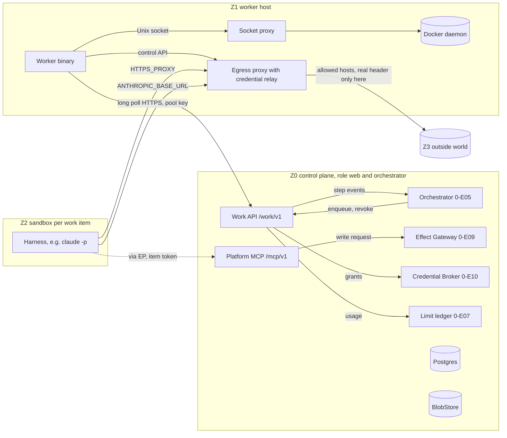
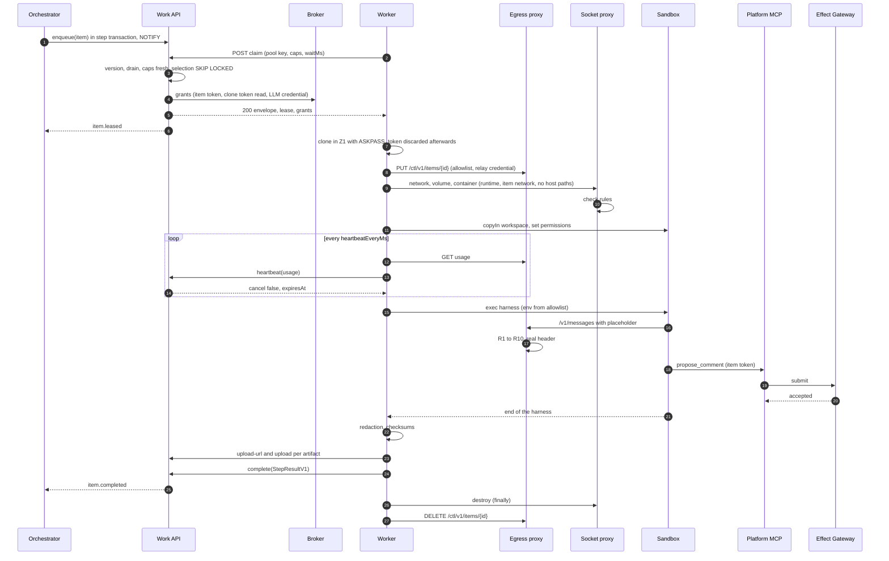
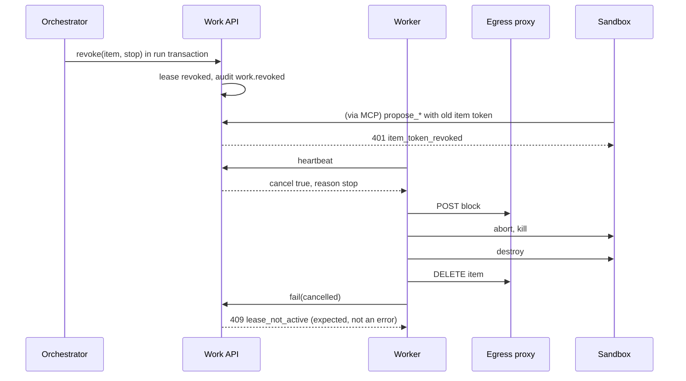
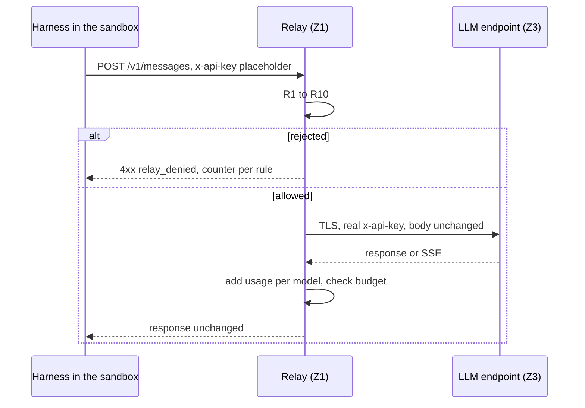

<!--
SPDX-License-Identifier: Apache-2.0
SPDX-FileCopyrightText: The Guildwork Authors
-->
# 03 Execution: Work API, Platform MCP, Worker, Sandbox, Proxies

Detailed design for the epics `0-E11` (Work API and platform MCP) and `0-E12` (worker and sandbox) of stage 0. Rulings of this document: FE-300 to FE-399. Abbreviations and classifications (VERIFIED, DERIVED, unverified) as in the [architecture README](../architecture/README.md). Effect Gateway, audit, Credential Broker and drivers are in [04](04-effects-audit-credentials.md); this document uses their interfaces.

## 1. Purpose and sources

This document makes buildable how work gets from the control plane (zone Z0) to a worker (Z1) and into a sandbox (Z2), how the sandbox talks to the outside only through the egress proxy, how the LLM credential stays in Z1, and how write requests from the sandbox get back into Z0 through the platform MCP.

| Source | What is implemented from it |
|---|---|
| [01](../architecture/01-plugin-interfaces.md) Section 1 | `Result`, `PluginError`, capabilities, manifest (frame for `ExecutionBackend`) |
| [01](../architecture/01-plugin-interfaces.md) Section 6 | `AgentTask` (platform MCP token per item), start path per credential kind, environment from an allowlist, credential relay |
| [01](../architecture/01-plugin-interfaces.md) Section 8 | `SandboxSpec`, `SandboxHandle`, `ExecutionBackend`, `WorkerApi`, `WorkerCaps`, isolation rules |
| [01](../architecture/01-plugin-interfaces.md) Section 13 | `BlobStore.presignPut` for `uploadUrl`, fallback without `PRESIGN` |
| [02](../architecture/02-services.md) Section 0 | Controller in Z0, jobs as work items, write requests per service (deny by default) |
| [03](../architecture/03-flow-and-orchestration.md) Sections 2.2 and 5 | States of work item and lease, failure paths (lease expired, `stop`, sandbox creation, no pool, worker version, drain) |
| [03](../architecture/03-flow-and-orchestration.md) Section 6 | Drain mode, worker N-1, versioned envelope |
| [05](../architecture/05-security.md) Sections 1 to 3, 5, 6, 9 | Zones, `single-host` separation, item token, pool key, sandbox phases, egress allowlist, relay limits, registry cache, file permissions, subscription conditions |
| [06](../architecture/06-operations-and-deployment.md) Sections 1, 2, 4, 8, 9 | Images `agent-worker`, `egress-proxy`, `sandbox-base`, topology `single-host`, metrics, air gap |
| [11](../architecture/11-installation-and-hosting.md) Sections 2.4, 2.7, 4 | Compose bundle with socket proxy and separate networks, worker package, driver assignment |
| [08](../architecture/08-roadmap.md) Stage 0 | Done criteria: lease expiry, `destroy` in the failure path, S6 case separation, contract suite `ExecutionBackend`, start path `subscription` (worker side) |
| ADR-05, ADR-07, ADR-20, ADR-22, ADR-44, ADR-48, ADR-57, ADR-62, ADR-64 | see Section 9 per ruling |

Not in this document: run state machine, router, policy and ledger ([02-control-plane.md](02-control-plane.md)); the harness `claude-code` itself and its contract tests "Launch with `<kind>`" ([05-plugins-and-contracts.md](05-plugins-and-contracts.md), epic `0-E15`); Compose bundle, images and `doctor` as a command ([06-installation-operations-ui.md](06-installation-operations-ui.md), epic `0-E18`). This document provides the building blocks and check functions for them.

## 2. Modules and responsibility

### 2.1 Overview



Who calls whom (only these directions are allowed):

| Caller | Target | Path | Authentication |
|---|---|---|---|
| Orchestrator | Work API service (`WorkItemService`) | In-process function call, same transaction | none (Z0 internal) |
| Work API | Orchestrator | pg-boss queue `orchestrator-event` ([02](02-control-plane.md) Section 4.9) | none (Z0 internal) |
| Worker | Work API | HTTPS, outbound only (ADR-05) | Pool key as bearer |
| Worker | Socket proxy | Unix socket in a shared volume | File permissions of the socket |
| Worker | Egress proxy (control API) | HTTP in the network `worker-egress` ([06](06-installation-operations-ui.md) Section 2.3) | Control secret as bearer |
| Sandbox | Egress proxy | HTTP proxy (`CONNECT`) and relay port in the item network | Network interface plus placeholder at the relay |
| Harness in the sandbox | Platform MCP | HTTPS via the egress proxy | Item token (JWT) |
| Platform MCP | Effect Gateway | Function call `EffectGateway.submit` | Context from the verified item token |

### 2.2 Directories and files

```
packages/contracts/src/work/
  envelope.ts          # WorkItemEnvelopeV1, StepResultV1, StepErrorV1, GrantsV1, InputGrantV1 (TypeBox schemas plus types)
  proposals.ts         # ProposalV1 (write requests); provider is the Effect Gateway (04 Section 2.1.1, 0-E09-T01), only used here
  worker-api.ts        # Request and response schemas of the Work API
  index.ts
apps/control-plane/src/work/
  service.ts           # WorkItemService: enqueue, revoke, queries for orchestrator and admin UI
  routes.ts            # Fastify plugin /work/v1
  claim.ts             # Capability matching, long poll, grants, kill switch, operator check (Section 2.4.2)
  lease.ts             # Heartbeat, extension, reaper, attempt counter; LeaseRevoker for the broker (Section 2.4.1)
  inputs.ts            # from 0-E20-T28: input grants and GET /work/v1/inputs/{grantId} (Section 2.12, FE-334)
  results.ts           # complete, fail, artifact completion, step events
  uploads.ts           # uploadUrl, upload via the API (fallback), rescan
  auth.ts              # Check pool key (broker, 04 Section 2.3.6)
  drain.ts             # Read and set the drain switch (DrainControl, Section 2.4.1)
  pools.ts             # syncPools: reconcile table pools from installation.yaml (Section 3)
  events.ts            # StepEvent types, sent via the queue orchestrator-event (02 Section 4.9)
  oidc.ts              # from 8-E05-T03: sign-in of the one-shot worker with a CI OIDC token (Section 2.4.3)
apps/control-plane/src/mcp/
  server.ts            # Fastify plugin /mcp/v1, MCP Streamable HTTP
  auth.ts              # Check item token, lease binding
  tools/registry.ts    # Tool list, mapping to services
  manifest-source.ts   # McpManifestSource: tools and effects according to the current service manifest (Section 2.5)
  tools/run-context.ts
  tools/repo.ts        # repo.read_file, repo.list_files (base SHA)
  tools/change.ts      # change.get, change.files, change.diff
  tools/item.ts        # item.get, item.comments
  tools/propose.ts     # propose_* -> EffectGateway.submit
  tools/kb/            # from 7-E02-T01: kb.* (Section 2.5.1)
  external-kb.ts       # from 7-E02-T06: external KB MCP (Section 2.5.1)
apps/worker/src/
  main.ts              # Subcommands: run (default), socket-proxy, probe, version
  config.ts            # Read and check worker.yaml
  client.ts            # Work API client (claim, heartbeat, complete, fail, uploadUrl)
  loop.ts              # Claim loop, parallelism, shutdown
  caps.ts              # WorkerCaps.verified: isolation, egress, harnesses
  item/runner.ts       # Lifecycle of an item (Section 4.4)
  item/clone.ts        # Clone in Z1 with ASKPASS or from a bundle (FE-335), tar for copyIn
  item/workspace.ts    # from 6-E04-T03: working state from input.workspace (bundle, checkout, patch; Section 2.12)
  item/inputs.ts       # from 0-E20-T28: download of the input grants to items/<id>/in/ with checksum (Section 2.12)
  item/collect.ts      # Collect transcript (local: reference of the runtime), bundle, logs; redaction, upload
  plugin-context.ts    # PluginContext for AgentRuntime and ModelProvider instances in the worker (Section 2.11.1, FE-339)
  harness/spawn-wrapper.ts  # Wrapper of the SandboxHandle: spawn with buildHarnessEnv (Section 2.11.1, 05 FE-550)
  item/heartbeat.ts    # Heartbeat loop, AbortController
  steps/registry.ts    # deterministic worker steps for kind "check" (Section 2.6, FE-327)
  item/dummy.ts        # kind "dummy": job script of the dummy service in the sandbox (Section 2.6, FE-332)
  item/model-call.ts   # kind "model_call" without job: ModelProvider.generate via the relay (Section 2.6)
  jobs/registry.ts     # from 1-E01-T02: JobHandler of the bundled services by envelope.job (Section 2.6, FE-331)
  health.ts            # GET 127.0.0.1:8090/healthz in the container (Section 2.6)
  harness/env.ts       # Environment of the harness process from an allowlist (Section 2.11)
  harness/subscription.ts  # Read and check the operator's token file (ADR-57)
  harness/cache.ts     # Check the harness cache directory runtimes.claude_code.cache_dir and pass it to the runtime (FE-522 in 05)
  socket-proxy/server.ts   # Socket proxy (Section 2.8)
  socket-proxy/rules.ts    # Allowlist and body checks
  doctor/separation.ts     # Check functions for doctor (ADR-62)
  doctor/dns.ts            # Check function "sandbox without DNS"
plugins/exec-docker/
  src/backend.ts       # ExecutionBackend docker-sysbox and docker-gvisor
  src/handle.ts        # SandboxHandle
  src/network.ts       # Create item network, attach proxy, remove
  src/resources.ts     # CPU, memory, PIDs, disk watcher
  manifest.json
  test/contract/       # Contract suite ExecutionBackend
apps/egress-proxy/src/
  main.ts
  ctl.ts               # Control API for the worker
  connect.ts           # HTTP CONNECT proxy with allowlist per item
  binding.ts           # Mapping network interface -> item
  relay/server.ts      # Credential relay
  relay/filter.ts      # Path, body, header and model filter
  relay/usage.ts       # Read SSE and JSON usage
  airgap.ts            # Intersection with the installation allowlist
  config.ts            # Read and check egress.yaml (Section 2.9, FE-328)
  llm-inspection/      # from 1-E07-T03: inspection proxy for operator_test (05 Section 2.20, FE-326); location fixed by this
  header-relay.ts      # from 10-E04-T02: header relay for tool sandboxes (Section 2.9.1, 15 K16)
packages/testkit/src/  # Provider is the package testkit (00 Section 2.7); this document uses:
  fake-worker.ts       # Worker fake for Work API tests (testkit fakeWorker)
  fake-runtime.ts      # AgentRuntime fake for worker tests (testkit fakeRuntime)
  secret-scan.ts       # Search for secret values in DB, envelopes, snapshots, logs, BlobStore
  docker-fixture.ts    # Test topology with networks for S6 (testkit startDockerTopology)
```

`apps/egress-proxy` and `plugins/exec-docker` are not in the package list of the [README](README.md) Section 2; FE-301 justifies the addition.

### 2.3 Work item envelope, result and grants

The envelope is versioned ([03](../architecture/03-flow-and-orchestration.md) Section 6 item 3). It is stored in `work_items.envelope` and **never** contains a secret. Secrets come only in the claim response as `grants` (FE-304).

```ts
// packages/contracts/src/work/envelope.ts
import type { RepoRef, ChangeRef, WorkItemRef, TenantRef, ServiceId, Isolation,
              CredentialKind, SandboxSpec, PinnedVersion, JSONSchema, LimitSnapshot,
              GenerateRequest, GenerateResult } from "../v1alpha1";   // contracts from detailed design 05 Section 2.11

export type WorkItemKind = "agent" | "model_call" | "check" | "dummy";
export type EnvelopeVersion = 1;

export interface WorkItemEnvelopeV1 {
  envelopeVersion: EnvelopeVersion;
  itemId: string;                      // UUIDv7
  tenant: TenantRef;
  runId: string; stepId: string; attempt: number;   // attempt starts at 1
  service: ServiceId;
  kind: WorkItemKind;
  job?: string;                        // JobKind "<service>.<name>" from sdk-service (00 Section 2.13), pattern ^[a-z0-9-]+\.[a-z0-9-_.]+$,
                                       // prefix must be service; required for steps of services from 1-E01-T02, absent for worker steps (FE-331)
  repo?: RepoRef; change?: ChangeRef; workItem?: WorkItemRef;
  baseSha?: string;                    // base SHA according to the config snapshot (ADR-17)
  repoClass?: "private_own" | "external_code";      // determined fresh at claim (05 Section 3)
  sandbox: Omit<SandboxSpec, "phases"> & {
    phases: { setup: { secretNames: string[]; network: "allowlist" }; agent: { network: "allowlist" } };
  };
  runtime?: {                          // for kind "agent" and "model_call" as well as "check" with check.llm (FE-336)
    runtimeId: string; harness: string; pin: PinnedVersion;
    credentialKind: CredentialKind; model: { id: string; fallback?: string };
    nativeTools: "none" | "read" | "edit" | "edit+shell";
    subagents: { allowed: boolean; maxDepth: 1; deniedTools: string[] };
    outputSchema?: JSONSchema;
    llm: { upstreamHost: string; models: string[]; maxTokens: number; betaAllow: string[] };
    profile?: "operator_test";         // from 1-E07: from runtimes[].credential.profile (05 Section 2.19)
    inspection?: true;                 // from 1-E07-T03: security.llm_inspection_proxy = required, inspection proxy mandatory (05 Section 2.20)
  };
  modelCall?: { provider: string;      // only for kind "model_call": instance of the ModelProvider (05 Sections 2.16, 2.17, FE-531)
                request: GenerateRequest };
  check?: { step: string; args: unknown;   // only for kind "check": deterministic worker step from the registry
            llm?: true };              // (Section 2.6, FE-327), e.g. "revert" (11 FE-1146); args is checked by the step's argsSchema;
                                       // llm only for steps with WorkerStepDef.llm (FE-336, e.g. eval-benchmark-judge), then runtime is required
  blobInputs?: BlobInputV1[];          // from 0-E20-T28: blobs of the same tenant that the worker loads via input grants (Section 2.12, FE-334)
  repoSource?: { kind: "bundle"; input: string };   // from 0-E20-T28: clone from the bundle blobInputs[name = input] instead of from the host (FE-335)
  workspace?: { bundleInput: string; patchInput?: string; mergeBase: string; headSha: string; rulesSha: string };
                                       // from 6-E04-T03: working state of the remote review (09 FE-958) instead of clone (Section 2.12)
  lookup?: EnvelopeInputsStage2V1;     // from stage 2: envSnapshots, analyzerBaselines, workSnapshot, setupSecretNames (10 Section 2.21, FE-1070)
  task?: { systemInstructionsRef: string; instruction: string;   // ref to an inline input (inputs)
           contextRefs: string[] };    // untrusted blocks, one inline input each
  platformMcp?: { url: string; tools: string[] };   // token comes as a grant
  budget: { maxUsd?: number; maxTurns: number; maxWallMs: number; maxOutputTokens?: number };
  deadlineAt: string;                  // ISO-8601, hard limit of the lease (FE-302)
  telemetry: { traceparent: string };
  inputs: InlineInputV1[];             // together at most work.inline_inputs_max_bytes (FE-306)
  requires: WorkItemRequirementsV1;    // for claim matching, Section 2.4.2
}

export interface InlineInputV1 { id: string; mediaType: string; untrusted: boolean; origin: string;
                                 sha256: string; data: string }   // data as UTF-8 or base64 according to mediaType

export interface BlobInputV1 {         // from 0-E20-T28 (FE-334); never a secret, only a reference
  name: string;                        // ^[a-z0-9][a-z0-9_.:-]{0,63}$, unique in the envelope; fixed names: "repo_bundle" (FE-335),
                                       // "workspace_bundle", "workspace_patch" (6-E04-T03), "step:<arg>" for step inputs (FE-336)
  ref: string;                         // BlobStore key under t/<tenant>/ of the same tenant
  sha256: string; sizeBytes: number;   // sizeBytes at most work.artifact_max_bytes
  untrusted: boolean;                  // true for foreign content (bundle, patch, benchmark inputs)
}

export interface WorkItemRequirementsV1 {
  pool: string;                        // pool ID from installation.yaml
  isolationAnyOf: Isolation[];         // from isolation_min per repo class (ADR-48)
  harness?: { runtime: string; credentialKind: CredentialKind };
  minWorkerVersion: string;            // semver; control plane N accepts N and N-1 (FE-315)
  singleOperator?: string;             // operator ID, required for subscription (05 Section 6 condition 2)
  dockerInDocker?: boolean;            // from stage 2 (builds with DinD); matched against DOCKER_IN_DOCKER (FE-337)
  browser?: boolean;                   // from 3-E03-T01 (E2E, 11 Section 2.3); matched against BROWSER (FE-337)
}

export interface GrantsV1 {              // only in the claim response, never stored
  itemToken?: { jwt: string; exp: string };                     // platform MCP, 04 Section 2.3.4
  clone?: { token: string; exp: string; cloneUrl: string; credentialHelper: "askpass" };   // profile read; absent with repoSource and workspace
  llm?: LlmGrantV1;                                             // never with subscription
  inputs?: InputGrantV1[];                                      // from 0-E20-T28: one per entry from blobInputs or lookup (FE-334)
  setupSecrets?: { name: string; value: string }[];             // from 2-E01-T05: only coder (later QA, PR fixer), 10 Section 2.21
  headerRelay?: { host: string; header: string; value: string };   // from 10-E04-T02: key of a tool (15 K16), goes only to the egress proxy
}
export interface InputGrantV1 {          // same form as in 10 Section 2.21; there additionally the names "work_snapshot" and "baseline:<id>"
  name: string;                        // = BlobInputV1.name or name from 10
  url: string;                         // BlobStore.presignGet with PRESIGN and blob.worker_endpoint, otherwise <control_url>/work/v1/inputs/{grantId}
  secret?: string;                     // only with the fallback URL: input token (JWT, FE-334) as bearer
  sha256: string; sizeBytes: number; exp: string;   // exp = lease expiry (expiresAt), renewal via the heartbeat
}

export type LlmGrantV1 =
  | { kind: "api_key"; header: "x-api-key"; value: string; placeholder: string }
  | { kind: "gateway"; header: "authorization"; value: string; placeholder: string }
  | { kind: "wif"; brokerJwt: string; exp: string; placeholder: string };   // exchange in the worker from stage 8
// Additive variants from stage 8 (13 Section 2.2.2, FE-1320): wif with exchange (8-E02-T03), bedrock (8-E02-T04),
// vertex (8-E02-T05), foundry (8-E02-T06), openai (8-E03-T03); envelopeVersion stays 1. A worker N-1 that does not know
// a variant ends the item with credential_unavailable, retryable false (no guessing on the field kind).

export type StepStatus = "ok" | "failed" | "budget_exceeded" | "rate_limited" | "auth_failed"
                       | "cancelled" | "schema_invalid";

export interface ArtifactRefV1 { artifactId: string; kind: ArtifactKind; sha256: string; size: number }
export type ArtifactKind = "log" | "transcript" | "bundle" | "artifact" | "sarif" | "egress_log";

export interface UsageReportV1 {
  byModel: Record<string, { in: number; out: number; cacheRead: number; cacheWrite: number; reasoning?: number }>;
  source: "relay" | "harness" | "both";   // the relay also counts calls that bypass the harness (05 Section 3)
  relayRequests: number;
}

export interface StepResultV1 {
  envelopeVersion: EnvelopeVersion;
  status: StepStatus;
  structured?: unknown;                // checked by the worker against outputSchema, again in Z0
  modelResult?: GenerateResult;        // only for kind "model_call" (05 Section 2.11.5)
  text?: string;                       // at most 64 KiB, otherwise as an artifact
  artifacts: ArtifactRefV1[];
  proposals: ProposalV1[];             // write requests from the result (e.g. bundle), 04 Section 2.1. Order in the plan: 0-E11-T01
                                       // creates the field as unknown[] (at most PROPOSALS_MAX), 0-E09-T01 narrows it to ProposalV1[]
                                       // (0-E09-T01 depends on 0-E11-T01 via 0-E13-T11, the other way round does not work; FE-345)
  usage: UsageReportV1;
  cost?: { usd?: number; source: "provider" | "client_estimate" | "price_table" | "subscription_utilization" };
  runtime?: { harness: string; version: string; sha256: string; credentialKind: CredentialKind; model: string;
              sessionRef?: string };
  sandbox: { isolation: Isolation; imageDigest: string; destroyed: true };   // Run Record (05 Section 8)
  timings: { claimedAt: string; setupMs: number; agentMs: number; collectMs: number };
  limitEvents: LimitSnapshot[];
  detail?: StepDetailV1;               // reports from which the Work API writes audits (Section 2.11.1)
}

export interface StepDetailV1 {          // from 1-E07; never content, never secrets
  tokenFileError?: TokenFileError;     // launch path subscription: reason from readSubscriptionToken (Section 2.11) -> audit subscription.token_file_invalid
  inspectionRejected?: { path: string; reason: string }[];   // rejections of the inspection proxy, at most 100 (05 Section 2.20)
                                                             // -> one audit inspection_proxy.request_rejected per entry
  inspectionRejectedDropped?: number;  // number of older rejections no longer listed
  pluginAudit?: { instanceId: string; action: string; subject: string; details: Record<string, unknown> }[];
                                       // buffer of PluginContext.audit in the worker, at most 100 (FE-339)
}

export type StepErrorCode =
  | "isolation_unavailable" | "sandbox_create_failed" | "clone_failed" | "harness_install_failed"
  | "harness_failed" | "credential_unavailable" | "cancelled" | "deadline" | "resource_exceeded"
  | "upload_failed" | "secret_found" | "internal"
  | "input_unavailable"                // from 0-E20-T28: input grant missing, download fails or checksum wrong (Section 2.12)
  | "inspection_proxy_missing";        // from 1-E07-T03: operator_test without an active inspection proxy (05 Section 2.20)

export interface StepErrorV1 {
  envelopeVersion: EnvelopeVersion;
  code: StepErrorCode;
  retryable: boolean;                  // false: Work API consumes no further attempt
  message: string;                     // redacted, at most 4 KiB
  artifacts: ArtifactRefV1[];          // e.g. log up to the abort
  usage?: UsageReportV1;               // usage up to the abort (03 Section 5 "Budget exhausted during the run")
  sandbox: { isolation?: Isolation; destroyed: boolean };   // destroyed false only if destroy itself failed
  detail?: StepDetailV1;
}
```

`TokenFileError` comes from `apps/worker/src/harness/subscription.ts` and is mirrored as a type in `contracts` (Section 2.11); `EnvelopeInputsStage2V1` is defined in [10](10-planner-architect-coder.md) Section 2.21 and sits in the envelope under `lookup` (there it still says `envelope.inputs`; `inputs` here is the list of inline inputs, hence the separate name, FE-334). Extensions of later stages that this document only takes up: `lookup` and `GrantsV1.setupSecrets` (2-E01-T05, 2-E01-T06, 2-E01-T13 according to 10 Section 2.21), `LlmGrantV1` variants (13 FE-1320), `requires.browser` (3-E03-T01).

Size limits (the schema checks, a violation yields HTTP 413 `too_large`): envelope in total 2 MiB, `inputs` together `work.inline_inputs_max_bytes` (default 1 MiB), `StepResultV1` without artifacts 1 MiB, `proposals` at most 100 entries.

Cross rules (schema plus `validateEnvelope` in `envelope.ts`, error `invalid` with JSON path): `runtime` required for `kind` `agent` and `model_call` as well as for `check` with `check.llm`, otherwise forbidden (for `model_call` and `check.llm`, `runtime.llm` carries the relay values); `modelCall` only and exactly with `model_call`; `check` only and exactly with `check`; `repoSource.input`, `workspace.bundleInput` and `workspace.patchInput` name an existing `blobInputs[].name`; `repoSource` and `workspace` exclude each other, both require `repo`; `job` starts with `<service>.`; `task.systemInstructionsRef` and every `contextRefs` ID name an existing `inputs[].id`; `sha256` of every inline input matches; `requires.singleOperator` set if `runtime.credentialKind` or `requires.harness.credentialKind` is `subscription`. For this, `contracts` exports the constants `ENVELOPE_MAX_BYTES`, `RESULT_MAX_BYTES`, `PROPOSALS_MAX`, `TEXT_MAX_BYTES` (64 KiB) and `INLINE_INPUTS_MAX_BYTES_DEFAULT` as well as `validateEnvelope(env: unknown, opts?: { inlineInputsMaxBytes?: number }): Result<WorkItemEnvelopeV1>`; the Work API calls it at `enqueue` with `work.inline_inputs_max_bytes`, the worker at claim without the option.

### 2.4 Work API

#### 2.4.1 Service in the control plane

```ts
// apps/control-plane/src/work/service.ts
export interface EnqueueWorkItem {
  tenantId: string; runId: string; stepId: string;
  envelope: Omit<WorkItemEnvelopeV1, "itemId" | "attempt" | "deadlineAt">;
  priority?: number;                   // smaller is earlier, default 100
  notBefore?: Date;
  maxAttempts?: number;                // default work.max_attempts
  wallMs: number;                      // from limits.service.<id>.wall_min
}
export type RevokeReason = "stop" | "budget_exhausted" | "deadline" | "kill_switch" | "superseded"
                         | "operator_check";   // from 1-E07-T02: operatorClaimGuard yielded skipped or blocked (Section 2.4.2)
// Definition lives in packages/contracts/src/work/worker-api.ts (heartbeat response), only re-exported here

// apps/control-plane/src/work/lease.ts: implementation of the port LeaseRevoker from 04 Section 2.3.1 (0-E11-T02)
export function createLeaseRevoker(svc: WorkItemService, db: Db): LeaseRevoker;
// revokeLeasesOfPoolKey(keyId, "kill_switch", tx): finds in tx all leases with state = 'active' whose worker_id is the row
// of the key keyId in workers, calls svc.revoke(itemId, "kill_switch", tx) per item and returns the count.
// At startup of the role web the result is passed as BrokerDeps.leases to createCredentialBroker (wiring 02);
// until then 0-E10-T06 uses the counting fake from 04.

export interface WorkItemService {
  enqueue(input: EnqueueWorkItem, tx: Tx): Promise<{ itemId: string }>;            // NOTIFY work_available
  revoke(itemId: string, reason: RevokeReason, tx: Tx): Promise<{ hadActiveLease: boolean }>;
  get(itemId: string): Promise<WorkItemRow | null>;
  listBlocked(tenantId: string): Promise<{ itemId: string; reason: BlockedReason; since: Date }[]>;
}
export type BlockedReason = "no_qualified_pool" | "upgrade_required" | "draining" | "no_safe_ci"
                          | "kill_switch";      // from 1-E08-T04: item within the scope of an active kill switch (06 Section 2.16)

// apps/control-plane/src/work/drain.ts  (used by "internal-cli drain on|off" during upgrade, 06 Section 4.4)
export interface DrainControl {
  set(on: boolean, actor: string): Promise<void>;   // writes tenants.drain_since of the row kind = 'installation', audit work.drain_on or work.drain_off
  status(): Promise<{ since: Date | null; activeLeases: number }>;   // activeLeases: leases in state active, for waiting until 0
}
```

`enqueue` and `revoke` run in the caller's transaction so that the state change of the step and the work item are atomic. The orchestrator receives results as events:

```ts
// apps/control-plane/src/work/events.ts
export const STEP_EVENTS_QUEUE = "orchestrator-event";   // one queue for all run events (02 Section 4.9, FE-270)
export type WorkerCapsVerified = WorkerCaps["verified"];   // WorkerCaps from 05 Section 2.11.6
export type StepEvent =
  | { t: "item.leased"; itemId: string; stepId: string; leaseId: string; attempt: number; caps: WorkerCapsVerified }
  | { t: "item.completed"; itemId: string; stepId: string; leaseId: string; result: StepResultV1 }
  | { t: "item.failed"; itemId: string; stepId: string; leaseId: string; error: StepErrorV1; attemptsLeft: number }
  | { t: "item.exhausted"; itemId: string; stepId: string; lastError: StepErrorV1 | { code: "lease_expired" } }
  | { t: "item.blocked"; itemId: string; stepId: string; reason: BlockedReason; since: string }
  | { t: "item.revoked"; itemId: string; stepId: string; reason: RevokeReason }
  | { t: "item.operator_rejected"; itemId: string; stepId: string;           // from 1-E07-T02, before item.revoked with operator_check
      decision: Extract<OperatorClaimDecision, { result: "skipped" | "blocked" }>; checks: OperatorCheck[] };   // 05 Section 2.19
```

`item.exhausted` is the mandatory event `error_after_retries` of the run state machine ([03](../architecture/03-flow-and-orchestration.md) Section 2.1). `item.blocked` is produced by claim matching when an item finds no matching worker for longer than `work.blocked_after_s`; from that, the orchestrator sets status `neutral` after its deadline. `item.operator_rejected` is the `RunEvent` from [05](05-plugins-and-contracts.md) Section 2.19: the orchestrator sets the run to `skipped(operator_only)` or `blocked` and triggers the status comment (assumption in the state machine: [02](02-control-plane.md), reported).

#### 2.4.2 Endpoints

All endpoints under `/work/v1`, JSON, schemas from `packages/contracts/src/work/worker-api.ts`. Required headers: `Authorization: Bearer <pool key>`, `X-Guildwork-Worker-Version: <semver>`. Error form (FE-330): `application/problem+json` according to [00](00-codebase-and-conventions.md) Section 3.2 with the extension field `reason`; the codes of the table below (`pool_mismatch`, `lease_not_active` etc.) go in `reason`, `code` is the `ErrorCode` according to this mapping, `status` the HTTP status of the table:

| `reason` | HTTP | `code` |
|---|---|---|
| `unauthorized` | 401 | `auth` |
| `pool_mismatch` | 403 | `permission` |
| `lease_not_found` | 404 | `not_found` |
| `lease_not_active` | 409 | `conflict` |
| `invalid`, `caps_stale` | 400 | `invalid` |
| `too_large` | 413 | `invalid` |
| `artifact_missing`, `schema_invalid`, `sha256_mismatch` | 422 | `invalid` |
| `upgrade_required` | 426 | `unsupported` |
| `rate_limited` | 429 | `rate_limited` (with `retryAfterMs` and header `Retry-After`) |
| `draining` | 503 | `transient` (with `retryAfterMs` and header `Retry-After`) |

```ts
// packages/contracts/src/work/worker-api.ts  (TypeBox schemas plus types; names binding)
export const WORKER_VERSION_HEADER = "x-guildwork-worker-version";
export interface ClaimRequest { pool: string; caps: WorkerCaps; waitMs: number; itemHint?: string }   // itemHint only with CI OIDC (8-E05-T03)
export interface LeaseInfo { leaseId: string; expiresAt: string; heartbeatEveryMs: number }
export interface ClaimResponse { envelope: WorkItemEnvelopeV1; lease: LeaseInfo; grants: GrantsV1;
                                 leaseToken?: string }   // 204 without body; leaseToken only after CI OIDC sign-in (FE-344)
export type WorkPhase = "setup" | "agent" | "check" | "collect";   // "check" from 2-E01-T05 (check phase, 10 Section 2.5)
export interface HeartbeatBody { usage?: UsageReportV1; phase: WorkPhase; phaseSince?: string; progress?: string }
// progress at most 200 characters, never content. phaseSince (ISO-8601, from 2-E01-T05): time of the last phase change.
// One field for lifecycle and sandbox phase (FE-338): 10 Section 2.19 calls it phase?: { current, since }, meaning phase plus phaseSince.
// From 2-E01-T05 the Work API writes, on every change of phase compared to the lease's previous heartbeat, the audit entry
// sandbox.phase_switched { itemId, from, to, at: phaseSince } in the transaction of the heartbeat (10 Section 2.5).
export interface HeartbeatResponse { cancel: boolean; reason?: RevokeReason; expiresAt: string; grants?: GrantsV1 }   // tasks additive from stage 2 (10 Section 2.19)
// grants in the heartbeat: renewed item tokens, wif broker JWT (13 Section 2.2.3) and input grants with new exp (FE-334), only if an expiry lies before the new expiresAt
export interface AcceptedResponse { accepted: true }
export interface FailResponse { accepted: true; attemptsLeft: number }
export interface UploadRequest { kind: ArtifactKind; size: number; sha256: string; contentType: string }
export interface UploadTarget { artifactId: string; method: "PUT"; url: string; headers: Record<string, string>;
                                mode: "presign" | "via_api"; expiresAt: string }
export interface WorkProblem extends Problem { reason: WorkErrorReason; retryAfterMs?: number }   // Problem from core (00 Section 3.2)
export type WorkErrorReason = "unauthorized" | "pool_mismatch" | "lease_not_found" | "lease_not_active" | "invalid" | "caps_stale"
  | "too_large" | "artifact_missing" | "schema_invalid" | "sha256_mismatch" | "upgrade_required" | "rate_limited" | "draining";
// RevokeReason is defined here and re-exported by apps/control-plane/src/work/service.ts.
```

Rate limiting of the claim: at most `work.claim_rate_per_min` claims per pool key and minute, above that `429 rate_limited` with `retryAfterMs` until the end of the window (counter in the memory of the role `web`; several instances do not share it, this is a limit against loops of a defective worker, not a security boundary).

| Method and path | Purpose | Request | Success | Errors |
|---|---|---|---|---|
| `POST /work/v1/claim` | Long poll for an item | `{ pool, caps: WorkerCaps, waitMs }` (`waitMs` at most `work.claim_wait_max_ms`) | `200 { envelope, lease: { leaseId, expiresAt, heartbeatEveryMs }, grants }`; `204` without item | `401 unauthorized`, `403 pool_mismatch`, `426 upgrade_required`, `503 draining` with `retryAfterMs`, `400 invalid`, `429 rate_limited` |
| `POST /work/v1/leases/{leaseId}/heartbeat` | Sign of life, usage, extension | `{ usage?: UsageReportV1, phase: WorkPhase, phaseSince?: string, progress?: string }` | `200 { cancel: boolean, reason?: RevokeReason, expiresAt, grants? }` | `404 lease_not_found`, `409 lease_not_active` (expired, revoked, ended) |
| `POST /work/v1/leases/{leaseId}/complete` | Report result | `StepResultV1` | `200 { accepted: true }` | `409 lease_not_active`, `422 artifact_missing` (artifact not stored or checksum wrong), `422 schema_invalid`, `413 too_large` |
| `POST /work/v1/leases/{leaseId}/fail` | Report error | `StepErrorV1` | `200 { accepted: true, attemptsLeft }` | `409 lease_not_active` |
| `POST /work/v1/leases/{leaseId}/upload-url` | Upload target for an artifact | `{ kind: ArtifactKind, size, sha256, contentType }` | `200 { artifactId, method: "PUT", url, headers, mode: "presign" \| "via_api", expiresAt }` | `409 lease_not_active`, `413 too_large` (above `work.artifact_max_bytes`) |
| `PUT /work/v1/leases/{leaseId}/artifacts/{artifactId}` | Fallback without `PRESIGN` (FE-305) | Raw bytes | `204` | `409 lease_not_active`, `422 sha256_mismatch`, `413 too_large` |

`uploadUrl` from [01](../architecture/01-plugin-interfaces.md) Section 8 is `POST .../upload-url`; the `PUT` to `.../artifacts/{artifactId}` is only the transfer of the bytes approved there and not a further kind of permission of the pool key. The pool key has no further operations ([05](../architecture/05-security.md) Section 1 Z1); in particular no download (FE-306).

**Claim matching** (`claim.ts`), in one transaction:
1. Check the pool key (broker); the key's pool must be `pool` in the request, otherwise `403 pool_mismatch`.
2. Worker version against the control plane: same major, minor equal or one less (FE-315), otherwise `426`. The item rows stay untouched (`available`).
3. Drain on: `503 draining` with `retryAfterMs = work.drain_retry_ms`.
4. `caps.verified` must be fresh (`probedAt` younger than `work.caps_max_age_s`), otherwise `400` with `reason: caps_stale`.
5. Selection: `SELECT ... FROM work_items WHERE state = 'available' AND (pool = $pool OR pool_alt = $pool) AND not_before <= now() AND requirements->'isolationAnyOf' ?| $verifiedIsolation AND (requirements->'harness' IS NULL OR $harnesses @> ...) AND version_ok AND single_operator_ok AND features_ok AND id <> ALL($skipped) ORDER BY priority, created_at FOR UPDATE SKIP LOCKED LIMIT 1`. `pool_alt` (column from 13 Section 3.2, FE-1353) applies from 8-E05-T05; before that only `pool = $pool`.
   The partial conditions: `$verifiedIsolation` is `caps.verified.isolation`; `$harnesses` the pairs `{ runtime, credentialKind }` from `caps.harnesses`; `version_ok` means `requirements->>'minWorkerVersion'` is less than or equal to the version from the header (semver comparison in TypeScript before the query, passed as a list of permitted minimum versions); `single_operator_ok` means `requirements->>'singleOperator' IS NULL` or equal to `workers.single_operator` of the pool key's row (never the self-reported value `caps.singleOperator`); `features_ok` (FE-337) means: `requirements->>'dockerInDocker'` not `true` or `DOCKER_IN_DOCKER` is in `caps.verified.execCaps`, likewise `requirements->>'browser'` (from 3-E03-T01) against `BROWSER`; `$skipped` are the candidates already discarded in this claim (step 5a). The claim also writes `workers.worker_version`, `verified_caps` and `last_seen_at` of the key row (source of `internal-cli workers list`, 06).
   5a. Checks on the candidate (a new selection for each discarded candidate, at most 20 per claim, then `204`):
   - **Kill switch** (from 1-E08-T04): `KillSwitchGate.match(tx, { tenant, service, org, repo })` from [06](06-installation-operations-ui.md) Section 2.16 with the item's values; on a match the item stays `available`, `blocked_reason = 'kill_switch'` and `blocked_since` (if still empty) are set, `item.blocked` once per reason. Revoking active leases when the kill switch is triggered is done by the kill switch itself via `WorkItemService.revoke` with reason `kill_switch`. Once the kill switch is lifted, the next successful claim resets `blocked_reason`.
   - **Operator check** (from 1-E07-T02, [05](05-plugins-and-contracts.md) Section 2.19): if `requires.harness.credentialKind` or `runtime.credentialKind` is `subscription`, the claim calls `operatorClaimGuard(input, scm)` with `run` from `runs` (trigger, ticket author, repo), `runtime` from the run's config snapshot (`runs.config_snapshot_id`) and `pool: { id: $pool, singleOperator: workers.single_operator }`; `scm` is the loaded `scm` instance of the repo (time limit 5 s, an error counts as `repo_info_failed`). `ok`: continue. `wait`: candidate discarded, item stays `available` with `blocked_reason = 'no_qualified_pool'`. `skipped` or `blocked`: in the same transaction `runs.operator_checks`, audit `operator.claim_rejected`, item `revoked` with reason `operator_check`, events `item.operator_rejected` and `item.revoked`; candidate discarded.
6. Concurrency limit: `pools.max_concurrency` (table `pools`, taken from `installation.yaml`, 01 Section 3.8) against active leases of the pool; when reached `204`.
7. Checking the reservation in the ledger is the orchestrator's job at the transition `received` to `queued`; the Work API only checks here that the step has not been aborted.
8. Create the lease, item `leased`, set `deadline_at`, increment `attempts` (envelope field `attempt`); fetch grants from the broker with `CredentialBroker.grantsForClaim(c: ClaimGrantInput)` from [04](04-effects-audit-credentials.md) Section 2.3.1, filled as follows: `tenantId`, `runId`, `itemId` from the item, `leaseId` and `leaseExpiresAt` of the new lease, `service = envelope.service`, `repo = envelope.repo` only without `repoSource` and without `workspace` (otherwise `null`, no clone token), `tools = envelope.platformMcp?.tools ?? []`, `effects = McpManifestSource.allowed(service)?.effects ?? []` (Section 2.5), `runtime` = entry `runtime.runtimeId` from `runtimes[]` of the run's config snapshot, or `null` without `envelope.runtime`. In addition, from 0-E20-T28, one input grant per `blobInputs` entry (Section 2.12). Event `item.leased`; audit `work.leased`; from 1-E07-T02 with credential kind `subscription` additionally audit `subscription.run_started` with run ID, operator and service (05 Section 2.15.6).
   If `grantsForClaim` fails (no half bundle, 04), the lease is not created: in a new transaction the Work API treats the item like a `fail` with `StepErrorV1 { code: "credential_unavailable", retryable: <isRetryable(error code of the broker)>, message: <code without content> }` (attempt consumed, `not_before` with backoff, `item.failed` or `item.exhausted`); the claim answers `204`.
9. If there is no item: long poll with `LISTEN work_available_<pool>` up to `waitMs`, then select again once (FE-303).

If an item finds no worker with matching verified capabilities for `work.blocked_after_s`, a job writes `blocked_reason = 'no_qualified_pool'` and sends `item.blocked`. It never falls back to a weaker isolation (ADR-48).

**Audits from worker reports** (`results.ts`, in the transaction of `complete` or `fail`, from 1-E07): `detail.tokenFileError` with `code: "credential_unavailable"` yields `subscription.token_file_invalid` with the error code (never path content) and the alert from 05 Section 2.15.6 (from 1-E07-T01, reading and reporting in the worker since 0-E12-T08); every entry in `detail.inspectionRejected` yields `inspection_proxy.request_rejected` with path and reason (from 1-E07-T03), `inspectionRejectedDropped` is stored as a number in the last entry; every entry in `detail.pluginAudit` is taken over with actor `plugin:<instanceId>` and item ID (FE-339). The schema rejects invalid `detail` fields with `422 schema_invalid`.

#### 2.4.3 Extensions of later stages

Every extension hooks in as a route in `routes.ts`, uses the same authentication, the same required headers and the same error form as Section 2.4.2, and extends the pool key's permissions only by reports to its own active lease (no downloads, FE-306).

| Extension | From task | Defined in |
|---|---|---|
| `POST /work/v1/leases/{leaseId}/egress-log` (reference to the connection log per phase) | 2-E01-T07 | [10](10-planner-architect-coder.md) Section 2.19 |
| `POST /work/v1/leases/{leaseId}/dependency-results`, heartbeat task `fetch_dependency` | 2-E01-T09 | [10](10-planner-architect-coder.md) Sections 2.7 and 2.19 |
| `POST /work/v1/leases/{leaseId}/untrusted-inputs` | 2-E01-T12 | [10](10-planner-architect-coder.md) Section 2.19 |
| `POST /work/v1/leases/{leaseId}/snapshots` | 2-E01-T13 | [10](10-planner-architect-coder.md) Section 2.19 |
| Variants of `complete` (`plan_draft`, `awaiting_input` etc.) and heartbeat task `steer` | Stage 2 per service | [10](10-planner-architect-coder.md) Section 2.19 |
| Kill switch in the claim (step 5a, `KillSwitchGate.match`) | 1-E08-T04 | [06](06-installation-operations-ui.md) Section 2.16 |
| Operator check in the claim (step 5a), audits `subscription.run_started` and `subscription.token_file_invalid` | 1-E07-T02 | [05](05-plugins-and-contracts.md) Sections 2.15.6 and 2.19 |
| Audit `inspection_proxy.request_rejected` from `detail.inspectionRejected` | 1-E07-T03 | [05](05-plugins-and-contracts.md) Section 2.20 |
| Input grants at claim, `GET /work/v1/inputs/{grantId}` (Section 2.12, FE-334) | 0-E20-T28 | here |
| Requirement `browser` in the claim (`features_ok`, FE-337) | 3-E03-T01 | here; [11](11-qa-prfix-automerge.md) Section 2.3 |
| Field `phase` with `check` and `phaseSince`, audit `sandbox.phase_switched` (FE-338) | 2-E01-T05 | here; [10](10-planner-architect-coder.md) Section 2.5 |
| Claim via `work_items.pool_alt` (fallback pool after an expired dispatch) | 8-E05-T05 | Step 5; [13](13-stage-8-providers-and-bases.md) Section 2.5.6 (FE-1353) |
| Costs from the price table in `results.ts`: with `cost.source = "price_table"` without `usd` the Work API sets `PriceLookup.cost(usage, entry)` per model and `usage.cost_source = 'price_table'`; if a price is missing, `usd` stays empty and the metric `price_missing` from `pricing` counts | 8-E06-T01 | [13](13-stage-8-providers-and-bases.md) Section 2.6 |
| Sign-in with a CI OIDC token instead of the pool key, `itemHint`, lease token | 8-E05-T03 | below; [13](13-stage-8-providers-and-bases.md) Section 2.5.4 (FE-1352) |

**Sign-in with a CI OIDC token** (`oidc.ts`, only for pools of the kind `ci-dispatch`, [12](12-expansion.md) FE-1233, check in detail [13](13-stage-8-providers-and-bases.md) Section 2.5.4; the file lives at `apps/control-plane/src/work/oidc.ts`, 13 names `workapi/oidc.ts`, meaning this file): the one-shot worker sends `Authorization: Bearer <OIDC token of the CI system>`, additionally `X-Guildwork-Auth: ci-oidc` and in the body `{ pool, caps, waitMs: 0, itemHint }`. The Work API checks the signature against the JWKS of the CI provider, `iss`, `aud` equal to `oidc.audience` of the pool, `repository`, `job_workflow_ref` and `runner_environment` against `oidc.*` ([05](../architecture/05-security.md) Section 5), `exp` in the future and `jti` single-use (`dispatch_records.oidc_jti`). The claim selects only the item `itemHint`, if it is `available` and its entry in `dispatch_records` is in the state `dispatched`, and sets it to `claimed` in the same transaction ([13](13-stage-8-providers-and-bases.md) Section 4.8); otherwise `204` (FE-329). The response additionally carries `leaseToken` (JWT of the own issuer, `typ: gw-lease+jwt`, valid until `deadline_at`, claims `LeaseTokenClaims` from 13); `heartbeat`, `complete`, `fail`, `upload-url` and the `PUT` of the artifact of this lease accept only this lease token as bearer, never the OIDC token and no pool key (FE-344). Rejection: `401 unauthorized` with `CiOidcError` as a `reason` addition, audit `work.auth_failed` with reason `oidc_claims_mismatch` and the code.

### 2.5 Platform MCP

Transport: MCP over Streamable HTTP under `POST /mcp/v1` (server library `@modelcontextprotocol/sdk`, version and license to be checked in stage R, unverified). The harness gets the connection as `--mcp-config` with `type: "http"`, the URL and the header `Authorization: Bearer <item token>` ([01](../architecture/01-plugin-interfaces.md) Section 6, `--strict-mcp-config`).

**Check per call** (`mcp/auth.ts`), in this order, abort at the first error with a JSON-RPC error and HTTP 401 or 403:
1. JWT signature with the issuer's key ring, header `typ` equal to `gw-item+jwt`, `aud` equal to `guildwork-platform-mcp`, `exp` in the future, `iss` equal to the own issuer URL.
2. The lease from claim `lease` is `active` and belongs to item `item`; otherwise `item_token_revoked` (revocation on `stop`, expiry, completion).
3. The tool is registered in `tools/registry.ts`, otherwise `tool_unknown` (FE-341, error form below); after that it is in claim `tools` **and** in the current manifest of the service (intersection, ADR-07); for `propose_<type>` additionally `<type>` in claim `effects` and in the write requests of the manifest. The current manifest is provided by the port `McpManifestSource` (below), never by the token alone; if the source does not know the service, that counts as not allowed (`mcp_tool_denied`).
4. Repo arguments are in claim `repos`; visibility rule for read tools: sources of other repos do not exist in stage 0 (ADR-63, only with `CROSS_REPO`).
5. Rate limiting per item `mcp.rate_per_min`.

**Tools of stage 0** (`tools/registry.ts`):

| Tool | Kind | Arguments | Result | Source |
|---|---|---|---|---|
| `run.context` | Read | `{ inputId? }` | Inline inputs of the envelope, marked as `untrusted` with `origin` and `sha256` | Envelope |
| `repo.read_file` | Read | `{ path, ref?: "base" \| "head" }` | Content, at most `mcp.read_max_bytes`; `head` always as `untrusted` | `SCMProvider.getFile` with token profile `read` |
| `repo.list_files` | Read | `{ prefix?, ref?: "base" \| "head" }` | Path list, at most 5,000 entries | `SCMProvider.compare` or tree at the SHA |
| `change.get` | Read | `{}` | Title and text as `untrusted`, author, SHAs | `SCMProvider.getChange` |
| `change.files` | Read | `{}` | Changed files with position mapping | `SCMProvider.listChangedFiles` |
| `item.get` | Read | `{}` | Ticket as `untrusted` | `WorkItemProvider.getItem` |
| `item.comments` | Read | `{ since? }` | Comments as `untrusted` | `WorkItemProvider.getComments` |
| `propose_<type>` | Write request | Schema per type from [04](04-effects-audit-credentials.md) Section 2.1 | `{ proposalId, state: "accepted" \| "rejected_policy" \| "invalid", ruleId? }` | `EffectGateway.submit` |

Read tools always return foreign content in the wrapper `{ untrusted: true, origin, sha256, value }` ([01](../architecture/01-plugin-interfaces.md) Section 1.1). A `propose_*` returns only the acceptance; the agent does not learn whether the effect was applied (the effect may only be executed after the run, e.g. in mode `record` or after G4).

```ts
// apps/control-plane/src/mcp/tools/registry.ts
export interface McpToolDef<A, R> {
  name: string;
  kind: "read" | "propose";
  argsSchema: TSchema;                 // TypeBox, checked by Ajv
  handler(ctx: McpCallContext, args: A): Promise<Result<R>>;
}
export interface McpCallContext {
  tenantId: string; runId: string; stepId: string; itemId: string; leaseId: string;
  service: ServiceId; repos: RepoRef[]; baseSha?: string; headSha?: string;
  tokenJti: string; traceparent: string;
}
export function registerTool(def: McpToolDef<unknown, unknown>): void;   // at startup of the role web; a duplicate name is a startup error

// apps/control-plane/src/mcp/manifest-source.ts
export interface McpManifestSource {     // implemented by the service loader of the control plane (02, open item there); in 0-E11 a fake in the test
  allowed(service: ServiceId): { tools: readonly string[]; effects: readonly EffectType[] } | null;   // null: service unknown
}
```

**Errors and limits of the tools**: rejections of the check per call answer with HTTP 401 (`item_token_invalid`, `item_token_revoked`) or 403 (`tool_denied`, `repo_denied`) and JSON-RPC error `-32001` with `data: { reason }`; a call of a tool that is not registered in this installation (e.g. `kb.*` without stage 7) answers with HTTP 404 and JSON-RPC error `-32001` with `data: { reason: "tool_unknown", tool }` (FE-341; callers treat this like `unavailable`, [15](15-stage-10-edge-layers.md) FE-1544), without audit, with counter `mcp_tool_unknown`; `tools/list` names only the intersection of registry, claim `tools` and manifest; invalid arguments with `-32602` and `data: { reason: "invalid_args", errors }`; rate limiting with HTTP 429 and `data: { reason: "rate_limited", retryAfterMs }`; a provider error in the handler as a tool result with `isError: true` and `data: { reason: "provider_error", code }` (code from `PluginError`, without content). Read responses above `mcp.read_max_bytes` are truncated at a UTF-8 character boundary and carry `truncated: true` and `totalBytes` in the wrapper (`{ untrusted: true, origin, sha256, value, truncated?, totalBytes? }`, `sha256` over the full content); `repo.list_files` truncates after 5,000 entries with `truncated: true`.

#### 2.5.1 Tools of later stages and naming rule

Naming rule (FE-323): read tools are named `<namespace>.<verb>` (`item.get`, `change.files`, `kb.search`), write requests `propose_<type>`, the clarifying question `request_human_input`. The names in [10](10-planner-architect-coder.md) Section 2.18 mean these tools: `work_item_get` is `item.get`, `work_item_comments` is `item.comments`, `change_get` is `change.get`, `kb_*` is `kb.*`. Whether every harness supports dots in tool names is unverified; the MCP client test from `0-E11-T06` lists the names via `claude` and records the result.

| Tool | Kind | Arguments and result | From task | Defined in |
|---|---|---|---|---|
| `propose_dependency` | Write request | `ProposeDependencyArgs`, `ProposeDependencyResult` | 2-E01-T09 | [10](10-planner-architect-coder.md) Section 2.7 |
| `request_human_input` | Clarifying question | `{ question: string; options?: string[] }` (question at most 4 KiB, `options` at most 10) yields `{ questionId: string; instruction: "end_turn" }`; only offered if the runtime reports `RESUME`; the handler passes the question as a write request of the effect type `human_input` to `EffectGateway.submit` (04 Section 2.1), `questionId` is its `proposalId`; the tool name stays `request_human_input` (FE-323) | 2-E04-T09 | here and [10](10-planner-architect-coder.md) Section 4.5 |
| `kb.repo_map`, `kb.symbol_context`, `kb.impact`, `kb.search`, `kb.module_summary`, `kb.standards`, `kb.learnings` | Read | Table and `KbToolError` in [12](12-expansion.md) Section 2.3 | 7-E02-T01 | [12](12-expansion.md) Section 2.3 |
| `kb.ask`, `kb.ask_result` | Read, asynchronous | only in the external KB MCP ([12](12-expansion.md) FE-1247) | 7-E02-T06 | [12](12-expansion.md) Section 2.3 |
| `change.threads` | Read | `{ includeResolved?: boolean }` yields `Thread[]` from `SCMProvider.getThreads`, texts `untrusted` | 2-E03-T02 | [10](10-planner-architect-coder.md) Section 2.18 |
| `plan.get` | Read | `{ planId?, version? }` yields `PlanArtifact` (default: the version bound by G1) | 2-E02-T03 | [10](10-planner-architect-coder.md) Section 2.18 |
| `design.get` | Read | `{ designId?, version? }` yields `DesignArtifact` | 2-E03-T01 | [10](10-planner-architect-coder.md) Section 2.18 |

**External KB MCP** (`external-kb.ts`, from 7-E02-T06, off by default via `knowledge.external_mcp.enabled`): its own path `POST /mcp/kb/v1` (MCP Streamable HTTP) next to `/mcp/v1`, so that item token and user token never share the same check path (FE-323). Authentication with the dev token of the developer MCP from [09](09-reviewer-companion-features-and-learnings.md) Section 3.4; tools only `kb.*` (without write requests) plus `kb.ask` and `kb.ask_result`; permission check at the provider per request ([12](12-expansion.md) FE-1242).

### 2.6 Worker binary

One binary `guildwork-worker` (image `agent-worker`), ESM on Node 22. Subcommands: `run` (default; `worker` is an equivalent name because the Compose bundle starts the image with the argument `worker`, [06](06-installation-operations-ui.md) Section 2.3), `socket-proxy` (Section 2.8, own container), `probe` (prints `WorkerCaps.verified` as JSON according to the schema from [05](05-plugins-and-contracts.md) Section 2.11.6, for `doctor`; exit code 0 even without isolation, 2 on a configuration error), `version` (prints `{ version, apiVersions: ["v1alpha1"], envelopeVersions: [1] }`). Option `run --once --pool <id> --item-hint <id>` (from 8-E05-T03, [12](12-expansion.md) FE-1233, [13](13-stage-8-providers-and-bases.md) Section 2.5.3): exactly one claim with sign-in via a CI OIDC token and `itemHint` (Section 2.4.3), after that only the lease token; ends with exit code 0 (item reported, or no item with log `no_item`, as in 13) or 1 (error). Previously exit code 3 stood here for "no item"; 13 sets 0 so that the CI job does not turn red for an item that has already been taken.

**Health check** (`health.ts`): `GET http://127.0.0.1:8090/healthz` only in the container ([06](06-installation-operations-ui.md) Section 2.3); `200` as long as the claim loop is running and the last response of the Work API (also `204`) is younger than `2 * work.claim_wait_max_ms`, otherwise `503`. No content except `{ ok, lastContactAt }`.

**Local configuration** `worker.yaml` (belongs to the worker host, never `installation.yaml`, never org or repo configuration; ADR-57):

```yaml
version: 1
control_url: https://agents.example.org        # Work API and platform MCP via the reverse proxy
pool: self-hosted
pool_key_file: /etc/guildwork-worker/pool.key   # mode 0400, owner worker user
max_parallel: 2                                  # at most max_concurrency of the pool
isolation_preference: [gvisor, sysbox]           # order if both are present and verified
docker:
  socket: /run/guildwork/socket-proxy/docker.sock   # never the socket of the control plane's daemon
egress_proxy:
  ctl_url: http://egress-proxy:9901
  ctl_secret_file: /run/guildwork/egress-ctl/secret
  container: guildwork-egress-proxy              # name that the socket proxy allows as the only one to attach
  relay_url: http://egress-proxy:3129            # relay in the network worker-egress for model_call without sandbox (FE-339)
single_operator: null                            # operator login for pools with single_operator
shutdown_grace_s: 120                            # wait time for running items on SIGTERM
work_dir: /var/lib/guildwork-worker              # clone directories items/<id>/, log files; owner worker user, 0700
runtimes:                                        # keys of this section are defined by 05 Section 2.15 (FE-522, ADR-57)
  claude_code:
    cache_dir: /var/lib/guildwork/harness        # harness cache; in the Compose bundle fixed to the mount point of the volume harness-cache (FE-343), never mounted into the sandbox
    subscription_token_file: null                # path to the file from "claude setup-token", off by default
credentials:                                     # from 8-E03-T03 (13 Section 2.3.4, FE-1332)
  chatgpt:
    auth_file: null                              # sign-in file from "codex login"; checked like subscription_token_file
microvm:                                         # from 9-E04-T02 (14 Section 2.4.2)
  runtime: null                                  # name of the Kata runtime in GET /info; null: microvm is never reported
probe:                                           # targets of the egress probe in caps.ts; default: host and port of control_url
  direct_target: null                            # "host:port"; a direct TCP connection from the probe container must fail
  connect_target: null                           # "host:port"; CONNECT via the proxy must succeed
sandbox:                                         # taken over from installation.yaml by the installer or "guildwork worker register" (FE-328)
  pids_limit: 512
  copy_out_max_bytes: 268435456
  destroy_retry: 3
```

```ts
// apps/worker/src/config.ts
export interface WorkerConfig {
  version: 1; controlUrl: URL; pool: string; poolKeyFile: string; maxParallel: number;
  isolationPreference: Isolation[];
  docker: { socket: string };
  egressProxy: { ctlUrl: URL; ctlSecretFile: string; container: string; relayUrl: URL };   // relayUrl default http://egress-proxy:3129
  singleOperator: string | null;
  shutdownGraceS: number;              // default 120, 0 to 3600
  workDir: string;                     // default /var/lib/guildwork-worker
  runtimes: { claudeCode: { cacheDir: string; subscriptionTokenFile: string | null } };
  credentials?: { chatgpt: { authFile: string | null } };   // from 8-E03-T03
  microvm?: { runtime: string | null };                     // from 9-E04-T02
  probe: { directTarget: string; connectTarget: string };   // without null after loading: default from controlUrl
  sandbox: { pidsLimit: number; copyOutMaxBytes: number; destroyRetry: number };
}
export function loadWorkerConfig(path: string): Result<WorkerConfig, { code: "config"; path: string; message: string }>;
// Load errors are fatal with exit code 2; file permissions of pool_key_file and subscription_token_file are checked (Section 6).
// Path of the file: option --config, otherwise /etc/guildwork-worker/worker.yaml. Unknown keys are an error (like installation.yaml).
```

The keys `harness_cache_volume` and `credentials.subscription.token_file` of earlier versions of this document are dropped; `runtimes.claude_code.cache_dir` and `runtimes.claude_code.subscription_token_file` apply (FE-333). The name of the Docker volume is a matter for the Compose bundle, not for `worker.yaml`: [06](06-installation-operations-ui.md) Section 2.3 mounts the volume `harness-cache` in the service `worker` fixed at `/var/lib/guildwork/harness` (readable and writable), the default of `cache_dir`; `loadWorkerConfig` checks that `cache_dir` exists and belongs to the worker user (FE-343). 05 Sections 2.15.2, 2.15.6 and 7 still name `harness_cache_volume`, `/opt/harness` and `credentials.subscription.token_file` (reported).

```ts
// apps/worker/src/client.ts  (implements WorkerApi from 01 Section 8)
export interface WorkApiClient {
  claim(pool: string, caps: WorkerCaps, waitMs: number):
    Promise<{ envelope: WorkItemEnvelopeV1; lease: LeaseInfo; grants: GrantsV1 } | null
            | { upgradeRequired: true } | { retryAfterMs: number }>;
  heartbeat(leaseId: string, body: HeartbeatBody): Promise<{ cancel: boolean; reason?: RevokeReason; expiresAt: string;
                                                             grants?: GrantsV1 } | { leaseLost: true }>;
  complete(leaseId: string, result: StepResultV1): Promise<{ accepted: true } | { leaseLost: true }>;
  fail(leaseId: string, err: StepErrorV1): Promise<{ accepted: true } | { leaseLost: true }>;
  uploadUrl(leaseId: string, req: UploadRequest): Promise<UploadTarget>;
  upload(target: UploadTarget, body: AsyncIterable<Uint8Array>): Promise<void>;
}
// Network errors and 5xx: retry with growing pause (250 ms, factor 2, at most 10 s, at most until expiresAt).
// 409 lease_not_active yields leaseLost; the worker aborts the item and reports nothing more.
```

**Loop** (`loop.ts`): per free slot (`max_parallel`) one claim with `waitMs = work.claim_wait_max_ms`; before every claim `caps.ts` from the cache (re-check if older than `work.caps_max_age_s / 2`); `upgradeRequired` stops new claims and reports an error in the log and as the metric `worker_upgrade_required`; `SIGTERM` stops new claims, waits for running items up to `shutdown_grace_s` (default 120 s), aborts after that (items go via `fail` with `cancelled`, `retryable: true`). `retryAfterMs` (drain, rate limiting) pauses all slots until it expires; `204` immediately starts the next long poll; network errors at claim wait as in the client (growing pause up to 10 s). Tests: `worker/loop stops claiming on upgrade_required`, `worker/loop honors retryAfterMs while draining`, `worker/loop sigterm waits for running items then aborts`.

**Verified capabilities** (`caps.ts`), result `WorkerCaps.verified` ([01](../architecture/01-plugin-interfaces.md) Section 8):

| Capability | Check | Reported |
|---|---|---|
| `sysbox` | `GET /info` via the socket proxy lists runtime `sysbox-runc`, and a probe container with this runtime starts, runs `true` and is removed | `isolation` contains `sysbox` |
| `gvisor` | as above with `runsc`; additionally `dmesg` in the container contains the gVisor marker (evidence that gVisor is really running; wording unverified, contract test) | `isolation` contains `gvisor` |
| `microvm` | never reported until 9-E04-T02; after that probe from [14](14-stage-9-breadth-and-hardening.md) FE-1422 (built in `plugin-backend-microvm`, called by `caps.ts`): `/dev/kvm` readable and writable for the worker process, `GET /info` lists `microvm.runtime`, a probe container from `sandbox-base` with this runtime starts, runs `true` and is removed, `uname -r` in the container differs from the host | `isolation` contains `microvm` |
| `DOCKER_IN_DOCKER`, `BROWSER` (FE-337) | `DOCKER_IN_DOCKER` (from stage 2): verified isolation `sysbox` or `microvm` and a probe container runs `docker info` in the container; `BROWSER` (from 3-E03-T01): the digest of `sandbox-e2e` is in `policy.json`, a probe container from it runs `gw-browser --version`, and the contract test BROWSER is green for the verified isolation in the release (list in the image, [11](11-qa-prfix-automerge.md) Section 2.3) | `verified.execCaps` (additive to `WorkerCaps`, requirement passed to 05 Section 2.11.6) |
| `egressProxy` | Probe item `probe-<uuid>` (network `gw-item-probe-<uuid>`, registration at the proxy with `allow` only `probe.connect_target`, probe container from `sandbox-base` with its own command, no separate probe image ([06](06-installation-operations-ui.md) FE-645), isolation as verified): in the container a direct TCP connection to `probe.direct_target` fails within 5 s, `CONNECT` to `probe.connect_target` via `http://<proxyIp>:3128` succeeds, resolving the host name of `probe.connect_target` fails; after that `destroy` and `DELETE` of the registration. The default of both targets is host and port of `control_url`, because the sandbox reaches the platform MCP via the proxy anyway; this also works with air gap. Without isolation no egress probe, then `egressProxy: false` | `egressProxy: true` |
| Harnesses | per runtime known in the configuration: pin present in `runtimes.claude_code.cache_dir` with marker `verified` or installable (05 Section 2.15.2); `subscription` only if `subscription_token_file` is set, `readSubscriptionToken` succeeds and `single_operator` is set; in doing so `caps.ts` calls `subscriptionHealth(mtime, now, warnDays)` from `@guildwork/plugin-claude-code/subscription` (05 Section 2.15.6, FE-530) with the `mtime` of the token file and `warnDays = 30` (starting value of `subscription.token_warn_days`; the worker never reads `installation.yaml`, the control plane evaluates `health.expiresAt` with its own value) and puts the result into `harnesses[].health` of the entry `{ runtime: "claude-code", credentialKinds: [..., "subscription"] }`; `ok: false` does not remove `subscription` (the alert comes from the control plane), `token_expired` does | `harnesses[]` |

**Deterministic worker steps** (`steps/registry.ts`, FE-327): an item with `kind: "check"` names a step of this registry in `envelope.check.step`. Steps do not call a model; they run in the lifecycle from Section 4.4 instead of the phase `agent`. The only exception (FE-336): a step with `llm: true` (so far only `eval-benchmark-judge`, [07](07-eval-and-qualification.md) Section 2.17.3), whose code calls a model in the sandbox; it gets the path only via the credential relay like a harness (registration with `relay` from `grants.llm` and `runtime.llm`, environment from `buildHarnessEnv` with the credential kind of the grant), never a real credential, never `subscription`.

Steps of other areas (`revert` 11, `kb-index` 12 FE-1263, `rule-test` 12 FE-1214, `eval-benchmark-judge` and `harbor-verify` 07, filter and reproduction 11) each live as `apps/worker/src/steps/<name>.ts` in the package `@guildwork/worker`, but belong to the component of the service that starts them and are built by its task; they hook in only via `registerStep` (interface `worker/worker-steps`). The exception is `revert`, which the component `worker` carries itself (5-E02-T04).

```ts
// apps/worker/src/steps/registry.ts
export interface WorkerStepContext {
  envelope: WorkItemEnvelopeV1;
  repoDir?: string;                    // clone in Z1 (phase cloning), if envelope.repo is set
  sandbox?: SandboxHandle;             // only with needsSandbox; with llm the wrapper with buildHarnessEnv (Section 2.11.1)
  inputs: Record<string, string>;      // from 0-E20-T28: name from blobInputs -> verified file under items/<id>/in/ in Z1 (Section 2.12)
  signal: AbortSignal;
  upload(kind: ArtifactKind, body: AsyncIterable<Uint8Array>, contentType: string): Promise<ArtifactRefV1>;   // with redaction (phase collecting)
}
export interface WorkerStepOutput { structured?: unknown; text?: string; proposals: ProposalV1[]; artifacts: ArtifactRefV1[] }
export interface WorkerStepDef<A = unknown> {
  name: string;                        // = envelope.check.step, e.g. "revert" (11 FE-1146)
  argsSchema: TSchema;                 // TypeBox; Ajv checks envelope.check.args before the run
  needsSandbox: boolean;               // true: commands run via exec in the sandbox (role check); false: only git commands on the clone in Z1, without repo hooks
  llm?: true;                          // FE-336: only with needsSandbox; item must carry check.llm and runtime, otherwise fail "invalid_args"
  image?(args: A): string;             // own sandbox image by digest instead of sandbox-base (e.g. BenchmarkJudgeArgs.image); must be in allowedImages
  run(ctx: WorkerStepContext, args: A): Promise<Result<WorkerStepOutput, StepErrorV1>>;
}
export function registerStep(def: WorkerStepDef): void;   // at startup; a duplicate name is a startup error (exit code 2)
// Unknown step or invalid args: fail with code "internal", retryable false, message "unknown_step" or "invalid_args".
```

**What the phase `agent` executes** (order of checking, the first matching row applies; FE-331, FE-332):

| Condition | Execution | Result |
|---|---|---|
| `envelope.job` set (from 1-E01-T02) | `JobHandler` from `jobs/registry.ts` with `JobContext` according to [00](00-codebase-and-conventions.md) Section 2.13: `input` from `readInputs` against `inputSchema`, `sandbox`, `runtime` only with `kind: "agent"`, `model` only with `model_call`, `mcp` only with `platformMcp`, `artifact` with redaction | `structured` = output, checked against `outputSchema`; an `AppError` of the handler becomes `StepErrorV1` with `code: "harness_failed"`, `retryable` = `isRetryable(code)` |
| `kind: "check"` | Worker step from `steps/registry.ts` | as described above |
| `kind: "dummy"` (0-E16-T02) | `item/dummy.ts`, below | `structured` = content of `out.json` |
| `kind: "agent"` | `AgentRuntime.run(task, wrap(sandbox), sink, signal)` of the runtime `runtime.runtimeId` (0-E15-T04); `wrap` is the `spawn` wrapper from Section 2.11.1, `task.credential` = `{ kind, runtimeInstance, placeholder, relayUrl: "http://<proxyIp>:3129" }` | Status and usage from `AgentRunResult`; `transcriptRef` `local:<path>` is uploaded by phase `collecting` as artifact `transcript` |
| `kind: "model_call"` | `item/model-call.ts`: `generate(req, signal, rt)` of the ModelProvider instance `modelCall.provider` with `req = { ...modelCall.request, credential }` and `rt` according to Section 2.11.1 (05 Sections 2.16, 2.17, FE-550) | `modelResult` |

Job registry (`jobs/registry.ts`, from 1-E01-T02): at startup the worker loads the `jobs` of all bundled `ServiceDefinition`s (package list from the build of the image `agent-worker`), checks them with `defineService` and registers them under their `JobKind`; a duplicate `JobKind` is a startup error (exit code 2). An item with an unknown `job` ends with `fail`, `code: "internal"`, `retryable: false`, `message: "unknown_job"`. So that a worker N-1 (FE-315) does not get a job it does not know, the controller sets `requires.minWorkerVersion` to the release with which the job appeared (constant per service package); claim matching (`version_ok`) enforces this.

**Dummy job** (`item/dummy.ts`, FE-332): the worker resolves the file `job/dummy-job.mjs` of the bundled package `@guildwork/service-dummy` (`import.meta.resolve`), copies it in phase `setup` to `/opt/guildwork/job/dummy-job.mjs` (owner root, 0444), writes `/run/guildwork/input.json` (the inline inputs of the envelope as a JSON list, owner root, 0444) and `/run/guildwork/mcp.json` (`{ "url": <platformMcp.url>, "headers": { "Authorization": "Bearer <item token>" } }`, owner agent, 0400) and starts `exec(["node", "/opt/guildwork/job/dummy-job.mjs"], { role: "agent", cwd: "/workspace", timeoutMs: budget.maxWallMs })` with the environment from Section 2.11 (`kind: "none"`, only the common variables). After that `copyOut("/run/guildwork/out.json")`. Exit code 0 and valid JSON yields `ok`; another exit code `harness_failed`, `retryable: false`; time limit `deadline`; a missing or invalid `out.json` `harness_failed` with message `output_missing`. Tests: `worker/dummy runs job script and returns out.json`, `worker/dummy exit code 3 fails without retry`.

**Inspection proxy with `operator_test`** (from 1-E07-T03, [05](05-plugins-and-contracts.md) Section 2.20, FE-548): if `envelope.runtime` carries `profile: "operator_test"` and `inspection: true` (the controller sets both when creating, from runtime and org configuration), the worker asks `GET /ctl/v1/inspection` in phase `registering`; `503` or `active: false` ends the item before the sandbox is created with `inspection_proxy_missing`, `retryable: false`. Otherwise it registers the item with `inspection` (instead of `relay`) and puts `caCertPem` into `SandboxSpec.trustedCaCerts` before `backend.create`; it takes the rejections from the usage query into `detail.inspectionRejected`.

**Platform MCP in the egress**: if `envelope.platformMcp` is set, the worker adds host and port of `platformMcp.url` (port default 443) to `allow` at registration. On `single-host` this name resolves to a private address in the proxy; the installer therefore enters the host in `egress.allow_private` (FE-328, 06 Section 2.4).

### 2.7 Sandbox: ExecutionBackend `docker-sysbox` and `docker-gvisor`

One package `plugins/exec-docker` implements both implementations from [01](../architecture/01-plugin-interfaces.md) Section 8; the parameter is the isolation (`sysbox` yields runtime `sysbox-runc`, `gvisor` yields `runsc`). It speaks the Docker Engine API exclusively via the socket proxy.

```ts
// plugins/exec-docker/src/backend.ts
export interface DockerBackendOptions {
  isolation: "sysbox" | "gvisor";
  socketPath: string;                  // socket proxy
  egressProxyContainer: string;
  sandboxUid: 10001;                   // fixed agent user in the image sandbox-base (FE-321)
  dnsBlackhole: true;                  // FE-310
}
export class DockerExecutionBackend implements ExecutionBackend {
  constructor(opts: DockerBackendOptions, ctx: PluginContext);
  create(spec: SandboxSpec, ctx: RunCtx): Promise<Result<SandboxHandle>>;
  pools(): Promise<PoolInfo[]>;        // from the worker configuration
  maxConcurrency(pool: string): number;
  // dispatch, buildSnapshot, restore: not present in stage 0 (capability SNAPSHOT: none)
}
```

**`create`** creates in this order and cleans up what has already been created on every error (`destroy` in the failure path):
1. Network `gw-item-<itemId>` with `Internal: true`, driver `bridge`, label `guildwork.item=<itemId>`.
2. Attach the egress proxy container to this network; remember its IP in the network (`proxyIp`).
3. Volumes `gw-item-<itemId>-ws` (workspace), `gw-item-<itemId>-run` and `gw-item-<itemId>-opt` (files of the runtime and the harness, FE-333), each with the label as above.
4. Container from `spec.image` (digest only) with `HostConfig.Runtime`, `NetworkMode = gw-item-<itemId>`, `Memory`, `NanoCpus`, `PidsLimit` (`sandbox.pids_limit`), `ReadonlyRootfs: true` with `Tmpfs` for `/tmp` and `/home/agent`, `CapDrop: ["ALL"]`, `SecurityOpt: ["no-new-privileges"]`, mounts only the three item volumes (`/workspace`, `/run/guildwork`, `/opt/guildwork`, all `rw` at the Docker level; permissions inside are set by `copyIn` and the section "File permissions"), `Dns: ["192.0.2.1"]` (FE-310), `User: "10001:10001"`, `Labels`. No `Env` with secrets (FE-322). No mount of the harness cache: the harness comes via `copyIn` (05 FE-522).
5. Start the container, replace `/etc/resolv.conf` as root with a file without `nameserver` (exec in role `setup`), with `spec.trustedCaCerts` copy the PEM files into the trust store of the sandbox and regenerate it (role `setup`, inspection proxy from 05 Section 2.20), start the disk watcher.

**`SandboxHandle`** (contract with `SandboxSpec`, `SandboxProcess` and `trustedCaCerts` in [05](05-plugins-and-contracts.md) Section 2.11.6; here only the implementation on Docker):

| Method | Implementation | Rules |
|---|---|---|
| `exec(cmd, { role, cwd, env, timeoutMs })` | `POST /containers/{id}/exec` plus `start`, output streamed into a log file of the worker, returns `{ code, outRef }` | Role `setup` runs as root, `agent` and `check` as uid 10001; `env` only from the caller (harness environment from Section 2.11); time limit via abort and `kill` |
| `spawn(cmd, { role, cwd, env, user })` | `POST /containers/{id}/exec` with `AttachStdin`, `AttachStdout`, `AttachStderr`, then `POST /exec/{id}/start` as a data stream; returns `SandboxProcess` (05 FE-511) | as `exec`; only roles `agent` and `check` as uid 10001; abort via `kill`; output additionally into the worker's log file |
| `copyIn(src, dst, { mode, owner, readOnly })` | `PUT /containers/{id}/archive` with tar from `src`, owner and mode in the tar header (`owner` root yields uid 0, agent uid 10001; `readOnly` yields 0444 or 0555 for directories, otherwise `mode`, default 0644) | `dst` only under the roots `COPY_IN_ROOTS = ["/workspace", "/run/guildwork", "/opt/guildwork"]`, otherwise `invalid` (the container has a read-only root file system); if a harness requires a path outside (location of the managed settings, spike in 0-E15), a further item volume with its own root is added for it, the root file system is never made writable |
| `copyOut(src)` | `GET /containers/{id}/archive` | at most `sandbox.copy_out_max_bytes` |
| `exportBundle(base, branch)` | `git bundle create` in the container in role `check`, then `copyOut` | Stage 2 uses this for `propose_push`; in stage 0 checked by the contract suite |
| `snapshot` | not present | capability `SNAPSHOT: none` |
| `destroy()` | Container `kill` and `remove` (with `v: true`), remove volumes, detach proxy from the network, remove network | idempotent; every substep is attempted even if an earlier one fails; errors collected; repeated up to `sandbox.destroy_retry` times |

**File permissions in the workspace** (FE-321, [05](../architecture/05-security.md) Section 3 "File permissions"): the worker copies the clone in as root; after that `chown -R 10001` on working files, `.git` owned by root with mode `0555` for directories and `0444` for files, `.git/config` and every file from `denyReadPaths` mode `0600` root. With `nativeTools: none` or `read` the whole workspace stays read-only (owner root, `0555`/`0444`).

**Resources**: `cpu` as `NanoCpus`, `memMb` as `Memory` and `MemorySwap` equal (no swap), `wallMs` via the lease deadline and a timer in the worker, `diskMb` via a watcher that measures the size of the workspace volume every 15 s and aborts with `resource_exceeded` when exceeded (FE-320).

**Blueprint** (`envSpec`): in stage 0 only the image `sandbox-base` by digest; `devcontainer`, `setupScript`, `blueprint` and `snapshotKey` come with 2-E01 (blueprint sandbox). The image `sandbox-base` needs: user `agent` with uid 10001 without `sudo`, `git`, CA certificates, no network tools except those of the base system, no harness (ADR-39); built in 0-E18.

### 2.8 Socket proxy (`single-host`, ADR-62)

Own container from the image `agent-worker` with the command `guildwork-worker socket-proxy` (FE-308). Only this container gets the socket of the Docker daemon; it provides the worker with a Unix socket in a shared volume. Every call is checked against an allowlist; everything else ends with `403` and a log entry `socket_proxy_denied` (method, path, rule, without body).

```ts
// apps/worker/src/socket-proxy/rules.ts
export interface SocketProxyPolicy {
  apiVersionPrefix: RegExp;            // /v1.4[3-9] and newer, otherwise 403
  allowedRuntimes: ("sysbox-runc" | "runsc" | string)[];   // from the verified capabilities of the host at startup; string from 9-E04-T02:
                                       // Kata runtime from microvm.runtime, only after a positive probe (14 FE-1423)
  allowedImages: RegExp[];             // sandbox-base by digest; from stage 2 the tool images that the worker starts itself
                                       // (sandbox-e2e, analyzers, registry cache, benchmark images); no separate probe image (06 FE-645)
  egressProxyContainer: string;
  managedLabel: "guildwork.item";
}
export type RuleDecision = { allow: true } | { allow: false; rule: string; reason: string };
export function checkRequest(p: SocketProxyPolicy, req: { method: string; path: string; body?: unknown;
                                                          target?: { labels: Record<string, string>; name: string } }): RuleDecision;
```

**Policy file** `socket-proxy/policy.json` (mounted read-only in the Compose bundle, [06](06-installation-operations-ui.md) Section 2.3; generated by the installer, FE-328): JSON form of `SocketProxyPolicy` with `"version": 1`, regular expressions as strings and `allowedImages` from the digest of `sandbox-base` of the release (probe containers run from `sandbox-base` with their own command, [06](06-installation-operations-ui.md) FE-645) and, from stage 2, the digests of the tool images that the installer takes from the release and from the pinned benchmark images of the eval judges (07 Section 2.17.3). `allowedRuntimes` in the file is an upper bound; at startup the socket proxy intersects it with the runtimes that `GET /info` of the daemon reports; it includes the Kata runtime (from 9-E04-T02, in the file as `microvm_runtime`) only if its own probe at startup is positive (14 FE-1423): it starts a container from `sandbox-base` with this runtime directly at the daemon, label `guildwork.item=probe-socket-proxy`, command `uname -r`, and compares with the kernel of the host; the same kernel, a startup error or a time limit of 60 s leave the runtime out (log `microvm_probe_failed`). The worker probe from Section 2.6 then runs via the socket proxy. If the file is missing or invalid, the socket proxy does not start (exit code 2). Start: `guildwork-worker socket-proxy --policy <path> --listen <unix-socket> --upstream /var/run/docker.sock`.

| Call | Allowed if |
|---|---|
| `GET /_ping`, `GET /version`, `GET /info` | always |
| `GET /containers/json`, `GET /networks`, `GET /volumes` | only with query `filters` that contains exactly `label=guildwork.item`; the proxy sets the filter itself if it is missing, and never passes through an unfiltered list (cleanup at startup, Section 4.4) |
| `GET /images/{name}/json` | `name` matches `allowedImages` (check whether the image is already present) |
| `POST /images/create` | `fromImage` matches `allowedImages` and contains `@sha256:` |
| `POST /networks/create` | `Name` starts with `gw-item-`, `Internal: true`, `Driver: bridge`, label set, `Options` empty or absent, `IPAM` without `Config` (Docker assigns the subnet) |
| `POST /networks/{id}/connect`, `.../disconnect` | Network carries the label; container is `egressProxyContainer` |
| `DELETE /networks/{id}` | Network carries the label |
| `POST /volumes/create`, `DELETE /volumes/{name}` | Name starts with `gw-item-`, label set; driver `local` without options |
| `POST /containers/create` | Body check below |
| `POST /containers/{id}/start`, `stop`, `kill`, `wait`, `DELETE /containers/{id}`, `GET /containers/{id}/json` | Container carries the label |
| `POST /containers/{id}/exec` | Container carries the label; `Privileged` absent or `false` |
| `POST /exec/{id}/start`, `GET /exec/{id}/json` | Exec belongs to a container with the label |
| `PUT /containers/{id}/archive`, `GET /containers/{id}/archive`, `HEAD /containers/{id}/archive` | Container carries the label |
| everything else (e.g. `build`, `commit`, `update`, `plugins`, `swarm`, `secrets`, `system/df`, `containers/{id}/attach` on foreign containers) | never |

**Body check for `POST /containers/create`** (each rule individually with a test case, Section 8): `HostConfig.Runtime` in `allowedRuntimes`; `Image` matches `allowedImages`; `HostConfig.Privileged` absent or `false`; `CapAdd` empty; `Devices`, `DeviceRequests`, `DeviceCgroupRules` empty; `Binds` empty; `Mounts` only `Type: volume` with name `gw-item-<itemId>-*`, where `<itemId>` equals the value of the container's label `guildwork.item` (no volume of another item); `NetworkMode` starts with `gw-item-`; `PidMode`, `IpcMode`, `UTSMode`, `UsernsMode`, `CgroupnsMode` empty or `private`; `SecurityOpt` without `unconfined`, without `seccomp=unconfined`, without `apparmor=unconfined`; `Sysctls` empty; `ExtraHosts` empty; `PortBindings` empty, `PublishAllPorts` false; `Labels` contains `guildwork.item`; `HostConfig.VolumesFrom` empty; from 2-E01-T08 check rule `sandbox.dns_none` ([10](10-planner-architect-coder.md) Section 2.5, FE-1033): `HostConfig.Dns` exactly `["192.0.2.1"]` (FE-310), `DnsSearch` and `DnsOptions` empty or absent, no writable mount on `/etc/resolv.conf`. Until 2-E01-T08 the worker sets the same values, but the socket proxy does not check them yet.

Logs of the socket proxy never contain request bodies; fields `Env` are removed before every error message (FE-322).

Alternative rootless daemon: only after the contract test from task `0-E12-T11` (open item in [09](../architecture/09-decisions.md) Section 4); until then the socket proxy is the only path in the Compose bundle.

### 2.9 Egress proxy

Own program `apps/egress-proxy` (image `egress-proxy`, FE-301), one container per worker host. It is attached to the outbound network of the host (`egress-out`), to the network `worker-egress` (only worker and proxy, control API) and to every item network to which the worker attaches it via the socket proxy. Start: `guildwork-egress-proxy --config /etc/guildwork/egress.yaml`; exit code 2 on an invalid configuration.

**Configuration** `egress.yaml` (mounted read-only in the Compose bundle, [06](06-installation-operations-ui.md) Section 2.3; generated by the installer or by `guildwork worker register` from `installation.yaml`, FE-328; the proxy never reads `installation.yaml`):

```yaml
version: 1
ctl: { port: 9901, secret_file: /run/guildwork/egress-ctl/secret }   # the proxy generates the secret anew at every start (mode 0400)
listen: { connect_port: 3128, relay_port: 3129, header_relay_port: 3130 }   # header_relay_port from 10-E04-T02
air_gap: false                       # from installation.yaml air_gap
air_gap_allow: []                    # egress.air_gap_allow
allow_private: []                    # egress.allow_private
relay: { max_body_bytes: 33554432, rate_per_min: 60 }   # relay.*; rate_per_min is the default if the registration names no value
```

```ts
// apps/egress-proxy/src/config.ts
export interface EgressProxyConfig {
  version: 1; ctl: { port: number; secretFile: string }; listen: { connectPort: number; relayPort: number; headerRelayPort?: number };
  airGap: boolean; airGapAllow: string[]; allowPrivate: string[];
  relay: { maxBodyBytes: number; ratePerMin: number };
}
```

#### 2.9.1 Control API for the worker

Only in the network `worker-egress`, port 9901, `Authorization: Bearer <control secret>` (file in a volume that only worker and proxy mount; mode 0400).

```ts
// apps/egress-proxy/src/ctl.ts
export interface ItemRegistration {
  itemId: string;
  network: string | null;              // gw-item-<itemId>; the proxy determines its IP in it. null only with bindVia "worker" (FE-339)
  bindVia?: "network" | "worker" | "sourceIp";   // default "network" (FE-311). "worker": model_call without sandbox, relay only on
                                       // worker-egress, binding via the placeholder (FE-339). "sourceIp": from 8-E04-T11 Helm operation (13 FE-1346)
  sourceIp?: string;                   // only with bindVia "sourceIp": pod IP of the sandbox; the proxy maps connections via the source IP
  allow: { host: string; port: number }[];   // from SandboxSpec.egress.allow, ports default 443; host "*" only in phase setup (FE-325)
  phase?: "setup" | "agent" | "check";       // from 2-E01-T07 (10 Section 2.5); absent: "agent"
  relay?: {
    placeholder: string;               // placeholder per item, present in the sandbox
    upstream: { host: string; port: 443 };
    upstreamKind?: RelayUpstreamKind;  // from 8-E02-T04: "anthropic" | "bedrock" | "vertex" | "foundry" | "openai", default "anthropic"
                                       // (13 Section 2.2.4, FE-1321); determines path allowlist, model source, body rules, usage
    credential: RelayCredentialV1;     // in memory only
    models: string[]; maxTokens: number; betaAllow: string[];
    ratePerMin?: number;               // default relay.rate_per_min from egress.yaml
    budget: { maxOutputTokens?: number; maxRequests?: number };
  };
  inspection?: InspectionRegistration; // from 1-E07-T03, excludes relay (05 Section 2.20, FE-548)
  headerRelay?: {                      // from 10-E04-T02 (15 K16, FE-1545): tool sandbox with network "allowlist"
    upstream: { host: string; port: 443 };   // host must also be in allow
    header: string;                    // e.g. the API key header of the tool; never authorization of an LLM kind
    value: string;                     // in memory only, from the SecretStore via the item's grant
  };
}
export type RelayCredentialV1 =        // same form as RelayCredential in 13 Section 2.2.4 (FE-324, FE-1321)
  | { header: "x-api-key" | "authorization"; value: string }   // api_key, gateway; from 8-E02-T03 wif, from 8-E02-T05 vertex,
                                                               // from 8-E02-T06 foundry, from 8-E03-T03 openai, each with "authorization", value "Bearer <token>"
  | { sigv4: { accessKeyId: string; secretAccessKey: string; sessionToken: string; region: string; service: "bedrock" } };   // from 8-E02-T04
// GET  /ctl/v1/inspection               -> 200 { active, caCertPem, caSha256 } or 503 without CA (from 1-E07-T03, 05 Section 2.20)
// PUT    /ctl/v1/items/{itemId}            ItemRegistration -> 200 { proxyIp, connectPort, relayPort }
//                                          a repeated PUT replaces allow and phase atomically; open connections that the new allowlist
//                                          no longer covers are closed (phase change, FE-325)
// PUT    /ctl/v1/items/{itemId}/relay-credential   RelayCredentialV1 -> 204 (exchange before expiry, from 8-E02-T03, FE-324)
// GET    /ctl/v1/items/{itemId}/usage      -> 200 { usage: UsageReportV1, blocked: boolean, authFailed: boolean, connections: ConnLogEntry[] }
// POST   /ctl/v1/items/{itemId}/block      { reason } -> 204 (budget exhausted, stop)
// DELETE /ctl/v1/items/{itemId}            -> 204; discards the credential, closes all connections of the item
// GET    /ctl/v1/health                    -> 200 { items: number, upstreamDns: "ok" | "failed" }
// GET    /healthz                          -> 200 | 503 without authentication and without content (health check in the Compose bundle, 06 Section 2.3)
// Errors: 401 without a valid control secret, 404 item_unknown, 409 phase_invalid (host "*" outside setup), 400 invalid
// Error body of the control API: problem+json with reason like the Work API (FE-330); codes: unauthorized, item_unknown, phase_invalid, invalid.
// How the worker fills relay: placeholder = grants.llm.placeholder; upstream.host = runtime.llm.upstreamHost;
// credential = { header, value } from grants.llm (api_key, gateway); models, maxTokens, betaAllow from runtime.llm;
// budget.maxOutputTokens = envelope.budget.maxOutputTokens; budget.maxRequests is absent in stage 0 (no limit besides ledger and rate).
// Without grants.llm (subscription, kind dummy, check without llm) relay is absent entirely; requests to port 3129 then end with 403 unbound.
// Further upstream kinds (from 8-E02-T04): upstreamKind from the credential kind of the grant, credential according to 13 Sections 2.2.3 to 2.2.5;
// paths and body rules per kind from UpstreamProfile (relay/upstreams.ts), R1, R2, R4, R7 to R10 unchanged.
// headerRelay: port 3130 in the item network (listen.header_relay_port), plain-text HTTP only to the host from upstream; the proxy sets up TLS,
// sets header = value and removes a header of the same name from the sandbox; binding as FE-311, no placeholder, any paths.
export interface ConnLogEntry { at: string; host: string; port: number; decision: "allowed" | "denied";
                                phase?: "setup" | "agent" | "check";
                                reason?: "not_in_allowlist" | "air_gap" | "blocked" | "dns_failed" | "private_address";
                                bytesUp: number; bytesDown: number }
```

#### 2.9.2 Forwarding and binding

- Ports in the item network: 3128 (HTTP proxy with `CONNECT`), 3129 (credential relay). The worker sets `HTTPS_PROXY=http://<proxyIp>:3128` in the sandbox and, for relay kinds, `ANTHROPIC_BASE_URL=http://<proxyIp>:3129`; both by IP so that the sandbox does not have to resolve a name (FE-310).
- **Binding to the item** via the local address of the connection: every IP of the proxy belongs to exactly one item network, and thus to exactly one item (FE-311). A connection on an IP without a registration is closed.
- **Relay for the worker itself** (FE-339, `model_call` without sandbox): on its address in the network `worker-egress` the proxy accepts port 3129 only for registrations with `bindVia: "worker"`; R1 counts as met there if the placeholder header (R2) belongs to exactly one such registration, otherwise `403 unbound`. There is no `CONNECT` (3128) on `worker-egress`. Only worker and proxy are attached to the network `worker-egress` ([06](06-installation-operations-ui.md) Section 2.3).
- **Binding via the source IP** (from 8-E04-T11, Helm, [13](13-stage-8-providers-and-bases.md) FE-1346): with `bindVia: "sourceIp"` the proxy maps connections via the source IP of the pod sandbox; the NetworkPolicy per item allows egress only to the proxy.
- `CONNECT host:port`: allowed only if `(host, port)` is in the item's `allow` (exact name, no wildcards, no IP literals except explicitly listed ones). With `air_gap: true` additionally only if the host is in the installation allowlist for air gap (intersection, ADR-44). After that, DNS resolution **in the proxy**; resolved addresses in private, loopback and link-local ranges are rejected unless the host is marked as internal (`allow_private` in the installation configuration, e.g. the control plane in the same network).
- No plain-text HTTP proxy except `CONNECT`; no TLS interception in stage 0 (the inspection proxy for `operator_test` comes with `1-E07`).
- Every connection is logged (`ConnLogEntry`, log with item ID, without content) and uploaded by the worker at the end of the item as artifact `egress_log` ([05](../architecture/05-security.md) Section 3 "Every connection is logged").

#### 2.9.3 DNS without a back channel (ADR-64)

The sandbox has no usable resolver (FE-310): container with `Dns: ["192.0.2.1"]` (documentation network, nothing answers), `/etc/resolv.conf` without `nameserver` after start, and Docker Engine from version 26, whose embedded resolver no longer forwards external names in `internal` networks (FE-316; fix according to recollection CVE-2024-29018, unverified, check task `0-E12-T06`). Only the egress proxy resolves names, and only for hosts in its allowlist.

#### 2.9.4 Registry cache offline (ADR-64, built in 2-E01)

Design for 2-E01, not built in stage 0 (FE-319): a registry cache container per item on the item network (name `registry-cache.internal`, content from the `ContentStore` of the worker host; defined in [10](10-planner-architect-coder.md) Section 2.6, `RegistryServer`; earlier version here: one container per worker host, superseded because the index is loaded per item and snapshot key) delivers in the agent phase only artifacts that were loaded from the lockfile in the setup phase; it answers requests for other names or versions with 404 and never resolves upstream. In stage 0 the worker rejects every item whose `egress.allow` names a registry cache (`StepErrorV1.code = "isolation_unavailable"` with message `registry_cache_unsupported`, `retryable: false`); services of stage 0 do not need it ([05](../architecture/05-security.md) Section 3: reviewer without build, planner, triage).

### 2.10 Credential relay

Part of the egress proxy, port 3129 per item network ([01](../architecture/01-plugin-interfaces.md) Section 6, [05](../architecture/05-security.md) Section 3 item 1). In stage 0 for the credential kinds `api_key` and `gateway`; `wif` has its place in the grant, the exchange in the worker comes with 8-E02. From stage 8 the relay knows an upstream kind per item (`upstreamKind`, Section 2.9.1) with a profile in `relay/upstreams.ts`: `bedrock` with SigV4 (8-E02-T04), `vertex` (8-E02-T05), `foundry` (8-E02-T06), `openai` with `relay/usage-openai.ts` (8-E03-T03); paths, model source, body rules and usage per kind are defined by [13](13-stage-8-providers-and-bases.md) Section 2.2.4 (FE-1321). The table R1 to R10 below describes the kind `anthropic`.

**Check per request** (`relay/filter.ts`), abort at the first error with HTTP status and JSON `{ "type": "error", "error": { "type": "relay_denied", "message": "<rule>" } }`:

| No. | Rule | Rejection |
|---|---|---|
| R1 | Connection comes via a registered item network (binding FE-311) | 403 `unbound` |
| R2 | Header `x-api-key` or `authorization` contains exactly the placeholder of this item | 401 `placeholder_mismatch` |
| R3 | Method and path: only `POST /v1/messages` and `POST /v1/messages/count_tokens`; query parameters only `beta=true` | 404 `path_denied` |
| R4 | Body is JSON and at most `relay.max_body_bytes` in size | 413 `body_too_large` |
| R5 | Body has no field `mcp_servers` and no field `container` | 400 `mcp_servers_denied` |
| R6 | Every element in `tools[]` has no field `type` or `type: "custom"` (allowlist, FE-313) | 400 `server_tool_denied` |
| R7 | `model` is in the item's `models` | 400 `model_denied` |
| R8 | `max_tokens` at most the item's `maxTokens` | 400 `max_tokens_denied` |
| R9 | every value in `anthropic-beta` is in `betaAllow` | 400 `beta_denied` |
| R10 | Item not blocked (budget, `stop`) and rate below `ratePerMin` | 429 `item_blocked` or `item_rate_limited` |

After that, the relay replaces the placeholder header with the real header from memory, removes all other credential headers (`x-api-key`, `authorization`, `anthropic-*-token`), forwards via TLS to `upstream` and passes the response through streamed. From the response, `relay/usage.ts` reads the usage (JSON response: field `usage`; server-sent events: `message_start.message.usage` plus every `message_delta.usage`) and adds it up per item and model. If the sum exceeds `budget.maxOutputTokens` or `maxRequests`, the relay blocks the item locally; the ledger decides finally via the heartbeat (FE-312). The relay counts upstream responses with 401 or 403 as `auth_failed` and reports them to the worker in the usage query.

**Shared check functions** (FE-326): R3 to R9 and reading the usage are pure functions without relay state; the inspection proxy for `operator_test` ([05](05-plugins-and-contracts.md) Section 2.20, module `apps/egress-proxy/src/llm-inspection/`) calls the same ones. R1, R2 and R10 (binding, placeholder, block and rate) are checked by `relay/server.ts` itself.

```ts
// apps/egress-proxy/src/relay/filter.ts
export interface MessagesPolicy {
  paths: string[];                     // default ["/v1/messages", "/v1/messages/count_tokens"]; the inspection proxy adds verified paths (1-E07-T04)
  maxBodyBytes: number; models: string[]; maxTokens: number; betaAllow: string[];
}
export interface InspectDenial {
  rule: "R3" | "R4" | "R5" | "R6" | "R7" | "R8" | "R9"; status: 400 | 404 | 413;
  code: "path_denied" | "body_too_large" | "mcp_servers_denied" | "server_tool_denied" | "model_denied"
      | "max_tokens_denied" | "beta_denied";
}
export function inspectMessagesRequest(p: MessagesPolicy, req: { method: string; path: string; query: URLSearchParams;
                                         headers: Headers; body: Uint8Array }):
  { ok: true; model: string; json: unknown } | { ok: false; denial: InspectDenial };

// apps/egress-proxy/src/relay/usage.ts
export type ModelUsage = UsageReportV1["byModel"][string];
export interface UsageAccumulator { add(model: string, u: Partial<ModelUsage>): void; snapshot(): UsageReportV1["byModel"]; requests: number }
export function meterResponse(contentType: string, body: AsyncIterable<Uint8Array>, model: string,
                              acc: UsageAccumulator): AsyncIterable<Uint8Array>;   // passes the bytes through unchanged, counts JSON and SSE usage
```

For `bedrock` (SigV4, from 8-E02-T04) the harness speaks the Bedrock format with other paths and fields; which ones is determined by the relay contract test (unverified). `MessagesPolicy.paths` is set per credential kind for this, R5 to R9 apply unchanged to the body.

Which `anthropic-beta` values the harness needs is unverified; `betaAllow` comes from the manifest of the runtime (0-E15) and is fixed in the contract test "Launch with `api_key`" against a recorded real run.

### 2.11 Harness environment and start path `subscription` (worker side)

```ts
// apps/worker/src/harness/env.ts
export interface HarnessEnvInput {
  kind: CredentialKind | "none";       // "none": process without LLM (dummy job, worker steps with sandbox), only rule 2
  proxyIp: string; placeholder?: string;
  configDir: string;                   // own empty CLAUDE_CONFIG_DIR per item: /run/guildwork/claude-config (05 Section 2.15.3), item volume
  runtimeExtra: Record<string, string>;   // from the runtime plugin, only non-credential variables
  subscriptionToken?: SecretValue;     // only with kind "subscription", from harness/subscription.ts
}
export function buildHarnessEnv(i: HarnessEnvInput): Result<Record<string, string>>;
```

Rules ([01](../architecture/01-plugin-interfaces.md) Section 6 "Environment per credential kind from an allowlist"):
1. The start is always the empty environment, never `process.env` of the worker.
2. Common: `PATH`, `HOME=/home/agent`, `LANG=C.UTF-8`, `CLAUDE_CONFIG_DIR`, `HTTPS_PROXY`, `NO_PROXY=` (empty).
3. `api_key`: additionally `ANTHROPIC_BASE_URL=http://<proxyIp>:3129`, `ANTHROPIC_API_KEY=<placeholder>`. `gateway`: `ANTHROPIC_BASE_URL`, `ANTHROPIC_AUTH_TOKEN=<placeholder>`. `wif`: like `api_key` (stage 8). `subscription`: only `CLAUDE_CODE_OAUTH_TOKEN` from the token file. From stage 8 (FE-1323): `bedrock`, `vertex`, `foundry` according to the table in [13](13-stage-8-providers-and-bases.md) Section 2.2.5 (with relay only the base URL pointing to the relay and the placeholder; in the transition without relay the short-lived credentials of the item role, note in the Run Record), `openai` (8-E03-T03) with base URL pointing to the relay and placeholder according to 13 Section 2.3.4, `chatgpt` (8-E03-T03) without a credential variable: the worker copies the sign-in file from `credentials.chatgpt.auth_file` per item read-only into the Codex home of the sandbox (owner root, 0444), never back, items of this kind one after another per worker (FE-1332). For this, `HarnessEnvInput` additively gets `cloud?: CloudCredentialPlan` (13 Section 2.2.5); variables outside the table are an error `invalid`.
4. `runtimeExtra` is checked against the pattern of the credential variables (`ANTHROPIC_*`, `CLAUDE_CODE_OAUTH_TOKEN`, `CLAUDE_CODE_USE_*`, `AWS_*`, `GOOGLE_*`, `AZURE_*`, `OPENAI_*`); a match is an error `invalid` of the runtime plugin, not a silent removal.
5. The environment goes to the harness process only as `Env` of the `exec` call, never into the container configuration (FE-322).

**Start path `subscription`** (`harness/subscription.ts`, ADR-57, [05](../architecture/05-security.md) Section 6 conditions 2 to 4):

```ts
export type TokenFileError = "not_configured" | "missing" | "insecure_mode" | "wrong_owner" | "empty" | "malformed";
export function readSubscriptionToken(cfg: WorkerConfig): Promise<Result<SecretValue, TokenFileError>>;
// Path from runtimes.claude_code.subscription_token_file (null yields not_configured).
// Reads the file anew per item (no cache beyond the item); requires owner = worker user,
// mode without group and world permissions (0400 or 0600), content one line with prefix "sk-ant-oat" (format according to [cc-auth], prefix unverified).
```

- The worker reports `credentialKinds` with `subscription` only if `single_operator` is set and the file passes the check; otherwise it never gets such items.
- The value is never logged, never written into an envelope, a result, an artifact or a snapshot. The worker's redaction rules know the prefix `sk-ant-oat` ([05](../architecture/05-security.md) Section 3 item 4) and additionally the concrete value of the running item (exact search before every upload).
- If the file is missing or insecure, an already claimed item ends with `credential_unavailable`, `retryable: false`, and the worker removes `subscription` from its capabilities until the next successful check.
- The contract test "Launch with `subscription`" with real `claude` belongs to 0-E15; this document provides `readSubscriptionToken`, `buildHarnessEnv` and the secret scan from `packages/testkit/src/secret-scan.ts` for it.
- If `readSubscriptionToken` fails for a claimed item, the worker reports `fail` with `credential_unavailable`, `retryable: false` and `detail.tokenFileError` = error code; from that the Work API writes the audit `subscription.token_file_invalid` (Section 2.4.2). `contracts` mirrors `TokenFileError` as a type (Section 2.3).

#### 2.11.1 Runtime and ModelProvider in the worker (05 FE-550, FE-551; FE-339)

**`spawn` wrapper** (`harness/spawn-wrapper.ts`): the worker never gives `AgentRuntime.run`, `resume` and `ModelProvider.generate` (via `rt.sandbox`) the raw `SandboxHandle`, but `wrapSandbox(sb, ctx)`:

```ts
// apps/worker/src/harness/spawn-wrapper.ts
export interface SpawnWrapContext {
  kind: CredentialKind | "none"; proxyIp: string; placeholder?: string;
  subscriptionToken?: () => Promise<Result<SecretValue, TokenFileError>>;   // readSubscriptionToken per item, only at the first spawn
  cloud?: CloudCredentialPlan;                                                // from stage 8 (13 Section 2.2.5)
}
export function wrapSandbox(sb: SandboxHandle, c: SpawnWrapContext): SandboxHandle;
// spawn(cmd, opts) with opts.role "agent": configDir = opts.env.CLAUDE_CONFIG_DIR (if missing: invalid "config_dir_missing"),
//   runtimeExtra = opts.env without CLAUDE_CONFIG_DIR; env = buildHarnessEnv({ kind, proxyIp, placeholder, configDir, runtimeExtra,
//   subscriptionToken }); errors of buildHarnessEnv (credential variable in runtimeExtra) yield invalid without starting a process.
//   After that sb.spawn(cmd, { ...opts, env }).
// spawn with role "check" and exec of any role: passed through unchanged (the caller sets the environment, Section 2.6).
// The wrapper passes all other methods (copyIn, copyOut, exportBundle, destroy) through; destroy is still called only by the worker
// in finally (the wrapper makes destroy a no-op for the plugin, so that the order of the teardown stays with the worker).
```

**Blocked read paths before `create`**: for runtimes with a launch export (`claude-code`, `@guildwork/plugin-claude-code/launch`, 05 FE-547) the worker calls `buildLaunch(task, cred, opts)` in phase `creating` and takes `plan.denyReadPaths` into `SandboxSpec.denyReadPaths` (union with the values of the envelope) before calling `backend.create`; it discards the plan itself (`run` builds it anew). If `buildLaunch` returns an error, the item ends with `harness_failed`, `retryable: false`. `exec-docker` sets these paths to `0600` root according to Section 2.7 "File permissions"; it evaluates patterns with `**` (e.g. `**/.credentials.json`) during the `copyIn` of the workspace, for `/proc/**` only the uid separation remains (processes of root are not readable for uid 10001; whether that suffices per isolation is unverified, contract case `git config and denyReadPaths unreadable for agent`).

**Harness cache in the worker container** (FE-343): the volume `harness-cache` of the Compose bundle is mounted in the service `worker` fixed at `/var/lib/guildwork/harness` (= `runtimes.claude_code.cache_dir`); `install` reads from it and copies via `copyIn` to `/opt/guildwork/harness/<runtime>/<version>/<sha256>/` in the sandbox (FE-333). The volume is never mounted into the sandbox; the socket proxy would reject it (only volumes `gw-item-<itemId>-*`).

**Transcript**: `AgentRunResult.transcriptRef` with prefix `local:` names a file of the worker process (05 Section 2.15.4). In phase `collecting` the worker redacts it again (rules plus concrete value of the item), uploads it as artifact `transcript` and deletes the local file; if the file is missing, the result has no transcript and the log reports `transcript_missing` (not an error of the item).

**`model_call`** (`item/model-call.ts`): the worker loads the bundled ModelProvider instance `modelCall.provider` with the `PluginContext` below and the instance configuration `{ relay_host: <host of egress_proxy.relay_url> }` plus the plugin's defaults (further keys from `installation.yaml` do not reach the worker, FE-328). It sets `req.credential = { kind: runtime.credentialKind, runtimeInstance: runtime.runtimeId, placeholder: grants.llm.placeholder, relayUrl: egress_proxy.relay_url }`.
- Without sandbox (`anthropic-api` and other HTTP providers): registration at the proxy with `network: null`, `bindVia: "worker"`, `allow: []` and `relay` from `grants.llm` and `runtime.llm`; the provider addresses the relay directly in the network `worker-egress` (Section 2.9.2). This decides the open question from 05 FE-550 whether the worker process reaches the relay: not via an item network, but via `worker-egress`.
- With sandbox (`claude-cli`, 05 Section 2.17): lifecycle like `kind: "agent"` (item network, `install`, `spawn` wrapper with kind `subscription`), `generate(req, signal, { sandbox: wrapSandbox(...) })`; `req.credential` is dropped because `subscription` has no relay.

**`PluginContext` in the worker** (`plugin-context.ts`, 05 FE-551), built anew per instance and item:

| Field | Value in the worker |
|---|---|
| `instanceId`, `tenant` | Instance ID from the envelope (`runtime.runtimeId` or `modelCall.provider`), `envelope.tenant` |
| `log`, `metrics`, `tracer`, `clock` | Facades of the worker; log with `itemId`, without content |
| `http` | `EgressHttp` with the allowlist from `manifest.egress` (instance hosts filled in). In the worker `http` reaches only hosts in the network `worker-egress`, i.e. the relay (`relay_host`); every other target URL yields `EgressDenied` (05 Section 2.9). A general egress for plugins in the worker only arises when a plugin needs it (stage 8, `wif` exchange via the egress permission of the worker, 13 Section 2.2.3) |
| `secrets.resolve` | always `not_found` (the worker has no plugin secrets; it reads the subscription token itself) |
| `audit.record` | Buffer in memory, at most 100 entries per item (further ones counted and discarded, log `plugin_audit_dropped`); the worker reports it with `complete` or `fail` in `detail.pluginAudit`, the Work API writes the entries (Section 2.4.2) |
| `blob`, `scmTokens` | not set |

### 2.12 Inputs from the BlobStore, clone from a bundle, remote work state (FE-334, FE-335)

FE-306 kept stage 0 without download; but eval (case runs with `eval-fixture`, benchmark judges, 07 Section 2.17), the remote review (09 FE-958) and the worker services of stage 2 (10 FE-1070) need blobs in the worker. The path is the same for all and does not extend the permissions of the pool key: at claim, the Work API issues an **input grant** per required blob (only in the response, never stored, like `GrantsV1`); the pool key alone loads nothing.

**Control plane** (`work/inputs.ts`, from 0-E20-T28):
1. At claim (step 8), one `InputGrantV1` per `envelope.blobInputs[]` entry (and from 2-E01-T05 per blob from `lookup.workSnapshot` and `lookup.analyzerBaselines`, names according to 10): `ref` must lie under `t/<tenant of the item>/`, otherwise a claim error as with `grantsForClaim` (`input_unavailable`, `retryable: false`).
2. `url`: with capability `PRESIGN` and `blob.worker_endpoint` set, `BlobStore.presignGet(ref, ttl)` with `ttl` up to `expiresAt` of the lease; otherwise the fallback URL `<control_url>/work/v1/inputs/{grantId}` with `grantId` = UUIDv7 and `secret` = input token: JWT of the own issuer (key ring as FE-307), header `typ: gw-input+jwt`, claims `{ aud: "guildwork-work-api", sub: grantId, lease, ref, sha256, exp }`, `exp` = lease expiry. There is no table for this (FE-334); the table `input_grants` from 10 Section 3.2 is not needed for this path (reported).
3. `GET /work/v1/inputs/{grantId}` (Fastify route in `routes.ts`, without pool key): bearer = input token; check signature, `typ`, `aud`, `sub = grantId`, `exp`, lease `active`; then the bytes of the blob `ref` streamed with `Content-Length` and header `X-Guildwork-Sha256`. Errors as in Section 2.4.2: `401 unauthorized` (token invalid), `404 lease_not_found` or `not_found` (blob missing), `410` with `reason: "grant_expired"` (lease no longer active or `exp` passed). Audit `work.input_served` per fetch (grant, ref, size, never content), at most once per grant.
4. Heartbeat: if `exp` of an input grant lies before the new `expiresAt`, the response issues it again with a new `exp` (`grants.inputs`).

**Worker** (`item/inputs.ts`, phase `preparing` after checking the envelope): downloads every grant to `items/<id>/in/<name>` (mode 0600, owner worker user), with `secret` as bearer for the fallback URL, at most `sizeBytes`, and checks `sha256`. If a grant for a `blobInputs` entry is missing, the download fails after the client's retries, or the checksum does not match, the item ends with `input_unavailable` (`retryable: true` on network errors and 5xx, otherwise `false`); no sandbox is created. Blobs with `untrusted: true` get into the sandbox only via `copyIn`, never into logs. `teardown` deletes `in/` together with the item directory.

**Clone from a bundle** (FE-335, from 0-E20-T28): if the SCM instance of the repo is `eval-fixture` ([07](07-eval-and-qualification.md) Section 2.17.1), the controller at creation extends `blobInputs` by `{ name: "repo_bundle", ref: PrFixtureV1.bundle_ref, ... untrusted: true }` and sets `repoSource = { kind: "bundle", input: "repo_bundle" }`; `grantsForClaim` then gets `repo: null` (no clone token, no call of `mintToken` at the plugin, whose `mintToken` may therefore stay `unsupported`). Instead of the host clone, phase `cloning` runs `git clone --no-checkout items/<id>/in/repo_bundle items/<id>/repo`, then `git -C items/<id>/repo checkout --detach <baseSha or head SHA according to the envelope>`; without network, without ASKPASS, without repo hooks (`core.hooksPath=/dev/null`). If the SHA is missing in the bundle, `clone_failed`, `retryable: false`. After that, continue as with the host clone (tar, `copyIn`).

**Remote work state** (from 6-E04-T03, [09](09-reviewer-companion-features-and-learnings.md) FE-958, items `reviewer.prepare`, `reviewer.find`, `reviewer.verify`, `reviewer.companions` of the run `reviewer.local`): the controller creates bundle and patch of the CLI upload as `blobInputs` `workspace_bundle` and `workspace_patch` (both `untrusted: true`) and sets `workspace = { bundleInput, patchInput, mergeBase, headSha, rulesSha }` (`input.workspace` in 09). Phase `cloning` (`item/workspace.ts`): `git clone --no-checkout` from the bundle, `git checkout --detach <headSha>` (if `headSha` is missing in the bundle: `<mergeBase>`), then `git apply --index --whitespace=nowarn items/<id>/in/workspace_patch` (only with a patch); `rulesSha` names the state of the rule files that the reviewer reads (09). Hooks off, no network. If `git apply` fails, the item ends with `clone_failed`, `retryable: false`, message `patch_apply_failed`. There are no effects in this run (09 FE-947); the item has neither a clone token nor write requests.

**Step inputs** (from 0-E20-T16, FE-336): a step that needs blobs (e.g. `eval-benchmark-judge` with `inputRef` and `goldenRef`) gets them as `blobInputs` with names `step:<arg>` (e.g. `step:inputRef`); the controller sets the entries, the step reads them via `WorkerStepContext.inputs` and copies them itself via `copyIn` to the place its program expects.

## 3. Data

DDL, indexes and migrations are in [01-data-model.md](01-data-model.md) Sections 3.4, 3.5 and 3.8 (consistency run 2026-11-01: the columns of this document are taken over there, the names there apply). Every table carries `tenant_id` with row-level security ([05](../architecture/05-security.md) Section 7).

| Table | Writer; reader | Columns this document uses |
|---|---|---|
| `work_items` | Work API; orchestrator, admin UI | `kind` (`WorkItemKind`), `pool`, `requirements` (`WorkItemRequirementsV1`, GIN index), `envelope_version`, `envelope` (at most 2 MiB, without secrets), `priority` (default 100), `attempts` (in the envelope `attempt`), `max_attempts`, `not_before`, `deadline_at` (per lease), `blocked_reason` (`BlockedReason`), `blocked_since`, `last_error` (`StepErrorV1`), `result` (`StepResultV1` without artifact contents), `ended_at`; claim index `(pool, priority, created_at) WHERE state = 'available'` |
| `leases` | Work API | `worker_id` (row of the pool key in `workers`), `pool`, `worker_version`, `verified_caps` (`WorkerCaps` at claim), `attempt`, `item_token_jti` (never the token), `state` (`active`, `released`, `expired`, `revoked`, Section 4.2), `end_reason` (`completed`, `failed`, `expired` or a `RevokeReason`); at most one active lease per item (unique partial index) |
| `artifacts` | Work API; Effect Gateway for recordings ([04](04-effects-audit-credentials.md)) | `work_item_id`, `lease_id`, `kind` (`ArtifactKind` plus `effect_record`, `eval_log`, `audit_anchor` from 04), `content_ref` (key in the BlobStore), `content_bytes`, `content_sha256`, `content_type`, `state` (`pending`, `stored`, `quarantined`, `deleted`, Section 4.3), `scan` (rule IDs and count, never the text of findings), `retain_until`, `stored_at` |
| `usage` | Work API at heartbeat and completion; owner is the ledger ([02-control-plane.md](02-control-plane.md)) | per report `run_id`, `work_item_id`, `lease_id`, `reservation_id`, `source` (`heartbeat`, `final`), `model`, `in_tokens`, `out_tokens`, `cache_read_tokens`, `cache_write_tokens`, `usd` (nullable), `cost_source`, `at`; the heartbeat reports cumulative values, the Work API writes the difference to the previous report |
| `workers` | Broker ([04](04-effects-audit-credentials.md) Section 2.3.6); Work API at claim | Pool key: `pool_id`, `key_id`, `key_sha256`, `revoked_at`, `single_operator` (matched against `requires.singleOperator`); written by the claim: `worker_version`, `verified_caps`, `last_seen_at` |
| `pools` | Work API (`pools.ts`, 01 Section 3.8) | `pool_key`, `plugin`, `max_concurrency`, `isolation_allowed`, `single_operator`, `enabled`. At startup of the role `web` and after every reload of `installation.yaml`, `syncPools(cfg, tx)` reconciles the rows with `pools[]` of the configuration (upsert per `pool_key`; pools that are no longer in the configuration get `enabled = false`, nothing is ever deleted because `workers` points to them). A pool with `enabled = false` gets no leases (claim answers `204`); built with 0-E11-T03, test `work-api/pools sync disables removed pool` |
| `tenants` | Admin API, Work API | `drain_since` of the row `kind = 'installation'` (drain switch) |
| `runs`, `steps` | read only | Abort state of the step at claim, run ID for audit |

**pg-boss queues** (names in [02](02-control-plane.md) Section 4.9, FE-270): `orchestrator-event` (step events, Section 2.4.1), `work-reaper` (every `work.reaper_interval_s`), `work-blocked-scan` (every 30 s), `work-artifact-rescan` (per stored artifact of the kinds `log`, `transcript`, `bundle`, `egress_log`).

**Envelope and message formats**: Section 2.3 (envelope, result, error, grants), 2.4.2 (Work API), 2.5 (MCP), 2.9.1 (control API of the proxy).

## 4. Flows

### 4.1 Claim, run and completion



### 4.2 States of work item and lease

Work item ([03](../architecture/03-flow-and-orchestration.md) Section 2.2):

| State | Event | Target | Effect |
|---|---|---|---|
| `available` | Claim matches | `leased` | Lease `active`, `attempt + 1`, audit `work.leased` |
| `available` | `revoke` | `revoked` | Audit `work.revoked`, event `item.revoked` |
| `available` | no matching worker after `work.blocked_after_s` | `available` | `blocked_reason` set, event `item.blocked` once per reason |
| `leased` | `complete` accepted | `completed` | Lease `released`, result stored, `item.completed` |
| `leased` | `fail` with `retryable` and attempts left | `available` | Lease `released`, `not_before = now + backoff`, `item.failed` |
| `leased` | `fail` without `retryable` or without attempts | `failed` | `item.failed`, then `item.exhausted` |
| `leased` | Lease expired, attempts left | `available` | Lease `expired`, audit `work.lease_expired`, counter `lease_expired` per pool |
| `leased` | Lease expired, no attempts | `failed` | `item.exhausted` with `lease_expired` |
| `leased` | `revoke` | `revoked` | Lease `revoked`, next heartbeat answers `cancel`, item token invalid immediately |
| `completed`, `failed`, `revoked` | any | unchanged | Final state; late reports of old leases yield `409` |

Lease:

| State | Event | Target |
|---|---|---|
| `active` | Heartbeat before `expires_at` | `active` (`expires_at = min(now + work.lease_ttl_s, deadline_at)`) |
| `active` | `complete` or `fail` | `released` |
| `active` | Reaper finds `expires_at < now` | `expired` |
| `active` | `revoke` on the item | `revoked` |
| `released`, `expired`, `revoked` | any | unchanged, answers `409 lease_not_active` |

`deadline_at = granted_at + wallMs + work.deadline_grace_s`. When a heartbeat reaches `deadline_at`, the Work API answers `cancel: true, reason: "deadline"`; the orchestrator receives this as the mandatory event `deadline` via `item.revoked`.

### 4.3 Artifact upload

| State | Event | Target |
|---|---|---|
| (new) | `upload-url` | `pending` (row with expected size and checksum) |
| `pending` | `complete` names the artifact, object present, size and `sha256` match | `stored` |
| `pending` | Checksum wrong | `pending` stays, `complete` is rejected with `422 artifact_missing` |
| `pending` | Lease ends without the artifact being named | `deleted` (deletion job removes the object) |
| `stored` | Rescan finds a secret | `quarantined` (object moved under the prefix `quarantine/`, audit `artifact.quarantined`, alert) |

Upload mode (FE-305): `presign` if `blob.worker_endpoint` is set and the driver reports `PRESIGN`; otherwise `via_api` (fallback with audit note `fallback: upload_via_api` once per lease).

### 4.4 Lifecycle of an item in the worker

| Phase | Step | On error |
|---|---|---|
| `preparing` | Check envelope (schema, version), requirements against own verified capabilities, start heartbeat loop; from 0-E20-T28 load input grants (Section 2.12) | `fail` (`isolation_unavailable`, `internal` or `input_unavailable`) |
| `cloning` | Clone in Z1 to `/var/lib/guildwork-worker/items/<id>/repo` with an ASKPASS script that only reads the grant; then delete the token from memory, create the tar. With `repoSource` or `workspace` instead build from the bundle (Section 2.12) | `clone_failed`, `retryable: true` (bundle, SHA or patch do not match: `false`) |
| `registering` | Proxy registration (`PUT /ctl/v1/items/{id}`) with `allow` from `sandbox.egress.allow` plus platform MCP host (Section 2.6) and `relay` from the LLM grant; with `operator_test` with inspection proxy instead `GET /ctl/v1/inspection` and `inspection` (Section 2.6); with `model_call` without sandbox `bindVia: "worker"` (Section 2.11.1) | `internal` with message `egress_registration_failed`, `retryable: true`; `inspection_proxy_missing`, `retryable: false` |
| `creating` | Take `denyReadPaths` from `buildLaunch`, CA from the inspection proxy into `trustedCaCerts` (Section 2.11.1), then `backend.create(spec)`; skipped for `model_call` without sandbox | `sandbox_create_failed`, `retryable: true` |
| `setup` | `copyIn` of the workspace, set permissions, empty `resolv.conf`; with `kind: "agent"` `AgentRuntime.install(sandbox, pin)` (harness from the cache via `copyIn`, 05 Section 2.15.2) | `sandbox_create_failed`; errors of `install` `harness_install_failed`, `retryable: true` |
| `agent` | according to the table "What the phase `agent` executes" (Section 2.6); events to the heartbeat loop | `harness_failed` or status from `AgentRunResult` or `StepErrorV1` of the step |
| `collecting` | Fetch proxy usage, connection log and rejections of the inspection proxy, redact and check the transcript from `transcriptRef` `local:` and other artifacts, upload, fill `detail` (Section 2.3) | `upload_failed`, `retryable: true`; finding after redaction: `secret_found`, `retryable: false` |
| `reporting` | `complete` or `fail` | with `leaseLost`: report nothing further |
| `teardown` (always, `finally`) | `handle.destroy()`, `DELETE /ctl/v1/items/{id}`, delete the clone directory | Log the error, metric `sandbox_destroy_failed`, alert; the next start cleans up leftovers with label `guildwork.item` |

`cancel` from the heartbeat or `leaseLost` triggers `AbortController.abort()`: the harness gets the signal, `exec` is ended with `kill`, then `teardown`, after that `fail` with `cancelled` (only if the lease is still active).

**Cleanup at startup**: the worker lists all containers, networks and volumes with label `guildwork.item` via the socket proxy and removes them before it makes the first claim (leftovers of a crash).

### 4.5 `stop` during a run



At the latest after `work.lease_ttl_s` the item is shut down even without a heartbeat: the worker aborts if it cannot reach the Work API for longer than `work.lease_ttl_s` (self-protection, no run without a lease, [03](../architecture/03-flow-and-orchestration.md) Section 2.4 "No sandbox lives on without a lease").

### 4.6 Relay call



## 5. Failure and abort paths

Every row has a test in Section 8 (column "Test"). "Audit" means an entry via the audit writer from [04](04-effects-audit-credentials.md) Section 2.2 in the same transaction as the state change.

| Error or abort | Stored | Audit | Log and metric | What the user sees | Test |
|---|---|---|---|---|---|
| Pool key invalid or revoked | nothing | yes, `work.auth_failed` (key ID, never value), at most once per minute and key | `work_auth_failed` | nothing | `work-api/auth rejects revoked pool key` |
| Worker version too old | Item unchanged `available` | yes, `work.upgrade_required` once per worker and hour | `worker_version_rejected` per version, alert via 0-E19 | after deadline status `neutral` (orchestrator) | `work-api/claim rejects worker older than N-1` |
| Drain on | Items stay `available` | yes (drain on and off) | Duration of the drain | Status "waiting for end of maintenance" after deadline | `work-api/claim returns 503 while draining` |
| No pool with verified isolation | `blocked_reason = no_qualified_pool` | yes | `claims_without_isolation` per repo class | Status `neutral` "no suitable pool" | `work-api/claim never falls back to weaker isolation` |
| `caps` stale | nothing | no | `caps_stale` | nothing | `work-api/claim rejects stale caps` |
| Pool key belongs to another pool | nothing | yes, `work.auth_failed` with reason `pool_mismatch` | `work_auth_failed` | nothing | `work-api/claim rejects key of other pool` |
| Worker claims too often (loop) | nothing | no | `work_claim_rate_limited` per pool | nothing | `work-api/claim rate limit per pool key` |
| Deadline reached | Lease `revoked` with `deadline`, item `failed` | yes, `work.revoked` | Heartbeat cancel logged | Status `neutral` after mandatory event `deadline` (orchestrator) | `work-api/heartbeat cancels at deadline` |
| Clone fails (network, token expired) | `fail` with `clone_failed`, `retryable: true`; clone directory deleted | via `item.failed` | `worker_clone_failed` | after retries status `neutral` | `worker/clone failure fails retryable and cleans up` |
| Egress proxy unreachable at registration | `fail` with `internal` (`egress_registration_failed`), `retryable: true`; no sandbox created | via `item.failed` | `worker_egress_registration_failed`, alert via `GET /ctl/v1/health` in doctor | after retries status `neutral` | `worker/item fails retryable when egress proxy unreachable` |
| Harness installation fails (checksum, cache) | `fail` with `harness_install_failed`, `retryable: true`; `destroy` in `finally` | via `item.failed` | `harness_install_failed` per runtime | after retries status `neutral` | Contract case from 0-E15-T02; worker side `worker/item destroys sandbox when harness throws` |
| Lease expired (worker gone, network) | Lease `expired`, item `available` at the last confirmed stage, old results discarded | yes | `lease_expired` per pool | nothing, as long as the next attempt succeeds | `work-api/lease expires without heartbeat and item becomes available` |
| Lease expired after the last attempt | Item `failed`, `item.exhausted` | yes | `lease_expired` | Status `neutral` after retries | `work-api/lease exhausted after max attempts emits item.exhausted` |
| Late report of an old lease | nothing | no | `late_report_rejected` | nothing | `work-api/results rejects complete from expired lease` |
| Budget exhausted during the run (ledger) | Usage up to the abort, lease `revoked` with `budget_exhausted`, reservation released (ledger) | yes | Heartbeat cancel logged | Status `neutral`, comment with state and costs (orchestrator) | `work-api/heartbeat cancels when ledger reports exceeded` |
| Relay budget per item exhausted | Usage in the result | yes (via `item.revoked`) | `relay_item_blocked` | as above | `egress-proxy/relay blocks item after budget` |
| `stop` | Lease `revoked`, sandbox destroyed, nothing pushed | yes | | Status `cancelled` (orchestrator) | `worker/item aborts and destroys sandbox on cancel` |
| Sandbox creation fails | Step `failed` via `item.failed`; `destroy` in `finally` | yes | `sandbox_create_failed` per pool | after retries status `neutral` | `exec-docker/create cleans up network and volume when container create fails` |
| `destroy` fails | Result with `sandbox.destroyed: false` | yes, `sandbox.destroy_failed` | Alert | nothing | `worker/teardown reports destroy failure and retries` |
| Socket proxy refuses a call | nothing | no (local) | `socket_proxy_denied` per rule, log without body | nothing; item fails with `sandbox_create_failed` | `socket-proxy/denies privileged container` and further rule tests |
| Egress to a host that is not allowed | Connection log with `denied` | no | `egress_denied` per service | nothing | `egress-proxy/connect denies host outside allowlist` |
| Relay rejects a request (R1 to R10) | Counter per rule in the connection log | no, except R2 (placeholder wrong): yes | `relay_denied` per rule | Harness sees 4xx | one test per rule `egress-proxy/relay denies ...` |
| LLM answers 401 or 403 | `auth_failed` in the result | yes | Alert (token expired) | Status `neutral`, admin notification (orchestrator) | `egress-proxy/relay reports upstream auth failure` |
| Token file `subscription` missing or insecure | Item `failed` with `credential_unavailable` | yes | `subscription_token_unavailable`, alert | Status `neutral` | `worker/subscription refuses token file readable by group` |
| Secret found in an artifact after redaction (worker) | no upload, item `failed` with `secret_found` | yes | `secret_found` per rule | Status `neutral` "run failed" | `worker/collect refuses upload when secret remains` |
| Secret found during the rescan (control plane) | Artifact `quarantined` | yes | Alert | Admin UI shows the quarantine | `work-api/rescan quarantines artifact with secret` |
| Artifact missing or checksum wrong | `complete` rejected | no | `artifact_mismatch` | nothing (worker repeats the upload) | `work-api/results rejects complete with wrong sha256` |
| Result violates the schema | `complete` rejected with `422 schema_invalid`; worker reports `fail(harness_failed)` | yes | `schema_invalid` per provider | Check `neutral` "run failed" (orchestrator) | `work-api/results rejects schema-invalid structured output` |
| Item token expired or revoked | nothing | yes for `propose_*` (`mcp.token_rejected`) | `mcp_token_rejected` | Harness sees an error | `mcp/auth rejects token after lease revoked` |
| MCP tool not allowed | nothing | yes (`mcp.tool_denied`) | `mcp_tool_denied` per service | Harness sees an error | `mcp/auth denies tool outside manifest` |
| Registry cache requested (stage 0) | Item `failed` with `registry_cache_unsupported` | yes | | Status `neutral` | `worker/rejects registry cache in stage 0` |
| Worker loses the Work API for longer than the lease | Item does not continue, `teardown` | (via lease expiry) | `worker_lease_lost` | nothing | `worker/self-aborts when control plane unreachable beyond lease ttl` |
| Grants not obtainable at claim (broker error) | no lease; item like `fail` with `credential_unavailable`, attempt consumed | yes, `work.leased` is dropped, `item.failed` | `work_grants_failed` per pool | after retries status `neutral` | `work-api/claim grants failure consumes attempt without lease` |
| Kill switch covers the item (from 1-E08-T04) | Item `available`, `blocked_reason = kill_switch` | no (audit when triggered) | `claims_kill_switch` | "stopped by kill switch" (router, 06) | `work-api/claim holds item under active kill switch` |
| Operator check `skipped` or `blocked` (from 1-E07-T02) | `runs.operator_checks`, item `revoked` with `operator_check` | yes, `operator.claim_rejected` | `operator_claim_rejected` per reason | Run `skipped(operator_only)` or `blocked` (orchestrator) | `work-api/claim operator guard blocks and revokes item` |
| Input grant missing, download fails, checksum wrong (from 0-E20-T28) | `fail` with `input_unavailable`; no sandbox | via `item.failed` | `worker_input_failed` | after retries status `neutral` | `worker/inputs sha256 mismatch fails without sandbox` |
| Fallback URL with an expired lease (from 0-E20-T28) | nothing | no | `work_input_rejected` | nothing | `work-api/inputs rejects token after lease end` |
| Patch of the remote work state does not apply (from 6-E04-T03) | `fail` with `clone_failed`, `retryable: false`, `patch_apply_failed` | via `item.failed` | `worker_clone_failed` | Event stream of the CLI ends with an error (09) | `worker/workspace patch apply failure fails without retry` |
| Inspection proxy missing with `operator_test` (from 1-E07-T03) | `fail` with `inspection_proxy_missing`, `retryable: false` | yes (via `item.failed`) | `worker_inspection_missing` | Status `neutral` | `worker/operator_test without inspection proxy fails before sandbox` |
| MCP tool not registered | nothing | no | `mcp_tool_unknown` | Harness sees `tool_unknown` | `mcp/tools unknown tool returns tool_unknown` |

**Metric names in the catalog** (FE-342): the short names of the column "Log and metric" are counters in the metric catalog `core/src/telemetry/catalog.ts` from [00](00-codebase-and-conventions.md) Section 3.3 under the name according to the table (prefix `guildwork.`, then area, then event); the task that first measures a counter enters it in the same PR (rule from 00). Attributes only from fixed sets, never item, run or repo IDs.

| Short name | Catalog name | Attributes | Entered by |
|---|---|---|---|
| `work_auth_failed`, `work_claim_rate_limited`, `work_grants_failed`, `work_input_rejected` | `guildwork.work.auth_failed`, `guildwork.work.claim_rate_limited`, `guildwork.work.grants_failed`, `guildwork.work.input_rejected` | `pool`; for `auth_failed` additionally `reason` (`WorkErrorReason`) | 0-E11-T03; `input_rejected` 0-E20-T28 |
| `worker_version_rejected` | `guildwork.worker.version_rejected` | `pool`, `version` (values: releases N and N-1, otherwise `other`) | 0-E11-T03 |
| `claims_without_isolation` | `guildwork.claim.isolation_mismatch` (already in the initial catalog) | `pool`, `required` | 0-E11-T03 |
| `caps_stale`, `late_report_rejected`, `artifact_mismatch`, `schema_invalid` | `guildwork.work.caps_stale`, `guildwork.work.late_report_rejected`, `guildwork.work.artifact_mismatch`, `guildwork.work.schema_invalid` | `pool`; `schema_invalid` with `service` | 0-E11-T03 to 0-E11-T05 |
| `lease_expired` | `guildwork.lease.expired` (already in the initial catalog) | `pool` | 0-E11-T04 |
| `claims_kill_switch`, `operator_claim_rejected` | `guildwork.claim.kill_switch`, `guildwork.claim.operator_rejected` | `pool`; `operator_rejected` with `reason` (`OperatorClaimDecision.reason`) | 1-E08-T04 or 1-E07-T02 |
| `worker_upgrade_required`, `worker_lease_lost`, `worker_clone_failed`, `worker_egress_registration_failed`, `worker_input_failed`, `worker_inspection_missing` | `guildwork.worker.upgrade_required`, `guildwork.worker.lease_lost`, `guildwork.worker.clone_failed`, `guildwork.worker.egress_registration_failed`, `guildwork.worker.input_failed`, `guildwork.worker.inspection_missing` | `pool` | 0-E12-T01 (`upgrade_required`), 0-E12-T09 (the others), 0-E20-T28 (`input_failed`), 1-E07-T03 (`inspection_missing`) |
| `sandbox_create_failed`, `sandbox_destroy_failed`, `harness_install_failed`, `secret_found` | `guildwork.sandbox.create_failed`, `guildwork.sandbox.destroy_failed`, `guildwork.harness.install_failed`, `guildwork.worker.secret_found` | `pool`; `install_failed` with `runtime`; `secret_found` with `rule` | 0-E12-T09 |
| `subscription_token_unavailable` | `guildwork.subscription.token_unavailable` | `reason` (`TokenFileError`) | 0-E12-T08 |
| `socket_proxy_denied` | `guildwork.socket_proxy.denied` | `rule` | 0-E12-T02 |
| `egress_denied` | `guildwork.egress.denied` | `service`, `reason` (`ConnLogEntry.reason`) | 0-E12-T04 |
| `relay_denied`, `relay_item_blocked` | `guildwork.relay.denied`, `guildwork.relay.item_blocked` | `rule` or none | 0-E12-T05 |
| `mcp_token_rejected`, `mcp_tool_denied`, `mcp_tool_unknown` | `guildwork.mcp.token_rejected`, `guildwork.mcp.tool_denied`, `guildwork.mcp.tool_unknown` | `service`; `tool_unknown` with `tool` (values: names from the naming rule FE-323 of the known stages, otherwise `other`) | 0-E11-T06 |

## 6. Security

**Trust boundaries**:
- Z0 trusts no worker content: result, usage and artifacts are checked against schema, lease and checksum; write requests always go through policy and Effect Gateway ([05](../architecture/05-security.md) Section 9 "Compromised worker").
- Z1 does not trust the sandbox: the sandbox reaches only the egress proxy (item network `internal`), has no resolver, sees no real LLM credential (except `subscription` according to ADR-57), no pool key, no control secret and no Docker socket.
- Z2 holds: workspace, placeholder, item token (bound to item and lease, at most until the end of the lease), with `subscription` the subscription token in the process.

**Permissions per secret**:

| Secret | Where | Who reads | Lifetime |
|---|---|---|---|
| Pool key | File on the worker host, mode 0400 | only the worker process | until revocation or rotation |
| Control secret of the proxy | Volume `gw-egress-ctl`, mode 0400 | Worker, egress proxy | generated anew at every restart of the proxy |
| Clone token (profile `read`) | Memory of the worker | ASKPASS script of the clone | until the end of the clone, at most 1 h |
| LLM credential (`api_key`, `gateway`) | Memory of the relay | Relay | until `DELETE /ctl/v1/items/{id}` |
| Item token | Sandbox (MCP configuration) | Harness | until the end of the lease, revocable |
| Subscription token | File on the worker host; environment of the `claude` process | Worker, `claude` | read per item, never stored |

**`single-host` separation** (ADR-62, check functions in `apps/worker/src/doctor/separation.ts`, used by `doctor` from 0-E18):

```ts
export interface SeparationCheck { id: string; ok: boolean; detail: string }
export function checkSeparation(env: { workerContainer: string; controlPlaneNetworks: string[];
                                       secretsPath: string; dockerSocketPaths: string[] }): Promise<SeparationCheck[]>;
// Checks: worker container without a mount of secrets/, .env and /var/run/docker.sock; worker in no network of the
// control plane except via the reverse proxy; socket proxy rejects probe requests with privileged, host path and
// foreign network; every gw-item network is internal; sandbox probe without DNS answer; Docker Engine from 26.
```

Networks in the Compose bundle: defined in [06](06-installation-operations-ui.md) Section 2.3 (FE-607); from it this document uses `worker-egress` (worker and egress proxy, control API), `egress-out` (outbound of the proxy) and the item networks `gw-item-<itemId>`. The worker is never attached to `core`; it reaches the control plane via the reverse proxy (`worker-uplink`).

**Residual risk**: as [05](../architecture/05-security.md) Section 1 (shared kernel on `single-host`); the socket proxy shrinks the Docker API but does not replace a kernel boundary.

## 7. Configuration

Keys in `installation.yaml` (schema `installation.schema.json`, [04](../architecture/04-configuration-and-limits.md) Section 7 "Further named values belong in the same schema"). All numbers are starting values (estimate), to be adjusted after measurement in stage 0.

| Key | Type | Default | Effect |
|---|---|---|---|
| `work.lease_ttl_s` | int 30 to 600 | 120 | Lease lifetime without heartbeat |
| `work.heartbeat_every_s` | int | 30 | Interval that the claim response sets (at most `lease_ttl_s / 3`) |
| `work.max_attempts` | int 1 to 10 | 3 | Attempts per item (N from [03](../architecture/03-flow-and-orchestration.md) Section 2.1) |
| `work.retry_backoff_s` | int | 30 | Pause before a new attempt, doubled per attempt |
| `work.deadline_grace_s` | int | 60 | Surcharge on `wall_min` |
| `work.claim_wait_max_ms` | int | 25000 | Long poll duration |
| `work.caps_max_age_s` | int | 600 | Maximum age of `WorkerCaps.verified` |
| `work.blocked_after_s` | int | 300 | from when an item is reported as blocked |
| `work.reaper_interval_s` | int | 15 | Interval of the lease reaper |
| `work.drain_retry_ms` | int | 30000 | `retryAfterMs` during drain |
| `work.claim_rate_per_min` | int 10 to 6000 | 120 | Claims per pool key and minute, above that `429` (Section 2.4.2) |
| `work.inline_inputs_max_bytes` | int | 1048576 | FE-306 |
| `work.artifact_max_bytes` | int | 268435456 | Size per artifact |
| `work.upload_mode` | `auto` \| `presign` \| `via_api` | `auto` | FE-305 |
| `blob.worker_endpoint` | URL \| null | null | Endpoint of the BlobStore as seen from the worker; only then `presign` |
| `mcp.rate_per_min` | int | 120 | Calls per item |
| `mcp.read_max_bytes` | int | 1048576 | Size per read response |
| `sandbox.pids_limit` | int | 512 | |
| `sandbox.copy_out_max_bytes` | int | 268435456 | |
| `sandbox.destroy_retry` | int | 3 | |
| `relay.max_body_bytes` | int | 33554432 | R4 |
| `relay.rate_per_min` | int | 60 | R10, per item |
| `egress.air_gap_allow` | List of hosts | from `air_gap` targets | Intersection with `air_gap: true` |
| `egress.allow_private` | List of hosts | `[]` | Hosts with a private address that are allowed |

**Values for Z1** (FE-328): `sandbox.*` takes effect in the worker, `egress.*` and `relay.*` in the egress proxy; neither ever reads `installation.yaml`. The installer writes the values into `worker.yaml` (section `sandbox`, Section 2.6) and `egress.yaml` (Section 2.9), `guildwork worker register` does the same for external worker hosts ([06](06-installation-operations-ui.md) Section 2.4.6); a change takes effect after a restart of the worker or proxy. Only in `worker.yaml` (keys of the worker host, not in `installation.yaml`): `control_url`, `pool`, `pool_key_file`, `max_parallel` (default 1, at most `max_concurrency` of the pool), `isolation_preference` (default `[gvisor, sysbox]`), `docker.socket`, `egress_proxy.*`, `single_operator` (default null), `shutdown_grace_s` (120), `work_dir` (`/var/lib/guildwork-worker`), `runtimes.claude_code.*` (05 Section 2.15), `probe.*` (default from `control_url`), `egress_proxy.relay_url` (default `http://egress-proxy:3129`), from 8-E03-T03 `credentials.chatgpt.auth_file`, from 9-E04-T02 `microvm.runtime`; in `egress.yaml` from 10-E04-T02 `listen.header_relay_port` (default 3130); required without a default are `control_url`, `pool` and `pool_key_file`.

The egress allowlist per service is in the org configuration (`security.egress`, [04](../architecture/04-configuration-and-limits.md) Section 3); the orchestrator puts it into `SandboxSpec.egress.allow`. Local worker configuration: `worker.yaml` (Section 2.6).

## 8. Tests

Test runs: `pnpm vitest run <path>`; Docker tests with `GW_TEST_DOCKER=1` and `GW_TEST_RUNTIME=runsc` or `sysbox-runc` (`pnpm test:isolation`), Postgres as a real container (Testcontainers, [README](README.md) Section 2).

**Envelope** (`packages/contracts/test/work/`, 0-E11-T01):
- `contracts/envelope has no secret fields`
- `contracts/envelope rejects runtime on kind check` (cross rules from Section 2.3, one case per rule)
- `contracts/envelope rejects inline input with wrong sha256`
- `contracts/worker-api problem carries reason` (error form FE-330)

**Work API** (`apps/control-plane/test/work/`):
- `work-api/service enqueue and revoke are atomic with caller transaction`
- `work-api/service revoke of available item emits item.revoked`
- `work-api/pools sync disables removed pool`
- `work-api/auth rejects revoked pool key`
- `work-api/claim rejects key of other pool`
- `work-api/claim rate limit per pool key`
- `work-api/claim single operator from key row, not from caps`
- `work-api/heartbeat cancels at deadline`
- `work-api/claim returns envelope without secrets and grants only in response`
- `work-api/claim matches only verified isolation`
- `work-api/claim never falls back to weaker isolation`
- `work-api/claim rejects worker older than N-1`
- `work-api/claim accepts worker N-1`
- `work-api/claim returns 503 while draining`
- `work-api/claim rejects stale caps`
- `work-api/claim long-poll wakes on enqueue`
- `work-api/claim respects pool max_concurrency`
- `work-api/claim concurrent workers get distinct items` (two workers, 100 items, no double assignment)
- `work-api/lease heartbeat extends expiry up to deadline`
- `work-api/lease expires without heartbeat and item becomes available`
- `work-api/lease exhausted after max attempts emits item.exhausted`
- `work-api/heartbeat cancels when ledger reports exceeded`
- `work-api/heartbeat returns cancel after revoke`
- `work-api/heartbeat writes usage deltas`
- `work-api/results rejects complete from expired lease`
- `work-api/results rejects complete with wrong sha256`
- `work-api/results rejects schema-invalid structured output`
- `work-api/results emits item.completed in same transaction`
- `work-api/uploads presign when worker endpoint set, via_api otherwise`
- `work-api/rescan quarantines artifact with secret`
- `work-api/blocked scan emits item.blocked once per reason`
- `work-api/oidc token allows one claim per dispatch` (FE-329, from 8-E05-T03)
- `work-api/oidc rejects foreign job_workflow_ref` (from 8-E05-T03, done criterion "oidc with a foreign workflow ref is rejected")
- `work-api/oidc lease accepts only lease token` (from 8-E05-T03, FE-344)
- `work-api/lease revoker revokes active leases of pool key` (0-E11-T02, port from 04)
- `work-api/claim passes claim grant input from envelope and snapshot` (0-E11-T03)
- `work-api/claim grants failure consumes attempt without lease` (0-E11-T03)
- `work-api/claim holds item under active kill switch` (1-E08-T04)
- `work-api/claim operator guard blocks and revokes item` and `work-api/claim writes subscription.run_started` (1-E07-T02)
- `work-api/results writes audits from detail` (`token_file_invalid`, `inspection_proxy.request_rejected`, `pluginAudit`; 1-E07-T02, 1-E07-T03)
- `work-api/heartbeat phase change writes sandbox.phase_switched` (2-E01-T05)
- `work-api/claim matches browser only with verified BROWSER` (3-E03-T01)
- `work-api/inputs presign or token url per grant` and `work-api/inputs rejects token after lease end` (0-E20-T28)

**Platform MCP** (`apps/control-plane/test/mcp/`):
- `mcp/auth rejects token with wrong typ or aud`
- `mcp/auth rejects token after lease revoked`
- `mcp/auth denies tool outside manifest`
- `mcp/auth denies repo outside token`
- `mcp/auth denies propose type outside token effects`
- `mcp/auth denies unknown service` (McpManifestSource returns null)
- `mcp/tools read_file at base sha wraps head content as untrusted`
- `mcp/tools read_file over size limit is truncated with marker`
- `mcp/tools propose_comment reaches effect gateway with item context`
- `mcp/tools rate limit per item`
- `mcp/client lists exactly allowed tools` (MCP client from the testkit or `claude`, records the naming question from FE-323)
- `mcp/tools unknown tool returns tool_unknown` (FE-341)

**Worker** (`apps/worker/test/`):
- `worker/config refuses pool key file readable by others`
- `worker/config rejects unknown keys`
- `worker/loop stops claiming on upgrade_required`
- `worker/loop honors retryAfterMs while draining`
- `worker/loop sigterm waits for running items then aborts`
- `worker/caps reports only probed isolation`
- `worker/caps egress probe fails when proxy missing`
- `worker/clone failure fails retryable and cleans up`
- `worker/item fails retryable when egress proxy unreachable`
- `worker/item registers platform mcp host in egress allow`
- `worker/dummy runs job script and returns out.json` (FE-332, with 0-E12-T09, script in the test is a fake)
- `worker/dummy exit code 3 fails without retry`
- `worker/jobs unknown job fails without retry` (FE-331, from 1-E01-T02)
- `doctor/dns rejects docker engine older than 26` (0-E12-T06)
- `doctor/separation reports mounted docker socket` (0-E12-T10)
- `worker/item aborts and destroys sandbox on cancel`
- `worker/item destroys sandbox when harness throws` (done criterion "sandbox `destroy` in the failure path")
- `worker/item destroys sandbox when upload fails`
- `worker/teardown reports destroy failure and retries`
- `worker/startup removes leftovers with guildwork label`
- `worker/collect refuses upload when secret remains`
- `worker/self-aborts when control plane unreachable beyond lease ttl`
- `worker/rejects registry cache in stage 0`
- `worker/clone token never enters sandbox` (scan of environment, file system and process list of the sandbox)
- `worker/harness env contains only allowlist per credential kind` (foreign variables in the worker environment, `/proc/<pid>/environ` of the harness)
- `worker/subscription token only from host file, foreign CLAUDE_CODE_OAUTH_TOKEN ignored`
- `worker/subscription refuses token file readable by group`
- `worker/subscription token never in envelope, result, artifacts or logs` (secret scan from `testkit/secret-scan.ts`)
- `worker/steps unknown step fails without retry` (FE-327, with 0-E12-T09)
- `worker/once claims exactly one item and exits` (from 8-E05-T03)
- `worker/spawn wrapper builds env from runtime extra and config dir` (0-E12-T08, FE-339; `runtimeExtra` with `ANTHROPIC_API_KEY` yields `invalid` without starting a process)
- `worker/deny read paths from launch plan reach sandbox spec` (0-E15-T04, with the launch export)
- `worker/collect uploads local transcript and deletes file` (0-E15-T04)
- `worker/caps reports subscription health from token mtime` (0-E15-T05, with `subscriptionHealth`)
- `worker/model call reaches relay over worker egress with placeholder` (0-E15-T08)
- `worker/plugin context audit buffer reported with result` (0-E15-T04)
- `worker/inputs sha256 mismatch fails without sandbox` and `worker/clone from bundle without network` (0-E20-T28)
- `worker/steps llm step gets relay env only` (0-E20-T16, FE-336)
- `worker/workspace builds from bundle and patch` and `worker/workspace patch apply failure fails without retry` (6-E04-T03)
- `worker/operator_test without inspection proxy fails before sandbox` and `worker/operator_test puts proxy ca into sandbox spec` (1-E07-T03)

**ExecutionBackend contract suite** (`plugins/exec-docker/test/contract/`, once per isolation, part of the contract suites of the five plugin kinds):
- `exec-docker/contract create runs container with requested runtime`
- `exec-docker/contract exec roles run as root for setup and uid 10001 for agent`
- `exec-docker/contract copyIn copyOut roundtrip` (with `owner` and `readOnly`)
- `exec-docker/copyIn outside roots is invalid` (FE-333)
- `exec-docker/contract exportBundle produces verifiable git bundle`
- `exec-docker/contract destroy is idempotent and removes network and volumes`
- `exec-docker/create cleans up network and volume when container create fails`
- `exec-docker/contract sandbox has no dns resolution`
- `exec-docker/contract sandbox reaches only egress proxy`
- `exec-docker/contract git config and denyReadPaths unreadable for agent`
- `exec-docker/contract memory and pids limits enforced`
- `exec-docker/contract disk watcher aborts on diskMb`

**Socket proxy** (`apps/worker/test/socket-proxy/`): one rejection case per rule from Section 2.8, at least `socket-proxy/denies privileged container`, `denies bind mount of host path`, `denies host network`, `denies host pid`, `denies cap add`, `denies device`, `denies unconfined seccomp`, `denies foreign network connect`, `denies non-digest image`, `denies container without label`, `denies exec privileged`, `denies build and commit`, `denies volume of other item`, `forces label filter on list`, `allows sandbox create within policy`; in addition `socket-proxy/logs never contain env values`.

**Egress proxy and relay** (`apps/egress-proxy/test/`):
- `egress-proxy/connect denies host outside allowlist`
- `egress-proxy/connect resolves dns only in proxy and rejects private addresses`
- `egress-proxy/connect binds connection to item by interface`
- `egress-proxy/air gap intersects allowlist`
- `egress-proxy/relay denies unbound connection` (R1)
- `egress-proxy/relay denies wrong placeholder` (R2)
- `egress-proxy/relay denies path other than messages` (R3)
- `egress-proxy/relay denies body over max_body_bytes` (R4)
- `egress-proxy/relay denies mcp_servers` (R5)
- `egress-proxy/relay denies server tool types` (R6, one case per known server tool type plus an unknown type)
- `egress-proxy/relay denies model and max_tokens outside item` (R7, R8)
- `egress-proxy/relay denies beta header outside allowlist` (R9)
- `egress-proxy/relay denies blocked item and rate above limit` (R10)
- `egress-proxy/relay injects real key and strips placeholder`
- `egress-proxy/relay counts usage from json and sse`
- `egress-proxy/relay blocks item after budget`
- `egress-proxy/relay reports upstream auth failure`
- `egress-proxy/delete drops credential from memory` (heap dump search for the value)
- `egress-proxy/ctl requires secret` (failure path 401)
- `egress-proxy/ctl phase switch closes connections outside new allowlist` (FE-325, from 2-E01-T07)
- `egress-proxy/relay credential rotation keeps counters` (FE-324, from 8-E02-T03)
- `egress-proxy/relay on worker egress only for bindVia worker` (FE-339, 0-E15-T08)
- `egress-proxy/header relay sets header and never exposes value` (from 10-E04-T02, 15 K16)

**Cross-cutting suites** (cases this document provides; collected in 0-E22):
- S6 `s6/single-host worker and sandbox cannot reach secrets, postgres, seaweedfs or docker socket` (test topology from `testkit/docker-fixture.ts`; on the real bundle in 0-E22): gate 0 successes.
- S6 `s6/socket proxy refuses host path, privileged and foreign network` (ADR-62).
- S6 `s6/claim without qualified isolation never falls back` (ADR-48).
- S6 one per row from Section 5 of the architecture that concerns this document (lease expired, `stop`, sandbox creation, no pool, worker version, drain).
- S1 `s1/sandbox dns exfiltration yields zero queries` (DNS catcher as the upstream resolver of the host).
- S1 `s1/agent cannot exfiltrate llm credential via env, proc, files, comment, proposal or bundle` (per credential kind of stage 0).
- S1 `s1/relay refuses mcp_servers and web_fetch via curl from sandbox`.

## 9. Rulings

| No. | Decision | Reason | Rejected alternative |
|---|---|---|---|
| FE-301 | Two packages beyond the list in the README: `apps/egress-proxy` (image `egress-proxy`) and `plugins/exec-docker` (ExecutionBackend `docker-sysbox` and `docker-gvisor` in one package with isolation as a parameter). | The image `egress-proxy` is set in [11](../architecture/11-installation-and-hosting.md) Section 2.1 and needs source code; both backends differ only in the runtime. | Egress proxy in the worker process (then relay credential and pool key would share a process); two separate backend packages. |
| FE-302 | Lease 120 s, heartbeat every 30 s, extension per heartbeat up to at most `deadline_at` = wall time plus 60 s. | Short leases make a failure visible quickly; the hard limit is enforced by `deadline` from the run state machine. | One lease over the whole wall time without heartbeat (failure detected only after up to 45 min). |
| FE-303 | Long poll via Postgres `LISTEN`/`NOTIFY` per pool, at most 25 s. | No additional service (ADR-02); 25 s is below common proxy idle limits (DERIVED). | Fixed polling interval (load and latency); WebSocket (inbound persistent connection, more state). |
| FE-304 | Secrets for an item (item token, clone token, LLM credential) only in the claim response as `grants`, never in the stored envelope; renewal only in the heartbeat. | Keeps the permissions of the pool key at the five operations from [05](../architecture/05-security.md) Section 1; the envelope stays free of secrets and may be shown in DB and admin UI. | Own endpoint `/credentials` (extends the permissions of the pool key); secrets encrypted in the envelope. |
| FE-305 | Upload `via_api` as the default on `single-host`, `presign` only with `blob.worker_endpoint` set. | On `single-host` the worker has no network to SeaweedFS (ADR-62); a presigned URL to `seaweedfs:8333` would be unreachable. | Make SeaweedFS public via the reverse proxy (opens the object store to the outside). |
| FE-306 | No download operation of the pool key: inputs up to 1 MiB inline in the envelope, larger context via MCP `run.context` with the item token; blobs for the worker only via input grants of the claim response (FE-334, from 0-E20-T28; 10 FE-1070). | The five operations of the pool key stay unchanged; context for agents is supposed to go through the MCP anyway. The former open item "snapshot restore" is solved with 10 FE-1070 and FE-334. | `GET /leases/{id}/inputs/{id}` with the pool key. |
| FE-307 | The item token is a JWT (ES256) of the own issuer with header `typ: gw-item+jwt`, `aud: guildwork-platform-mcp`; revocation by checking the lease on every call. | Check without a table lookup of the token, revocation still immediate; the same key ring as the OIDC issuer ([04](04-effects-audit-credentials.md) FE-410). | Random token with hash in the DB (one more table, same effect). |
| FE-308 | Socket proxy as its own program in the image `agent-worker` (subcommand `socket-proxy`), own container, allowlist with body check. | ADR-62 requires checking runtime, network, host paths and `privileged` at creation; for that the body must be read. No fifth image. | Ready-made Docker socket proxy that filters only by API area (no body check, unverified whether one with body check and a free license exists); own image. |
| FE-309 | Clone in the worker (Z1) outside the sandbox with ASKPASS, handover as tar via `copyIn`. | The clone token never touches Z2; the architecture requires the clone before agent start by the worker ([05](../architecture/05-security.md) Section 3). | Clone in the setup phase in the sandbox (token in Z2, network open). |
| FE-310 | Sandbox without resolver from stage 0: `Dns` to an address from 192.0.2.0/24, `resolv.conf` without `nameserver`, proxy by IP. | ADR-64 and `doctor` ([11](../architecture/11-installation-and-hosting.md) Section 2.2) already check this in stage 0; it only costs the network configuration. 2-E01 then only checks the ecosystems. | Build only in 2-E01 (then `doctor` would be red in stage 0). |
| FE-311 | Binding of a proxy connection to the item via the network interface (one internal network per item); at the relay additionally the placeholder. | The sandbox cannot forge the binding because it reaches only its own network. | Proxy password per item in `HTTPS_PROXY` (forgeable by another sandbox if networks were shared). |
| FE-312 | The relay does not book usage into the ledger itself but reports it to the worker; the worker reports it in the heartbeat; the relay blocks locally when the item limit is exceeded, the ledger blocks finally via `cancel`. | Z1 has no database connection ([05](../architecture/05-security.md) Section 9); the local block takes effect immediately. | Relay with its own connection to the ledger. |
| FE-313 | Server tools are filtered by an allowlist: every `tools[]` element with a field `type` other than `custom` is rejected, plus `mcp_servers` and `container`. | New server tool types appear constantly; a blocklist would have gaps after the next release. | Blocklist of the known prefixes `web_fetch_*`, `web_search_*`, `code_execution_*`. |
| FE-314 | Superseded by FE-333 (consistency run 2026-11-01). Previously: harness cache as a named volume, read-only in the sandbox under `/opt/harness`. | 05 FE-522 defines the path via `copyIn`; two paths for the same cache do not fit together. | |
| FE-315 | Worker version as a header; the control plane accepts the same major version with minor equal or one less. | [03](../architecture/03-flow-and-orchestration.md) Section 6 item 3 (N and N-1) with upgrade only minor to minor ([11](../architecture/11-installation-and-hosting.md) Section 6). | Version only in the body (cannot be evaluated before the body check). |
| FE-316 | Docker Engine from version 26 is a prerequisite of the worker host; `doctor` checks this. | Older engines forwarded DNS from `internal` networks (recollection of CVE-2024-29018, unverified, task 0-E12-T06 checks it and records the evidence). | No minimum version (DNS back channel depending on the host). |
| FE-317 | In addition to create, start, stop and remove, the socket proxy allows: `exec`, `archive`, networks and volumes with the label, `images/create` by digest and `info`. | `SandboxHandle` needs `exec`, `copyIn` and `copyOut`, the item network needs network calls; this settles the open item from [09](../architecture/09-decisions.md) Section 4. Every addition is bound to the label `guildwork.item`. | Wording from [05](../architecture/05-security.md) Section 1 without addition (sandbox not operable). |
| FE-318 | Work items live in their own table with their own claim, not as pg-boss jobs; pg-boss only for internal jobs (reaper, rescan, step events). | The claim needs matching against verified capabilities, worker version and operator; leases with heartbeat and revocation are not a pg-boss pattern. The architecture requires work items behind their own interface ([06](../architecture/06-operations-and-deployment.md) Section 3). | Work items as pg-boss jobs with `fetch` (no capability matching). |
| FE-319 | No registry cache in stage 0; items that request it end with `registry_cache_unsupported`. The design is in Section 2.9.4, it is built in 2-E01. | No service of stage 0 needs it; 2-E01 names it explicitly. | Build in stage 0 without users. |
| FE-320 | Disk limit `diskMb` via a watcher in the worker (measurement every 15 s, abort `resource_exceeded`). | `StorageOpt size` works only with certain storage drivers and file systems (unverified per base). | `StorageOpt` as the only path. |
| FE-321 | The agent runs as uid 10001 without `sudo`; workspace permissions as in Section 2.7; setup as root. | Implements `.git` read-only and `.git/config` unreadable ([05](../architecture/05-security.md) Section 3) without bind mounts from the host. | Agent as root in the container (permissions not enforceable). |
| FE-322 | The subscription token (and every harness environment) only as `Env` of the `exec` call, never in the container configuration; the socket proxy never logs bodies. | The container environment is permanently readable via `inspect`; ADR-57 forbids any storage. | Set the environment at container start. |
| FE-323 | Tool names of the platform MCP: reading as `<namespace>.<verb>`, write requests `propose_<type>`, clarifying question `request_human_input`; the differing names in 10 Section 2.18 denote the same tools. Arguments of `request_human_input` defined here. The external KB MCP gets its own path `/mcp/kb/v1`. | One name per tool in registry, manifest and item token; namespaces make the intersection of token and manifest readable. A separate path keeps user token and item token in separate check paths. | Names with underscores everywhere (breaks the stage 0 names); external KB MCP under `/mcp/v1` with a second token type. |
| FE-324 | The relay knows two credential forms (`RelayCredentialV1`): header replacement and SigV4; the worker exchanges short-lived credentials (`wif`) before expiry via `PUT /ctl/v1/items/{itemId}/relay-credential` without renewing the registration. | 13 Sections 2.2.4 and 4.4 require bearer tokens and SigV4 in the relay and a new exchange on expiry; rewriting the registration would reset open connections and counters. | One credential per item for the whole runtime (too long for tokens with half the remaining lease time). |
| FE-325 | The worker sets phases (from 2-E01-T07) by a repeated `PUT /ctl/v1/items/{itemId}` with `phase` and a new allowlist; the wildcard `*` (all hosts) is allowed only in phase `setup`, private addresses stay blocked there too, air gap still intersects. | One registration per item remains the single source of truth; 10 Section 2.5 requires an open network only in the setup phase. | Own endpoint per phase; second proxy instance for the setup phase. |
| FE-326 | The check rules R3 to R9 and the counting of the usage are exported, stateless functions (`inspectMessagesRequest`, `meterResponse`); the inspection proxy for `operator_test` lives as the module `apps/egress-proxy/src/llm-inspection/` in the same program and uses them. | 05 Section 2.20 requires the same filter function and left the path open; one place for the rules keeps relay and inspection proxy the same. | Own filter copy in the inspection proxy; inspection proxy as its own program. |
| FE-327 | Deterministic steps (`kind: "check"`) name `check.step` and `check.args` in the envelope; the worker runs them from a registry, without a model (exception FE-336), with a sandbox only with `needsSandbox`. | 11 FE-1146 (revert) and further worker steps need an execution path; the envelope had no field for it. | One `WorkItemKind` of its own per step (changes DDL and claim per step). |
| FE-328 | The installer or `guildwork worker register` writes values for Z1 (`sandbox.*`, `egress.*`, `relay.*`) into `worker.yaml` and `egress.yaml`; the allowlist of the socket proxy lies next to them as `policy.json`. Z1 never reads `installation.yaml`. | Z1 has no access to the configuration of the control plane (ADR-62, worker package on foreign hosts); 06 Section 2.3 already mounts `egress.yaml` and `policy.json`. | Values per item in the envelope (repeats per item, the proxy would need them before the first registration). |
| FE-329 | The one-shot worker from `ci-dispatch` signs in with the OIDC token of the CI run; the token is valid for only one claim, enforced via the transition `dispatched` to `claimed` in `dispatch_records`. | 12 FE-1233 requires exactly one claim; the state already exists, a block list of the `jti` would be a second source of truth. | Pool key as a CI secret (forbidden, 12 Section 6); list of used `jti`. |
| FE-330 | Errors of the Work API and of the control API of the egress proxy as `problem+json` (00 FE-011) with the extension field `reason` for the exact reason; mapping of `reason` to status and `ErrorCode` in Section 2.4.2. The relay keeps answering in the error format of the Messages API (`{ "type": "error", "error": { "type": "relay_denied", ... } }`) because the harness evaluates this form; the platform MCP answers with JSON-RPC errors (protocol). | The former form `{ error: { code, message } }` contradicted FE-011; with `reason` the fine-grained reasons are kept for worker and tests. | Own error form only for the Work API (second form in the project); all reasons as new `ErrorCode` (bloats the catalog from 00). |
| FE-331 | The envelope carries `job?: JobKind`; with it the worker selects the `JobHandler` of the bundled services (job registry from 1-E01-T02). Without `job`, `kind` determines the execution (table in Section 2.6). | Resolves the open item from 00 Section 10 ("envelope without job kind"); worker steps, dummy and pure harness runs need no job. | Derive the job kind from `stepId` (step names are domain names, not unique per handler); own field per service. |
| FE-332 | `kind: "dummy"` runs the script `job/dummy-job.mjs` of the bundled dummy package via `exec` in the sandbox; input, MCP access and output as files under `/run/guildwork`. | The dummy job from 06 Section 2.8 runs in stage 0 before the job API of sdk-service (1-E01-T02) and is supposed to prove the path through sandbox, egress proxy and platform MCP. | Dummy as a JobHandler in the worker process (does not prove the sandbox and MCP path); script in the image `sandbox-base` (couples service and base image). |
| FE-333 | The harness cache lies on the worker host (`runtimes.claude_code.cache_dir`) and comes into the sandbox via `copyIn` (05 FE-522); the sandbox has three item volumes `/workspace`, `/run/guildwork`, `/opt/guildwork` as the only writable roots for `copyIn`; the keys of the worker configuration for cache and subscription token are named as in 05 Section 2.15. Replaces FE-314. | 03 and 05 described two paths (mount and `copyIn`) and two key names; with a read-only root file system `copyIn` needs writable targets, which 05 already uses (`/run/guildwork/*`, `/opt/guildwork/harness/*`). | Keep the mount of the cache volume and change 05 (the contract `SandboxSpec` has no free mounts); writable root file system. |
| FE-334 | Blobs get into the worker only via input grants of the claim response (`blobInputs` in the envelope, `GrantsV1.inputs`, form `InputGrantV1` from 10 Section 2.21), from stage 0 (0-E20-T28). Without `PRESIGN` the fallback URL `GET /work/v1/inputs/{grantId}` carries a JWT of the own issuer, bound to lease, blob and checksum; no table. The stage 2 fields from 10 sit in the envelope under `lookup`, because `inputs` here are the inline inputs. | Eval (07 FE-747, FE-748) and remote review (09 FE-958) need blobs before stage 2; one path for all keeps the permissions of the pool key at FE-306. The JWT verifies itself without storage and expires with the lease (like FE-307). | Own download endpoint with the pool key (extends its permissions); table `input_grants` already in stage 0 (the migration lies in the block of stage 2). |
| FE-335 | Clone from a git bundle (`repoSource`) for repos of the SCM instance `eval-fixture` and build from bundle plus patch (`workspace`) for the remote review; both in Z1 without network and without hooks, without a clone token. | 07 FE-748 keeps case runs away from the host; 09 FE-958 has the work state only locally at the user; the clone token from FE-309 would be meaningless without a host. | `mintToken` of the fixture plugin returns a bundle URL as a token (mixes token and download); unpack the bundle in the sandbox (foreign content before permissions are assigned in Z2). |
| FE-336 | A worker step with `llm: true` may call a model in the sandbox, only via the credential relay with a placeholder; the envelope then carries `check.llm` and `runtime`. The only such step so far: `eval-benchmark-judge` (07). | 07 Section 2.17.3: the benchmark code calls the model itself, the values must stay comparable with the original; via the relay, credential, usage and ledger stay as in every run. | Benchmark judge as `kind: "agent"` (the harness does not fit the benchmark code); real credential in the sandbox. |
| FE-337 | The claim matches `requires.dockerInDocker` and `requires.browser` against `WorkerCaps.verified.execCaps` (additive to 05 Section 2.11.6), which `caps.ts` reports only after a probe. | 11 requires `BROWSER` for E2E (gap in 11 Section 10), 10 `DOCKER_IN_DOCKER`; ADR-48 "verified, not configured"; a fixed pool from `services.qa.e2e.pool` alone does not check the capability. | Capability from the pool configuration; only a fixed pool per service. |
| FE-338 | The heartbeat has one field `phase` for lifecycle and sandbox phase (`setup`, `agent`, `check`, `collect`) plus `phaseSince`; from 2-E01-T05 every change writes `sandbox.phase_switched`. | 10 Section 2.19 wanted `phase` as an object next to the existing required field; two fields with the same meaning would drift apart. | Second field `sandboxPhase`; `phase` as an object (breaks worker N-1). |
| FE-339 | Worker side of 05 FE-550 and FE-551: `spawn` wrapper with `buildHarnessEnv` for `AgentRuntime` and `ModelProvider`; `denyReadPaths` from `buildLaunch` before `create`; `PluginContext` in the worker with `http` only to the relay, `secrets` empty, `audit` as a buffer in the result; `model_call` without sandbox reaches the relay in the network `worker-egress` (`bindVia: "worker"`, `egress_proxy.relay_url`). | 05 assigns these parts to 03; the worker is not attached to any item network, an item network just for one HTTP call would be a sandbox without content; `worker-egress` has only worker and proxy. | Item network plus empty sandbox per `model_call`; ModelProvider with a real key directly to the vendor (bypassing the relay, no usage counting). |
| FE-340 | The claim fills `ClaimGrantInput` from the envelope, manifest and config snapshot of the run; if the grants fail, no lease is created and the item consumes an attempt with `credential_unavailable`. Kill switch and operator check run on the candidate (`KillSwitchGate.match`, `operatorClaimGuard`), at most 20 candidates per claim. The Work API implements the broker's port `LeaseRevoker` with `WorkItemService.revoke`. | 04 Section 2.3.1, 05 Section 2.19 and 06 Section 2.16 name the claim as the place of the call; rebuilding the kill switch rule in SQL would be a second version of the scope logic. | Kill switch as an SQL condition (earlier version); operator check in the orchestrator (does not know the pool of the requesting worker). |
| FE-341 | An unregistered MCP tool yields HTTP 404 with JSON-RPC `-32001` and `reason: "tool_unknown"`, checked before token and manifest. | 15 FE-1544 needs a fixed, testable code for "tool missing in this installation" (e.g. `kb.*` without stage 7), separate from `tool_denied`. | `tool_denied` also for unknown tools (the caller could not distinguish misconfiguration from absence). |
| FE-342 | The counters of this document have fixed catalog names `guildwork.<area>.<event>` (table in Section 5), entered by the task that first measures them. | 00 Section 3.3 requires every metric in the catalog; every task would have translated short names without a mapping differently. | Short names as catalog names (breaks the prefix scheme from 00). |
| FE-343 | The volume `harness-cache` is mounted in the worker container fixed at `/var/lib/guildwork/harness` (default of `runtimes.claude_code.cache_dir`); the harness still comes into the sandbox via `copyIn` (FE-333). The name of the volume is in the Compose bundle, not in `worker.yaml`. | 05 FE-550 requires the fixed path in the worker; the socket proxy allows only item volumes, a shared cache volume in every sandbox would need an exception. 05 FE-522 and FE-550 still name the mount in the sandbox (reported). | Mount `/opt/harness` in every sandbox (05 in the version of 2026-11-01). |
| FE-344 | One-shot worker: claim with `itemHint`, after that only `leaseToken` as bearer; exit code 0 even without an item (as in 13 FE-1352 and Section 2.5.3). | 13 defines lease token and exit codes; the OIDC token of the CI run is not supposed to have any permissions after the claim. | OIDC token for the whole lease (previously here); exit code 3 without an item. |
| FE-345 | One provider per interface in the catalog: `ProposalV1` is provided by the Effect Gateway (04), the test building blocks by `testkit` (00), `propose_dependency` and `request_human_input` by the platform MCP as MCP tools; envelope and worker only use them. | Rule from `components/README.md` Section 3; the files do live in paths of this area (`contracts/src/work/proposals.ts`), but they are defined and built there. | Duplicate entries with different build tasks. |

## 10. Open items

| Item | Settled by | Until then |
|---|---|---|
| Does Sysbox or gVisor run with a rootless daemon, and does the allowlist from FE-317 suffice ([09](../architecture/09-decisions.md) Section 4)? | `0-E12-T11` (contract test, enter the result in 09) | socket proxy only |
| Forwarding of external DNS requests from `internal` networks in Docker from version 26 (CVE-2024-29018, unverified) | `0-E12-T06` | minimum version 26 plus `resolv.conf` without resolver plus S1 case |
| Which `anthropic-beta` values and paths does `claude -p` need behind the relay? | Contract test "Launch with `api_key`" in 1-E07 or 0-E15 | `betaAllow` from the runtime manifest, empty means no beta headers |
| Does `dmesg` in gVisor reliably detect that gVisor is really running (probe marker)? | `0-E12-T07` | additionally `GET /containers/{id}/json` with `HostConfig.Runtime` |
| Solved: download of inputs for snapshot restore (stage 2, query L1) | [10](10-planner-architect-coder.md) FE-1070 and FE-334: input grants in the claim response, no new operation of the pool key | path from 0-E20-T28 |
| `git` in the image `agent-worker` (clone in Z1, FE-309) and in the image `sandbox-base`: classification of the system packages in the license gate (R-E02) | R-E02, 0-E21 | system packages of the base distribution, not `bundled` in the sense of ADR-50 |
| Does the isolation test (Sysbox, gVisor) run on GitHub-hosted standard runners (installation of `runsc` and Sysbox via package, unverified)? | `0-E12-T03` with R-E03 | tests with `GW_TEST_DOCKER=1` locally and on a runner that can do both |
| Version and license of the MCP server library | R-E02 (license gate), `0-E11-T06` | library with a free license from the allowlist |
| The worker side of `kind: "model_call"` is defined (Section 2.11.1, FE-339); the only open point is that the task text of `0-E15-T08` does not yet name `item/model-call.ts`, `plugin-context.ts` and the registration with `bindVia: "worker"` | `0-E15-T08`, task text to be supplemented there | work items `model_call` fail with `internal`, `unknown_kind`, `retryable: false` |
| `WorkerCaps.verified.execCaps` (FE-337) is an additive change of the contract in 05 Section 2.11.6 | 05 (reported), at the latest with 3-E03-T01 | without the field no matching of `browser` and `dockerInDocker`; items with these requirements stay `available` with `no_qualified_pool` |
| Implementation of `McpManifestSource` by the service loader of the control plane (02 does not yet describe the loader, 00 Section 10) | `0-E16-T01` (first bundled service) | fake in the test of 0-E11-T06; without a loader every service is unknown and every tool rejected |
| The location of the managed settings of `claude` under Linux lies outside of `COPY_IN_ROOTS` (05 Section 2.15.3, spike) | `0-E15-T03` | further item volume at this location according to FE-333, addition here and in `policy.json` |
| Does `PUT /containers/{id}/archive` to an item volume work under Sysbox and gVisor with a read-only root file system (unverified) | `0-E12-T03` (contract case `copyIn copyOut roundtrip`) | no fallback to a writable root file system; if the case is red, a ruling here |
