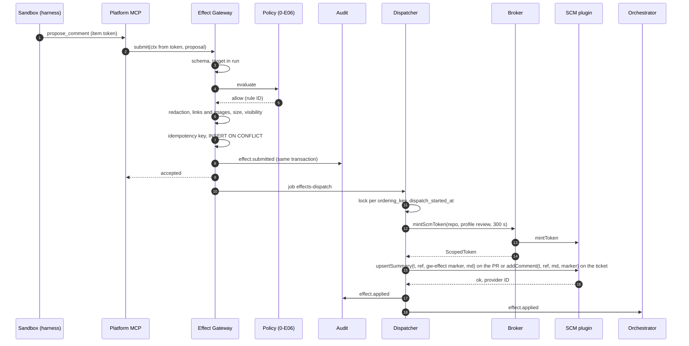
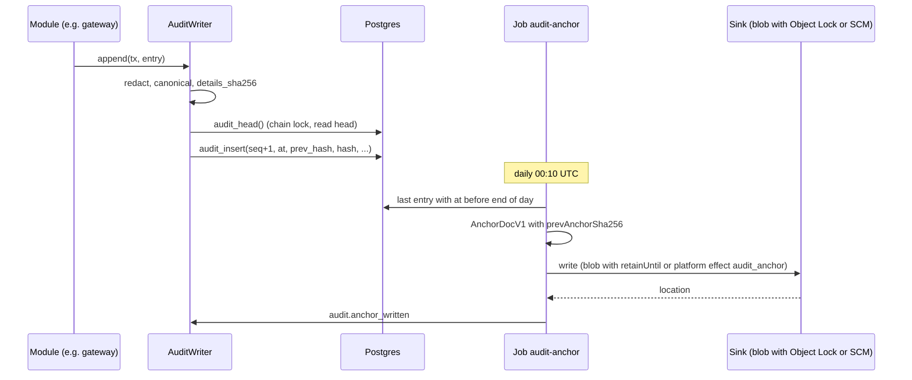

<!--
SPDX-License-Identifier: Apache-2.0
SPDX-FileCopyrightText: The Guildwork Authors
-->
# 04 Effect Gateway, Audit, Credential Broker and Drivers

Detailed design for the epics `0-E03` (core drivers), `0-E08` (audit with hash chain), `0-E09` (Effect Gateway) and `0-E10` (Credential Broker) of stage 0. Rulings of this document: FE-400 to FE-499. Source keys and classifications as in the [architecture README](../architecture/README.md). Work API, platform MCP, worker and proxies are in [03](03-execution.md). Section 2.1.5 also designs the executors of later stages; they are built in the stage given by the catalog (section 2.1.1).

## 1. Purpose and sources

This document makes the building blocks of zone Z0 buildable that manage permissions and act on the outside world: the single write path (Effect Gateway), the tamper-evident trail (audit), the issuing of short-lived credentials (broker) and the connection to the base (drivers).

| Source | What is implemented from it |
|---|---|
| [01](../architecture/01-plugin-interfaces.md) section 1 | Manifest, capabilities, `Result`, contract suite as a load condition (also for drivers) |
| [01](../architecture/01-plugin-interfaces.md) section 5 | Write methods of the `SCMProvider` only with a gateway token, `TokenProfile`, `mintToken`, push check, fallback chains |
| [01](../architecture/01-plugin-interfaces.md) section 6 | LLM credential per kind (`api_key`, `gateway`, `wif`), broker JWT with `exp` at most half the remaining lifetime of the lease |
| [01](../architecture/01-plugin-interfaces.md) section 13 | `BlobStore`, `SecretStore`, `CloudIdentity`, capabilities, contract suite with failure paths, rules 1 and 2 |
| [02](../architecture/02-services.md) section 0 | allowed write requests per service, mode `shadow` writes to the eval log |
| [03](../architecture/03-flow-and-orchestration.md) sections 2.2, 2.3, 5 | States of the effect, status comment, failure paths "effect fails", "policy rejects", "fallback level", "visibility" |
| [04](../architecture/04-configuration-and-limits.md) section 7 | `installation.yaml`: `blob`, `secrets`, `cloud_identity`, `audit_anchor` |
| [05](../architecture/05-security.md) sections 2, 3 item 4, 5, 7, 8 | Permission profiles per effect, Effect Gateway (idempotency, redaction, links and images), broker, redaction, visibility rule, audit |
| [06](../architecture/06-operations-and-deployment.md) sections 1, 4, 5, 6 | Drivers per base, required alerts (audit chain, anchor), retention, key rotation |
| [11](../architecture/11-installation-and-hosting.md) sections 2.2, 3, 4 | `doctor` (driver reachable, audit anchor), profiles, driver assignment, fallback level without `PRESIGN` |
| [08](../architecture/08-roadmap.md) stage 0 | Done criteria: effect idempotency, audit chain with daily anchor, effect in mode `record`, driver contract suites |
| ADR-06, ADR-10, ADR-22, ADR-29, ADR-41, ADR-43, ADR-45, ADR-63 | see section 9 per ruling |

Not here: the policy itself (rules, "command covers effect", deny by default, [02-control-plane.md](02-control-plane.md)); the methods of the GitHub plugin (`mintToken`, `push`, `addComment` etc., [05-plugins-and-contracts.md](05-plugins-and-contracts.md)); drivers `azure-blob` and `azure-keyvault` (0b-E01).

## 2. Modules and responsibility

### 2.0 Directories and files

```
packages/contracts/src/work/proposals.ts      # ProposalV1, EffectType (shared with 03 section 2.3)
packages/core/src/redaction/
  rules.ts             # rules: selection of gitleaks-compatible patterns plus our own (sk-ant-*, AWS, placeholders)
  redact.ts            # redact(text, extra) and scan(text, extra) -> hits without the matched text
  markdown.ts          # remove external links and images (FE-420)
apps/control-plane/src/effects/
  catalog.ts           # effect types, profiles, executor assignment, stage (section 2.1.1)
  gateway.ts           # EffectGateway.submit
  idempotency.ts       # key derivation
  content-checks.ts    # redaction, Markdown, sizes, visibility hook
  dispatcher.ts        # outbox processing (pg-boss), retry, reconciliation after a crash
  record.ts            # modes record and shadow: storage in the BlobStore
  bundle-check.ts      # push check of the bundle at submit (01 section 5): verify, head, changed paths
  checks/types.ts      # EffectCheck, EffectCheckInput, EffectCheckResult (section 2.1.7, FE-436)
  checks/registry.ts   # EFFECT_CHECKS: fixed list of checkers in execution order
  policy/              # checkers of later stages: coder-hard-gates.ts (2), qa-paths.ts (3), prfixer-forbidden.ts (4),
                       # orchestrator-merge.ts (5); citations.ts (6) lives directly under effects/ (09 section 2.10);
                       # ticket-visibility.ts (8, 13 section 2.1.7, FE-1314)
  executors/types.ts   # EffectExecutor, ExecContext (section 2.1.5)
  executors/comment.ts  executors/status-comment.ts  executors/check.ts  executors/audit-anchor.ts   # stage 0
  executors/ack.ts  executors/push.ts  executors/change.ts                                          # stage 0
  executors/review.ts  executors/thread-resolve.ts  executors/reply.ts                              # stage 1
  executors/ready-for-review.ts  executors/request-reviewers.ts  executors/ticket-transition.ts      # stage 2
  executors/plan.ts  executors/human-input.ts                                                       # stage 2
  executors/rerun.ts (stage 4)  executors/merge.ts (stage 5)
  executors/labels.ts  executors/approve-human.ts  executors/withdraw-approve.ts                     # stage 6
  executors/notify.ts (stage 1)  executors/link.ts (stage 7)  executors/code-scanning-upload.ts (stage 9)
  executors/issue.ts (stage 10)
  events.ts            # orchestrator-event
apps/control-plane/src/audit/
  writer.ts            # AuditWriter.append
  (canonical JSON: canonicalJson from @guildwork/core, 00 section 2.5; no module of its own)
  anchor.ts            # daily anchor job
  verify.ts            # verification of the chain and the anchors
  cli.ts               # subcommand "audit-verify" of the control-plane image (FE-425)
  checks.ts            # check functions for doctor
apps/control-plane/src/broker/
  broker.ts            # CredentialBroker
  secrets.ts           # resolution with audit and short cache
  keyring.ts           # wiring of the key ring from drivers/identity-self-issuer (FE-427)
  oidc-routes.ts       # WebMount /oidc: /oidc/.well-known/openid-configuration, /oidc/jwks.json (FE-441)
  scm-tokens.ts        # token per effect, per item and PluginContext.scmTokens.read (FE-446)
  item-tokens.ts       # issue and verify item tokens
  llm-grants.ts        # LLM credential per item
  pool-keys.ts         # pool keys
  plugin-secrets.ts    # PluginContext.secrets for loaded plugins
  work-item-tokens.ts  # mintWorkItemToken for ticket systems outside the SCM (stage 8, 13 FE-1315)
  cloud-grants.ts      # CloudGrantIssuer for bedrock, vertex, foundry (stage 8, 13 section 2.2.2)
  driver-issuer.ts     # createDriverIssuer for drivers with source self_issuer (stage 8, 13 FE-1342)
  static-scm-tokens.ts # weak token level (stage 9, 14 section 2.1.7, FE-1406)
apps/control-plane/src/drivers/
  load.ts              # exactly one driver per class from installation.yaml, capabilities, health
drivers/blob-fs/          drivers/blob-s3/
drivers/secret-file/      drivers/secret-env/
drivers/identity-self-issuer/
  src/keyring.ts       # key ring of the issuer (section 2.3.3), FE-427
  (per driver: src/index.ts, src/manifest.json, test/contract.test.ts)
packages/testkit/src/contract/drivers/
  blob-store.ts  secret-store.ts  cloud-identity.ts   # driver suites with all cases from section 8, built in 0-E03-T01 (05 FE-545, FE-438)
packages/testkit/src/effects.ts                      # effectsProbe(...).expectRecordedEffects(runId) (component testkit, 00 section 2.7)
.opengrep/rules/gw-plugin-write-only-in-executors.yaml       # check of the single write path (00 FE-054, FE-445)
drivers/blob-s3/test/images.ts                       # digests of the test images SeaweedFS and Garage (section 2.4.3)
```

### 2.1 Effect Gateway

#### 2.1.1 Effect catalog

An effect is an action on the outside world. It arises from a **write request** of a service (`propose_*`, [02](../architecture/02-services.md) section 0) or as a **platform effect** from the core (FE-406). Every type has exactly one permission profile and exactly one executor under `apps/control-plane/src/effects/executors/` (FE-428); section 2.1.5 contains the design per executor. The list covers all effect types that the architecture (01 to 05) and the detailed design (00 to 15) name (reconciliation 2026-11-01 after the Red Team on the work plan, round 1; stages 8 to 10 after the reports from [13](13-stage-8-providers-and-bases.md), [14](14-stage-9-breadth-and-hardening.md) and [15](15-stage-10-edge-layers.md)). A new type only comes with a row here, an executor design in section 2.1.5 and a build task in the plan.

| Effect type | Origin | Permission profile | Plugin method ([05](05-plugins-and-contracts.md) sections 2.11.3, 2.14.6, 2.14.8) | used in stages | Executor built in (task) |
|---|---|---|---|---|---|
| `comment` | `propose_comment`; platform (replies, notices, [02](02-control-plane.md) FE-251) | `review` (PR) or `comment_issue` (ticket); action `hide` `labels` | PR: `SCMProvider.upsertSummary` with effect marker (FE-433); ticket: `WorkItemProvider.addComment`; `hide`: `WorkItemProvider.hideComment`; session variant: `session.activity` with type `response` | 0 and all following; `hide` 7; session 9 | 0 (`0-E09-T05`); `hide` 7 (`7-E05-T07`); session 9 (`9-E02-T03`) |
| `status_comment` | platform (orchestrator) | `review` or `comment_issue` | `SCMProvider.upsertSummary` or `WorkItemProvider.addComment`/`updateComment` with marker; session variant: `session.start`, `session.activity`, `session.plan` ([14](14-stage-9-breadth-and-hardening.md) FE-1411) | 0 and all following; session 9 | 0 (`0-E09-T05`); session 9 (`9-E02-T01`) |
| `check` | `propose_check`; platform (`agent-approval-check`, [10](10-planner-architect-coder.md) FE-1046) | `review` | `SCMProvider.startCheck`, `updateCheck` | 0 and all following | 0 (`0-E09-T05`) |
| `audit_anchor` | platform (audit) | `audit_anchor` (FE-407) | `SCMProvider.push` to a fixed branch | 0 | 0 (`0-E09-T06`) |
| `ack` | platform (ingress processing or orchestrator, [02](02-control-plane.md) FE-251) | `comment_issue` (issue) or `review` (PR) | `TriggerSource.ack` with token ([05](05-plugins-and-contracts.md) FE-510) | 0 and all following | 0 (`0-E09-T07`) |
| `push` | `propose_push` | `write_branch` | `SCMProvider.push` with bundle | 2, 3, 4, 9, 10 | 0 (`0-E09-T08`) |
| `change` | `propose_change`; revert step of the orchestrator (FE-429) | `write_branch` | `SCMProvider.push` (bundle, if present), then `openChange` | 2, 3, 4, 5, 7, 10 | 0 (`0-E09-T09`) |
| `review` | `propose_review` (variants `review` and `summary`) | `review` | `SCMProvider.submitReview` or `upsertSummary` | 1, 6 | 1 (`1-E05-T08`) |
| `thread_resolve` | `propose_thread_resolve` | `review` | `SCMProvider.reply` (if `replyMd`), then `resolveThread` (if `resolve`) | 1 | 1 (`1-E05-T09`) |
| `reply` | `propose_reply` | `review` | `SCMProvider.reply` | 4, 6, 7 | 1 (`1-E05-T10`) |
| `notify` | platform (notifier messages, [01](../architecture/01-plugin-interfaces.md) section 10; revert, fallback, report, approval requests) | instance `comment-on-source`: `comment_issue` or `review`; other notifiers: none (own secret of the instance) | `comment-on-source`: like `comment`; otherwise `Notifier.send`, `update`; variant `approval`: `Notifier.requestApproval` ([14](14-stage-9-breadth-and-hardening.md) FE-1412) | 5, 6, 9 | 1 (`1-E05-T11`); `send` 6 (`6-E05-T06`); `approval` 9 (`9-E02-T02`) |
| `ready_for_review` | platform (orchestrator, [10](10-planner-architect-coder.md) FE-1045) | `write_branch` | `SCMProvider.updateChange({ draft: false })` | 2, 5 | 2 (`2-E01-T15`) |
| `request_reviewers` | platform (orchestrator) | `review` | `SCMProvider.requestReview` | 2, 5 | 2 (`2-E01-T16`) |
| `ticket_transition` | platform (orchestrator) | `comment_issue` | `WorkItemProvider.linkExternal`, then `transition` | 2, 8 | 2 (`2-E01-T17`) |
| `plan` | `propose_plan` | `comment_issue` | `WorkItemProvider.addComment` or `updateComment` with marker | 2 | 2 (`2-E02-T11`) |
| `human_input` | `request_human_input` | `comment_issue` (ticket) or `review` (PR) | `WorkItemProvider.addComment` or `SCMProvider.upsertSummary` with marker; run transition by the orchestrator | 2, 3 | 2 (`2-E01-T14`) |
| `dependency` | `propose_dependency` | none | no call to the outside; flow via `dependency_requests` ([10](10-planner-architect-coder.md) section 2.7, FE-432) | 2, 3, 4 | 2 (`2-E01-T09`, no outbox executor) |
| `rerun` | `propose_rerun` | `rerun` | `SCMProvider.rerunFailedJobs` | 4 | 4 (`4-E02-T06`) |
| `merge` | platform (merge gate, [11](11-qa-prfix-automerge.md) FE-1143) | `merge` | `SCMProvider.merge` | 5 | 5 (`5-E02-T07`) |
| `labels` | `propose_labels` | `labels` | `SCMProvider.setLabels` (PR) or `WorkItemProvider.setLabels` (ticket, from 7-E05) | 6, 7 | 6 (`6-E01-T09`) |
| `approve_human` | platform (reviewer controller, O24, [09](09-reviewer-companion-features-and-learnings.md) FE-927) | `review` | `SCMProvider.approve` | 6 | 6 (`6-E06-T09`) |
| `withdraw_approve` | platform ([09](09-reviewer-companion-features-and-learnings.md) FE-930) | `review` | `SCMProvider.withdrawApprove` | 6 | 6 (`6-E06-T10`) |
| `link` | `propose_link` (with `close` only under [12](12-expansion.md) FE-1217) | `labels` | `WorkItemProvider.linkItems`, with `close` then `closeAsDuplicate` | 7 | 7 (`7-E05-T06`) |
| `code_scanning_upload` | platform (completed analyzer run with `analyzers.upload_to_host`, [14](14-stage-9-breadth-and-hardening.md) FE-1440) | `code_scanning`; fallback levels `review` | `SCMProvider.uploadSarif`; fallback chain check annotations, then summary | 9 | 9 (`9-E07-T01`) |
| `issue` | `propose_issue` (only `prfixer` in mode `ci_doctor`); platform (occasion `incident_handoff`, [15](15-stage-10-edge-layers.md) K3, FE-1521) | `labels` | `WorkItemProvider.search`, `getItem`, then `createItem` or `addComment` on the issue with the same marker | 10 | 10 (`10-E02-T05`); platform origin 10 (`10-E03-T01`) |

**Stage of the executor (FE-428):** For every stage in "used in", the stage "built in" is the same stage or precedes it in the stage graph ([08](../architecture/08-roadmap.md) section 3). That is why `change` lies before stage 2 (users in 2 and 7, which do not precede each other), namely in stage 0, where the plugin methods (0-E14-T08, 0-E14-T09) and the gateway are built, and with it `push`, which uses the same push check; `reply` and `notify` in stage 1 (users in 4, 6 and 7, or in 5 and 6) and `labels` in stage 6 (users in 6 and 7). `catalog.ts` records `stage` and `usedIn` per type; the guard test from `0-E09-T10` checks both against the stage graph.

**Not in the catalog:** `revert` is not a type of its own but a worker step with the effects `change` (with bundle), `ready_for_review` and `request_reviewers` under the policy rule `POL-110` (`orchestrator.revert_after_red_target`, FE-429, [11](11-qa-prfix-automerge.md) FE-1146). A platform effect `link` does not exist; linking ticket and PR is part of `ticket_transition` (FE-430). `propose_merge` and `propose_approve` are excluded by the architecture (ADR-36, FE-927); `propose_assign` ([12](12-expansion.md) FE-1250) and `propose_reviewers` (backlog M29) are not planned.

A type whose executor is still missing in the running build (its stage has not been built yet) is accepted, checked and stored in mode `record` or `shadow`; in mode `live` it ends with `failed` and error `unsupported` (no silent success). The guard test prevents a stage from counting as built while its used types have no executor.

```ts
// packages/contracts/src/work/proposals.ts
export type EffectType =
  | "comment" | "status_comment" | "check" | "audit_anchor" | "ack" | "push" | "change"
  | "review" | "thread_resolve" | "reply" | "ready_for_review" | "request_reviewers" | "ticket_transition"
  | "plan" | "human_input" | "dependency" | "rerun" | "merge" | "labels" | "approve_human" | "withdraw_approve"
  | "link" | "issue" | "notify" | "code_scanning_upload";   // code_scanning_upload from 9-E07-T01 (14 FE-1440)

export type EffectTarget =
  | { kind: "change"; change: ChangeRef }
  | { kind: "work_item"; workItem: WorkItemRef }
  | { kind: "repo"; repo: RepoRef; branch?: string }
  | { kind: "thread"; change: ChangeRef; threadId: string };

interface ProposalBase { proposalKey: string;    // assigned by the service, unique within the step (e.g. "summary", "review:<headSha>", "resolve:<fp>")
                         target: EffectTarget }

export type ProposalV1 =
  | ProposalBase & { type: "comment"; action?: "post"; bodyMd: string }                      // target change or work_item
  | ProposalBase & { type: "comment"; action: "hide"; commentId: string; reason: "spam" }     // only triage, profile labels (12 FE-1251)
  | ProposalBase & { type: "check"; name: string; sha: string; status: "queued" | "in_progress" | "completed";
                     conclusion?: "success" | "neutral" | "failure" | "action_required"; summaryMd: string;
                     annotations?: Annotation[]; actions?: { id: string; label: string }[] }   // target repo
  | ProposalBase & { type: "review"; variant: "review"; commitSha: string; verdict: "comment" | "request_changes";
                     bodyMd: string; comments: ReviewComment[] }   // target change; ReviewComment with fingerprint (05 section 2.11.3)
  | ProposalBase & { type: "review"; variant: "summary"; commitSha: string; bodyMd: string }  // target change; one comment per PR
  | ProposalBase & { type: "thread_resolve"; fingerprint: string; replyMd?: string; resolve: boolean }   // target thread
  | ProposalBase & { type: "reply"; bodyMd: string }                                         // target thread
  | ProposalBase & { type: "labels"; add: string[]; remove: string[] }                       // target change or work_item
  | ProposalBase & { type: "push"; branch: string; bundleArtifactId: string; expectedOldSha: string | null;
                     newSha: string }                                                         // target repo; newSha = head of the bundle
  | ProposalBase & { type: "change"; head: string; base: string; title: string; bodyMd: string;
                     bundle?: { artifactId: string; expectedOldSha: string | null; newSha: string } }  // target repo; always draft
  | ProposalBase & { type: "human_input"; questionId: string; questionMd: string }            // target work_item or change
  | ProposalBase & { type: "plan"; planArtifactId: string; version: number; summaryMd: string }   // target work_item
  | ProposalBase & { type: "dependency"; ecosystem: string; name: string; version: string; reason: string }
  | ProposalBase & { type: "link"; other: WorkItemRef; relation: "relates" | "duplicates" | "blocks"; close?: boolean }  // close only with duplicates
  | ProposalBase & { type: "issue"; project: string; marker: string; title: string; bodyMd: string; labels?: string[] }
  | ProposalBase & { type: "rerun"; sha: string; jobIds: string[] };

// apps/control-plane/src/effects/catalog.ts: platform effects have their own input types; a service can never
// submit them as a write request (the schema of ProposalV1 does not know them). Each carries its occasion (02 FE-251).
export type PlatformEffectInput =
  | { type: "status_comment"; target: EffectTarget; objectKey: string; version: number; bodyMd: string }
  | { type: "comment"; target: EffectTarget; reason: string; bodyMd: string }
  | { type: "check"; target: EffectTarget; name: "agent-approval-check"; sha: string;
      status: "in_progress" | "completed"; conclusion?: "success"; summaryMd: string }
  | { type: "audit_anchor"; day: string; docArtifactId: string; parentSha: string | null }
  | { type: "ack"; eventId: string; deliveryId: string;
      priority?: "ack_fast" }                         // from 9-E02-T01 (FE-448, 14 FE-1410): queue effects-ack-fast
  | { type: "ready_for_review"; target: EffectTarget }
  | { type: "request_reviewers"; target: EffectTarget; users: Actor[] }
  | { type: "ticket_transition"; target: EffectTarget; to?: StatusCategory;
      link?: { url: string; title: string; kind: "pr" | "branch" | "build" | "plan" } }
  | { type: "approve_human"; target: EffectTarget; commitSha: string; bodyMd: string; decisionId: string }
  | { type: "withdraw_approve"; target: EffectTarget; approvalId: string; reason: string }
  | { type: "merge"; target: EffectTarget; expectedHeadSha: string; method: "merge" | "squash" | "rebase"; decisionId: string }
  | { type: "notify"; variant?: "send"; instance: string; to: Audience; source?: EffectTarget;   // source only for comment-on-source
      msg: { title: string; md: string; runId?: string; kind: NotifyKind; severity: "info" | "action" | "alert" } }
  | { type: "notify"; variant: "approval"; instance: string; to: Audience;   // from 9-E02-T02 (14 FE-1412)
      req: ApprovalRequest }                          // ApprovalRequest with approvalId, summaryMd, links (14 section 2.2.2)
  | { type: "issue"; reason: "incident_handoff"; target: EffectTarget;      // kind "repo"; from 10-E03-T01 (15 K3, FE-1521, FE-450)
      instance: string; project: string; marker: string; title: string;   // title starts with "[incident] "
      bodyMd: string; labels?: string[] }
  | { type: "code_scanning_upload"; target: EffectTarget; analyzerRunId: string; sarifRef: string;   // from 9-E07-T01 (14 section 2.7.1)
      commitSha: string; ref: string; toolName: string };
// The revert step (FE-429) delivers a ProposalV1 of type change with bundle in the StepResult with service "platform".
export const ISSUE_TITLE_PREFIX = { ci_doctor: "[ci-doctor]", incident_handoff: "[incident]" } as const;
// Search path of the issue executor (15 FE-1519, FE-450); submit rejects an issue whose title does not start with the prefix
// of its origin (invalid, reason issue_title_prefix)

export interface CatalogEntry {
  type: EffectType; origin: ("proposal" | "platform")[]; profiles: (TokenProfile | null)[];
  executor: string | "internal";   // file under effects/executors/ or "internal" (only dependency, FE-432)
  stage: Stage; usedIn: Stage[];   // FE-428; Stage as in 08 ("R", "0", "0b", "1" ... "10", "7a")
  task: string;                    // build task in the plan, e.g. "1-E05-T08"
}
export const CATALOG: readonly CatalogEntry[];               // exactly one row per EffectType (table above)
export interface PlannedExecutor {
  type: EffectType; variant?: "hide" | "session" | "send" | "approval" | "platform";
  // extension of a built executor: comment hide (7) and session (9), status_comment session (9),
  // notify send (6) and approval (9), issue platform (10)
  stage: Stage; task: string;
}
export const PLANNED_EXECUTORS: readonly PlannedExecutor[]; // executors and variants of stages not yet built
export const BUILT_STAGES: readonly Stage[];                 // after stage 0: ["R", "0"]; completing each stage extends it
export function catalogEntry(type: EffectType): CatalogEntry;  // throws on unknown type (cannot happen after the guard test)
```

**Source of the stage graph for the guard test** (`apps/control-plane/test/effects/catalog-guard.test.ts`, 0-E09-T10): the stage headers of the plan files under `docs/plan/` in the format of `tools/plan/plan.py` (English keys, [00](00-codebase-and-conventions.md) FE-037), the same source as the plan check. The test does not read them itself (no second TOML dependency) but calls `python3 tools/plan/plan.py stage-graph --json`; 0-E09-T10 adds this subcommand (output `{ "<stage>": ["<predecessor>", ...] }`, standard library only) to the plan tool (FE-442). The test fails if a stage from `CatalogEntry.stage` or `usedIn` is missing from the graph. The error message names the type, the stage of the executor and the using stage that does not come after it.

#### 2.1.2 Interface

```ts
// apps/control-plane/src/effects/gateway.ts
export interface SubmitContext {
  tenantId: string; runId?: string; stepId?: string;   // missing only for platform effects without a run (daily anchor, ack before the run; 01 section 3.5)
  itemId?: string; leaseId?: string;       // set for origin MCP or StepResult
  service: ServiceId;                      // "platform" for platform effects
  origin: "mcp" | "step_result" | "platform";
  actor: AuditActor;
  traceparent: string;
}
export type SubmitOutcome =
  | { state: "accepted"; effectId: string; mode: "live" | "shadow" | "record"; duplicate: boolean }
  | { state: "awaiting_approval"; effectId: string; gate: "G4" }
  | { state: "rejected_policy"; effectId: string; ruleId: string; reason: string }
  | { state: "invalid"; reason: string };

export interface EffectGateway {
  submit(ctx: SubmitContext, p: ProposalV1, tx?: Tx): Promise<SubmitOutcome>;
  submitPlatform(ctx: SubmitContext, e: PlatformEffectInput, tx?: Tx): Promise<SubmitOutcome>;
  release(effectId: string, approvalId: string, tx: Tx): Promise<void>;   // after approval G4 (from stage 2)
}
export interface EffectGatewayDeps {
  db: Db; config: InstallationConfig;                 // effects.* (section 7)
  policy: Policy;                                     // 02 section 2.2 (0-E06-T08, 0-E06-T09)
  resolver: Pick<Resolver, "snapshot">;               // config snapshot of the run (02, 0-E06-T07)
  audit: AuditWriter; blob: BlobStore;
  placeholders: (tenantId: string) => Promise<string[]>;   // CredentialBroker.activePlaceholders (0-E10-T05)
  bundleCheck?: BundleCheck;                          // from 0-E09-T08 (section 2.1.5 push); if missing, push and change with bundle yield invalid
  checks: readonly EffectCheck[];                     // EFFECT_CHECKS (section 2.1.7)
  log: Logger; metrics: Metrics; clock: Clock;
}
export function createEffectGateway(deps: EffectGatewayDeps): EffectGateway;
// apps/control-plane/src/effects/bundle-check.ts (0-E09-T08)
export interface BundleCheck {
  check(i: { tenantId: string; artifactId: string; branch: string; expectedOldSha: string | null; newSha: string })
    : Promise<Result<{ headSha: string; sha256: string; changedPaths: string[]; deletedPaths: string[] }>>;
}
```

`release` (from stage 2): loads the effect with `FOR UPDATE`; only `pending` with `hold = 'G4'` and an approval `approvals.state = granted` whose binding (SHA or plan) matches the effect lift the hold (`hold = null`, `approval_id`, audit `effect.released`, job `effects-dispatch` via `sendInTx`). A denied or expired approval sets `rejected_policy` with rule `approval_denied` (section 4.2). Every other state is an error `conflict` without any change.

The gateway calls the policy via `Policy.evaluateEffect(i: EffectPolicyInput): PolicyDecision`; both types are defined in [02-control-plane.md](02-control-plane.md) section 2.2 (built in 0-E06, consistency run 2026-11-01). `EffectPolicyInput.effect` carries `type: EffectType`, `target` and, for a push, the changed paths from the bundle; `origin` is the value from `SubmitContext`. `PolicyDecision` knows `allow`, `deny`, `require_approval` (gate `G4`) and `shadow`.

#### 2.1.3 Flow of `submit`

In this order; each step with its own test (section 8):

1. **Schema**: Ajv against `ProposalV1`; an error yields `invalid` (no effect record, audit `effect.invalid` with reason, counter). For `push` and for `change` with bundle, the push check follows (`bundle-check.ts`, section 2.1.5 `push`); an invalid bundle likewise yields `invalid`. It delivers the changed and deleted paths for step 4 (`EffectPolicyInput.effect.paths`) and for the checkers from section 2.1.7.
2. **Context**: load run (with `runs.effect_sink`, FE-444), step and config snapshot; for origin `mcp`, tenant, run, item and service come from the verified item token ([03](03-execution.md) section 2.5), never from the argument.
3. **Target within scope**: the target must belong to the run (same repo or same ticket as the run or its agent PR); otherwise `rejected_policy` with rule `target_outside_run`.
4. **Policy**: `Policy.evaluateEffect`; `deny` yields `rejected_policy` with the rule ID; `require_approval` yields effect `pending` with `hold = 'G4'` and outcome `awaiting_approval`; `shadow` acts like step 6 with `service_shadow`. The decision is stored in `policy_decisions` (`effects.policy_decision_id`).
5. **Content check** (`content-checks.ts`): redaction scan of all texts (rules from `packages/core/src/redaction`, plus the placeholders of all active items of the tenant); a hit yields `rejected_policy` with rule `secret_found` (audit `effect.blocked_secret` with rule IDs, without text). Then clean the Markdown (FE-420), size limits (`effects.comment_max_bytes`), and finally the checkers from `EFFECT_CHECKS` in fixed order (section 2.1.7; the first is the visibility hook, FE-421): the first `reject` yields `rejected_policy` with its rule ID, `require_approval` acts as in step 4.
6. **Mode** (in this order, the first matching rule applies): `effects.mode: record` of the installation yields `shadowed` with `shadow_reason = 'gateway_record'`; sink `record` of the run (`runs.effect_sink = 'record'`, set by `createRun` according to [02](02-control-plane.md) FE-241, for example for every case run of the eval service according to [07](07-eval-and-qualification.md) FE-746) yields `shadowed` with `run_record` (FE-444); a service in mode `shadow` according to the snapshot yields `shadowed` with `service_shadow`; otherwise `pending`. The sink of the run applies to every origin, including platform effects with `runId` (for example `status_comment`, `withdraw_approve`); no checker, no policy decision and no configuration can lift it for an effect.
7. **Idempotency key** (FE-402) and insert into `effects` with `ON CONFLICT (tenant_id, idempotency_key) DO NOTHING RETURNING`; on conflict `submit` returns the existing effect with `duplicate: true` and writes nothing further.
8. **Storage** for `shadowed`: payload as JSON in the BlobStore (`record.ts`): `gateway_record` under `effect-record/<tenant>/<run>/<effectId>.json` as artifact `effect_record`; `run_record` and `service_shadow` under `eval-log/<tenant>/<run>/<effectId>.json` as artifact `eval_log` (there the eval service reads the effects of a case as `RecordedEffect`, [07](07-eval-and-qualification.md) section 2.16.1).
9. **Audit** `effect.submitted` (or `effect.shadowed`, `effect.rejected_policy`) in the same transaction.
10. **Trigger the dispatcher**: for `pending` without `hold`, a pg-boss job `effects-dispatch` (payload `{ v: 1, tenantId, effectId }`, `singletonKey = effectId`) via `sendInTx` in the same transaction; it becomes visible only with the commit ([02](02-control-plane.md) FE-271). An `ack` with `priority: "ack_fast"` goes with the same payload to the queue `effects-ack-fast` (from 9-E02-T01, FE-448).

Without a passed `tx`, `submit` opens its own transaction with `withTenant(ctx.tenantId)`; with `tx` (for example in a transition of the orchestrator) all steps from 7 on run in it, and a rollback by the caller takes effect, audit and job with it. The placeholders for step 5 come from `deps.placeholders(tenantId)`; if this call fails, `submit` throws an `AppError` with code `transient` without an effect row and without audit (fail closed, log event `effect.placeholders_unavailable`); the caller (platform MCP, orchestrator) treats it like any transient error and retries.

#### 2.1.4 Idempotency and outbox

The table `effects` is the outbox (FE-401). Key (FE-402):

```ts
// apps/control-plane/src/effects/idempotency.ts
export function idempotencyKey(i: { tenantId: string; runId: string; stepKey: string; type: EffectType;
                                     target: EffectTarget; proposalKey: string; payloadSha256: string }): string;
// = hex(SHA-256("gw-effect-v1\n" + canonical({tenantId, runId, stepKey, type, target, proposalKey, payloadSha256})))
// stepKey is the domain key of the step in the run (stable across attempts, not the step row ID of one attempt).
```

So a repeated attempt of the same step with the same request yields exactly one effect ("same key, one effect"); a request with changed content is a new effect.

**Platform effects** (FE-435, resolves backlog M144): without a run, `runId` is the fixed string `-`; without a step, `stepKey` is the domain key of the occasion: `anchor:<day>` (`audit_anchor`), `ack:<deliveryId>` (`ack`), `status:<objectKey>:<version>` (`status_comment`), `approve:<repoId>:<pr>:<headSha>` (`approve_human`, [09](09-reviewer-companion-features-and-learnings.md) section 2.9), `withdraw:<approvalId>`, `merge:<runId>:<sha>` ([11](11-qa-prfix-automerge.md) section 2), `approval:<approvalId>:<instance>` (`notify` variant `approval`), `incident:<marker>:<deliveryId>` (`issue` from `incident-handoff`, one effect per delivery; the executor does the appending via the marker), `sarif:<analyzerRunId>` (`code_scanning_upload`), otherwise `platform:<occasion>:<object>`. Methods with their own parameter `idempotencyKey` (`submitReview`, `approve`, `withdrawApprove`, `merge`) receive `effects.idempotency_key`; the plugins store it as a hidden marker and recognize a repetition by it.

**Dispatcher** (`dispatcher.ts`), pg-boss job `effects-dispatch`:
1. Load the effect with `SELECT ... FOR UPDATE SKIP LOCKED`; only `pending` without `hold`. If the run of the effect (`runs.state`) is already `cancelled`, the effect ends without a call to the outside with `failed` and `error = { code: "cancelled", message: "run cancelled before dispatch" }` (a gateway code, not a `PluginError` code), audit `effect.failed`, event `effect.failed` (section 4.2).
2. Order per target: `pg_advisory_xact_lock(hashtext(ordering_key))`; if there is an earlier unfinished effect with the same `ordering_key`, the job is rescheduled after a short pause (FE-405).
3. `dispatch_started_at = now()`, `attempts + 1`, commit (own short transaction before the call to the outside).
4. Token from the broker: `mintScmToken({ repo, profile, purpose: { kind: "effect", effectId }, ttlS: broker.effect_token_ttl_s })`. If the target is a `work_item` of a WorkItemProvider instance without an SCM instance of the same ID (ticket system outside the SCM, from 8-E01-T06), instead `mintWorkItemToken({ tenantId, effectId, instance, profile })` ([13](13-stage-8-providers-and-bases.md) FE-1315, section 2.3.5); the choice follows the kind of the target instance, never the provider name. Types with profile `null` (for example `notify` to other instances) get no token.
5. If `dispatch_started_at` was already set without a result (crash after the call): first `executor.reconcile` (search for the marker `gw-effect:<effectId>` at the target); if it finds the effect, the effect counts as `applied` (FE-404).
6. `executor.execute`; result `applied` with `provider_request_id`, `fallback_used`; or an error.
7. Error handling by `PluginError.code` ([01](../architecture/01-plugin-interfaces.md) section 1.1 rule 3): `rate_limited`, `transient` with growing pause (`retryAfterMs` takes precedence); `auth`, `permission`, `invalid`, `not_found`, `conflict`, `unsupported` immediately `failed`. After `effects.retry.max_attempts`, `failed`.
8. Audit `effect.applied` or `effect.failed`, event to the orchestrator (queue `orchestrator-event`), token discarded.

```ts
// apps/control-plane/src/effects/events.ts
export const EFFECT_EVENTS_QUEUE = "orchestrator-event";   // one queue for all run events (02 section 4.9)
export type EffectEvent =
  | { t: "effect.applied"; effectId: string; runId: string; type: EffectType; providerRequestId?: string; fallbackUsed: string }
  | { t: "effect.failed"; effectId: string; runId: string; type: EffectType; error: PluginError; attempts: number }
  | { t: "effect.rejected"; effectId: string; runId: string; ruleId: string }
  | { t: "effect.shadowed"; effectId: string; runId: string; reason: "service_shadow" | "gateway_record" | "run_record" }
  | { t: "effect.awaiting_approval"; effectId: string; runId: string; gate: "G4" };
// Sent via sendInTx in the transaction of the state change as a RunEvent of the queue orchestrator-event (02 section 4.9);
// effects without a run (runId "-", daily anchor, ack before the run) send no event.

// apps/control-plane/src/effects/dispatcher.ts
export interface DispatcherDeps {
  db: Db; config: InstallationConfig; broker: Pick<CredentialBroker, "mintScmToken">;
  executors: ReadonlyMap<EffectType, EffectExecutor>;   // from effects/executors/index.ts, one per built type
  plugins: PluginRegistry; blob: BlobStore; audit: AuditWriter; log: Logger; metrics: Metrics; clock: Clock;
}
export function effectsHandlers(deps: DispatcherDeps): HandlerRegistration<{ v: 1; tenantId: string; effectId: string }>[];
// one registration for effects-dispatch (02 section 4.9.2); from 9-E02-T01 a second one for effects-ack-fast
// with the same handler (FE-448); the orchestrator role registers them at startup
```

A job whose effect is not (or no longer) `pending` without `hold` ends without effect (redelivery after a crash is harmless). When the `orchestrator` role starts, the dispatcher sends `effects-dispatch` again for every effect `pending` without `hold` that has no open job (resumption after restart, test `effects/dispatch resumes after restart`); the `singletonKey` prevents duplicate jobs.

**Priority `ack_fast`** (FE-448, from 9-E02-T01, need from [14](14-stage-9-breadth-and-hardening.md) FE-1410): ingress processing sets `priority: "ack_fast"` on the platform effect `ack` when the delivering TriggerSource instance reports the capability `AGENT_SESSION: native` (deadline for the first activity; never by provider name). The priority is stored in the payload of the effect; `submit` step 10 and the resumption after restart choose the queue `effects-ack-fast` from it, otherwise `effects-dispatch`. The queue has its own workers with `effects.ack_fast.concurrency` (default 2) and is never occupied by effects of other types (`submit` rejects `priority` on any other type with `invalid`); the handler is the same as for `effects-dispatch` (lock per `ordering_key`, token, reconciliation, error handling). The deadline is measured in `linear_ack_latency_seconds` (14); the dispatcher additionally records `guildwork.effect.ack_fast_wait` (gauge, s: age of the oldest waiting job of the queue). Test `effects/dispatch serves ack fast before backlog` (100 waiting `comment` effects with one worker for `effects-dispatch`, then one `ack_fast`: the `ack` is `applied` while `comment` effects are still waiting).

#### 2.1.5 Executors

```ts
// apps/control-plane/src/effects/executors/types.ts
export interface ExecContext { plugins: PluginRegistry; blob: BlobStore; log: Logger; clock: Clock; signal: AbortSignal }
// calls of the WorkItemWriter methods always with the per-effect token as the first parameter (05 FE-543), e.g.
// addComment(t, ref, md, { marker }); an executor without a token for a ticket write call is a programming error
export interface ExecOutcome { providerRequestId?: string; fallbackUsed: "none" | string; result: Record<string, unknown> }
export interface EffectExecutor {
  type: EffectType;
  profile: TokenProfile | null;               // TokenProfile contains audit_anchor (05 section 2.11.3)
  execute(ctx: ExecContext, e: EffectRow, token: ScopedToken | null): Promise<Result<ExecOutcome>>;
  reconcile?(ctx: ExecContext, e: EffectRow, token: ScopedToken | null): Promise<Result<ExecOutcome | null>>;
  profileFor?(e: EffectRow, caps: CapabilitySet<string>): TokenProfile;   // only types with several profiles in the catalog
}                                             // (code_scanning_upload); otherwise profile applies
```

**Common to all executors:** The dispatcher (section 2.1.4) fetches the token with the profile from the catalog (or from `profileFor`, if the executor sets it), calls `execute` or, after a crash, first `reconcile`, and handles errors by `PluginError.code`. For every final state `failed`: stored `effects.state = failed`, `error` (code, message without payload text), `attempts`; audit `effect.failed` with type, code and attempts; metric `effect_failed_total{type,code}` and a log line with `effectId`, `type`, `code` (never token, never text); event `effect.failed` to the orchestrator, which sets the status comment. If the plugin method is missing or the capability reports `none`, the effect ends immediately with `unsupported` (same path, metric `effect_unsupported{type}`). Hidden markers have the form `<!-- gw-effect:<effectId> run:<runId> -->`; `reconcile` searches for them from `dispatch_started_at`. Every executor has a test in mode `live` against recorded GitHub responses and a failure path test (section 8). The test reads the cassettes (format `guildwork-cassette/1`, [05](05-plugins-and-contracts.md) section 2.10) from `plugins/github/contract/fixtures/`; until 0-E14-T13 these are the provisional cassettes of the task that builds the method (0-E14-T04, T07, T08, T09, T14), afterwards the real ones in the same place, without any change to the test. An executor task therefore does not depend on 0-E14-T13; 0-E16 checks the chain against the real recordings. The policy rule is given per type below; every write request is additionally subject to `POL-010` and `POL-011`, every platform effect to `POL-012` ([02](02-control-plane.md) section 4.7). Names of the form `orchestrator.*` and `system.*` are the names of the occasion rules `POL-101` to `POL-113` from the table in 02 section 4.7 ([02](02-control-plane.md) FE-254; the ID is given alongside each below): `policy_decisions.rule_id` carries the ID, `details.rule_name` the name. Occasion rules of later platform effects (`orchestrator.incident_ticket` for `issue`, the rule for `code_scanning_upload`) get their ID from the same block in the PR of the effect (02 section 4.7). Names of other forms (`prfixer.ci_doctor_issue`, `qa.test_paths` etc.) are service rules or checker IDs from section 2.1.7. All built executors are listed in `effects/executors/index.ts` as `export const EXECUTORS: readonly EffectExecutor[]`; the dispatcher builds its mapping from it, and the guard test (0-E09-T10) reconciles it with `CATALOG`. Executors call plugins only via the registry (`ctx.plugins.get(instanceId, kind)`) and only under `withCaller("effect_gateway", ...)` of the transport ([05](05-plugins-and-contracts.md) section 2.8, 0-E13-T10); the plugin instance is that of the target repo or ticket according to `effects.target`. Every write method of the `WorkItemProvider` receives the per-effect token `t` as its first parameter ([05](05-plugins-and-contracts.md) FE-543, `WorkItemWriter` in 05 section 2.12), like those of the `SCMProvider`.

Stage 0:
- **`comment`** (`comment.ts`, 0-E09-T05): target `change` via `upsertSummary(t, ref, "gw-effect:<effectId>", md)` (one separate comment per effect, FE-433), target `work_item` via `addComment(t, ref, md, { marker })`. Idempotency: marker in the text; `reconcile` reads the comments since `dispatch_started_at` (`getComments` or upsert via the marker) and reports a found one as `applied`. Policy: `POL-070` (citations); as a platform effect `POL-103` (`orchestrator.comment`). Failure paths: text over `effects.comment_max_bytes` is already rejected at `submit`; `not_found` (ticket deleted) yields `failed` without retry. Action `hide` (from stage 7, `7-E05-T07`): `hideComment(t, ref, commentId, "spam")` with profile `labels`, only for `triage` under `spam_action: hide_comment` ([12](12-expansion.md) FE-1251); reconciliation by calling again (hiding is idempotent); without capability `COMMENT_HIDE`, `unsupported`, the comment stays visible and the status comment gives the reason. Session variant (from stage 9, `9-E02-T03`, [14](14-stage-9-breadth-and-hardening.md) section 2.2.3): target `work_item` of an instance with `AGENT_SESSION: native` for which `work_item_sessions` holds a session of the run (14 section 3.1): instead of `addComment`, an activity `session.activity(id, { type: "response", body: md })` (signature according to [01](../architecture/01-plugin-interfaces.md) section 4, token as with the write methods), marker in the text. Idempotency and reconciliation: `reconcile` searches for the marker in the activities of the session (read method according to 14, `RECONCILE` per spike 9-E02-T01-S01; without it, calling again). Failure path: no session of the run, or `session.activity` with `not_found` or `unsupported`: comment via `addComment` as above, `fallback_used = "comment"`; the citation check against `ticketTargetVisibility` (FE-1314) applies equally on both paths.
- **`status_comment`** (`status-comment.ts`, 0-E09-T05, [03](../architecture/03-flow-and-orchestration.md) section 2.3): one comment per object. The control plane renders the text from all active runs of the object with the marker `guildwork:status` and the version from `status_comments` ([02](02-control-plane.md) section 4.4, 01 FE-116); the executor writes it as an upsert via the marker (`upsertSummary` or `addComment`/`updateComment`) and does not change it. Concurrent effects are serialized in the gateway via `ordering_key = status:<object>` (FE-405); the version number in the marker is checked when reading back; if the version at the target is already higher, the executor does not write and reports `applied` with `result.skipped = "newer_version"` (protection against two control plane processes). Policy: `POL-101` (`orchestrator.status_comment`). Target `work_item` with `addComment(t, ref, md, { marker })` or `updateComment(t, ref, id, md)`. If the WorkItemProvider reports `AGENT_SESSION: native`, the executor writes session activities instead of the comment (`session.start`, `session.activity`, `session.plan`) according to [14](14-stage-9-breadth-and-hardening.md) section 2.2.1 (FE-1411; idempotency via `work_item_sessions.last_version`, fallback to the comment with `fallback_used = "comment"`); this variant is built by `9-E02-T01`.
- **`check`** (`check.ts`, 0-E09-T05): `startCheck` on the first effect per `(sha, name)`, then `updateCheck`; the check ID is in the result and is found for `reconcile` via `external_id` = effect key (if the provider supports it, otherwise search by name and SHA via `checkEvidence`). Annotations in blocks as the plugin requires. Policy: name from the service's list (`ai-review`, `ai-qa`, `ai-fix`, `quality-gate` etc.) or `POL-105` (`orchestrator.agent_approval_check`). Failure path: without `CHECK_RUN`, `unsupported`; the service then puts the result only into the summary (fallback chain from [01](../architecture/01-plugin-interfaces.md) section 5).
- **`audit_anchor`** (`audit-anchor.ts`, 0-E09-T06): section 2.2.4.
- **`ack`** (`ack.ts`, 0-E09-T07): loads the stored event (`eventId`) and calls `TriggerSource.ack(ev, t)` of the plugin that delivered the event (GitHub: reaction `eyes`). Idempotency: key `ack:<deliveryId>` (FE-435); `reconcile` calls again (a second identical reaction is not a new entry on GitHub, unverified until 0-E14-T13). Policy: `POL-102` (`orchestrator.ack`, occasion "command accepted"). Failure path: `ack` is never a precondition for the run; `failed` only produces audit and metric, no status comment.
- **`push`** (`push.ts`, 0-E09-T08): `SCMProvider.push(t, repo, branch, bundleRef, expectedOldSha)`. Before that, at `submit`, the push check from [01](../architecture/01-plugin-interfaces.md) section 5 in `bundle-check.ts`: `git bundle verify`, head of the bundle equal to `newSha`, branch prefix `agent/`, no paths under `.github/workflows`, changed paths for `EffectPolicyInput.paths`. Idempotency: the plugin reports `ok` if the branch already points to `newSha` (FE-434); `reconcile` is therefore calling again. Policy: `POL-020`, `POL-021`, `POL-022`, plus the path rules per service (`qa.test_paths`, hard gates of the coder from 2-E04-T04). Failure paths: `conflict` (branch moved) yields `failed` without retry with `error.code = conflict`, the run does not count this as a round ([11](11-qa-prfix-automerge.md) section 5); an invalid bundle yields `invalid` at `submit` with audit `effect.invalid`, no effect.
- **`change`** (`change.ts`, 0-E09-T09): with `bundle`, first like `push` to `head` (the same check at `submit`), then `openChange(t, repo, { head, base, title, bodyMd, draft: true })` with the effect marker in the text. Idempotency: `openChange` returns the open PR with the same `head`, the same `base` and the same marker instead of opening a second one (FE-434); `reconcile` is calling again. Labels and reviewers come as separate effects (`labels`, `request_reviewers`). Policy: like `push`, plus path rules per service (`architect.doc_paths`, `.agents/rules/` only for `standards`, `docs.paths`, `.agents/environment.yaml` only in mode `env_bootstrap`), for a revert `POL-110` (`orchestrator.revert_after_red_target`). Failure paths: push succeeds, `openChange` fails: `failed` with `result.pushedSha`; the next retry of the step finds the branch via the plugin idempotency and only opens the PR; an open PR by a human on the same `head` yields `conflict`.

Stage 1:
- **`review`** (`review.ts`, 1-E05-T08): variant `review` via `submitReview(t, ref, { comments, verdict, commitSha, bodyMd, idempotencyKey })` with the fallback chain of the plugin ([05](05-plugins-and-contracts.md) section 4.4); `ReviewOutcome` (`posted`, `demotedToSummary`, `failedPositions`, `fallbackUsed`) is stored in `effects.result` and goes to the controller with the event `effect.applied` ([08](08-reviewer.md) FE-839). Variant `summary` via `upsertSummary(t, ref, "guildwork:summary run=<runId> sha=<commitSha>", bodyMd)`. Idempotency: marker with `idempotencyKey` in the review text (the plugin finds its own review on the same `commitSha`) or upsert via the summary marker; `reconcile` is calling again. Policy: command `review` or route `change.*` with reviewer; `POL-070`. Failure paths: `commitSha` is no longer the head: the plugin still posts on `commitSha` (GitHub shows it as outdated), no error; a fallback level yields `fallback_used` and audit `effect.fallback_used`; `invalid` (for example 422 without a valid position after all levels) yields `failed`, and the controller writes the findings into the summary.
- **`thread_resolve`** (`thread-resolve.ts`, 1-E05-T09): with `replyMd`, first `reply(t, ref, threadId, replyMd + marker)`, then with `resolve: true` `resolveThread(t, ref, threadId, true)`. Idempotency: `reconcile` reads `getThreads(ref, true)`; if the marker is already in the thread, the reply is skipped; if the thread is already resolved, resolving is skipped. Policy: only threads with `isOwn` and without a human reply for `resolve: true` ([02](../architecture/02-services.md) section 4, stage 9 of the reviewer pipeline). Failure paths: thread deleted (`not_found`) yields `failed` without retry, the finding stays `addressed`; without `THREAD_RESOLVE` only the reply and `fallback_used = "reply_only"`.
- **`reply`** (`reply.ts`, 1-E05-T10): `reply(t, ref, threadId, bodyMd + marker)`. Idempotency and reconciliation as with `thread_resolve` (marker in the thread). Policy: reviewer only in platform threads or on mention ([09](09-reviewer-companion-features-and-learnings.md) FE-913), at most `max_replies_per_thread`; PR fixer and indexer according to [02](../architecture/02-services.md) section 0. Failure path: `not_found` yields `failed` without retry.

- **`notify`** (`notify.ts`, 1-E05-T11): instance `comment-on-source` (default, [01](../architecture/01-plugin-interfaces.md) section 10) writes a comment on `source` like `comment` (marker, upsert, same reconciliation); every other instance via `Notifier.send(to, msg, idempotencyKey)` or `update` as soon as its contract is binding (kind `report` with 6-E05-T06, Slack with 9-E02-T02). Messages without a source object (alarm, report) only go to a configured other instance; without one, they remain in the admin UI and the sink `log` ([00](00-codebase-and-conventions.md) FE-019). Idempotency: `idempotencyKey = effects.idempotency_key` or marker. Policy: `POL-111` (`orchestrator.notify`) with occasion; `POL-070` for the text. Failure path: missing instance or non-binding contract yields `unsupported`; the message then appears in the Run Record and in the admin UI, and the required alert runs independently via `log` and `webhook`. Variant `approval` (from stage 9, `9-E02-T02`, [14](14-stage-9-breadth-and-hardening.md) FE-1412): `Notifier.requestApproval(to, req, idempotencyKey)` of the instance with `idempotencyKey = effects.idempotency_key`; occasion key `approval:<approvalId>:<instance>` (FE-435), so one request per approval and instance. `MessageRef` is stored in `effects.result` and in `notifier_messages` (14 section 3.1), so that later `update` calls (approval granted, expired) change the same message. The decision never comes back via this effect, but via the signed callback of the plugin (14 section 2.2.2) as an approval command; the effect only reports the delivery. Reconciliation: calling again with the same `idempotencyKey` (the plugin recognizes the repetition, contract case of the notifier contract). Failure path: an instance without `requestApproval` yields `unsupported`; the approval stays open in the admin UI and in the comment on the source object and expires as usual; audit `effect.failed`, no second path.

Stage 2:
- **`ready_for_review`** (`ready-for-review.ts`, 2-E01-T15): `updateChange(t, ref, { draft: false })`. Idempotency: `reconcile` reads `getChange(ref).draft`; if it is already `false`, the effect counts as `applied`. Policy: `POL-106` (`orchestrator.mark_ready`) or `POL-110` (`orchestrator.revert_after_red_target`). Failure path: PR closed yields `failed` (`conflict`), the run stays in its state and the status comment gives the reason.
- **`request_reviewers`** (`request-reviewers.ts`, 2-E01-T16): `requestReview(t, ref, users)` with the owners from `codeowners()`, without the author and bots. Idempotency: requesting again has no effect on GitHub (unverified until the recording); `reconcile` is calling again. Policy: `POL-107` (`orchestrator.request_reviewers`), for a revert `POL-110`. Failure path: `invalid` (person without access) yields `failed`, the status comment names the persons; the run continues.
- **`ticket_transition`** (`ticket-transition.ts`, 2-E01-T17): first `linkExternal(t, ref, link)` (if `link`), then `transition(t, ref, to)` (if `to`). GitHub Issues ([05](05-plugins-and-contracts.md) section 2.14.8): `linkExternal` as a comment with link and marker (upsert, fallback level `comment`), `transition` only `done` (close issue) and `todo` (reopen), other categories without a call with `fallback_used = "no_status"`; Jira from 8-E01-T06 with remote link and transition. Idempotency: upsert via marker or `globalId`; `transition` to the current status is an `applied` without a call. Policy: `POL-108` (`orchestrator.ticket_transition`). Failure path: no matching transition yields `failed` (`invalid`) with the list of possible targets in `error` ([13](13-stage-8-providers-and-bases.md) section 5).
- **`plan`** (`plan.ts`, 2-E02-T11): plan comment on the ticket with marker `guildwork:plan run=<runId>`; the first version via `addComment(t, ref, md, { marker })`, every further version via `updateComment(t, ref, id, md)` of the same comment (found via the marker). Idempotency: marker plus `version`; `reconcile` reads the comments and reports `applied` if the marker with this version is present. Policy: command `plan` or pipeline stage `planning`. Failure path: comment deleted by humans: new comment instead of update, `result.recreated = true`.
- **`human_input`** (`human-input.ts`, 2-E01-T14): question as a comment with marker `gw-question:<questionId>` on the ticket (`addComment(t, ref, md, { marker })`) or on the PR (`upsertSummary` with this marker); after `applied` the orchestrator sets the run to `awaiting_input` (run transition, not the executor). Idempotency and reconciliation via the marker. Policy: command or stage covers `request_human_input`; rate limit per run ([10](10-planner-architect-coder.md) section 2.9). Failure path: `failed` does not set the run to `awaiting_input`; the orchestrator treats it like a failed step (snapshot remains, `coder.wip_push`).
- **`dependency`** (no executor, FE-432): the MCP tool `propose_dependency` writes a row into `dependency_requests` and runs via allowlist, approval and worker ([10](10-planner-architect-coder.md) sections 2.7 and 4.8, built in 2-E01-T09); no row is created in `effects` and no SCM plugin is called. The catalog lists the type with `executor: "internal"` so that item token and policy can name it.

Stage 4:
- **`rerun`** (`rerun.ts`, 4-E02-T06): `rerunFailedJobs(t, repo, sha, jobIds)`; before that an entry in `prfix_reruns` (unique per repo and SHA) in the same transaction as the transition to `pending`. Idempotency: the table allows at most one rerun per commit; `reconcile` reads `checkEvidence` and reports `applied` if the jobs were restarted after `dispatch_started_at`. Policy: only jobs of the current head SHA, `services.prfixer.rerun_unrelated`. Failure paths: a conflict in `prfix_reruns` yields `rejected_policy` (`rerun_once_per_commit`); without permission (`permission`) or without `CI_RERUN`, fallback level comment to humans with a link to the job, `fallback_used = "human_hint"`, `prfix_reruns.via_fallback = true` ([11](11-qa-prfix-automerge.md) section 5).

Stage 5:
- **`merge`** (`merge.ts`, 5-E02-T07): `merge(t, ref, { expectedHeadSha, method, viaQueue: false, idempotencyKey })`. Before the call the executor checks the fencing ([11](11-qa-prfix-automerge.md) FE-1143): `decisionId` is the latest decision of the run, `decision = merge`, same SHA, age below `max_decision_age_s`; the broker mints the token with profile `merge` only now and discards it afterwards. Idempotency: `reconcile` reads `getChange(ref).state`; if it is `merged` with a merge SHA, the effect counts as `applied`. Policy: `POL-109` (`orchestrator.merge_gate_passed`, plus the checker of the same name from section 2.1.7). Failure paths: `rejected: head_moved` (409) yields `failed`, decision `superseded_by`, the gate checks again; `not_mergeable` (405) yields `failed`, run `awaiting_human_review`; missed fencing yields `rejected_policy` without a call.

Stage 6:
- **`labels`** (`labels.ts`, 6-E01-T09): target `change` via `SCMProvider.setLabels(t, ref, add, remove)`, target `work_item` via `WorkItemProvider.setLabels(t, ref, add, remove)` (GitHub from 7-E05-T03); token with profile `labels` via the general rule from section 2.3.5 (from 0-E10-T03, FE-452). Idempotency: setting and removing are set operations; `reconcile` is calling again. Policy: only labels from `label_allowlist` or the `triage` configuration, never reserved labels (`agent:*`, `agent-risk`, [12](12-expansion.md) FE-1218); reviewer only with `summary.labels: apply`. Failure path: unknown label (`invalid`) yields `failed`, the summary names it as a suggestion; without `SET_LABELS`, `unsupported`.
- **`approve_human`** (`approve-human.ts`, 6-E06-T09): reads the head fresh (`getChange`); if it differs from `commitSha`, no call and `rejected_policy` (`head_moved`). Otherwise `approve(t, ref, { commitSha, bodyMd, idempotencyKey })`; then `getChange` again; if the head has moved, the executor immediately submits `withdraw_approve` (FE-931 in 09). Idempotency: marker with `idempotencyKey` in the review text; `reconcile` reads `listReviews` and finds its own approve on the SHA. Policy: `POL-112` (`orchestrator.approve_human`) with stored decision `decision_id` from `reviewer.auto_approve` ([09](09-reviewer-companion-features-and-learnings.md) section 2.9). Failure paths: return value `agent_pr` yields `rejected_policy` and an alarm; `failed` leaves `review_auto_approvals` at `pending` and produces an audit entry, no second attempt on the same head without a new decision.
- **`withdraw_approve`** (`withdraw-approve.ts`, 6-E06-T10): `withdrawApprove(t, ref, { reason, idempotencyKey })` dismisses only its own approve. Idempotency: dismissing an already dismissed review is `applied`; `reconcile` reads `listReviews`. Policy: `POL-113` (`system.withdraw_approve`, always allowed, even with reviewer `off` or `shadow`, FE-930); stored in mode `record` of the installation or with sink `record` of the run (FE-444), otherwise never `shadowed`. Failure path: after `effects.retry.max_attempts`, `failed`, state `active` remains, alarm `auto_approve_withdraw_failed` and notification of the admins ([09](09-reviewer-companion-features-and-learnings.md) section 4.6).

Stage 7:
- **`link`** (`link.ts`, 7-E05-T06): `linkItems(t, a, b, relation)` (GitHub as fallback level comment "Duplicate of #n" or "Related to #n" with marker, [12](12-expansion.md) FE-1219); with `close: true` and `relation: duplicates`, then `closeAsDuplicate(t, ref, other)`. Idempotency: marker in the comment; closing a closed issue is `applied`. Policy: command or route `triage`; `close` only under `auto_close` and a green T1 gate of the repo ([12](12-expansion.md) FE-1217), otherwise `rejected_policy` for the whole effect; `POL-070`. Failure path: linking succeeds, closing fails: `failed` with `result.linked = true`, audit, issue stays open.

Stage 9:
- **`code_scanning_upload`** (`code-scanning-upload.ts`, 9-E07-T01, design in [14](14-stage-9-breadth-and-hardening.md) section 2.7.1, FE-1440): platform effect after a completed analyzer run with `analyzers.upload_to_host: true`; target `repo` with branch, profile `code_scanning` (only `security_events: write`, section 2.3.5). Level choice via `capabilities({ repo })`: `uploadSarif(t, repo, { commitSha, ref, sarifGzipRef, toolName, idempotencyKey })`, otherwise check annotations via the same path as the executor `check` (same check name as the analyzer check, profile `review`), otherwise a paragraph in the summary; the chosen level is stored in `fallback_used`. Idempotency: `idempotencyKey = sarif:<analyzerRunId>` (FE-435); `reconcile` reads the upload status (shape unverified until 9-E07-T01). Policy: occasion rule for SARIF from `analyzer_runs` of the allowlist on the checked SHA (14 calls it `POL-082`; the ID in block `POL-1nn` is assigned by 02 section 4.7 in the PR of the effect). Token: the executor sets `profileFor(e, caps)` (section 2.1.5, type `EffectExecutor`): `code_scanning` with `CODE_SCANNING_UPLOAD: native`, otherwise `review` for the fallback levels; the dispatcher mints this profile in step 4, and the broker checks it against the list of allowed profiles of the type in the catalog (`profiles: ["code_scanning", "review"]`). Failure path: upload status `failed` yields `failed` with `error.code = invalid` and audit `effect.failed`; if the plugin reports `CODE_SCANNING_UPLOAD: none` (app without the permission, 14 FE-1440), the fallback level runs without error with `fallback_used = "check_annotations"`.

Stage 10:
- **`issue`** (`issue.ts`, 10-E02-T05; design of the stage in [15](15-stage-10-edge-layers.md) section 2.4): search path according to FE-1519: `search` of the WorkItemProvider with the repo qualifier `repo:<owner>/<name>` ([05](05-plugins-and-contracts.md) FE-551), open issues and the title prefix of the origin (`ISSUE_TITLE_PREFIX`: `[ci-doctor]` for `propose_issue`, `[incident]` for the platform effect), then per hit `getItem` and a check of the marker in the text (searching via hidden comments is unverified). Found: `addComment(t, ref, md, { marker: "gw-effect:<effectId>" })` on it (appending, [15](15-stage-10-edge-layers.md) section 2.5), `result.action = "appended"`; otherwise `createItem(t, project, { title, bodyMd, labels, marker })`, `result.action = "created"`. Idempotency: marker in the issue text and effect marker in the comment; `reconcile` searches for both from `dispatch_started_at`. Origin and policy: `propose_issue` only from `prfixer` in mode `ci_doctor` (service rule `prfixer.ci_doctor_issue`); platform effect with occasion `incident_handoff` from the inbound `incident-handoff` without a matching route (15 section 2.5, FE-1521, built in 10-E03-T01, FE-450) under the occasion rule `orchestrator.incident_ticket` (repo in `repos` of the instance, labels not reserved; ID from block `POL-1nn`, 02 section 4.7); both with profile `labels` and `POL-070`. Failure path: without `CREATE_ISSUE`, `unsupported`; for the PR fixer the status comment reports the cause, for the platform effect the incident remains in the audit (`effect.failed`) and in the admin UI, and no second path is created.

Fallback levels ([01](../architecture/01-plugin-interfaces.md) section 5 "fallback chains"): the executor asks the plugin's `capabilities()` and chooses the best level; the chosen one is recorded in `fallback_used`, in the audit and in the event.

#### 2.1.6 Modes `record` and `shadow`

- `effects.mode: record` (installation, FE-403): not a single call to the outside; every accepted effect becomes `shadowed` and is stored as JSON. For tests and offline eval ([06](../architecture/06-operations-and-deployment.md) section 2, topology "offline eval").
- Sink `record` per run (FE-444): `runs.effect_sink = 'record'`, set when the run is created from `CreateRunRequest.effectSink` ([02](02-control-plane.md) FE-241) and immutable afterwards; every effect of the run becomes `shadowed` with reason `run_record` and is stored in the eval log, including platform effects with `runId`. The eval service sets the sink for every case run ([07](07-eval-and-qualification.md) FE-746: "the Effect Gateway enforces it"); an eval run without sink `record` is a bug in the orchestrator, not a case for the gateway. The column `runs.effect_sink` (`'live' | 'record'`, `NOT NULL DEFAULT 'live'`) and the value `run_record` in the check constraint of `effects.shadow_reason` belong to [01](01-data-model.md) (sections 3.4 `runs` and 3.5 `effects`, need reported); the gateway reads the column from 0-E09-T03. Test `effects/mode run record never calls provider` (run with sink `record` in an installation with `effects.mode: live`: 0 calls on the plugin fake, all effects `shadowed` with `run_record`, stored under `eval-log/`).
- Service `mode: shadow`: as above with reason `service_shadow`, stored in the eval log; costs keep counting (ledger, [02](../architecture/02-services.md) section 0).
- Test helper: `effectsProbe(db, blobs).expectRecordedEffects(runId)` in `packages/testkit/src/effects.ts` (component `testkit`, signature in [00](00-codebase-and-conventions.md) section 2.7, built in 0-E09-T03) reads the stored records and the effect rows for E2E tests (dummy service in 0-E16).

#### 2.1.7 Checkers of later stages

Path, bundle and citation checks that later stages add to the gateway are entries of a fixed list (FE-436). They run in `submit` step 5 after redaction and Markdown cleaning, so on the text that would go to the outside, and on the paths from the push check (step 1). The `POL-*` rules of the policy remain in [02](02-control-plane.md) section 4.7; a checker replaces none of them.

```ts
// apps/control-plane/src/effects/checks/types.ts
export interface EffectCheckInput {
  ctx: SubmitContext;
  effect: { type: EffectType; target: EffectTarget; payload: ProposalV1 | PlatformEffectInput };
  bodyMd?: string;                         // text after redaction and Markdown cleaning (step 5)
  bundle?: { artifactId: string; headSha: string; sha256: string;
             changedPaths: string[]; deletedPaths: string[] };   // from bundle-check.ts, only push and change with bundle
  snapshot: EffectiveConfig;               // config snapshot of the run (02 section 2.2)
  run?: { id: string; command?: CommandName; pipelineStage?: string; serviceMode: "off" | "shadow" | "live" };
}
export type EffectCheckResult =
  | { verdict: "pass" }
  | { verdict: "reject"; ruleId: string; reason: string; alert?: boolean }   // alert: additionally a counter for an alarm rule
  | { verdict: "require_approval"; ruleId: string; gate: "G4"; reason: string };
export interface EffectCheck {
  id: string;                              // rule ID in dot notation, e.g. "qa.test_paths"
  stage: Stage; task: string;              // stage and build task as in the effect catalog (FE-428)
  appliesTo: EffectType[];
  services?: ServiceId[];                  // missing: for every origin, including platform effects
  run(i: EffectCheckInput, tx: Tx): Promise<EffectCheckResult>;
}

// apps/control-plane/src/effects/checks/registry.ts
export const EFFECT_CHECKS: readonly EffectCheck[];   // order = execution order
```

| Checker (`id`) | File | applies to | Stage, task | Rule defined in |
|---|---|---|---|---|
| `visibility.citation` | `effects/content-checks.ts` (stage 0), from stage 6 `effects/citations.ts` | every effect with text | 0 (`0-E09-T02`, stage 0 rule FE-421); full check 6 (`6-E07-T01`) | FE-421; [09](09-reviewer-companion-features-and-learnings.md) section 2.10 |
| `hard_gate.<gate>` (gates from 10 section 6.3) | `effects/policy/coder-hard-gates.ts`, check logic from `services/coder/src/gates/` | `push`, `change` from `coder` | 2 (`2-E04-T04`) | [10](10-planner-architect-coder.md) section 6.3 |
| `qa.test_paths` | `effects/policy/qa-paths.ts` | `push`, `change` from `qa` | 3 (`3-E01-T04`) | [11](11-qa-prfix-automerge.md) section 6 |
| `prfixer.forbidden_changes` | `effects/policy/prfixer-forbidden.ts` | `push`, `change` from `prfixer` | 4 (`4-E01-T06`) | [11](11-qa-prfix-automerge.md) section 2.4 |
| `orchestrator.merge_gate_passed` | `effects/policy/orchestrator-merge.ts` | `merge` (platform) | 5 (`5-E02-T02`) | [11](11-qa-prfix-automerge.md) section 3.3 |

Rules:
- Stored per effect is the list `{ id, verdict, ruleId? }` of all checkers that ran, in `effects.checks` (also on `pass`), never the checked text.
- `reject`: effect `rejected_policy` with `ruleId`, audit `effect.rejected_policy`, metric `guildwork.effect.rejected{rule}`; with `alert: true` additionally `guildwork.effect.check_alerts{rule}` (for example disagreement between worker and gateway on hard gates). The task of the checker creates the matching alarm rule according to [00](00-codebase-and-conventions.md) section 2.9.
- `require_approval`: like the policy result `require_approval` (effect `pending` with `hold = 'G4'`).
- If a checker throws or exceeds 10 s, `reject` applies with `ruleId = check_error:<id>` (fail closed), log line with `effectId` and checker ID.
- A new checker only comes with a row in this table, an entry in `EFFECT_CHECKS` and one test per result (`pass`, `reject` or `require_approval`).

### 2.2 Audit

#### 2.2.1 Writer

```ts
// apps/control-plane/src/audit/writer.ts
export type AuditActor = { kind: "system" | "user" | "worker" | "service" | "plugin" | "admin"; id: string };   // columns actor_kind, actor_ref (01 section 3.7)
export interface AuditEntryInput {
  tenantId: string; actor: AuditActor;
  action: string;                          // dot notation, catalog below
  subject: string;                         // e.g. "run:<id>", "effect:<id>", "item:<id>"
  details?: Record<string, unknown>;       // gets redacted; at most audit.details_inline_max_bytes inline
}
export interface AuditWriter {
  append(tx: Tx, e: AuditEntryInput): Promise<{ seq: bigint; hash: string }>;
}
```

`append` always runs in the transaction of the domain change (atomicity: no state change without audit, no audit without state change). Flow: redact details, serialize canonically, store as a blob if oversized (key `audit-details/<sha256>`, content-addressed, written before the insert), `audit_head()` (takes the chain lock `AUDIT_CHAIN_LOCK` until the end of the transaction and returns `seq` and `hash` of the head across all tenants), set `seq = head + 1` and `at`, compute the hash, `audit_insert(...)` (checks the head and writes). Both functions and the columns are in [01-data-model.md](01-data-model.md) section 3.7 (FE-125, FE-127).

**Hash** (FE-408):

```
hash(n) = SHA-256( "gw-audit-v1\n" || hex(prev_hash) || "\n" ||
                   canonical({ seq, tenant, actor, action, subject, details_sha256, details_ref, at }) )
prev_hash(1) = 32 zero bytes
```

`canonical` is `canonicalJson` from `@guildwork/core` (RFC 8785, [00](00-codebase-and-conventions.md) section 2.5); `actor` as `{ kind, id }`, `at` as ISO-8601 in UTC with milliseconds; `seq` as a decimal string.

**Immutability in Postgres** ([01-data-model.md](01-data-model.md) section 3.7): the application role has only `SELECT` on `audit` and writes via `audit_insert`; triggers reject `UPDATE`, `DELETE` and `TRUNCATE` for every role, including the owner. A test tries all three.

**Catalog** (minimum set stage 0; modules may add actions, each new one with a test): `work.leased`, `work.revoked`, `work.lease_expired`, `work.upgrade_required`, `work.auth_failed`, `work.drain_on`, `work.drain_off`, `artifact.quarantined`, `mcp.token_rejected`, `mcp.tool_denied`, `effect.invalid`, `effect.submitted`, `effect.shadowed`, `effect.rejected_policy`, `effect.blocked_secret`, `effect.applied`, `effect.failed`, `effect.fallback_used`, `effect.released` (from stage 2), `broker.secret_resolved`, `broker.scm_token_minted`, `broker.scm_token_refused`, `broker.item_token_issued`, `broker.llm_grant_issued`, `broker.pool_key_created`, `broker.pool_key_revoked`, `broker.key_rotated`, `audit.anchor_written`, `audit.anchor_failed`, `audit.verify_failed` (FE-440), `driver.capability_fallback` (for example upload without `PRESIGN`). From [01](01-data-model.md) via the port `DbAuditSink` (stage 0, list `DbAuditEntry.action` in 01 section 2.1): `db.installation_scope` (once per job run with caller and reason, 01 section 4.3), `retention.batch`, `retention.tenant_purged`, `retention.identity_erased` (01 section 3.11), `schema.migration_failed`, `schema.migration_refused`, `schema.app_too_old` (01 sections 2.5 and 5). Later actions of this area: `broker.llm_grant_refused` (from 8-E02-T03, [13](13-stage-8-providers-and-bases.md) section 2.2.2), `broker.weak_token_refused` and `broker.static_token_rotated` (from 9-E01-T04, [14](14-stage-9-breadth-and-hardening.md) section 3.3).

**Actions of other areas** (their home is the respective section; writer and content are there, here only the index, so that no area assigns a name twice): eval and qualification `eval.set.imported`, `eval.set.rejected`, `eval.case.rejected`, `eval.run.created`, `eval.run.cancelled`, `eval.run.failed`, `eval.reference.imported`, `qualification.evaluated`, `qualification.unproven_live_used`, `qualification.adopted`, `qualification.adopt_rejected`, `qualification.adoption_expired`, `qualification.rating_added` ([07](07-eval-and-qualification.md) section 2.16.5, from 0-E20); stage 2 with the prefixes `sandbox.*`, `env_snapshot.*`, `registry.*`, `dependency.*`, `provenance.*`, `work_snapshot.*`, `analyzer.*`, `plan.*`, `design.*`, `coder.*`, `steer.*`, `agent_ci.*`, `pipeline.*` ([10](10-planner-architect-coder.md) section 5, table "audit actions of stage 2"); stage 8 ([13](13-stage-8-providers-and-bases.md) section 3.4); stage 9 ([14](14-stage-9-breadth-and-hardening.md) section 3.3); stage 10 ([15](15-stage-10-edge-layers.md) section 5.3). Rules for all: dot notation `<area>.<event>`, a name belongs to exactly one section, details only IDs, codes, hashes and fingerprints (never secret values, never untrusted text), and every new action comes with a test that checks the entry in the same transaction as the domain change.

`AuditWriter` structurally satisfies the port `DbAuditSink` from `@guildwork/db` ([01](01-data-model.md) section 2.1, FE-129): `append(tx, e: DbAuditEntry)` with the same meaning as `AuditEntryInput`; `db` calls it for the actions `db.*`, `retention.*` and `schema.*` above. From 0-E08-T02 it replaces the list fake there, without `db` depending on `apps/control-plane` (test `audit/writer satisfies db audit port`). `createAuditWriter(deps: { blob: BlobStore; config: InstallationConfig; clock: Clock }): AuditWriter` is the only constructor.

#### 2.2.2 Check tool

```ts
// apps/control-plane/src/audit/verify.ts
export interface VerifyOptions { fromSeq?: bigint; toSeq?: bigint; checkAnchors: boolean; pageSize: number }
export type VerifyFinding =
  | { kind: "hash_mismatch"; seq: string }
  | { kind: "prev_mismatch"; seq: string }
  | { kind: "gap"; afterSeq: string; nextSeq: string }
  | { kind: "details_blob_mismatch"; seq: string }
  | { kind: "anchor_mismatch"; day: string; anchoredSeq: string }
  | { kind: "anchor_missing"; day: string }
  | { kind: "anchor_unreadable"; day: string; reason: string };
export interface VerifyReport { ok: boolean; checkedFrom: string; checkedTo: string; entries: number;
                                anchorsChecked: number; findings: VerifyFinding[] }
export interface AnchorReader {                 // view of the configured sink (section 2.2.3); without a sink: null
  read(day: string): Promise<Result<AnchorDocV1 | null>>;
}
export function verifyChain(db: Db, blob: BlobStore, anchors: AnchorReader | null, o: VerifyOptions): Promise<VerifyReport>;

// apps/control-plane/src/audit/cli.ts
export function auditVerifyMain(argv: readonly string[], deps: { db: Db; blob: BlobStore; anchors: AnchorReader | null;
                                stdout: NodeJS.WritableStream }): Promise<0 | 1 | 2>;
```

Flow of `verifyChain`: read entries page by page (`pageSize`, default 1000) ordered by `seq` in the installation scope (`withInstallationScope`), recompute the hash per entry (own code path, not `AuditWriter`), check `prev_hash` against the hash of the predecessor and `seq` for gaps, and for `details_ref` read the blob and check it against `details_sha256`. With `checkAnchors`, fetch the document via `anchors.read(day)` for each row from `audit_anchors` in the range: if it is missing, `anchor_missing`; read errors `anchor_unreadable`; if `lastSeq` or `lastHash` differ from the chain, `anchor_mismatch`. Without a sink (`anchors = null`) the anchor comparison is skipped without a finding. The check writes nothing except the audit entry from FE-440.

Invocation: `docker compose run --rm control-plane audit-verify [--from <seq>] [--to <seq>] [--no-anchors] [--json]` (subcommand of the image, FE-425; `main.ts` from 0-E05-T10 passes `audit-verify` on to `auditVerifyMain`, 0-E08-T03 registers the subcommand there). Exit codes `0` chain and anchors in order, `1` finding, `2` invalid option. Output without `--json`: one line per finding, the first one with `seq` first; with `--json` the `VerifyReport` (numbers as strings). The admin UI and `doctor` call the same function.

**Daily check before the anchor (FE-440):** before writing, the job `audit-anchor` calls `verifyChain` from the last anchored `seq + 1` to the end of the day with `checkAnchors: true` for the previous day. On a finding it writes no anchor (an anchor would certify a broken chain), writes audit `audit.verify_failed` with the first finding (`kind`, `seq` or `day`), sets the metric `guildwork.audit.chain_ok` to 0 and ends without retry; the alarm rule `audit_chain` ([00](00-codebase-and-conventions.md) section 2.9) fires via this metric and via `guildwork.audit.anchor_age`. Without a finding it sets `chain_ok` to 1 and writes the anchor.

#### 2.2.3 Daily anchor

Job `audit-anchor` (pg-boss schedule, daily at `audit_anchor.at_utc`, default `00:10`): builds the anchor document for the previous day (UTC) and writes it to the sink ([05](../architecture/05-security.md) section 8, ADR-29).

```ts
export interface AnchorDocV1 {
  v: 1; installation: string; day: string;          // "2026-11-01"
  lastSeq: string; lastHash: string; entries: number;   // last entry with at < end of day
  prevAnchorSha256: string | null;                 // chain of the anchors
  createdAt: string;
}
export interface AnchorSink {
  kind: "blob" | "scm";
  write(doc: AnchorDocV1, bytes: Uint8Array): Promise<Result<{ location: string }>>;
  read(day: string): Promise<Result<AnchorDocV1 | null>>;
}
```

- **Sink `blob`**: requires `OBJECT_LOCK` on the BlobStore (checked at startup; if it is missing, the `orchestrator` role starts with error `audit_anchor_sink_invalid`). Key `audit-anchors/<installation>/<YYYY>/<MM>/<DD>.json`, `retainUntil = now + audit_anchor.retention_days`.
- **Sink `scm`**: platform effect `audit_anchor` via the Effect Gateway (section 2.2.4).
- Afterwards audit `audit.anchor_written` with `{ day, lastSeq, lastHash, location, docSha256 }` (this entry belongs to the chain of the new day). If writing fails: retry with growing pause up to 6 h, audit `audit.anchor_failed`, metric `audit_anchor_age_seconds` rises; 0-E19 computes the required alert "daily anchor missing" from this metric ([06](../architecture/06-operations-and-deployment.md) section 4).
- Without a configured sink the chain keeps running; `doctor` reports "audit chain not anchored", the admin UI "audit anchor missing" (check function `checkAnchorSink` in `audit/checks.ts`).

```ts
// apps/control-plane/src/audit/anchor.ts
export function createAnchorSink(cfg: InstallationConfig["audit_anchor"], deps: { blob: BlobStore & { caps: CapabilitySet<BlobCap> };
                                 gateway?: Pick<EffectGateway, "submitPlatform"> }): Result<AnchorSink | null>;
// null without a sink; error audit_anchor_sink_invalid for blob without OBJECT_LOCK or scm without repo; scm only from 0-E09-T06 (before that error unsupported)
export function auditAnchorHandlers(deps: { db: Db; sink: AnchorSink | null; audit: AuditWriter; blob: BlobStore;
                                    config: InstallationConfig; log: Logger; metrics: Metrics; clock: Clock }): HandlerRegistration[];
// registration for the queue audit-anchor (schedule daily at audit_anchor.at_utc, 02 section 4.9.2)
// apps/control-plane/src/audit/checks.ts
export interface AnchorSinkCheck { status: "ok" | "warn" | "fail"; code: "anchor_ok" | "anchor_not_configured" | "anchor_too_old"
                                   | "anchor_sink_invalid" | "anchor_not_tamperproof_unverifiable"; message: string }
export function checkAnchorSink(deps: { db: Db; config: InstallationConfig; drivers: LoadedDrivers; clock: Clock }): Promise<AnchorSinkCheck>;
```

`checkAnchorSink` returns `fail` without a sink ("audit chain not anchored"), with an invalid sink and when the latest entry in `audit_anchors` is older than one day plus `audit_anchor.at_utc` plus one hour; with sink `scm` it always returns `warn` with `anchor_not_tamperproof_unverifiable` in stage 0 ("anchor not tamper-proof (not verifiable)"), because the `SCMProvider` has no read method for branch protection in stage 0; that method is added additively with 5-E03-T03 ([11](11-qa-prfix-automerge.md) FE-1152), after which `checkAnchorSink` uses the `BranchProtectionReader` (open item, section 10). `doctor` (D20, [06](06-installation-operations-ui.md) section 2.5) and the status page of the admin UI call the function; it writes nothing itself.

#### 2.2.4 Anchor via SCMProvider (platform effect `audit_anchor`, M123)

- Repo from `audit_anchor.repo`, fixed branch `audit_anchor.branch` (default `guildwork-audit-anchor`), never `agent/*` and never the default branch (exception from the `agent/*` rule only for this platform effect, FE-407).
- Content per commit: a tree with exactly two files, `latest.json` (the new anchor document) and `anchors.jsonl` (all anchor documents so far, one per line, rebuilt from the stored artifacts `audit_anchor`). The parent commit is the last pushed commit (from the details of `audit.anchor_written`); `expectedOldSha` is the same value, `null` for the first anchor.
- Bundle creation without a clone using isomorphic-git (`writeBlob`, `writeTree`, `writeCommit`, `packObjects`; MIT, API availability unverified, task `0-E09-T06`), bundle header v2 with the parent commit as prerequisite; checked in the test with `git bundle verify`.
- Token: profile `audit_anchor` (only `contents:write`, only this repo); `TokenProfile` in [05](05-plugins-and-contracts.md) section 2.11.3 and the architecture ([01](../architecture/01-plugin-interfaces.md) section 5, [05](../architecture/05-security.md) section 2) know it since the consistency run 2026-11-01.
- `push` with `conflict` (someone else has moved the branch): `failed` without retry, audit `audit.anchor_failed` with reason `branch_moved`, alarm; this is exactly the manipulation the anchor is meant to make visible.
- `doctor` checks that force push and deletion are blocked on the anchor branch; without a readable protection rule it reports "anchor not tamper-proof (not verifiable)" as a warning.

### 2.3 Credential Broker

#### 2.3.1 Interface

```ts
// apps/control-plane/src/broker/broker.ts
export type SecretPurpose = { kind: "plugin"; instanceId: string } | { kind: "driver"; driver: string }
                          | { kind: "llm_grant"; itemId: string } | { kind: "admin_sso" }
                          | { kind: "blueprint_setup"; itemId: string };   // setup secrets of the blueprint (10 section 2.21 rule 2), from 2-E01-T05
export interface ScmTokenRequest {
  tenantId: string; repo: RepoRef;                 // exactly one repo (05 section 2)
  profile: TokenProfile;
  purpose: { kind: "effect"; effectId: string; effectType: EffectType } | { kind: "item_clone"; itemId: string; leaseId: string }
         | { kind: "plugin_read"; instanceId: string };   // PluginContext.scmTokens.read (05 FE-551, FE-446)
  ttlS: number;
}
export interface CredentialBroker {
  resolveSecret(ref: SecretRef, purpose: SecretPurpose): Promise<Result<SecretValue>>;
  mintScmToken(req: ScmTokenRequest): Promise<Result<ScopedToken>>;
  issueItemToken(req: ItemTokenRequest): Promise<Result<{ jwt: string; exp: string; jti: string }>>;
  verifyItemToken(jwt: string): Promise<Result<ItemTokenClaims>>;
  issueLlmGrant(req: { tenantId: string; itemId: string; leaseExpiresAt: Date; runtime: RuntimeConfig }):
    Promise<Result<LlmGrantV1 | null>>;       // null for subscription (token only on the worker host, ADR-57)
  grantsForClaim(c: ClaimGrantInput): Promise<Result<GrantsV1>>;   // bundles the three above for the work API
  activePlaceholders(tenantId: string): Promise<string[]>;         // placeholders gwph_ of all active items, for redaction in the gateway (section 2.1.3 step 5)
  createPoolKey(poolId: string, label: string): Promise<{ keyId: string; secret: string }>;   // secret shown once
  verifyPoolKey(bearer: string): Promise<Result<{ identityId: string; poolId: string; keyId: string }>>;
  revokePoolKey(keyId: string, by: AuditActor): Promise<void>;
  keyRing(): IssuerKeyRing;
  scmReadTokens(instanceId: string): { read(repo: RepoRef): Promise<Result<ScopedToken>> };   // FE-446, for makeContext (02)
}
export interface ClaimGrantInput {            // from the work API at claim (03 section 2.4)
  tenantId: string; runId: string; itemId: string; leaseId: string; leaseExpiresAt: Date;
  service: ServiceId; repo: RepoRef | null;    // null: item without clone
  tools: string[]; effects: EffectType[];      // from manifest and policy (03 section 2.5)
  runtime: RuntimeConfig | null;               // null: item without LLM (e.g. check program)
}
// RuntimeConfig = one entry from runtimes[] of the config snapshot (architecture 04 section 3, schema in packages/config, 0-E06-T01)
export interface LeaseRevoker {               // port to the work API; a fake in the tests until 0-E11-T02
  revokeLeasesOfPoolKey(keyId: string, reason: "kill_switch", tx: Tx): Promise<number>;   // number of revoked leases
}
export interface SecretRegistry {             // exact values for redaction while they are in the cache
  values(): readonly string[];
}
export interface BrokerDeps {
  db: Db; config: InstallationConfig; drivers: LoadedDrivers; plugins: PluginRegistry;
  catalog: (type: EffectType) => CatalogEntry;   // catalogEntry from effects/catalog.ts (0-E09-T01)
  keyring: IssuerKeyRing;                        // from drivers/identity-self-issuer (FE-427), from 0-E10-T02
  leases: LeaseRevoker; audit: AuditWriter; log: Logger; metrics: Metrics; clock: Clock; random: Random;
}
export function createCredentialBroker(deps: BrokerDeps): CredentialBroker & { secretRegistry: SecretRegistry };
```

`grantsForClaim` bundles `issueItemToken` (always), `mintScmToken` with `purpose.kind = "item_clone"` and profile `read` (if `repo`) and `issueLlmGrant` (if `runtime`) into `GrantsV1` ([03](03-execution.md) section 2.3). If one part fails, it returns the error of that part and hands out no other part (no half bundle); the work API then ends the claim with `credential_unavailable`.

`ScopedToken` and `TokenProfile` come from the contract ([01](../architecture/01-plugin-interfaces.md) section 5). Tokens are never stored; the audit contains only a fingerprint (`SHA-256` of the first 8 bytes, hex), profile, repo, purpose and expiry.

#### 2.3.2 Secrets

- The broker reads all machine secrets via the `SecretStore` driver ([05](../architecture/05-security.md) section 5): GitHub App key, webhook secret, OIDC signing key (if the store has no `SIGN`), LLM keys, client secret of the admin UI.
- `PluginContext.secrets.resolve` of the plugins goes through `plugin-secrets.ts`: a plugin only gets references that its manifest declares under `secrets` and that its instance configuration names; otherwise `permission`.
- Short in-memory cache per value (`broker.secret_cache_s`, default 60 s); audit `broker.secret_resolved` only on a cache miss (FE-426). Exception for purpose `blueprint_setup` (FE-447): every resolution writes `broker.secret_resolved` with `{ ref, purpose: { kind, itemId }, outcome }`, even on a cache hit, because the value goes into a sandbox (10 section 2.21 rule 2); only references under `secret://repos/<repo>/` whose `<repo>` is the repo of the item are allowed, otherwise `permission` without reading from the store.
- Every resolved value is registered with the logger of the process instance as a value to redact (exact match) while it is in the cache: `secretRegistry.values()` returns the values, and the logger passes them as `extra` to `redact` from `core/src/redaction` (hits with `ruleId "registered"`). [00](00-codebase-and-conventions.md) section 3 does not yet have the hook for this in `LoggerOptions` (for example `extraRedactions: () => readonly string[]`); until it is there, 0-E10-T01 wraps the logger of the role in a layer that runs every field through `redact(text, values())` before output (test `broker/secrets resolved values are redacted in logs`).
- Failure paths: unknown reference yields `not_found`, locked store `permission`, store unreachable `transient`; each with audit `broker.secret_resolved` with `{ ref, purpose, outcome: <code> }` (never the value), counter `guildwork.broker.secret_errors{code}`, no cache entry.

#### 2.3.3 Own OIDC issuer and key ring

One key ring per installation (FE-410), algorithm ES256 (P-256), library `jose` (MIT, check the version in stage R).

```ts
// drivers/identity-self-issuer/src/keyring.ts (used by the broker, FE-427)
export type KeyState = "next" | "active" | "retired";
export interface IssuerKey { kid: string; state: KeyState; createdAt: string; activatedAt?: string;
                             retiredAt?: string; publicJwk: JWK; secretRef: SecretRef }
export interface IssuerKeyRing {
  activeKid(): string;
  sign(payload: JWTPayload, header: { typ: string }): Promise<string>;
  jwks(): { keys: JWK[] };                // next, active and retired until expiry
  rotate(now: Date): Promise<{ changed: boolean; active: string; next: string }>;
}
```

| State | In JWKS | Signs | Transition |
|---|---|---|---|
| `next` | yes | no | after `broker.oidc.next_key_lead_days` to `active` |
| `active` | yes | yes | to `retired` when the next one is activated |
| `retired` | yes, until `retiredAt + broker.oidc.retired_keep_s` | no | removed afterwards (secret part deleted if the store has `WRITE`) |

- The metadata of the ring (list of `IssuerKey` without the secret part) is stored as JSON under `secret://guildwork/oidc-keyring` in the SecretStore, the secret keys under `secret://guildwork/oidc-key-<kid>` (FE-411). With capability `SIGN` the store signs itself, and the secret part never leaves it.
- Rotation: job `broker-rotate-keys` daily; needs `WRITE` on the SecretStore. Without `WRITE` (for example `env`) the operator rotates by hand, and `doctor` warns if the active key is older than `broker.oidc.rotation_days`.
- Endpoints in the `web` role (`oidc-routes.ts`, `WebMount` with name `oidc` and prefix `/oidc` according to [02](02-control-plane.md) FE-213; FE-441): `GET /oidc/.well-known/openid-configuration` (`issuer`, `jwks_uri`, `id_token_signing_alg_values_supported: ["ES256"]`, `response_types_supported: ["id_token"]`, `subject_types_supported: ["public"]`) and `GET /oidc/jwks.json` (Cache-Control `max-age=300`). Issuer URL from `cloud_identity[].issuer_url` of the driver `self-issuer`; it must be `<public_url>/oidc`, because verifiers look for the discovery under `<issuer>/.well-known/openid-configuration` (OpenID Connect Discovery 1.0 section 4; wording unverified, the test `broker/oidc discovery under issuer path` demonstrates the behavior against `jose`); any other value is a configuration error `oidc_issuer_mismatch`, and the `web` role does not start. Without an active key the `web` role does not start either (error `oidc_no_active_key`, section 5).
- Job `broker-rotate-keys` (`keyring.ts`): `brokerHandlers(deps): HandlerRegistration[]` registers it for the queue from [02](02-control-plane.md) section 4.9 (daily 03:00 UTC); it calls `IssuerKeyRing.rotate(now)` and on `changed` writes audit `broker.key_rotated` with `{ step: "init" | "next" | "activate" | "remove", kid }` (`init` only at first start, section 2.4.6). Without `WRITE` on the SecretStore it ends without change with log warning `broker.rotation_read_only`.
- If the JWKS is stored inline at a federation target (WIF, from stage 8, [05](../architecture/05-security.md) section 5), the operator must upload the `next` key there before activation; the admin UI shows this from stage 8 (open item).

#### 2.3.4 Item token

```ts
// apps/control-plane/src/broker/item-tokens.ts
export interface ItemTokenRequest { tenantId: string; runId: string; itemId: string; leaseId: string;
                                    service: ServiceId; repos: RepoRef[]; tools: string[]; effects: EffectType[];
                                    exp: Date }       // at most deadline_at of the lease
export interface ItemTokenClaims {
  iss: string; sub: `item:${string}`; aud: "guildwork-platform-mcp"; exp: number; iat: number; jti: string;
  tid: string; run: string; item: string; lease: string; svc: ServiceId;
  repos: string[];                     // RepoRef.id
  tools: string[]; effects: EffectType[];
}
```

Header `typ: gw-item+jwt`, `kid` of the active key. `verifyItemToken` checks the signature against the ring (including `retired`), `typ`, `aud`, `iss`, `exp` with at most 30 s clock skew. The platform MCP additionally checks the lease binding on every call ([03](03-execution.md) section 2.5).

#### 2.3.5 SCM tokens per effect and per item

Rules in `scm-tokens.ts` (FE-413):

| Purpose | Allowed profiles | TTL |
|---|---|---|
| every effect type with an executor (section 2.1.1) except the rows below | exactly the profile from the catalog for type and target (`review`, `comment_issue`, `labels`, `write_branch`, `rerun`) | `broker.effect_token_ttl_s` (300 s) |
| `approve_human`, `withdraw_approve` | `review`; refused in stages before 6 (`stage_not_enabled`), afterwards `approve_human` only with a stored decision `decision_id` | 300 s |
| effect `audit_anchor` | `audit_anchor`, only the repo from `audit_anchor.repo` | 300 s |
| item clone | `read` | `min(3600, remaining lifetime of the lease)` |
| `merge` | always refused in stage 0 (`broker.scm_token_refused`, reason `stage_not_enabled`); from stage 5 only with a stored merge gate decision on the SHA | |
| `dispatch` | always refused in stage 0; from stage 8 only via the dispatch app (`8-E05-T02`) | |
| effect `code_scanning_upload` (from 9-E07-T01) | `code_scanning` (only `security_events: write`, [14](14-stage-9-breadth-and-hardening.md) FE-1440) or `review` for the fallback levels; no other effect type gets `code_scanning`; refused before 9-E07-T01 | 300 s |
| `plugin_read` (read methods of a plugin without its own secrets, for example `github-issues`, from 0-E10-T03, FE-446) | `read` of the SCM instance named in `scm` of the instance, for exactly the requested repo | 600 s; cache per `(instanceId, repo)` until 60 s before expiry |
| effect with target `work_item` of a ticket system outside the SCM (from 8-E01-T06) | `mintWorkItemToken`, profile `comment_issue` or `labels` according to the catalog, `weak: true` ([13](13-stage-8-providers-and-bases.md) FE-1308, FE-1315) | `broker.effect_token_ttl_s` |
| instance with `SCOPED_SHORT_TOKEN: none` (weak token level, from 9-E01-T04) | profiles mapped by `PROFILE_CLASS` to the stored tokens `read` or `write`, `weak: true`; `merge` and `dispatch` always refused (`weak_token_refused`, audit `broker.weak_token_refused`) ([14](14-stage-9-breadth-and-hardening.md) section 2.1.7, FE-1406) | expiry of the stored token, capped at the TTL of the row above |
| any other combination | refused with `permission` | |

The broker checks: the profile matches the effect type according to the catalog (for types with several profiles, one from `CatalogEntry.profiles`); exactly one repo; the repo belongs to the tenant; the effect or the lease is still open or active. Then `SCMProvider.mintToken([repo], profile, ttlS)` of the plugin instance of the repo. The first row applies to every profile of a built executor, so also to `labels` from 0-E10-T03 (the executor `labels` from 6-E01-T09 needs no further step in the broker, FE-452); 7-E05-T05 only adds the cases with target `work_item` (profile `labels` for `link`, `comment` with `hide` and `issue` on the issue repo).

**`PluginContext.scmTokens.read` (FE-446, need from [05](05-plugins-and-contracts.md) FE-551):** `scmReadTokens(instanceId)` returns the object that the control plane inserts when building the `PluginContext` for instances with configuration key `scm` (`makeContext`, [02](02-control-plane.md)). `read(repo)` calls `mintScmToken({ tenantId, repo, profile: "read", purpose: { kind: "plugin_read", instanceId }, ttlS: 600 })` on the SCM instance named in `scm`; the broker first checks that the instance `instanceId` is loaded, its `scm` points to a loaded SCM instance and the repo belongs to a tenant of the installation (otherwise `permission`, audit `broker.scm_token_refused` with reason `plugin_read_not_allowed`). In-memory cache per `(instanceId, repo)` until 60 s before expiry; audit `broker.scm_token_minted` only when minting, not on a cache hit (like FE-426). The token only goes to the plugin in the control plane process, never to a worker or sandbox. Tests: `broker/plugin read token only for linked scm instance`, `broker/plugin read token cached until shortly before expiry`.

#### 2.3.6 LLM grants and pool keys

LLM grant per item (`llm-grants.ts`), only in memory and only in the claim response ([03](03-execution.md) FE-304):
- `api_key`: key from `runtime.credential.ref`, header `x-api-key`; placeholder `gwph_<itemId-short-form>_<16 random bytes base32>` per item.
- `gateway`: value from the reference, header `authorization: Bearer ...`.
- `wif`: JWT of the ring with `aud` from the runtime configuration, `sub` = workspace rule, `exp = now + (leaseExpiresAt - now) / 2`, fresh `jti` per exchange ([01](../architecture/01-plugin-interfaces.md) section 6 row `wif`); from 8-E02-T03 the worker performs the exchange (FE-449, below).
- `subscription`: no grant (`null`); the broker never sees the token (ADR-57).
- Any other kind in stage 0: error `unsupported`, the item ends with `credential_unavailable`.
- From stage 8 ([13](13-stage-8-providers-and-bases.md) section 2.2.2, where the types `LlmGrantV1` and `CloudGrantIssuer` are): `wif` additionally carries `exchange` (token endpoint and parameters without secrets, 8-E02-T03); the worker performs the exchange (13 section 2.2.3), not the driver `self-issuer` (FE-449). For `bedrock` (8-E02-T04, with `CloudGrantIssuer` in `broker/cloud-grants.ts`), `vertex` (8-E02-T05) and `foundry` (8-E02-T06), `issueLlmGrant` delegates to `CloudGrantIssuer.issue`, which calls `CloudIdentity.exchange` of the driver named in `runtimes[].credential.identity_ref` with `ttlS = min(credential.max_ttl_s, remaining lifetime of the lease)`. `openai` (8-E03-T03) resolves `runtimes[].credential.ref` via `resolveSecret(ref, { kind: "llm_grant", itemId })`. Every issuance writes `broker.llm_grant_issued` (kind, runtime, expiry, mode `relay` or `transition`, fingerprint), every refused exchange `broker.llm_grant_refused` with the code of the vendor; the item then ends with `credential_unavailable`. Kinds whose task is missing in the running build remain `unsupported`.
- The broker keeps the placeholders of active items in memory per tenant while the lease is active; `activePlaceholders` provides them to the gateway for redaction (from `0-E10-T05`).

Pool keys (`pool-keys.ts`, FE-412): format `gwpk_<keyId>.<secret>` with `keyId` 10 characters base32 and `secret` 32 random bytes base64url. Stored is `SHA-256(secret)` with `keyId` in `workers` (one row per key, [01-data-model.md](01-data-model.md) section 3.8); comparison in constant time. `guildwork worker register` (0-E18) calls `createPoolKey` via the internal command `internal-cli pool-key create` ([06](06-installation-operations-ui.md) section 2.4.6, FE-603: no network route) and shows the key exactly once. Revocation sets `revoked_at`; active leases of this key are revoked in the same transaction via the port `LeaseRevoker.revokeLeasesOfPoolKey(keyId, "kill_switch", tx)` (section 2.3.1). The work API (0-E11-T02) implements the port with `WorkItemService.revoke`; until then 0-E10-T06 tests with a fake that counts the calls. `verifyPoolKey` yields `auth` uniformly for wrong format, unknown `keyId`, wrong hash and revoked key (no distinction to the outside) without its own audit (`work.auth_failed` is written by the work API with the reason) and on success sets `last_seen_at` at most once per minute.

### 2.4 Drivers

#### 2.4.1 Loading and capabilities

```ts
// apps/control-plane/src/drivers/load.ts
export interface LoadedDrivers {
  blob: BlobStore & { caps: CapabilitySet<BlobCap> };
  secrets: SecretStore & { caps: CapabilitySet<SecretCap> };
  identities: (CloudIdentity & { caps: CapabilitySet<IdentityCap> })[];
}
export function loadDrivers(cfg: InstallationConfig, ctx: DriverContextFactory): Promise<Result<LoadedDrivers>>;

export interface DriverPackage<T> {           // export of every driver package (drivers/<name>/src/index.ts)
  manifest: DriverManifest;                   // 05 section 2.4 (kind: DriverKind[], "BlobStore" | "SecretStore" | "CloudIdentity")
  attestation: ContractAttestation;           // contract-attestation.json as for plugins (05 FE-504)
  fixturesDir: string;
  create(config: Record<string, unknown>, ctx: DriverContext): Promise<Result<T & { caps: CapabilitySet<string> }>>;   // init with probe
}
export interface DriverContext { log: Logger; clock: Clock; secrets?: SecretStore;   // secrets is missing only when loading the SecretStore itself
                                 issuer?: DriverIssuer }   // from 8-E04-T03 (13 FE-1342), only with a configuration using self_issuer
export interface DriverContextFactory { forDriver(id: string): DriverContext }
export const BUILTIN_DRIVERS: Readonly<Record<string, DriverPackage<unknown>>>;   // "fs", "s3", "file", "env", "self-issuer"; more later
export function driverSchemas(): Readonly<Record<DriverSchemaKey, TSchema>>;
// configuration schema per driver from the manifest of the BUILTIN_DRIVERS, key "<class>:<driver>" (e.g. "BlobStore:s3");
// passed as LoadOptions.driverSchemas to loadInstallation (00 section 2.8). DriverClass from @guildwork/config is equal to
// DriverKind from @guildwork/contracts; the type test drivers/driver-class.test-d.ts keeps both equal (00 FE-051).

export interface DriverHealthEntry { kind: "driver"; id: string; component: "blob" | "secrets" | "cloud_identity";
                                     report: HealthReport; checkedAt: Timestamp }
export function driverHealth(): readonly DriverHealthEntry[];        // latest state in the memory of the process
export function pollDriverHealth(d: LoadedDrivers, deps: { metrics: Metrics; log: Logger; clock: Clock }): Promise<void>;
```

Rules: exactly one `BlobStore` and one `SecretStore`, a list of `CloudIdentity` ([04](../architecture/04-configuration-and-limits.md) section 7); manifest with `license`, `distribution`, `contractSuite` as for plugins; a driver without a passed contract suite in the matching version is not loaded ([01](../architecture/01-plugin-interfaces.md) section 1.1 rule 1). The driver determines its capabilities at `init` by probing, not from the configuration (FE-417). `health()` of all drivers runs every 60 s, and only here (FE-451): the result as metric `guildwork.health.ok` with `component` and `id` (section 2.5) and as the latest `HealthReport` per driver for the alarm rule `driver_unhealthy` (M37) and the notifier type of the same name (delivery from 9-E02-T04).

**Flow of `loadDrivers`:** (1) Look up `blob.driver`, `secrets.driver` and every `cloud_identity[].driver` in `BUILTIN_DRIVERS`; unknown yields error `driver_unknown`. (2) Per driver, check the manifest with `validateManifest` ([05](05-plugins-and-contracts.md) section 2.4) and the attestation with the same check as for plugins (`host/attestation.ts`, load condition 8, 05 FE-504): `contractSuite.version` must be the version of the driver suite in `packages/testkit/src/contract/drivers/` and the attestation must be `passed` with the current fixtures hash; otherwise error `driver_contract_missing`. (3) Create the `SecretStore` first (without `ctx.secrets`), then `BlobStore` and `CloudIdentity` with `ctx.secrets` for their `*_ref` keys. (4) If `create` (probe) fails, this yields `driver_init_failed` with the `PluginError` of the driver. Every error stops the startup of the role (exit 1, log event `drivers.load_failed` with code and driver ID, no audit, because the chain needs the BlobStore).

**Issuer in the driver context (from 8-E04-T03, [13](13-stage-8-providers-and-bases.md) FE-1340, FE-1342):** if the configuration of a driver chooses `self_issuer` (`auth.kind` for `gcs`, `aws-secretsmanager`, `gcp-secretmanager`; `source` for `azure-managed-identity`, `aws`, `gcp`), the `DriverContextFactory` of the control plane sets `issuer = createDriverIssuer(keyRing, db, clock, driverId)` from `broker/driver-issuer.ts` (type `DriverIssuer` in `packages/contracts/src/drivers/context.ts`, 13 section 2.4.3); other drivers get no `issuer`. Because the key ring only comes into being with the driver `self-issuer`, `loadDrivers` loads the drivers in the order `SecretStore`, `self-issuer`, then all with `self_issuer` (step 3). If there is no `self-issuer` in `cloud_identity`, `loadDrivers` ends with `driver_init_failed` and a hint naming key and driver (13: test `self issuer treiber ohne self-issuer wird beim start abgelehnt`). A `SecretStore` with `self_issuer` needs the ring, but the ring needs the `SecretStore` (section 2.3.3): until this is resolved in 8-E04-T03 (section 10), `loadDrivers` rejects this combination with `driver_init_failed` (reason `self_issuer_cycle`) instead of using a half-loaded ring. Test `drivers/load sets issuer only for self issuer config`.

The contracts (`BlobStore`, `SecretStore`, `CloudIdentity`) live in `packages/contracts` ([05](05-plugins-and-contracts.md) section 2.11.7, 0-E13-T04). The driver suites live as reusable functions in `packages/testkit/src/contract/drivers/{blob-store,secret-store,cloud-identity}.ts` and use the harness from 0-E13-T07 (`defineContractSuite`); 0-E03-T01 builds them with all cases from section 8, including the minimum cases of the table in [05](05-plugins-and-contracts.md) section 2.10 ([05](05-plugins-and-contracts.md) FE-545, FE-438). Every driver runs them in `drivers/<name>/test/contract.test.ts` with `runContractSuite` and records suite and version in the manifest under `contractSuite`.

Driver health (FE-422, FE-439): `pollDriverHealth` calls `health()` of every loaded driver (time limit 10 s, exceeding it yields `ok: false` with hint `timeout`), writes `guildwork.health.ok` (section 2.5) and keeps the latest `HealthReport` per driver in memory; `driverHealth()` returns it. `HealthSource.latest()` from 0-E19-T08 ([00](00-codebase-and-conventions.md) section 2.9) reads the entries with `kind: "driver"` from it for the alarm rule `driver_unhealthy` and never calls `health()` of the drivers itself (one query per driver and tick, FE-451); likewise the `DriverHealthMonitor` from 9-E02-T04 ([14](14-stage-9-breadth-and-hardening.md) section 2.2.4) builds its state (`consecutiveFailures`, state changes) from `driverHealth()` and only writes the notifier effect, the audit and the mirror in `plugin_instances.health` for the admin UI, without its own schedule and without its own call of `health()`. The `orchestrator` role registers the handler for the queue `drivers-health` at startup with `pollDriverHealth` ([02](02-control-plane.md) section 4.9.2, 0-E05-T10), because 0-E03-T01 comes before 0-E05 in the plan; 0-E03-T01 tests the function directly. Display in the admin UI and messages via a notifier come with `9-E02-T04`.

#### 2.4.2 `BlobStore` `fs`

- Configuration: `blob: { driver: fs, path: /var/lib/guildwork/blob }`.
- Keys: only `[A-Za-z0-9._/-]`, no leading `/`, no segment `.` or `..`, at most 1024 bytes; otherwise `invalid`.
- `put`: write to a temporary file in the same directory tree, `fsync`, `rename`; `etag` = SHA-256 hex of the content; metadata (`contentType`) in a side file `<key>.meta.json`.
- `get` of a missing key: `ok` with `null`; `list` alphabetical with cursor = last key; `delete` idempotent.
- Capabilities: `PRESIGN: none`, `VERSIONING: none`, `OBJECT_LOCK: none`, `SSE_KMS: none`. `retainUntil` is rejected (`unsupported`) so that nobody assumes Object Lock (FE-416).

#### 2.4.3 `BlobStore` `s3`

- Configuration: `blob: { driver: s3, endpoint, bucket, region?, force_path_style: true, access_key_ref, secret_key_ref, sse_kms_key_id? }`; libraries `@aws-sdk/client-s3` and `@aws-sdk/s3-request-presigner` (Apache-2.0, check the version in stage R).
- Probe at `init`: `HeadBucket`; `GetBucketVersioning` (`VERSIONING` if `Enabled`); `GetObjectLockConfiguration` (`OBJECT_LOCK` if `ObjectLockEnabled`); `PRESIGN` by creating and using a presigned URL on a probe key.
- `put` with `retainUntil`: `ObjectLockMode: COMPLIANCE`, `ObjectLockRetainUntilDate`; without `OBJECT_LOCK`, error `unsupported`.
- `delete` under lock: the service response `AccessDenied` becomes `permission`.
- Error mapping: `NoSuchKey` to `ok(null)` for `get`, `SlowDown` and 503 to `rate_limited`, network errors to `transient`, `InvalidAccessKeyId` and `SignatureDoesNotMatch` to `auth`.
- Contract suite against SeaweedFS and Garage as containers ([01](../architecture/01-plugin-interfaces.md) section 13); whether SeaweedFS supports Object Lock is checked by `0-E03-T07` (M123), Garage reports `OBJECT_LOCK: none` (unverified until the probe in 0-E03-T03).
- Test images (FE-443): `drivers/blob-s3/test/images.ts` pins SeaweedFS and Garage by digest (`export const SEAWEEDFS_IMAGE`, `GARAGE_IMAGE`); 0-E03-T03 sets them, Renovate bumps them. The profile `s3` of the Compose bundle (0-E18-T04) takes over the same SeaweedFS version; the probe from 0-E03-T07 thus applies to the shipped version, and a bump in the bundle without a bump here is caught by the test `blob-s3/compose image matches tested image` (task 0-E18-T04, reported to [06](06-installation-operations-ui.md)).
- Failure path of the probe: `HeadBucket` fails with a network error or 403, so `init` yields `transient` or `auth`; the role does not start (section 2.4.1 step 4). If only the probe calls for versioning, Object Lock or presign fail, the capability counts as `none` with log warning `blob_s3.probe_failed` and the name of the probe.

#### 2.4.4 `SecretStore` `file`

- Configuration: `secrets: { driver: file, path: /etc/guildwork/secrets, master_key_file: /etc/guildwork/master.key }`.
- Storage: per secret one file `<name>.json` with a list of versions `{ version, createdAt, nonce, ciphertext }`, AES-256-GCM with the master key from `master_key_file` (32 bytes, mode 0400), additional data = name and version (FE-414). Directory 0700, files 0600; writes atomic via `rename`.
- `SecretRef` `secret://<name>/<field>`; `get` without a version returns the newest; unknown version: `not_found`.
- Capabilities: `WRITE: native`, `SIGN: none`, `ROTATION_EVENT: none`.
- The master key is kept separate from the secrets, so that a backup of the secret directory alone contains no plaintexts; the operator backs it up separately (note to 0-E18 `backup`).

#### 2.4.5 `SecretStore` `env`

- Configuration: `secrets: { driver: env, prefix: GW_SECRET_ }`; mapping `secret://github-app/key` to `GW_SECRET_GITHUB_APP__KEY` (uppercase, `-` to `_`, `/` to `__`, FE-415).
- Read only: `put` yields `unsupported`; `version` is always `env`; missing variable `not_found`.
- Capabilities: `WRITE: none`, `SIGN: none`, `ROTATION_EVENT: none`. Consequence: no automatic key rotation (section 2.3.3).

#### 2.4.6 `CloudIdentity` `self-issuer`

- Configuration: `cloud_identity: [{ driver: self-issuer, issuer_url }]`.
- `ambientToken(audience)`: JWT via the key ring (section 2.3.3) with `iss = issuer_url`, `aud = audience`, `sub = "installation:<id>"`, `exp` at most 3600 s.
- `exchange(target, ...)`: `unsupported` for every target, in stage 0 and afterwards (FE-424, FE-449). The WIF exchange for `anthropic_wif` runs from 8-E02-T03 in the worker with the broker JWT from the ring (`issueLlmGrant` kind `wif`, section 2.3.6, [13](13-stage-8-providers-and-bases.md) section 2.2.3); `exchange("anthropic_wif")` only exists for cloud identity drivers as cloud issuers according to 13 FE-1324. JWTs for drivers with `self_issuer` are minted by `createDriverIssuer` (section 2.4.1), not by this driver.
- Capabilities: `SELF_ISSUER: native`, `AMBIENT: none`.
- First start: if `secret://guildwork/oidc-keyring` is missing and the SecretStore has `WRITE`, `create` generates a key in state `active` and writes ring and key (the broker writes audit `broker.key_rotated` with `step: "init"` at the first start of the `web` role). Without `WRITE` and without a ring, `create` ends with `not_found`; the operator creates ring and key by hand (command in the operator documentation, 0-E18). With capability `SIGN` of the store, `sign` calls `SecretStore.sign(secretRef, bytes)`, otherwise the driver reads the secret key into memory once per process.
- Factory: `export function createKeyRing(store: SecretStore & { caps: CapabilitySet<SecretCap> }, clock: Clock, cfg: { rotationDays: number; nextKeyLeadDays: number; retiredKeepS: number }): Promise<Result<IssuerKeyRing>>` in `src/keyring.ts`; the values come from `broker.oidc.*` (section 7), and the broker passes them.

### 2.5 Metrics

The short names in the sections above stand for the following names in the catalog from [00](00-codebase-and-conventions.md) section 3.3 (FE-437). The measuring task enters new names in `core/src/telemetry/catalog.ts`; attributes only from fixed sets (`effect` = `EffectType`, `rule` = rule or checker ID, `service` = `ServiceId`).

| Short name in the text | Catalog name | Kind, unit | Attributes | Task |
|---|---|---|---|---|
| `effect_failed_total`, `effect_unsupported` | `guildwork.effect.failures` (exists) | counter | `plugin`, `effect`, `code` (`unsupported` is a code) | `0-E09-T04` |
| `effect_invalid` | `guildwork.effect.invalid` | counter | `service` | `0-E09-T02` |
| `effect_rejected` | `guildwork.effect.rejected` | counter | `rule` | `0-E09-T02` |
| `secret_found` | `guildwork.effect.secret_found` | counter | `rule` | `0-E09-T02` |
| `effect_duplicate` | `guildwork.effect.duplicate` | counter | `effect` | `0-E09-T02` |
| checkers with `alert` (section 2.1.7) | `guildwork.effect.check_alerts` | counter | `rule` | `0-E09-T02` |
| age of the oldest waiting job in `effects-ack-fast` (FE-448) | `guildwork.effect.ack_fast_wait` | gauge, s | none | `9-E02-T01` |
| `effect_reconciled` | `guildwork.effect.reconciled` | counter | `effect` | `0-E09-T04` |
| counter per capability (fallback level) | `guildwork.capability.fallback` (exists) | counter | `plugin`, `capability`, `level` | `0-E09-T05` |
| `audit_anchor_age_seconds` | `guildwork.audit.anchor_age` | gauge, s | none | `0-E08-T04` |
| result of the daily chain check (FE-440) | `guildwork.audit.chain_ok` | gauge 0 or 1 | none | `0-E08-T04` |
| `driver_health` | `guildwork.health.ok` (exists) | gauge 0 or 1 | `component` (`blob`, `secrets`, `cloud_identity`), `id` (driver) | `0-E03-T01` |
| secret not resolvable | `guildwork.broker.secret_errors` | counter | `code` | `0-E10-T01` |
| SCM token refused | `guildwork.broker.token_refused` | counter | `reason` | `0-E10-T03` |

## 3. Data

DDL, indexes and migrations are in [01-data-model.md](01-data-model.md); the columns of this document have been adopted there (consistency run 2026-11-01), and the names there apply.

| Table | Writer; readers | Columns this document uses (01 section) |
|---|---|---|
| `effects` (outbox, FE-401) | Effect Gateway; orchestrator, merge gate from stage 5, admin UI | 3.5: `work_item_id`, `lease_id`, `origin` (`mcp`, `step_result`, `platform`), `service`, `type` (`EffectType`), `target` (`EffectTarget`), `ordering_key`, `idempotency_key` (unique with `tenant_id`), `state`, `shadow_reason` (`gateway_record`, `service_shadow`, from FE-444 `run_record`; FE-403), `hold`, `approval_id`, `policy_decision_id`, `checks`, `payload_inline`, `payload_ref` and `payload_sha256` (FE-419), `attempts`, `next_attempt_at`, `dispatch_started_at`, `applied_at`, `provider_request_id`, `fallback_used`, `result`, `error`; indexes for dispatch (`pending` without `hold`), order per `ordering_key` and per run |
| `audit` | only `AuditWriter` via `audit_head` and `audit_insert` | 3.7: `seq` (gapless, FE-127), `at`, `tenant_id`, `actor_kind`, `actor_ref`, `action`, `subject`, `run_id`, `details` (redacted, at most `audit.details_inline_max_bytes`, FE-409), `details_ref`, `details_sha256` (goes into the chain), `prev_hash`, `hash`; row-level security on `tenant_id` for readers, `verifyChain` reads in the installation scope |
| `audit_anchors` | job `audit-anchor` | 3.7: one row per day after a successful write to the sink (`day`, `last_seq`, `hash`, `sink`, `sink_ref`); the retention of the audit partitions checks it (01 section 3.10) |
| `artifacts` | shared with [03](03-execution.md) section 3 | 3.5: kinds `effect_record`, `eval_log`, `audit_anchor` |
| `workers` | broker (pool keys, FE-412) | 3.8: `pool_id`, `key_id` (unique), `key_sha256`, `label`, `created_by`, `registered_at`, `revoked_at`, `last_seen_at` |
| `approvals` | read only | `id`, `state`, SHA or plan binding for `release` after G4 (from stage 2) |
| `runs`, `steps`, `config_snapshots` | read only | service mode, command, pipeline stage, repo class, `effect_sink` (FE-444, column reported to 01), `stepKey` (= `steps.stage`, stable across attempts) |

`details` and `details_sha256` extend the column list from [05](../architecture/05-security.md) section 8 (FE-409). **No separate table** for the outbox (FE-401) and the key ring (FE-411); the anchor is additionally recorded as audit entry `audit.anchor_written` and as artifact `audit_anchor`.

**pg-boss queues** (names in [02](02-control-plane.md) section 4.9, FE-270): `effects-dispatch`, `effects-ack-fast` (from 9-E02-T01, FE-448), `orchestrator-event` (effect events), `audit-anchor` (schedule), `broker-rotate-keys` (schedule), `drivers-health` (schedule, the only query of the driver health, FE-451; [14](14-stage-9-breadth-and-hardening.md) section 2.2.4 uses it too). Handlers are provided by `effectsHandlers` (0-E09-T04), `auditAnchorHandlers` (0-E08-T04) and `brokerHandlers` (0-E10-T02) as `HandlerRegistration` according to [02](02-control-plane.md) section 4.9.2; the `orchestrator` role registers `drivers-health` itself with `pollDriverHealth` (FE-439). The role collects all of them at startup (0-E05-T10, wiring of the whole system in 0-E16-T03), and the test `queues.every_queue_has_handler` from 02 keeps the set complete.

**BlobStore prefixes**: `effect-record/`, `eval-log/`, `effect-payload/`, `audit-details/`, `audit-anchors/`, `artifacts/`, `quarantine/` (the last two from [03](03-execution.md)).

## 4. Flows

### 4.1 Write request to effect



### 4.2 States of the effect

| State | Event | Target | Effect |
|---|---|---|---|
| (new) | `submit`, policy `allow`, mode live | `pending` | dispatch job |
| (new) | policy `require_approval` | `pending` with `hold = G4` | event `effect.awaiting_approval` |
| (new) | policy `deny` or secret found or target outside the run | `rejected_policy` | event `effect.rejected` |
| (new) | mode `record` of the installation, sink `record` of the run (FE-444) or service `shadow` | `shadowed` | storage in the BlobStore |
| (new) | same idempotency key | unchanged (existing effect) | nothing new |
| `pending` with `hold` | approval granted | `pending` | dispatch job |
| `pending` with `hold` | approval denied or expired | `rejected_policy` | rule `approval_denied` |
| `pending` | executor ok | `applied` | event `effect.applied` |
| `pending` | `transient`, `rate_limited`, attempts left | `pending` | `next_attempt_at` after pause |
| `pending` | permanent error or attempts exhausted | `failed` | event `effect.failed`; status comment by the orchestrator |
| `pending` | run `cancelled` before dispatch | `failed` with `cancelled` | nothing to the outside |
| `applied`, `failed`, `rejected_policy`, `shadowed` | any | unchanged | final state |

Pause: `min(effects.retry.max_ms, effects.retry.base_ms * effects.retry.factor^(attempts-1))` with a random share of 20 %, or `retryAfterMs` of the plugin, if larger.

### 4.3 Audit entry and daily anchor



### 4.4 Key rotation

| Day | Ring | Effect |
|---|---|---|
| 0 | `active` A | tokens with A |
| `rotation_days - next_key_lead_days` | `active` A, `next` B | B published in JWKS, audit `broker.key_rotated` (step "next") |
| `rotation_days` | `retired` A, `active` B | new tokens with B; A still verifies |
| `rotation_days` + `retired_keep_s` | `active` B | A removed from JWKS, secret part deleted |

## 5. Failure and abort paths

| Failure or abort | Stored | Audit | Log and metric | What the user sees | Test |
|---|---|---|---|---|---|
| Write request violates schema | nothing | yes, `effect.invalid` | `effect_invalid` per service | harness gets an error | `effects/submit rejects invalid proposal` |
| Target outside the run | effect `rejected_policy` (`target_outside_run`) | yes | `effect_rejected` per rule | comment "blocked by rule X" (orchestrator) | `effects/submit rejects target outside run` |
| Policy rejects | effect `rejected_policy` with rule ID | yes | `effect_rejected` per rule | as above; with G4 an approval request | `effects/submit stores policy rule id on deny` |
| Secret in the content | effect `rejected_policy` (`secret_found`), no content stored except rule IDs | yes, `effect.blocked_secret` | `secret_found` per rule, alarm | status `neutral` (orchestrator) | `effects/submit blocks secret and stores no plaintext` |
| Same key again | nothing new | no | `effect_duplicate` | nothing | `effects/idempotency same key yields one effect` |
| Provider temporarily disrupted | `attempts`, `next_attempt_at` | no per attempt, yes at the final state | per plugin | status comment after N attempts | `effects/dispatch retries transient with backoff` |
| Provider rejects permanently (`auth`, `permission`, `invalid`, `conflict`) | effect `failed` with error | yes | alarm on `auth` | status comment | `effects/dispatch does not retry permission error` |
| Crash after the call to the outside | `dispatch_started_at` set | yes (at the final state) | `effect_reconciled` | nothing duplicated | `effects/dispatch reconciles by marker after crash` |
| Executor missing in mode live | effect `failed` (`unsupported`) | yes | `effect_unsupported` per type | status comment | `effects/dispatch fails unsupported type in live mode` |
| Run cancelled before dispatch | effect `failed` with `error.code = cancelled`, no call to the outside | yes, `effect.failed` | `guildwork.effect.failures{code=cancelled}` | nothing (run has ended) | `effects/dispatch fails effect of cancelled run without call` |
| Placeholder query at the broker fails | nothing (no effect row) | no | log `effect.placeholders_unavailable` | caller retries (`transient`) | `effects/submit fails closed when placeholders unavailable` |
| Fallback level used | `fallback_used` | yes, `effect.fallback_used` | counter per capability | note in the summary | `effects/executor records fallback` |
| Checker throws an error or runs over 10 s (section 2.1.7) | effect `rejected_policy` (`check_error:<id>`), `effects.checks` | yes | error log, `effect_rejected` | status `neutral` with reason | `effects/checks fail closed on error` |
| Visibility violated (hook, FE-421) | effect `rejected_policy` (`visibility`) | yes | counter per service | status `neutral` with reason "citation from a source with narrower visibility" | `effects/submit rejects cross repo reference in stage 0` |
| Writing the audit fails | whole transaction rolled back (domain change too) | (not possible) | error log, alarm | error depending on the caller | `audit/append failure rolls back business change` |
| Attempt to change or delete `audit` | nothing | (trigger rejects) | error log | nothing | `audit/update and delete are rejected` |
| Chain broken | finding in the check report | (the check writes only the result entry `audit.verify_failed`) | alarm "audit chain broken" | admin UI red, `doctor` error | `audit/verify detects modified row`, `detects deleted row` |
| Chain broken at the daily check (FE-440) | no anchor, no row in `audit_anchors` | yes, `audit.verify_failed` with the first finding | `guildwork.audit.chain_ok` 0, alarm `audit_chain` | admin UI red, `doctor` error | `audit/anchor refuses to anchor broken chain` |
| Daily anchor fails | nothing new | yes, `audit.anchor_failed` | `audit_anchor_age_seconds`, alarm after deadline | admin UI "audit anchor missing" | `audit/anchor retries and alarms when sink fails` |
| Anchor branch moved (SCM) | effect `failed` (`branch_moved`) | yes | alarm | admin UI | `audit/anchor scm reports branch moved` |
| Sink `blob` configured without Object Lock | startup of the role refused | no | error at startup | `doctor` error | `audit/anchor blob sink requires object lock` |
| Secret not resolvable | nothing | yes, `broker.secret_resolved` with `not_found` | counter | plugin reports `health` red | `broker/secrets unknown ref returns not_found` |
| Plugin requests an undeclared secret | nothing | yes | alarm | nothing | `broker/plugin secrets denies undeclared ref` |
| SCM token with an inadmissible profile | nothing | yes, `broker.scm_token_refused` | counter per reason | effect `failed` | `broker/scm token refuses merge in stage 0` |
| Signing key missing or unreadable | `web` role does not start (`oidc_no_active_key`) | no | error at startup | `doctor` error | `broker/keyring refuses start without active key` |
| `issuer_url` is not `<public_url>/oidc` | `web` role does not start (`oidc_issuer_mismatch`) | no | error at startup | `doctor` error (D10) | `broker/oidc refuses issuer outside public url` |
| Driver unknown, without valid attestation, or probe fails | role does not start (`driver_unknown`, `driver_contract_missing`, `driver_init_failed`) | no (the chain needs the BlobStore) | log `drivers.load_failed` with code and driver | `doctor` error | `drivers/load rejects driver without passed contract suite`, `drivers/load fails start when probe fails` |
| Rotation without `WRITE` | nothing | no | warning | `doctor` warning | `broker/keyring warns when store is read only` |
| Pool key revoked | `revoked_at`, active leases revoked | yes | | worker gets 401 | `broker/pool key revoke revokes active leases` |
| BlobStore unreachable | nothing | no | `driver_health` red, alarm | `doctor` error | `drivers/health reports unreachable blob` |
| Deletion under Object Lock | nothing | no | | error `permission` | contract case `blob-store/delete under object lock is permission` |
| Expired presigned URL | nothing | no | | upload fails, worker requests a new URL | contract case `blob-store/expired presign url is rejected` |
| Unknown secret version | nothing | no | | `not_found` | contract case `secret-store/unknown version is not_found` |
| Refused exchange (`exchange`) | nothing | no | | `unsupported` | contract case `cloud-identity/exchange unsupported in stage 0` |

## 6. Security

- **Single write path** (ADR-06): no other module calls write methods of the plugins. Enforced twice (FE-439, FE-445): at runtime by the write protection of the transport (`withCaller("effect_gateway")`, [05](05-plugins-and-contracts.md) section 2.8), at build time by the Opengrep rule `gw-plugin-write-only-in-executors` ([00](00-codebase-and-conventions.md) section 2.10, FE-054; gate `opengrep` in `make check`). The rule reports every method call of a write method outside `apps/control-plane/src/effects/executors/**`, the plugins themselves (`plugins/*/src/**`) and the tests; generic names (`push`, `merge`, `update`, `reply`, `transition`, `assign`, `approve`) only count on receivers whose name ends in `scm`, `provider`, `plugin`, `notifier` or `trigger` (00 section 2.10). Its method list is equal to `WRITE_METHODS` ([05](05-plugins-and-contracts.md) section 2.8); the test `opengrep/rules > write method list equals WRITE_METHODS` keeps both equal, and the rule tests `.opengrep/tests/gw-plugin-write-only-in-executors/bad_*.ts` (a call outside, for example in the orchestrator or in the controller of a service, is reported) and `good_*.ts` (a call in the executor, `array.push`) are the test `effects/lint write methods only in executors`. Covered are calls of `addComment`, `updateComment`, `hideComment`, `upsertSummary`, `submitReview`, `push`, `openChange`, `updateChange`, `requestReview`, `startCheck`, `updateCheck`, `reply`, `resolveThread`, `setLabels`, `rerunFailedJobs`, `transition`, `assign`, `linkExternal`, `createItem`, `linkItems`, `closeAsDuplicate`, `approve`, `withdrawApprove`, `merge`, `TriggerSource.ack` as well as `Notifier.send` and `update`; they are only allowed under `apps/control-plane/src/effects/executors/` (also for controllers of the services and for the orchestrator; FE-428). The task that introduces a further write method (`session.start`, `session.activity`, `session.plan` with 9-E02-T01, `Notifier.requestApproval` with 9-E02-T02, `uploadSarif` with 9-E07-T01) adds it to `WRITE_METHODS`, to the rule and to this list in the same PR; otherwise the equality test fails.
- **Token per effect**: executors get a token for exactly one repo and one profile, which is discarded after the call; no token is stored or logged.
- **Redaction**: the same rules in gateway, worker (before upload), audit details and logger ([05](../architecture/05-security.md) section 3 item 4); rules for `sk-ant-oat`, `sk-ant-api`, AWS keys, GitHub tokens (`ghs_` also in the stateless format `ghs_<App-ID>_<JWT>`, `ghp_`, `github_pat_`; patterns in [00](00-codebase-and-conventions.md) section 2.5), private keys (PEM header), placeholders `gwph_`, pool keys `gwpk_`, plus the gitleaks-compatible patterns of the selection in `rules.ts` (FE-418).
- **Markdown**: external links and images are removed (against exfiltration via image URLs); only links to the host of the target repo and to the public URL of the installation (`public_url`) are allowed, FE-420.
- **Audit**: hash chain plus daily anchor outside the DB; the application's write permission only via `audit_insert`; check tool independent of the writer (own code path for recomputation).
- **Broker**: signing keys only in the SecretStore or in the memory of the `web` and `orchestrator` roles; with `SIGN` never in the process. Pool keys stored only as a hash. Subscription tokens never in the broker (ADR-57).
- **Drivers**: `file` encrypts at rest with a separate master key; `env` read only; secrets never in `installation.yaml` (only `secret://` references, [04](../architecture/04-configuration-and-limits.md) section 7).
- **Residual risk** (DERIVED): whoever has root on the host of the control plane can change the DB and the anchor keys at the same time; the sink `blob` with Object Lock in another account, or an anchor repo with branch protection, still makes the manipulation visible as long as the attacker does not control the sink (M123).

## 7. Configuration

Keys in `installation.yaml` ([04](../architecture/04-configuration-and-limits.md) section 7; existing keys `blob`, `secrets`, `cloud_identity`, `audit_anchor` there, new ones here). Numbers are starting values (estimate).

| Key | Type | Default | Effect |
|---|---|---|---|
| `effects.mode` | `live` \| `record` | `live` | FE-403 |
| `effects.retry.max_attempts` | int | 5 | attempts per effect |
| `effects.retry.base_ms` | int | 2000 | |
| `effects.retry.factor` | int | 4 | |
| `effects.retry.max_ms` | int | 300000 | |
| `effects.payload_inline_max_bytes` | int | 16384 | FE-419 |
| `effects.comment_max_bytes` | int | 60000 | limit before the provider (GitHub's limit unverified) |
| `effects.link_allow_hosts` | list of hosts | `[]` | additional allowed link hosts (FE-420) |
| `effects.ack_fast.concurrency` | int | 2 | workers of the queue `effects-ack-fast` (from 9-E02-T01, FE-448) |
| `audit.details_inline_max_bytes` | int | 8192 | FE-409 |
| `audit_anchor.sink` | `blob` \| `scm` \| null | null | sink (existing key) |
| `audit_anchor.repo` | text | | with `scm` (existing key) |
| `audit_anchor.branch` | text | `guildwork-audit-anchor` | FE-407 |
| `audit_anchor.at_utc` | `HH:MM` | `00:10` | time of the job |
| `audit_anchor.retention_days` | int | 400 | `retainUntil` with `blob` (retention at least 1 year, [06](../architecture/06-operations-and-deployment.md) section 5) |
| `broker.secret_cache_s` | int | 60 | FE-426 |
| `broker.effect_token_ttl_s` | int | 300 | |
| `broker.oidc.rotation_days` | int | 30 | |
| `broker.oidc.next_key_lead_days` | int | 7 | |
| `broker.oidc.retired_keep_s` | int | 172800 | longer than any issued token lifetime |
| `blob.*` | per driver | | section 2.4 |
| `secrets.*` | per driver | | section 2.4 |
| `cloud_identity[].issuer_url` | URL | `<public_url>/oidc` | issuer; any other value is a startup error `oidc_issuer_mismatch` (FE-441) |

## 8. Tests

Runs with `pnpm vitest run <path>`; Postgres and S3 services as real containers (Testcontainers); GitHub only via recorded responses or the plugin fake from the contract harness (0-E13).

**Effect Gateway** (`apps/control-plane/test/effects/`):
- `effects/submit rejects invalid proposal`
- `effects/submit rejects target outside run`
- `effects/submit stores policy rule id on deny`
- `effects/submit holds effect when policy requires approval`
- `effects/submit blocks secret and stores no plaintext` (one case per own rule: `sk-ant-oat`, `sk-ant-api`, AWS, `gwph_`, `gwpk_`)
- `effects/submit removes external links and images`
- `effects/submit rejects cross repo reference in stage 0`
- `effects/idempotency same key yields one effect` (done criterion "effect idempotency": 20 concurrent `submit` calls with the same request, one effect, one provider call)
- `effects/idempotency changed payload yields new effect`
- `effects/submit writes audit in same transaction` (aborting the transaction leaves neither effect nor audit)
- `effects/mode record never calls provider and stores payload` (done criterion "effect in mode `record`")
- `effects/mode shadow stores eval log`
- `effects/mode run record never calls provider` (FE-444, 0-E09-T03) and `effects/mode run record overrides live service mode` (service `live`, sink `record`: `shadowed` with `run_record`)
- `effects/submit rejects issue title without origin prefix` (FE-450, 10-E02-T05) and `effects/submit rejects priority on non ack` (FE-448, 9-E02-T01)
- `effects/dispatch serves ack fast before backlog` (FE-448, 9-E02-T01)
- `effects/dispatch uses work item token for ticket targets outside scm` (8-E01-T06)
- `effects/dispatch retries transient with backoff`
- `effects/dispatch honors retryAfterMs`
- `effects/dispatch does not retry permission error`
- `effects/dispatch reconciles by marker after crash`
- `effects/dispatch serializes effects per ordering key`
- `effects/dispatch fails unsupported type in live mode`
- `effects/dispatch emits orchestrator events`
- `effects/executor records fallback`
- `effects/status comment keeps rows of parallel runs` (two runs, 50 alternating updates, both rows remain)
- `effects/lint write methods only in executors` (rule tests of the Opengrep rule `gw-plugin-write-only-in-executors`, FE-445) and `opengrep/rules > write method list equals WRITE_METHODS` (00 FE-054)
- `effects/checks run in registry order and store results` and `effects/checks fail closed on error` (section 2.1.7, 0-E09-T02)
- `effects/catalog every type has exactly one profile and stage` and `effects/catalog platform types are not accepted as proposals` (0-E09-T01)
- `effects/submit fails closed when placeholders unavailable` (0-E09-T02)
- `effects/release lifts g4 hold only for matching granted approval` (from stage 2, with `release`)
- `effects/dispatch fails effect of cancelled run without call` (0-E09-T04)
- `effects/idempotency platform effect without run uses fallback key` (0-E09-T07)
- `effects/bundle-check rejects workflow paths`, `effects/bundle-check rejects non agent branch`, `effects/bundle-check reports changed paths` (0-E09-T08)
- `effects/anchor scm builds bundle accepted by git bundle verify`
- `audit/anchor writes daily doc via scm sink` (0-E09-T06, against the SCM fake)
- `effects/catalog every effect type has an executor or a planned stage` and `effects/catalog executor stage precedes every using stage` (guard test, 0-E09-T10)
- per executor from section 2.1.5 two cases: `effects/executors/<type> live against recorded github responses` (mode `live`, plugin against cassettes, marker and result checked) and `effects/executors/<type> failure path stores audits and logs` (the failure path named in the design: state, `error`, audit, metric); in addition `effects/executors/<type> reconcile after crash finds marker` for every type with a marker

**Audit** (`apps/control-plane/test/audit/`):
- `audit/append links hashes and keeps seq gapless under concurrency` (8 parallel writers, 1,000 entries)
- `audit/append failure rolls back business change`
- `audit/update and delete are rejected`
- `audit/details are redacted before hashing`
- `audit/large details go to blob and hash matches`
- `audit/verify passes on intact chain`
- `audit/verify detects modified row`
- `audit/verify detects deleted row`
- `audit/verify detects anchor mismatch`
- `audit/anchor writes daily doc to object lock blob` (done criterion "audit chain with daily anchor")
- `audit/anchor blob sink requires object lock`
- `audit/anchor retries and alarms when sink fails`
- `audit/anchor scm reports branch moved`
- `audit/checks doctor reports missing anchor sink`
- `audit/checks scm sink is warn unverifiable in stage 0`
- `audit/anchor refuses to anchor broken chain` (FE-440)
- `audit/writer satisfies db audit port`
- `audit/cli exit codes 0 1 2`

**Broker** (`apps/control-plane/test/broker/`):
- `broker/secrets unknown ref returns not_found`
- `broker/secrets audits on cache miss only`
- `broker/secrets resolved values are redacted in logs` (0-E10-T01)
- `broker/plugin secrets denies undeclared ref`
- `broker/keyring rotates next active retired` (lives in the driver `identity-self-issuer`, 0-E03-T06)
- `broker/keyring refuses start without active key`
- `broker/keyring warns when store is read only`
- `broker/rotation job publishes next before activation` (0-E10-T02, audit `broker.key_rotated`)
- `broker/oidc discovery and jwks served`, `broker/oidc discovery under issuer path`, `broker/oidc refuses issuer outside public url` (FE-441)
- `broker/item token verifies and binds lease`
- `broker/item token rejects wrong typ aud iss and expired`
- `broker/scm token one repo and profile per effect`
- `broker/scm token refuses merge in stage 0`
- `broker/scm token clone ttl bounded by lease`
- `broker/scm token never stored or logged` (secret scan over DB and logs)
- `broker/llm grant api_key returns placeholder and key only in response`
- `broker/llm grant subscription returns null`
- `broker/llm grant wif exp is half remaining lease`
- `broker/llm grant unsupported kind fails` (failure path `credential_unavailable`)
- `broker/grants for claim returns no partial bundle`
- `broker/pool key verify constant time and hash only stored`
- `broker/plugin read token only for linked scm instance`, `broker/plugin read token cached until shortly before expiry` (FE-446, 0-E10-T03)
- `broker/secrets blueprint setup audits every resolution and only own repo` (FE-447, 2-E01-T05)
- `broker/scm token code scanning only for code scanning upload` (9-E07-T01)
- `broker/llm grant cloud kinds delegate to cloud grant issuer` and `broker/llm grant refused exchange audits and fails item` (8-E02-T04; cases per kind in 13 section 8.2)
- `broker/pool key revoke revokes active leases` (via the port `LeaseRevoker`, a counting fake until 0-E11-T02)

**Drivers** (driver suites from `packages/testkit/src/contract/drivers/`, built in 0-E03-T01 according to FE-545 and FE-438, per driver in `drivers/<name>/test/contract.test.ts`):
- `blob-store/put get roundtrip`, `streams 64 MiB`, `get missing is null`, `list pages with cursor`, `delete is idempotent`, `rejects invalid keys`, `etag is stable`, `presign put and get roundtrip` (if `PRESIGN`), `expired presign url is rejected` (if `PRESIGN`), `delete under object lock is permission` (if `OBJECT_LOCK`), `retainUntil without object lock is unsupported`, `capabilities match probe`, `health fails when backend down`. Runs: `fs`; `s3` against SeaweedFS and Garage as containers.
- `secret-store/get missing is not_found`, `put then get returns new version`, `unknown version is not_found`, `values never logged`, `concurrent put is atomic`, `file is encrypted at rest and mode 0600`, `env is read only`. Runs: `file`, `env`.
- `cloud-identity/ambient token verifies with jwks`, `aud and exp honored`, `token signed before rotation still verifies`, `exchange unsupported in stage 0`, `discovery document matches issuer`. Run: `self-issuer`.
- `drivers/load rejects driver without passed contract suite`, `drivers/load exactly one blob and secret store`, `drivers/driver-class.test-d.ts` (type test `DriverClass` equal to `DriverKind`, 00 FE-051), `drivers/schemas cover every builtin driver` (`driverSchemas()` has one key per entry in `BUILTIN_DRIVERS`), `drivers/load sets issuer only for self issuer config` (8-E04-T03), `drivers/load fails start when probe fails`, `drivers/health reports unreachable blob` (calls `pollDriverHealth` directly), `drivers/health times out after 10 s`.
- `blob-s3/seaweedfs capabilities are recorded` (0-E03-T07, records the version and the capabilities found); `blob-s3/compose image matches tested image` (0-E18-T04, FE-443).

**Cross-cutting**: S1 `s1/effect gateway strips external images and blocks secrets in comments`; S6 per row from [03](../architecture/03-flow-and-orchestration.md) section 5 that concerns this document ("effect fails", "policy rejects", "fallback level used", "visibility", "control plane restarted": outbox in Postgres, `effects/dispatch resumes after restart`); S8 driver contract suites.

## 9. Rulings

| No. | Decision | Reason | Rejected alternative |
|---|---|---|---|
| FE-401 | The table `effects` is the outbox; no separate outbox table. | Effect state and dispatch order are the same fact; [08](../architecture/08-roadmap.md) names no outbox table. | Separate table `outbox` with a copy of the payload. |
| FE-402 | Idempotency key = SHA-256 over tenant, run, domain step key, type, target, `proposalKey` and payload hash. | Repeated attempts of the same step produce the same effect; changed content a new one. | Key from the lease ID (every attempt would be a new effect); key freely chosen by the service (an agent could force collisions). |
| FE-403 | Mode `record` as installation key `effects.mode`; the result is the state `shadowed` with `shadow_reason = gateway_record`. | The five effect states from [03](../architecture/03-flow-and-orchestration.md) section 2.2 remain unchanged; tests and offline eval need a switch without any external effect. | Own state `recorded` (changes the architecture table). |
| FE-404 | Delivery at least once, with reconciliation via a hidden marker before a retry after a crash. | No provider offers general idempotency keys; the marker makes the repetition recognizable. | At most once (loss of effects on a crash). |
| FE-405 | Serialization per target via `ordering_key` and advisory lock; status comment without compare-and-swap at the provider. | All writers run through this gateway; the order per object is preserved. | CAS via provider ETags (unverified for GitHub comments). |
| FE-406 | Platform effects (`status_comment`, `audit_anchor`, later `approve_human`, `merge`, `ready_for_review` etc.; complete list in section 2.1.1) run through the same gateway with `origin = platform` and a fixed list per type; a service can never submit them as a write request. | One write path for everything (ADR-06); M113 requires origin and permission profile for effects of the orchestrator. | Orchestrator calls plugins directly. |
| FE-407 | Anchor via SCM as platform effect `audit_anchor` to a fixed branch `guildwork-audit-anchor` with its own permission profile `audit_anchor` (only `contents:write`, one repo); exception from the `agent/*` rule only for this. | M123: the sink `scm` was allowed neither as an effect nor as a profile. | Anchor via `write_branch` to `agent/audit-anchor` (too many permissions, misleading branch name). |
| FE-408 | One chain per installation, advisory lock, SHA-256 over canonical JSON with prefix `gw-audit-v1`. | Gapless `seq` and simple verification; throughput suffices for the expected load (DERIVED). | Chain per tenant (several heads, harder to anchor); Merkle tree (more code without need in stage 0). |
| FE-409 | `audit` additionally gets `details` (jsonb, up to 8 KiB) and `details_sha256`; larger details as a blob in `details_ref`. | Most details are small; verification needs no blob access; the hash of the details goes into the chain. | Details always as a blob (every verification reads the BlobStore). |
| FE-410 | One key ring (ES256) for OIDC issuer, item tokens and WIF JWTs; distinguished via `typ` and `aud`. | One rotation, one JWKS; the MCP rejects foreign `typ`/`aud`. | Separate keys per purpose (more maintenance without security gain, as long as `typ` and `aud` are checked). |
| FE-411 | Metadata of the key ring in the SecretStore instead of a table. | No entry in the table list of stage 0; the secret parts live there anyway. | Table `signing_keys`. |
| FE-412 | Pool key `gwpk_<keyId>.<secret>`, only `SHA-256(secret)` stored, row in `workers` (consistency run 2026-11-01: `identities` only holds accounts at providers, 01 section 3.2). | 32 random bytes need no slow hash method; the prefix makes hits in the secret scan unambiguous. | Argon2id (needlessly expensive per request); separate table `pool_keys`. |
| FE-413 | SCM token per effect with 300 s, per clone at most 3600 s or the remaining lifetime of the lease; `merge` and `dispatch` always refused in stage 0. | Short-lived per purpose ([05](../architecture/05-security.md) section 2); profiles without users in stage 0 are blocked. | One token per run (too long, too broad). |
| FE-414 | `file` SecretStore with AES-256-GCM per version and a separate master key file. | "encrypted file" ([01](../architecture/01-plugin-interfaces.md) section 13); backups of the secrets alone contain no plaintexts. | Plaintext with file permissions; master key from a password at startup (restart without a human impossible). |
| FE-415 | `env` SecretStore maps `secret://a-b/c` to `GW_SECRET_A_B__C`. | unambiguous, reversible mapping for common names. | free mapping table in the configuration. |
| FE-416 | `fs` rejects `retainUntil` with `unsupported`. | Nobody should assume Object Lock on `fs` ([05](../architecture/05-security.md) section 8). | Silently ignore `retainUntil`. |
| FE-417 | Capabilities of the drivers by probe at startup, not from the configuration. | As with isolation (ADR-48): only the probe shows what an S3 service can do. | Capabilities in `installation.yaml`. |
| FE-418 | Redaction rules as data in `packages/core/src/redaction/rules.ts` (selection of gitleaks-compatible patterns plus our own), shared by gateway, worker, audit and logger. | One rule source; gitleaks itself runs in CI and in the self-check, not in the control plane. | gitleaks as a subprocess in the control plane (additional binary in Z0). |
| FE-419 | Payload up to 16 KiB inline in `effects`, larger in the BlobStore with a hash. | Small effects without blob access; large ones (reviews) without DB bloat. | Always inline; always blob. |
| FE-420 | Markdown of the effects without external links and images; only the host of the target repo and `public_url` allowed. | [05](../architecture/05-security.md) section 2 item 4 (Markdown exfiltration). | Only remove images. |
| FE-421 | Visibility and citation check (ADR-63) as a hook with the stage 0 rule "only references to the target repo or the own ticket"; everything else is rejected. The full check (visibility per source, `CROSS_REPO`) comes with stage 6. | Stricter than necessary, but safe as long as no stage 0 service cites across repo boundaries. | Hook without effect until stage 6 (gap in the write path). |
| FE-422 | Exactly one driver per class except `cloud_identity`; `health()` every 60 s as metric `guildwork.health.ok` and notifier type `driver_unhealthy` (one query for all readers, FE-451). | [04](../architecture/04-configuration-and-limits.md) section 7; M37. | Several BlobStores per purpose. |
| FE-423 | Retry of the effects: 5 attempts, 2 s times 4 to the power of n, at most 5 min, 20 % jitter. | Survives short outages and secondary rate limits without hour-long backlogs (estimate). | Unlimited retry. |
| FE-424 | `self-issuer.exchange` always `unsupported` in stage 0. | Exchange for LLM credentials only comes with 8-E02 ([01](../architecture/01-plugin-interfaces.md) section 13). | Half-finished WIF exchange in stage 0. |
| FE-425 | Check tool as subcommand `audit-verify` of the image `control-plane`; the CLI `guildwork` calls it. | No dependency of the audit tasks on the installer CLI (0-E18), which only comes after the worker. | Command only in `apps/cli`. |
| FE-426 | Secret cache 60 s in memory, audit only on a cache miss. | "with audit" ([01](../architecture/01-plugin-interfaces.md) section 1.1) without an entry per plugin call. | Audit per resolution (thousands of entries per hour). |
| FE-427 | The key ring of the issuer lives in the driver `identity-self-issuer`; the broker only wires it. | The driver needs the ring for `ambientToken`, and the broker depends on the driver (epic 0-E10 after 0-E03); this way no dependency cycle arises. | Ring in the broker, driver calls the broker (cycle 0-E03 and 0-E10). |
| FE-428 | Every effect type has exactly one executor under `effects/executors/`, built in a stage that is equal to every using stage or precedes it in the stage graph; `catalog.ts` records `stage`, `usedIn` and `task`, and a guard test checks both. Only an executor calls write methods of the plugins. | Red Team work plan round 1: types without an executor and without a task (`review`, `thread_resolve`, `reply`, `labels` and others) would have ended live with `unsupported`. | Build the executor with the first using task (this is how the gaps arose); executor in the service (violates the single write path). |
| FE-429 | `revert` is not an effect type of its own: the revert step of the orchestrator delivers `change` with bundle, then `ready_for_review` and `request_reviewers`, all under the policy rule `orchestrator.revert_after_red_target`. | The revert is a push with a PR; a separate executor would duplicate the push check ([11](11-qa-prfix-automerge.md) FE-1146). | Type `revert` with its own executor. |
| FE-430 | No platform effect `link`; linking ticket and PR is part of `ticket_transition` (`linkExternal`, then `transition`). `link` is only the write request `propose_link` (`linkItems`). | One type, one method, one profile: `link` has profile `labels`, the ticket link `comment_issue` ([05](../architecture/05-security.md) section 2). | One type `link` for both paths with two profiles. |
| FE-431 | The approve effect is called `approve_human` (like capability `APPROVE_HUMAN` and [09](09-reviewer-companion-features-and-learnings.md) FE-927); previously it was `approve` here. | One name in catalog, policy, plan and tests; the name says that only human PRs are approved. | `approve` (same as the SCM method, easy to confuse). |
| FE-432 | `dependency` has no outbox executor; `propose_dependency` runs via `dependency_requests` and the worker ([10](10-planner-architect-coder.md) FE-1034). | No SCM plugin is called; the flow has its own states and approvals. | Executor that triggers the worker job (second path next to the heartbeat task). |
| FE-433 | A comment on the PR goes via `upsertSummary` with the marker `gw-effect:<effectId>` (one comment per effect), on the ticket via `addComment`. | The SCM contract has no method for a free PR comment without a thread; the upsert via a unique marker is at the same time the reconciliation after a crash. | `WorkItemProvider.addComment` on the PR number (only possible on GitHub, where PRs are issues). |
| FE-434 | `push` and `openChange` are idempotent in the plugin: if the branch already points to the head of the bundle, `push` reports `ok`; if there is an open PR with the same `head`, the same `base` and the same marker, `openChange` returns it ([05](05-plugins-and-contracts.md) sections 2.14.6 and 2.14.7). | Reconciliation after a crash without additional read methods in the contract. | Methods `branchHead` and `findChange` in the contract. |
| FE-435 | Substitute for `runId` and `stepKey` for platform effects without a run or step (section 2.1.4). | Backlog M144: the key was not defined for `audit_anchor` and `ack`. | Random key (no idempotency). |
| FE-436 | Path, bundle and citation checks of later stages are `EffectCheck` entries of a fixed list `EFFECT_CHECKS` in the gateway (rule ID in dot notation, result in `effects.checks`, fail closed); the `POL-*` rules remain in the policy (section 2.1.7). | Catalog reconciliation 2026-11-01: the tasks 2-E04-T04, 3-E01-T04, 4-E01-T06, 5-E02-T02 and 6-E07-T01 create checkers in the gateway without a defined docking point; the checks need bundle paths and the cleaned text, which only the gateway has, while the policy is a pure function over stored facts ([02](02-control-plane.md) section 4.7). | Checks as `POL` rules (the policy would get bundle and text); every task changes `gateway.ts` itself (order and coverage not testable). |
| FE-437 | Metrics of this document are named `guildwork.effect.*`, `guildwork.audit.*`, `guildwork.broker.*` in the catalog; existing catalog names take precedence (section 2.5). | One name per metric according to [00](00-codebase-and-conventions.md) section 3.3; the short names in the text were not in catalog format. | Short names as separate metrics (double counting next to `guildwork.effect.failures`). |
| FE-438 | One suite per driver contract: `packages/testkit/src/contract/drivers/{blob-store,secret-store,cloud-identity}.ts`, built in 0-E03-T01 with all cases from section 8, including the minimum cases from [05](05-plugins-and-contracts.md) section 2.10; 0-E13-T08 only builds the five plugin suites (same as [05](05-plugins-and-contracts.md) FE-545). Docking point reconciliation 2026-11-01: the earlier version of this ruling (suites under `suites/` from 0-E13-T08) contradicted FE-545, plan and catalog and has been replaced. | Plan (0-E03-T01, 0-E13-T08), 05 and the catalog already fixed the location; one suite per contract, one version in the manifest. | Two suites per driver contract (which one is the load condition?); driver suites under `suites/` from 0-E13-T08. |
| FE-439 | Single write path enforced twice: write protection of the transport at runtime and a check at build time (section 6; since FE-445 the Opengrep rule from 00 FE-054 instead of the earlier type-aware Vitest test via the TypeScript compiler API). The modules provide the handlers of the queues of this document as `HandlerRegistration`; the `orchestrator` role registers `drivers-health` itself with `pollDriverHealth`, because 0-E03-T01 comes before 0-E05 in the plan (0-E04-T02 depends on 0-E03-T02). | ESLint is limited to five rules (00 FE-002), Biome cannot distinguish calls by the type of the receiver; a name search alone would report `merge` or `push` of every array. A dependency of 0-E03-T01 on 0-E05-T05 would create a cycle. | Own ESLint rule (breaks FE-002); plain text search for method names; driver health with `setInterval` per process outside pg-boss. |
| FE-440 | Before every anchor, the job `audit-anchor` checks the chain since the last anchor with `verifyChain`; on a finding it writes no anchor but `audit.verify_failed` and sets `guildwork.audit.chain_ok` to 0 (source of the alarm `audit_chain`). | An anchor over a broken chain would certify the manipulation; the alarm `audit_chain` from 00 section 2.9 needed a regular check result that nobody produced so far. | Check only on demand (`audit-verify`, admin UI): a break would only be noticed at the next manual run; write the anchor anyway and only alarm. |
| FE-441 | OIDC endpoints under the prefix `/oidc` as a `WebMount` (`/oidc/.well-known/openid-configuration`, `/oidc/jwks.json`); `issuer_url` must be `<public_url>/oidc`. | Verifiers look for the discovery under `<issuer>/.well-known/openid-configuration`; with the default issuer `<public_url>/oidc` (architecture 04 section 7) it was at the wrong path so far. One prefix per area fits 02 FE-213 and the Caddy route `/oidc/` (06). | Discovery at the root `/.well-known/` (wrong path for the issuer `/oidc`, second prefix); issuer equal to `public_url` (collides with other services at the root). |
| FE-442 | The stage graph for the guard test is provided by `tools/plan/plan.py stage-graph --json` (added in 0-E09-T10). | One source and one reader for the plan format (00 FE-037); no second TOML library in the TypeScript part. | TOML reader in the test; stage graph as a copy in `catalog.ts` (drifts apart). |
| FE-443 | Test images for `blob-s3` by digest in `drivers/blob-s3/test/images.ts`; the Compose profile `s3` takes over the same SeaweedFS version, and a test keeps both equal. | The probe from 0-E03-T07 (Object Lock, presign) only applies to the checked version; the default sink on `single-host` depends on it. | Maintain versions separately in test and bundle. |
| FE-444 | Sink `record` per run: `runs.effect_sink = 'record'` yields `shadowed` with `shadow_reason = 'run_record'` in `submit` step 6 and storage under `eval-log/` as `eval_log`; precedence after `effects.mode: record` and before the service mode; applies to every origin with a run. | [02](02-control-plane.md) FE-241 and [07](07-eval-and-qualification.md) FE-746 require the gateway to enforce the sink of the run; so far `record` existed only per installation. A separate reason distinguishes eval runs in the Run Record from installations in mode `record` and from services in `shadow`. | Sink as service mode `shadow` (eval runs could not be distinguished from shadow runs in the Run Record, and `POL-113` exempts `withdraw_approve` from the service mode, so an eval run could act on the outside); reason `eval_record` (the sink belongs to the run, not to the eval service). |
| FE-445 | The build check "single write path" is the Opengrep rule `gw-plugin-write-only-in-executors` with the equality test against `WRITE_METHODS` ([00](00-codebase-and-conventions.md) FE-054); the type-aware Vitest test is dropped. | 00 has fixed the check engine for code rules within packages (Opengrep, section 2.10); two mechanisms for the same rule drifted apart. The false reports for `array.push` etc. that FE-439 cited against a name search are prevented by restricting generic names to receivers such as `scm` or `provider`; the runtime block remains the second line. | Keep both checks (double maintenance of the method list); only the type-aware test (second check engine next to Opengrep). |
| FE-446 | `PluginContext.scmTokens.read` is the broker purpose `plugin_read`: profile `read` of the SCM instance named in `scm`, exactly one repo, 600 s, cache per instance and repo until 60 s before expiry, audit only when minting. | [05](05-plugins-and-contracts.md) FE-551: `github-issues` has no secrets of its own and fetches a token per read access, "the broker caches according to 04"; without purpose and cache there would be a new token and an audit entry per read access. | Token per call without cache (load at the hoster and in the audit); own secret for `github-issues` (rejected in 05 FE-551). |
| FE-447 | Purpose `blueprint_setup` for setup secrets: only references under `secret://repos/<repo>/` of the own item, audit on every resolution, including from the cache. | [10](10-planner-architect-coder.md) section 2.21 rule 2 requires the purpose and an audit per resolution; the value leaves the control plane into a sandbox, unlike plugin secrets. | Audit only on a cache miss like FE-426 (an item would get secrets without its own entry). |
| FE-448 | Priority `ack_fast` only for the platform effect `ack` of instances with `AGENT_SESSION: native`, via a separate queue `effects-ack-fast` with its own workers and the same handler. | [14](14-stage-9-breadth-and-hardening.md) FE-1410: first activity within 10 s; a separate queue guarantees that a backlog of other effects does not hold up the `ack`, without giving up the order per target. | pg-boss priority in the same queue (busy workers still block); selection by provider name (the core never asks for the provider name). |
| FE-449 | The driver `self-issuer` never exchanges (`exchange` always `unsupported`); the worker performs the WIF exchange with the broker JWT, and `createDriverIssuer` mints JWTs for drivers with `self_issuer`. | [13](13-stage-8-providers-and-bases.md) sections 2.2.3 and 2.4.3 fix both paths; the earlier sentence "`anthropic_wif` comes with 8-E02" left a third path open. | `exchange("anthropic_wif")` in the `self-issuer` (exchange in Z0, access token in the core). |
| FE-450 | The effect `issue` has two origins: `propose_issue` (`prfixer`, title prefix `[ci-doctor]`) and the platform effect with occasion `incident_handoff` (title prefix `[incident]`, occasion rule `orchestrator.incident_ticket`); the executor searches by repo, label and title prefix and checks the marker via `getItem`. | [15](15-stage-10-edge-layers.md) K3, FE-1519 and FE-1521: without a route only a ticket is created, and searching for hidden markers is unverified; one prefix per origin keeps both searches apart. | Search only for the marker text (unverified); separate effect type for incident tickets (second executor for the same method). |
| FE-451 | Driver health is queried exactly once (`pollDriverHealth`, queue `drivers-health`, 60 s); `HealthSource` (0-E19-T08) and `DriverHealthMonitor` (9-E02-T04) read `driverHealth()`. | 0-E03-T01, 0-E19-T08 and 14 section 2.2.4 each planned their own query with different ticks; three queries yield three states and duplicate metrics. | Query in the alert state machine (drivers would depend on 0-E19); own tick per reader. |
| FE-452 | The broker issues the profile `labels` via the general rule from section 2.3.5 from 0-E10-T03; 7-E05-T05 only adds ticket targets. | The executor `labels` (6-E01-T09) needs the token in stage 6, and stage 6 does not depend on stage 7; the GitHub plugin mints `labels` from 0-E14-T06. | Profile only with 7-E05-T05 (executor `labels` would have ended in stage 6 without a token). |

## 10. Open items

| Item | Resolved by | Until then |
|---|---|---|
| Does SeaweedFS support Object Lock and presigned URLs (M123, [09](../architecture/09-decisions.md) section 4)? | `0-E03-T07` | default sink on `single-host` remains `scm` |
| Can `doctor` read the branch protection of the anchor branch without `administration`? | `5-E03-T03` (read method `BranchProtectionReader`, [11](11-qa-prfix-automerge.md) FE-1152; the `SCMProvider` has no read method for it in stage 0, so 0-E08-T04 cannot resolve it) | `checkAnchorSink` always reports the warning "not verifiable" for sink `scm` (section 2.2.3) |
| Resuming anchoring after a confirmed chain break (FE-440): operator checkpoint entry from which anchoring starts again | same task as deletion with a chain cut (row below); track as a minor in the backlog | no anchor until resolved, alarm `audit_chain` stays active |
| Does isomorphic-git offer `packObjects` in the required form? | `0-E09-T06` | own minimal packfile writer as a substitute in the same task |
| Deleting old audit entries after the retention period with a chain cut (checkpoint entry) | first stage in which an installation is one year old; track as a minor in the backlog | no deletion |
| Inline JWKS with WIF: hint about the `next` key in the admin UI | 8-E02 | rotation without WIF users is uncritical |
| `SecretStore` with `auth.kind: self_issuer` (aws-secretsmanager, gcp-secretmanager, [13](13-stage-8-providers-and-bases.md) section 2.4.2): the key ring lives in the `SecretStore` itself (section 2.3.3), so the login needs the ring and the ring needs the login | `8-E04-T03` (build of `createDriverIssuer`; for example ring storage outside the store or only with `SIGN` on the KMS) | `loadDrivers` rejects the combination with `self_issuer_cycle` (section 2.4.1) |
| Are a second identical reaction (`ack`) and a repeated `requestReview` without effect on GitHub? | `0-E14-T13` or `2-E01-T16` (recording) | reconciliation by calling again; on deviation, add a marker search |
| Can GitHub hide an issue comment (`minimizeComment`) with the profile `labels`? | `7-E05-T07` (recording) | `hide` ends with `unsupported`, the comment stays visible |
| Comment size limit on GitHub | contract suite of the GitHub plugin (0-E14) | `effects.comment_max_bytes` 60000 |
| Libraries `jose`, `@aws-sdk/*`, isomorphic-git, `@modelcontextprotocol/sdk` against the license allowlist | R-E02 | only libraries with a license from the allowlist |
