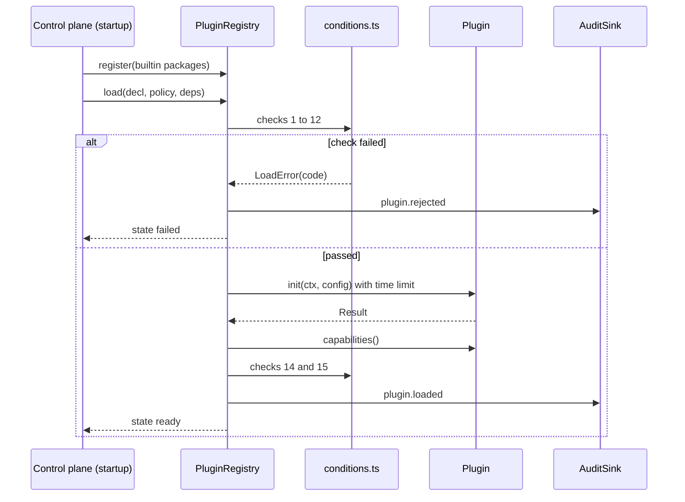
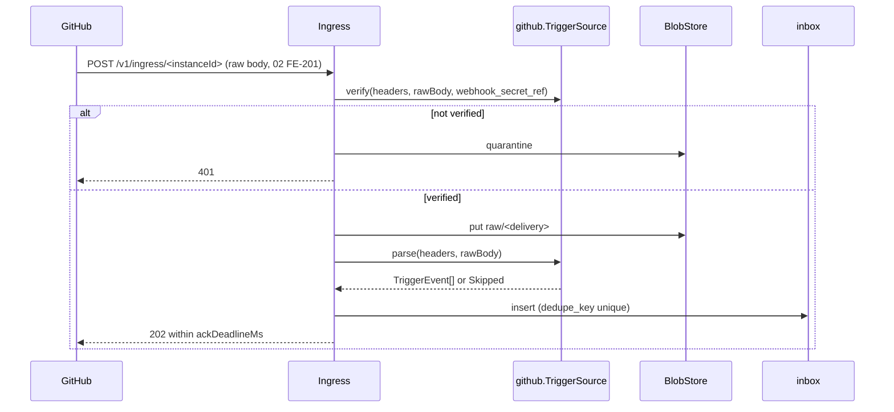
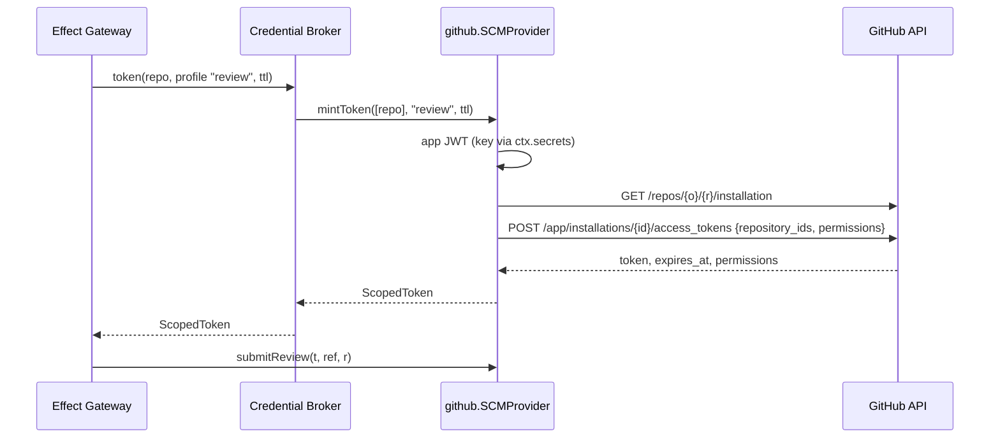
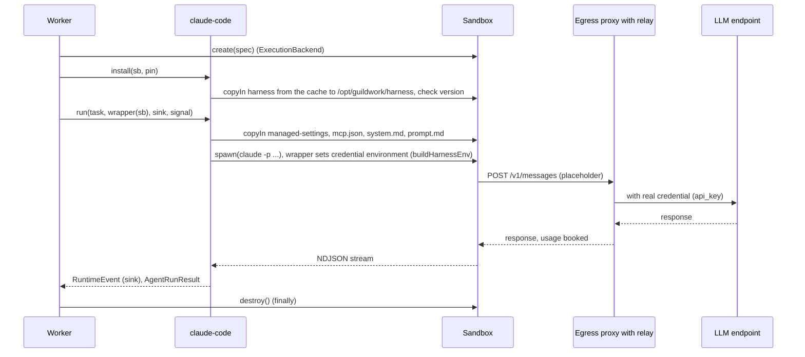
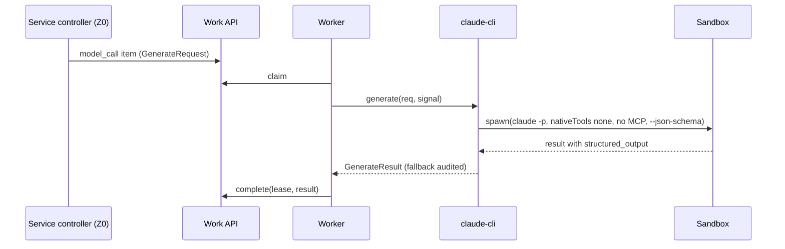
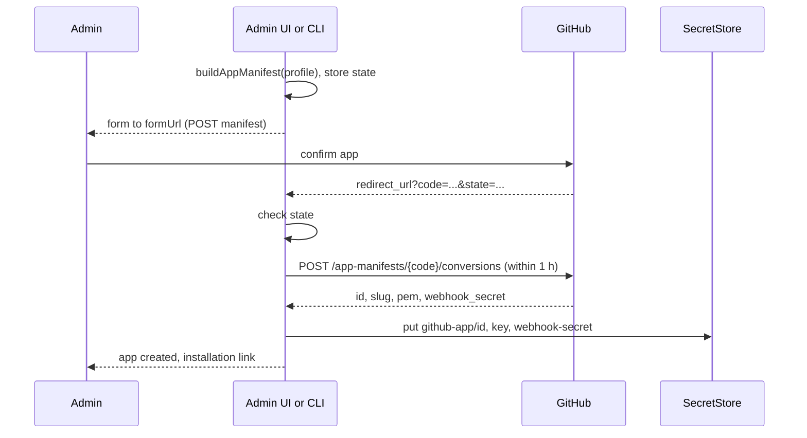

<!--
SPDX-License-Identifier: Apache-2.0
SPDX-FileCopyrightText: The Guildwork Authors
-->
# 05 Plugins and Contracts

Detailed design for the plugin framework, the contracts `guildwork-dev.github.io/v1alpha1`, the contract harness, the GitHub plugin, the runtime `claude-code`, the ModelProviders `anthropic-api` and `claude-cli`, and the credential paths of stages 0 and 1. Rulings of this document: FE-500 to FE-599. Classifications (VERIFIED, DERIVED, ASSUMED, unverified) as in the [architecture README](../architecture/README.md); in tables (B), (A), (V), (u).

Work plan: Epics `0-E13`, `0-E14`, `0-E15` in [stage-0.plugins.toml](../plan/tasks/stage-0.plugins.toml) and `1-E07` in [stage-1.credentials.toml](../plan/tasks/stage-1.credentials.toml).

## 1. Purpose and sources

This document makes buildable:
- the shared framework of all plugins and drivers: manifest, versioning, loader, load conditions, capabilities, error and rate-limit model, transport ([01](../architecture/01-plugin-interfaces.md) section 1, [06](../architecture/06-operations-and-deployment.md) section 3 row "Plugin mechanics", [11](../architecture/11-installation-and-hosting.md) section 5);
- the binding contracts of stage 0 as complete TypeScript types: `TriggerSource`, `SCMProvider`, `AgentRuntime`, `ModelProvider`, `ExecutionBackend`, `BlobStore`, `SecretStore`, `CloudIdentity` ([08](../architecture/08-roadmap.md) stage 0, principle 3); sketches for `WorkItemProvider`, `KnowledgeStore`, `Notifier`, `Analyzer`;
- the normalized event schema ([01](../architecture/01-plugin-interfaces.md) section 2), because [02-control-plane](02-control-plane.md) did not yet exist at the time of writing (Ruling FE-501);
- the contract harness with recorded responses, replay, and recording without external effect ([01](../architecture/01-plugin-interfaces.md) rule 1, [07](../architecture/07-eval.md) section 5 last paragraph);
- the GitHub plugin ([01](../architecture/01-plugin-interfaces.md) sections 3, 5, 11.1, 11.2, 11.5; [05](../architecture/05-security.md) section 2; ADR-08, ADR-45);
- the runtime `claude-code` ([01](../architecture/01-plugin-interfaces.md) section 6; [05](../architecture/05-security.md) sections 3 and 6; ADR-17, ADR-39, ADR-57);
- the ModelProviders `anthropic-api` (ADR-03, ADR-31) and `claude-cli` (ADR-58);
- the personal operator mode with `acknowledge_terms`, `operator_repos`, profile `operator_test`, and inspection proxy (ADR-18, ADR-51; [04](../architecture/04-configuration-and-limits.md) sections 1 rule 8, 3a, 5, 7).

ADRs read: ADR-03, ADR-06, ADR-08 to ADR-10, ADR-13, ADR-14, ADR-17, ADR-18, ADR-22, ADR-31, ADR-32, ADR-39, ADR-41, ADR-45, ADR-48, ADR-50, ADR-51, ADR-57, ADR-58, ADR-61, ADR-63, ADR-70. Open minors from [backlog-minors](../architecture/backlog-minors.md) that are taken up here: M21, M36 (part CA trust), M38, M87 (part flag combination), M115 (part trust level); deliberately not taken up: M86 and M104 (contradict ADR and 08 principle 3, see section 10), M101 (minor on continuation after a subscription limit, needs `RESUME` from stage 2).

What the architecture specifies is not decided anew here. Where this document extends a contract from [01](../architecture/01-plugin-interfaces.md), it does so only additively and records it as a Ruling with a reason in section 9; the places are reported in section 10 as a contradiction or gap in the architecture.

## 2. Modules and responsibility

### 2.1 Packages and directories

```
packages/contracts/                      @guildwork/contracts (types, schemas, loader; no network dependency)
  src/
    index.ts                             public exports; API surface tested as a snapshot
    api-version.ts                       ApiVersion, PluginKind, DriverKind, version comparison
    common/
      result.ts                          Result, ok(), err(), PluginError, isRetryable()
      refs.ts                            TenantRef, RepoRef, ChangeRef, WorkItemRef, Actor, PermissionLevel, ServiceId, ScopeRef
      untrusted.ts                       Untrusted, untrusted(), sanitize(), renderUntrustedBlock()
      secrets.ts                         SecretRef, SecretValue, SecretDecl
      schema.ts                          JSONSchema (TypeBox TSchema)
      page.ts                            Page<T>
      limits.ts                          RateLimitSnapshot, LimitSnapshot, Usage
      health.ts                          HealthReport
      capability.ts                      CapabilitySet, CapabilityLevel
      context.ts                         PluginContext, EgressHttp, Clock, AuditSink, Logger, Metrics, Tracer facades (from @guildwork/core)
      base.ts                            PluginBase
    capabilities/catalog.ts              all capability enums as `as const` lists (runtime check)
    events/                              single definition of the event schema (FE-501); detailed design 02 refers here
      trigger-event.ts                   TriggerEvent, ResolvedEvent, StoredEvent, Skipped, CommandName
      command.ts                         parseCommand(), COMMAND_ALIASES (FE-556)
      dedupe-key.ts                      dedupeKey() (formula from 02 FE-211)
      routing-name.ts                    RoutingName, routingName() (table from 02 FE-206, M38)
      object-key.ts                      objectKey() (01-data-model FE-111)
    kinds/
      trigger-source.ts                  binding v1alpha1
      scm-provider.ts                    binding v1alpha1
      agent-runtime.ts                   binding v1alpha1
      model-provider.ts                  binding v1alpha1
      execution-backend.ts               binding v1alpha1 (incl. SandboxSpec, SandboxHandle, WorkerCaps)
      work-item-provider.ts              sketch (@sketch), binding from 8-E01-T05 (section 2.21, FE-558)
      knowledge-store.ts                 sketch (@sketch); part LEARNINGS binding from 7a-E01-T03 (09 FE-963), KbCap values of stage 9 (FE-561)
      notifier.ts                        sketch (@sketch), binding from 9-E02-T02 (14 section 2.2.2, FE-1412)
      analyzer.ts                        sketch (@sketch) from 0-E13-T04 with AnalyzerFinding (FE-560), binding from 2-E05-T01
    drivers/
      blob-store.ts                      binding v1alpha1
      secret-store.ts                    binding v1alpha1
      cloud-identity.ts                  binding v1alpha1
    manifest/
      manifest.ts                        PluginManifest, DriverManifest (types derived from the schema)
      manifest.schema.ts                 TypeBox schema, also exported as JSON Schema
      validate.ts                        validateManifest() with Ajv
      service-manifest.ts                ServiceManifest, ServiceManifestSchema, validateServiceManifest() (section 2.4.1, FE-554)
      attestation.ts                     ContractAttestation (type and schema, FE-552)
      fixtures-hash.ts                   fixturesHash(dir) (FE-552; loader and harness use the same function)
      suite-versions.ts                  SUITE_VERSIONS per kind (FE-539, FE-552)
    host/
      registry.ts                        PluginRegistry (built-in packages, instances)
      loader.ts                          loadInstance(): load conditions, state machine
      conditions.ts                      individual checks as pure functions with error codes
      attestation.ts                     check of the contract attestation and the fixtures hash
      capabilities.ts                    CapabilityResolver, FallbackRecorder
      retry.ts                           withRetry(), RetryPolicy
      in-process.ts                      in-process proxy: method check, time limit, error encapsulation
      transport.ts                       PluginTransport (in_process; subprocess_grpc from stage 9 in @guildwork/plugin-host, 14 section 2.5.2, FE-561)
  test/                                  Vitest, one test per file under src/
packages/testkit/src/contract/           contract harness (part of @guildwork/testkit)
  harness.ts                             defineContractSuite(), runContractSuite()
  cassette.ts                            cassette format, loading, canonical bytes (fixturesHash re-exported from contracts)
  replay-http.ts                         ReplayHttp implements EgressHttp
  record-http.ts                         RecordingHttp implements EgressHttp (with protection rules)
  redact.ts                              redaction before writing
  attest.ts                              writes contract-attestation.json
  fake-claude/                           fake binary that plays back recorded NDJSON transcripts; fake-sandbox.ts (FakeSandboxHandle)
  suites/
    trigger-source.suite.ts  scm-provider.suite.ts  agent-runtime.suite.ts
    model-provider.suite.ts  execution-backend.suite.ts
    work-item-provider.suite.ts          from 8-E01-T05 (read cases) and 8-E01-T06 (write cases), section 2.21 (FE-558)
    knowledge-store.ts                   part LEARNINGS from 7a-E01-T03, against real Postgres (09 FE-963)
    notifier.suite.ts                    from 9-E02-T02 (14 FE-1412)
    versions.ts                          re-exports SUITE_VERSIONS from contracts (FE-539, FE-552)
  an1.ts                                 scaffold of the Analyzer suite AN1 from 2-E05-T01 (10 section 2.14)
  drivers/                               driver suites blob-store, secret-store, cloud-identity (detailed design 04, 0-E03-T01; FE-545, 04 FE-438)
  reference/                             reference fakes per plugin kind that pass their suite (self-test of the harness)
plugins/github/                          packages `github` (TriggerSource, SCMProvider) and `github-issues` (WorkItemProvider; write methods per stage, section 2.14.8)
  manifest.github.json  manifest.github-issues.json  contract-attestation.json
  src/
    index.ts                             createGithubPlugin(), createGithubIssuesPlugin()
    config.ts                            instance configuration schema
    client/rest.ts  client/graphql.ts  client/errors.ts  client/paginate.ts  client/rate-limit.ts
    auth/app-jwt.ts  auth/mint-token.ts  auth/profiles.ts  auth/device-flow.ts (userDeviceAuth, 6-E04-T04, FE-555)
    diagnostics/index.ts                 export @guildwork/plugin-github/diagnostics: readHookDeliveries, readWorkflowPermissions (section 2.14.10, FE-557)
    trigger/verify.ts  trigger/parse.ts  trigger/map-events.ts  trigger/reconcile.ts  trigger/ack.ts  trigger/self.ts
    scm/read/*.ts                        one file per read method
    scm/write/*.ts                       one file per write method; submit-review.ts with fallback chain
    scm/push.ts                          Git bundle without force
    scm/diff-positions.ts                position mapping for inline comments
    scm/codeowners.ts                    parser
    issues/*.ts                          github-issues reading; issues/write/*.ts writing (section 2.14.8)
    app-manifest/build.ts  app-manifest/exchange.ts  app-manifest/state.ts
  contract/fixtures/                     cassettes and webhook fixtures (section 3.4)
  test/
plugins/claude-code/                     AgentRuntime `claude-code`
  manifest.json  contract-attestation.json
  src/
    index.ts  config.ts  capabilities.ts  supports.ts
    install/pin.ts  install/fetch.ts  install/cache.ts  install/install.ts   cache on the worker host, via copyIn into the sandbox (03 FE-333, FE-553)
    launch/index.ts                      export @guildwork/plugin-claude-code/launch (buildLaunch, FE-547)
    launch/argv.ts  launch/env.ts  launch/managed-settings.ts  launch/mcp-config.ts  launch/config-dir.ts  launch/prompt.ts
    run/run.ts  run/stream-parser.ts  run/result.ts  run/budget.ts
    run/resume.ts  run/steer.ts          stage 2 (section 2.15.7, FE-546)
    credentials/                         cloud credential kinds from stage 8 (13 section 2.2)
    subscription/constraints.ts  subscription/health.ts   export @guildwork/plugin-claude-code/subscription (FE-550);
                                         only the worker reads the token file (03 section 2.11)
  contract/transcripts/                  recorded NDJSON runs (section 3.5)
  test/
plugins/model-anthropic/                 ModelProvider `anthropic-api` (Vercel AI SDK)
  manifest.json  contract-attestation.json  price-tables/anthropic.yaml   until 8-E06-T01, then packages/pricing (FE-562)
  src/index.ts  src/generate.ts  src/usage.ts  src/limits.ts  src/count-tokens.ts  src/models.ts
plugins/model-claude-cli/                ModelProvider `claude-cli`
  manifest.json  contract-attestation.json
  src/index.ts  src/generate.ts  src/render-messages.ts
packages/config/src/rules/               resolver rules of this area (part of @guildwork/config)
  model-reachability.ts                  ADR-58
  personal-modes.ts                      ADR-51, ADR-18, 04 section 3a (stage 1)
  operator-claim.ts                      checks at claim time (section 2.19, stage 1)
  harness-pins.ts                        FE-521
apps/egress-proxy/src/llm-inspection/    inspection proxy (stage 1); location and shared check functions inspectMessagesRequest, meterResponse per 03 FE-326
```

Dependency direction (binding, a test checks the imports): `core` < `contracts` < `testkit`, `config` < `plugins/*`. Plugins never import `db`, `apps/*`, or other plugins. Exceptions, each through a named package export and no other import: `plugins/model-claude-cli` uses `@guildwork/plugin-claude-code/launch` (Ruling FE-533); `plugins/backend-microvm` uses `@guildwork/plugin-exec-docker/sandbox` (14 FE-1421, FE-561). The import test carries exactly these two pairs as an allowlist.

### 2.2 Who loads what where

| Plugin or driver | loaded in | caller | zone |
|---|---|---|---|
| `github` (TriggerSource) | control plane, role `web` | Ingress (`verify`, `parse`), Reconciler (`reconcile`, `poll`), Effect Gateway (`ack`) | Z0 |
| `github` (SCMProvider) | control plane, roles `web` and `orchestrator` | Credential Broker (`mintToken`, `cloneSpec`), platform MCP and Orchestrator (read methods), Effect Gateway (write methods) | Z0 |
| `github-issues` (WorkItemProvider) | control plane | Router (`getItem`), platform MCP (read methods), Effect Gateway (write methods) | Z0 |
| `claude-code` (AgentRuntime) | Worker | Worker per work item | Z1, starts the process in Z2 |
| `anthropic-api`, `claude-cli` (ModelProvider) | Worker | Worker per work item of kind `model_call` (Ruling FE-531) | Z1 (`claude-cli` starts in Z2) |
| `docker-sysbox`, `docker-gvisor` (ExecutionBackend) | Worker | Worker | Z1 (implementation in detailed design 03) |
| drivers `fs`, `s3`, `file`, `env`, `self-issuer` | control plane | core (implementation in detailed design 03 and 04) | Z0 |

The GitHub plugin is never loaded in the worker (Ruling FE-515): the worker receives `cloneSpec` and a `read` token in the work item envelope.

### 2.3 Shared base types (`common/*`)

```ts
// packages/contracts/src/common/result.ts
export type Result<T> = { ok: true; value: T } | { ok: false; error: PluginError };

export type PluginErrorCode =
  | "auth" | "permission" | "not_found" | "rate_limited" | "conflict" | "unsupported" | "transient" | "invalid";

export interface PluginError {
  code: PluginErrorCode;
  retryAfterMs?: number;          // only meaningful for rate_limited and transient
  providerRequestId?: string;     // e.g. X-GitHub-Request-Id, request-id from Anthropic
  message: string;                // without secret, without foreign content in full length (at most 500 characters)
  detail?: { httpStatus?: number; providerCode?: string; fallback?: string };  // for audit and metric
}

export const ok = <T>(value: T): Result<T> => ({ ok: true, value });
export const err = (code: PluginErrorCode, message: string, extra: Partial<PluginError> = {}): Result<never> =>
  ({ ok: false, error: { code, message, ...extra } });
export const isRetryable = (e: PluginError): boolean => e.code === "rate_limited" || e.code === "transient";
```

**Alignment with the scaffold from 0-E01-T06** ([00](00-codebase-and-conventions.md) section 2.6, FE-010; Ruling FE-542): `Result<T>` of this document is the same type as `PluginResult<T>` of the scaffold, that is `Result<T, PluginError>` from `@guildwork/core`; `common/result.ts` exports both names (`export type Result<T> = PluginResult<T>`) and defines no second result type. `PluginError` of the scaffold is extended additively by `detail`, `PluginErrorCode` remains the subset of `ErrorCode` from `core`. `ok` is the `ok` from `core` (re-exported); `err(code, message, extra)` is the helper function for plugins that builds a `PluginError` and calls `core.err`. `API_GROUP`, `API_VERSIONS`, `ApiVersion`, `compileSchema`, and `toJsonSchema` come from the scaffold (`src/version.ts`, `src/schema.ts`); `api-version.ts` (section 2.4) only adds `PluginKind`, `DriverKind`, and `BINDING_KINDS_V1ALPHA1`, and `SUPPORTED_API_VERSIONS` is an alias for `API_VERSIONS`.

```ts
// packages/contracts/src/common/refs.ts
export interface TenantRef { orgId: string; installationId: string }
export interface RepoRef { scm: string; instance: string; owner: string; name: string; id: string }
export interface ChangeRef { repo: RepoRef; number: number; headSha: string; baseSha: string; headRef: string; baseRef: string; draft: boolean }
export interface WorkItemRef { provider: string; instance: string; project: string; key: string }
export interface Actor { providerId: string; login: string; kind: "human" | "bot" | "app" | "automation"; email?: string; viaRule?: string }
export type PermissionLevel = "none" | "read" | "triage" | "write" | "maintain" | "admin";
export type BuiltinServiceId = "planner" | "architect" | "coder" | "reviewer" | "qa" | "prfixer" | "indexer"
                             | "standards" | "triage" | "docs";
export type ServiceId = BuiltinServiceId | "dummy" | `${string}/${string}`;   // "dummy": test service of stage 0 (2.4.1, FE-554)
export interface ChangeKey { repo: RepoRef; number: number }     // sufficient for reading a change (getChange, FE-555); ChangeRef satisfies it
export type StatusCategory = "todo" | "started" | "in_review" | "done" | "blocked";
export interface ScopeRef { repo?: RepoRef; project?: string }    // capabilities per instance (empty) or per repo or project
export const PERMISSION_ORDER: readonly PermissionLevel[] = ["none", "read", "triage", "write", "maintain", "admin"];
```

```ts
// packages/contracts/src/common/untrusted.ts
export interface Untrusted<T = string> {
  readonly untrusted: true;
  value: T;
  origin: string;          // e.g. "github:issue_comment:123456", "ci-log:job:789"
  sha256: string;          // over the sanitized value (UTF-8, for objects canonical JSON)
  sanitized: boolean;
}
/** Creates an Untrusted value; strings are sanitized (05 section 4 point 2). */
export function untrusted<T>(value: T, origin: string): Untrusted<T>;
/** Removes zero-width characters (U+200B to U+200D, U+2060, U+FEFF), bidi control characters (U+202A to U+202E, U+2066 to U+2069), and HTML comments. */
export function sanitize(text: string): string;
/** The only format in which foreign content reaches a prompt (Ruling FE-535). */
export function renderUntrustedBlock(u: Untrusted<string>): string;
// Format:
// <untrusted origin="github:issue_comment:123456" sha256="ab12...">
// ...content in which every "</untrusted" is replaced by "<\/untrusted"...
// </untrusted>
```

```ts
// packages/contracts/src/common/secrets.ts
export type SecretRef = `secret://${string}`;
/** SecretValue is the class from @guildwork/core (00 section 2.5, 0-E01-T03), only re-exported here (Ruling FE-549):
 *  new SecretValue(text), reveal(); toString, toJSON, and util.inspect return "[REDACTED]". Binary values (e.g. PEM)
 *  are held as UTF-8 text. reveal() is allowed by a lint rule in plugins/** only under auth/, launch/, and credentials/. */
export { SecretValue } from "@guildwork/core";
export interface SecretDecl {
  name: string;                           // key in the instance configuration, e.g. "key_ref"
  kind: "private_key" | "webhook_secret" | "api_key" | "token" | "client_secret" | "password" | "other";
  required: boolean;
  description: string;
}
```

```ts
// packages/contracts/src/common/limits.ts
export interface Usage { in: number; out: number; cacheRead: number; cacheWrite: number; reasoning?: number }
export interface RateLimitSnapshot {          // SCM and ticket providers
  resource: string;                           // e.g. "core", "graphql", "search"
  limit?: number; remaining?: number; resetAt?: string;
  secondary: boolean;                         // GitHub secondary rate limit (01 section 11.5)
  observedAt: string;
}
export interface LimitSnapshot {              // LLM providers and harnesses
  provider: string;
  kind: "requests" | "input_tokens" | "output_tokens" | "tokens" | "subscription_window";
  status?: "allowed" | "allowed_warning" | "rejected";
  limit?: number; remaining?: number; utilization?: number; resetAt?: string;
  observedAt: string;
  source: "headers" | "rate_limit_event" | "probe";
}
```

```ts
// packages/contracts/src/common/health.ts, capability.ts, page.ts, schema.ts
export interface HealthReport { ok: boolean; expiresAt?: string; disabledByProvider?: boolean; weakAuth?: boolean; notes: string[] }
export type CapabilityLevel = "native" | "fallback" | "none";
export type CapabilitySet<C extends string> = Record<C, { level: CapabilityLevel; note?: string }>;
export interface Page<T> { items: T[]; next?: string }
export type JSONSchema = import("@sinclair/typebox").TSchema | Record<string, unknown>;
```

```ts
// packages/contracts/src/common/context.ts
import type { Logger, Metrics, Tracer, Clock } from "@guildwork/core";
export type { Clock } from "@guildwork/core";   // now, timestamp, monotonicMs, sleep (00 FE-013); no separate Clock type (FE-549)
/** The only HTTP path of a plugin (Ruling FE-508). Allows only hosts from manifest.egress plus instance hosts. */
export interface EgressHttp {
  fetch(url: string | URL, init?: RequestInit & { timeoutMs?: number }): Promise<Response>;
  /** For the Vercel AI SDK and other libraries with a fetch parameter. */
  asFetch(): typeof globalThis.fetch;
}
export interface AuditSink {
  record(e: { action: string; subject: string; details: Record<string, unknown> }): Promise<void>;
}
export interface PluginContext {
  instanceId: string;
  tenant: TenantRef;
  log: Logger; metrics: Metrics; tracer: Tracer;
  http: EgressHttp;
  secrets: { resolve(ref: SecretRef): Promise<SecretValue> };   // via the Credential Broker or the worker's SecretStore, with audit
  clock: Clock;
  audit: AuditSink;                                              // additive to 01 (Ruling FE-506)
  /** Read-only BlobStore access; set in the control plane for SCMProvider instances (push reads the bundle). FE-551 */
  blob?: Pick<BlobStore, "get">;
  /** Token with profile read for a linked scm instance; set in the control plane for WorkItemProvider instances
   *  with configuration key scm (github-issues). Implemented via the Credential Broker (04), audit there. FE-551 */
  scmTokens?: { read(repo: RepoRef): Promise<Result<ScopedToken>> };
}
```

**Context per location** (Ruling FE-551): the control plane builds the `PluginContext` in `LoaderDeps.makeContext` (detailed design 02 wires it): `http` with egress allowlist, `secrets` via `CredentialBroker.resolveSecret` (04), `audit` via the `AuditWriter` (04), `blob` and `scmTokens` as above. The worker builds it for `AgentRuntime` and `ModelProvider` instances (detailed design 03): `http` via the host's egress proxy, `secrets` without values (the worker has no plugin secrets; it reads the subscription token itself, 2.15.6), `audit` as a buffer that the worker reports to the Work API together with the item's result; `blob` and `scmTokens` are absent there.

```ts
// packages/contracts/src/common/base.ts
export interface PluginBase<C extends string> {
  manifest(): PluginManifest;
  init(ctx: PluginContext, config: unknown): Promise<Result<void>>;
  capabilities(scope?: ScopeRef): Promise<CapabilitySet<C>>;
  health(): Promise<HealthReport>;
  dispose?(): Promise<void>;                                    // additive: cleanup on unload (Ruling FE-506)
}
```

### 2.4 Manifest and versioning

```ts
// packages/contracts/src/api-version.ts (API_GROUP, API_VERSIONS, and ApiVersion from the scaffold src/version.ts, FE-542)
import { API_GROUP, API_VERSIONS, type ApiVersion } from "./version";   // O17, changeable only with deprecation
export const SUPPORTED_API_VERSIONS: readonly ApiVersion[] = API_VERSIONS;  // current and previous major version (rule 6)
export type PluginKind = "TriggerSource" | "WorkItemProvider" | "SCMProvider" | "AgentRuntime"
                       | "ModelProvider" | "ExecutionBackend" | "KnowledgeStore" | "Notifier" | "Analyzer";
export type DriverKind = "BlobStore" | "SecretStore" | "CloudIdentity";
export const BINDING_KINDS_V1ALPHA1: readonly (PluginKind | DriverKind)[] =
  ["TriggerSource", "SCMProvider", "AgentRuntime", "ModelProvider", "ExecutionBackend", "BlobStore", "SecretStore", "CloudIdentity"];
```

```ts
// packages/contracts/src/manifest/manifest.ts (types are derived from manifest.schema.ts: Static<typeof PluginManifestSchema>)
export interface PluginManifest {
  apiVersion: ApiVersion;
  kind: PluginKind[];                 // not empty, without duplicates
  id: string;                         // ^[a-z][a-z0-9-]{1,62}$; third parties later "<vendor>/<name>" (stage 9)
  version: string;                    // semver 2.0.0
  license: string;                    // SPDX expression, required
  distribution: "bundled" | "operator_supplied";
  trust: "first_party" | "vetted" | "third_party";   // the manufacturer's statement; the effective level comes from the installation (FE-505)
  transport: "in_process" | "subprocess_grpc" | "subprocess_jsonrpc" | "http" | "wasm";
  configSchema: JSONSchema;           // additionalProperties: false required (unknown keys = error)
  secrets: SecretDecl[];
  egress: string[];                   // host names without scheme, optionally with "*." at the start; "{config.<path>}" for instance hosts
  contractSuite: { version: string; passedAt: string; fixturesHash: string };   // fixturesHash: "sha256:<hex>"
}
export interface DriverManifest extends Omit<PluginManifest, "kind"> { kind: DriverKind[] }
```

**Validation rules** (`validateManifest`, error code `MANIFEST_INVALID` with JSON path):

| Rule | Check |
|---|---|
| Schema | Ajv against `PluginManifestSchema`, `allErrors: true`, no additional keys |
| `kind` | not empty, no duplicates; every kind must be in `SUPPORTED_KINDS[apiVersion]` |
| `version` | valid semver |
| `license` | SPDX expression parsable (own small parser for `AND`, `OR`, `WITH`, parentheses; list of identifiers from the SPDX list, pinned as a file in the package) |
| `distribution` | `bundled` only if every license of the expression is in `bundled_licenses` of the installation (ADR-50); plugins that start proprietary software are `operator_supplied` (FE-520) |
| `trust`, `transport` | `third_party` never `in_process` (rule 4) |
| `configSchema` | itself a valid JSON Schema Draft 2020-12, root `type: object`, `additionalProperties: false` |
| `secrets` | names unique; every `required` name appears in the `configSchema` as a required field with pattern `^secret://` |
| `egress` | valid host names; no `*` alone; no IP literals |
| `contractSuite` | `version` semver, `passedAt` ISO-8601, `fixturesHash` `^sha256:[0-9a-f]{64}$` |

**Versioning** (Ruling FE-502): from stage 0, the eight binding contracts in `v1alpha1` can only be changed additively: new optional methods, new optional fields, new values in capability enums. A breaking change (removing a method, adding a required field, changing a type) creates `v1alpha2`; the core then carries both according to rule 6. The test `contracts.api-surface` compares the type declarations (`tsc --emitDeclarationOnly` of the files under `kinds/` and `drivers/`) with a checked-in snapshot; a difference that is not additive makes the test fail (additive means: the old snapshot is assignable via `tsc` to the new declaration; checked with a generated file `compat.check.ts` that assigns every old interface to the new one). Sketches carry `/** @sketch */` and are excluded from the snapshot (FE-503).

**Attestation and fixtures hash** (Ruling FE-552): type and hash function live in `contracts`, because the loader needs them at runtime and `contracts` must not depend on `testkit`; the harness (2.10) writes the file, the loader (2.5, check 8) reads it.

```ts
// packages/contracts/src/manifest/attestation.ts and fixtures-hash.ts
export interface ContractAttestation {
  pluginId: string; pluginVersion: string;
  suites: { kind: string; version: string; cases: { name: string; result: "passed" | "skipped_capability"; requires?: string[] }[] }[];
  fixturesHash: string;                              // "sha256:<hex>"
  passedAt: string;                                  // ISO-8601
  toolchain: { node: string; vitest: string; harness: string };
}
export const ContractAttestationSchema: TSchema;     // additionalProperties: false; an error on reading yields CONTRACT_ATTESTATION_MISSING
/** SHA-256 over the sorted list "relative path + NUL + SHA-256 of the canonical content + LF" of all files under
 *  contract/fixtures/ and contract/transcripts/ of pluginDir; canonical: JSON files as canonicalJson (core), otherwise bytes.
 *  A missing directory counts as empty. Result "sha256:<hex>". */
export function fixturesHash(pluginDir: string): Promise<string>;
```

**Contract suite versions** (Ruling FE-539): one semver version per kind as `SUITE_VERSIONS: Readonly<Record<PluginKind | DriverKind, string>>` in `packages/contracts/src/manifest/suite-versions.ts` (the loader needs them at runtime, FE-552; `packages/testkit/src/contract/suites/versions.ts` re-exports them and every suite reads its version there), e.g. `{ SCMProvider: "1.0.0" }`. The loader accepts a plugin if `manifest.contractSuite.version` has the same major and minor version as the suite of its kind; with several kinds the version must satisfy every suite (version per kind in the attestation, section 2.10).

#### 2.4.1 Service manifest (Ruling FE-554)

The type `ServiceManifest` from [01](../architecture/01-plugin-interfaces.md) section 14 lives in `contracts` like the plugin manifest, because policy (`POL-010`, [02](02-control-plane.md)), Orchestrator, `@guildwork/sdk-service` ([00](00-codebase-and-conventions.md) section 2.13), and every service import it and `contracts` is the only source of shared types. The fields are literally those from 01; built in `0-E13-T05` together with the plugin manifest.

```ts
// packages/contracts/src/manifest/service-manifest.ts (type derived from ServiceManifestSchema: Static<typeof ServiceManifestSchema>)
import type { Isolation } from "../kinds/execution-backend";
import type { AgentTask } from "../kinds/agent-runtime";
import type { TriggerAction, TriggerSubject } from "../events/trigger-event";
export interface ServiceManifest {
  apiVersion: ApiVersion; kind: "Service";
  id: ServiceId;                       // third parties "<vendor>/<name>"; built-in names only for bundled + first_party
  version: string; license: string; distribution: "bundled" | "operator_supplied";
  trust: "first_party" | "vetted" | "third_party";
  controller: { transport: "in_process" | "subprocess_grpc" | "http"; image?: string };
  commands: { name: string; minPermission: PermissionLevel; args?: JSONSchema }[];   // never a name from CommandName or COMMAND_ALIASES
  subscribes: { subject: TriggerSubject; action: TriggerAction; filter?: string }[];
  inputSchema: JSONSchema; outputSchema: JSONSchema;
  requires: { plugin: PluginKind; caps: string[]; level: "native" | "fallback" }[];
  effects: string[];                   // allowed write requests (EffectType from 04 section 2.1.1), deny by default
  jobs: { nativeTools: AgentTask["nativeTools"]; minIsolation: Isolation; egress: string[]; analyzers?: string[] }[];
  platformMcpTools: string[];
  qualification: { evalSuite: string; gateA: boolean; gateB?: { reference: string } };
  configSchema: JSONSchema;
  contractSuite: { version: string; passedAt: string; fixturesHash: string };
}
export const ServiceManifestSchema: TSchema;          // additionalProperties: false on every level
/** Checks the schema and the rules of the table; error: invalid with detail.providerCode = "SERVICE_MANIFEST_INVALID"
 *  and message with JSON path. Pure function; the service loader checks effect catalog, tool catalog, and filters. */
export function validateServiceManifest(m: unknown): Result<ServiceManifest>;
```

`ServiceId` (2.3) is extended additively by the internal name `"dummy"` (`ServiceId = BuiltinServiceId | "dummy" | \`${string}/${string}\``): the test service of stage 0 ([06](06-installation-operations-ui.md) section 2.8) is built in, but it is not a domain service and never `live`.

| Rule | Check by `validateServiceManifest` |
|---|---|
| Schema | Ajv against `ServiceManifestSchema`, `allErrors: true`, no additional keys |
| `apiVersion`, `kind` | `apiVersion` in `SUPPORTED_API_VERSIONS`, `kind` equal to `"Service"` |
| `id` | `BuiltinServiceId` or `dummy` only with `distribution: bundled` and `trust: first_party`; otherwise `<vendor>/<name>`, both parts `^[a-z][a-z0-9-]{1,62}$` |
| `version`, `license`, `configSchema`, `contractSuite` | as for the plugin manifest (table in 2.4), except `contractSuite.version`: semver or only the major number (`"1"` counts as `1.0.0`, as in 08, 11, 15); the build sets `passedAt` and `fixturesHash`; the loader checks the license rule for `bundled` as for plugins |
| `trust`, `controller` | `third_party` never `in_process`; `image` required for `subprocess_grpc` with `third_party` and for `http`, then only with digest (`@sha256:`) |
| `commands` | names unique, `^[a-z][a-z0-9-]{1,31}$`, none from `CommandName` or `COMMAND_ALIASES` (2.11.1); built-in services carry `commands: []`, their commands are in `CommandName` |
| `subscribes` | `subject` from `TriggerSubject`, `action` from `TriggerAction` |
| `requires` | `plugin` from `PluginKind`; every capability is in the list of this kind in `capabilities/catalog.ts` (2.6) |
| `effects`, `platformMcpTools` | values unique; `effects` each `^(propose\|request)_[a-z_]+$` |
| `jobs` | at least one entry; `egress` are host names as in the plugin manifest or the placeholders `<llm>`, `<control>`, `<registry-cache>`, which the control plane fills in per item |
| `qualification` | `evalSuite` not empty; `none` only with `id: dummy` |

The JSON export lives under `packages/contracts/schemas/service-manifest.schema.json` (freshness test as for the plugin manifest); in stage 9, `9-E05-T03` publishes it with the additive extension `consumes`, `produces`, `subscribesInternal` from [14](14-stage-9-breadth-and-hardening.md) section 2.5.3. What goes beyond the pure form is checked by the control plane's service loader at load time ([01](../architecture/01-plugin-interfaces.md) section 14 rule 3, built in `0-E16-T01`): every value from `effects` is in the effect catalog (04 section 2.1.1), every tool from `platformMcpTools` is in the catalog of the platform MCP, `requires` against the loaded plugins; an error rejects only this service. At runtime: a `StepRequest` of a service ([00](00-codebase-and-conventions.md) section 2.13) is only permitted if an entry from `jobs` has the same `nativeTools`, its `egress` contains the requested hosts, and the item's isolation is at least `minIsolation`; the check belongs to the Orchestrator (02).

### 2.5 Loader and load conditions

```ts
// packages/contracts/src/host/loader.ts
export type InstanceState = "declared" | "validated" | "initializing" | "ready" | "degraded" | "failed" | "disabled";

export type LoadErrorCode =
  | "MANIFEST_INVALID" | "API_VERSION_UNSUPPORTED" | "KIND_UNSUPPORTED" | "KIND_METHODS_MISSING"
  | "LICENSE_NOT_ALLOWED_BUNDLED" | "TRUST_TRANSPORT_VIOLATION" | "TRANSPORT_UNSUPPORTED" | "TRUST_NOT_GRANTED"
  | "CONTRACT_ATTESTATION_MISSING" | "CONTRACT_SUITE_VERSION" | "FIXTURES_HASH_MISMATCH" | "ATTESTATION_VERSION_MISMATCH"
  | "CONFIG_INVALID" | "SECRET_UNDECLARED" | "SECRET_UNRESOLVABLE" | "EGRESS_NOT_ALLOWED"
  | "PRIVATE_MODE_NO_POLL" | "DUPLICATE_INSTANCE" | "INIT_FAILED" | "INIT_TIMEOUT";

export interface LoadError { code: LoadErrorCode; message: string; path?: string }

export interface InstanceDecl {                  // from org.yaml or installation.yaml, delivered by the config resolver
  instanceId: string;                            // e.g. "gh", "cc-abo"
  pluginId: string;                              // e.g. "github", "claude-code"
  config: Record<string, unknown>;
  tenant: TenantRef;
}

export interface InstallationPolicy {           // from installation.yaml
  bundledLicenses: string[];                     // bundled_licenses
  ingressMode: "public" | "private";             // 11 section 1.1
  airGap: boolean;
  allowedEgressHosts?: string[];                 // only with air_gap: SCM, ticket, LLM targets
  trustGrants: Record<string, "first_party" | "vetted" | "third_party">;  // pluginId -> effective level (FE-505)
}

export interface LoadedInstance<K extends PluginKind | DriverKind = PluginKind | DriverKind> {
  instanceId: string; pluginId: string; kinds: K[];
  state: InstanceState; stateReason?: LoadError;
  plugin: unknown;                               // typed access via registry.get<SCMProvider>(id, "SCMProvider")
  capabilities: Record<string, { level: CapabilityLevel; note?: string }>;
  capabilitiesAt: string;
  manifest: PluginManifest;
  attestation: ContractAttestation;
}

export interface PluginRegistry {
  register(pkg: BuiltinPluginPackage): void;     // built-in packages at startup (stage 0: only these)
  load(decl: InstanceDecl, policy: InstallationPolicy, deps: LoaderDeps): Promise<LoadedInstance>;
  get<T>(instanceId: string, kind: PluginKind | DriverKind): T;     // throws if not ready or degraded
  list(): LoadedInstance[];
  unload(instanceId: string): Promise<void>;
}

export interface BuiltinPluginPackage {
  manifest: PluginManifest | DriverManifest;
  attestation: ContractAttestation;
  fixturesDir: string;                            // root of the plugin package with contract/ (input of fixturesHash, 2.4); shipped in the image
  create(): unknown;                              // returns an object that implements the kinds
}

export interface LoaderDeps {
  makeContext(decl: InstanceDecl, manifest: PluginManifest): PluginContext;
  audit: AuditSink;
  clock: Clock;
  initTimeoutMs: number;                          // named value plugins.init_timeout_ms
}
```

**Load sequence** (per instance, in this order; the first unmet condition sets `failed` with a code):

| No. | Condition | Error code | Source |
|---|---|---|---|
| 1 | package for `pluginId` is registered, `instanceId` not yet taken | `DUPLICATE_INSTANCE` or `MANIFEST_INVALID` | |
| 2 | manifest valid (section 2.4) | `MANIFEST_INVALID` | 01 section 1.1 |
| 3 | `apiVersion` in `SUPPORTED_API_VERSIONS` | `API_VERSION_UNSUPPORTED` | rule 6 |
| 4 | every `kind` is carried by the core in this version | `KIND_UNSUPPORTED` | |
| 5 | effective trust level = `min(manifest.trust, trustGrants[pluginId] ?? "third_party")`; stage 0 loads only `first_party` | `TRUST_NOT_GRANTED` | FE-505, M115 |
| 6 | `third_party` never `in_process`; stages 0 to 8 load only `transport: in_process`, from stage 9 additionally `subprocess_grpc` via `@guildwork/plugin-host` ([14](14-stage-9-breadth-and-hardening.md) section 2.5.2); other values remain rejected | `TRUST_TRANSPORT_VIOLATION`, `TRANSPORT_UNSUPPORTED` | rule 4, FE-536, FE-561 |
| 7 | license rule for `bundled` | `LICENSE_NOT_ALLOWED_BUNDLED` | rule 7, ADR-50 |
| 8 | attestation present, suite version matches per kind, `pluginVersion` equal to `manifest.version`, fixtures hash recomputed equal to `manifest.contractSuite.fixturesHash` | `CONTRACT_ATTESTATION_MISSING`, `CONTRACT_SUITE_VERSION`, `ATTESTATION_VERSION_MISMATCH`, `FIXTURES_HASH_MISMATCH` | rule 1, FE-504 |
| 9 | instance configuration valid against `configSchema` | `CONFIG_INVALID` | 01 section 1.1 |
| 10 | every `secret://` value of the configuration is declared in `secrets` and resolvable (existence only, the value is not read) | `SECRET_UNDECLARED`, `SECRET_UNRESOLVABLE` | |
| 11 | with `airGap`, every host from `egress` (after filling in the instance hosts) is in `allowedEgressHosts` | `EGRESS_NOT_ALLOWED` | ADR-44 |
| 12 | the created object has all required methods of every kind (list per kind in `capabilities/catalog.ts`) | `KIND_METHODS_MISSING` | |
| 13 | `init()` returns `ok` within `initTimeoutMs` | `INIT_FAILED`, `INIT_TIMEOUT` | |
| 14 | with `ingressMode: private` and kind `TriggerSource`: `capabilities().POLL` is not `none` | `PRIVATE_MODE_NO_POLL` | 11 section 1.1 |
| 15 | `capabilities()` returns only known keys of the kind; missing keys count as `none` | `MANIFEST_INVALID` (unknown key) | ADR-10 |

**Instance states:**

| State | Event | Target | Effect |
|---|---|---|---|
| `declared` | checks 1 to 12 passed | `validated` | |
| `declared` | check failed | `failed` | audit `plugin.rejected` with code, log `error`, metric `plugin_load_failed{code}`, alert `plugin_unhealthy` |
| `validated` | `init` started | `initializing` | |
| `initializing` | `init` ok, checks 14 and 15 passed | `ready` | audit `plugin.loaded` with version, capabilities, fixtures hash |
| `initializing` | `init` error or time limit | `failed` | as above, `INIT_FAILED` or `INIT_TIMEOUT` |
| `ready` | `health().ok == false` or `disabledByProvider` | `degraded` | audit `plugin.health_changed`, alert |
| `degraded` | `health().ok == true` | `ready` | audit `plugin.health_changed` |
| `ready`, `degraded` | admin kill switch or configuration change removes the instance | `disabled` | `dispose()`, audit `plugin.disabled` |
| `failed` | new valid configuration | `declared` | retry |

A load error blocks only this instance, never the installation (Ruling FE-506); capabilities of a `failed` or `disabled` instance count as `none`, and services that require them run with `Skipped` and a visible reason (rule 2). The core queries `health()` every `plugins.health_interval_s` (starting value 300, estimate); it rereads the capabilities at load time and after every state change (Ruling FE-538).

**Wiring:** at startup, control plane and worker call `registry.register()` for the built-in packages and `registry.load()` for every instance from the effective configuration; the call is built by detailed design 02 (control plane) or 03 (worker). The table `plugin_instances` holds the state (columns in section 3.1).

### 2.6 Capabilities

```ts
// packages/contracts/src/capabilities/catalog.ts (excerpt; per kind the complete list from 01)
export const TRIGGER_CAPS = ["WEBHOOK", "WEBHOOK_HMAC", "POLL", "RECONCILE", "CI_EVENT", "RELAY",
  "NATIVE_BOT_MENTION", "ACK_REACTION", "AGENT_SESSION", "BUTTON_ACTIONS"] as const;
export const SCM_CAPS = ["BATCH_REVIEW", "REVIEW_REQUEST_CHANGES", "INLINE_MULTILINE", "SUGGESTION_BLOCK", "THREAD_RESOLVE",
  "COMMENT_HIDE", "CHECK_RUN", "CHECK_ANNOTATIONS", "CHECK_ACTIONS", "COMMIT_STATUS", "LABELS", "DRAFT_CHANGE",
  "SCOPED_SHORT_TOKEN", "WEBHOOK_HMAC", "PERMISSION_API", "CODEOWNERS", "CI_LOGS", "MERGE_QUEUE", "MERGE_SHA_GUARDED",
  "SET_LABELS", "REQUEST_REVIEWERS", "CODE_SCANNING_READ", "CODE_SCANNING_UPLOAD", "CI_RERUN", "APPROVE_HUMAN",
  "USER_DEVICE_AUTH"] as const;                                   // USER_DEVICE_AUTH additive (FE-555)
export const WORK_ITEM_CAPS = ["RICH_TEXT_ADF", "TRANSITIONS", "DELEGATION", "AGENT_SESSION", "PLAN_NATIVE", "EXTERNAL_LINK",
  "DEV_PANEL", "CUSTOM_FIELDS", "ATTACHMENTS", "PERMISSION_API", "NATIVE_BOT_MENTION", "SET_LABELS", "CREATE_ISSUE",
  "LINK_ITEMS", "CLOSE_AS_DUPLICATE", "RELATED_SEARCH", "COMMENT_HIDE", "LIST_LABELS"] as const;   // 01 section 4 plus COMMENT_HIDE, LIST_LABELS (FE-558)
export const KB_CAPS = ["SYMBOL_GRAPH", "VECTOR", "FTS", "SUMMARIES", "LEARNINGS", "CROSS_REPO", "OFFLINE_ARTIFACT",
  "LEXICAL_MULTI_REPO", "DOC_SOURCE"] as const;                   // 01 section 9 plus stage 9 (14 FE-1441, FE-1442; FE-561)
export const RUNTIME_CAPS = ["NATIVE_TOOLS_LOCKABLE", "SHELL_VIA_SANDBOX_ONLY", "STRUCTURED_OUTPUT", "SUBAGENTS_GATED",
  "BUDGET_ABORT", "COST_USD", "CACHE_TOKENS", "LIMITS_READABLE", "RESUME", "BARE_MODE", "OTEL_NATIVE", "STEER", "EXPORT_SESSION"] as const;
export const MODEL_CAPS = ["TOOLS", "STRICT_SCHEMA", "PROMPT_CACHE", "BATCH_API", "EMBEDDINGS", "COST_FROM_PROVIDER",
  "LIMIT_HEADERS", "REGION_EU"] as const;
export const EXEC_CAPS = ["DOCKER_IN_DOCKER", "MICROVM", "USERSPACE_KERNEL", "EGRESS_PROXY", "SNAPSHOT", "GPU", "BROWSER",
  "KVM", "SELF_HOSTED", "SINGLE_OPERATOR"] as const;
export const BLOB_CAPS = ["PRESIGN", "VERSIONING", "OBJECT_LOCK", "SSE_KMS"] as const;
export const SECRET_CAPS = ["WRITE", "SIGN", "ROTATION_EVENT"] as const;
export const IDENTITY_CAPS = ["AMBIENT", "SELF_ISSUER"] as const;
/** Optional method -> capability it requires (check 12 and CapabilityResolver). */
export const OPTIONAL_METHOD_CAP: Record<string, string> = {
  "SCMProvider.setLabels": "SET_LABELS", "SCMProvider.rerunFailedJobs": "CI_RERUN",
  "SCMProvider.approve": "APPROVE_HUMAN", "SCMProvider.withdrawApprove": "APPROVE_HUMAN",
  "SCMProvider.merge": "MERGE_SHA_GUARDED|MERGE_QUEUE", "SCMProvider.uploadSarif": "CODE_SCANNING_UPLOAD",
  "SCMProvider.userDeviceAuth": "USER_DEVICE_AUTH",
  "WorkItemProvider.hideComment": "COMMENT_HIDE", "WorkItemProvider.listLabels": "LIST_LABELS",
  "WorkItemProvider.setLabels": "SET_LABELS", "WorkItemProvider.createItem": "CREATE_ISSUE", "WorkItemProvider.linkItems": "LINK_ITEMS",
  "WorkItemProvider.closeAsDuplicate": "CLOSE_AS_DUPLICATE", "WorkItemProvider.searchRelated": "RELATED_SEARCH",
  "WorkItemProvider.session": "AGENT_SESSION", "KnowledgeStore.documentSource": "DOC_SOURCE",
  "TriggerSource.poll": "POLL", "TriggerSource.reconcile": "RECONCILE",
  "AgentRuntime.resume": "RESUME", "AgentRuntime.steer": "STEER", "AgentRuntime.exportSession": "EXPORT_SESSION",
  "ModelProvider.submitBatch": "BATCH_API", "ModelProvider.collectBatch": "BATCH_API", "ModelProvider.embed": "EMBEDDINGS",
  "ExecutionBackend.buildSnapshot": "SNAPSHOT", "ExecutionBackend.restore": "SNAPSHOT",
  "BlobStore.presignPut": "PRESIGN", "BlobStore.presignGet": "PRESIGN", "SecretStore.put": "WRITE", "SecretStore.sign": "SIGN",
};
```

An optional method whose capability is `none` may be absent; if a plugin reports `native` or `fallback`, it must be present (check 12). `SCMProvider.repoInfo` has been required since ADR-63, `approvalProtection` is optional without its own capability (condition ADR-61 (a): absence means "not met"). Likewise without their own capability are the reading optional methods `environmentProtection`, `forkInfo`, `branchRules`, `listDir`, `installedRepos`, and `listMergedChanges` (2.11.3): absence means "not readable", and the caller treats it like `unreadable`.

```ts
// packages/contracts/src/host/capabilities.ts
export interface CapabilityDecision { instanceId: string; cap: string; level: CapabilityLevel; note?: string }
export interface CapabilityResolver {
  /** Returns the level; for "none" or below minLevel a Skipped with reason "capability_missing:<cap>". */
  require(instanceId: string, cap: string, minLevel: "native" | "fallback", scope?: ScopeRef):
    Promise<CapabilityDecision | Skipped>;
}
export interface FallbackRecorder {
  /** Required for every fallback level used (rule 2): audit "capability.fallback" and an entry for the run summary. */
  record(runId: string, d: CapabilityDecision, what: string): Promise<void>;
}
```

Capabilities of runtimes and ModelProviders depend on the instance, that is on harness and credential kind (Ruling FE-537); capabilities of an SCMProvider may differ per repo (`scope.repo`); on GitHub they do not in stage 0.

### 2.7 Error and rate-limit model

**Rules:**
1. Every method with network access or external effect returns `Result<T>` and never throws; a thrown error becomes `transient` with `detail.providerCode = "uncaught"` in the in-process proxy and sets the instance to `degraded` if it occurs more than `plugins.uncaught_max` (starting value 5) times within `plugins.uncaught_window_s` (starting value 300).
2. Plugins do not retry themselves (Ruling FE-507). They return exactly one classified error; the caller uses `withRetry`. Exception: documented fallback chains within a method (e.g. `submitReview`).
3. `rate_limited` and `transient` are retried with increasing pauses, `auth`, `permission`, `invalid`, `not_found`, `conflict`, `unsupported` never (rule 3 from 01).

```ts
// packages/contracts/src/host/retry.ts
export interface RetryPolicy {
  maxAttempts: number;      // plugins.retry.max_attempts, initial value 5 (estimate)
  baseMs: number;           // plugins.retry.base_ms, initial value 500
  maxMs: number;            // plugins.retry.max_ms, initial value 60000
  jitter: "full";           // pause = random(0, min(maxMs, baseMs * 2^(n-1))), with retryAfterMs at least this value
  deadlineMs?: number;      // hard upper limit across all attempts
}
export function withRetry<T>(op: (attempt: number) => Promise<Result<T>>, policy: RetryPolicy, clock: Clock,
  onRetry?: (e: PluginError, attempt: number, waitMs: number) => void): Promise<Result<T>>;
```

**Mapping of HTTP responses** (applies to all HTTP plugins, implemented in `client/errors.ts` per plugin, checked in every suite):

| Response | `code` | `retryAfterMs` |
|---|---|---|
| 400, 422 | `invalid` | |
| 401 | `auth` | |
| 403 with rate-limit marker (GitHub: `x-ratelimit-remaining: 0` or text "secondary rate limit" (u); Anthropic: 429 instead of 403) | `rate_limited` | from `retry-after` or reset time |
| 403 otherwise | `permission` | |
| 404 | `not_found` | |
| 409 | `conflict` | |
| 429 | `rate_limited` | from `retry-after` (u per provider), otherwise `baseMs` |
| 500 to 599, timeout, connection error | `transient` | |
| response does not match the expected schema | `invalid` with `detail.providerCode = "unexpected_shape"` | |

Every HTTP plugin updates `RateLimitSnapshot` from the response headers of the last response per `resource`; `rateLimitState()` returns the latest state without a network call.

### 2.8 Transport: in-process and subprocess

Basis: [06](../architecture/06-operations-and-deployment.md) section 3, row "Plugin mechanics": in-process modules for own adapters, subprocess with gRPC for third parties and harnesses, WASM only for small pure functions.

- **Stage 0 builds only `in_process`** (Ruling FE-536). All plugins of this document are `first_party`, `in_process`. Harnesses are separate processes anyway that the plugin starts itself; that needs no plugin transport.
- **In-process proxy** (`host/in-process.ts`): wraps every plugin object. It checks that only methods of the loaded kinds are called, sets a time limit per call (`plugins.call_timeout_ms`, starting value 30000; `AgentRuntime.run` and `ModelProvider.generate` use the task's budget), catches thrown errors (rule 1 in 2.7), measures duration and errors per method (`plugin_call_seconds{plugin,method}`, `plugin_call_errors{plugin,method,code}`), and opens an OTel span per call.
- **Subprocess gRPC from stage 9** (the sketch here; the binding implementation with `PluginHandle`, handshake, protocol, and back channel is in [14](14-stage-9-breadth-and-hardening.md) section 2.5.2, FE-1429, built in the package `@guildwork/plugin-host`; from then on loader condition 6 accepts the value `subprocess_grpc`, FE-561): the core starts the plugin binary with an environment variable `GUILDWORK_PLUGIN_COOKIE`; the plugin writes a handshake line with protocol version, `apiVersion`, network type, and address of a Unix socket to stdout (pattern of go-plugin, [go-plugin] VERIFIED according to 01; line format unverified). One gRPC service per kind with the same method names; messages as JSON-encoded parameters, so that the TypeScript types remain the only source. The plugin receives only the declared secrets, individually per call, no file system mount (M115). `PluginTransport` (`host/transport.ts`) is the interface behind which both paths lie; up to stage 8 there is only `InProcessTransport`, and the loader rejects other values with `TRANSPORT_UNSUPPORTED`. The second implementation is delivered by `@guildwork/plugin-host` in stage 9 (`9-E05-T02`); its `wrap` takes a `PluginHandle` instead of the plugin object (14 section 2.5.2). For this the interface stays in `contracts`, `plugin-host` implements it.

```ts
// packages/contracts/src/host/transport.ts
export type CallerRole = "effect_gateway" | "broker" | "ingress" | "orchestrator" | "worker" | "other";
export interface PluginTransport {
  readonly kind: "in_process" | "subprocess_grpc";
  /** Wraps the object from BuiltinPluginPackage.create(); methods outside the loaded kinds throw on access. */
  wrap<T extends object>(plugin: T, kinds: (PluginKind | DriverKind)[], opts: { pluginId: string; instanceId: string;
       callTimeoutMs: number; onUncaught(e: unknown): void }): T;
}
export const InProcessTransport: PluginTransport;
/** Sets the caller role for all plugin calls in fn (AsyncLocalStorage). Write methods of SCMProvider,
 *  WorkItemProvider, and TriggerSource.ack run only under "effect_gateway", otherwise result invalid with
 *  detail.providerCode = "caller_not_effect_gateway" (test in-process.write-guard). */
export function withCaller<T>(role: CallerRole, fn: () => Promise<T>): Promise<T>;
export function currentCaller(): CallerRole;               // "other" if not set
/** List of write methods per kind, equal to the list in detailed design 04 section 6 "Only write path". */
export const WRITE_METHODS: Readonly<Record<string, readonly string[]>>;
```

### 2.9 PluginContext and egress

- The core sets `ctx.http` per instance: allowlist = `manifest.egress` with filled-in instance hosts (e.g. `{config.api_url}`); any other target URL results in an exception `EgressDenied` and the error `permission` with `detail.providerCode = "egress_denied"`; audit `plugin.egress_denied`. In the worker, `ctx.http` additionally runs through the host's egress proxy (detailed design 03).
- `ctx.secrets.resolve` reads in the control plane via the Credential Broker (`resolveSecret`, 04 section 2.3): cache per value `broker.secret_cache_s`, audit `broker.secret_resolved` with instance and name (never value) only on a cache miss ([04](04-effects-audit-credentials.md) FE-426). In the worker it always returns `not_found`: runtime and ModelProvider plugins declare no secrets, and only the worker itself reads the subscription token (section 2.15.6, FE-550).
- Direct network access (`fetch`, `node:http`, `node:https`, `node:net`, `undici`) is forbidden in `plugins/**` by the Biome rule `noRestrictedImports` and by a test that searches the sources for these imports and for global `fetch(` (`plugins.no-direct-network`). Exception: `plugins/claude-code` and `plugins/model-claude-cli` start processes in the sandbox, whose network the egress proxy limits.

### 2.10 Contract harness

**Structure of a suite:**

```ts
// packages/testkit/src/contract/harness.ts
export interface ContractCase<P> {
  name: string;                                   // stable name, appears in the attestation
  fixtures?: string[];                            // cassettes or webhook files, relative to contract/fixtures/
  run(plugin: P, h: CaseHelpers): Promise<void>;  // Vitest assertions
  requires?: string[];                            // capabilities; the case is dropped if the plugin reports them as "none"
  errorPath?: boolean;                            // marks failure path cases; per suite at least one per error code of the kind
}
export interface ContractSuite<P> {
  kind: PluginKind | DriverKind;
  version: string;                                // semver of the suite (FE-539)
  cases: ContractCase<P>[];
}
export interface CaseHelpers {
  http: ReplayHttp;                               // the case's cassette
  clock: FakeClock;
  audit: CapturingAuditSink;
  secrets: Map<SecretRef, SecretValue>;           // test secrets, never real ones
  fixture(path: string): Promise<Uint8Array>;
}
export function defineContractSuite<P>(s: ContractSuite<P>): ContractSuite<P>;
/** Registers the cases as Vitest tests; makePlugin builds the plugin with ReplayHttp and test context. */
export function runContractSuite<P>(s: ContractSuite<P>, makePlugin: (h: CaseHelpers) => Promise<P>,
  opts: { pluginDir: string; mode: "replay" | "record" }): void;
```

**Cassette format** (Ruling FE-509), one JSON file per case:

```ts
// packages/testkit/src/contract/cassette.ts
export interface Cassette {
  format: "guildwork-cassette/1";
  plugin: string; case: string;
  recordedAt: string;                       // ISO-8601
  recorder: { harnessVersion: string; target: string };   // target: name of the recording profile, never a secret; "doc" for cassettes from the documentation
  source?: { kind: "doc"; urls: string[]; readAt: string };   // only for cassettes from the public documentation (FE-564)
  interactions: Interaction[];
}
export interface Interaction {
  seq: number;
  request: {
    method: string; url: string;            // query parameters sorted
    headers: Record<string, string>;        // allowlist only: accept, content-type, x-github-api-version, anthropic-version, anthropic-beta
    body?: unknown;                          // JSON after redaction; otherwise bodySha256
    bodySha256?: string;
  };
  response: {
    status: number;
    headers: Record<string, string>;        // allowlist: content-type, link, retry-after, x-ratelimit-*, anthropic-ratelimit-*, request-id, x-github-request-id, etag
    body?: unknown; bodyBase64?: string;    // JSON preferred
  };
}
```

**Replay** (`ReplayHttp`): the requests of a case must match the interactions in order, method, URL, and canonical body (JSON with sorted keys); headers outside the allowlist are ignored. A deviation or a missing interaction makes the case fail with a diff; so do interactions not consumed at the end (`unused interactions`). No network access: `ReplayHttp` is an `EgressHttp` that never calls `fetch`.

**Recording without external effect** (`RecordingHttp`, only with `GUILDWORK_CONTRACT_RECORD=1` and `--target <profile>`):
1. The recording profile (`plugins/<p>/contract/targets/<name>.yaml`, checked in, without secrets) names allowed hosts, allowed repos or projects, and the mode `read_only` or `writes_to_test_targets`.
2. `read_only` (default): only `GET` and `HEAD`, for GraphQL only documents without `mutation`; any other request aborts with `RecordingBlocked` before it reaches the network.
3. `writes_to_test_targets`: write requests only if the URL or the GraphQL variables name a repo from the profile's allowlist; in addition `--allow-writes` must be set. Such runs are owner steps (tasks `0-E14-T13`, `0-E15-T11`), because they have external effects.
4. Secrets come only from the environment of the recording shell and are never written into the cassette.
5. Redaction before writing (`redact.ts`): `authorization`, `x-api-key`, cookies removed; JSON fields `token`, `access_token`, `refresh_token`, `pem`, `webhook_secret`, `client_secret` replaced by `"REDACTED"`; patterns from the shared redaction list (`SECRET_PATTERNS` from `@guildwork/core`, derived from `REDACTION_RULES` from 0-E08-T01, [00](00-codebase-and-conventions.md) section 2.5; in it `sk-ant-*`, `ghs_`, `ghp_`, `github_pat_`, [05](../architecture/05-security.md) section 3 point 4) over the whole text; no separate pattern list in the harness. A match after redaction aborts the write (`RecordingLeak`).
6. Webhook fixtures are re-signed with the fixed test secret `contract-test-webhook-secret`; the original signature is discarded.
7. After writing, gitleaks and the deny list scanner run over the new files (`make contract-record` calls both).

**Cassettes from the public documentation** (Ruling FE-564, owner decision O28): where the project has no account with the vendor (e.g. Claude API key, other model vendors, hosters, ticket systems, and clouds of stages 8 and 9), the agent builds the cassettes by hand from the public documentation (example requests and responses, schemas, documented headers and error codes): `recorder.target = "doc"`, `source` with the URLs read and the reading date; every value that the documentation does not show is recorded as a `"(u)"` note in the companion file `<case>.notes.md`, and the case does not check it. `make contract` attests them like recorded cassettes; the loader does not distinguish. A recording from an optional owner run with its own account replaces the documentation cassette of the same case; until then the plugin's capability matrix carries the note "contract from documentation, not verified against the real system".

**Fixtures hash:** `fixturesHash(pluginDir)` from `contracts` (section 2.4, FE-552); `cassette.ts` re-exports it, there is no second computation. The general recording format `fixtures/recorded/` from [00](00-codebase-and-conventions.md) section 2.7 applies to tests without a plugin contract; for plugins and drivers only cassettes according to this section apply, and `contractSuite.fixturesHash` is only this hash.

**Attestation** (`contract-attestation.json`, checked in, rewritten by `make contract`): type `ContractAttestation` from `contracts` (section 2.4); `attest.ts` fills it from the suite run, `toolchain.harness` is the version of `@guildwork/testkit`.

**Make targets** (in the repo's `Makefile`, gate entry in `quality/gates.toml`): `make contract PLUGIN=<p>` runs the plugin's suites in mode `replay` and rewrites `contract-attestation.json` and `contractSuite` in the manifest (`passedAt`, `fixturesHash`); exit code 0 green, 1 on a red case. `make contract-record PLUGIN=<p> TARGET=<profile> [ALLOW_WRITES=1]` (`ALLOW_WRITES=1` is passed to the harness as `--allow-writes`) sets `GUILDWORK_CONTRACT_RECORD=1`, starts the suites in mode `record` with `RecordingHttp`, then calls `make gitleaks` and `make denylist` over the new files, and aborts on a match with exit code 1 without keeping the files. `contract.attestation-current` is a required check of the CI (job `ts`).

**Fake binary and sandbox stand-in for runtime suites** (`fake-claude/`): `fake-claude` is a Node script with the same invocation form as `claude`. It reads the environment variable `GUILDWORK_FAKE_TRANSCRIPT` (path of a file from `contract/transcripts/`), compares its argv with the companion file `<name>.argv.json` (`{ "argv": string[], "envKeys": string[], "stdin": "prompt" | "stream-json" }`; placeholders `<ANY>` and `<TMP>` for variable values), and on a deviation writes a line `{"type":"fake_error","reason":"argv_mismatch","diff":...}` to stderr with exit code 97; otherwise it outputs the transcript line by line on stdout (pauses from the field `_delayMs` per line, if present) and ends with the exit code from the last line `_exit` (default 0). `FakeSandboxHandle` (`fake-sandbox.ts`) implements `SandboxHandle` without a container: `copyIn` writes into a temp directory, `spawn` starts `fake-claude` as a child process with the passed environment and forwards `kill` to it, `exec` with `--version` returns the version from the companion file. The AgentRuntime suite and `claude-cli` thus run without Docker.

With `contract.attestation-current` the CI checks that the checked-in attestation matches the current state (rerun the suite, result equal except for `passedAt`). This fulfills the load condition in the build and makes it checkable at runtime (Ruling FE-504).

**Abstract suites per kind** (in `suites/`, with a reference fake in `reference/` that passes them). Required cases per suite (excerpt; the failure paths are required):

| Suite | Required cases |
|---|---|
| TriggerSource | `verify` valid, signature wrong, header missing, body modified, signature before JSON parse (unparsable body with valid signature becomes `verified` and then `Skipped(unparseable)`); `parse` per fixture against a golden JSON; `isSelf`; `describe().ackDeadlineMs`; with `RECONCILE` the same `dedupeKey` as the webhook event of the same occurrence; with `POLL` cursor monotonic |
| SCMProvider | every required read method success and `not_found`; `mintToken` with profile, lifetime, repo restriction; `cloneSpec` without token in the URL; every required write method success; `submitReview` with every level of the fallback chain; `push` with wrong `expectedOldSha` yields `conflict`; `rate_limited` with `retryAfterMs`; `auth` with expired token; `renderSuggestion` |
| AgentRuntime | `supports` per credential kind; `install` with wrong checksum yields `invalid`; `run` with result `ok`, `schema_invalid`, `budget_exceeded`, `rate_limited`, `auth_failed`, `cancelled` (AbortSignal); event sequence starts with `started` and ends with `finished`; `usage` and `cost.source` set |
| ModelProvider | `generate` text, structured, with tool call (if `TOOLS`); `usage` with cache fields; `rate_limited` with `retryAfterMs`; `auth`; `invalid` on schema violation; `AbortSignal` aborts; `models()` with price and regions |
| ExecutionBackend | `create`, `exec` with role, `copyIn`, `copyOut`, `spawn` (FE-511), `destroy` also after an error in `exec`; agent phase without setup secrets; `denyReadPaths` not readable; direct network access from the sandbox fails; `maxConcurrency` |
| BlobStore | `put`, `get`, `list` with cursor, `delete`; `get` on a missing key `null`; with `OBJECT_LOCK`, `delete` before `retainUntil` yields `permission`; with `PRESIGN` an expired URL fails |
| SecretStore | `get` with version; unknown version yields `not_found`; with `WRITE`, `put` increments the version; with `SIGN` signature verifiable with the public key, key never readable |
| CloudIdentity | `ambientToken` with `aud` and `exp`; `exchange` rejected yields `auth` or `permission`; `exchange("aws_sts")` returns JSON with three parts (2.11.7) |
| WorkItemProvider (from 8-E01-T05) | every required read method success and `not_found`; `search` with cursor; payload never truth (`getItem` fresh); `rate_limited` with `retryAfterMs`; `auth`; from 8-E01-T06 every required write method success, writing without a token or with the wrong profile yields `invalid` or `permission` without a call to the vendor, `addComment` with marker idempotent, `transition` without a matching transition yields `invalid` with `no_transition`; optional methods only with a reported capability |
| KnowledgeStore, part `LEARNINGS` (from 7a-E01-T03) | cases from [09](09-reviewer-companion-features-and-learnings.md) section 8.2 against real Postgres |
| Notifier (from 9-E02-T02) | `send` idempotent via `idempotencyKey`, `update`; with `INTERACTIVE_APPROVAL` `requestApproval`, `verifyCallback` before every parse (valid, wrong, too old), `parseCallback` ([14](14-stage-9-breadth-and-hardening.md) section 8.2) |
| Analyzer (from 2-E05-T01) | suite AN1 in `an1.ts` ([10](10-planner-architect-coder.md) section 2.14 rule 6) |

The rows BlobStore, SecretStore, and CloudIdentity are the minimum cases of the driver suites. These live as reusable functions in `packages/testkit/src/contract/drivers/`, their complete cases are in [04](04-effects-audit-credentials.md) section 8, they are built in `0-E03-T01` and run there against containers or recordings (Ruling FE-545, identically [04](04-effects-audit-credentials.md) FE-438). `ExecutionBackend` runs against the implementations in `0-E12`. This document delivers the harness, the five suites of the plugin kinds of stage 0, and their reference fakes (`0-E13-T08`); the suites of the kinds that become binding later are built by the task that makes the contract binding (table above), each with a reference fake under `reference/` and an entry in `SUITE_VERSIONS`.

### 2.11 Binding contracts `v1alpha1` (complete types)

#### 2.11.1 Event schema (Ruling FE-501)

```ts
// packages/contracts/src/events/trigger-event.ts
export type Headers = Readonly<Record<string, string>>;   // keys in lower case; multiple headers joined with ", "
export type TriggerMode = "webhook" | "ci_event" | "poll" | "relay" | "schedule" | "manual";
export type SignatureScheme = "hmac_sha256_hex" | "standard_webhooks" | "jwt" | "shared_secret" | "oidc" | "none";
export type TriggerAction = "created" | "commented" | "mentioned" | "assigned" | "delegated" | "review_requested" | "labeled"
  | "synchronized" | "ready_for_review" | "ci_failed" | "review_submitted" | "prompted" | "stop"
  | "merged" | "pushed_default" | "button" | "alert_fired" | "handoff";
export type TriggerSubject = "issue" | "pr" | "review_comment" | "commit" | "pipeline" | "work_item" | "agent_session" | "check"
  | "alert" | "incident";
export type CommandName = "plan" | "architect" | "code" | "review" | "qa" | "fix" | "ask" | "triage" | "docs" | "release"
  | "approve" | "say" | "handoff" | "resume" | "pause" | "remember" | "continue" | "stop" | "hold"
  | "config" | "ignore" | "help"
  | "tests";                                    // additive: alias for "qa" with scope unit (architecture 02 section 5, FE-556)

export interface TriggerEvent {
  id: string;                                   // delivery ID; for poll/reconcile "reconcile:<dedupeKey>" (02 FE-205)
  dedupeKey: string;                            // dedupeKey(), events/dedupe-key.ts
  occurredAt: string; receivedAt: string;
  source: { plugin: string; instance: string; mode: TriggerMode;
            signature: { scheme: SignatureScheme; verified: boolean; strength: "strong" | "weak" } };
  actor: Actor;
  where: { repo?: RepoRef; change?: ChangeRef; workItem?: WorkItemRef;
           thread?: { id: string; commentId: string; path?: string; lines?: [number, number] };
           commit?: { sha: string; ref: string } };   // additive (FE-556, 15 K10): set only without change, e.g. push or red CI on the default branch
  what: { action: TriggerAction; subject: TriggerSubject };
  mention?: { handle: string; native: boolean; offset: number };
  command?: { name: CommandName | `${string}/${string}`; args: Record<string, string>;
              origin: "comment" | "label" | "assignment" | "delegation" | "button" | "dispatch" | "cli" | "mcp";
              alias?: "tests" };                // additive: originally written alias, for display only (FE-556)
  text?: Untrusted & { editedAfterTrigger: boolean };
  links: { workItemKeys: string[]; closes: string[]; urls: string[] };
  incident?: { severity: "critical" | "high" | "medium" | "low" | "info"; key: string; title: Untrusted };
                                                // additive (FE-556, 15 K14, FE-1540): only incident-handoff and sentry set it;
                                                // values of severity equal to IncidentHandoffBodyV1 (15 section 2.5.1)
  rawRef: string;                               // BlobStore key of the raw payload; set by the ingress, not the plugin
}
export interface ResolvedEvent extends TriggerEvent {
  permission: { scm?: PermissionLevel; workItem?: PermissionLevel; checkedAt: string; source: string };
  identity: { platformUserId?: string };
}
export const EVENT_SCHEMA_VERSION = 1 as const;
export interface StoredEvent extends TriggerEvent {      // like this in guildwork.events (01-data-model section 3.3)
  schemaVersion: typeof EVENT_SCHEMA_VERSION;
  tenantId: string; inboxId: string; pluginInstanceId: string;
  objectKey: string | null;
  routingOn: RoutingName | null;
}
export type Skipped = { skipped: true; reason: string };
export const isSkipped = (x: unknown): x is Skipped => typeof x === "object" && x !== null && (x as Skipped).skipped === true;
```

```ts
// packages/contracts/src/events/command.ts, dedupe-key.ts, routing-name.ts, object-key.ts
/** Recognizes "@<handle> <command> [args]" at the start of a line or after whitespace, ignores code blocks and quotes (">" at the start of a line).
 *  Aliases are resolved here: "tests" yields name "qa" with args.scope = "unit" and alias "tests"; a scope
 *  set by the user is overwritten. Routing, minimum permissions (command_permissions), and service apply to the target. */
export function parseCommand(text: string, handle: string, extraCommands?: string[]):
  { mention: { handle: string; native: false; offset: number }; command?: TriggerEvent["command"] } | null;
export const COMMAND_ALIASES: Readonly<Partial<Record<CommandName, { name: CommandName; args: Record<string, string> }>>> =
  { tests: { name: "qa", args: { scope: "unit" } } };              // FE-556
/** sha256(JCS([source.instance, what.subject, what.action, where.thread?.commentId ?? null,
 *  where.change?.headSha ?? where.commit?.sha ?? null,
 *  where.workItem?.key ?? where.change?.number ?? where.commit?.sha ?? null])), hex
 *  (02 FE-211 extended by where.commit, FE-556; JCS is canonicalJson from @guildwork/core). */
export function dedupeKey(ev: Pick<TriggerEvent, "source" | "what" | "where">): string;
export type RoutingName =
  | "work_item.created" | "work_item.mentioned" | "work_item.labeled" | "work_item.assigned"
  | "change.opened" | "change.synchronized" | "change.ready_for_review" | "change.merged" | "change.closed" | "change.labeled"
  | "comment.command" | "pipeline.ci_failed" | "push.default" | "item.triaged" | "check.button" | "alert.handoff";
/** Mapping to the vocabulary of routing.on in 04 (M38); table below; null means unroutable. */
export function routingName(ev: TriggerEvent): RoutingName | null;
/** pr:<plugin_instance_id>:<repo_provider_id>:<number> or item:<plugin_instance_id>:<project>:<key> (01-data-model FE-111). */
export function objectKey(ev: TriggerEvent, pluginInstanceId: string): string | null;
```

| `routing.on` (`RoutingName`) | `what.subject` | `what.action` | Additional condition |
|---|---|---|---|
| `work_item.created` | `issue`, `work_item` | `created` | |
| `work_item.mentioned` | `issue`, `work_item` | `mentioned`, `commented` | `command` set (mention with command) |
| `work_item.labeled` | `issue`, `work_item` | `labeled` | |
| `work_item.assigned` | `issue`, `work_item` | `assigned`, `delegated` | |
| `change.opened` | `pr` | `created` | |
| `change.synchronized` | `pr` | `synchronized` | |
| `change.ready_for_review` | `pr` | `ready_for_review` | |
| `change.merged` | `pr` | `merged` | |
| `change.closed` | `pr` | `stop` | provider reports closing without merge |
| `change.labeled` | `pr` | `labeled` | |
| `comment.command` | `pr`, `review_comment` | `commented`, `mentioned` | `command` set |
| `pipeline.ci_failed` | `pipeline`, `check` | `ci_failed` | |
| `push.default` | `commit` | `pushed_default` | |
| `check.button` | `check` | `button` | `command.origin = button` |
| `item.triaged` | internal | internal | generated by the Orchestrator after triage, never by a TriggerSource |
| `alert.handoff` | `alert`, `incident` | `alert_fired`, `handoff` | from stage 10 |
| otherwise | | | `null`, the event ends as `skipped(unroutable)` (02 section 4.3) |

The table merges the mapping from 02 FE-206 and the rows `change.labeled`, `push.default` of this document (consistency run 2026-11-01); 02 refers here. A name outside the table is a schema error of the configuration.

`item.triaged` is an internal event of the Orchestrator, not a `TriggerEvent`; it is not defined here (detailed design 02).

**Extensions of stages 3 to 10 (Ruling FE-556, additive according to FE-502):**
- `where.commit` carries commit and ref of an event without a PR: `push` to the default branch and red CI on a branch without a PR (15 K10, `ci_doctor`). Without this field, all `pushed_default` events of an instance would fall onto the same `dedupeKey` (neither `commentId` nor `change` nor `workItem` set) and the inbox would discard every push after the first as a duplicate; therefore `where.commit.sha` enters the object and SHA part of the formula. For events with `change` the key does not change.
- `incident` carries severity, key, and title of a handoff event (15 K14, FE-1540); router context and ticket marker read only this field.
- `tests` is a reserved command name and alias for `qa` with `scope: unit` (architecture 02 section 5); resolved in `parseCommand` via `COMMAND_ALIASES`, so that router and QA service know only `qa`.
- An event "check completed green" deliberately does not exist: PR fixer (`await_ci`) and post-merge follow-up read the state with `checkEvidence` periodically (11 FE-1137), because a green event per check would fill every inbox with events without effect, and after a merge there is no PR reference anymore anyway.

#### 2.11.2 TriggerSource

```ts
// packages/contracts/src/kinds/trigger-source.ts
export type TriggerCap = typeof TRIGGER_CAPS[number];
export interface InstallTarget { kind: "repo" | "org" | "project" | "site"; ref: string }
export interface InstallReceipt { id: string; target: InstallTarget; url: string; expiresAt?: string }
export interface VerifyResult { verified: boolean; scheme: SignatureScheme; strength: "strong" | "weak"; reason?: string }

export interface TriggerSource extends PluginBase<TriggerCap> {
  describe(): { modes: TriggerMode[]; events: string[]; ackDeadlineMs: number };
  verify(headers: Headers, rawBody: Uint8Array, secret: SecretRef): Promise<VerifyResult>;
  parse(headers: Headers, rawBody: Uint8Array): Promise<TriggerEvent[] | Skipped>;   // rawRef stays "" (set by the ingress)
  /** Reaction as an acknowledgment of receipt. Writes externally, therefore only via the Effect Gateway with a token (FE-510). */
  ack(ev: TriggerEvent, t?: ScopedToken): Promise<Result<void>>;
  poll?(cursor: string | null): Promise<Result<{ events: TriggerEvent[]; cursor: string }>>;
  reconcile?(since: string): Promise<Result<TriggerEvent[]>>;
  install?(target: InstallTarget, url: string, secret: SecretRef): Promise<Result<InstallReceipt>>;
  renew?(receipt: InstallReceipt): Promise<Result<InstallReceipt>>;
  isSelf(actor: Actor): boolean;
}
```

#### 2.11.3 SCMProvider

```ts
// packages/contracts/src/kinds/scm-provider.ts
export type ScmCap = typeof SCM_CAPS[number];
export type TokenProfile = "read" | "review" | "comment_issue" | "labels" | "rerun" | "write_branch" | "merge" | "dispatch"
                         | "audit_anchor"    // only push to the fixed anchor branch of a repo (04 FE-407)
                         | "code_scanning";  // additive (14 FE-1440, FE-555): only uploadSarif

export interface ScopedToken {
  value: SecretValue;
  profile: TokenProfile;
  repos: RepoRef[];                 // exactly the repos for which it was minted
  expiresAt: string;
  instance: string;
  weak: boolean;                    // true for a fallback level without SCOPED_SHORT_TOKEN (05 section 2)
  permissions: Record<string, "read" | "write">;   // permissions actually confirmed by the provider
}
export interface DiffHunk { oldStart: number; oldLines: number; newStart: number; newLines: number }
export interface FileChange {
  path: string; previousPath?: string;
  status: "added" | "modified" | "removed" | "renamed" | "copied";
  additions: number; deletions: number; binary: boolean;
  patch?: string;                   // missing for binary files or truncated patches
  truncated: boolean;               // provider has truncated the patch
  hunks: DiffHunk[];                // position mapping: valid lines for inline comments
}
export interface ThreadComment { id: string; author: Actor; body: Untrusted; at: string }
export interface Thread {
  id: string; path?: string; lines?: [number, number]; side?: "new" | "old";
  resolved: boolean; outdated: boolean; isOwn: boolean;   // isOwn: first comment from this platform
  resolvedBy?: Actor;               // last resolver, if resolved (08 section 4.12)
  comments: ThreadComment[];
}
export interface Annotation {
  path: string; startLine: number; endLine: number;
  level: "notice" | "warning" | "failure";
  title?: string; message: string; rawDetails?: string;
}
export interface ReviewComment { path: string; lines: [number, number]; side: "new" | "old"; bodyMd: string;
                                 suggestion?: { code: string; range: [number, number] }; fingerprint: string }
export interface ReviewOutcome { posted: string[]; demotedToSummary: string[];   // fingerprints of the comments (08 FE-839)
                                 fallbackUsed: "none" | "draft_notes_bulk" | "single_inline" | "summary_only"; failedPositions: string[] }
export interface CheckEvidence { name: string; status: "queued" | "running" | "done";
                                 conclusion?: "success" | "failure" | "neutral" | "cancelled" | "skipped";
                                 annotations?: Annotation[]; url?: string; source: "check_run" | "commit_status" }
export interface BranchRules {                                   // additive (FE-555): effective rules for a branch
  requiredApprovals: number;                                     // 0 without required review
  requiredChecks: { context: string; integrationId: string | null }[];   // integrationId: app to which the check is bound; null = any source
  updateRestricted: boolean;                                     // push or update of the branch restricted
  bypassActors: { kind: "app" | "user" | "team" | "role"; id: string }[] | "unknown";   // who may push despite the restriction
  sources: ("ruleset" | "branch_protection")[];
  unknown: string[];                                             // parts that were not readable; "unknown" is never "met"
}

export interface SCMProvider extends PluginBase<ScmCap> {
  // Auth (Credential Broker only)
  mintToken(repos: RepoRef[], profile: TokenProfile, ttlS: number): Promise<Result<ScopedToken>>;
  cloneSpec(repo: RepoRef, ref: string): Promise<{ url: string; credentialHelper: "askpass" | "proxy"; depth?: number; username: string }>;
  // Read
  getFile(repo: RepoRef, path: string, ref: string): Promise<Result<Uint8Array | null>>;
  compare(repo: RepoRef, base: string, head: string): Promise<Result<FileChange[]>>;
  getPermission(user: Actor, repo: RepoRef): Promise<Result<PermissionLevel>>;
  codeowners(repo: RepoRef, paths: string[], ref: string): Promise<Result<Record<string, Actor[]>>>;
  getChange(ref: ChangeKey): Promise<Result<{ title: Untrusted; body: Untrusted; author: Actor; draft: boolean; headSha: string; baseSha: string;
                                              headRepo: RepoRef; state: "open" | "closed" | "merged";
                                              headRef?: string; baseRef?: string; mergeSha?: string }>>;
                                    // ChangeKey instead of ChangeRef, and headRef, baseRef, mergeSha additive (FE-555): repo and number suffice
  listChangedFiles(ref: ChangeRef): Promise<Result<FileChange[]>>;
  getThreads(ref: ChangeRef, includeResolved: boolean): Promise<Result<Thread[]>>;
  mergeStatus(ref: ChangeRef): Promise<Result<{ mergeable: boolean; conflicts: boolean; requiredChecks: string[];
                                                approvals: number; blocking: string[]; draft: boolean; unknown: string[] }>>;
  checkEvidence(repo: RepoRef, sha: string): Promise<Result<CheckEvidence[]>>;
  repoInfo(repo: RepoRef): Promise<Result<{ visibility: "public" | "internal" | "private"; fork: boolean; defaultBranch: string; archived: boolean;
                                            topics?: string[];                                   // additive (FE-555, 02 FE-232)
                                            properties?: Record<string, string | string[] | null> }>>;   // additive: custom properties; missing if not readable
  installedRepos?(): Promise<Result<{ repos: RepoRef[]; complete: boolean }>>;   // additive (FE-555): all repos of the instance; complete false on abort
  branchRules?(repo: RepoRef, branch: string): Promise<Result<BranchRules | { unreadable: true }>>;   // additive (FE-555, 11 FE-1152), stage 5
  listDir?(repo: RepoRef, path: string, ref: string): Promise<Result<{ path: string; blobSha: string; kind: "file" | "dir" }[] | null>>;
                                    // additive (FE-555): directory at ref with blob SHAs, null if it is missing; stage 2 (10 FE-1042, cacheKey)
  listMergedChanges?(repo: RepoRef, q: { since?: string; path?: string; limit: number; cursor?: string }):
    Promise<Result<Page<{ number: number; mergedAt: string; mergeSha: string; author: Actor; title: Untrusted }>>>;
                                    // additive (FE-555): merged changes, newest first; stage 7 only if 12 section 10 chooses them
  userDeviceAuth?: {                // additive (FE-555, 09 FE-960), capability USER_DEVICE_AUTH; a user token of the hoster never leaves the plugin
    start(): Promise<Result<{ deviceCode: SecretValue; userCode: string; verificationUri: string; interval: number; expiresIn: number }>>;
    poll(deviceCode: SecretValue): Promise<Result<{ state: "pending" | "slow_down" | "denied" | "expired" }
                                               | { state: "approved"; login: string; providerUserId: string }>>;
  };
  approvalProtection?(repo: RepoRef, branch: string): Promise<Result<{ dismissStale: boolean; lastPushApproval: boolean } | { unreadable: true }>>;
  ciFailureLogs(repo: RepoRef, sha: string, maxBytes: number): Promise<Result<Untrusted[]>>;
  ciArtifact?(repo: RepoRef, sha: string, sel: { workflow: string; artifact: string; maxBytes: number }):
    Promise<Result<{ bytes: Uint8Array; workflowRunId: string } | null>>;   // profile read; SARIF ingest (08 FE-821)
  codeScanningSarif?(repo: RepoRef, sha: string, maxBytes: number):
    Promise<Result<{ toolName: string; bytes: Uint8Array }[]>>;              // capability CODE_SCANNING_READ (08 section 4.14, FE-821)
  listReviews?(ref: ChangeRef): Promise<Result<{ author: Actor; state: "approved" | "changes_requested" | "commented";
                                                 sha: string; at: string }[]>>;   // merge gate facts (11 section 2)
  environmentProtection?(repo: RepoRef, names: string[]): Promise<Result<
    { name: string; requiredReviewers: number | "unknown" }[] | { unreadable: true }>>;   // stage 2, workflow-guard (10 section 2.16, FE-544)
  forkInfo?(upstream: RepoRef, forkOwner: string): Promise<Result<{ fork: RepoRef | null; appInstalled: boolean;
    approvalForForkPrs: "required" | "not_required" | "unknown" }>>;           // stage 2, agent_fork (10 section 2.16, FE-544)
  rateLimitState(): Promise<RateLimitSnapshot | null>;
  // Write (Effect Gateway only, token per effect)
  upsertSummary(t: ScopedToken, ref: ChangeRef, marker: string, md: string): Promise<Result<{ id: string }>>;
  submitReview(t: ScopedToken, ref: ChangeRef, r: { comments: ReviewComment[]; verdict: "comment" | "request_changes";
               commitSha: string; bodyMd: string; idempotencyKey: string }): Promise<Result<ReviewOutcome>>;
  reply(t: ScopedToken, ref: ChangeRef, threadId: string, md: string): Promise<Result<void>>;
  resolveThread(t: ScopedToken, ref: ChangeRef, threadId: string, resolved: boolean): Promise<Result<void>>;
  renderSuggestion(code: string, range: [number, number]): string;
  startCheck(t: ScopedToken, repo: RepoRef, sha: string, name: string): Promise<Result<string>>;
  updateCheck(t: ScopedToken, repo: RepoRef, id: string, u: { status: "queued" | "in_progress" | "completed";
              conclusion?: "success" | "neutral" | "failure" | "action_required"; summaryMd: string;
              annotations?: Annotation[]; actions?: { id: string; label: string }[] }): Promise<Result<void>>;
  push(t: ScopedToken, repo: RepoRef, branch: string, bundleRef: string, expectedOldSha: string | null): Promise<Result<{ newSha: string }>>;
  openChange(t: ScopedToken, repo: RepoRef, c: { head: string; base: string; title: string; bodyMd: string;
             draft: true; labels?: string[]; reviewers?: Actor[] }): Promise<Result<ChangeRef>>;
  updateChange(t: ScopedToken, ref: ChangeRef, patch: Partial<{ title: string; bodyMd: string; draft: boolean }>): Promise<Result<void>>;
  requestReview(t: ScopedToken, ref: ChangeRef, users: Actor[]): Promise<Result<void>>;
  setLabels?(t: ScopedToken, ref: ChangeRef, add: string[], remove: string[]): Promise<Result<void>>;
  rerunFailedJobs?(t: ScopedToken, repo: RepoRef, sha: string, jobIds: string[]): Promise<Result<void>>;
  approve?(t: ScopedToken, ref: ChangeRef, a: { commitSha: string; bodyMd: string; idempotencyKey: string }):
    Promise<Result<void | { rejected: "head_moved" | "agent_pr" }>>;
  withdrawApprove?(t: ScopedToken, ref: ChangeRef, a: { reason: string; idempotencyKey: string }): Promise<Result<void>>;
  merge?(t: ScopedToken, ref: ChangeRef, m: { expectedHeadSha: string; method: "merge" | "squash" | "rebase";
         viaQueue: boolean; idempotencyKey: string }): Promise<Result<{ mergeSha: string } | { rejected: "head_moved" | "not_mergeable" }>>;
  syncFork?(t: ScopedToken, fork: RepoRef, branch: string): Promise<Result<{ headSha: string } | { rejected: "diverged" }>>;
                                    // stage 2: bring the fork's default branch up to upstream, without force (FE-544)
  uploadSarif?(t: ScopedToken, repo: RepoRef, s: { commitSha: string; ref: string; sarifGzipRef: string; toolName: string;
               idempotencyKey: string }): Promise<Result<{ uploadId: string; status: "pending" | "complete" | "failed" }>>;
                                    // stage 9, profile code_scanning, capability CODE_SCANNING_UPLOAD; form from 14 section 2.7.1
                                    // (FE-1440, FE-555); the plugin reads the gzip SARIF via ctx.blob.get(sarifGzipRef) like push
}
// Deliberately absent: approve() for agent PRs, verdict "approve" in submitReview, approve or merge without SHA binding,
// writing under .github/workflows (01 section 5).
```

Additive compared with [01](../architecture/01-plugin-interfaces.md): `cloneSpec().username`, `getChange().headRepo` and `state` (fork detection for the repo class), `mergeStatus().unknown` (conditions that were not readable; "unknown" is not "met"), `repoInfo().defaultBranch` and `archived`, `CheckEvidence.source`, `ScopedToken` spelled out (Ruling FE-540). Added additively in the consistency run 2026-11-01 (FE-502, optional methods and fields): `TokenProfile` `audit_anchor` (04 FE-407), `Thread.resolvedBy`, `ReviewOutcome.posted` as fingerprints (08 FE-839), `ciArtifact` and `codeScanningSarif` (08 FE-821, bytes only, parsing in the sandbox), `listReviews` (merge gate facts from 11). Additively with the effect catalog (04 section 2.1.1, 2026-11-01): `WorkItemProvider.hideComment` (optional, `COMMENT_HIDE`), idempotency of `push` and `openChange` (04 FE-434). Reviewer suggestions (09 FE-909) make do with `codeowners`; a method for the most recent authors per path is deliberately not included (09 open point 8). The GitHub mapping of the new methods is in section 2.14.6; their contract cases are built by the task that needs them first (1-E06-T02, 1-E06-T03, 5-E01-T02 for `listReviews`). Additively with the component catalog (2026-11-01) according to FE-502 (Ruling FE-544), because tasks require them and the contract did not have them: `environmentProtection` and `forkInfo` (reading, without their own capability; absence means "not readable", as with `approvalProtection`), `syncFork` (writing, profile `write_branch` on the fork) for `agent_fork` in 2-E06-T01 and 2-E06-T02, `uploadSarif` with `CODE_SCANNING_UPLOAD` for 9-E07-T01. The permission profile of the SARIF upload is `code_scanning` with only `security_events: write` ([14](14-stage-9-breadth-and-hardening.md) FE-1440, table in 2.14.5).

With the reconciliation of the reported gaps (2026-11-01), additively according to FE-502 (Ruling FE-555), each with the task that builds the GitHub mapping (2.14.6) and the contract cases:

| Extension | Need | built by |
|---|---|---|
| `getChange(ref: ChangeKey)` with `headRef`, `baseRef`, `mergeSha` | PR attribution of the release commits knows only repo and number ([15](15-stage-10-edge-layers.md) FE-1513) | type 0-E13-T03, GitHub 0-E14-T07 |
| `repoInfo().topics`, `.properties` | group membership via custom property `agents_group`, alternatively topic ([02](02-control-plane.md) FE-232, `ConfigSources.groupOf`) | type 0-E13-T03, GitHub 0-E14-T07 |
| `installedRepos` | source for "repo has left the installation" (deadline "like repo" of the findings, [01-data-model](01-data-model.md) section 2.2) | type 0-E13-T03, GitHub 0-E14-T07 |
| `listDir` | list of `.github/workflows` with blob SHAs at the base SHA for the `cacheKey` of the CI check ([10](10-planner-architect-coder.md) FE-1042) | 2-E06-T01 |
| `branchRules` | fact `branchProtection` for C13 and doctor ([11](11-qa-prfix-automerge.md) FE-1152) | 5-E03-T03 |
| `userDeviceAuth`, capability `USER_DEVICE_AUTH` | dev token via the device flow ([09](09-reviewer-companion-features-and-learnings.md) FE-960) | 6-E04-T04 |
| `listMergedChanges` | window `window_prs` of the miner and owners from the history, only if platform data is not sufficient ([12](12-expansion.md) section 10) | 7-E03-T03 |
| `TokenProfile` `code_scanning`, new form of `uploadSarif` | [14](14-stage-9-breadth-and-hardening.md) FE-1440 | 9-E07-T01 |

`getPermission` does not cover the device flow, because the login is only known after the confirmation; the platform then checks permissions with the app token via `getPermission`. Deliberately not included: a method "PR for commit" (15 FE-1513 reads the number from the commit message) and an event for green checks (2.11.1).

#### 2.11.4 AgentRuntime

```ts
// packages/contracts/src/kinds/agent-runtime.ts
export type RuntimeCap = typeof RUNTIME_CAPS[number];
export type CredentialKind = "subscription" | "api_key" | "wif" | "gateway" | "bedrock" | "vertex" | "foundry"
                           | "openai" | "azure_openai" | "chatgpt";
export interface CredentialRef {
  kind: CredentialKind;
  runtimeInstance: string;                  // id from runtimes[], e.g. "cc-abo"
  placeholder?: string;                     // for relay kinds: placeholder per item, set by the worker
  relayUrl?: string;                        // for relay kinds: ANTHROPIC_BASE_URL of the credential relay
}
export interface AgentTask {
  service: ServiceId; runId: string; stepId: string; itemId: string;
  systemInstructions: string;
  agentFilesFromBase: { path: string; content: string }[];   // CLAUDE.md, AGENTS.md, REVIEW.md from the base SHA (ADR-17); additive
  instruction: string;
  context: Untrusted[];
  workdir: string;
  model: { id: string; fallback?: string }; credential: CredentialRef;
  platformMcp: { url: string; token: string; tools: string[] };
  nativeTools: "none" | "read" | "edit" | "edit+shell";
  subagents: { allowed: boolean; maxDepth: 1; deniedTools: string[] };
  outputSchema?: JSONSchema;
  budget: { maxUsd?: number; maxTurns: number; maxWallMs: number; maxOutputTokens?: number };
  telemetry: { traceparent: string; otlpEndpoint: string };
  profile?: "operator_test";                                  // additive: condition 9, unlocks shell on the subscription
}
export type RuntimeEvent =
  | { t: "started" } | { t: "message"; role: string; textHash: string }
  | { t: "tool_use"; name: string; argsHash: string } | { t: "tool_result"; name: string; ok: boolean }
  | { t: "usage"; model: string; in: number; out: number; cacheRead: number; cacheWrite: number }
  | { t: "rate_limit"; status: "allowed" | "allowed_warning" | "rejected"; utilization?: number; resetsAt?: string }
  | { t: "permission_denied"; tool: string } | { t: "error"; code: string } | { t: "finished" };
export interface AgentRunResult {
  status: "ok" | "failed" | "budget_exceeded" | "rate_limited" | "auth_failed" | "cancelled" | "schema_invalid";
  structured?: unknown; text?: string; sessionRef?: string; transcriptRef: string; workspaceDiffRef?: string;
  usage: Record<string, Usage>;
  cost: { usd?: number; source: "provider" | "client_estimate" | "price_table" | "subscription_utilization" };
  limitEvents: LimitSnapshot[];
  exit: { code: number | null; signal?: string; reason?: "wall" | "turns" | "usd" | "abort" | "crash" };   // additive
}
export interface PinnedVersion {
  package: string; version: string; sha256: string;
  source: "npm" | "official_installer" | "operator_mirror";
  mirrorUrl?: string;                                          // additive: required for operator_mirror
}
export interface AgentRuntime extends PluginBase<RuntimeCap> {
  supports(cred: CredentialKind): { ok: boolean; constraints: string[] };
  install(sb: SandboxHandle, pin: PinnedVersion): Promise<Result<void>>;
  run(task: AgentTask, sb: SandboxHandle, sink: (e: RuntimeEvent) => void, signal: AbortSignal): Promise<AgentRunResult>;
  resume?(sessionRef: string, prompt: string, task: AgentTask, sb: SandboxHandle, sink: (e: RuntimeEvent) => void, signal: AbortSignal): Promise<AgentRunResult>;
  steer?(sessionRef: string, text: string): Promise<Result<void>>;
  exportSession?(sessionRef: string): Promise<Result<{ bundleRef: string }>>;
  probeLimits?(cred: CredentialRef): Promise<LimitSnapshot | null>;
}
```

Changed compared with [01](../architecture/01-plugin-interfaces.md): `run` and `resume` receive the `SandboxHandle` as a parameter, because 01 does not say where the runtime learns about the sandbox from (Ruling FE-541); `agentFilesFromBase`, `profile`, `exit`, `mirrorUrl` are additive.

#### 2.11.5 ModelProvider

```ts
// packages/contracts/src/kinds/model-provider.ts
export type ModelCap = typeof MODEL_CAPS[number];
export type MsgPart =
  | { type: "text"; text: string }
  | { type: "untrusted"; value: Untrusted<string> }            // provider renders with renderUntrustedBlock (FE-535)
  | { type: "tool_use"; id: string; name: string; input: unknown }
  | { type: "tool_result"; toolUseId: string; content: string; isError?: boolean };
export interface Msg { role: "user" | "assistant"; content: MsgPart[] }
export interface ToolDef { name: string; description: string; inputSchema: JSONSchema }
export interface ToolCall { id: string; name: string; input: unknown }
export interface ModelInfo {
  id: string; provider: string; contextTokens: number; maxOutputTokens: number;
  regions: ("eu" | "us" | "global")[];
  price?: { inPerMTok: number; outPerMTok: number; cacheReadPerMTok?: number; cacheWritePerMTok?: number; currency: "USD"; asOf: string; source: string };
}
export interface GenerateRequest {
  model: string; system?: string; messages: Msg[]; tools?: ToolDef[]; outputSchema?: JSONSchema; strictTools?: boolean;
  cache?: { breakpoints: number[] } | "auto"; maxTokens: number; region?: "eu" | "us" | "global";
  meta: { tenant: TenantRef; repo?: string; user?: string; service: ServiceId; runId: string; itemId: string };
  credential?: CredentialRef;   // additive (FE-550): placeholder and relay URL per item, set only by the worker; never stored in the envelope
}
export interface GenerateResult {
  text?: string; structured?: unknown; toolCalls?: ToolCall[]; requestId: string;
  usage: Usage;
  cost: { usd?: number; source: "provider" | "price_table" | "none" };   // "none" additive for claude-cli (no USD)
  limits?: LimitSnapshot;
  stopReason: "end" | "max_tokens" | "tool_use" | "refusal" | "other";  // additive
}
export interface ModelProvider extends PluginBase<ModelCap> {
  models(): Promise<ModelInfo[]>;
  generate(req: GenerateRequest, signal: AbortSignal, rt?: { sandbox?: SandboxHandle }): Promise<Result<GenerateResult>>;
                                    // rt additive (FE-550): sandbox of the item, only for providers that start a process (claude-cli)
  submitBatch?(reqs: GenerateRequest[]): Promise<Result<string>>;
  collectBatch?(id: string): Promise<Result<GenerateResult[]>>;
  embed?(texts: string[], model: string): Promise<Result<{ vectors: Float32Array[]; dim: number; usage: Usage }>>;
  countTokens?(req: GenerateRequest): Promise<Result<number>>;
}
```

#### 2.11.6 ExecutionBackend

```ts
// packages/contracts/src/kinds/execution-backend.ts
export type ExecCap = typeof EXEC_CAPS[number];
export type Isolation = "sysbox" | "gvisor" | "microvm";
export interface SandboxSpec {
  image: string;                                                // digest
  envSpec?: { devcontainer?: string; setupScript?: string; maintenanceScript?: string; blueprint?: string };
  resources: { cpu: number; memMb: number; diskMb: number; wallMs: number };
  isolation: Isolation;
  phases: { setup: { secrets: SecretRef[]; network: "open" | "allowlist" }; agent: { secrets: []; network: "allowlist" } };
  egress: { allow: string[]; proxy: string };
  mounts: { repo: "ro" | "rw"; gitDir: "ro" };
  readOnlyPaths: string[]; denyReadPaths: string[];
  trustedCaCerts?: string[];                                    // additive: PEM, into the sandbox's trust store (inspection proxy, 1-E07)
  snapshotKey?: string;
}
export interface SandboxProcess {                               // additive (FE-511)
  pid: number;
  stdout: AsyncIterable<Uint8Array>; stderr: AsyncIterable<Uint8Array>;
  writeStdin(data: Uint8Array | null): Promise<void>;           // null closes stdin
  kill(signal: "SIGTERM" | "SIGKILL"): Promise<void>;
  wait(): Promise<{ code: number | null; signal?: string }>;
}
export interface SandboxHandle {
  id: string;
  exec(cmd: string[], opts: { role: "setup" | "agent" | "check"; cwd?: string; env?: Record<string, string>; timeoutMs: number }):
    Promise<{ code: number; outRef: string }>;
  spawn(cmd: string[], opts: { role: "agent" | "check"; cwd?: string; env: Record<string, string>; user?: "agent" }): Promise<SandboxProcess>;
  copyIn(src: string, dst: string, opts?: { mode?: number; owner?: "root" | "agent"; readOnly?: boolean }): Promise<void>;
  copyOut(src: string): Promise<Uint8Array>;
  exportBundle(base: string, branch: string): Promise<{ bundleRef: string; files: string[] }>;
  snapshot?(tag: string): Promise<string>;
  destroy(): Promise<void>;
}
export interface PoolInfo { id: string; label: string; slots: number; caps: ExecCap[]; harnesses: { runtime: string; credentialKinds: CredentialKind[] }[] }
export interface RunCtx { tenant: TenantRef; runId: string; stepId: string; itemId: string; leaseId: string; traceparent: string; signal: AbortSignal }
export interface ExecutionBackend extends PluginBase<ExecCap> {
  pools(): Promise<PoolInfo[]>;
  maxConcurrency(pool: string): number;
  dispatch?(item: WorkItemEnvelopeV1): Promise<Result<{ started: boolean; reason?: string }>>;   // WorkItemEnvelopeV1: detailed design 03 section 2.3
  create(spec: SandboxSpec, ctx: RunCtx): Promise<Result<SandboxHandle>>;
  buildSnapshot?(repo: RepoRef, spec: SandboxSpec): Promise<Result<{ snapshot: string; postBuildOk: boolean }>>;
  restore?(snapshotRef: string, spec: SandboxSpec, ctx: RunCtx): Promise<Result<SandboxHandle>>;
}
export interface WorkerCaps {
  workerVersion: string;
  verified: { isolation: Isolation[]; runtimeClasses?: string[]; egressProxy: boolean; probedAt: string; probeVersion: string };
  harnesses: { runtime: string; credentialKinds: CredentialKind[]; health?: HealthReport }[];   // health additive (FE-512)
  singleOperator?: string;
}
```

`WorkerApi` ([01](../architecture/01-plugin-interfaces.md) section 8) is not a plugin contract; type and endpoints are in detailed design 03. `WorkItemEnvelopeV1` is defined there and only re-exported as a type by `contracts` (section 10, open point 3).

#### 2.11.7 Drivers

```ts
// packages/contracts/src/drivers/blob-store.ts, secret-store.ts, cloud-identity.ts
export type BlobCap = typeof BLOB_CAPS[number];
export interface BlobStore extends PluginBase<BlobCap> {
  put(key: string, data: Uint8Array | AsyncIterable<Uint8Array>, opts?: { contentType?: string; retainUntil?: string }): Promise<Result<{ etag: string }>>;
  get(key: string): Promise<Result<AsyncIterable<Uint8Array> | null>>;
  delete(key: string): Promise<Result<void>>;          // with OBJECT_LOCK before retainUntil: permission
  list(prefix: string, cursor?: string): Promise<Result<Page<{ key: string; size: number; etag: string }>>>;
  presignPut?(key: string, ttlS: number): Promise<Result<string>>;
  presignGet?(key: string, ttlS: number): Promise<Result<string>>;
}
export type SecretCap = typeof SECRET_CAPS[number];
export interface SecretStore extends PluginBase<SecretCap> {
  get(ref: SecretRef, version?: string): Promise<Result<{ value: SecretValue; version: string }>>;   // version additive
  put?(ref: SecretRef, value: SecretValue): Promise<Result<{ version: string }>>;
  sign?(keyRef: SecretRef, payload: Uint8Array, alg: "ES256" | "RS256"): Promise<Result<Uint8Array>>;
  publicKey?(keyRef: SecretRef): Promise<Result<{ jwk: Record<string, unknown> }>>;                // additive: for the JWKS of the self-issuer
}
export type IdentityCap = typeof IDENTITY_CAPS[number];
export interface CloudIdentity extends PluginBase<IdentityCap> {
  ambientToken(audience: string): Promise<Result<{ jwt: string; exp: string }>>;
  exchange(target: "anthropic_wif" | "aws_sts" | "gcp_sts" | "entra", req: { audience: string; ttlS: number }):
    Promise<Result<{ credential: SecretValue; exp: string }>>;
    // encoding of credential (part of the contract, 13 FE-1325, FE-563): for "aws_sts" canonical JSON
    // { "accessKeyId": string, "secretAccessKey": string, "sessionToken": string } as text; otherwise the token as text
}
export interface AwsStsCredential { accessKeyId: string; secretAccessKey: SecretValue; sessionToken: SecretValue }
export function parseAwsStsCredential(v: SecretValue): Result<AwsStsCredential>;   // invalid for another form; secret parts remain SecretValue
```

### 2.12 Sketches (`@sketch`, not binding in `v1alpha1`)

`WorkItemProvider`, `KnowledgeStore`, `Notifier`, and `Analyzer` exist as type files with `/** @sketch */` in `kinds/`, literally according to [01](../architecture/01-plugin-interfaces.md) sections 4, 9, 10, and 12. For the `Notifier`, `kind` additionally knows `alert` (required alerts via the sink `notifier`, [00](00-codebase-and-conventions.md) FE-018) and `report` (scheduled report, [09](09-reviewer-companion-features-and-learnings.md) FE-926); since the consistency run 2026-11-01 both are also in 01 section 10. They are excluded from the API snapshot and have no contract suite yet. Each becomes binding with the task that first needs the contract as a whole; that task adds the types to the API snapshot and creates the suite (table in 2.10):

| Kind | binding from | binding version |
|---|---|---|
| `Analyzer` | 2-E05-T01 | sketch below frozen unchanged, extensions in [10](10-planner-architect-coder.md) section 2.14 (FE-560) |
| `KnowledgeStore`, part `LEARNINGS` | 7a-E01-T03 | [09](09-reviewer-companion-features-and-learnings.md) section 2.11 (FE-963); the remaining methods stay a sketch until stage 7 ([12](12-expansion.md)) |
| `WorkItemProvider` | 8-E01-T05 (reading), 8-E01-T06 (writing) | section 2.21 (FE-558); until then `github-issues` uses the subset below |
| `Notifier` | 9-E02-T02 | [14](14-stage-9-breadth-and-hardening.md) section 2.2.2 (FE-1412): sketch plus `approvalId`, `idempotencyKey` for `requestApproval`, `verifyCallback`, `parseCallback`; these types exist only there, no second version here |
| `KnowledgeStore`, values `LEXICAL_MULTI_REPO`, `DOC_SOURCE` | 9-E07-T02, 9-E07-T04 | `KB_CAPS` (2.6); optional part `documentSource?: DocumentSourceApi` with the form from [14](14-stage-9-breadth-and-hardening.md) section 2.7.4 (FE-1442, FE-561) |

For `github-issues` in stages 0 and 1 the following subset applies:

```ts
// packages/contracts/src/kinds/work-item-provider.ts (excerpt, reading)
/** @sketch */
export interface WorkItemReader extends PluginBase<WorkItemCap> {
  getItem(ref: WorkItemRef): Promise<Result<WorkItem>>;
  getComments(ref: WorkItemRef, since?: string): Promise<Result<{ id: string; author: Actor; body: Untrusted; at: string }[]>>;
  search(query: string, cursor?: string): Promise<Result<Page<WorkItemRef>>>;
  getAttachments(ref: WorkItemRef): Promise<Result<AttachmentRef[]>>;
  getLinks(ref: WorkItemRef): Promise<Result<{ url: string; kind: string }[]>>;
  userPermission(user: Actor, project: string): Promise<Result<PermissionLevel>>;
  whoami(): Promise<Result<Actor>>;
  renderMention(user: Actor): string;
  listLabels?(project: string): Promise<Result<{ name: string; description?: string }[]>>;   // additive, LIST_LABELS (FE-558): labels that exist in the project
}
```

As with the `SCMProvider`, the write methods receive the token per effect as their first parameter (Ruling FE-543); [01](../architecture/01-plugin-interfaces.md) section 4 lists them without a token, which contradicts rule 5 (writing only with a token per effect). A token with the wrong profile or no token yields `invalid`. The subset that `github-issues` implements per stage is in section 2.14.8.

```ts
// packages/contracts/src/kinds/work-item-provider.ts (excerpt, writing)
/** @sketch */
export interface WorkItemWriter {
  addComment(t: ScopedToken, ref: WorkItemRef, markdown: string, opts?: { marker?: string }):
    Promise<Result<{ id: string; fallbackUsed?: "adf_plaintext" }>>;                                                    // fallbackUsed additive (13, FE-558)
  updateComment(t: ScopedToken, ref: WorkItemRef, id: string, markdown: string): Promise<Result<void>>;
  transition(t: ScopedToken, ref: WorkItemRef, target: StatusCategory): Promise<Result<{ from: string; to: string; fallbackUsed?: "no_status" }>>;
  linkExternal(t: ScopedToken, ref: WorkItemRef, link: { url: string; title: string; kind: "pr" | "branch" | "build" | "plan" }):
    Promise<Result<{ fallbackUsed?: "comment" }>>;
  assign(t: ScopedToken, ref: WorkItemRef, who: Actor | "agent"): Promise<Result<void>>;
  setLabels?(t: ScopedToken, ref: WorkItemRef, add: string[], remove: string[]): Promise<Result<void>>;                 // SET_LABELS
  createItem?(t: ScopedToken, project: string, item: { title: string; bodyMd: string; labels?: string[]; marker: string }):
    Promise<Result<WorkItemRef>>;                                                                                       // CREATE_ISSUE
  linkItems?(t: ScopedToken, a: WorkItemRef, b: WorkItemRef, kind: "relates" | "duplicates" | "blocks"):
    Promise<Result<{ fallbackUsed?: "comment" }>>;                                                                      // LINK_ITEMS
  closeAsDuplicate?(t: ScopedToken, ref: WorkItemRef, of: WorkItemRef): Promise<Result<{ fallbackUsed?: "not_planned_with_comment" }>>;  // CLOSE_AS_DUPLICATE
  hideComment?(t: ScopedToken, ref: WorkItemRef, commentId: string, reason: "spam"): Promise<Result<void>>;            // COMMENT_HIDE
}
export interface WorkItemProvider extends WorkItemReader, WorkItemWriter {}   // session and searchRelated literally according to 01 section 4
```

From 0-E13-T04, `Analyzer` exists as a sketch literally according to [01](../architecture/01-plugin-interfaces.md) section 12 in `kinds/analyzer.ts`. This gives `AnalyzerFinding` a TypeScript form in `contracts` already in stage 1, which the Reviewer imports (SARIF ingest in 1-E06-T01, [08](08-reviewer.md) section 4.14); 2-E05-T01 freezes exactly this form (Ruling FE-560). Fields that only the Reviewer needs (`title`, `severity`) do not belong in the contract but in a separate type of the Reviewer that extends `AnalyzerFinding`.

```ts
// packages/contracts/src/kinds/analyzer.ts (sketch from 0-E13-T04, binding from 2-E05-T01 without field changes)
/** @sketch */
export type AnalyzerCap = "SARIF_NATIVE" | "FINGERPRINT" | "BASELINE" | "TAINT_INTERFILE" | "AUTOFIX" | "QUALITY_GATE" | "INGEST";
export interface AnalyzerManifestExt {
  image: string; rulesLicense?: string; languages: string[]; filePatterns: string[];
  runsRepoCode: boolean; needsBuild: boolean; offline: boolean; cost: "free" | "byo_license";
}
export interface AnalyzerFinding {
  ruleId: string; path: string; lines: [number, number]; level: "error" | "warning" | "note";
  securitySeverity?: number;                      // properties["security-severity"], 0 to 10
  cwe: string[];                                  // e.g. "CWE-89"
  fingerprint: string;                            // if missing in the SARIF, the platform computes it (sarif.fingerprint, 10 FE-1026)
  baselineState: "new" | "unchanged" | "absent";  // set by the platform (01 section 12 rule 2)
  message: Untrusted; fix?: Untrusted;
  llmUse: "allowed" | "forbidden";                // from the configuration, never from the SARIF
}
export interface AnalyzerReport {
  sarifRef: string; findings: AnalyzerFinding[]; toolVersion: string; rulesHash: string;
  gate?: { status: "passed" | "failed" | "neutral"; revision: string; reason?: string };
}
export interface Analyzer extends PluginBase<AnalyzerCap> {
  describe(): { languages: string[]; filePatterns: string[]; output: "sarif-2.1.0"; network: "none" | "allowlist";
                cost: "free" | "byo_license"; typicalWallMs?: number };
  run(sb: SandboxHandle, req: { scope: "diff" | "full"; baseSha: string; headSha: string; paths?: string[]; config: unknown }):
    Promise<Result<AnalyzerReport>>;
  ingest?(src: { kind: "ci_artifact" | "scm_code_scanning" | "webhook"; ref: string; headSha: string }): Promise<Result<AnalyzerReport>>;
}
```

### 2.13 Normalized foundations that other documents use

| Export | Users | Detailed design |
|---|---|---|
| `TriggerEvent`, `StoredEvent`, `dedupeKey`, `routingName`, `objectKey`, `parseCommand` | Ingress, Router | 02 |
| `withRetry`, `PluginError` | Effect Gateway, Broker, Orchestrator | 02, 04 |
| `ScopedToken`, `TokenProfile` | Credential Broker, Effect Gateway | 04 |
| `SandboxSpec`, `SandboxHandle`, `WorkerCaps` | Worker, backends | 03 |
| `BlobStore`, `SecretStore`, `CloudIdentity` and their suites (suites in `testkit/src/contract/drivers/`, built in 0-E03-T01, FE-545 and 04 FE-438) | drivers | 03, 04 |
| `ServiceManifest`, `validateServiceManifest` (2.4.1) | `sdk-service`, service loader, policy (`POL-010`), Orchestrator, every service | 00, 02, 06, 08, 10, 11, 12, 15 |
| `AnalyzerFinding`, `AnalyzerReport` (2.12) | Reviewer (SARIF ingest, stage 1), analyzer runner, `@guildwork/sarif` | 08, 10 |
| `renderUntrustedBlock` | every prompt construction | 08, 10 |
| `ContractAttestation`, `fixturesHash`, `SUITE_VERSIONS` | loader, driver loader, harness | 03, 04 (FE-552) |
| `subscriptionHealth` (`@guildwork/plugin-claude-code/subscription`) | Worker (`caps.ts`) | 03 (FE-550) |

### 2.14 GitHub plugin

#### 2.14.1 Manifests and configuration (Ruling FE-513)

```json
{
  "apiVersion": "guildwork-dev.github.io/v1alpha1",
  "kind": ["TriggerSource", "SCMProvider"],
  "id": "github",
  "version": "0.1.0",
  "license": "Apache-2.0",
  "distribution": "bundled",
  "trust": "first_party",
  "transport": "in_process",
  "configSchema": { "$ref": "#/github-instance" },
  "secrets": [
    { "name": "app_id_ref", "kind": "other", "required": true, "description": "GitHub App ID" },
    { "name": "key_ref", "kind": "private_key", "required": true, "description": "Private key of the app (PEM)" },
    { "name": "webhook_secret_ref", "kind": "webhook_secret", "required": true, "description": "Webhook secret of the app" }
  ],
  "egress": ["{config.api_host}", "{config.web_host}"],
  "contractSuite": { "version": "1.0.0", "passedAt": "<from attestation>", "fixturesHash": "sha256:<from attestation>" }
}
```

`github-issues` has the same format with `kind: ["WorkItemProvider"]`, `secrets: []` (uses the token of the linked `scm` instance via the broker), and configuration `{ scm: string }`.

Instance configuration `github` (TypeBox, `additionalProperties: false`):

| Key | Type | Default | Effect |
|---|---|---|---|
| `instance` | string | required | display name, e.g. `github.com/example-org` |
| `app_id_ref`, `key_ref`, `webhook_secret_ref` | `secret://...` | required | references into the SecretStore |
| `api_url` | URL | `https://api.github.com` | REST and GraphQL base (GraphQL under `/graphql`) |
| `web_url` | URL | `https://github.com` | clone and manifest flow |
| `mention_handle` | string | `agent` | handle for `@<handle>` (ADR-32) |
| `mode` | list of `webhook`, `reconcile`, `poll` | `[webhook, reconcile]` | from `plugins.triggers[].mode` (04) |
| `reconcile.max_pages` | int | 10 | upper limit per repo and run (rate-limit protection) |
| `ack` | `eyes` or `off` | `eyes` | reaction as acknowledgment of receipt |
| `audit_anchor_branch` | string or `null` | `null` | the only branch outside `agent/*` to which `push` with profile `audit_anchor` may write (2.14.7); the control plane sets it when building the `InstanceDecl` from `audit_anchor.branch` of the installation if `audit_anchor.sink` equals `scm` (04 FE-407), otherwise `null` |
| `client_id_ref` | `secret://...` or `null` | `null` | client ID of the app for the device flow (`userDeviceAuth`, from 6-E04-T04); `storeAppCredentials` stores it under `secret://github-app/client-id`; `null` means `USER_DEVICE_AUTH: none` |

`api_host` and `web_host` are derived from `api_url` and `web_url` and go into the egress allowlist. The interval of `reconcile` and `poll` is not determined by the plugin but by the control plane with the named values `trigger.reconcile_interval` and `trigger.poll_interval` ([02](02-control-plane.md) section 7); the former instance keys `reconcile.interval_s` and `poll.interval_s` are dropped (FE-556). GitHub Enterprise Server is possible via `api_url`, but in stage 0 not covered by a suite (unverified).

#### 2.14.2 Client and error mapping (Ruling FE-514)

Own client in `client/` on top of `ctx.http`, no Octokit. REST with header `accept: application/vnd.github+json` and `x-github-api-version: <pinned version>` (header name and version unverified, verification task 0-E14-T01). Pagination via the `link` header (`rel="next"`, unverified), upper limit per call as a parameter. GraphQL `POST {api_url}/graphql` with variables; errors in the field `errors` yield `invalid`, or `rate_limited` for type `RATE_LIMITED` (u). Rate-limit headers `x-ratelimit-limit`, `x-ratelimit-remaining`, `x-ratelimit-reset`, `x-ratelimit-resource`, `retry-after` (all unverified) feed `RateLimitSnapshot`. Errors according to the table in 2.7.

#### 2.14.3 Webhook: verify, parse, ack, isSelf

- **verify:** HMAC-SHA-256 over the raw body with the webhook secret, comparison with `x-hub-signature-256` (prefix `sha256=`, [gh-webhooks] according to 01 matrix 11.1 B) via `crypto.timingSafeEqual` after a length check; before any JSON parse. Result `scheme: "hmac_sha256_hex"`, `strength: "strong"`. Missing header: `verified: false, reason: "missing_signature"`.
- **parse:** reads `x-github-event` and `x-github-delivery` (u) and maps according to the table. Text from comments and bodies becomes `Untrusted` with `origin` `github:<event>:<id>`; `parseCommand` with `mention_handle` sets `mention` and `command`; links from `Closes #n`, `Fixes #n`, `Resolves #n` (u, GitHub keywords) into `links.closes`. Events that are not mapped yield `Skipped("unsupported_event:<name>.<action>")`.

| GitHub event and action (u) | `what.subject` | `what.action` | Remark |
|---|---|---|---|
| `pull_request.opened` | `pr` | `created` | `change` from `pull_request.head/base` |
| `pull_request.synchronize` | `pr` | `synchronized` | new `headSha` |
| `pull_request.ready_for_review` | `pr` | `ready_for_review` | |
| `pull_request.closed` with `merged: true` | `pr` | `merged` | without `merged`: Skipped |
| `pull_request.labeled` | `pr` | `labeled` | label in `command.args.label`, `origin: label` |
| `pull_request.review_requested` | `pr` | `review_requested` | only if the app is requested |
| `issue_comment.created` (on PR) | `pr` | `commented` or `mentioned` | `mentioned` if a command was recognized |
| `issue_comment.created` (on issue) | `issue` | `commented` or `mentioned` | |
| `issue_comment.edited` | as created | as created | `text.editedAfterTrigger: true` |
| `pull_request_review_comment.created` | `review_comment` | `commented` or `mentioned` | `thread` with `path`, `lines` |
| `pull_request_review.submitted` | `pr` | `review_submitted` | |
| `issues.opened` | `issue` | `created` | |
| `issues.labeled` | `issue` | `labeled` | |
| `issues.assigned` | `issue` | `assigned` | only if the app is assigned (V according to 01) |
| `check_suite.completed` with failure, `workflow_run.completed` with failure | `pipeline` | `ci_failed` | `change` from the PR list of the payload (u); if the list is empty, `where.commit` with `head_sha` and `head_branch` (u) instead of `change` (FE-556, 15 K10) |
| `check_run.requested_action` | `check` | `button` | check action button (`BUTTON_ACTIONS`), `command` from the action ID |
| `push` to the default branch | `commit` | `pushed_default` | `where.commit` with `after` and `ref` (u) (FE-556) |
| `installation.*`, `installation_repositories.*` | | | Skipped, but audit `github.installation_changed` with action and repo IDs; the list of repos is delivered by `installedRepos` (2.14.6), not by the event |
| everything else | | | `Skipped(unsupported_event)` |

- **Actor:** `sender.type` `Bot` yields `bot`, an app installation `app` (u); `isSelf` compares with the bot login of the own app `<app-slug>[bot]` (u) or with the app ID from `performed_via_github_app` (u). `parse` delivers bot and self events with `actor.kind` set; the router does the discarding (cheap checks first, 01 section 2).
- **ack:** reaction `eyes` on the triggering comment (endpoint `POST /repos/{owner}/{repo}/issues/comments/{id}/reactions` or `.../pulls/comments/{id}/reactions`, u). Runs as an effect via the Effect Gateway with profile `comment_issue` (issue) or `review` (PR) (Ruling FE-510); without a token `invalid`. `ackDeadlineMs: 10000` (01 section 3, V) concerns the HTTP response of the ingress, not the reaction.

#### 2.14.4 reconcile and poll (Ruling FE-518)

`reconcile(since)` and `poll(cursor)` read, per repo of the installation (`GET /installation/repositories`, u), the open PRs changed since `since` (`GET /repos/{o}/{r}/pulls?state=open&sort=updated&direction=desc`, u, stop at the first older entry), issue comments (`GET /repos/{o}/{r}/issues/comments?since=`, u), and review comments (`GET /repos/{o}/{r}/pulls/comments?since=`, u), and create `TriggerEvent`s from them with the same `dedupeKey` as the webhook event of the same occurrence. This way the inbox discards duplicates ([01](../architecture/01-plugin-interfaces.md) section 2). `source.mode: "poll"`, signature `{ scheme: "none", verified: true, strength: "strong" }`, because the data comes from the authenticated API; `id = "reconcile:" + dedupeKey` (02 FE-205; the same form as the inbox's `delivery_id`). The cursor is the latest `updated_at` minus `trigger.reconcile_overlap_s` (starting value 120), so that clock skew loses nothing. Limits: `reconcile.max_pages` per repo; if it is reached, audit `github.reconcile_truncated` and metric. The caller stores the cursor (detailed design 02).

#### 2.14.5 Auth: app JWT, mintToken, permission profiles, cloneSpec

- **App JWT:** RS256 with `node:crypto` (`createSign("RSA-SHA256")`), claims `iat = now - 60`, `exp = now + 540`, `iss = app_id` (values unverified, verification task); key via `ctx.secrets.resolve(key_ref)` (audit of the access by the broker).
- **mintToken(repos, profile, ttlS):** installation per owner via `GET /repos/{o}/{r}/installation` (u), then `POST /app/installations/{id}/access_tokens` with `repository_ids` and `permissions` only from the profile ([gh-insttoken] according to 05: token 1 h, restrictable per request to repos and permissions, V). GitHub cannot shorten `ttlS`; the result carries `expiresAt` of the response, and the broker discards it itself after `ttlS` (detailed design 04). A profile that the app does not have yields `permission` with `detail.providerCode = "profile_not_granted"`. Repos of different owners in one call yield `invalid` (one token per installation).

| Profile (05 section 2) | `permissions` of the token request |
|---|---|
| `read` | `contents: read`, `pull_requests: read`, `issues: read`, `checks: read`, `actions: read` |
| `review` | `contents: read`, `pull_requests: write`, `checks: write` |
| `comment_issue` | `issues: write` |
| `labels` | `issues: write`, `pull_requests: write` |
| `rerun` | `checks: write` (not workflow jobs, M66, stage 4) |
| `write_branch` | `contents: write`, `pull_requests: write` |
| `merge` | `contents: write`, `pull_requests: write` (only one repo, stage 5) |
| `dispatch` | never from this plugin; separate dispatch app (stage 8) |
| `audit_anchor` | `contents: write`, only the repo from `audit_anchor.repo` (04 FE-407) |
| `code_scanning` | `security_events: write` (stage 9, only `uploadSarif`; the app has the permission only if the operator chooses it in the manifest flow, otherwise `profile_not_granted`, 14 FE-1440) |

A test (`github.profiles.never`) checks that no request contains `workflows`, `administration`, or `actions: write`.

- **cloneSpec:** `url = {web_url}/{owner}/{name}.git`, `username = "x-access-token"` (u), `credentialHelper: "askpass"`, `depth` from the call; the token never appears in the URL ([05](../architecture/05-security.md) section 3).

#### 2.14.6 SCM methods mapped to GitHub

All endpoints without a source in the architecture are unverified and are verified against the primary documentation in task `0-E14-T01`; the task adds the result to this table as the column "Evidence".

| Method | GitHub | Capability | Evidence |
|---|---|---|---|
| `getFile` | `GET /repos/{o}/{r}/contents/{path}?ref=` with raw media type; 404 yields `null` | | u |
| `compare` | `GET /repos/{o}/{r}/compare/{base}...{head}`, file list paginated; `hunks` parsed from `patch` | | u |
| `getPermission` | `GET /repos/{o}/{r}/collaborators/{login}/permission`; `admin`, `maintain`, `write`, `triage`, `read`, `none` | `PERMISSION_API` native | u |
| `codeowners` | `getFile` for `.github/CODEOWNERS`, `CODEOWNERS`, `docs/CODEOWNERS` at `ref` (first one present), own parser (last matching rule wins), teams as `Actor` with `kind: "human"` and `login: "@org/team"` | `CODEOWNERS` native | u |
| `getChange` | `GET /repos/{o}/{r}/pulls/{n}` | | u |
| `listChangedFiles` | `GET /repos/{o}/{r}/pulls/{n}/files` paginated; `truncated` if `patch` is missing | | u |
| `getThreads` | GraphQL `repository.pullRequest.reviewThreads` with `isResolved`, `isOutdated`, `resolvedBy`, comments | `THREAD_RESOLVE` native | GraphQL V (01 matrix 11.2), field names u |
| `mergeStatus` | `GET .../pulls/{n}` (`mergeable`, `mergeable_state`), `GET /repos/{o}/{r}/rules/branches/{branch}` for required checks, approvals from `GET .../pulls/{n}/reviews`; whatever is not readable ends up in `unknown` | | u |
| `checkEvidence` | `GET /repos/{o}/{r}/commits/{sha}/check-runs` plus `GET .../commits/{sha}/status` | `CHECK_RUN`, `COMMIT_STATUS` native | [gh-checks] V for check runs |
| `repoInfo` | `GET /repos/{o}/{r}` (`visibility`, `fork`, `default_branch`, `archived`, `topics`); `properties` via `GET /repos/{o}/{r}/properties/values` (list of `property_name` and `value`); 403 or 404 there omits only `properties` | | u; permission for custom properties open (check 0-E14-T01), the app gets no write permission for it |
| `installedRepos` | app JWT `GET /app/installations`, per installation a token with profile `read` without repo restriction and `GET /installation/repositories` paginated; an abort via `reconcile.max_pages` per installation yields `complete: false` | | u; 0-E14-T07 |
| `getChange` | as above; uses only `repo` and `number`, returns `head.ref`, `base.ref`, `merge_commit_sha` as `headRef`, `baseRef`, `mergeSha` | | u |
| `listDir` | `GET /repos/{o}/{r}/contents/{path}?ref=` (response as a list with `path`, `sha`, `type`); 404 yields `null`; a file instead of a directory yields `invalid` | | u; stage 2 (2-E06-T01) |
| `branchRules` | `GET /repos/{o}/{r}/rules/branches/{branch}` (active rules: `pull_request.required_approving_review_count`, `required_status_checks` with `integration_id`, `update`, `non_fast_forward`); bypass list via `GET /repos/{o}/{r}/rulesets/{id}` per ruleset, classic branch protection via `GET /repos/{o}/{r}/branches/{branch}/protection`; whatever the app may not read ends up in `unknown` or `bypassActors: "unknown"`; nothing readable yields `{ unreadable: true }` | | u; permissions open (the app has no `administration`), stage 5 (5-E03-T03) |
| `listMergedChanges` | without `path`: `GET /repos/{o}/{r}/pulls?state=closed&sort=updated&direction=desc` filtered on `merged_at`; with `path`: `GET /repos/{o}/{r}/commits?path=&since=` on the default branch and per commit `GET /repos/{o}/{r}/commits/{sha}/pulls`; `limit` limits the hits, the cursor is the page | | u; stage 7 (7-E03-T03), only if 12 section 10 chooses the provider method |
| `userDeviceAuth` | `start`: `POST {web_url}/login/device/code` with `client_id` from `client_id_ref`; `poll`: `POST {web_url}/login/oauth/access_token` with `grant_type` device code; on success `GET /user` with the user token for `login` and `id`, after which the user token is discarded (never stored, never returned); error codes `authorization_pending`, `slow_down`, `access_denied`, `expired_token` mapped to the states | `USER_DEVICE_AUTH` native only with `client_id_ref` | u; whether the app offers the device flow for users and whether it must be enabled in the app settings is unverified (09 open point 3, 6-E04-T04) |
| `approvalProtection` | not present in stages 0 and 1 (stage 6, contract test according to 08) | | |
| `ciFailureLogs` | failed jobs via `GET /repos/{o}/{r}/actions/runs?head_sha=` and `.../jobs`, log per job via `GET /repos/{o}/{r}/actions/jobs/{id}/logs`, truncated to `maxBytes` from the end | `CI_LOGS` native | u; permission `actions: read` according to 05 |
| `ciArtifact` | workflow run via `GET /repos/{o}/{r}/actions/runs?head_sha=` (name `workflow`, completed), artifact via `GET .../actions/runs/{id}/artifacts` and download as zip, abort via `maxBytes` | `CI_LOGS` | u; permission `actions: read` according to 05; stage 1 (1-E06-T02) |
| `codeScanningSarif` | analyses at the commit via `GET /repos/{o}/{r}/code-scanning/analyses?ref=&sha=`, SARIF per analysis with SARIF media type | `CODE_SCANNING_READ` | u; permission open (08 open point 10.3); stage 1 (1-E06-T03) |
| `listReviews` | `GET .../pulls/{n}/reviews` paginated (`APPROVED`, `CHANGES_REQUESTED`, `COMMENTED` mapped to `approved`, `changes_requested`, `commented`), `commit_id` as `sha` | | u; stage 5 (5-E01-T02) |
| `environmentProtection` | `GET /repos/{o}/{r}/environments/{name}` per name, required reviewers from the protection rules; 403 or 404 yields `{ unreadable: true }` | | u; permission open (10 OP-9); stage 2 (2-E06-T01) |
| `forkInfo` | `GET /repos/{o}/{r}/forks` filtered on `forkOwner`, app installation via `GET /repos/{forkOwner}/{name}/installation`; approval requirement for fork PRs assumed not readable via API, then `unknown` | | u; stage 2 (2-E06-T02) |
| `syncFork` | `POST /repos/{forkOwner}/{name}/merge-upstream` with `branch`; 409 yields `rejected: diverged` | | u; whether the app token may do this: 10 OP-10; stage 2 (2-E06-T02) |
| `uploadSarif` | bytes via `ctx.blob.get(sarifGzipRef)`, then `POST /repos/{o}/{r}/code-scanning/sarifs` with `commit_sha`, `ref`, `sarif` (gzip, base64), `tool_name`; response ID as `uploadId`, status via `GET .../code-scanning/sarifs/{id}`; idempotency: if an upload ID for `idempotencyKey` already exists in the effect (`reconcile` of the executor), only the status is read | `CODE_SCANNING_UPLOAD` | [gh-sarif] B according to 01 matrix for the capability, fields u; stage 9 (9-E07-T01) |
| `rateLimitState` | last state from headers | | |
| `upsertSummary` | issue comment with hidden marker `<!-- guildwork:summary run=<id> sha=<sha> -->`; an existing own comment with marker via `PATCH`, otherwise `POST /repos/{o}/{r}/issues/{n}/comments` | | u |
| `submitReview` | `POST /repos/{o}/{r}/pulls/{n}/reviews` with `commit_id`, `event` `COMMENT` or `REQUEST_CHANGES`, `comments[]` (`path`, `line`, `start_line`, `side`); fallback chain section 4.4 | `BATCH_REVIEW`, `REVIEW_REQUEST_CHANGES`, `INLINE_MULTILINE`, `SUGGESTION_BLOCK` native | [gh-reviews] V for the endpoint, fields u |
| `reply` | `POST /repos/{o}/{r}/pulls/{n}/comments/{id}/replies` | | u |
| `resolveThread` | GraphQL mutation `resolveReviewThread` or `unresolveReviewThread` | `THREAD_RESOLVE` | mutation names u |
| `renderSuggestion` | code block with language `suggestion` | `SUGGESTION_BLOCK` | V according to 01 |
| `startCheck`, `updateCheck` | `POST /repos/{o}/{r}/check-runs`, `PATCH .../check-runs/{id}`; annotations in blocks of 50 per request, at most 3 actions | `CHECK_RUN`, `CHECK_ANNOTATIONS`, `CHECK_ACTIONS` native | [gh-checks] V; 50 and 3 according to 01 matrix 11.2 V |
| `push` | Git CLI with bundle, section 2.14.7 | | D |
| `openChange` | first `GET /repos/{o}/{r}/pulls?state=open&head={o}:{head}&base={base}`: an open PR with the effect marker from `bodyMd` is returned (04 FE-434), an open PR without marker yields `conflict`; otherwise `POST /repos/{o}/{r}/pulls` with `draft: true`; labels via `setLabels`, reviewers via `requestReview` | `DRAFT_CHANGE` native | u |
| `updateChange` | `PATCH .../pulls/{n}` for title and text; draft to ready via GraphQL `markPullRequestReadyForReview` (u) | | u |
| `requestReview` | `POST .../pulls/{n}/requested_reviewers` | `REQUEST_REVIEWERS` native | u |
| `setLabels` | `POST /repos/{o}/{r}/issues/{n}/labels`, `DELETE .../labels/{name}` | `SET_LABELS`, `LABELS` native | u |
| `rerunFailedJobs`, `approve`, `withdrawApprove`, `merge` | not present in stages 0 and 1; capabilities `CI_RERUN`, `APPROVE_HUMAN`, `MERGE_SHA_GUARDED`, `MERGE_QUEUE` report `none` | | stages 4, 6, 5 |

Further capabilities in stage 0: `SCOPED_SHORT_TOKEN` native, `WEBHOOK_HMAC` native, `COMMENT_HIDE` none (no need until stage 7), `CODE_SCANNING_READ` none and `CODE_SCANNING_UPLOAD` none (stages 1 and 9 respectively), `USER_DEVICE_AUTH` none (stage 6). The token that `installedRepos` mints per installation stays in the plugin and is discarded after the call.

#### 2.14.7 push via Git bundle without force (Ruling FE-516)

1. Load the bundle via `ctx.blob.get(bundleRef)` (FE-551) into a fresh temporary directory, `git bundle verify` (the directory is deleted in `finally`). If `ctx.blob` or the object is missing, result `invalid` with `detail.providerCode = "bundle_missing"` without a network call.
2. Target commit = tip of the bundle for `refs/heads/<branch>`.
3. `git ls-remote <url> refs/heads/<branch>` with askpass and token: if the branch already points to the target commit, result `ok` with `newSha = <target>` without push (repetition after a crash, 04 FE-434). If the remote state otherwise differs from `expectedOldSha` (or exists with `expectedOldSha: null`), result `conflict` without push.
4. `git push <url> <target>:refs/heads/<branch>` without `--force` and without `--force-with-lease`; a branch that has moved in the meantime makes the push fail as a non-fast-forward, result `conflict`.
5. Result `newSha = <target>`.

The Effect Gateway performs the checks for the `agent/` prefix, forbidden paths, secrets, and size beforehand (01 section 5 "Push check", detailed design 04). The plugin additionally and independently checks that `branch` starts with `agent/` (defense in depth), otherwise `invalid`; the only exception is a token with profile `audit_anchor` on exactly the branch from the instance key `audit_anchor_branch` (2.14.1, filled from `audit_anchor.branch`, 04 FE-407); if it is `null` or another branch is named, `invalid` with `detail.providerCode = "branch_not_allowed"`. Prerequisite: `git` in the image `control-plane` (detailed design 06). Contract test against a local bare repo via `file://` (`cloneSpec` via test override), no network.

#### 2.14.8 github-issues reading and writing

| Method | GitHub (u) | Remark |
|---|---|---|
| `getItem` | `GET /repos/{o}/{r}/issues/{n}` | `status.category`: open `todo`, closed `done`; title and text `Untrusted` |
| `getComments` | `GET .../issues/{n}/comments?since=` | |
| `search` | `GET /search/issues?q=` | exactly one `repo:` qualifier, see below |
| `getAttachments` | returns `[]` with capability `ATTACHMENTS: none` | |
| `getLinks` | links from the text and `closes` | |
| `userPermission` | like `SCMProvider.getPermission` on the issue's repo | |
| `whoami` | app bot login | |
| `renderMention` | `@login` | |
| `listLabels` (optional, `LIST_LABELS` native) | `GET /repos/{o}/{r}/labels` paginated, `project` is `<owner>/<name>` | built in 7-E05-T02 (label list for the triage verifier, [12](12-expansion.md) section 2.6); until then `none` |

**Token of the read methods** (FE-551): `github-issues` has no secrets of its own. Before the call, every read method fetches `ctx.scmTokens.read(repo)` (profile `read` of the instance named in `scm`, minted by the Credential Broker) and uses it as `authorization: Bearer`; if `ctx.scmTokens` is missing, `init` fails with `invalid` (`providerCode = "scm_link_missing"`, load error `INIT_FAILED`). The token is fetched per call (the broker caches according to 04), never stored in the plugin. `search` requires exactly one qualifier `repo:<owner>/<name>` in `query` (the caller knows the repo from the run) and fetches the token for this repo; without or with several qualifiers `invalid` with `providerCode = "search_repo_required"`. This keeps the search restricted to repos of the installation without a list of all repos.

Write methods (Effect Gateway only, with a token per effect, profile `comment_issue` or `labels`; signatures `WorkItemWriter` in section 2.12; executors in 04 section 2.1.5; files under `plugins/github/src/issues/write/`). Each is built by the task of the stage in which its executor first needs it:

| Method | GitHub (u) | Remark | built in |
|---|---|---|---|
| `addComment` | `POST /repos/{o}/{r}/issues/{n}/comments`; `opts.marker` as a hidden HTML comment at the end | executors `comment`, `status_comment`, `plan`, `human_input` | 0-E14-T14 |
| `updateComment` | `PATCH /repos/{o}/{r}/issues/comments/{id}` | only the app's own comments, otherwise `permission` | 0-E14-T14 |
| `transition` | `done`: `PATCH .../issues/{n}` with `state: closed`, `state_reason: completed`; `todo`: `state: open`; other categories without a call, result with `fallback_used = "no_status"` | executor `ticket_transition` | 2-E01-T17 |
| `linkExternal` | no remote link on GitHub; fallback level comment with link and marker `gw-link:<kind>:<url>` (upsert via the marker) | executor `ticket_transition` | 2-E01-T17 |
| `setLabels`, `createItem`, `linkItems`, `closeAsDuplicate` | [12](12-expansion.md) section 2.7 | executors `labels`, `issue`, `link` | 7-E05-T03, 7-E05-T04 |
| `hideComment` (optional, additive according to FE-502, capability `COMMENT_HIDE`) | GraphQL `minimizeComment` with reason `SPAM` | action `hide` of the executor `comment` | 7-E05-T07 |
| `assign` | `POST .../issues/{n}/assignees` | no effect type uses it (no write request, 12 FE-1250); Jira version in 8-E01-T06 | not planned |

#### 2.14.9 GitHub App via manifest flow (ADR-45, Ruling FE-517)

```ts
// plugins/github/src/app-manifest/build.ts
export interface AppManifestOptions {
  name: string;                       // suggestion "guildwork-<installation>"
  webUrl: string;                     // GitHub web URL
  homepageUrl: string;                // public_url of the installation
  webhookUrl: string | null;          // null in operating mode private (11 section 1.1)
  redirectUrl: string;                // admin UI or local back channel of the CLI
  profiles: TokenProfile[];           // default: ["read", "review", "comment_issue", "labels"]
  org?: string;                       // app under an organization instead of under the account
}
export function buildAppManifest(o: AppManifestOptions): { manifest: Record<string, unknown>; formUrl: string; state: string };
// plugins/github/src/app-manifest/exchange.ts
export function exchangeManifestCode(http: EgressHttp, apiUrl: string, code: string): Promise<Result<{
  id: number; slug: string; pem: SecretValue; webhookSecret: SecretValue; clientId: string; clientSecret: SecretValue; htmlUrl: string }>>;
export function storeAppCredentials(store: SecretStore, r: Awaited<ReturnType<typeof exchangeManifestCode>>, prefix: string):
  Promise<Result<{ appIdRef: SecretRef; keyRef: SecretRef; webhookSecretRef: SecretRef; clientIdRef: SecretRef }>>;   // clientIdRef additive (FE-555)
```

- Manifest fields (u, verification task): `name`, `url`, `hook_attributes { url, active }`, `redirect_url`, `public: false`, `default_permissions` (union of the chosen profiles from 2.14.5), `default_events` (from the table in 2.14.3).
- By default only the profiles that stages 0 and 1 need (`read`, `review`, `comment_issue`, `labels`); `write_branch` and `merge` come with the option `--with-write-branch` (CLI) or a switch in the setup wizard, as soon as stage 2 runs (Ruling FE-517); likewise `code_scanning` only on explicit choice (`--with-code-scanning`, stage 9, 14 FE-1440).
- `storeAppCredentials` additionally stores the `client_id` from the exchange under `secret://github-app/client-id` (type `other`, not a secret in the narrow sense, but a value of the app); the instance names it in `client_id_ref` for the device flow (FE-555).
- `formUrl`: `{web_url}/settings/apps/new?state=<state>` or `{web_url}/organizations/{org}/settings/apps/new?state=<state>` (u); the manifest goes as the form field `manifest` via POST from the browser (u).
- `state`: 32 random bytes base64url, stored with an expiry of 1 h; a callback with a different `state` is rejected (`invalid`, audit `github.app_create_state_mismatch`).
- Exchange: `POST /app-manifests/{code}/conversions` within one hour ([gh-manifest] V according to 11 section 2.3); response fields `id`, `slug`, `pem`, `webhook_secret`, `client_id`, `client_secret`, `html_url` (u).
- Storage only in the SecretStore under `secret://github-app/id`, `secret://github-app/key`, `secret://github-app/webhook-secret`; never output to console or log; audit `github.app_created` with `id` and `slug`.
- `webhookUrl: null`: `hook_attributes.active: false`; if GitHub does not accept this (09 section 4, unverified), the assistant sets a placeholder URL and switches off the webhook after creation via `PATCH /app/hook/config` (u).
- Users: `guildwork github-app create` (Epic `0-E18`) and step 3 of the setup wizard (Epic `0-E17`) only call these functions.

#### 2.14.10 Diagnostic reads for doctor (Ruling FE-557)

`doctor` needs two GitHub-specific reads that are not part of the `SCMProvider`, because they do not exist on other hosters ([06](06-installation-operations-ui.md) checks D13 and D21, commands `internal-cli github hook-deliveries` and `github workflow-permissions`). They live as pure functions in the package export `@guildwork/plugin-github/diagnostics`, which only `apps/control-plane` (internal-cli) imports; the caller builds the dependencies from the instance configuration and the SecretStore.

```ts
// plugins/github/src/diagnostics/index.ts (export "@guildwork/plugin-github/diagnostics")
export interface GithubDiagnosticsDeps {
  http: EgressHttp;                    // egress like the instance (api_host)
  apiUrl: string;                      // api_url of the instance
  appId: string; key: SecretValue;     // for the app JWT (auth/app-jwt.ts)
}
/** D13: last webhook delivery of the app. GET /app/hook/deliveries?per_page=<limit> with app JWT (u).
 *  403 or 404: readable false; otherwise the most recent delivery with time and HTTP status. */
export function readHookDeliveries(d: GithubDiagnosticsDeps, limit: number):
  Promise<Result<{ readable: boolean; last?: { at: string; statusCode: number } }>>;
/** D21: default permission of GITHUB_TOKEN per org. Per org the installation via GET /orgs/{org}/installation (app JWT),
 *  installation token with profile read (table 2.14.5) without repo restriction, then
 *  GET /orgs/{org}/actions/permissions/workflow, field default_workflow_permissions (u). 403 or 404: "unreadable". */
export function readWorkflowPermissions(d: GithubDiagnosticsDeps, orgs: string[]):
  Promise<Result<{ org: string; default: "read" | "write" | "unreadable" }[]>>;
```

- The app gets no additional permission for these reads (no `administration`, test `github.profiles.never` stays); which permission `GET /orgs/{org}/actions/permissions/workflow` requires is unverified (0-E14-T01). If the profile `read` is not sufficient, D21 reports `warn` ("not readable"), never `pass`.
- The token and the app JWT live only within the call; no log with token, errors without response text over 500 characters (2.3). Errors according to table 2.7.
- Built in 0-E18-T08 (`readHookDeliveries`) and 0-E18-T09 (`readWorkflowPermissions`), cassettes under `contract/fixtures/cassettes/diagnostics.*.json`.

### 2.15 Runtime `claude-code`

#### 2.15.1 Manifest, capabilities, `supports`

Manifest: `id: "claude-code"`, `kind: ["AgentRuntime"]`, `license: "Apache-2.0"` (adapter code), `distribution: "operator_supplied"` (Ruling FE-520: the plugin starts proprietary software that the operator installs; rule 7), `trust: "first_party"`, `transport: "in_process"`, `egress: ["registry.npmjs.org", "{config.mirror_host}"]` (only for `install` in the worker; the sandbox has its own egress allowlist).

Instance configuration `claude-code` (TypeBox, `additionalProperties: false`; the worker builds it per runtime from `plugins.runtimes[]` of the org and `harness_pins` of the installation, the plugin reads no file itself):

| Key | Type | Default | Effect |
|---|---|---|---|
| `credential_kind` | `CredentialKind` | required | determines capabilities (FE-537) and `supports` |
| `pin` | `PinnedVersion` | required | from `harness_pins.claude-code` (2.15.2) |
| `mirror_host` | host name or `null` | `null` | host from `pin.mirrorUrl`; goes into the egress allowlist |
| `cache_dir` | path | value of `runtimes.claude_code.cache_dir` from `worker.yaml` | harness cache on the worker host (2.15.2, FE-553) |
| `kill_grace_ms` | int | value of `claude_code.kill_grace_ms` | pause between SIGTERM and SIGKILL (2.15.4) |

| Capability | `api_key` | `subscription` | Reason |
|---|---|---|---|
| `NATIVE_TOOLS_LOCKABLE` | native | native | managed settings ([01](../architecture/01-plugin-interfaces.md) matrix 11.3 V) |
| `SHELL_VIA_SANDBOX_ONLY` | native | native | process runs in the sandbox |
| `STRUCTURED_OUTPUT` | native | native | `--json-schema` (B) |
| `SUBAGENTS_GATED` | fallback | fallback | only on or off via the tool list; hooks are switched off (FE-524) |
| `BUDGET_ABORT` | native | fallback | `--max-budget-usd` (B) and turn limit; with the subscription only turns and wall time |
| `COST_USD` | fallback | none | estimate "not a billing statement" ([cc-sdk-ts] V); subscription without USD |
| `CACHE_TOKENS` | native | native | |
| `LIMITS_READABLE` | none | none | in stages 0 and 1 only reactive (FE-528) |
| `RESUME`, `STEER`, `EXPORT_SESSION` | none | none | stage 2 (FE-528) |
| `BARE_MODE` | native | none | `subscription` without `--bare` (B) |
| `OTEL_NATIVE` | native | native | [cc-monitoring] V |

`supports(kind)`: `api_key` ok with conditions `["bare", "relay", "env_allowlist"]`; `subscription` ok with `["no_bare", "host_token_file", "native_tools_max_read_unless_operator_test", "single_operator_pool"]`; `wif`, `gateway`, `bedrock`, `vertex`, `foundry` up to stage 7 `ok: false` with `["contract_test_stage_8"]` (Ruling FE-529); `openai`, `azure_openai`, `chatgpt` `ok: false` with `["other_harness"]`. From stage 8, `supports` reports `ok: true` for `wif`, `bedrock`, `vertex`, and `foundry` with `["bare", "env_allowlist", "relay"]` as long as the relay case of the kind is `passed` in the attestation, otherwise `["bare", "env_allowlist", "transition"]` ([13](13-stage-8-providers-and-bases.md) section 2.2.5, FE-1322); the switch is built by the task of the respective kind (8-E02-T03 to 8-E02-T06), `gateway` stays `ok: false` with `["contract_test_stage_8"]` until a task verifies it.

#### 2.15.2 Installation at the operator (ADR-39, Ruling FE-521, FE-522)

Configuration: `installation.yaml` receives the key `harness_pins` (new, into the JSON Schema of Epic `0-E06`):

```yaml
harness_pins:
  claude-code:
    package: "@anthropic-ai/claude-code"
    version: "<x.y.z>"                 # exact, never "latest"
    sha256: "<hex>"                    # over the downloaded artifact
    source: npm                        # npm | official_installer | operator_mirror
    mirror_url: null                   # required for operator_mirror and for air_gap
```

Org runtimes with `version: "pinned:<x.y.z>"` ([04](../architecture/04-configuration-and-limits.md) section 3) must name a version from `harness_pins`, otherwise the resolver rejects the runtime (`config.harness_pin_missing`, rule in `packages/config/src/rules/harness-pins.ts`).

Sequence of `install(sb, pin)`:

| Step | Location | What | Error |
|---|---|---|---|
| 1 | Worker (Z1) | cache entry `<cache_dir>/claude-code/<version>/<sha256>/` present and file `.verified` in it: continue with 5 | |
| 2 | Worker | load the artifact into a temp file: `npm`: tarball via the registry (URL scheme unverified); `operator_mirror`: `mirror_url`; `official_installer`: binary from the vendor (procedure unverified) | `transient` or `not_found` |
| 3 | Worker | SHA-256 of the artifact equal to `pin.sha256`, otherwise abort | `invalid` with `detail.providerCode = "pin_mismatch"`; audit `harness.pin_mismatch`; alert |
| 4 | Worker | unpack into `<entry>.tmp-<random>/` (without install scripts), then `rename` to the entry and write `.verified` with `{ version, sha256, at }`; directories 0755, files 0644 or 0755 for executables | `transient` |
| 5 | Sandbox | entry via `sb.copyIn(<entry>, "/opt/guildwork/harness/claude-code/<version>/<sha256>/", { owner: "root", readOnly: true })` in phase `setup` into the sandbox (item volume `/opt/guildwork`, [03](03-execution.md) FE-333), then `sb.exec(["test", "-f", "<path>/.verified"], { role: "setup", timeoutMs: 5000 })` | `copyIn` fails or code not equal to 0: `transient` with `providerCode = "harness_copy_failed"` |
| 6 | Sandbox | `<path>/<entrypoint> --version` reports `pin.version` (entrypoint according to spike 0-E15-T01, unverified), otherwise abort | `invalid` with `version_mismatch` |

Location of the cache (Ruling FE-553, same as [03](03-execution.md) FE-333): a directory on the worker host, key `runtimes.claude_code.cache_dir` in `worker.yaml` (default `/var/lib/guildwork/harness`; the key belongs to 03, the plugin receives the value as the instance key `cache_dir`). The cache is never mounted into the sandbox; per item, step 5 copies the checked entry to `/opt/guildwork/harness/...`, because `SandboxSpec` knows no free mounts and the sandbox's root file system is read-only. Two items with the same version do not download twice: steps 2 to 4 run under a file lock `<entry>.lock` (`flock`, waiting time at most 300 s, then `transient`). An entry with a wrong checksum never arises, because `rename` only follows after step 3; a leftover `*.tmp-*` is deleted at worker startup.

Whether the npm package runs without install scripts or downloads a native binary is unverified (spike `0-E15-T01`); if the check turns out negative, `official_installer` becomes the default and step 2 downloads the binary directly (Ruling FE-522 remains: checksum over the downloaded artifact). None of this is contained in the image (ADR-39).

#### 2.15.3 Start path per credential kind

Shared (both kinds, Ruling FE-525):

```
claude -p
  --setting-sources user
  --strict-mcp-config --mcp-config /run/guildwork/mcp.json        # only the platform MCP; empty for claude-cli
  --settings '{"disableAllHooks": true}'
  --output-format stream-json --verbose                           # format unverified, FE-526
  --json-schema '<outputSchema>'                                  # only if outputSchema is set
  --append-system-prompt-file /run/guildwork/system.md            # systemInstructions + agent files from the base SHA (ADR-17)
  --max-turns <budget.maxTurns>                                   # flag name unverified
  --model <model.id> [--fallback-model <model.fallback>]          # flag names unverified
  < /run/guildwork/prompt.md                                      # instruction + Untrusted blocks via stdin
```

| Kind | additionally | Environment (allowlist, otherwise empty) | Managed settings |
|---|---|---|---|
| `api_key` | `--bare`, `--max-budget-usd <budget.maxUsd>` | from the worker (`buildHarnessEnv`, 03 section 2.11 rules 2 and 3): `PATH`, `HOME`, `LANG`, `CLAUDE_CONFIG_DIR`, `HTTPS_PROXY`, `NO_PROXY`, `ANTHROPIC_BASE_URL` = relay, `ANTHROPIC_API_KEY` = placeholder per item; from the plugin (`runtimeExtra`): OTel variables | deny list per `nativeTools`, `allowedProviders: ["customEndpoint"]`, `env.ANTHROPIC_BASE_URL` = relay |
| `subscription` | no `--bare` | from the worker: `PATH`, `HOME`, `LANG`, `CLAUDE_CONFIG_DIR`, `HTTPS_PROXY`, `NO_PROXY`, `CLAUDE_CODE_OAUTH_TOKEN` from the host file; from the plugin: OTel variables, with `operator_test` additionally the CA variable (M21, after the contract test) | deny list per `nativeTools`; no endpoint pin (there is no relay) |

- **Environment** (Ruling FE-523, division of labor FE-550): the environment is never copied from the worker environment ([01](../architecture/01-plugin-interfaces.md) section 6, "environment per credential kind from an allowlist"). It is created in two parts: `launch/env.ts` builds only `runtimeExtra` (non-credential variables) from an empty map: `CLAUDE_CONFIG_DIR` (= `LaunchPlan.configDir`), the OTel variables from `harnessOtelEnv({ traceparent: task.telemetry.traceparent, endpoint: task.telemetry.otlpEndpoint, serviceName: "claude-code" })` ([00](00-codebase-and-conventions.md) section 2.9, `@guildwork/telemetry`) plus `CLAUDE_CODE_ENABLE_TELEMETRY=1` and `CLAUDE_CODE_ENHANCED_TELEMETRY_BETA=1`, with `operator_test` the CA variable from `LaunchCredential.caEnv`. Only the worker sets the credential variables: it passes `run` a wrapper of the `SandboxHandle` ([03](03-execution.md) section 2.11) whose `spawn`, for `role: "agent"`, passes the value `CLAUDE_CONFIG_DIR` from `opts.env` as `configDir` and the rest as `runtimeExtra` to `buildHarnessEnv` and starts with its result. `buildHarnessEnv` rejects `runtimeExtra` containing a credential variable (`ANTHROPIC_*`, `CLAUDE_CODE_OAUTH_TOKEN`, `CLAUDE_CODE_USE_*`, `AWS_*`, `GOOGLE_*`, `AZURE_*`, `OPENAI_*`) with `invalid`; `launch/env.ts` already checks the same pattern at build time (`buildLaunch` then returns `invalid` with `providerCode = "credential_in_runtime_env"`). Variable names other than `TRACEPARENT` and `CLAUDE_CODE_ENHANCED_TELEMETRY_BETA` are unverified (06 section 4, V for these two). The plugin thus never holds a credential.
- **Config directory:** per item a fresh empty directory `/run/guildwork/claude-config` (owner agent user, mode 0700); with `subscription` it is in `denyReadPaths` together with `/proc/**` and `**/.credentials.json` ([05](../architecture/05-security.md) section 3 point 2).
- **Managed settings** (`launch/managed-settings.ts`, Ruling FE-524): file at the system-wide location of the managed settings in the sandbox (path under Linux unverified, spike), via `copyIn` in phase `setup` with owner `root`, mode 0444. Content:

| `nativeTools` | allowed native tools (names unverified) | always forbidden |
|---|---|---|
| `none` | none | `WebFetch`, `WebSearch`, `Bash`, `Read`, `Write`, `Edit`, `Glob`, `Grep`, `NotebookEdit`, `Task` |
| `read` | `Read`, `Glob`, `Grep` | `WebFetch`, `WebSearch`, `Bash`, `Write`, `Edit`, `NotebookEdit`, `Task` |
| `edit` | `Read`, `Glob`, `Grep`, `Write`, `Edit` | `WebFetch`, `WebSearch`, `Bash`, `Task` |
| `edit+shell` | `Read`, `Glob`, `Grep`, `Write`, `Edit`, `Bash` | `WebFetch`, `WebSearch`; `Task` only with `subagents.allowed` |

  Platform MCP tools are allowed via `platformMcp.tools` (`mcp__guildwork__<tool>`, naming scheme unverified). Reason for managed settings instead of only `--disallowedTools`: "was observed to leak" ([pullfrog] according to 01, V).
- **Prompt:** `prompt.md` contains `instruction` and per `context` entry one block from `renderUntrustedBlock`; `system.md` contains `systemInstructions` and per agent file from the base SHA one section with a path header. Both via `copyIn` (owner `root`, read-only).
- **MCP configuration:** `{"mcpServers": {"guildwork": {"type": "http", "url": "<platformMcp.url>", "headers": {"Authorization": "Bearer <item-token>"}}}}` (format unverified, spike); the item token applies only to this work item ([05](../architecture/05-security.md) section 2).

**Launcher export** (Ruling FE-547): the start path builder is a pure function without process start; `run` (2.15.4) and `claude-cli` (2.17) use the same one.

```ts
// plugins/claude-code/src/launch/index.ts (package export "@guildwork/plugin-claude-code/launch")
export interface LaunchCredential {
  kind: "api_key" | "subscription";              // further kinds via credentials/ from stage 8 (13 section 2.2)
  relayUrl?: string;                               // api_key: from CredentialRef, only for env.ANTHROPIC_BASE_URL of the managed settings
  caEnv?: Record<string, string>;                  // operator_test: CA variable according to 1-E07-T04 (M21)
}                                                  // no token and no placeholder: the worker sets both (FE-550)
export interface LaunchFile { path: string; content: Uint8Array; mode: number; owner: "root" | "agent" }
export interface LaunchPlan {
  argv: string[];                                  // argv[0] = entrypoint under opts.harnessDir (2.15.2 step 6)
  env: Record<string, string>;                     // only runtimeExtra plus CLAUDE_CONFIG_DIR (FE-523, FE-550)
  files: LaunchFile[];                             // managed-settings, mcp.json, system.md, prompt.md
  stdinPath: string;                               // /run/guildwork/prompt.md
  configDir: string;                               // /run/guildwork/claude-config, mode 0700
  denyReadPaths: string[];                         // with subscription: configDir, /proc/**, **/.credentials.json;
                                                   // the worker takes them over into SandboxSpec before create (03 section 2.11)
}
export function buildLaunch(task: AgentTask, cred: LaunchCredential, opts: { harnessDir: string; mcp: "platform" | "none";
  maxTurns: number; steerable?: boolean; resumeSessionRef?: string }): Result<LaunchPlan>;
// harnessDir: /opt/guildwork/harness/claude-code/<version>/<sha256> (2.15.2). Errors: invalid with providerCode
// "credential_in_runtime_env", "unsupported_credential_kind" (kind outside LaunchCredential.kind), or "schema_too_large"
// (outputSchema as JSON over 64 KiB, limit for the argv length; unverified whether claude accepts a file).
/** copyIn of all files with owner and mode from the plan, phase setup. */
export function applyLaunchFiles(sb: SandboxHandle, plan: LaunchPlan): Promise<Result<void>>;
```

#### 2.15.4 Run, event stream, result

`run(task, sb, sink, signal)`:
1. Build the start path (2.15.3), files via `copyIn`.
2. `sb.spawn(argv, { role: "agent", env, user: "agent" })` (FE-511); `sink({ t: "started" })`.
3. Read stdout line by line as NDJSON (`run/stream-parser.ts`); every line is translated into events without content (only hashes, never text in `RuntimeEvent`, so that no foreign text reaches logs). Every line is redacted with `redact` from `@guildwork/core` (`REDACTION_RULES`, among them `sk-ant-oat`, `gwph_`) and appended to a worker-local file `<os.tmpdir()>/guildwork-transcripts/<itemId>.ndjson` (mode 0600); `transcriptRef` is `local:<path>`. The worker uploads it as an artifact of kind `transcript` in the phase `collecting` ([03](03-execution.md) section 4.4, rescan with the item's concrete value) and replaces the reference with the BlobStore key `transcripts/<run>/<item>.ndjson` (section 3.2). A line over 1 MiB is not parsed, is noted in the transcript as `{"type":"guildwork_truncated","bytes":n}`, and counts as `error` with `code: "line_too_long"`.

| NDJSON message (format unverified) | `RuntimeEvent` |
|---|---|
| `system` with `subtype: init` | (internal: check model and tool list; an unexpected tool results in abort `failed`) |
| `assistant` with text | `message` with `textHash` |
| `assistant` with `tool_use` | `tool_use` with `name`, `argsHash` |
| `user` with `tool_result` | `tool_result` with `ok` |
| usage information | `usage` per model |
| `rate_limit_event` ([cc-sdk-ts] V according to 04 section 6) | `rate_limit` |
| tool denied | `permission_denied` |
| `result` | (result, see below), then `finished` |

4. **Budget and abort** (`run/budget.ts`): wall-time timer `budget.maxWallMs`, then `SIGTERM`, after `claude_code.kill_grace_ms` (starting value 5000) `SIGKILL`; likewise for `signal.aborted`. Usage in the stream is counted; if `out` exceeds the limit `maxOutputTokens`, abort as for wall time.
5. **Result** (`run/result.ts`):

| Situation | `status` | `exit.reason` |
|---|---|---|
| `result` without error, schema set and `structured_output` present and confirmed by Ajv against `outputSchema` | `ok` | |
| `result` without error, schema set, `structured_output` missing or invalid | `schema_invalid` | |
| `result` with budget limit (USD) or turn limit (error recognition unverified) | `budget_exceeded` | `usd` or `turns` |
| wall time or `maxOutputTokens` exceeded | `budget_exceeded` (FE-527) | `wall` |
| `AbortSignal` | `cancelled` | `abort` |
| last `rate_limit` with `rejected` or HTTP 429 in the result | `rate_limited` | |
| login error (e.g. "Not logged in", 401) | `auth_failed` | |
| process ends without `result` | `failed` | `crash` |

   `usage` from the `result` per model; `cost`: with `api_key` `{ usd: total_cost_usd, source: "client_estimate" }` ([cc-sdk-ts] V), with `subscription` `{ source: "subscription_utilization" }` without `usd` ([05](../architecture/05-security.md) section 6 condition 6); `sessionRef` from `session_id`; `limitEvents` from all `rate_limit` events.
6. `finally`: ensure the process has ended; the worker destroys the sandbox (`destroy` in `finally`, 01 section 8).

#### 2.15.5 OTel

Via `runtimeExtra` (FE-550), `launch/env.ts` sets `TRACEPARENT = task.telemetry.traceparent`, `CLAUDE_CODE_ENABLE_TELEMETRY=1`, `CLAUDE_CODE_ENHANCED_TELEMETRY_BETA=1`, and `OTEL_EXPORTER_OTLP_ENDPOINT = task.telemetry.otlpEndpoint`, the variables other than the two `CLAUDE_CODE_*` from `harnessOtelEnv` (0-E19-T01); the worker sets the values of `task.telemetry` (collector via the egress proxy; the collector host is in the egress allowlist of every service). Repo settings cannot redirect the telemetry ([cc-monitoring] V according to 06). Claude Code redacts telemetry content by default ([cc-monitoring] V according to 05); the collector redacts additionally (detailed design 06).

#### 2.15.6 Start path `subscription` and host file (ADR-57)

Division of labor (Ruling FE-550): only the worker reads and checks the host file; the plugin never sees the token.

- **Key and reading:** `runtimes.claude_code.subscription_token_file` in `worker.yaml` ([03](03-execution.md) section 2.6 and FE-333; the key belongs to 03, default `null` = kind `subscription` off). `readSubscriptionToken` (03 section 2.11, 0-E12-T08) rereads the file **per item** and checks owner = worker user, mode without group and world permissions, content one line with prefix `sk-ant-oat` (exact pattern unverified, spike 0-E15-T01 adds it there). Errors (`TokenFileError`: `not_configured`, `missing`, `insecure_mode`, `wrong_owner`, `empty`, `malformed`) end the item before the start with `credential_unavailable`, `retryable: false` (03 section 5); the control plane then writes the audit `subscription.token_file_invalid` with the error code (without content) and triggers the alert.
- **Handover:** the token goes as `subscriptionToken` to `buildHarnessEnv` in the worker's `spawn` wrapper (2.15.3) and ends up only as `CLAUDE_CODE_OAUTH_TOKEN` in the process environment of `claude`; never in log, event, transcript (redaction of `sk-ant-oat` plus the exact value before upload, 03 section 2.11), work item envelope, snapshot, or database.
- **Audit `subscription.run_started`** (run ID, operator, service): written by the Work API at the claim of an item whose `requires.harness.credentialKind` is `subscription` (03 section 2.4.2).
- **Conditions in `supports` and `run`** (`subscription/constraints.ts`): `run` rejects with `failed` and reason `subscription_constraint` if `nativeTools` is above `read` and `task.profile` is not `operator_test`, or if the worker is not registered with `singleOperator`. The actual enforcement is done by the resolver at load time and by the Orchestrator at claim time (Epic `1-E07`); this check is the second line.
- **Token expiry** (Ruling FE-530): via `@guildwork/plugin-claude-code/subscription`, `subscription/health.ts` exports the pure function `subscriptionHealth(mtime: Date, now: Date, warnDays: number): HealthReport` with `expiresAt = mtime + 365 days` (lifetime one year, [cc-auth] B according to 01) and `ok: false` with the note `token_expires_soon` from `warnDays` (named value `subscription.token_warn_days`, starting value 30) before expiry, `token_expired` afterwards. The worker calls it during the capability check (`caps.ts`, 03 section 2.6, table of checked capabilities, row "Harnesses") with the file's `mtime` and reports the result via `WorkerCaps.harnesses[].health` (FE-512); the control plane triggers the required alert "token expiry" ([06](../architecture/06-operations-and-deployment.md) section 4). `health()` of the plugin instance checks only the harness cache (entry of the pin present), not the token.
- `/login` is never a start path (ADR-57); the adapter never calls `claude setup-token` itself.

#### 2.15.7 Resume and steer (stage 2, Ruling FE-546)

Basis: [10](10-planner-architect-coder.md) sections 2.9, 4.5, 4.6 (FE-1020, FE-1021); all flags unverified until the contract test (10 OP-11).

- **`resume(sessionRef, prompt, task, sb, sink, signal)`** (`run/resume.ts`, 2-E04-T09): beforehand, the worker has restored the work-state snapshot into the sandbox, including the configuration directory with the session (10 FE-1020). The adapter builds the start path like `run` with `buildLaunch(..., { resumeSessionRef })`, which appends `--resume <sessionRef>` and writes `prompt` instead of `instruction` as `prompt.md`; run, event stream, and result as in 2.15.4. If `claude --version` differs from the version with which the session was created (from the snapshot), the call ends without start with `failed` and reason `resume_version_mismatch` (10 section 5). If the session is missing in the configuration directory, `failed` with reason `session_missing`.
- **`steer(sessionRef, text)`** (`run/steer.ts`, 2-E04-T10): only for a running process that `run` started with `steerable: true` (then `--input-format stream-json` and the prompt as the first JSON message via stdin, stdin stays open). `steer` writes a further user message with `text` as an Untrusted block via `SandboxProcess.writeStdin`. No running process for `sessionRef`: `not_found`; the caller then delivers the message in the next turn (10 section 4.6, `next_item`).
- **Capabilities:** `RESUME` and `STEER` report `native` per credential kind only once the respective contract test is green (2-E04-T09 and 2-E04-T10 respectively; result as a switch in the manifest package `capabilities.ts`, not guessed at runtime); before that `none` (FE-528 applies until then). `EXPORT_SESSION` stays `none` until stage 9 (14 section 2.6.2, 9-E06).
- **Subscription rate limit with a distant `resetsAt`** (M101): `run` reports `rate_limited` with `limitEvents`; the Coder decides on the pause with snapshot (10 section 5), the continuation is a normal `resume`.

### 2.16 ModelProvider `anthropic-api` (ADR-03, ADR-31, Ruling FE-531, FE-532)

- **Location:** in the worker as a work item of kind `model_call` (control plane without LLM, [11](../architecture/11-installation-and-hosting.md) section 1 principle 1). Detailed design 03 builds the envelope and the enqueueing; this section delivers the execution.
- **Path to the model:** via the egress proxy's credential relay with a placeholder per item, like the runtime. The worker sets placeholder and relay URL in `req.credential` before the call (FE-550); if `req.credential` is missing or the kind is not `api_key`, `generate` immediately returns `auth` with `providerCode = "credential_missing"`. The real key exists only in the relay ([05](../architecture/05-security.md) section 3 point 1); the relay books the usage against the item budget.
- **Library:** Vercel AI SDK, packages `ai` and `@ai-sdk/anthropic` ([aisdk] V according to 06: official packages; package names, `createAnthropic`, `generateText`, `generateObject` or output object and fields for cache usage unverified, task `0-E15-T08` part 1). `createAnthropic({ baseURL: <req.credential.relayUrl>/v1, apiKey: <req.credential.placeholder>, fetch: ctx.http.asFetch() })` per call (no client across items).
- **generate:** `Msg` into the SDK format, `untrusted` parts via `renderUntrustedBlock`; `outputSchema` as structured output with `strict` ([an-structured] B according to 01 matrix 11.4); `tools` and `strictTools` passed through; `cache: "auto"` sets cache breakpoints at `system` and at the last stable block (unverified how the SDK expresses this); `AbortSignal` passed through. Structured output is additionally checked with Ajv after the SDK; a deviation yields `invalid` with `detail.providerCode = "schema_invalid"`.
- **Result:** `requestId` from `request-id` (u); `usage` with `cacheRead`, `cacheWrite`; `limits` from `anthropic-ratelimit-*` headers (B according to 01 matrix 11.4), read along via the `fetch` wrapper; `cost` from the price table (`source: "price_table"`, from 8-E06-T01 without `usd`, see below).
- **Price table:** `plugins/model-anthropic/price-tables/anthropic.yaml` with date and source per model (fields like `ModelInfo.price` plus `id`, `regions`, `contextTokens`, `maxOutputTokens`; schema `PriceTableSchema` in `src/models.ts`, an invalid file makes `init` fail with `invalid`); `models()` reads it. If a model is missing from the table, `generate` returns `cost: { source: "price_table" }` without `usd` and a log entry `price_missing`. With 8-E06-T01 the table is merged into `packages/pricing/tables/anthropic.json` ([13](13-stage-8-providers-and-bases.md) FE-1362), and from then on only the control plane computes costs (13 FE-1360, Ruling FE-562): `generate` always reports `cost: { source: "price_table" }` without `usd`, `models()` no longer returns `price`, and the file `price-tables/anthropic.yaml`, `PriceTableSchema`, and the note from `pricing.max_age_days` are dropped in the plugin (the note about old prices then comes from `pricing`). The plugin never imports `pricing`. Until 8-E06-T01 the file in the plugin is the only source. Values are unverified until they have been read off the pricing page (task `0-E15-T08`); a table older than `pricing.max_age_days` (starting value 90) produces a note in `health()`.
- **countTokens:** `POST /v1/messages/count_tokens` via the relay (path in the relay allowlist, 05 section 3 point 1).
- **Capabilities:** `TOOLS` native, `STRICT_SCHEMA` native, `PROMPT_CACHE` native, `LIMIT_HEADERS` native, `BATCH_API` none (not needed in stages 0 and 1), `EMBEDDINGS` none (embeddings local, O7), `COST_FROM_PROVIDER` none, `REGION_EU` none (`inference_geo` only `global` and `us`, [an-residency] B according to 01). The resolver therefore admits the instance only in repos whose `data_policy` allows `global` or `us` (Epic `0-E06`).
- Manifest: `id: "anthropic-api"`, `distribution: "bundled"` (Apache-2.0 adapter, AI SDK under Apache-2.0 to be checked by the license gate), `egress: ["{config.relay_host}"]`. Instance configuration: `relay_host` (host name, required; the worker sets it to the host of its egress proxy, 03 section 2.10), `price_table` (path, default the shipped file).

### 2.17 ModelProvider `claude-cli` (ADR-58, Ruling FE-533)

- **Location and path:** work item `model_call` in the worker; the worker creates the item's sandbox (as with `agent`, with harness cache and `spawn` wrapper from 2.15.3) and passes it as `rt.sandbox` (FE-550; if it is missing, `invalid` with `providerCode = "sandbox_missing"`); the call starts `claude -p` in it with the start path `subscription` from 2.15.3 (launcher from `plugins/claude-code/src/launch`), `nativeTools: "none"`, empty MCP configuration (`--strict-mcp-config` with `{"mcpServers": {}}`), `--json-schema` for `outputSchema`, `--max-turns 1`.
- **Messages:** `system` goes into `system.md`; `messages` are rendered into one prompt: per message a section `## user` or `## assistant`, foreign content via `renderUntrustedBlock`. Non-empty `tools` yields `unsupported` (capability `TOOLS: none`).
- **Result:** `structured` from `structured_output`, `text` from the `result`; `usage` from the `result`; `cost: { source: "none" }`; `limits` from the last `rate_limit` event. `requestId` is the `session_id`.
- **Capabilities:** all `fallback` or `none` (ADR-58): `STRICT_SCHEMA` fallback (check with Ajv), `TOOLS`, `PROMPT_CACHE`, `BATCH_API`, `EMBEDDINGS`, `COST_FROM_PROVIDER`, `LIMIT_HEADERS`, `REGION_EU` none.
- **Audit:** every call writes, via the `FallbackRecorder`, the fallback level and the startup effort (duration until the first output line) for the run summary.
- **Configuration:** entry in `models` with `plugin: claude-cli`, `runtime: <id of a runtime of kind subscription>`, `model` ([04](../architecture/04-configuration-and-limits.md) section 3a). All conditions of `subscription` apply ([05](../architecture/05-security.md) section 6 condition 1).

### 2.18 Resolver rules of this area

```ts
// packages/config/src/rules/model-reachability.ts (ADR-58)
export interface ReachabilityInput {
  service: ServiceId;
  modelRefs: string[];                    // models.*, gate_model, notes_model of the service
  mandatorySingleCall: boolean;           // reviewer gate, clarity gate, plan critique, QA judge, triage classification (02)
  models: { id: string; plugin: string; runtime?: string; region: string }[];
  loadedPlugins: Set<string>;             // ready or degraded
  allowedRegions: string[];               // data_policy of the repo or of the repo class
  runtimes: { id: string; credentialKind: CredentialKind; unlocked: boolean; allowedServices?: ServiceId[] }[];
}
export type ReachabilityError =
  | { code: "MODEL_REF_UNKNOWN"; ref: string } | { code: "MODEL_PLUGIN_NOT_LOADED"; ref: string; plugin: string }
  | { code: "MODEL_REGION_FORBIDDEN"; ref: string; region: string }
  | { code: "CLAUDE_CLI_RUNTIME_INVALID"; ref: string; runtime: string; reason: "missing" | "not_subscription" | "locked" | "service_not_allowed" }
  | { code: "NO_REACHABLE_MODEL"; service: ServiceId };
export function checkModelReachability(i: ReachabilityInput): ReachabilityError[];   // empty = reachable
```

```ts
// packages/config/src/rules/personal-modes.ts (stage 1, ADR-51, ADR-18, 04 sections 1 rule 8, 3a, 7)
export type PersonalModeError =
  | { code: "PERSONAL_MODE_LOCKED"; runtime: string; kind: "subscription" | "chatgpt" }           // without acknowledge_terms
  | { code: "PERSONAL_MODE_NOT_INSTALLATION_LEVEL"; file: string }                               // unlocking in org or repo
  | { code: "SUBSCRIPTION_SHELL_SERVICE"; runtime: string; service: ServiceId }                  // nativeTools > read without operator_test
  | { code: "SUBSCRIPTION_POOL_NOT_SINGLE_OPERATOR"; runtime: string; pool: string }
  | { code: "SUBSCRIPTION_TRIGGERS_NOT_OPERATOR_ONLY"; runtime: string }
  | { code: "OPERATOR_TEST_REPOS_EMPTY"; runtime: string }
  | { code: "OPERATOR_TEST_REPO_NOT_PRIVATE"; runtime: string; repo: string }                     // repoInfo at load time
  | { code: "OPERATOR_TEST_REPO_AMBIGUOUS"; runtime: string; repo: string }                       // owner/name with several scm instances (FE-559)
  | { code: "OPERATOR_TEST_EGRESS_OPEN"; runtime: string; service: ServiceId; host: string }      // host outside control plane, LLM, registry cache
  | { code: "OPERATOR_TEST_NO_INSPECTION_PROXY"; runtime: string }                               // llm_inspection_proxy missing
  | { code: "OPERATOR_TEST_RISK_NOT_ACKNOWLEDGED"; runtime: string };                            // acknowledge_risk without subscription_token_in_shell_sandbox
export function checkPersonalModes(cfg: EffectiveConfigView, repoInfo: RuleCaps["repoInfo"]): Promise<PersonalModeError[]>;
                                          // EffectiveConfigView and RuleCaps from 02 section 2.2 (FE-559)
```

Every error rejects the affected runtime or the service at load time (not the installation) and appears in `config validate`, `doctor`, and the admin UI. The mapping to the fields is in [04](../architecture/04-configuration-and-limits.md) sections 3a and 7.

**Hooking into the resolver** (Ruling FE-559, [02](02-control-plane.md) FE-238, FE-239): the check functions above remain pure functions and are tested as such; each file additionally exports an object of the form `ConsistencyRule` (02 section 2.2), which `createResolver` receives in its rule list. The adapter builds the input from `EffectiveConfigView` and `RuleCaps` and maps every error to a `ConfigError`.

```ts
// packages/config/src/rules/model-reachability.ts, personal-modes.ts, harness-pins.ts (each in addition to the check function)
export const modelReachabilityRule: ConsistencyRule;   // id "model-reachability", levels org, repo_group, repo; scope "service"
export const personalModesRule: ConsistencyRule;       // id "personal-modes", levels installation, org; scope "runtime"
export const personalModesServiceRule: ConsistencyRule; // id "personal-modes-service", levels org, repo; scope "service"
export const harnessPinsRule: ConsistencyRule;         // id "harness-pins", levels installation, org; scope "runtime"
// packages/config/src/rules/to-config-error.ts
/** A rule error becomes ConfigError { code: "consistency", key, line, column, message: "<CODE>: <text>" };
 *  key is the configuration path (e.g. "runtimes[cc-abo].credential.profile"), line and column from the source of the
 *  key, otherwise 0. The text never names a secret value. */
export function toConfigError(code: string, key: string, text: string, view: EffectiveConfigView): ConfigError;
```

| Rule | Input from `EffectiveConfigView` and `RuleCaps` | Errors point to |
|---|---|---|
| `model-reachability` | `services.<id>.models.*`, `models[]`, `runtimes[]`, `data_policy` of the repo; `loadedPlugins` from `caps.pluginLoaded` | `services.<id>.models.<ref>`; `NO_REACHABLE_MODEL` to `services.<id>` |
| `personal-modes` | `credentials.personal_modes.*` (only `view.installation`), `runtimes[].credential.*`, `security.llm_inspection_proxy`; `repoInfo` from `caps.repoInfo` | `runtimes[<id>].credential.<field>` |
| `personal-modes-service` | `services.<id>.runtime`, egress and `nativeTools` of the services on a runtime of kind `subscription` | `services.<id>.runtime` (`SUBSCRIPTION_SHELL_SERVICE`, `OPERATOR_TEST_EGRESS_OPEN`) |
| `harness-pins` | `harness_pins` (installation) against `runtimes[].version` with `pinned:` | `runtimes[<id>].version` (`config.harness_pin_missing`) |

`operator_repos` names repos as `<owner>/<name>`; the adapter maps them with the org's `scm` instance to `RepoRef` (`id` empty, `repoInfo` reads only owner and name). If the org has more than one `scm` instance, the entry must read `<instance>:<owner>/<name>`, otherwise error `OPERATOR_TEST_REPO_AMBIGUOUS`. `operatorClaimGuard` (2.19) is not a consistency rule: it runs at claim time, not at load time.

### 2.19 Checks at claim time (stage 1)

`operatorClaimGuard(input, scm)` runs before every claim of an item whose runtime has the kind `subscription` (code in `packages/config/src/rules/operator-claim.ts`, pure function with injected `SCMProvider`). The call site is the claim of the Work API ([03](03-execution.md) section 2.4.2), because only there do the item and the pool of the requesting worker come together: with `ok` the item goes to the worker; with `wait` it stays `available` for another pool; with `skipped` or `blocked` it is not handed out, the Work API writes `runs.operator_checks` and the audit `operator.claim_rejected` in the same transaction and reports a `RunEvent` to the Orchestrator ([02](02-control-plane.md)), which sets the run to `skipped(operator_only)` or `blocked` and triggers the status comment. The caller reads `repoInfo` via the loaded `scm` instance of the repo; a read error counts as a violation (`repo_info_failed`).

| Check | Source | Result on violation |
|---|---|---|
| trigger of the run equal to `credential.operator` of the runtime | condition 3 | run `skipped(operator_only)`, audit, counter; no response to others except "no permission" according to the configuration |
| with `operator_test`: ticket author equal to operator | condition 9 | run `blocked` before the agent start, audit |
| with `operator_test`: repo in `operator_repos` | condition 9 | `blocked`, audit |
| with `operator_test`: `repoInfo` fresh, `visibility == "private"` | condition 9, M17 | `blocked`, audit; `not_found` or an error counts as a violation |
| worker's pool with `singleOperator == operator` | condition 2 | item stays `available` with reason `no_qualified_pool` |

**Eval case runs of the operator (architecture ADR-72, [07](07-eval-and-qualification.md) FE-758):** if the run carries `effect_sink: "record"`, its SCM instance is `eval-fixture`, and the eval run was started by the runtime's operator (trigger equal to `credential.operator`), then with `operator_test` these three conditions replace the rows "ticket author equal to operator", "repo in `operator_repos`", and "`repoInfo` private"; the set must have `origin` `public_benchmark`, `own_public`, or `human_labeled` (from `EvalTriggerV1` and the case). If one condition is missing, the rows of the table apply unchanged. Tests `operator-claim.eval-public-set-operator-allowed` and `operator-claim.eval-foreign-requester-blocked`.

The result of every check is in the Run Record (`operator_checks`, detailed design 01 and 02).

```ts
// packages/config/src/rules/operator-claim.ts
export type OperatorCheckId = "trigger_is_operator" | "author_is_operator" | "repo_listed" | "repo_private_fresh" | "pool_single_operator";
export interface OperatorCheck { id: OperatorCheckId; ok: boolean; detail?: string }      // like this in runs.operator_checks
export interface OperatorClaimInput {
  run: { id: string; triggeredBy: Actor; ticketAuthor?: Actor; repo: RepoRef };
  runtime: { id: string; operator: string; profile?: "operator_test"; operatorRepos: string[] };   // from runtimes[].credential
  pool: { id: string; singleOperator?: string };                                                 // from WorkerCaps
}
export type OperatorClaimDecision =
  | { result: "ok" }
  | { result: "skipped"; reason: "operator_only" }
  | { result: "blocked"; reason: "author_not_operator" | "repo_not_listed" | "repo_not_private" | "repo_info_failed" }
  | { result: "wait"; reason: "no_qualified_pool" };
export function operatorClaimGuard(i: OperatorClaimInput, scm: Pick<SCMProvider, "repoInfo">):
  Promise<{ decision: OperatorClaimDecision; checks: OperatorCheck[] }>;
```

### 2.20 Inspection proxy for `operator_test` (stage 1, ADR-18, Ruling FE-534)

- **Location:** module in the egress proxy of the worker host (`apps/egress-proxy/src/llm-inspection/`, specified in [03](03-execution.md) FE-326). Active only if the runtime has `profile: operator_test` and the org configuration sets `security.llm_inspection_proxy: required`.
- **TLS:** termination only for the runtime's LLM host (default `api.anthropic.com`); all other hosts of the allowlist go through as a tunnel. Own CA per worker host, created at first start with `node:crypto` (ECDSA P-256, validity 3650 days, `basicConstraints CA:true, pathlen:0`, `nameConstraints` only to the LLM host), stored in the egress proxy's volume under `/var/lib/guildwork-egress/inspection-ca/ca.pem` (0644) and `ca.key` (0600, owner proxy user); the proxy creates the leaf certificate for the LLM host in memory at startup (validity 7 days, rebuilt after 6 days). If the key is missing or unreadable, `GET /ctl/v1/inspection` reports 503 and the worker starts no `operator_test` item (`inspection_proxy_missing`). The CA certificate goes into the sandbox's trust store via `SandboxSpec.trustedCaCerts`. Whether Claude Code uses `NODE_EXTRA_CA_CERTS` or the system trust store for this is unverified (M21); the contract test decides and adds the variable to the allowlist of 2.15.3.
- **Filter:** the same functions as the credential relay (`inspectMessagesRequest` for R3 to R9 and `meterResponse` for the usage, built in Epic `0-E12`, 03 FE-326): path allowlist `POST /v1/messages` and `POST /v1/messages/count_tokens` plus the paths that the contract test establishes for the subscription start (task `1-E07-T04`); rejection for `mcp_servers` and server tools (`web_fetch_*`, `web_search_*`, `code_execution_*`, and others); `anthropic-beta` only from an allowlist; model allowlist per service; upper limit `max_tokens`.
- **Auth header:** passed through unchanged, never stored, never logged, never replaced ([05](../architecture/05-security.md) section 6 condition 9). The module's logger has a fixed header allowlist without `authorization` and `x-api-key`; a test checks that the token appears in no log line.
- **Booking:** `usage` from the response (also from server-sent events) is booked against the item's reservation as with the relay; an exhausted budget blocks further requests of the item.
- **Rejections and audit:** the proxy has no database. It keeps the rejections per item (`rejected: { path, reason }[]`, at most 100, older ones counted) and returns them with the usage query; the worker takes them over into `StepResultV1` or `StepErrorV1` (`detail.inspectionRejected`), and the Work API writes the audit `inspection_proxy.request_rejected` per entry (path, reason, never body or header).
- **Without inspection proxy:** if an item with `operator_test` starts without the worker having reported the inspection proxy as active, the worker aborts before the agent start (`failed`, reason `inspection_proxy_missing`, audit).
- **Control API** (Ruling FE-548, additive to the control API of the egress proxy in [03](03-execution.md) section 2.9.1): before starting an `operator_test` item, the worker queries the state and registers the item with a field `inspection` instead of `relay`; the sandbox's path stays `CONNECT` via port 3128, and for the LLM host the proxy then terminates TLS with its CA.

```ts
// apps/egress-proxy/src/llm-inspection/ctl.ts (extension of ItemRegistration in 03 section 2.9.1)
export interface InspectionRegistration {
  llmHost: string;                     // default api.anthropic.com
  pathAllow: string[];                 // POST /v1/messages, POST /v1/messages/count_tokens plus paths from 1-E07-T04
  models: string[]; maxTokens: number; betaAllow: string[];
  budget: { maxOutputTokens?: number; maxRequests?: number };
  recordOnly?: boolean;                // only measurement run in 1-E07-T04: log method and path, never header or body
}
// ItemRegistration.inspection?: InspectionRegistration   (excludes relay in the same item)
// GET /ctl/v1/inspection -> 200 { active: boolean; caCertPem: string; caSha256: string } or 503 if the CA is missing
// GET /ctl/v1/items/{itemId}/usage returns, with inspection, the same usage form as with the relay plus rejected: { path, reason }[]
```

### 2.21 WorkItemProvider binding (stage 8, Ruling FE-558)

With `jira-cloud`, the `WorkItemProvider` becomes binding ([13](13-stage-8-providers-and-bases.md) FE-1303 reports that the types belong here). `8-E01-T05` adds the reading types to the API snapshot and creates the suite `work-item-provider.suite.ts` with the read cases and a reference fake, `8-E01-T06` adds the write cases (table in 2.10); `SUITE_VERSIONS.WorkItemProvider` starts with `1.0.0`. The basis is [01](../architecture/01-plugin-interfaces.md) section 4 with the extensions of this document: token per effect in every writing method (FE-543), `hideComment` (04 section 2.1.1), `listLabels`, `rateLimitState`, `updatedAt` on comments, and `fallbackUsed` in the results. From then on `github-issues` implements the same contract (methods without capability report `none`).

```ts
// packages/contracts/src/kinds/work-item-provider.ts (binding v1alpha1 from 8-E01-T05; @sketch is dropped)
export type WorkItemCap = typeof WORK_ITEM_CAPS[number];
export interface AttachmentRef { id: string; name: string; mediaType: string; size: number; url: string }   // 01 names only the name; fields here (FE-558)
export interface WorkItem {
  ref: WorkItemRef; title: Untrusted; body: Untrusted;
  status: { name: string; category: StatusCategory }; assignee?: Actor; labels: string[];
  fields: Record<string, Untrusted<unknown>>; acceptanceCriteria?: Untrusted[];
  components: string[]; url: string; updatedAt: string;
}
export interface WorkItemComment { id: string; author: Actor; body: Untrusted; at: string; updatedAt?: string }
export interface WorkItemReader extends PluginBase<WorkItemCap> {
  getItem(ref: WorkItemRef): Promise<Result<WorkItem>>;                       // always fresh, the payload is never truth
  getComments(ref: WorkItemRef, since?: string): Promise<Result<WorkItemComment[]>>;
  search(query: string, cursor?: string): Promise<Result<Page<WorkItemRef>>>;  // the vendor's query language; restriction per plugin
  searchRelated?(ref: WorkItemRef, k: number): Promise<Result<{ ref: WorkItemRef; score: number; how: "native" | "text" }[]>>;  // RELATED_SEARCH
  getAttachments(ref: WorkItemRef): Promise<Result<AttachmentRef[]>>;          // [] with ATTACHMENTS none
  getLinks(ref: WorkItemRef): Promise<Result<{ url: string; kind: string }[]>>;
  userPermission(user: Actor, project: string): Promise<Result<PermissionLevel>>;
  whoami(): Promise<Result<Actor>>;
  renderMention(user: Actor): string;
  listLabels?(project: string): Promise<Result<{ name: string; description?: string }[]>>;   // LIST_LABELS
  rateLimitState(): Promise<RateLimitSnapshot | null>;                        // without network call (2.7)
}
export interface WorkItemSession {                                             // AGENT_SESSION; write paths with token per effect (FE-543)
  start(t: ScopedToken, ref: WorkItemRef): Promise<Result<string>>;
  activity(t: ScopedToken, id: string, a: { type: "thought" | "action" | "response" | "error" | "elicitation"; body: string }): Promise<Result<void>>;
  plan(t: ScopedToken, id: string, steps: { title: string; status: "pending" | "in_progress" | "done" }[]): Promise<Result<void>>;   // always replaces entirely
  end(t: ScopedToken, id: string): Promise<Result<void>>;
}
export interface WorkItemProvider extends WorkItemReader, WorkItemWriter {   // WorkItemWriter as in 2.12, now binding
  session?: WorkItemSession;
}
```

- **Write methods** as `WorkItemWriter` in 2.12. `addComment` additionally returns `fallbackUsed?: "adf_plaintext"` ([13](13-stage-8-providers-and-bases.md) section 2.1.4); a missing transition in `transition` is `invalid` with `detail.providerCode = "no_transition"`. Weak tokens (`weak: true`, 13 FE-1308) are allowed; a token without a matching profile yields `permission` without a call to the vendor, a missing token `invalid` (as in 2.12).
- **Callers:** read methods: router, platform MCP, and services via the control plane; write methods and `session` only the Effect Gateway (`WRITE_METHODS` in 2.8 extended by `session.start`, `session.activity`, `session.plan`, `session.end`).
- **Changed compared with 01 section 4** (all additive or FE-543): token parameter, `hideComment`, `listLabels`, `rateLimitState`, `updatedAt`, `fallbackUsed`; `session` receives the token per call like every other writing method (Linear, [14](14-stage-9-breadth-and-hardening.md) section 2.2.1).

## 3. Data

### 3.1 Tables (schema in [01-data-model](01-data-model.md))

| Table | Columns this document needs (names from 01) | Writer |
|---|---|---|
| `plugin_instances` | `tenant_id`, `config_id` (`InstanceDecl.instanceId`), `plugin_id`, `plugin_version`, `api_version`, `kinds text[]`, `config jsonb`, `config_hash`, `state` (`InstanceState`), `state_reason jsonb` (`LoadError`), `capabilities jsonb`, `capabilities_at`, `health jsonb`, `health_at`, `manifest jsonb`, `attestation jsonb`, `updated_at` | loader (control plane) |
| `audit` | actions from section 3.3 | via `AuditSink` |
| `effects` | effect type `ack` (FE-510, catalog in 04 section 2.1.1), `fallback_used` from `ReviewOutcome` | Effect Gateway (detailed design 04) |
| `events`, `inbox` | `StoredEvent` (section 2.11.1), `dedupe_key`, `delivery_id` | Ingress (detailed design 02) |
| `runs` (Run Record) | `harness_version`, `harness_sha256`, `credential_kind`, `operator_checks jsonb`, `capability_fallbacks jsonb` | Orchestrator, Worker |
| `usage` | per item `in_tokens`, `out_tokens`, `cache_read_tokens`, `cache_write_tokens`, `usd` (null with the subscription), `cost_source` | relay, worker (detailed design 02 and 03) |

The columns have been taken over into 01 (consistency run 2026-11-01).

### 3.2 Artifacts in the BlobStore

| Key | Content | Redaction |
|---|---|---|
| `transcripts/<run>/<item>.ndjson` | NDJSON stream of `claude` | `sk-ant-*`, placeholders, gitleaks rules before storage |
| `raw/<delivery-id>.json` | raw payload of the webhook (ingress) | none (no secret expected in the GitHub payload), stored encrypted |
| `harness-probe/<worker>/<date>.json` | result of the version probe | no secrets |

### 3.3 Audit actions of this area

`plugin.loaded`, `plugin.rejected`, `plugin.health_changed`, `plugin.disabled`, `plugin.egress_denied`, `capability.fallback`, `github.installation_changed`, `github.reconcile_truncated`, `github.app_created`, `github.app_create_state_mismatch`, `harness.installed`, `harness.pin_mismatch`, `subscription.token_file_invalid`, `subscription.run_started` (only run ID, operator, service), `operator.claim_rejected`, `inspection_proxy.request_rejected` (path, reason, never body or header), `personal_mode.config_rejected`.

### 3.4 Fixtures of the GitHub plugin (`plugins/github/contract/fixtures/`)

```
webhooks/
  pull_request.opened.json  pull_request.synchronize.json  pull_request.ready_for_review.json
  pull_request.closed.merged.json  pull_request.labeled.json  pull_request.review_requested.json
  issue_comment.created.pr.command.json  issue_comment.created.issue.command.json  issue_comment.edited.json
  pull_request_review_comment.created.json  pull_request_review.submitted.json
  issues.opened.json  issues.labeled.json  check_suite.completed.failure.json  workflow_run.completed.failure.json
  check_run.requested_action.json  push.default.json  installation.created.json  star.created.json (unsupported)
  headers/<name>.json                     matching headers (x-github-event, x-github-delivery, x-hub-signature-256)
golden/<name>.event.json                  expected TriggerEvents
cassettes/
  mint-token.read.json  mint-token.profile-not-granted.json
  get-file.ok.json  get-file.not-found.json  compare.ok.json  compare.truncated.json
  get-permission.write.json  get-permission.none.json  codeowners.github-dir.json
  get-change.ok.json  get-change.fork.json  list-changed-files.paginated.json
  get-threads.ok.json  merge-status.ok.json  merge-status.unreadable-rules.json
  check-evidence.ok.json  repo-info.private.json  repo-info.public.json  ci-failure-logs.ok.json
  upsert-summary.create.json  upsert-summary.update.json
  submit-review.batch-ok.json  submit-review.422-position.json  submit-review.single-inline.json  submit-review.summary-only.json
  reply.ok.json  resolve-thread.ok.json  start-check.ok.json  update-check.annotations-75.json
  open-change.ok.json  update-change.ready.json  request-review.ok.json  set-labels.ok.json
  ack.reaction.json  reconcile.since.json  poll.cursor.json
  error.401.json  error.403-rate-limit.json  error.403-secondary.json  error.404.json  error.422.json  error.502.json
  issues.get-item.json  issues.get-comments.json  issues.search.json
  app-manifest.conversion.json            response with redacted pem, webhook_secret, client_secret
  repo-info.properties.json  repo-info.properties-forbidden.json  installed-repos.json  get-change.by-key.json   (0-E14-T07, FE-555)
  diagnostics.hook-deliveries.json  diagnostics.workflow-permissions.json  (0-E18-T08, 0-E18-T09, FE-557)
  cassettes of the later methods (list-dir, branch-rules, device-flow, list-merged-changes, upload-sarif, issues.list-labels)
  are created by the task that builds the method (table in 2.11.3)
```

### 3.5 Transcripts of the runtime (`plugins/claude-code/contract/transcripts/`)

`api_key.ok.structured.ndjson`, `api_key.schema-invalid.ndjson`, `api_key.budget-usd.ndjson`, `api_key.max-turns.ndjson`, `api_key.rate-limit-rejected.ndjson`, `api_key.auth-401.ndjson`, `subscription.ok.ndjson`, `subscription.not-logged-in.ndjson`, `subscription.rate-limit-event.ndjson`, `tool-denied.ndjson`, `crash-no-result.ndjson`; per file a companion file `.argv.json` with the expected invocation. Recorded by an owner run (task `0-E15-T07`), redacted according to section 2.10.

## 4. Flows

### 4.1 Loading a plugin instance



### 4.2 Webhook to inbox



The response codes and the inbox belong to detailed design 02; only the plugin's share is described here.

### 4.3 Token per effect



### 4.4 Fallback chain of `submitReview` on GitHub

| Level | Attempt | Transition |
|---|---|---|
| 1 `none` | one review with all inline comments | 422 with position error: level 2; other error: return the error |
| 2 `single_inline` | comments individually as review comments on `commitSha`; collect failing positions | then a summary review with `bodyMd` plus the collected comments as a list (`demotedToSummary`) |
| 3 `summary_only` | only `bodyMd` with all comments as a list | if level 2 already succeeded for no comment |

Beforehand, `diff-positions.ts` filters comments whose lines are not in a hunk directly into `demotedToSummary` (no failed attempt needed). `idempotencyKey` is a hidden marker in the review text; if `submitReview` finds its own review with this marker on the same `commitSha` when repeating, it returns that review's result without a new post. `draft_notes_bulk` does not exist on GitHub.

### 4.5 Run of the runtime in the worker



With `subscription` the request goes without relay via the egress allowlist, or with `operator_test` via the inspection proxy; the auth header comes from the `claude` process itself.

### 4.6 Single call via `claude-cli`



### 4.7 GitHub App via manifest flow



### 4.8 States

**Harness cache per version:** `absent` > `downloading` (lock `<entry>.lock`) > `verifying` > `verified` (success: directory created via `rename`, `.verified` written) or `rejected` (checksum wrong: temp file deleted, no entry; every further attempt downloads again and fails the same way until the pin is changed). Only a `verified` entry is copied into a sandbox via `copyIn` to `/opt/guildwork/harness` (FE-553).

**Inspection proxy per request:** `received` > `tls_terminated` > `filtered` > `forwarded` > `answered` (usage booked); branches `rejected_path`, `rejected_body`, `rejected_budget` with response 403 to the sandbox and audit.

## 5. Failure and abort paths

| Error | Stored | Audit | Log and metric | What the user sees |
|---|---|---|---|---|
| manifest invalid, license, trust, transport, attestation, fixtures hash | `plugin_instances.state = failed`, `state_reason` | `plugin.rejected` with code | `error`, `plugin_load_failed{code}`, alert `plugin_unhealthy` | admin UI: instance red with code; services that need this kind run `Skipped(capability_missing)` with a visible response |
| `init` fails or time limit | as above | as above | as above | as above |
| `health()` reports a problem | `health`, state `degraded` | `plugin.health_changed` | alert (token or webhook expiry) | admin UI notice |
| plugin throws instead of `Result` | error as `transient` at the call | only on state change | `plugin_call_errors{code="uncaught"}` | like the caller's error |
| egress to a host not allowed | nothing | `plugin.egress_denied` | counter | error `permission` at the caller |
| webhook signature wrong | raw payload in quarantine (ingress) | yes | `ingress_rejected` | nothing (03 section 5) |
| unsupported GitHub event | nothing except counter | no | `ingress_skipped{reason}` | nothing |
| `mintToken`: profile not in the app | no token | yes, via the broker | counter | effect `failed`, status comment "app permissions missing: <profile>" |
| `submitReview` falls back to a fallback level | `fallback_used` on the effect | `capability.fallback` | `fallback_used{cap}` | note in the summary (03 section 5) |
| `push` with a moved branch | effect `failed` with `conflict` | yes | counter | status comment; Orchestrator decides (detailed design 02) |
| GitHub rate limit | `rate_limited`, snapshot | no (retry) | `provider_rate_limited{provider}` | only after exhausted retries `neutral` |
| `reconcile` at `max_pages` | cursor up to the state read | `github.reconcile_truncated` | counter | nothing; the next run catches up |
| manifest flow: `state` wrong or code expired | nothing | `github.app_create_state_mismatch` or error | `warn` | error message with restart of the flow |
| harness checksum wrong | cache entry `rejected`, file deleted | `harness.pin_mismatch` | alert | item `failed`, status `neutral` "harness checksum does not match"; `doctor` reports the pin |
| harness version differs | item `failed` | yes | `error` | as above |
| harness entry cannot be copied into the sandbox or `.verified` is missing afterwards | item `failed` with `harness_copy_failed`, `retryable: true` | yes | `error` | status `neutral`; `doctor` checks `runtimes.claude_code.cache_dir` |
| `installedRepos` aborts (`complete: false`) | nothing; the caller then does not treat missing repos as removed | no | counter | nothing |
| `branchRules` not readable | fact `branchProtection.variant = unknown` at the caller (11) | no | | repo stays on `human` |
| device flow: app without `client_id_ref` or vendor rejects | no dev token | `dev_token` audit at the caller (09) | counter | CLI reports an error, exit code 1 or 3 (09 FE-949) |
| `push` without bundle (`ctx.blob` missing or object gone) | effect `failed` with `invalid` (`bundle_missing`) | yes (effect) | counter | status comment |
| `github-issues` without a linked `scm` instance | instance `failed` with `INIT_FAILED` (`scm_link_missing`) | `plugin.rejected` | `plugin_load_failed{code}` | admin UI: instance red |
| start path error `subscription` (file missing, permissions, format; check in the worker, FE-550) | item `failed` with `credential_unavailable` and `TokenFileError` | `subscription.token_file_invalid` (Work API) | `subscription_token_unavailable`, alert | status `neutral` "subscription login missing", admin notification |
| run `auth_failed` | transcript (redacted), usage up to then | yes | alert `auth_failed{provider}` | status `neutral`, admin notification (03 section 5) |
| run `schema_invalid` | transcript, no effect | yes | `schema_invalid{provider}` | check `neutral` "run failed" |
| run `budget_exceeded` (USD, turns, wall time) | usage up to the abort, transcript | yes | counter per reason | status `neutral` with state and costs |
| run `cancelled` (`@agent stop`) | transcript up to the abort | yes | | status `cancelled` |
| process ends without `result` | transcript, stderr excerpt (redacted) | yes | `runtime_crash` | status `neutral` |
| `subscription` condition violated during the run | item `failed` with `subscription_constraint` | yes | alert | status `neutral` with reason |
| inspection proxy rejects a request | request metadata without body and header | `inspection_proxy.request_rejected` | counter per reason | run possibly fails with `failed`, reason in the Run Record |
| inspection proxy missing with `operator_test` | item `failed` with `inspection_proxy_missing` | yes | alert | status `neutral` |
| claim check `operator_test` fails | run `blocked`, `operator_checks` | `operator.claim_rejected` | counter | status comment "only the operator, only own private repos" |
| resolver rejects personal mode | config error with code | `personal_mode.config_rejected` | counter | `config validate`, `doctor`, admin UI name code and key |
| ModelProvider not reachable (ADR-58) | config error | yes | counter | service rejected at load time, admin UI with code |

## 6. Security

- **Trust boundaries:** GitHub plugin and loader in Z0; runtime and ModelProvider in the worker (Z1); `claude` in the sandbox (Z2). Plugins see secrets only via `ctx.secrets` and never as files; the subscription token exists only in the worker's memory and in the process environment of `claude` (ADR-57).
- **Trust level:** effective is `min(manifest, installation)` (FE-505); in stage 0 only built-in `first_party` packages load `in_process`.
- **Egress:** every plugin only to hosts from the manifest and the instance configuration; direct network access is forbidden and tested (2.9).
- **Write methods** only from the Effect Gateway with a token per effect (rule 5); the in-process proxy rejects calls of write methods whose caller context is not `effect_gateway` (context mark via `AsyncLocalStorage`, test `in-process.write-guard`).
- **Permissions of the app:** only the profiles from 05 section 2; never `workflows`, `administration`, `actions: write` (test). Default without `contents: write` until stage 2 (FE-517).
- **Push:** never force, only `agent/*`, `expectedOldSha` checked (FE-516).
- **Foreign content:** everything from payloads and API responses that humans have written becomes `Untrusted` (titles, bodies, comments, CI logs, commit messages); prompts embed it only via `renderUntrustedBlock`.
- **Runtime:** harness unchanged, pinned, with checksum (ADR-39); empty config directory, `--setting-sources user`, `--strict-mcp-config` with only the platform MCP, `disableAllHooks`, managed settings with deny lists, environment only from the allowlist, agent files only from the base SHA ([05](../architecture/05-security.md) section 3 point 5). `WebFetch` and `WebSearch` are always forbidden.
- **Redaction:** cassettes, transcripts, and logs before any storage (rules for `sk-ant-*`, `ghs_`, placeholders, gitleaks).
- **Recording:** read-only by default; write recording only as an owner run against test repos (2.10).
- **Personal operator mode:** unlocking only in `installation.yaml`; resolver at load time, Orchestrator at claim time, runtime during the run (three lines); the inspection proxy passes the auth header through unchanged and never logs it. The legal interpretation of the inspection proxy remains an operator risk ([05](../architecture/05-security.md) section 6, M125 in the backlog).

## 7. Configuration

| Key | Level | Type | Default | Effect | Source |
|---|---|---|---|---|---|
| `plugins.scm[]`, `plugins.triggers[]`, `plugins.work_items[]`, `plugins.runtimes[]`, `models[]` | org | lists | | instances (04 section 3) | 04 |
| GitHub instance (table 2.14.1) | org | object | | | this document |
| `harness_pins.<harness>` | installation | object | required for every runtime used | version, checksum, source, mirror | FE-521 |
| `credentials.personal_modes.subscription.acknowledge_terms` | installation | string | missing (locked) | unlocking `subscription` | 04 section 7, ADR-51 |
| `runtimes[].credential.operator`, `allowed_pools`, `allowed_triggers`, `allowed_services`, `profile`, `operator_repos`, `acknowledge_risk` | org | as in 04 section 3a | | conditions | 04 section 3a |
| `security.llm_inspection_proxy` | org | `required` or missing | missing | required for `operator_test` | 04 section 3a |
| `runtimes.claude_code.subscription_token_file` | worker-local (`worker.yaml`, 03 section 2.6) | path | `null` | host file of the subscription token; the key belongs to 03, only used here (FE-550, FE-553) | ADR-57, 03 FE-333 |
| `runtimes.claude_code.cache_dir` | worker-local (`worker.yaml`, 03 section 2.6) | path | `/var/lib/guildwork/harness` | harness cache on the worker host; the key belongs to 03, the plugin receives it as the instance key `cache_dir` (FE-553) | 03 FE-333 |
| GitHub instance `audit_anchor_branch` | org (filled from the installation) | string or `null` | `null` | exception from the `agent/*` prefix for the anchor (2.14.7) | 04 FE-407 |
| `plugins.init_timeout_ms` | installation | int | 10000 (estimate) | time limit for `init` | 2.5 |
| `plugins.call_timeout_ms` | installation | int | 30000 (estimate) | time limit per call | 2.8 |
| `plugins.health_interval_s` | installation | int | 300 (estimate) | interval of the `health()` queries | 2.5 |
| `plugins.uncaught_window_s`, `plugins.uncaught_max` | installation | int | 300, 5 (estimate) | switching to `degraded` | 2.7 |
| `plugins.retry.max_attempts`, `base_ms`, `max_ms` | installation | int | 5, 500, 60000 (estimate) | `withRetry` | 2.7 |
| `trigger.reconcile_interval` | installation | duration | as in 02 section 7 | reconcile interval; key and default belong to the control plane (schedule of the queue `trigger-reconcile`), only used here | 02 |
| `trigger.reconcile_overlap_s` | installation | int | 120 (estimate) | overlap of the cursor; key of this document | 2.14.4 |
| `trigger.poll_interval` | installation | duration | as in 02 section 7 | operating mode `private`; key and default belong to the control plane, only used here | 02, 11 section 1.1 |
| GitHub instance `client_id_ref` | org | `secret://...` or `null` | `null` | device flow (2.14.1) | FE-555 |
| `claude_code.kill_grace_ms` | installation | int | 5000 (estimate) | pause between SIGTERM and SIGKILL | 2.15.4 |
| `subscription.token_warn_days` | installation | int | 30 (estimate) | early warning of token expiry | FE-530 |
| `pricing.max_age_days` | installation | int | 90 (estimate) | note for an old price table; in the plugin only until 8-E06-T01, then in `pricing` (FE-562) | 2.16 |

All starting values are estimates; stage 0 measures and sets them ([04](../architecture/04-configuration-and-limits.md) section 7, last point). The keys go into the JSON Schema of Epic `0-E06` (section 10, open point 4).

## 8. Tests

### 8.1 Test cases per module (Vitest, files under `test/` of the respective package)

**`packages/contracts`**
- `untrusted.sanitize`: removes zero-width, bidi, HTML comments; leaves normal text unchanged; `sha256` over the sanitized value.
- `untrusted.render`: `</untrusted` in the content is masked; format exactly as in 2.3.
- `result.isRetryable`: only `rate_limited` and `transient`.
- `events.parseCommand`: command at the start of a line, after whitespace, with arguments; ignores code blocks and quotes; an unknown command yields `mention` without `command`; a different handle yields `null`.
- `events.dedupeKey`: equal inputs give an equal key, `headSha` changes it; two `pushed_default` events with different `where.commit.sha` yield different keys, an event with `change` has the same key as before FE-556 (`events.dedupe-key.commit`).
- `events.parseCommand.alias-tests`: `@agent tests` yields `name: "qa"`, `args.scope: "unit"`, `alias: "tests"`.
- `manifest.service-validate`: per rule of the table in 2.4.1 one valid and one invalid case with JSON path; the manifests from 08 section 2.3, 11 section 2.9, and 15 section 2.3.1 are valid, the dummy manifest from 06 section 2.8 after the correction from section 10 point 16; `manifest.service-schema-export`: checked-in JSON Schema file equal to the export.
- `drivers.aws-sts-credential`: `parseAwsStsCredential` reads the JSON from 2.11.7, another form yields `invalid`, secret parts remain `SecretValue`.
- `events.routingName`: every row of the table in 2.11.1, an unknown combination yields `null`.
- `manifest.validate`: per rule of the table in 2.4 one valid and one invalid case with JSON path.
- `contracts.api-surface`: snapshot; additive change green, removed method red (FE-502).
- `contracts.reexports-core`: `SecretValue`, `Clock`, `ok` from `contracts` are the same objects as from `@guildwork/core` (FE-549); `JSON.stringify(new SecretValue("x"))` yields `"[REDACTED]"`.
- `manifest.fixtures-hash`: the order of the files does not change the hash, one byte changes it, JSON with a different key order yields the same hash, a missing `contract/transcripts/` counts as empty (FE-552).
- `manifest.attestation-schema`: an additional key or a missing `fixturesHash` yields an error.
- `loader.conditions`: per error code from 2.5 one case that yields exactly this code, and the state `failed` with audit `plugin.rejected`.
- `loader.lifecycle`: all transitions of the state table; an error in one instance leaves other instances `ready`.
- `loader.private-mode`: TriggerSource without `POLL` with `ingressMode: private` yields `PRIVATE_MODE_NO_POLL`.
- `loader.trust`: manifest `first_party` without a grant by the installation does not load (`TRUST_NOT_GRANTED`, M115).
- `capabilities.resolver`: `none` yields `Skipped(capability_missing:<cap>)`; `fallback` satisfies `minLevel: fallback`; `FallbackRecorder` writes audit.
- `capabilities.optional-methods`: capability `native` without method yields `KIND_METHODS_MISSING`.
- `retry.withRetry`: pauses grow, `retryAfterMs` is respected, `auth` is not retried, the deadline takes effect (FakeClock).
- `in-process.uncaught`: a thrown error becomes `transient`; after `uncaught_max` errors `degraded`.
- `in-process.timeout`: a call over `call_timeout_ms` yields `transient` with `providerCode: "timeout"`.
- `in-process.write-guard`: a write method without Effect Gateway context is rejected.
- `plugins.no-direct-network`: no `fetch(`, `node:http`, `undici` in `plugins/**` except allowed exceptions.

**`packages/testkit` (harness)**
- `cassette.hash-is-contracts`: `fixturesHash` from `testkit` is the function from `contracts` (FE-552).
- `fake-claude.argv-mismatch`: deviating argv yields exit code 97 and `fake_error` on stderr; `fake-claude.replay`: the transcript is output line for line, `_exit` sets the exit code.
- `replay.strict`: wrong method, URL, or body yields an error with diff; unused interactions make the case fail.
- `record.read-only-blocks-write`: `POST` in mode `read_only` does not reach the network (`RecordingBlocked`), checked with a local test server that counts 0 requests.
- `record.graphql-mutation-blocked`: a GraphQL document with `mutation` is blocked.
- `record.writes-only-allowlisted`: a write request to a repo outside the allowlist is blocked.
- `record.redaction`: `authorization`, `token`, `pem`, `sk-ant-...`, `ghs_...` never in the file; a remaining match aborts with `RecordingLeak`.
- `record.webhook-resign`: a re-signed fixture passes `verify` with the test secret.
- `attest.current`: attestation matches the state (`contract.attestation-current`).
- `reference.<kind>`: every reference fake passes its suite (5 cases, one per plugin kind; 0-E03-T01 checks the driver suites, FE-545).

**`plugins/github`** (contract suite plus unit tests)
- `github.verify.ok`, `github.verify.bad-signature`, `github.verify.missing-header`, `github.verify.tampered-body`, `github.verify.before-parse`.
- `github.parse.<fixture>`: per webhook fixture from 3.4 against the golden event; `star.created` yields `Skipped(unsupported_event)`.
- `github.parse.untrusted`: comment text is `Untrusted` with `origin`; `issue_comment.edited` sets `editedAfterTrigger`.
- `github.isSelf`: own bot yes, other bot no, human no.
- `github.reconcile.same-dedupe-key`: the reconcile event for `issue_comment.created.pr.command` has the same `dedupeKey` as the webhook event.
- `github.reconcile.truncated`: reaching `max_pages` yields audit `github.reconcile_truncated`.
- `github.mint-token.profiles`: per profile exactly the permissions of table 2.14.5; `github.profiles.never` (no `workflows`, `administration`, `actions: write`).
- `github.mint-token.not-granted`: `permission` with `profile_not_granted`.
- `github.clone-spec.no-token-in-url`.
- `github.read.<method>.ok` and `.not-found` per read method; `github.compare.truncated`; `github.merge-status.unknown` (rules that are not readable end up in `unknown`).
- `github.diff-positions`: lines outside the hunks are demoted beforehand.
- `github.submit-review.batch`, `.fallback-single-inline`, `.fallback-summary-only`, `.idempotent` (a second call with the same key posts nothing).
- `github.update-check.annotations-chunked`: 75 annotations yield two requests (50 and 25).
- `github.push.bundle-missing` (without `ctx.blob` `invalid` with `bundle_missing`, no Git call), `github.push.audit-anchor-branch` (profile `audit_anchor` only on `audit_anchor_branch`, otherwise `branch_not_allowed`).
- `github.push.ok`, `github.push.expected-old-sha-mismatch` (result `conflict`, no push), `github.push.branch-moved` (non-fast-forward yields `conflict`), `github.push.non-agent-branch` (`invalid`), `github.push.never-force` (command line without `--force`), against a local bare repo.
- `github.errors.<status>`: 401, 403 rate limit, 403 secondary, 404, 422, 502 according to table 2.7 with `retryAfterMs`.
- `github.ack.requires-token`: without token `invalid`; with token the reaction is sent.
- `github.app-manifest.permissions`: the default manifest contains exactly the permissions of `read`, `review`, `comment_issue`, `labels`; with `--with-write-branch` additionally `contents: write`; never `workflows`, `administration`, `actions: write`.
- `github.app-manifest.state-mismatch`: a wrong `state` is rejected.
- `github.app-manifest.exchange-stores-secrets`: storage only in the SecretStore fake, no value in the log (log capture).
- `github.parse.where-commit`: `push.default` and `workflow_run.completed.failure` without PR set `where.commit` and no `change`.
- `github.repo-info.topics-properties` (topics and custom properties; 403 on properties omits only `properties`), `github.installed-repos` (all installations, `complete: false` at `max_pages`), `github.get-change.by-key` (only repo and number) in 0-E14-T07; `github.list-dir` (2-E06-T01), `github.branch-rules` with `unreadable` and `unknown` (5-E03-T03), `github.device-flow` (states, user token never in the result, log capture; 6-E04-T04), `github.list-merged-changes` (7-E03-T03), `github.upload-sarif` (9-E07-T01).
- `github.diagnostics.hook-deliveries` and `.workflow-permissions`: success, 403 yields `readable: false` or `unreadable`, no token in the log (0-E18-T08, 0-E18-T09).
- `github-issues.list-labels` (7-E05-T02).
- `github-issues.read`: `getItem`, `getComments`, `search` from cassettes; `github-issues.read.token-from-ctx` (every read access fetches `ctx.scmTokens.read(repo)`, token never stored); `github-issues.search.repo-required` (without `repo:` `invalid`); `github-issues.init.scm-link-missing`.

**`plugins/claude-code`**
- `claude-code.install.pin-mismatch` (`invalid`, audit, no entry in the cache), `.cache-hit` (no download), `.version-mismatch`, `.copy-failed` (`harness_copy_failed`; `copyIn` to `/opt/guildwork/harness` with owner root and read-only, FE-553), `.concurrent` (two simultaneous installations of the same version download once, lock).
- `claude-code.env.runtime-extra-only`: `LaunchPlan.env` contains only `CLAUDE_CONFIG_DIR`, OTel variables, and with `operator_test` the CA variable; a `task` with a credential variable in `caEnv` yields `credential_in_runtime_env`; the worker's process environment is never read (test with foreign `ANTHROPIC_API_KEY`, `AWS_*`, `CLAUDE_CODE_OAUTH_TOKEN` in `process.env`). The complete environment per kind is checked by `worker/harness env contains only allowlist per credential kind` (03).
- `claude-code.argv.api-key`: contains `--bare`, `--setting-sources user`, `--strict-mcp-config`, `disableAllHooks`, `--max-budget-usd`.
- `claude-code.argv.subscription`: contains no `--bare`, otherwise as above without `--max-budget-usd`.
- `claude-code.managed-settings.<level>`: deny lists per `nativeTools`; `WebFetch`, `WebSearch` always forbidden; `allowedProviders` only with `api_key`.
- `claude-code.prompt.untrusted`: every context entry as an Untrusted block; agent files from the base SHA in `system.md`.
- `claude-code.run.<transcript>`: per transcript from 3.5 with fake `claude` the expected `AgentRunResult` and the expected event sequence.
- `claude-code.run.wall-timeout`: fake hangs, result `budget_exceeded` with `exit.reason: wall`, process ended.
- `claude-code.run.abort`: `AbortSignal` yields `cancelled`.
- `claude-code.run.no-text-in-events`: no event contains plain text of the model.
- `claude-code.subscription.no-token-in-plugin`: `run` with kind `subscription` passes no variable `CLAUDE_CODE_OAUTH_TOKEN` to `spawn` (the wrapper sets it; check of the files in 03 `worker/subscription ...`).
- `claude-code.subscription.never-logged`: with the `spawn` wrapper from 03 and a test token, the token appears in no log line, no event, no transcript (`expectNoSecrets`).
- `claude-code.transcript.redacted-local`: the transcript exists as a `local:` file with mode 0600, `sk-ant-oat` pattern redacted.
- `claude-code.subscription.constraint`: `nativeTools: edit+shell` without `operator_test` yields `failed`.
- `claude-code.subscription-health.expiry`: `subscriptionHealth` with mtime 340 days ago yields `ok: false` (`token_expires_soon`) with `expiresAt`, 366 days ago `token_expired`, 10 days ago `ok: true`.
- `claude-code.supports`: table 2.15.1.
- `claude-code.capabilities`: capabilities per `credential_kind` according to table 2.15.1.
- `claude-code.otel-env`: `LaunchPlan.env` contains `TRACEPARENT` and `OTEL_EXPORTER_OTLP_ENDPOINT` from `task.telemetry`.
- `claude-code.subscription.cost-no-usd`: result with `subscription` with `cost.source = subscription_utilization` without `usd`.
- `claude-code.resume.args` (`--resume` and new prompt), `.version-mismatch` (`failed` without start), `.session-missing`; `claude-code.steer.writes-stdin`, `.not-running` (`not_found`) (stage 2, 2.15.7).

**`plugins/model-anthropic`, `plugins/model-claude-cli`**
- `anthropic-api.generate.text`, `.structured`, `.tool-call`, `.cache-usage`, `.limits-from-headers`, `.rate-limited`, `.auth`, `.schema-invalid`, `.abort` (cassettes).
- `anthropic-api.base-url-relay`: the request goes to `req.credential.relayUrl` with placeholder, never directly to `api.anthropic.com`; `anthropic-api.credential-missing` (without `req.credential` `auth`).
- `anthropic-api.price-missing`: a model without a table entry yields costs without `usd` and log `price_missing`.
- `anthropic-api.cost.price-table`: costs from the table, source `price_table`.
- `claude-cli.generate.structured` (fake `claude`), `.tools-unsupported`, `.no-mcp`, `.native-tools-none`, `.fallback-audited`, `.cost-none`, `.sandbox-missing`.

**`apps/egress-proxy` (inspection proxy, `test/llm-inspection/`)**
- `llm-inspection.tls-only-llm-host`: only the LLM host is terminated, other hosts go through as a tunnel (upstream certificate visible).
- `llm-inspection.filter.<rule>`: per rule R3 to R9 from 03 section 2.10 one rejected case with 403 and reason; a valid request goes through (local upstream test server).
- `llm-inspection.auth-header-unchanged`: the upstream receives `authorization` bit-identical.
- `llm-inspection.no-token-in-logs`: test token in no log line (`captureLogs`, `expectNoSecrets`).
- `llm-inspection.usage-from-sse`: usage from SSE booked; an exhausted budget blocks the next request.
- `llm-inspection.record-only`: logging mode records only method and path.
- `llm-inspection.ca-missing`: without CA key, `GET /ctl/v1/inspection` returns 503.
- `worker/operator-test-without-inspection-proxy-fails` (03): an item with `operator_test` without an active inspection proxy ends before the start with `inspection_proxy_missing`.

**`packages/config` (rules)**
- `rules.model-reachability.<code>`: one case per error code; Reviewer with `models.gate` on `claude-cli` with a locked runtime yields `CLAUDE_CLI_RUNTIME_INVALID(locked)`.
- `rules.harness-pins.missing`: org names a version without a pin.
- `rules.personal-modes.<code>`: one case per error code from 2.18; the example from 04 section 3a is valid.
- `rules.operator-claim.<case>`: foreign trigger, foreign ticket author, repo not listed, repo has become public, `repoInfo` returns an error.
- `rules.consistency-adapter.<rule>`: per rule from the table in 2.18 one case via `createResolver` with fake `RuleCaps`; the error appears as `ConfigError` with `code: "consistency"`, key path and code in the text, and rejects only the runtime or the service (FE-559); `rules.personal-modes.ambiguous-repo` with two `scm` instances.

### 8.2 Contract and suite cases with the real system (owner runs)

| Case | What is verified | Task |
|---|---|---|
| GitHub recording, reading | cassettes from real responses | 0-E14-T13 |
| GitHub recording, writing against a test repo | cassettes of the write methods | 0-E14-T13 |
| Contract test "start with `subscription`" | token only from the host file as `CLAUDE_CODE_OAUTH_TOKEN`, model call succeeds, a secret scan over all tables, envelopes, snapshots, logs, BlobStore does not find the token; foreign credential variables of the worker environment not in `/proc/<pid>/environ` | 0-E15-T07 |
| Cassettes `anthropic-api` | cassettes from the public documentation of the Messages API (FE-564); a recording via the relay with a real API key is an optional owner run (O28) | 0-E15-T11 |
| Contract test "start with API key via the relay" | `--bare`, placeholder, model call against a stub of the Messages API (from the documentation cassettes of 0-E15-T11) succeeds, scan of environment, file system, and process list of the sandbox without the relay's test key; a run against the real account is an optional owner run (O28) | 1-E07-T05 |
| Contract test "start with `subscription` behind the inspection proxy" | CA trust, required paths, auth header unchanged, no token in the log | 1-E07-T04 |

### 8.3 Mapping of the done criteria from [08](../architecture/08-roadmap.md)

| Criterion (stage) | Task |
|---|---|
| contracts `v1alpha1` binding for TriggerSource, SCMProvider, AgentRuntime, ModelProvider, ExecutionBackend, and the three drivers; the others as sketches (0) | 0-E13-T01 to T05 |
| contract suites of the five plugin kinds with recorded GitHub responses green (0) | 0-E13-T08, 0-E14-T13, 0-E15-T06, 0-E15-T11; ExecutionBackend suite runs in 0-E12 |
| contract suites of the drivers (0) | 0-E03-T01 delivers the suites (cases in 04 section 8, minimum cases in 2.10); run in 0-E03 (FE-545) |
| GitHub plugin (trigger, SCM, issues) with contract suite; GitHub App via manifest flow (0) | 0-E14-T02 to T13 |
| `claude-code` runtime: installation with pin and checksum, empty config directory, managed settings, `--setting-sources user`, `--strict-mcp-config`, `disableAllHooks`, schema output, budget abort, OTel pass-through; start path `subscription` (0) | 0-E15-T02 to T05 |
| contract test "start with `subscription`" green (0) | 0-E15-T07 |
| plugins `github` and `claude-code` with pinned version, credential kind API key via the credential relay; `subscription` locked by default (1) | 1-E07-T01, T05 |
| ModelProvider for gate and verifier, in operator mode `claude-cli` (1) | 0-E15-T08, T09, T10 |
| contract test "start with API key via the relay" (1) | 1-E07-T05 |
| S4 case "Reviewer alone on with `subscription`" (1) | preparation 1-E07-T08 (dummy service with a required single call via `claude-cli`); the case with the real Reviewer belongs to 1-E10 |
| contract test "start with `subscription` behind the inspection proxy" (1) | 1-E07-T03, T04 |
| S1 case "exfiltrate subscription token" with 0 hits outside the LLM endpoint (1) | 1-E07-T06 |
| S2 cases "trigger or ticket author not equal to operator", "repo not in `operator_repos`", "without `acknowledge_terms`" yield 0 subscription runs (1) | 1-E07-T07 |
| permission test against the real app permissions (1) | offline in 0-E14-T11 (`github.app-manifest.permissions`, `github.profiles.never`); against the real app in 1-E10 |

## 9. Rulings

| No. | Decision | Reason | Rejected alternative |
|---|---|---|---|
| FE-500 | Contracts, schemas, and loader live in `@guildwork/contracts` (loader under `src/host/`), the harness in `@guildwork/testkit`; no new package | the package list of the specifications stays unchanged; the loader needs only schemas and pure functions | separate package `plugin-host` (deviation from the package list without benefit) |
| FE-501 | The event schema (`TriggerEvent`, `StoredEvent`, `RoutingName`, etc.) is specified only here in `contracts/events`; detailed design 02 references it, its Rulings FE-205, FE-206, and FE-211 are incorporated here (consistency run 2026-11-01) | 02 did not exist at the time of writing; the plugins create the events and need the type first | definition in 02 (plugins would then depend on the control plane) |
| FE-502 | Binding contracts can only be changed additively from stage 0; a break means a new `apiVersion` (`v1alpha2`) according to rule 6; snapshot test of the API | 08 principle 3 requires "frozen"; additive extension is necessary because stages 2 to 6 add optional methods | freely changeable until `v1beta1` (M104, contradicts 08 principle 3); completely frozen without additive changes |
| FE-503 | Sketches carry `@sketch` and are excluded from the snapshot | 08 principle 3: only contracts in use are binding | sketches not as a type at all (then `github-issues` lacks the basis) |
| FE-504 | Load condition at runtime via a checked-in attestation and a recomputed fixtures hash; the suite runs in the build | the runtime has no Vitest; the attestation is signed with the image | run the suite at startup (slow, needs test dependencies in the image) |
| FE-505 | The effective trust level is `min(manifest, installation)`; stage 0 loads only built-in `first_party` | a manifest cannot trust itself (M115) | adopt the manifest statement |
| FE-506 | A load error blocks only the instance; `PluginContext.audit` and `PluginBase.dispose` additive | like rule 3 for services in 01 section 14; audit needs a path out of the plugin | stop the whole installation |
| FE-507 | Plugins do not retry themselves; `withRetry` at the caller | no double retries, one place for pauses and audit | retry in the plugin |
| FE-508 | Every HTTP call of a plugin goes through `ctx.http`; direct network access forbidden and tested | egress enforcement and replay without a global HTTP dispatcher | global mock dispatcher for `fetch` (fragile, bypasses egress) |
| FE-509 | Cassette format `guildwork-cassette/1`, strict matching; recording only with a switch and a target profile, read-only by default, writing only against test repos as an owner run; webhook fixtures re-signed with a test secret | "recorded real responses" without external effect in normal development | handwritten fixtures (no real evidence); free recording (external effect) |
| FE-510 | `TriggerSource.ack` optionally receives `t?: ScopedToken`; `ack` runs as an effect via the Effect Gateway | rule 5 (writing only with a token per effect) contradicts an `ack` without a token | `ack` directly in the ingress with the app token (violates rule 5) |
| FE-511 | `SandboxHandle.spawn` as an additive required method with a stream | `AgentRuntime.run` must report events continuously; `exec` delivers only at the end | query an output file in the sandbox via `copyOut` (delay, load) |
| FE-512 | `WorkerCaps.harnesses[].health` additive | token expiry (condition 7) arises in the worker, the alert is raised in the control plane | separate health endpoint on the worker (the worker has no ingress, ADR-05) |
| FE-513 | Package `plugins/github` with two manifests `github` and `github-issues` | 04 uses both IDs; shared client | one manifest with three kinds (does not fit `plugin: github-issues` in 04) |
| FE-514 | Own lean GitHub client instead of Octokit | egress via `ctx.http`, replay, fewer dependencies | Octokit (own HTTP stack, more license and update surface) |
| FE-515 | GitHub plugin only in the control plane | app key and tokens stay in Z0 | plugin also in the worker |
| FE-516 | `push` via Git CLI with bundle: `ls-remote` comparison, then a normal push without force; `agent/` prefix additionally checked in the plugin | "never force" (01) while keeping the bundle check; a race ends as non-fast-forward | Git Data API (many calls per blob); `--force-with-lease` (is force) |
| FE-517 | App manifest by default only with the profiles `read`, `review`, `comment_issue`, `labels`; `write_branch` and `merge` only on request from stage 2 | least privilege for the reviewer core | all profiles immediately (more damage on compromise, M92) |
| FE-518 | `reconcile` and `poll` create events with `mode: poll`, signature `none` but `verified: true, strong`, and the `dedupeKey` of the webhook event | inbox dedupe across paths | own key per path (double runs) |
| FE-519 | Command parser shared in `contracts`, handle configurable, default `agent` | one behavior across all inputs (ADR-32) | parser per plugin |
| FE-520 | `claude-code` and `claude-cli` are `distribution: operator_supplied` | rule 7: `bundled` covers everything the plugin executes | `bundled` for the adapter |
| FE-521 | New installation key `harness_pins` with version, checksum, source, mirror; org `version` must match | 01: checksum "from the operator configuration"; 04 names the version at the org level | checksum in `org.yaml` (the org could loosen the pin) |
| FE-522 | The harness is checked in the worker cache and usable only as a checked entry (`.verified`, atomic via `rename`); it reaches the sandbox via `copyIn` per item (again so since FE-553, same as 03 FE-333; the interim version with a volume from 03 FE-314 is superseded) | one path for all harnesses (06 section 8), checksum before first use | mount of a cache volume (`SandboxSpec` has no free mounts) |
| FE-523 | Environment allowlist from 01 plus OTel variables and (after the contract test) CA variable; the worker builds the credential variables (`buildHarnessEnv`), the plugin only `runtimeExtra` (FE-550) | 06 section 4 requires OTel variables, 01 does not list them | OTel only via managed settings (unverified whether possible) |
| FE-524 | Managed settings with deny lists per `nativeTools`, `WebFetch` and `WebSearch` always forbidden; with the subscription no endpoint pin | do not bypass the egress boundary via native web tools; with the subscription there is no relay | only `--disallowedTools` ("leak", [pullfrog]) |
| FE-525 | Both start paths with `--setting-sources user`, `--strict-mcp-config`, `disableAllHooks`; `api_key` additionally `--bare` | 05 section 3 point 5 names the flags generally; 01 only for the subscription | flags only for the subscription |
| FE-526 | Output as an NDJSON stream, result from the last `result` message; fallback to plain JSON if the spike does not confirm the stream | `sink` needs continuous events, limits arrive as `rate_limit_event` | only the final result (no events) |
| FE-527 | Exceeding wall time and output tokens yields `budget_exceeded` with `exit.reason` | `AgentRunResult.status` knows no timeout; `wall_min` is budget (04) | new status `timeout` (breaks the contract) |
| FE-528 | `RESUME`, `STEER`, `EXPORT_SESSION`, `LIMITS_READABLE` `none` in stages 0 and 1 | only stage 2 (Coder) needs them; honest capabilities | build them now without users |
| FE-529 | Up to stage 7, `supports` reports only `api_key` and `subscription` as possible; from stage 8 `wif`, `bedrock`, `vertex`, `foundry` with condition `relay` or `transition` per attestation (2.15.1, 13 FE-1322) | contract tests of the other kinds only in stage 8 (01 section 6) | report all kinds (unverified) |
| FE-530 | Token expiry from the `mtime` of the host file plus 365 days, early warning 30 days; computation as the pure function `subscriptionHealth` of the plugin, called by the worker (FE-550) | the token has a lifetime of one year; the content does not reveal the date (unverified) | maintain the date in the worker configuration (easily outdated) |
| FE-531 | ModelProviders run only in the worker as a work item `model_call`; `anthropic-api` via the relay with placeholder | control plane without LLM (11 principle 1); key only in the relay; uniform booking | call directly from the control plane |
| FE-532 | Prices from a versioned price table per provider; cost source `price_table` (until 8-E06-T01 in the plugin, then central, FE-562) | Anthropic delivers no USD per request (`COST_FROM_PROVIDER` none) | costs from the response (do not exist) |
| FE-533 | `claude-cli` uses the launcher of `claude-code`, renders messages into one prompt, rejects tools, runs in a sandbox | same conditions and hardening as `subscription` without a second code path | own launcher; run without sandbox in the worker |
| FE-534 | Inspection proxy in the egress proxy, TLS only for the LLM host, CA per worker host, filter shared with the relay | one filter rule for relay and inspection proxy (05 section 6 condition 9) | own filter (deviation possible) |
| FE-535 | One fixed Untrusted block format in `contracts` for every prompt construction | 01 section 1.1: embed only marked; one format is testable | format per runtime |
| FE-536 | Stage 0 builds only `in_process`; subprocess gRPC sketched as an interface, built in stage 9 | third-party plugins only in stage 9 (08) | build gRPC now |
| FE-537 | Capabilities of runtimes and ModelProviders depend on the instance (incl. credential kind) | `BARE_MODE`, `COST_USD`, `BUDGET_ABORT` differ per kind | capabilities only per plugin |
| FE-538 | Capabilities are read at load time and after every state change, `health()` periodically | capabilities change rarely, health often | capabilities on every call (unnecessary load) |
| FE-539 | Suite versions semver per kind; the loader accepts the same major and minor version | the suite grows additively; a patch only changes cases | one global suite version |
| FE-540 | `SCMProvider` additive: `cloneSpec().username`, `getChange().headRepo` and `state`, `mergeStatus().unknown`, `repoInfo().defaultBranch` and `archived`, `CheckEvidence.source`, `ScopedToken` spelled out | repo class (fork), "unknown is not met" (01 `CheckEvidence`), askpass needs the user name | hide fields in helper calls |
| FE-541 | `AgentRuntime.run` and `resume` receive the `SandboxHandle` as a parameter; `AgentTask` additively extended by `agentFilesFromBase` and `profile` | 01 does not say where the runtime learns about the sandbox from; ADR-17 requires agent files from the base SHA | sandbox in the runtime's constructor (one instance runs for many items) |
| FE-542 | `contracts` builds on the scaffold from 0-E01-T06: `Result<T>` is `PluginResult<T>` (core `Result` with `PluginError`), `PluginError` additively extended by `detail`, `SUPPORTED_API_VERSIONS` is an alias for `API_VERSIONS`, `api-version.ts` only adds the kinds | 00 FE-010 specifies one result type for all packages; two types of the same name in one package would be a break at the first import | own `Result` type in `contracts` (contradicts FE-010) |
| FE-543 | Write methods of the `WorkItemProvider` receive `t: ScopedToken` as their first parameter as with the `SCMProvider` (`WorkItemWriter`, 2.12) | rule 5: writing only with a token per effect; 0-E14-T14 requires `invalid` for a wrong profile | token via the instance's context (then a write call without an effect would be possible) |
| FE-544 | `SCMProvider` additively extended by `environmentProtection`, `forkInfo`, `syncFork` (stage 2), and `uploadSarif` (stage 9) | 2-E06-T01, 2-E06-T02, and 9-E07-T01 require these paths, the contract did not have them; additive according to FE-502 | hoster calls directly in the package `workflow-guard` or in the gateway (violates egress via `ctx.http` and rule 5) |
| FE-545 | Driver suites live in `packages/testkit/src/contract/drivers/` and are created in 0-E03-T01 with the cases from 04; 0-E13-T08 builds only the five plugin suites | 04 section 2.4.1 and 0-E03-T01 already specify the location; two suites for the same contract would drift apart | driver suites additionally under `suites/` |
| FE-546 | `resume` via `--resume` from the restored configuration directory, `steer` via stdin of a process started with `--input-format stream-json`; `RESUME` and `STEER` `native` only after a green contract test | 10 FE-1020 and FE-1021; capabilities must be checked, not assumed | restart the session per steering instruction |
| FE-547 | Start path builder as the pure function `buildLaunch` with `LaunchPlan`, export `@guildwork/plugin-claude-code/launch` | `run`, `resume`, and `claude-cli` need the same hardened start path (FE-533); a pure function is testable without a sandbox | the launcher starts the process itself (then two start paths) |
| FE-549 | `contracts` does not define `SecretValue` and `Clock` itself but re-exports the types from `@guildwork/core` (00 FE-013, 0-E01-T03); output `[REDACTED]` | two classes of the same name break at the first import, and `withRetry` needs `Clock.sleep` from core | own classes in `contracts` (as it previously stood here, contradicted 00) |
| FE-550 | Division of labor between worker and runtime plugin: only the worker reads the token file (`readSubscriptionToken`, 03), only its `spawn` wrapper sets the credential variables via `buildHarnessEnv` (03), the plugin delivers `runtimeExtra`; harness cache as in FE-553; placeholder and sandbox for ModelProviders come additively via `GenerateRequest.credential` and `generate(..., rt)`; transcript as a worker-local file, upload by the worker (part harness cache replaced by FE-553) | 03 section 2.11 builds the same building blocks; two readers of the token file and two allowlists would drift apart; plugins must not import `apps/worker`; the plugin thus never holds a credential | token file and environment in the plugin (duplication with 03, token in plugin memory) |
| FE-551 | `PluginContext` additively extended by `blob` (only `get`, for `push`) and `scmTokens.read` (token `read` of the linked `scm` instance for `github-issues`); context specified per location (control plane, worker) | `push` needs the bundle from the BlobStore, `github-issues` has no secrets of its own; plugins never import `db` or `apps/*` | bundle bytes as a parameter of `push` (breaks the contract); own app secrets for `github-issues` (second storage of the same key) |
| FE-552 | `ContractAttestation`, `fixturesHash`, and `SUITE_VERSIONS` live in `contracts` (`manifest/`), the harness re-exports them | the loader checks them at runtime, `contracts` must not import `testkit`; one computation for loader and harness | the loader calls `testkit` (test dependency in the image) |
| FE-548 | The inspection proxy is switched via the egress proxy's control API: `ItemRegistration.inspection` instead of `relay`, `GET /ctl/v1/inspection` returns state and CA | the worker must check "active" before the start and put the CA into `SandboxSpec.trustedCaCerts`; one path for relay and inspection proxy | separate control channel of the inspection proxy |
| FE-553 | Harness cache as the directory `runtimes.claude_code.cache_dir` on the worker host, per item via `copyIn` to `/opt/guildwork/harness/...` (read-only, owner root); the keys `runtimes.claude_code.cache_dir` and `runtimes.claude_code.subscription_token_file` belong to `worker.yaml` (03), the plugin only uses them | 03 FE-333 specified the path: `SandboxSpec` knows no free mounts, the root file system is read-only, `/opt/guildwork` is one of the three writable roots; the volume version from FE-550 contradicted this | keep the volume mount (requires a change to `SandboxSpec` and to 03) |
| FE-554 | `ServiceManifest` with schema and `validateServiceManifest` in `contracts/manifest`, fields literally 01 section 14, built with the plugin manifest in 0-E13-T05; effect, tool, and filter checks in the service loader; `ServiceId` additively extended by `dummy` | `POL-010`, Orchestrator, `sdk-service`, and all services import the type from `contracts` (00 section 2.13); it was defined nowhere | type in `sdk-service` (then `contracts` or the policy would depend on the service SDK); own type per service |
| FE-555 | `SCMProvider` additive: `getChange(ChangeKey)` with `headRef`, `baseRef`, `mergeSha`; `repoInfo().topics` and `.properties`; `installedRepos`, `listDir`, `branchRules`, `listMergedChanges` (reading, without capability); `userDeviceAuth` with `USER_DEVICE_AUTH`; `TokenProfile` `code_scanning` and the form of `uploadSarif` from 14; `client_id_ref` of the GitHub instance | reported needs from 01, 02, 09, 10, 11, 12, 14, 15; additive according to FE-502; every read goes through the contract instead of directly to the hoster (egress, cassettes) | hoster calls in the callers' packages; an event instead of a query for repo removal (without repo ID in the `dedupeKey` the events would collide) |
| FE-556 | Event schema additive: `where.commit`, `incident`, `command.alias`, `CommandName` `tests` with `COMMAND_ALIASES`; `dedupeKey` includes `where.commit.sha`; no event for green checks; interval of `reconcile` and `poll` only via `trigger.*` of the control plane | 15 K10 and K14, architecture 02 section 5; without the commit in the key the inbox would discard every second push; two clocks for the same run would drift apart | resolve the alias in the router (then every place with `CommandName` knows two names); event `ci_passed` (see 2.11.1) |
| FE-557 | GitHub-specific diagnostic reads for doctor (D13, D21) as pure functions in the export `@guildwork/plugin-github/diagnostics`, without an additional app permission | other hosters do not have these reads, they do not belong in the contract; doctor still needs them via egress equivalent to `ctx.http` | methods on the `SCMProvider` (contract with GitHub terms); access with the app's admin permission |
| FE-558 | `WorkItemProvider` becomes binding with 8-E01-T05 and 8-E01-T06 (section 2.21, suite with read and write cases), with `listLabels` (`LIST_LABELS`), `rateLimitState`, token also for `session` | 13 FE-1303 refers here; triage needs the repo's label list (12 section 2.6); rule 5 also applies to sessions | types in 13 (second source of the contract); labels only from the configuration |
| FE-559 | Resolver rules of this area remain pure functions and each exports a `ConsistencyRule` object; errors become `ConfigError` with `code: "consistency"`; `checkPersonalModes` takes `RuleCaps["repoInfo"]` | 02 FE-238 and FE-239: one form and one list for all rules; the check functions stay testable without the resolver | own call path in the resolver per area |
| FE-560 | From 0-E13-T04, `Analyzer` exists as a sketch with `AnalyzerFinding` in `contracts`, 2-E05-T01 freezes exactly this form; Reviewer fields (`title`, `severity`) belong in a type of the Reviewer | 1-E06-T01 needs the form in stage 1; two versions of the same type would drift apart | intermediate type in the Reviewer until stage 2 (later replacement with field alignment) |
| FE-561 | Stage 9 in the framework: loader condition 6 accepts `subprocess_grpc` via `@guildwork/plugin-host`; import exception `backend-microvm` on `@guildwork/plugin-exec-docker/sandbox`; `KB_CAPS` extended by `LEXICAL_MULTI_REPO` and `DOC_SOURCE` with the optional part `documentSource`; `Notifier` binding in the version from 14 | 14 FE-1421, FE-1429, FE-1441, FE-1442, FE-1412; one version per type | write out the types a second time here |
| FE-562 | From 8-E06-T01, `anthropic-api` no longer computes costs: `cost.source = "price_table"` without `usd`, table in `packages/pricing` | 13 FE-1360, FE-1362: one source of prices in the control plane | two tables for Anthropic |
| FE-563 | `CloudIdentity.exchange("aws_sts")` returns JSON with three parts as part of the contract; `parseAwsStsCredential` in `contracts` | 13 FE-1325; driver and broker need the same reading | separate result field per target (breaks the contract) |
| FE-564 | Cassettes from the public documentation (`recorder.target = "doc"`, `source` with URLs and reading date) for every vendor with which the project has no account; unverified values as a note, not checked; later recordings from optional owner runs replace them | owner decision O28: the project uses only the Claude subscription, live runs against other vendors are optional and not a done criterion; the load condition (architecture 01 rule 1) still needs a suite | plugins without a contract suite until an owner run (load condition violated); done criterion with a real account (excluded by the owner) |

Not included (review of the reports 2026-11-01): `ModelProvider.embed` gets no option for document or query, because [12](12-expansion.md) FE-1259 solves this with two model IDs without a contract change; it can be added additively as soon as a provider requires it. `ticketTargetVisibility` stays in the policy of the Effect Gateway ([14](14-stage-9-breadth-and-hardening.md) FE-1449); there is no directory `contracts/src/visibility/`.

## 10. Open points

| No. | Point | Resolved by | Kind |
|---|---|---|---|
| 1 | done in the consistency run 2026-11-01: columns of `plugin_instances` and Run Record are in 01 | | |
| 2 | done in the consistency run 2026-11-01: 02 refers to section 2.11.1; name `routingName` instead of `routingKey`, `dedupeKey` according to 02 FE-211 | | |
| 3 | done in the consistency run 2026-11-01 for the detailed designs: `WorkItemEnvelopeV1` with `modelCall` (03 section 2.3); contract of `spawn` and `trustedCaCerts` in section 2.11.6, Docker implementation in 03 section 2.7; implementation in 0-E12, 0-E15-T04, 0-E15-T09, 1-E07-T03 | 0-E15-T04, 0-E15-T09, 1-E07-T03 | build |
| 4 | New configuration keys (section 7, `harness_pins`) into the JSON Schema of 0-E06 | 0-E15-T02, 1-E07-T01 | alignment |
| 5 | Effect type `ack` is in the catalog of 04 section 2.1.1 (consistency run 2026-11-01); write protection via caller context in the Effect Gateway | 0-E14-T04 | build |
| 6 | GitHub facts unverified: endpoints, headers, event names, manifest fields, permissions per endpoint, bot login, GHES | 0-E14-T01 | verification |
| 7 | Claude Code facts unverified: NDJSON format, `--max-turns`, `--model`, `--fallback-model`, path and keys of the managed settings, tool names, MCP configuration format, npm package with or without downloading, interplay of `--bare` and `--setting-sources user`, loading of `CLAUDE.md` despite `--setting-sources user` (09 section 4), pattern of the subscription token | 0-E15-T01 (M87 part flag combination) | verification |
| 8 | AI SDK facts unverified: package names, function names, cache usage fields, license | 0-E15-T08 | verification |
| 9 | CA trust and required paths of the subscription start behind the inspection proxy (M21, M36 part CA) | 1-E07-T04 | contract test |
| 10 | M104 (freeze contracts only after stage 1) and M86 (abstractions only with a second implementation) contradict 08 principle 3 and ADR-09/ADR-10; not implemented here, FE-502 mitigates via additive changes | owner-free architecture round | architecture |
| 11 | M125 (inspection proxy and "intermediate") remains an operator risk; the detailed design builds the inspection proxy as ADR-18 requires | operator | legal, no legal advice |
| 12 | M101 (continue after a subscription rate limit via `resume`) only with `RESUME` in stage 2 | stage 2 | minor |
| 13 | Consequences of the Rulings FE-543 to FE-548 in other documents (component catalog 2026-11-01): 04 section 2.1.5 calls the write methods of the `WorkItemProvider` with a token (FE-543); 03 section 2.9.1 refers to `ItemRegistration.inspection` and `GET /ctl/v1/inspection` (FE-548); 10 section 2.16 names `environmentProtection`, `forkInfo`, `syncFork` as the path (FE-544); 12 section 2.7 names the files under `plugins/github/src/issues/write/` | areas 03, 04, 10, 12 | alignment |
| 14 | Consequences of the Rulings FE-549 to FE-552 in other documents (docking 2026-11-01): 03 sections 2.6 and 2.11 (`spawn` wrapper with `buildHarnessEnv`, mount point `/var/lib/guildwork/harness` of the volume in the worker container, call of `subscriptionHealth` in `caps.ts`, upload of the `local:` transcript, `relay_host` and `GenerateRequest.credential` for `model_call`, audits `subscription.token_file_invalid`, `subscription.run_started`, `inspection_proxy.request_rejected` in the Work API, worker `PluginContext`, call of `operatorClaimGuard` in the Work API's claim according to 2.19); 02 (`makeContext` with `blob` and `scmTokens`, `audit_anchor_branch` when building the `InstanceDecl`); 04 (broker purpose for `scmTokens.read`); 00 section 2.7 (`fixtures/recorded/` not for plugin contracts); 06 (mount of the volume in the worker service, `git` in the image `control-plane`) | areas 00, 02, 03, 04, 06 | alignment |
| 15 | Consequences of the Rulings FE-553 to FE-563 in other documents (reconciliation of the reported gaps 2026-11-01): 01 sections 2.2 and 10 (the source of repo removal is `installedRepos`; the column or table for "last seen" and the reconciliation in the maintenance job are missing there); 02 FE-211 (formula with `where.commit`), FE-232 (`groupOf` via `repoInfo().topics` and `.properties`), section 10 (`ServiceManifest` done), check "StepRequest against `jobs`" in the Orchestrator; 08 section 2.10 (replace the intermediate type `AnalyzerFinding` with the import from `contracts`, Reviewer fields in a separate type); 09 section 2.7 (the form of `userDeviceAuth` is now here); 10 and `sarif` (location `kinds/analyzer.ts`); 11 sections 2.9 and 10 (`tests`, `branchRules`); 12 sections 2.6 and 10 (`listLabels`, `listMergedChanges`); 13 FE-1303 (types in 2.21); 14 section 2.2.1 (`session` with token); 15 K10, K14 (fields are in 2.11.1) | areas 01, 02, 08, 09, 10, 11, 12, 13, 14, 15 | alignment |
| 16 | The dummy manifest ([06](06-installation-operations-ui.md) section 2.8) requires `SCMProvider` with capability `READ_FILE`; it does not exist (`getFile` is a required method without capability), so `validateServiceManifest` rejects it. Proposal: remove the entry `SCMProvider` from `requires` | 06, before 0-E16-T01 | alignment |
| 17 | Architecture addenda in 01: section 2 (`where.commit`, `incident`, `tests`), 4 (`hideComment`, `listLabels`, token per write method, `AttachmentRef`), 5 (methods from FE-555), 14 (`dummy`) (backlog M151 for `hideComment`) | architecture run | architecture |

**Contradictions and gaps in the architecture that this document bridges by Ruling** (all six caught up in the architecture in the consistency run 2026-11-01: 01 sections 3, 6, 8; 04 section 3; 08 stage 1; follow-up list in 09 section 5):
- [01](../architecture/01-plugin-interfaces.md) section 3 `ack` without token versus rule 5 (FE-510).
- [01](../architecture/01-plugin-interfaces.md) section 8 `SandboxHandle.exec` without stream versus `AgentRuntime.run` with `sink` (FE-511); `run` without sandbox parameter (FE-541).
- [01](../architecture/01-plugin-interfaces.md) section 6 environment allowlist without OTel variables versus [06](../architecture/06-operations-and-deployment.md) section 4 (FE-523).
- [01](../architecture/01-plugin-interfaces.md) section 6 names `--strict-mcp-config` and `disableAllHooks` only for the subscription, [05](../architecture/05-security.md) section 3 point 5 generally (FE-525).
- [04](../architecture/04-configuration-and-limits.md) section 3 sets the harness version at the org level, [01](../architecture/01-plugin-interfaces.md) requires the checksum from the operator configuration (FE-521).
- [08](../architecture/08-roadmap.md) names the GitHub plugin and `claude-code` in stage 0 and stage 1 (M103): they are built in stage 0 (Epics 0-E14, 0-E15); stage 1 adds the credential path API key via the relay and the operator mode (Epic 1-E07).
