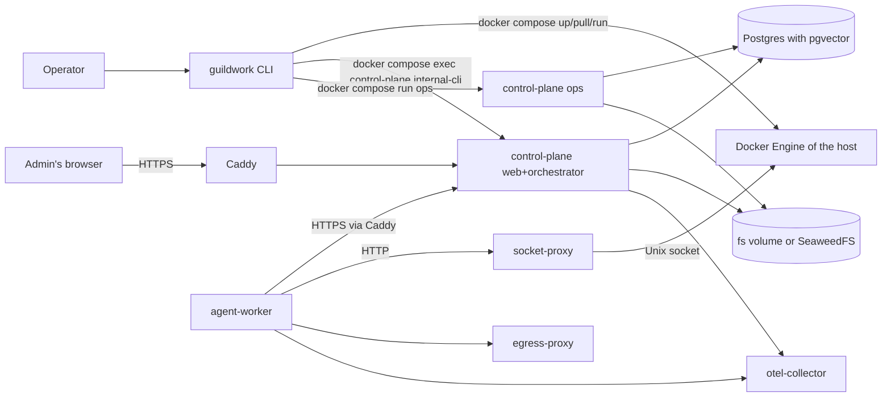
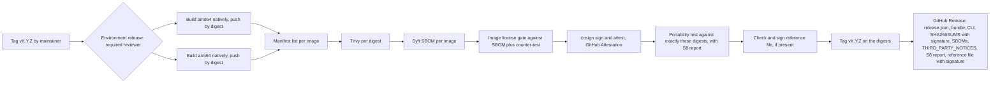
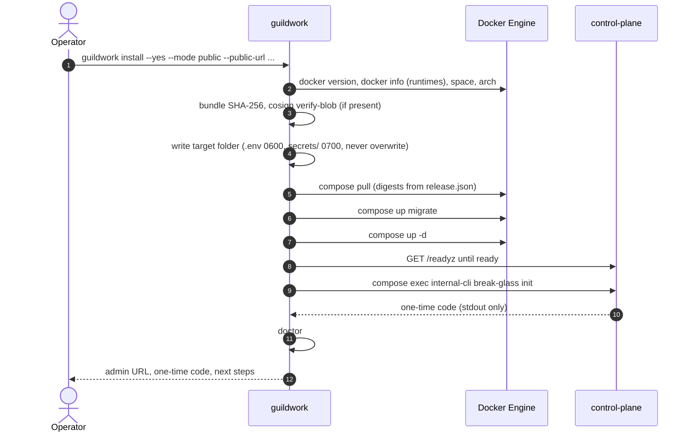
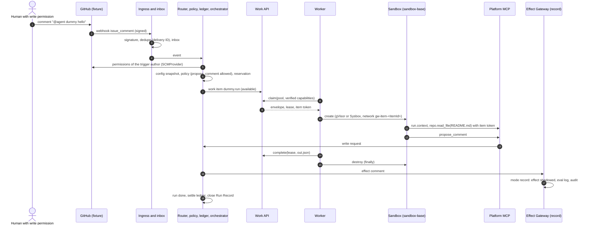
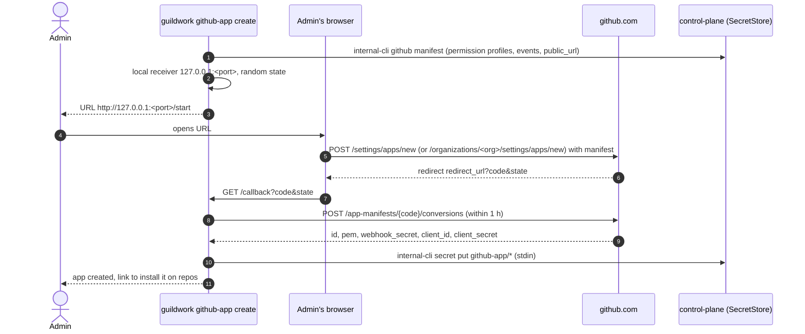
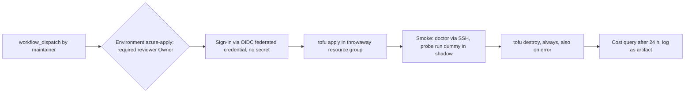

<!--
SPDX-License-Identifier: Apache-2.0
SPDX-FileCopyrightText: The Guildwork Authors
-->
# 06 Installation, Operations and Admin UI

Area: container images, compose bundle `single-host`, installer CLI `guildwork`, admin UI with setup wizard, dummy service end to end, telemetry and air gap, upgrade, backup and restore, supply chain and release, portability test, OpenTofu modules `generic-vm` and `azure`, drivers `azure-blob` and `azure-keyvault`, Run Record, costs and kill switch in the admin UI. Stages 0, 0b and 1. Rulings FE-600 to FE-699.

Related tasks: `docs/plan/tasks/stage-0.installation.toml` (0-E16, 0-E17, 0-E18, 0-E21, 0-E22), `stage-0b.bases.toml` (0b-E01 to 0b-E03), `stage-1.adminui.toml` (1-E08). Source keys and classifications (VERIFIED, DERIVED, unverified) as in the [architecture README](../architecture/README.md). "(u)" in a cell means unverified; every such spot has a verification task in the plan.

## 1. Purpose and sources

This document makes the installability of the platform buildable: what is shipped, how an operator installs, checks, backs up, updates and operates it, and how the project checks every release before it is published.

| Source | What is implemented here |
|---|---|
| [11](../architecture/11-installation-and-hosting.md) sections 1 to 10 | Operating modes, images, CLI, setup wizard, compose bundle, OpenTofu modules, worker package, upgrade, backup, telemetry, air gap, test matrix, support matrix |
| [06](../architecture/06-operations-and-deployment.md) sections 1, 3, 4, 6, 8, 9 | Operations core, observability in the bundle, kill switch, artifacts and licenses |
| [05](../architecture/05-security.md) sections 1, 3, 7, 8, 10 | Zone separation on `single-host` (ADR-62), admin sign-in, emergency admin, Run Record, supply chain |
| [07](../architecture/07-eval.md) section 5 | Suites S1 to S8 as scaffold, S8 complete for stage 0 |
| [08](../architecture/08-roadmap.md) stages 0, 0b, 1 | Done criteria that the tasks map (acceptance matrix, section 8.10) |
| [12](../architecture/12-open-source-and-project.md) section 5.2 | Release gate, container gate, portability test |
| [01](../architecture/01-plugin-interfaces.md) sections 8, 13, 14 | Worker capabilities, driver contracts, service manifest of the dummy |
| [03](../architecture/03-flow-and-orchestration.md) sections 2, 5, 6 | Run states in the Run Record, failure paths, drain and lifting during upgrade |
| [04](../architecture/04-configuration-and-limits.md) section 7 | Keys of `installation.yaml` |
| ADRs | ADR-02, ADR-05, ADR-08, ADR-21, ADR-22, ADR-29, ADR-38, ADR-39, ADR-41 to ADR-45, ADR-47, ADR-48, ADR-50, ADR-51, ADR-57, ADR-62, ADR-64, ADR-67; O17, O22 |

Boundaries to other documents: control plane, run state machine, policy and ledger are in [02](02-control-plane.md); Work API, worker, sandbox, socket proxy, egress proxy and credential relay in [03](03-execution.md); Effect Gateway, audit, broker and the core drivers in [04](04-effects-audit-credentials.md); plugin framework, GitHub plugin and `claude-code` in [05](05-plugins-and-contracts.md); table DDL in [01](01-data-model.md); eval runner in [07](07-eval-and-qualification.md). This document names their interfaces only where it calls them. The collector pipelines (redaction, metrics) belong to Epic 0-E19; here it only says how the collector is wired into the bundle.

## 2. Modules and responsibility

### 2.1 Directories

```text
apps/cli/                         command guildwork (Node SEA binary, FE-604)
  src/main.ts                     arguments, subcommands, exit codes
  src/commands/                   install.ts doctor.ts upgrade.ts backup.ts restore.ts
                                  worker-register.ts github-app-create.ts admin-break-glass.ts
                                  admin-login.ts config-validate.ts version.ts
                                  plugin-add.ts (stage 9, [14](14-stage-9-breadth-and-hardening.md) section 2.5.4)
  src/doctor/checks/              one file per check (section 2.5), file name = check ID
  src/compose/                    wrapper around "docker compose" (exec, run, up, pull, ps)
  src/bundle/                     verify bundle and release.json, digests, cosign call
  src/prompt/                     questions with default value, --yes, abort without terminal
  src/output/                     text and NDJSON output, error codes GW-CLI-nnn
  test/                           Vitest, fixtures (fake Docker, fake Compose)
apps/control-plane/src/admin/     admin API of the role web
  auth/                           oidc.ts session.ts csrf.ts roles.ts break-glass.ts totp.ts
  setup/                          state.ts sso.ts github-manifest.ts model-access.ts pool.ts probe-run.ts
  api/                            status.ts pools.ts services.ts audit.ts telemetry.ts
                                  runs.ts run-record.ts costs.ts kill-switches.ts (stage 1)
apps/control-plane/src/ops/       role ops: backup schedule, restore test (FE-608),
                                  blob-init.ts and pitr.ts (section 2.11.1, 0-E18-T04)
apps/control-plane/src/telemetry/ product telemetry (preview), update notice (0-E18-T16),
                                  version-age.ts (version age, 0-E17-T08)
apps/control-plane/src/killswitch/ kill switch (stage 1)
apps/control-plane/src/migrate/guards.ts   inputs of the migrator locks (haltPoints, maximum backup age)
                                           and messages; the locks themselves in packages/db (01 FE-133)
apps/control-plane/src/internal-cli.ts     internal commands for "docker compose exec" (FE-603)
apps/admin-ui/                    React SPA with Vite (FE-601)
  src/pages/                      Login, BreakGlass, Setup/*, Status, Pools, Services, Audit,
                                  Telemetry, Runs, RunRecord, Costs, KillSwitches
  src/api/client.ts               typed client of the admin API
services/dummy/                   dummy service (section 2.8)
  manifest.yaml  src/controller.ts  job/dummy-job.mjs  test/
deploy/images/<image>/Dockerfile  control-plane, agent-worker, egress-proxy, sandbox-base
deploy/compose/                   compose.yaml, profiles, caddy/, otel/, socket-proxy/, postgres/init/,
                                  installation.example.yaml, env.template, host-prepare.sh
deploy/worker-package/            systemd unit, compose.worker.yaml, README
deploy/tofu/generic-vm/           OpenTofu module (section 2.14)
deploy/tofu/azure/                OpenTofu module (section 2.14)
drivers/blob-azure/               driver azure-blob (section 2.15)
drivers/secret-azure-keyvault/    driver azure-keyvault (section 2.15)
tools/release/                    release.json, release.toml (stage, halt points), bundle, SHA256SUMS,
                                  image license gate (Python)
tools/fixture-server/             recorded GitHub responses and signed webhooks (container, section 2.17)
tools/acceptance/                 acceptance matrix per stage and check tool (Python)
tools/portability/                smoke, seed runs, comparison, PITR evidence (section 2.18)
tools/airgap-env/                 test environment without egress with mirror registry (0-E18-T17)
tools/doc_commands_check.py       runs marked command blocks of the operator docs (section 2.18)
packages/testkit/src/e2e/         E2E stack of the chain (section 2.17)
packages/testkit/src/fixture-server/  fixture server in the test process (section 2.17)
packages/testkit/src/test-idp/    test IdP for the OIDC login (section 2.17)
packages/testkit/src/fake-anthropic/  fake LLM upstream for the harness mode (section 2.17)
packages/testkit/src/telemetry-sink/  capture sink for telemetry cases (section 2.17)
packages/testkit/src/azure-recorder/  recording and replay for Azure SDK clients (section 2.17)
eval/suites/s1-security ... s8-installation   suite scaffold (0-E22)
docs/ops/                         operator docs (install, upgrade, backup, air-gap, hetzner)
.github/workflows/                images.yml release.yml portability.yml tofu.yml
                                  azure-drivers.yml azure-apply.yml
```

Who calls whom:



### 2.2 Container images

| Image | Base (pinned by digest) | Content | Roles or start |
|---|---|---|---|
| `control-plane` | `node:22-bookworm-slim` | Control plane, admin UI bundle (static), `pg_dump`, `pg_restore` and `psql` of major version 18 from the PGDG package repo (u: arm64 packages), `restic` (license u, verification task), `git` from Debian (for `SCMProvider.push` via Git bundle, [05](05-plugins-and-contracts.md) section 2.14.7, FE-516) | `web`, `orchestrator`, `migrate`, `ops` by argument; `all` = `web`+`orchestrator` in one process (bundle) |
| `agent-worker` | `node:22-bookworm-slim` | Worker binary, socket proxy (FE-611), `git`, no harness binaries | `worker`, `socket-proxy` |
| `egress-proxy` | `node:22-bookworm-slim` | Egress proxy with allowlist and credential relay ([03](03-execution.md)) | `proxy` |
| `sandbox-base` | `debian:bookworm-slim` | `bash`, `git`, `ca-certificates`, `curl`, `tini`, Node 22, `python3`, user `agent` (uid 10001, [03](03-execution.md) FE-321) without sudo; nothing proprietary; platform tools as bundled Node scripts under `/opt/guildwork/bin/` (table below) | Sandbox per work item, extended per repo via blueprint |

**Platform tools in `sandbox-base` (FE-651).** A tool that a work item calls in the sandbox and that does not justify its own image lives as a bundled Node script (one `.mjs` per tool, without `node_modules` at runtime) under `/opt/guildwork/bin/<name>`, is owned by user `root` with mode 0755 and is listed in the SBOM of the image. The task that builds the tool extends `deploy/images/sandbox-base/Dockerfile`, the structure check `images.sandbox-base-tools` (file present and executable, `node --check` without errors) and this table in the same PR.

| Tool | Task | Defined in |
|---|---|---|
| `gw-review-context` | 1-E02-T03 | [08](08-reviewer.md) section 2.10, FE-805, FE-806 |
| `gw-kb-indexer` | 7-E01-T04 | [12](12-expansion.md) section 2.1, FE-1261, FE-1263 |

Rules (11 section 2.1, 05 section 10):
- Every image for `linux/amd64` and `linux/arm64`, built natively on `ubuntu-24.04` or `ubuntu-24.04-arm` and merged into a manifest list with `docker buildx imagetools create` (FE-622).
- Pulled by digest only. Tags are immutable versions `vX.Y.Z` or `vX.Y.Z-rc.N`; there is no floating tag (FE-606).
- Every image runs without root (`USER 10001`, sandbox `agent`), with `HEALTHCHECK` (for `sandbox-base` and tool images without a service `HEALTHCHECK CMD ["true"]`, so that the structure check stays the same for all) and labels `org.opencontainers.image.{version,revision,created,source,licenses}`; `created` serves the version age (FE-618).
- No `claude` and none of the packages from ADR-39 (name lists `FORBIDDEN_NPM` and `FORBIDDEN_PYPI` in `tools/ci/license_check.py`, [00](00-codebase-and-conventions.md) section 2.10) in any image; the image license gate (section 2.12) checks this against the SBOM of every image.
- Weekly rebuild of `agent-worker` and `sandbox-base` (06 section 6) via `images.yml` on a schedule; new digests reach operators only with the next release.
- There is no separate probe image (FE-645): probe containers of `doctor` (D11, D12, D15, D16, D17) and the worker probe ([03](03-execution.md) section 2.6) run from `sandbox-base` with their own command. `allowedImages` in `socket-proxy/policy.json` therefore contains only the digest of `sandbox-base` (and from stage 2 the tool images that the worker starts itself).
- The image `control-plane` also carries version and revision as the file `dist/version.json` (`{ version, revision, created }`, written at build time), because image labels are not readable inside the container.

**Tool images of later stages (FE-640).** Every further image lives under `deploy/images/<image>/Dockerfile`, is built as a matrix entry in `images.yml`, follows the same rules (both platforms, digest, without root, labels, license gate) and is listed in `release.json` under `images` (section 2.10). Content and invocation are defined by the document of the stage that introduces it; here there is only the list.

| Image | Stage, task | Content and invocation | Provider in the component catalog |
|---|---|---|---|
| `registry-cache` | 2, 2-E01-T11 | [10](10-planner-architect-coder.md) section 2.6 | `registry-cache/image-registry-cache` |
| `mermaid-check` | 2, 2-E03-T04 | 10 section 2.12 | `service-architect/image-mermaid-check` |
| `analyzer-opengrep`, `analyzer-gitleaks`, `analyzer-osv-scanner`, `analyzer-trivy` | 2, 2-E05-T04 to T06 | 10 section 2.14 | `container-images/image.analyzer-*` |
| `sandbox-e2e` | 3, 3-E03-T01 | [11](11-qa-prfix-automerge.md) section 2.3 | `container-images/image.sandbox-e2e` |
| `embedder` | 7, 7-E01-T07 | [12](12-expansion.md) section 2.2 | `embedder/image-embedder` |
| `engines` (ast-grep and Opengrep, sandbox image of the step `rule-test`) | 7, 7-E03-T05 | 12 section 2.5, FE-1214 | `service-standards/engine-image` |
| `analyzer-git-cliff` | 10, 10-E01-T04 | [15](15-stage-10-edge-layers.md) section 2.3.6 | no separate entry (used only by its own plugin; built via `container-images/images-workflow`) |
| `analyzer-axe`, `analyzer-infracost` | 10, 10-E04-T01 and T02 | 15 sections 2.6.1 and 2.6.2 | like `analyzer-git-cliff` |

A task that introduces an image delivers Dockerfile, matrix entry and structure tests (`images.non-root`, `images.healthcheck-present`, `images.labels-complete`) in the same PR; the license gate (section 2.12) reads the list from `images.yml`, not from a second list. In the component catalog every image is provided by exactly one component (rule "one provider per interface"): tool images that their introducing component provides itself (last column) are not named again by `container-images`; `container-images` provides the four core images, the workflow `images.yml` and the images that several components use and that no introducing component provides itself (analyzers of stage 2, `sandbox-e2e`).

### 2.3 Compose bundle `single-host`

File `deploy/compose/compose.yaml`, project name `guildwork`. Images are given as `${GW_IMAGE_<NAME>}` with digest in the `.env` generated by the installer; in air-gap mode they point to `registry_mirror` (section 2.9).

| Service | Image | Networks | Volumes, mounts | Healthcheck | Profile |
|---|---|---|---|---|---|
| `postgres` | `pgvector/pgvector:<pg17-Tag>@sha256:...` ([pgv-docker] per 11) | `core` | `pgdata`, `postgres/init/` ro as `/docker-entrypoint-initdb.d`, `postgres-secrets/` ro (only here) | `pg_isready -U guildwork` | always |
| `migrate` | `control-plane` (argument `migrate`) | `core` | `secrets/` ro, `installation.yaml` ro | Exit code 0, once before start (`depends_on: condition: service_completed_successfully`) | always |
| `control-plane` | `control-plane` (argument `all`) | `core`, `edge`, `otel` | `secrets/` ro, `blobdata` (with `fs`), `installation.yaml` ro, `release.json` ro as `/etc/guildwork/release.json` (FE-646) | `GET /readyz` | always |
| `ops` | `control-plane` (argument `ops`) | `core` | `secrets/` ro, `blobdata` ro (with `fs`), `backups`, `installation.yaml` ro, `release.json` ro | `GET 127.0.0.1:9464/healthz` inside the container | always |
| `caddy` | `caddy:2@sha256:...` | `edge`, `worker-uplink` (alias = host name from `public_url`) | `caddy-data`, `Caddyfile` ro | `caddy validate` at start, `GET :2019/config/` internal only | always |
| `worker` | `agent-worker` (argument `worker`) | `worker-uplink`, `worker-egress`, `otel` | `worker-secrets/` ro, `harness-cache` (volume with fixed name `gw-harness-cache` = default of `harness_cache_volume`, inside the container under `/var/lib/guildwork/harness`, [05](05-plugins-and-contracts.md) FE-550), `socket-proxy-sock` (Unix socket of the socket proxy, [03](03-execution.md) section 2.8) | `GET 127.0.0.1:8090/healthz` inside the container | always |
| `socket-proxy` | `agent-worker` (argument `socket-proxy`) | none (`network_mode: none`) | `/var/run/docker.sock` ro (only here), `socket-proxy-sock` (own Unix socket for the worker), `socket-proxy/policy.json` ro | `GET /_ping` against its own allowlist | always |
| `egress-proxy` | `egress-proxy` | `worker-egress`, `egress-out`, `worker-uplink` (outbound to `caddy` only, for the platform MCP of the sandbox), sandbox networks at runtime | `egress.yaml` ro | `GET /healthz` | always |
| `otel-collector` | `otel/opentelemetry-collector-contrib@sha256:...` | `otel`, `core` | `otel/collector.yaml` ro (content from 0-E19), `otel-files` | `health_check` extension | always |
| `seaweedfs` | `chrislusf/seaweedfs@sha256:...`, the same digest as `SEAWEEDFS_IMAGE` in `drivers/blob-s3/test/images.ts` ([04](04-effects-audit-credentials.md) FE-443; test `blob-s3/compose image matches tested image`, 0-E18-T04); version and Object Lock from the probe 0-E03-T07 | `core` | `seaweed-data` | `GET /status` of the master (u) | `s3` |
| `seaweedfs-init` | `control-plane` (argument `ops blob-init`) | `core` | `secrets/` ro | once: create bucket, enable versioning and Object Lock where available | `s3` |
| `pgbackrest` | `control-plane` (argument `ops pitr`) with pgBackRest (u: package and license) | `core` | `pgdata` ro, `pitr-repo` | `pgbackrest check` | `pitr` |
| `prometheus`, `grafana` | upstream images | `core` | own volumes | upstream | `observability` |

**Networks (FE-607):**

| Network | `internal` | Members | Purpose |
|---|---|---|---|
| `edge` | no | `caddy`, `control-plane` | the only published entry: ports 443 and 80 (ACME and redirect only) on `caddy` |
| `core` | yes | `postgres`, `control-plane`, `ops`, `migrate`, `otel-collector`, `seaweedfs`, `pgbackrest` | state; never a worker or a sandbox (ADR-62) |
| `worker-uplink` | yes | `worker`, `caddy`, `egress-proxy` | the worker reaches the Work API and platform MCP only via the reverse proxy; through it the egress proxy reaches only `caddy` for the sandbox (host from `public_url` in `egress.allow_private`, section 2.4.1) |
| `worker-egress` | yes | `worker`, `egress-proxy` | the worker's own outbound traffic (harness installation, WIF exchange) via the proxy; control API of the egress proxy ([03](03-execution.md) section 2.9.1) |
| `egress-out` | no | `egress-proxy` | the only exit to the internet apart from `caddy` |
| `otel` | yes | `otel-collector`, `control-plane`, `worker`, `egress-proxy` | OTLP; the collector is not part of `worker-egress` |
| `gw-item-<itemId>` | yes | sandbox of the item, `egress-proxy` | created and removed per work item by the worker via the socket proxy ([03](03-execution.md) section 2.7) |

The worker reaches the Docker API only via the Unix socket of the socket proxy in the volume `socket-proxy-sock`, not via a network (03 section 2.8, consistency run 2026-11-01).

**Routes in Caddy** (`deploy/compose/caddy/Caddyfile`, 0-E18-T03). Caddy forwards only these prefixes to `control-plane:8080`; every other path yields 404 at the edge. The endpoints themselves are defined by the named documents.

| Prefix | Target in the role `web` | Defined in | Reachable from |
|---|---|---|---|
| `/v1/ingress/` | Webhook ingress `POST /v1/ingress/{instanceId}` | [02](02-control-plane.md) | `edge` (hoster) |
| `/work/` | Work API | [03](03-execution.md) | `worker-uplink` and remote workers via `edge` |
| `/mcp/` | Platform MCP | 03 | `worker-uplink` (sandbox via the egress proxy) |
| `/oidc/` | Issuer `self-issuer`: discovery under `<issuer_url>/.well-known/openid-configuration` with `issuer_url` = `<public_url>/oidc` (default from 04 section 7) and JWKS per `jwks_uri` | [04](04-effects-audit-credentials.md) | `edge` |
| `/admin/` (SPA, `/admin/auth/`, `/admin/api/v1/`, `/admin/setup/`, `/admin/oauth/`) | Admin UI and admin API (section 2.6) | this document | `edge`, optionally limited by `admin.allowed_cidrs` |
| `/api/v1/` | Endpoints with developer token | [09](09-reviewer-companion-features-and-learnings.md) | `edge` |
| `/healthz`, `/readyz` | Health | 02 | `edge` (status only, no details) |

A stage that needs a new prefix extends this table and the Caddyfile in the same PR; the test `compose.caddy-routes-match-table` compares both.

**Source address for the role `web` (FE-652, [13](13-stage-8-providers-and-bases.md) FE-1302 and FE-1316).** Every forward to `control-plane:8080` sets the header `X-Guildwork-Peer` to the address of the TCP connection to Caddy and replaces any value the client sends along; in the Caddyfile as `header_up X-Guildwork-Peer {remote_host}` in the shared `reverse_proxy` block of all routes (placeholder `{remote_host}` and replacement by `header_up` u: verify against the Caddy docs in 0-E18-T03). The role `web` never reads other forwarding headers (`X-Forwarded-For`) for allowlists. Test `compose.caddy-sets-peer-header`: a request with its own `X-Guildwork-Peer: 203.0.113.9` to `/v1/ingress/` arrives in the role `web` with the address of the test client, not with the value sent along. Applies to all prefixes from stage 0; used from stage 8 by the relay ingresses with `ipAllowlist`.

**Extending the bundle (FE-641).** Further services come as a fragment `deploy/compose/<name>.compose.yaml`, which `compose.yaml` includes via `include`, and hang on their own profile (name = fragment), unless the service is part of the mandatory scope (`observability.compose.yaml` from 0-E19-T03 is always on). Every fragment uses only the networks from the table above, never mounts `secrets/` or `docker.sock` and puts its image digest as `${GW_IMAGE_<NAME>}` into `env.template`. Profiles in use: `s3`, `pitr`, `observability`, `kb-vectors` (7-E01-T07).

**Preparing the host** (`deploy/compose/host-prepare.sh`, FE-619, 0-E18-T18): the only step with root, started by the operator personally. Options `--isolation gvisor|sysbox|both` (mandatory), `--kvm` (udev rule for `/dev/kvm`), `--dry-run` (only print what would change). Flow: check the distribution against the list in `docs/ops/install.md`, install `runsc` from the official package source with checksum and register it as a runtime in `/etc/docker/daemon.json`, optionally Sysbox, Docker restart only if no stack is running (otherwise a notice and exit 1). Idempotent; every change as a line on stdout. Exit 0 changed or already correct, 1 error, 2 invalid option.

**Files in the target folder** (installer rules 3 and 4 from 11 section 2.4):

| Path | Mode | Content | second `install` run |
|---|---|---|---|
| `compose.yaml`, `profiles/*.yaml`, `caddy/`, `otel/`, `socket-proxy/` | 0644 | from the bundle | replaced if the bundle is newer, old version as `*.prev` |
| `.env` | 0600 | image digests, `COMPOSE_PROFILES`, non-secret values; never a secret | never overwritten; missing keys are added |
| `egress.yaml`, `worker.yaml`, `socket-proxy/policy.json` | 0644 | files for zone Z1, generated from `installation.yaml` and `release.json` ([03](03-execution.md) FE-328, step `install.write`); never a secret | rewritten, old version as `*.prev` |
| `secrets/` | 0700, files 0600 (`master.key` 0400) | SecretStore `file` ([04](04-effects-audit-credentials.md) FE-414): `master.key` (32 random bytes) and store `store/` with the initial secrets from the table below (FE-647) | never overwritten; missing files are created |
| `postgres-secrets/` | 0700, files 0600 | plaintext passwords `superuser`, `owner`, `app`, `ops` for the init script of the service `postgres` (mounted only there) | never overwritten |
| `worker-secrets/pool-key` | 0700/0600 | pool key of the local worker (FE-633), step `install.pool-key` | never overwritten |
| `installation.yaml` | 0640 | installation configuration ([04](../architecture/04-configuration-and-limits.md) section 7) | never overwritten |
| `release.json`, `release.prev.json` | 0644 | release manifest of the installed or previous version | `release.json` replaced after upgrade |

**Initial secrets and database roles (FE-647, FE-648).** Before the first start there is no running control plane that could accept secrets. Therefore `install` (step `install.write`) writes the initial secrets itself with the driver `@guildwork/driver-secret-file` (bundled in the CLI, version 1 per secret, format from 04 FE-414) into `secrets/store/`; all later secrets go through `internal-cli secret put`. Values are 32 bytes from `crypto.randomBytes`, base64url.

| Secret (`secret://...`) | Content | Reader |
|---|---|---|
| `database/app-url` | `postgres://guildwork_app:<app>@postgres:5432/guildwork` | `database.url_ref` (roles `web`, `orchestrator`) |
| `database/migrate-url` | `postgres://guildwork_owner:<owner>@postgres:5432/guildwork` | `database.migrate_url_ref` (role `migrate`, [01](01-data-model.md) FE-112) |
| `database/ops-url` | `postgres://guildwork_ops:<ops>@postgres:5432/guildwork` | `ops.database_url_ref` (role `ops`, section 2.11) |
| `admin/totp-key` | 32 bytes | AES-256-GCM of the TOTP secret (section 3.1) |
| `backup/local/password` | 32 bytes | restic password of the default target `local` (`BackupTarget.passwordRef`) |

`installation.yaml` from the template additionally sets `secrets: { driver: file, path: /etc/guildwork/secrets/store, master_key_file: /etc/guildwork/secrets/master.key }` and the three `*_url_ref` to these references. The init script `deploy/compose/postgres/init/01-roles.sh` runs only on the first start of the empty volume `pgdata` (behavior of the Postgres image, u: verify against the image docs in 0-E18-T03) and creates from the files in `postgres-secrets/`: `guildwork_owner` (LOGIN, owner of the database `guildwork`), `guildwork_app` (LOGIN, `NOBYPASSRLS`), `guildwork_ops` (LOGIN, `CREATEDB`, `BYPASSRLS`, member of `pg_read_all_data`; `pg_dump` reads tables with forced RLS only with `BYPASSRLS`, u: verify behavior in 0-E18-T10). The privileges of `guildwork_app` are then set by `migrate` ([01](01-data-model.md) section 6, FE-112).

### 2.4 Installer CLI `guildwork`

Common to all commands (11 section 2.2):
- Options: `--dir <path>` (default `./guildwork`), `--yes` (all questions with default value), `--json` (NDJSON events instead of text), `--verbose`, `--help`.
- Every question has an option. Without a terminal (`!process.stdin.isTTY`) and without the option, the command aborts with step and reason (`GW-CLI-010`), unless `--yes` supplies a default value. A mandatory value without a default (such as `--public-url` with `--mode public`) is never silently missing.
- No secret as a command-line option: secrets come from files (`--*-file`) or from stdin (`--*-stdin`); the parser rejects options named `*password*`, `*secret*`, `*token*`, `*key*` without `-file`/`-stdin` (`GW-CLI-002`).
- Never `sudo`, never package installation, writes only into `--dir` and into the backup target.
- Local commands to the control plane run via `docker compose exec control-plane node dist/internal-cli.js <command>` or `docker compose run --rm ops ...` (FE-603). Whoever may operate `docker` is an administrator on this host anyway.

```ts
// apps/cli/src/output/types.ts
export type ExitCode = 0 | 1 | 2;           // 0 success, 1 step failed, 2 invalid option
export type StepStatus = "start" | "ok" | "warn" | "fail" | "skip";
export interface StepEvent {                 // one NDJSON line with --json
  ts: string;                                // ISO-8601
  command: string;                           // "install", "doctor", ...
  step: string;                              // stable step ID, such as "install.preflight.docker"
  status: StepStatus;
  message: string;                           // human-readable, without secrets
  code?: CliErrorCode;                       // with warn and fail
  data?: Record<string, unknown>;            // structured values, never secrets
}
export type CliErrorCode =
  | "GW-CLI-001"   // unknown option or wrong type                           -> Exit 2
  | "GW-CLI-002"   // secret as option                                        -> Exit 2
  | "GW-CLI-010"   // mandatory value missing without terminal                -> Exit 1
  | "GW-CLI-020"   // preflight failed (Docker, Compose, arch, space)         -> Exit 1
  | "GW-CLI-021"   // target folder not empty and no earlier installation     -> Exit 1
  | "GW-CLI-030"   // bundle checksum wrong                                   -> Exit 1
  | "GW-CLI-031"   // signature invalid                                       -> Exit 1
  | "GW-CLI-032"   // image digest not in release.json                        -> Exit 1
  | "GW-CLI-040"   // service does not become ready (deadline)                -> Exit 1
  | "GW-CLI-050"   // upgrade path not allowed (version, halt point)          -> Exit 1
  | "GW-CLI-051"   // no fresh backup                                         -> Exit 1
  | "GW-CLI-052"   // drain deadline expired                                  -> Exit 1
  | "GW-CLI-060"   // backup failed                                           -> Exit 1
  | "GW-CLI-061"   // restore: manifest differs                               -> Exit 1
  | "GW-CLI-062"   // restore onto non-empty target without --replace-existing -> Exit 1
  | "GW-CLI-070"   // GitHub manifest exchange failed (code expired, network) -> Exit 1
  | "GW-CLI-080";  // doctor: at least one check "fail"                       -> Exit 1
```

#### 2.4.1 `guildwork install`

| Option | Type | Default | Effect |
|---|---|---|---|
| `--dir` | path | `./guildwork` | target folder |
| `--version` | `X.Y.Z` | version of the CLI | release to be installed; never `latest` |
| `--bundle` | file | download from the release | bundle from file (air gap) |
| `--mode` | `public` \| `private` | `public` | operating mode (11 section 1.1), key `ingress.mode` (FE-631) |
| `--public-url` | URL | none (mandatory with `public`) | `public_url` |
| `--tls` | `acme` \| `internal` \| `files` | `acme` with `public`, `internal` with `private` | Caddy TLS |
| `--tls-cert-file`, `--tls-key-file` | file | | with `--tls files` |
| `--blob` | `fs` \| `s3` | `fs` | driver; `s3` turns on profile `s3` (SeaweedFS) |
| `--isolation` | `auto` \| `gvisor` \| `sysbox` | `auto` | expected isolation of the local pool; `auto` takes what `doctor` finds verified |
| `--audit-anchor` | `blob` \| `scm` | `blob` with `s3` with Object Lock, otherwise `scm` | sink of the daily anchor ([05](../architecture/05-security.md) section 8) |
| `--audit-anchor-repo` | `owner/repo` | | with `scm` |
| `--air-gap` | switch | off | `air_gap: true`, requires `--registry-mirror` |
| `--registry-mirror` | host | | mirror for images and harness packages |
| `--profiles` | list | empty | additional profiles `pitr`, `observability` |
| `--no-start` | switch | off | writes only the target folder |

Steps (every ID is a `StepEvent.step`):
1. `install.preflight.*` without writing: `docker` (engine at least `install.min_docker_version`), `compose` (plugin at least `install.min_compose_version`), `arch` (amd64 or arm64), `resources` (`install.min_cpu`, `install.min_mem_gb`, `install.min_disk_gb` at the target folder), `kernel` (from 5.12, only with `--isolation sysbox`), `isolation` (`runsc` or `sysbox-runc` registered in `docker info`; if both are missing: `fail` with a pointer to `host-prepare.sh`, FE-619), `target` (empty or earlier installation with `release.json`).
2. `install.bundle.verify`: checksum of the bundle against the SHA-256 of the version built into the CLI (FE-605); `install.bundle.signature`: `cosign verify-blob` against the signature of `SHA256SUMS` if `cosign` is in the `PATH`, otherwise `warn` with the exact verification command (FE-620).
3. `install.write`: files per section 2.3; `.env`, `secrets/` and `postgres-secrets/` only supplemented; initial secrets per section 2.3 only if `secrets/master.key` is missing; per [03](03-execution.md) FE-328 generates from `installation.yaml` the files for zone Z1, which Z1 reads instead of `installation.yaml`: `socket-proxy/policy.json` (03 section 2.8, `allowedImages` = digest of `sandbox-base` from `release.json`), `egress.yaml` (03 section 2.9: values `egress.*` and `relay.*`; `allow_private` additionally contains the host from `public_url`, because the platform MCP of the sandbox goes via the egress proxy and the network `worker-uplink` to the private address of `caddy`, 03 section 2.6) and `worker.yaml` of the local worker (03 section 2.6: `control_url` = `public_url`, pool `self-hosted`, `pool_key_file` = `/etc/guildwork/worker-secrets/pool-key`, section `sandbox` from `sandbox.*`). A second run rewrites the three files (old version as `*.prev`), because they follow only from `installation.yaml` and `release.json`; a change takes effect after restarting `worker`, `socket-proxy` and `egress-proxy`.
4. `install.images`: `docker compose pull`; every image by digest from `release.json`; with `cosign` additionally `cosign verify` per digest.
5. `install.migrate`: `docker compose up migrate` (empty database, no backup lock).
6. `install.start`: `docker compose up -d` for all services except `worker`; wait until `control-plane` reports `/readyz` (deadline `install.ready_timeout_s`, polling every 2 s).
7. `install.break-glass`: `internal-cli break-glass init` creates the emergency admin and prints the one-time code only on stdout (FE-612); in `--json` mode as an event with `data.oneTimeCode`, never into a file. Second run: emergency admin exists, `skip`.
8. `install.pool-key`: only if `worker-secrets/pool-key` is missing, `internal-cli pool-key create --pool self-hosted --name local`; the key goes via stdin of `docker compose exec` directly into the file (mode 0600), never to stdout or into an event. Then `docker compose up -d worker`. This task creates the internal command (0-E18-T06); `worker register` (0-E18-T13) uses it.
9. `install.doctor`: `doctor` without `--strict`; failures are reported, `install` then ends with exit 1, the stack keeps running.
10. `install.next`: URL of the admin UI and a pointer to the setup wizard.

#### 2.4.2 `guildwork doctor`

Options: `--dir`, `--json`, `--strict` (warnings count as failure), `--only <id,...>`, `--skip <id,...>`, `--repo <owner/repo>` (repeatable; additionally the checks with `scope: "repo"` for every named repo, FE-642; without `--repo` only the checks with `scope: "installation"` run, and D18 and D19 summarize the last stored state of all repos). Writes nothing except probe objects in its own prefix `_doctor/<uuid>` of the BlobStore, which it deletes again, and the report via `internal-cli doctor report` (section 2.4.9). Exit 0 if no check is `fail` (FE-637); 1 otherwise; 2 on invalid option. Checks in section 2.5.

```ts
// apps/cli/src/doctor/types.ts
export type CheckResult = "ok" | "warn" | "fail" | "skip" | "n/a";
export interface DoctorCheck {
  id: string;                       // "D16-single-host-separation" or "R02-agent-ci"
  stage: "0" | "0b" | "2" | "5" | "6" | "7" | "8";   // from which stage the check really checks (FE-630)
  scope: "installation" | "repo";   // "repo" runs only with --repo (FE-642)
  appliesTo: ("single-host" | "worker-package" | "any")[];
  run(ctx: DoctorContext): Promise<CheckOutcome>;
}
// Registration: apps/cli/src/doctor/checks/index.ts exports the list of all DoctorCheck;
// a later stage adds its file and an entry, never a second mechanism.
export interface CheckOutcome {
  result: CheckResult;
  message: string;                  // without secrets
  hint?: string;                    // concrete next step, such as a command or docs section
  data?: Record<string, unknown>;
}
export interface DoctorContext {
  dir: string; installation: InstallationConfig; release: ReleaseManifest;
  compose: ComposeClient;           // exec, inspect, ps
  internal: InternalCli;            // docker compose exec control-plane internal-cli ... (section 2.4.9)
  clock: () => Date;
  repo?: string;                    // only with --repo, "owner/repo"
}
export interface DoctorReport { version: string; startedAt: string; checks: (CheckOutcome & { id: string })[]; exitCode: 0 | 1 }
```

#### 2.4.3 `guildwork upgrade`

Options: `--to <X.Y.Z>` (mandatory), `--bundle <file>`, `--backup` (if a fresh backup is missing, run `backup` first instead of aborting), `--drain-timeout <min>`, `--rollback` (way back to `release.prev.json`), `--yes`. Flow in section 4.4, rules in section 2.10.

#### 2.4.4 `guildwork backup`

Options: `--secrets` (additionally an encrypted export of `secrets/` into a separate restic repo, passphrase via `--passphrase-file` or stdin), `--target <name>` (from `backup.targets`), `--kind manual|pre_upgrade`. Output: snapshot ID, manifest path, row in `backup_runs`. Flow in section 2.11.

#### 2.4.5 `guildwork restore`

Options: `--snapshot <id|latest>` (mandatory), `--target <name>`, `--secrets` (with `--passphrase-file`), `--replace-existing` (only with TTY confirmation by typing the installation name; never with `--yes` alone), `--verify-only` (throwaway database like the automatic test, replace nothing). Result: comparison of the manifest (row counts, last audit hash, object list), verification of the audit chain, report. Flow: `docker compose stop` of all services except `postgres`, then `docker compose run --rm ops restore ...`: `pg_restore --no-owner --role=guildwork_owner` via `database.migrate_url_ref` into the empty database `guildwork` (or, with `--replace-existing`, the database emptied beforehand), objects back via the BlobStore driver, comparison; only on equality `docker compose up -d`. In CI the confirmation is replaced by `GW_CONFIRM=<installation>` (section 2.13).

#### 2.4.6 `guildwork worker register`

Options: `--pool <id>` (default `self-hosted`), `--name <worker-name>`, `--single-operator <operator-id>`, `--out <file>` (writes the key with mode 0600 instead of displaying it), `--config-dir <folder>` (target folder for the files of the worker package, default `./guildwork-worker-<name>`). Calls `internal-cli pool-key create`; the plaintext appears exactly once (stdout or file), the database holds only the hash ([03](03-execution.md) pool key). For the worker package on own hardware (11 section 2.7), the command writes per 03 FE-328 with the same function as `install.write` (section 2.4.1) into `--config-dir`: `worker.yaml` (`control_url` = `<public_url>`, `pool`, `pool_key_file` = `/etc/guildwork/pool-key`, `single_operator`, section `sandbox` from `sandbox.*`), `egress.yaml` (`egress.*`, `relay.*`; `allow_private` empty, because the remote worker reaches the control plane via the public address) and `socket-proxy/policy.json` (`allowedImages` from `release.json`), all 0644 without a secret, plus the lines for `worker.env` (`GW_WORK_API_URL`, `GW_POOL`, `GW_POOL_KEY_FILE`; never the key). The operator copies the folder to the worker host; the key gets there separately.

#### 2.4.7 `guildwork github-app create`

Options: `--org <name>` (app under an organization, otherwise under the admin's account), `--name <app-name>`, `--callback-port <port>` (local receiver on `127.0.0.1`, default: free port), `--paste-code` (without local receiver: the admin copies `code` from the redirect URL). Flow in section 4.3; writes `github-app/id`, `github-app/private-key`, `github-app/webhook-secret`, `github-app/client-id`, `github-app/client-secret` into the SecretStore via `internal-cli secret put` (values via stdin, never as an argument).

From 8-E05-T02 additionally `--dispatch --repo <runnerRepo>` ([13](13-stage-8-providers-and-bases.md) section 2.5.2, FE-1354): creates the dispatch app for the backend `ci-dispatch`. `internal-cli github manifest --dispatch` builds the manifest with `buildAppManifest({ profiles: ["dispatch"] })` (only `actions: write`, no events, no webhook); the flow is the same as above. Only `secret://github-dispatch-app/id` and `secret://github-dispatch-app/private-key` are stored; the command prints both references as a suggestion for `dispatchAppRef.appIdRef` and `keyRef` of the plugin instance (13 section 2.5.1) and discards webhook secret and client values, because the dispatch app has neither a webhook nor user sign-in. The completion names the installation link only for `<runnerRepo>`. `--dispatch` without `--repo` is `GW-CLI-001`. Test `github app create dispatch erzeugt manifest nur mit actions write` (13).

#### 2.4.8 Further commands

| Command | Purpose | Reason |
|---|---|---|
| `guildwork admin break-glass reset` | new one-time code, TOTP reset, audit and alert | [05](../architecture/05-security.md) section 7: "the CLI can lock it and reset it" (FE-612) |
| `guildwork admin break-glass lock` / `unlock` | lock or unlock the emergency admin | as above |
| `guildwork config validate [--file]` | check `installation.yaml` against `installation.schema.json` | [04](../architecture/04-configuration-and-limits.md) section 7 names `config validate` |
| `guildwork version` | CLI, bundle and installed version, release date, age | version age (FE-618) |
| `guildwork admin login --url <public_url> [--out <file>] [--callback-port <port>]` | admin session for commands that use the admin API as a client (`guildwork-eval`, [07](07-eval-and-qualification.md) section 2.17.5), via sign-in in the browser; flow in section 2.6.2 | FE-653 |
| `guildwork admin session [--role viewer\|approver\|admin] [--ttl-min <n>] [--out <file>]` | the same without a browser on the host of the installation via `internal-cli admin session create` (CI, portability test, operator at the host) | FE-603, FE-653 |
| `guildwork plugin add <ref>@<digest> [--instance <id>] [--dry-run]` | accept a third-party plugin, driver or service artifact (stage 9); calls `internal-cli plugins add`, which calls the same function as `POST /admin/api/v1/plugins/artifacts`; output `PluginAddResult` with `configSnippet` | [14](14-stage-9-breadth-and-hardening.md) section 2.5.4, FE-603 |

#### 2.4.9 Internal commands (`internal-cli`)

The CLI talks to the control plane only via `docker compose exec control-plane node dist/internal-cli.js <command>` or `docker compose run --rm ops <command>` (FE-603). Every command writes exactly one JSON object to stdout, values with secrets only where the table says so; inputs with secrets only via stdin. Exit codes as in the CLI (0, 1, 2). The framework (`apps/control-plane/src/internal-cli.ts`: command registry, JSON output, exit codes, audit with actor `cli:local`) is created by 0-E17-T03; every further task registers its command.

```ts
// apps/cli/src/compose/client.ts
export interface ExecResult { code: number; stdout: string; stderr: string }
export interface ComposeClient {
  exec(service: string, argv: string[], opts?: { stdin?: string }): Promise<ExecResult>;
  run(service: string, argv: string[], opts?: { stdin?: string; rm?: boolean }): Promise<ExecResult>;
  up(services?: string[], opts?: { detach?: boolean }): Promise<void>;
  pull(): Promise<void>;
  ps(): Promise<{ service: string; state: string; health?: string; publishers: { targetPort: number; publishedPort: number }[] }[]>;
  inspect(container: string): Promise<Record<string, unknown>>;   // docker inspect as JSON
}
export interface InternalCli {                 // calls compose.exec("control-plane", ["node","dist/internal-cli.js", ...])
  call<T>(command: string[], opts?: { stdin?: string }): Promise<T>;   // throws CliError with the code from the JSON response
}
```

| Command | Response | Caller | Built by |
|---|---|---|---|
| `break-glass init` | `{ username, oneTimeCode }` (secret, stdout only) | `install` | 0-E17-T03 |
| `break-glass reset` / `lock` / `unlock` | `{ state, oneTimeCode? }` | `admin break-glass` | 0-E17-T03 |
| `admin session create --role <r> --ttl-min <n>` | `{ session, expiresAt }` (secret, stdout only); creates a session `kind = "cli"` with subject `cli:local`, audit `admin.session.cli_created` | `admin session` | 0-E17-T03 |
| `schema status` | `{ current, expected, pending: number }` | D07 | 0-E18-T07 |
| `doctor report` (stdin: `DoctorReport`) | `{ stored: true }`; writes `installation_settings` key `doctor_last` | `doctor` | 0-E18-T07 |
| `workers list` | `{ name, pool, version, verified, lastSeenAt }[]` | D27, `upgrade` | 0-E18-T09 |
| `backup status` | `{ lastSucceededAt?, lastRestoreTest?: { at, state }, targets: { name, appendOnly }[] }` | D25, `upgrade` | 0-E18-T10 |
| `drain on` / `off` / `status` | `{ drain: boolean, activeLeases: number }` | `upgrade` | 0-E18-T12 (switch from [03](03-execution.md) `drain.ts`) |
| `pool-key create --pool --name [--single-operator]` | `{ keyId, key }` (secret, stdout only) | `install` (local worker), `worker register` | 0-E18-T06 (key from [04](04-effects-audit-credentials.md) `pool-keys.ts`) |
| `github manifest [--org]` | `{ manifest, postUrl }` | `github-app create` | 0-E18-T14 (`buildAppManifest`, FE-638) |
| `github manifest --dispatch` | as above with profile `dispatch` | `github-app create --dispatch` | 8-E05-T02 |
| `secret put <ref>` (stdin: value) | `{ ref, version }` | `github-app create` | 0-E18-T14 |
| `db versions` | `{ serverVersionNum: number; pgvector?: string }` | D05, D06 | 0-E18-T07 |
| `doctor probe blob\|secret\|identity` | `{ ok: boolean; capabilities: string[]; detail?: string }` (probe object `_doctor/<uuid>` deleted afterwards; test JWT verified against the JWKS) | D08, D09, D10 | 0-E18-T07 |
| `github hook-deliveries --limit 20` | `{ readable: boolean; last?: { at: string; statusCode: number } }` (app JWT, function in the GitHub plugin, open item 19) | D13 | 0-E18-T08 |
| `audit anchor-status` | result of `checkAnchorSink` ([04](04-effects-audit-credentials.md)): `{ sink; lastAnchorAt?; objectLock?: boolean; state: "ok" \| "missing" \| "stale" }` | D20, status page | 0-E18-T09 |
| `github workflow-permissions` | `{ org: string; default: "read" \| "write" \| "unreadable" }[]` per org of the installation (open item 19) | D21 | 0-E18-T09 |
| `plugins list` | `{ instance, kind, state, capabilities: string[] }[]` from the plugin registry | D23 | 0-E18-T09 |
| `runs lifted` | `{ lastUpgradeLifted: number; unknownAutomatonVersion: number }` | D28 | 0-E18-T09 |
| `config effective telemetry` | `{ product: boolean; updateCheck: boolean; airGap: boolean }` (after resolver) | D29 | 0-E18-T09 |
| `blueprint check --repo <r>` | as in [10](10-planner-architect-coder.md) section 2.20 | R01-blueprint | 2-E01-T04 |
| `agent-ci check --repo <r>` | as in 10 section 2.20 | R02-agent-ci, D18 | 2-E06-T03 |
| `pricing status` | `{ tables: { provider: string; version: string; ageDays: number }[]; maxAgeDays: number }` (from `@guildwork/pricing`, [13](13-stage-8-providers-and-bases.md) section 2.6) | D33 | 8-E06-T01 |
| `identity-link status` | `{ enabled: boolean; reason?: "page_disabled" \| "secret_store_read_only" }` (13 section 2.1.6, FE-1309) | D34 | 8-E01-T07 |
| `plugins add --ref <r> --digest <d> [--instance <id>] [--dry-run]` | `PluginAddResult` or error with `ArtifactRejectCode` ([14](14-stage-9-breadth-and-hardening.md) section 2.5.4) | `plugin add` | 9-E05-T04 |

Checks that concern the host or the worker (D01 to D04, D11, D12, D15 to D17, D22, D30, D31) do not run via `internal-cli`, but via `docker`/`docker compose` of the host: D11 and D22 via `docker compose exec worker guildwork-worker probe` (`WorkerCaps` from 03 section 2.6), D12, D15 and D17 as probe containers from `sandbox-base` (FE-645) in the respective network, D16 statically via `docker inspect` and actively from the container `worker`.

Not via `internal-cli`, but as an argument of the image: `migrate`, `ops`, `ops blob-init`, `ops pitr` (section 2.3) and `audit-verify` ([04](04-effects-audit-credentials.md) FE-425).

### 2.5 `doctor` checks

Every check has its own file `apps/cli/src/doctor/checks/<id>.ts` and its own tests (section 8.3). "fail" sets exit code 1.

| ID | Checks | How | Result | Source |
|---|---|---|---|---|
| D01-docker | Docker Engine and Compose plugin | `docker version --format json`, `docker compose version` against `install.min_docker_version`, `install.min_compose_version` | fail below minimum | 11 section 2.4 rule 1 |
| D02-arch | Architecture | `uname -m` | fail except amd64, arm64 | 11 section 2.1 |
| D03-resources | CPU, RAM, disk per slot | `nproc`, `/proc/meminfo`, `statfs` at the target folder against `install.min_*` and `pool.slot_mem_gb` times `max_concurrency` | fail below minimum | 11 section 2.4 |
| D04-kernel | Kernel for Sysbox | `uname -r` | fail below 5.12, only if the pool is to offer `sysbox` | 11 section 2.4 |
| D05-postgres-version | Major version | `SHOW server_version_num` via `internal-cli` | fail except 17 and 18 (FE-602) | 11 section 3 |
| D06-pgvector | Extension | `SELECT extversion FROM pg_extension WHERE extname = 'vector'` | fail below 0.8.2; reports the version | 11 sections 3 and 6 rule 7 |
| D07-schema | Schema version | `internal-cli schema status` | fail with too old or too new schema, with hint | 11 section 6 rule 6 |
| D08-blobstore | Driver `BlobStore` | write, read, delete probe in `_doctor/<uuid>`; capabilities `PRESIGN`, `OBJECT_LOCK` | fail on probe error; capabilities as data | 11 section 2.2 |
| D09-secretstore | Driver `SecretStore` | `get` on `doctor/probe`; with `WRITE` `put` of a new version | fail on error | 11 section 2.2 |
| D10-cloud-identity | Driver `CloudIdentity` `self-issuer` | from outside: `GET <issuer_url>/.well-known/openid-configuration` and `GET` on its `jwks_uri` via `public_url` (Caddy route `/oidc/`); inside: `internal-cli doctor probe identity` signs a test JWT, the CLI verifies it against the fetched JWKS | fail on error; with `private` only the inner part | ADR-22 |
| D11-isolation | Verified isolation | `docker info` runtimes (`runsc`, `sysbox-runc`), `/dev/kvm` readable and writable, probe container per runtime via the socket proxy | fail without `sysbox` and without `gvisor`; data: verified list | 11 section 3, ADR-48 |
| D12-egress | Outbound HTTPS | via the egress proxy `HEAD` to every configured target (SCM API, LLM endpoint, mirror) | fail if a configured target is not reachable | 11 section 2.2 |
| D13-public-url | Public URL and webhook | only `public`: DNS, TLS certificate valid, `GET public_url/healthz`; last webhook delivery via `GET /app/hook/deliveries` with app JWT | fail on DNS, TLS or health; warn if deliveries are not readable | 11 section 2.2, ADR-08 |
| D14-clock | Time | `Date` header of the SCM endpoint against the host time | fail above `doctor.max_clock_skew_s` | 11 section 2.2 |
| D15-air-gap | Air-gap locks | only with `air_gap: true`: telemetry and update notice effectively off; fetching `doctor.airgap_probe_url` via the egress proxy and directly from a probe container in `worker-egress` must fail | fail if a fetch succeeds | 11 section 8 |
| D16-single-host-separation | Separation of worker and control plane | static: `docker inspect` of `worker`: no mount of `docker.sock`, `secrets/`, `.env`; no membership in `core`; hash of `socket-proxy/policy.json` equal to the bundle; all `gw-item-*` networks `internal`. active: from `worker` TCP to `postgres:5432`, `seaweedfs:8333`, `control-plane:8080` must fail, `https://<public-host>/healthz` via `caddy` must succeed; via the socket proxy `POST /containers/create` with host path, `Privileged`, `NetworkMode: host` and a foreign network must each fail with 403 | fail on any success | [05](../architecture/05-security.md) section 1, ADR-62 |
| D17-sandbox-dns | Sandbox without DNS | probe container in a fresh `gw-item-doctor` network: `getaddrinfo` of any name fails; from stage 2 additionally the registry cache in offline mode per [10](10-planner-architect-coder.md) section 2.6 (2-E01-T11) | fail if resolution succeeds; cache part `n/a` until stage 2 | ADR-64 |
| D18-agent-ci | CI variant per repo | Stage 0: slot. From stage 2 (2-E06-T03): summary over all repos with coder not `off` from the respective latest entry in `agent_ci_checks` (10 section 2.16); the per-repo check itself is R02-agent-ci | Stage 0 `n/a` (FE-630); from stage 2 `fail` if a repo has `no_safe_ci`, `warn` if a repo was never checked; `data` = list of repo, result, time | ADR-59 |
| D19-auto-approve | Hoster settings for `auto_approve` | slot; the real check comes with stage 6 | `n/a` in stage 0 (FE-630) | ADR-61 (a) |
| D20-audit-anchor | Audit anchor | sink configured; last anchor not older than one day plus margin; with `blob` capability `OBJECT_LOCK` | fail "audit chain not anchored" | ADR-29 |
| D21-github-token-default | Org default `GITHUB_TOKEN` | `GET /orgs/{org}/actions/permissions/workflow` with installation token | fail with `write`; warn if not readable | [05](../architecture/05-security.md) section 5 |
| D22-harness-pin | Pinned harness version | `PinnedVersion` per runtime complete (exact version, `sha256` 64 hex); if the file is in the `harness-cache`, checksum equal | fail on mismatch | [01](../architecture/01-plugin-interfaces.md) section 6 |
| D23-private-mode | Operating mode `private` | every ingress plugin reports capability `POLL` | fail otherwise | 11 section 1.1 |
| D24-config | Configuration | `installation.yaml` against schema; deprecated keys | fail when invalid, warn when deprecated | 11 section 6 rule 11 |
| D25-backup | Backup | last successful row in `backup_runs` younger than `migrate.recent_backup_max_age`; last restore test successful; at least one target outside the host with `append_only` | warn on missing off-host target (M124), fail on failed last run | 11 section 7 |
| D26-version-age | Version age | release date from `release.json` against today | warn above `support.version_age_warn_days` | M95, FE-618 |
| D27-worker-versions | Worker versions | `internal-cli workers list`: version per worker | warn at N-1, fail when older | M96, 11 section 6 rule 9 |
| D28-lifted-runs | Lifted runs | number of runs lifted at the last upgrade and of runs with unknown automaton version | information; warn on unknown version | [03](../architecture/03-flow-and-orchestration.md) section 6, FE-624 |
| D29-telemetry | Telemetry | effective values `telemetry.product`, `telemetry.update_check` | information | ADR-44 |
| D30-published-ports | Published ports | `docker compose ps --format json`: only `caddy` with 443 and 80 | fail on any further port | 11 section 2.4 rule 5 |
| D31-file-modes | File permissions | `.env` 0600, `secrets/` 0700, files in it 0600, `worker-secrets/` 0700 | fail on broader permissions | 11 section 2.4 rule 3 |
| D32-embedder | Embedder service (profile `kb-vectors`) | `GET /v1/health` of the service: reachable, model and checksum | `n/a` without profile; fail if the profile is on and the service is not reachable | [12](12-expansion.md) section 2.2, 7-E01-T07 |
| D33-pricing-age | Age of the price tables (stage 8) | `internal-cli pricing status`: `version` per provider against `pricing.max_age_days` | `warn` per table that is too old, with provider and age, never `fail`; `n/a` before 8-E06-T01 | [13](13-stage-8-providers-and-bases.md) section 2.6, 8-E06-T01 |
| D34-identity-link-page | Page "link accounts" (stage 8) | `internal-cli identity-link status` | `warn` with reason if `identity_link.oauth.*` is set but the page is off (`secret_store_read_only`: SecretStore without `WRITE`, FE-1309); `n/a` without `identity_link.oauth.*` | 13 section 2.1.6, 8-E01-T07 |

**Per-repo checks (FE-642).** With `--repo` these checks additionally run; without `--repo`, D18 and D19 summarize the last state of all repos. The check IDs of this register apply: [10](10-planner-architect-coder.md) section 2.20 and FE-1067 call the blueprint check `D32-blueprint` and the per-repo check `D18-agent-ci`; what is meant are `R01-blueprint` (file `checks/R01-blueprint.ts`) and `R02-agent-ci` (file `checks/R02-agent-ci.ts`), whose result D18 summarizes without `--repo`. `D32` is the embedder (follow-up list: align the directory list and section 2.20 in 10).

| ID | Stage | Checks | Result | Defined in, task |
|---|---|---|---|---|
| R01-blueprint | 2 | `.agents/environment.yaml` on the default branch against the blueprint schema | fail with key and line; `n/a` without file | [10](10-planner-architect-coder.md) section 2.4, 2-E01-T04 |
| R02-agent-ci | 2 | CI variant `security.agent_ci` (like the check per claim) | fail with `no_safe_ci` | 10 section 2.16, 2-E06-T03 |
| R03-branch-protection | 5 | Branch protection without bypass, binding of the required check to the app (condition C13) | warn "repo stays human" without proof | [11](11-qa-prfix-automerge.md) section 2.5, 5-E03-T03 |
| R04-auto-approve | 6 | Hoster settings for `auto_approve` via `approvalProtection` | fail if not readable; notice "auto_approve has no effect" with reason | [09](09-reviewer-companion-features-and-learnings.md) section 2.9, 6-E06-T08 |

### 2.6 Admin API and admin UI

The admin UI is a React SPA that the role `web` serves under `/admin/`; all data comes from the admin API under `/admin/api/v1` (FE-601, FE-634). The session lives on the server side; the browser holds only a cookie `__Host-gw_session` (`Secure`, `HttpOnly`, `SameSite=Lax`, `Path=/`). No IdP token reaches the browser. Clients without a browser send a session `kind = "cli"` (section 2.6.2) in the same cookie header and the value from `GET /admin/api/v1/me` as `X-GW-CSRF`.

```ts
// apps/control-plane/src/admin/types.ts
export type AdminRole = "viewer" | "approver" | "admin";
export interface AdminSession {
  id: string;                         // random 32 bytes, in the DB only SHA-256
  subject: string;                    // "oidc:<iss>#<sub>", "break-glass:<username>" or "cli:local"
  roles: AdminRole[];                 // fresh from the token at every sign-in, or fixed "admin" for the break-glass admin;
                                      // with "cli" the roles of the approving session or --role (section 2.6.2)
  kind: "oidc" | "break_glass" | "cli";
  parentId?: string;                  // only "cli" from admin login: SHA-256 of the approving browser session
  createdAt: string; lastSeenAt: string; expiresAt: string;
  csrf: string;                       // for header X-GW-CSRF
}
export interface Problem {            // RFC 9457, Content-Type application/problem+json
  type: string;                       // "https://guildwork-dev.github.io/problems/<code>"
  title: string; status: number; code: AdminErrorCode; detail?: string; instance?: string;
}
export type AdminErrorCode =
  | "unauthenticated" | "forbidden" | "csrf" | "invalid" | "not_found" | "conflict"
  | "locked_by_file"                  // key is set in installation.yaml (FE-614)
  | "setup_order"                     // wizard step before its predecessor
  | "break_glass_locked" | "totp_required" | "totp_invalid"
  | "github_code_expired" | "upstream_unavailable"
  | "cli_code_invalid"                // section 2.6.2: code unknown, expired, used or verifier wrong
  | "page_disabled" | "secret_store_read_only";   // link accounts, 13 section 2.1.6 (8-E01-T07)
// Rule: an area that needs its own problem code via registerAdminRoutes adds it here in the same PR;
// codes that appear only in the body of a 400 invalid (such as ArtifactRejectCode from 14) do not belong in this list.

export interface StatusView {
  version: string; releaseDate: string; versionAgeDays: number; versionAgeWarn: boolean;
  ingressMode: "public" | "private"; profile: "single-host";
  auditAnchor: { configured: boolean; lastAnchorAt?: string; state: "ok" | "missing" | "stale" };
  doctor?: { at: string; fails: number; warns: number };   // from installation_settings doctor_last (internal-cli doctor report)
  setupComplete: boolean; drain: boolean;
  telemetry?: { product: boolean; updateCheck: boolean; airGap: boolean; latestVersion?: string };   // from 0-E18-T16
  personalModes: { kind: "subscription" | "chatgpt"; acknowledgedTerms: string;   // from 1-E07-T09, empty without unlock
                   riskNote: "intermediate_unclear" }[];                             // ADR-57, 05 section 6 condition 8
  activeKillSwitches: number;         // from 1-E08-T04; 0 in stage 0
}
export interface AuditItem {          // view of a row from audit (area 04), redacted
  seq: number; at: string; actor: string; action: string;
  subject?: string; runId?: string; detail?: Record<string, unknown>; hash: string;
}
export interface PoolView {
  id: string; plugin: string; maxConcurrency: number;
  configuredIsolation: Isolation[];
  workers: { name: string; version: string; verified: Isolation[]; probedAt: string; lastSeenAt: string; deviation: boolean }[];
  health?: "ok" | "unhealthy";        // from 8-E05-T05 (13 section 2.5.6, SlotState.unhealthy); absent for pools without this information
  unhealthySince?: string;            // from 8-E05-T05; the Pools page shows "impaired" since this time
}
export interface ServiceView {
  id: string; mode: "off" | "shadow" | "live";
  qualification: "qualified" | "reference" | "not_qualified";
  standardNotProven: boolean;         // ADR-47: operator deviation active
  subscriptionRisk?: { acknowledgedTerms: string };   // condition 8 (05 section 6)
  autoApproveIneffective?: {          // from 6-E06-T08 (09 section 2.9, FE-962), only service reviewer:
    repo: string;                     // per repo with auto_approve: true where the approval has no effect
    reasons: ("capability_missing" | "protection_unreadable" | "reviewer_not_qualified_live")[];
  }[];
}
```

**Endpoints stage 0 (0-E17):**

| Method and path | Role | Request | Response | Errors |
|---|---|---|---|---|
| `GET /admin/auth/login` | none | `?return_to` (relative paths only) | 302 to the IdP with PKCE `S256`, `state`, `nonce` (cookie `__Host-gw_oidc`, 10 min) | 503 `upstream_unavailable` on discovery error |
| `GET /admin/auth/callback` | none | `code`, `state` | 302 to `return_to`, session set | 400 `invalid` on wrong `state`/`nonce`; 403 `forbidden` without a matching role |
| `POST /admin/auth/logout` | signed in | | 204 | |
| `POST /admin/auth/break-glass/login` | none | `{ username, password, totp? }` | 200 `{ mustChangePassword, mustEnrollTotp }` or session | 401; 423 `break_glass_locked`; 401 `totp_required` |
| `POST /admin/auth/break-glass/enroll` | break-glass session in state `pending_enroll` | `{ newPassword, totpCode }` (TOTP secret beforehand from `GET .../enroll`) | 204 | 400 `totp_invalid`, 400 `invalid` (password rule) |
| `GET /admin/auth/break-glass/enroll` | as above | | `{ otpauthUri, qrSvg }` | |
| `GET /admin/api/v1/me` | viewer | | `{ subject, roles, kind, csrf, expiresAt }` (`csrf` = `AdminSession.csrf`; clients without a browser such as `guildwork-eval` fetch the header value here, [07](07-eval-and-qualification.md) section 2.17.5) | 401 |
| `GET /admin/auth/cli` | signed in (otherwise 302 to `/admin/auth/login` with `return_to` pointing to itself) | `port`, `state`, `code_challenge` (S256) | 302 to the page `/admin/cli-login` with the same parameters (subject, roles, button "Approve", section 2.6.2) | 400 `invalid` on a port outside 1024 to 65535 or a missing parameter |
| `POST /admin/auth/cli/approve` | signed in, not `kind = "cli"` | `{ port, state, codeChallenge }` | `{ redirect: "http://127.0.0.1:<port>/callback?code=<code>&state=<state>" }` | 400 `invalid` |
| `POST /admin/auth/cli/token` | none (possession of the code) | `{ code, codeVerifier }` | `{ session, csrf, expiresAt }` | 400 `cli_code_invalid` |
| `GET /admin/api/v1/status` | viewer | | `StatusView` | |
| `GET /admin/api/v1/setup` | admin | | `SetupState` (section 2.7) | |
| `PUT /admin/api/v1/setup/sso` | admin | `SsoInput` | `SetupState` | 400 `invalid` (discovery fails), 409 `locked_by_file`, 409 `setup_order` |
| `POST /admin/api/v1/setup/github/manifest` | admin | `{ owner?: string; appName: string }` | `{ postUrl, manifest, state }` for a form that the browser sends to GitHub | 409 `setup_order` |
| `GET /admin/setup/github/callback` | admin (session) | `code`, `state` | 302 to `/admin/setup` | 400 `github_code_expired`, 400 `invalid` (state) |
| `PUT /admin/api/v1/setup/model-access` | admin | `ModelAccessInput` | `SetupState` | 400 `invalid` (locked kind without `acknowledge_terms`) |
| `PUT /admin/api/v1/setup/pool` | admin | `{ action: "confirm_local" } \| { action: "registered", pool: string }` | `SetupState` | 409 if no worker with verified isolation has reported |
| `POST /admin/api/v1/setup/probe-run` | admin | `{ repo: string; number: number }` (issue or PR on which the comment would appear in `shadow`) | `{ runId }` | 409 `setup_order`; 400 `invalid` if the repo does not belong to the installation of the app |
| `GET /admin/api/v1/setup/probe-run/{runId}` | admin | | `ProbeRunResult` | 404 |
| `PUT /admin/api/v1/setup/telemetry` (0-E18-T16) | admin | `{ product: boolean; updateCheck: boolean }` | `SetupState` | 409 `locked_by_file`; 409 with `air_gap` and `true` |
| `GET /admin/api/v1/telemetry/preview` (0-E18-T16) | admin | | `TelemetryReport` (section 2.9) | |
| `GET /admin/api/v1/pools` | viewer | | `PoolView[]` | |
| `GET /admin/api/v1/services` | viewer | | `ServiceView[]` | |
| `GET /admin/api/v1/audit` | approver | `?cursor&action&actor&from&to` | `{ items: AuditItem[]; next?: string; chain: "ok" \| "broken"; anchor: StatusView["auditAnchor"] }` | |

**Endpoints stage 1 (1-E08):** section 2.16.

**Endpoints of other areas (FE-643).** Every endpoint that the admin UI calls with the admin session lives under `/admin/api/v1/` and goes through the same rules (session, role, CSRF, audit, problem details); it is registered via the plugin of the admin API (`registerAdminRoutes`, below). This also applies to endpoints that other documents name with `/api/v1/` and role `viewer`, `approver` or `admin` (such as alerts in [00](00-codebase-and-conventions.md) section 2.9, plans and provenance in [10](10-planner-architect-coder.md) section 2.19, analytics, learnings and developer token management in [09](09-reviewer-companion-features-and-learnings.md) section 3.4): their path is `/admin/api/v1/<rest>`. Under `/api/v1/` there are only endpoints with developer token (09). This decision was made with FE-643; documents that still name admin endpoints with `/api/v1/` align their tables (follow-up list in section 10, item 21).

**Register of admin endpoints and pages of other areas (FE-643).** They are defined (types, roles, errors, building task) in the named document; this list is the directory, so that nobody creates a family twice. Whoever introduces a new family or page enters it here in the same PR. Paths relative to `/admin/api/v1`, pages under `/admin/`.

| Path family | Page | Defined in |
|---|---|---|
| `/alerts`, `/alerts/{id}/ack` | `/admin/alerts` | [00](00-codebase-and-conventions.md) section 2.9 (0-E19-T09) |
| `/eval/*`, `/qualification/*` | none (client `guildwork-eval`, section 2.6.2) | [07](07-eval-and-qualification.md) section 2.6 (FE-745) |
| `/analytics/*`, `/learnings*`, `/dev-tokens*` | `/admin/analytics`, `/admin/learnings` | [09](09-reviewer-companion-features-and-learnings.md) section 3.4 |
| `/runs/{runId}/plans*`, `/runs/{runId}/designs/*`, `/runs/{runId}/proposal*`, `/runs/{runId}/untrusted-inputs`, `/runs/{runId}/steer`, `/runs/{runId}/dependencies`, `/repos/{repoId}/agent-ci*`, `/eval/plan-approval-shadow` | sections in the Run Record (`/admin/runs/{runId}`) | [10](10-planner-architect-coder.md) section 2.19 |
| `/merge-gate/*`, `/runs/{runId}/merge-gate`, `/qa/*`, `/repo-overrides*`, `/post-merge-watches`, `/repos/{repoId}/branch-protection` | `/admin/qa-quarantine`, `/admin/repo-overrides`, `/admin/merge-gate-shadow` | [11](11-qa-prfix-automerge.md) section 2.12 |
| `/kb/layers`, `/rules/stats` | `/admin/kb`, `/admin/rules` | [12](12-expansion.md) section 3.5 |
| `/identity-links*`; callbacks `/admin/oauth/identity-link/<provider>/callback` (outside `/admin/api/v1`, browser redirect with session) | `/admin/identity-link` ("link accounts") | [13](13-stage-8-providers-and-bases.md) section 2.1.6 |
| `/plugins/artifacts*`, `/capabilities`, `/runs/{runId}/handoffs*` | `/admin/plugins`, `/admin/capabilities`; handoffs in the Run Record (`#handoff-{seq}`) | [14](14-stage-9-breadth-and-hardening.md) sections 2.5.4, 2.6.2 and 2.8.1 |
| `/campaigns*` | `/admin/campaigns` | [15](15-stage-10-edge-layers.md) section 2.7.3 |

Page path equals directory or file name (without `.tsx`) under `apps/admin-ui/src/pages/` (FE-654); the page registers itself in `pages` (`registry.ts`, section 2.6.1).

```ts
// apps/control-plane/src/admin/plugin.ts
export interface AdminRouteSpec<Req, Res> {
  method: "GET" | "PUT" | "POST" | "PATCH" | "DELETE";   // PATCH for example for budgets of the campaigns (15 section 2.7.3)
  path: string;                       // relative to /admin/api/v1, such as "/runs/:runId"
  role: AdminRole;                    // minimum role
  auditAction?: string;               // mandatory for modifying methods: "admin.<area>.<verb>"
  request?: TSchema; response: TSchema;   // TypeBox; basis of the typed client of the SPA
  handler(req: Req, ctx: AdminRequestContext): Promise<Res>;
}
export interface AdminRequestContext { session: AdminSession; tenantId: string; audit: AuditWriter; problem(code: AdminErrorCode, status: number, detail?: string): never }
export function registerAdminRoutes(app: FastifyInstance, routes: AdminRouteSpec<unknown, unknown>[]): void;
```

Rules of the admin API:
- Every change (`PUT`, `POST`, `PATCH`, `DELETE`) requires the header `X-GW-CSRF` equal to `AdminSession.csrf` (double submit) and writes an audit entry (`actor` = session subject, `action` = `admin.<area>.<verb>`).
- Responses carry `Cache-Control: no-store`; the SPA files are served with `Content-Security-Policy: default-src 'self'; script-src 'self'; style-src 'self'; img-src 'self' data:; connect-src 'self'; frame-ancestors 'none'; form-action 'self' https://github.com` (the target `https://github.com` or the GHES host only for the manifest form).
- Optional `admin.allowed_cidrs`: Caddy and the role `web` answer `/admin*` only from these networks (with `private` internal only anyway).
- Roles: `viewer` reads status, pools, services, runs, costs; `approver` additionally audit and triggering the kill switch; `admin` everything, including setup, lifting the kill switch, settings.

#### 2.6.1 Pages of the admin UI

Every page has a fixed path under `/admin/`; links from outside (status comment, alert, report) point only to these paths. New pages of later stages register in the page registry and extend this table in the same PR.

| Path | Page | Minimum role | Data | Built by |
|---|---|---|---|---|
| `/admin/login`, `/admin/break-glass` | Login, break-glass sign-in with enroll | none | `/admin/auth/*` | 0-E17-T04 |
| `/admin/cli-login` | Sign in the command line (section 2.6.2) | viewer | `/admin/auth/cli/approve` | 0-E17-T04 |
| `/admin/setup`, `/admin/setup/<step>` | Setup wizard (section 2.7) | admin | `/admin/api/v1/setup*` | 0-E17-T05 to T07, 0-E16-T08 |
| `/admin/` | Status | viewer | `/status` | 0-E17-T08 |
| `/admin/telemetry` | Telemetry with preview | admin | `/telemetry/preview`, `/setup/telemetry` | 0-E18-T16 (FE-649) |
| `/admin/pools`, `/admin/services`, `/admin/audit` | Pools, services, audit | viewer, viewer, approver | `/pools`, `/services`, `/audit` | 0-E17-T09 |
| `/admin/alerts` | Alerts with acknowledgment | viewer (acknowledging admin) | `/alerts` (00 section 2.9) | 0-E19-T09 |
| `/admin/runs`, `/admin/runs/{runId}` | Runs, Run Record (deep link for status comments, [05](../architecture/05-security.md) section 8) | viewer | `/runs`, `/runs/{runId}` | 1-E08-T02 |
| `/admin/costs` | Costs | viewer | `/costs` | 1-E08-T03 |
| `/admin/kill-switches` | Kill switch; banner on all pages as long as one is active | viewer (triggering approver, lifting admin) | `/kill-switches` | 1-E08-T05 |

```ts
// apps/admin-ui/src/pages/registry.ts
export interface AdminPage {
  path: string;                       // relative to /admin, such as "/runs/:runId"
  title: string; minRole: AdminRole; nav?: { group: "betrieb" | "runs" | "einstellungen"; order: number };
  component: () => Promise<{ default: React.ComponentType }>;   // lazy
}
export const pages: AdminPage[];      // the only list; router and navigation read it
// apps/admin-ui/src/components/Markers.tsx (1-E08-T06)
export function StandardNotProvenMarker(p: { reason: string }): JSX.Element;      // ADR-47
export function PersonalModeRisk(p: { kind: "subscription" | "chatgpt"; acknowledgedTerms: string }): JSX.Element;   // condition 8, 1-E07-T09
```

#### 2.6.2 Session for the command line

Commands that use the admin API as a client (today only `guildwork-eval`, [07](07-eval-and-qualification.md) section 2.17.5) need an admin session without a browser cookie. There are exactly two ways, both result in a row in `admin_sessions` with `kind = "cli"` (FE-653); the installer command `guildwork` itself never uses a session, but `internal-cli` (FE-603).

1. **`guildwork admin login`** (browser, also from another machine): the command generates `state` (32 bytes) and a PKCE verifier (RFC 7636, `S256`), starts a receiver on `127.0.0.1:<port>` (like `github-app create`, section 4.3) and prints the URL `<public_url>/admin/auth/cli?port&state&code_challenge`. In the browser the admin signs in as usual (OIDC or emergency admin) and approves on `/admin/cli-login`. `POST /admin/auth/cli/approve` creates a one-time code (32 bytes, base64url), valid for `admin.cli_code_ttl_s`, bound to `code_challenge` and the approving session, stored as a row in `admin_sessions` with `id_sha256` = SHA-256 of the code and `handoff_challenge` set (section 3.1; such a row never counts as a session), and redirects the browser to the receiver. The exchange deletes this row and creates the new session in the same transaction. The command checks `state`, exchanges code and verifier via `POST /admin/auth/cli/token` for a new session (`roles` = roles of the approving session, expiry `admin.cli_session_ttl_min`, at most the end of the approving session) and writes the session ID as the only line into `--out` (default `GUILDWORK_EVAL_SESSION_FILE` or `~/.config/guildwork-eval/session`, mode 0600). Code and verifier are valid exactly once; a wrong verifier consumes the code. Without a local receiver (`--paste-code`), `/admin/cli-login` shows the code for typing in.
2. **`guildwork admin session`** (on the host, without a browser): `internal-cli admin session create` creates the session directly (subject `cli:local`, role from `--role`, default `viewer`, expiry `--ttl-min`, at most `admin.cli_session_ttl_min`); the ID goes only via stdout of `docker compose exec` into the file `--out` (mode 0600). For CI and the portability test (section 2.13).

Rules: a session `kind = "cli"` must not approve another session (`POST /admin/auth/cli/approve` with it yields 403 `forbidden`). Signing out of the approving browser session revokes the CLI sessions derived from it (`parentId`). Audit: `admin.session.cli_approved`, `admin.session.cli_created`, `admin.session.cli_code_rejected`. The session ID never appears in a URL, never in the log and never in the NDJSON output. Tests: `admin.cli-login.pkce-one-time` (code twice or with a wrong verifier yields `cli_code_invalid`), `admin.cli-login.roles-from-parent`, `admin.cli-login.cli-session-cannot-approve`, `admin.cli-login.logout-revokes-children`, `cli.admin-session.file-mode-0600`.

### 2.7 Setup wizard

Order as in [11](../architecture/11-installation-and-hosting.md) section 2.3. The wizard is a state machine per installation; every step has a state, and a step opens only when all predecessors are `done` or `skipped` (`setup_order`).

```ts
// apps/control-plane/src/admin/setup/state.ts
export type SetupStepId = "break_glass" | "sso" | "github_app" | "model_access" | "first_pool" | "probe_run";
export type SetupStepStatus = "open" | "done" | "skipped" | "failed";
export interface SetupState {
  steps: { id: SetupStepId; status: SetupStepStatus; completedBy?: string; completedAt?: string;
           lockedByFile: boolean; detail?: string }[];
  telemetry?: { product: boolean; updateCheck: boolean; lockedByFile: boolean };   // from 0-E18-T16 (FE-649)
  complete: boolean;                  // all steps done (probe_run necessarily done)
}
export interface SsoInput {
  issuer: string;                     // https URL; discovery must succeed
  clientId: string;
  clientSecret: string;               // input only, goes straight into the SecretStore as "oidc/client"
  groupClaim: string;                 // default "groups"
  roles: Record<AdminRole, string[]>; // groups per role
  subjectRoles?: { match: { sub?: string; email?: string }; roles: AdminRole[] }[];   // FE-613
  scopes?: string[];                  // default ["openid","profile","email"]
}
export type ModelAccessInput =
  | { kind: "api_key"; keySecretRef?: string }                       // key via "secret put", never in the request
  | { kind: "wif"; organizationId: string; serviceAccountId: string; federationRuleId: string }
  | { kind: "bedrock" | "vertex" | "foundry"; config: Record<string, string> }
  | { kind: "subscription"; acknowledgeTerms: string }               // locked until stage 1 (1-E07); here display only
  | { kind: "later" };
export interface ProbeRunResult {
  runId: string; state: string;       // run state from 03 section 2.1
  effects: { kind: string; status: "shadowed" | "applied" | "rejected_policy" }[];
  runRecordComplete: boolean;         // all mandatory fields from 05 section 8 filled
  policyViolations: number;
  success: boolean;                   // runRecordComplete && policyViolations == 0 && effects only "shadowed"
}
```

| Step | What the wizard does | Stored | Completion |
|---|---|---|---|
| 1 `break_glass` | Sign-in with the one-time code from `install`, new password, set up TOTP | `break_glass_accounts` | first successful sign-in with TOTP |
| 2 `sso` | Check the issuer (discovery, JWKS), client secret into the SecretStore, role mapping, test sign-in in a new window | `installation_settings` (`admin_sso`), secret `oidc/client` | test sign-in yields a role `admin` |
| 3 `github_app` | Manifest with the permission profiles from 05 section 2 (FE-638), form to GitHub, exchange of the `code` within one hour, values into the SecretStore; then a link to install the app on repos | Secrets `github-app/*`, `installation_settings` (`plugins.github.app_id`) | exchange succeeded and app JWT verified against `GET /app` |
| 4 `model_access` | Choose the credential kind; preferably `wif`; `subscription` and `chatgpt` are locked and show the notice "personal operator mode, unlock in `installation.yaml` with `acknowledge_terms`" | `installation_settings` (`runtimes.*`) | valid selection or `later` |
| 5 `first_pool` | Confirm the local worker or show `guildwork worker register`; shows the verified capabilities of the reported workers | `installation_settings` (`pools`) | at least one worker with verified isolation has reported |
| 6 `probe_run` | Probe run in `shadow` on a chosen repo; in stage 0 with the dummy service (FE-615), from stage 1 with the reviewer | Run, effects `shadowed`, eval log | `ProbeRunResult.success` |
| Opt-ins (0-E18-T16) | Product telemetry and update notice, both preselected "off", with a link to the preview | `installation_settings` (`telemetry`) | changeable at any time; not a step of the order |

**Probe run (0-E16-T08, `apps/control-plane/src/admin/setup/probe-run.ts`).** `POST .../probe-run` builds in one transaction a `RouteDecision` ([02](02-control-plane.md), queue `orchestrator-intake`) with target `services: ["dummy"]`, object `repo#number`, command `dummy` with `text = "probe"`, `mode = "deterministic"`, actor `admin:<session-subject>` and the run override `mode: shadow` for exactly this run (audit `admin.setup.probe_run`, no entry in `installation_settings`), sends it with `sendInTx` and sets the step to `open` with `detail.runId`. `GET .../probe-run/{runId}` reads `runs` and `effects`; `runRecordComplete` checks the fields of the list `STAGE0_RUN_RECORD_FIELDS` (exported from `probe-run.ts`; the same list is used by the test `e2e.dummy.run-record-complete` from 0-E16-T04); `policyViolations` counts audit entries `policy.%` with `decision = deny` of the run. When the run reaches a final state, the endpoint sets the step to `done` (`success`) or `failed` with reason. If no worker claims the item within `setup.probe_run_timeout_s`, the endpoint sends `stop` to the run on the next poll and sets the step to `failed` with reason `no_worker` and audit `admin.setup.probe_run_failed`; `setup_order` checks the order (step 5 `done`) beforehand.

Settings from the wizard are an overlay (FE-614): if a key is set in `installation.yaml`, the wizard only displays it (`lockedByFile`) and rejects changes with `locked_by_file`. The effective configuration is file before overlay; the resolver ([02](02-control-plane.md)) reads both and checks the result against the same schema.

```ts
// apps/control-plane/src/admin/settings/overlay.ts (0-E17-T05)
export interface SettingsOverlay {
  read(tx: Tx): Promise<Record<string, unknown>>;            // dot path -> value, current versions only
  lockedKeys(file: InstallationConfig): Set<string>;         // dot paths that installation.yaml sets
  put(tx: Tx, key: string, value: unknown, by: string): Promise<{ version: number }>;   // throws locked_by_file; writes history and audit
}
export function mergeOverlay(file: InstallationConfig, overlay: Record<string, unknown>): unknown;   // file wins; the resolver checks the result
```

Keys of the overlay (exhaustive for stage 0; new keys extend this list): `admin_sso`, `plugins.github.app_id`, `runtimes.*`, `pools`, `telemetry`, plus two internal keys without configuration effect that `mergeOverlay` does not carry into the effective configuration: `doctor_last` (`DoctorReport`, only via `internal-cli doctor report`) and `telemetry_installation_id` (UUIDv4 from `crypto.randomUUID()`, created when the first `TelemetryReport` is generated, never changed).

### 2.8 Dummy service

Purpose: proves the whole chain of stage 0 without domain logic and without an LLM ([08](../architecture/08-roadmap.md) stage 0: comment, event, lease, worker, sandbox, write request, effect in mode `record`).

```yaml
# services/dummy/manifest.yaml
apiVersion: guildwork-dev.github.io/v1alpha1
kind: Service
id: dummy
version: 0.1.0
license: Apache-2.0
distribution: bundled
trust: first_party
controller: { transport: in_process }
commands:
  - { name: dummy, minPermission: write, args: { type: object, properties: { text: { type: string, maxLength: 200 }, mode: { enum: [deterministic, harness] }, fail: { enum: [none, exit, hang] } } } }
subscribes: []                      # only the command, no automatic trigger
inputSchema:  { $ref: "#/definitions/DummyInput" }
outputSchema: { $ref: "#/definitions/DummyOutput" }
requires:
  - { plugin: SCMProvider, caps: [READ_FILE], level: native }
  - { plugin: ExecutionBackend, caps: [EGRESS_PROXY], level: native }
effects: [propose_comment]
jobs:
  - { nativeTools: none, minIsolation: gvisor, egress: [], analyzers: [] }
platformMcpTools: [run.context, repo.read_file]   # names per 03 FE-323; propose_comment follows from effects
qualification: { evalSuite: none, gateA: false }
configSchema: { type: object, properties: { mode: { enum: [off, shadow, live] } }, additionalProperties: false }
```

`minIsolation: gvisor` means per 01 section 8 "at least `sysbox` or `gvisor`". The dummy is `off` by default; the probe run switches it to `shadow` for exactly one run (run override with audit, no config entry). `live` is locked for the dummy (policy rule `dummy.never_live`); an external effect is therefore never possible.

```ts
// services/dummy/src/types.ts
export interface DummyInput {
  text: string;                       // Untrusted<string> in the envelope; the job returns it only truncated
  mode: "deterministic" | "harness";
  fail: "none" | "exit" | "hang";     // allowed only in tests (policy checks GW_TEST_MODE of the installation)
  repo: RepoRef; baseSha: string; path: string;   // file for the read proof, default "README.md"
}
export interface DummyOutput {
  echo: string;                       // at most 200 characters, sanitized
  fileSha256: string;                 // checksum of the file read via read_file
  sandbox: { isolation: Isolation; image: string; hostname: string };
  harness?: { runtime: "claude-code"; version: string; structuredOutputOk: boolean };
}
```

Flow (sequence in section 4.2):
1. Controller: route `@agent dummy <text>` on an issue or PR, policy allows only `propose_comment` on the triggering object.
2. One step `dummy.run`, one work item with `SandboxSpec` from `sandbox-base`, `nativeTools: none`, egress empty.
3. Job `job/dummy-job.mjs` in the sandbox: fetches via the platform MCP `run.context` (inline input `DummyInput`) and `repo.read_file({ path, ref: "base" })`, computes `fileSha256`, writes `out.json`, calls `propose_comment` with `dummy: <echo> (run <runId>, sha256 <8 Zeichen>)`.
4. Mode `harness` (task 0-E16-T07): instead of step 3 the worker starts `claude-code` with a fixed prompt and `--json-schema` for `DummyOutput.harness`; in tests against a fake LLM upstream behind the credential relay (FE-616). The prompt lives as the file `services/dummy/prompts/harness.md` (version in the Run Record under `versions.prompt.dummy-harness`) and reads: "Use the tool repo.read_file to read the file {path}. Answer only with JSON according to the given schema: ok = true, path = the path read." The schema for `--json-schema` is `{ ok: true, path: string }`; the job sets `runtime` and `version` in `DummyOutput.harness` from the pinned version, `structuredOutputOk` is true if the answer satisfies the schema and `path` matches. From the request, the prompt contains only `path`; `text` never goes into the prompt.
5. Effect Gateway in mode `record`: effect `shadowed`, entry in the eval log, audit; run to `done`.
6. `fail: exit` ends the job with exit code 3, `fail: hang` waits until the lease deadline; both only if the installation sets `GW_TEST_MODE=1`, otherwise the policy rejects the command.

### 2.9 Telemetry, update notice, air gap

```ts
// apps/control-plane/src/telemetry/types.ts
export interface TelemetryReport {    // exactly what would be sent; preview in the admin UI
  schema: "guildwork-telemetry/1";
  installationId: string;             // random UUID per installation, not derivable
  productVersion: string; profile: "single-host" | "kubernetes" | "azure" | "aws" | "gcp" | "hetzner";
  runsByServiceAndMode: { service: string; mode: "shadow" | "live"; count: number }[];   // last 7 days
  bundledPluginIds: string[];         // only IDs of bundled plugins
  periodStart: string; periodEnd: string;
}
export interface UpdateCheckResult { checkedAt: string; latest?: string; current: string; newer: boolean; error?: string }
```

Rules:
- `TelemetryReport` never contains code, diffs, tickets, prompts, findings, names, repo or org names, URLs (11 section 8). A schema test rejects any further field (`additionalProperties: false`).
- Sending: today there is no receiver run by the project. The switch `telemetry.product` generates the preview; data is sent only if `telemetry.endpoint` is set, and the project sets no default (FE-617, open owner item in section 10). When sending: weekly (pg-boss schedule `telemetry-send`, `0 4 * * 1`) `POST <telemetry.endpoint>` with the `TelemetryReport` as JSON via an `EgressHttp` with exactly this host; an error is only logged (`telemetry.send_failed`, without content) and retried only at the next tick.
- Update notice: with `telemetry.update_check: true` and `air_gap: false` once a day `GET https://api.github.com/repos/<owner>/<repo>/releases?per_page=20` via an `EgressHttp` ([05](05-plugins-and-contracts.md) sections 2.3 and 2.9) of the control plane with the allowlist `api.github.com`, which is set only when the switch is on (the control plane is not in the network of the egress proxy, section 2.3); only channel `stable` counts. Tick: pg-boss schedule `update-check` (`0 4 * * *`, `singletonKey` `update-check`), handler in the role `orchestrator`; result as a row in `update_checks`, the newest row fills `StatusView.telemetry.latestVersion`. The entry of the queue in the list from [02](02-control-plane.md) section 4.9 belongs to 0-E18-T16.
- Version age offline (FE-618): the release date is in `release.json` and in the image label `created`; admin UI and `doctor` warn above `support.version_age_warn_days`, without network. In the control plane, `versionAge(release, now, warnDays): { days: number; warn: boolean }` (`apps/control-plane/src/telemetry/version-age.ts`, 0-E17-T08) reads the mounted `/etc/guildwork/release.json` (FE-646); if the file is missing, `releasedAt` from `dist/version.json` (field `created`) applies. `doctor` D26 and `guildwork version` compute the same in the CLI from the `release.json` of the target folder.
- Split (FE-649): version age and status page are built by 0-E17-T08; telemetry switch, preview, update notice, the fields `telemetry` in `StatusView` and `SetupState` and the page `/admin/telemetry` are built by 0-E18-T16.
- Air gap (`air_gap: true`): switches `telemetry.*` act as off, no matter what is set (the resolver enforces it, the admin UI shows "locked by air gap"); `.env` points every image to `<registry_mirror>/<pfad>@<gleicher Digest>`; harness packages come via `source: operator_mirror` ([01](../architecture/01-plugin-interfaces.md) section 6); the egress proxy allows only SCM, ticket and LLM targets and the mirror ([03](03-execution.md)); `egress-out` is the only non-internal network apart from `edge`, and the operator additionally sets up a host firewall (docs `docs/ops/air-gap.md`); `doctor` D15 checks actively.
- Offline installation: `guildwork install --bundle <file> --registry-mirror <host> --air-gap`; the operator brings the images into the mirror beforehand with `crane copy` or `skopeo copy` by digest; `docs/ops/air-gap.md` names the commands from `release.json`.

### 2.10 Upgrade and way back

Rules from [11](../architecture/11-installation-and-hosting.md) section 6, here as checks:

| Rule | Enforced in | Check |
|---|---|---|
| only a named version, no `latest` | CLI `--to` mandatory, format `X.Y.Z` | `GW-CLI-001` |
| N-1 to N per minor, halt points | CLI beforehand against `release.json.upgrade`; `migrate` itself via the halt point lock of the migrator (`packages/db/src/migrator/gates.ts`, [01](01-data-model.md) FE-133) with `MigrateOptions.haltPoints` from `release.json` | `GW-CLI-050`; `migrate` exit 1 with `MigrateErrorCode` `halt_point_skipped` |
| backup before the migration | CLI beforehand (D25 logic) and `migrate` itself via the backup gate of the migrator (`gates.ts`, empty DB excepted, maximum age `MigrateOptions.backupMaxAgeS`) | `GW-CLI-051`; `migrate` exit 1 with `MigrateErrorCode` `no_recent_backup` |
| `migrate` before the rollout | Compose: `control-plane` and `worker` depend on `migrate` with `service_completed_successfully` | Test `upgrade.migrate-before-rollout` |
| drain first | `internal-cli drain on` and waiting for 0 active leases until `upgrade.drain_timeout_min` | `GW-CLI-052`; then abort without change, drain off again |
| lift runs (ADR-67) | `migrate` calls the lifting of the control plane ([02](02-control-plane.md)) before the migrations | Test in the portability test (section 2.13) |
| workers N-1 keep working | Work API ([03](03-execution.md)) | Portability test with worker N-1 |
| way back without database rollback | `upgrade --rollback`: `release.prev.json` and `compose.prev.yaml`, no `migrate` | Test `upgrade.rollback-image-only` |
| runs of unknown automaton version | the control plane neither executes nor changes them; `doctor` D28 warns (FE-624) | Test `orchestrator.unknown-automaton-version-untouched` (part of task 0-E18-T12) |
| do not silently upgrade pgvector | `migrate` never contains `ALTER EXTENSION vector UPDATE`; rule `no-extension-update` of the migration linter ([01](01-data-model.md) FE-132) | Test `migrate.no-extension-update` |

**Locks of `migrate` (one place, 01 FE-133).** Backup gate and halt point check exist only in the migrator (`packages/db/src/migrator/gates.ts`, 0-E02-T03); error codes are those from `MigrateErrorCode` (01 section 2). `apps/control-plane/src/migrate/guards.ts` (0-E18-T12) checks nothing itself, but only supplies the inputs and the messages:

```ts
// apps/control-plane/src/migrate/guards.ts
export function migrateGateInputs(release: ReleaseManifest | null, cfg: InstallationConfig):
  { haltPoints: string[]; backupMaxAgeS: number };   // haltPoints = release.upgrade.haltPoints ([] without /etc/guildwork/release.json),
                                                      // backupMaxAgeS = parseDuration(migrate.recent_backup_max_age)
export function migrateErrorHint(code: MigrateErrorCode): string;   // text with the next step, such as "guildwork backup"
```

The role `migrate` ([01](01-data-model.md) section 2.5, `runMigrateRole`) sets `MigrateRoleInput.haltPoints` and `backupMaxAgeS` from `migrateGateInputs`, calls the lifting of open runs (ADR-67) before `apply()` and, on a `MigrateErrorCode`, writes the hint from `migrateErrorHint` into `migrate.failed`. The CLI reads the same codes from the exit and the log of the service and reports `GW-CLI-050` (`halt_point_skipped`) or `GW-CLI-051` (`no_recent_backup`).

**Origin of `upgrade.haltPoints` and `upgrade.fromMinor` (FE-656).** The maintainers maintain `tools/release/release.toml`:

```toml
stage = "0"                     # highest accepted stage of this release; input of the S8 report (section 2.12)
[[halt_point]]
version = "0.4.0"               # release that every installation must pass through
reason = "data migration of the table runs, contract phase in 0.5.0"
```

`build_manifest.py --version <v> --digests <file> [--previous <release.json of the previous version>]` sets `upgrade.haltPoints` to all `halt_point.version` lower than `<v>` (semver, ascending) and `upgrade.fromMinor` to `X.Y` of the previous version (without `--previous` allowed only for the first release, then empty, FE-623). It aborts with exit 1 if a migration file with header line `-- haltepunkt: true` and a number above `schemaVersion` of the previous version is added, but `<v>` is not entered as `halt_point` (test `release.halt-point-required-for-marked-migration`).

```ts
// apps/cli/src/bundle/release-manifest.ts (TypeBox schema, source; 0-E18-T05, FE-644)
// 0-E21-T01 exports tools/release/release.schema.json from it and generates release.json against it
export interface ReleaseManifest {
  schema: "guildwork-release/1";
  version: string;                    // "0.1.0"
  channel: "stable" | "next";
  releasedAt: string;                 // ISO-8601, source of the version age
  gitRevision: string;
  images: Record<CoreImage, ImageRef> & Partial<Record<ToolImage, ImageRef>>;   // FE-640: every image of the release
  thirdPartyImages: Record<"postgres" | "caddy" | "otel-collector" | "seaweedfs", { repository: string; digest: string }>;
  bundle: { file: string; sha256: string };
  cli: Record<"linux-amd64" | "linux-arm64", { file: string; sha256: string }>;
  schemaVersion: number;              // highest migration of this release
  automatonVersion: number;           // version of the run automaton
  upgrade: { fromMinor: string; haltPoints: string[] };   // allowed previous version and mandatory intermediate versions
  signing: { certificateIdentityRegexp: string; oidcIssuer: "https://token.actions.githubusercontent.com" };
}
export type CoreImage = "control-plane" | "agent-worker" | "egress-proxy" | "sandbox-base";
export type ToolImage = "registry-cache" | "mermaid-check" | "analyzer-opengrep" | "analyzer-gitleaks"
  | "analyzer-osv-scanner" | "analyzer-trivy" | "sandbox-e2e" | "embedder" | "engines"
  | "analyzer-git-cliff" | "analyzer-axe" | "analyzer-infracost";   // list in section 2.2; new images extend both places
export interface ImageRef { repository: string; digest: string; platforms: ("linux/amd64" | "linux/arm64")[] }
```

### 2.11 Backup and restore

Minimum level on `single-host` (FE-609): logical dump `pg_dump -Fc` plus objects, both into a restic repo; physical backup with WAL archive (pgBackRest) as profile `pitr`. `migrate` requires only the minimum level; a target outside the host with `append_only` is a recommendation (`doctor` D25 warns).

```ts
// apps/control-plane/src/ops/types.ts
export interface BackupTarget {
  name: string;
  kind: "local" | "s3" | "rest";      // rest = restic rest-server, s3 = any S3 service
  url: string;                        // restic repository URL without credentials
  credentialsRef?: string;            // secret://...
  passwordRef: string;                // secret://backup/<name>/password (generated by the installer)
  appendOnly: boolean;                // confirmed by the operator (rest-server --append-only, Object Lock)
}
export interface BackupManifest {
  format: "gw-backup/1";
  createdAt: string; installation: string; productVersion: string; schemaVersion: number;
  postgres: { serverVersion: string; dumpFile: "db.dump"; sha256: string };
  tables: Record<string, number>;     // row count per table in the dump snapshot
  audit: { lastSeq: number; lastHash: string };
  blobs: { driver: "fs" | "s3"; objectCount: number; totalBytes: number; listingSha256: string };
  secretsIncluded: boolean;           // flag only; secrets are in the separate repo
}
export type BackupRunStatus = "running" | "succeeded" | "failed";
export type BackupRunKind = "scheduled" | "manual" | "pre_upgrade" | "restore_test";
```

Flow of a backup (role `ops`, also for `guildwork backup`):
1. Row in `backup_runs` (`running`); set the lock `ops_locks('retention')` so that the deletion job ([02](02-control-plane.md)) deletes no objects during the backup (FE-610).
2. `pg_dump -Fc --snapshot` in a `REPEATABLE READ` transaction that at the same time reads row counts and the last audit entry; checksum of the dump.
3. Object list as of the cutoff (`BlobStore.list`), copy into the restic repo (with `fs` directly from the volume, with `s3` via the driver), `listingSha256` over the sorted list `key, size, etag`.
4. `restic backup` with tags `gw`, `<version>`, `<kind>`; manifest as a file in the snapshot and as `manifest_ref` in `backup_runs`.
5. Release the lock; `succeeded` or `failed` with error; a failure triggers the mandatory alert "Postgres backup failed" ([06](../architecture/06-operations-and-deployment.md) section 4, via 0-E19).
6. `restic forget --prune` per `backup.retention`; never on targets with `appendOnly` (there the service sets the retention period).
7. `--secrets`: content of `secrets/` into a separate restic repo with the operator's own passphrase; the passphrase never resides in the installation.

Automatic restore test (`backup.restore_test.schedule`): `CREATE DATABASE gw_restore_test_<ts>` on the same server (role `guildwork_ops` with `CREATEDB`), `pg_restore` of the latest snapshot, row counts and audit chain against the manifest, sample of 20 object keys from the snapshot against their checksums, drop the database, row `restore_test` in `backup_runs` (FE-608).

**Role `ops` in operation (FE-648).** The role connects as `guildwork_ops` via `ops.database_url_ref` (section 2.3) and starts a pg-boss instance with only two schedules and handlers: `ops-backup` (cron `backup.schedule`, `singletonKey` `ops-backup`) and `ops-restore-test` (cron `backup.restore_test.schedule`, `singletonKey` `ops-restore-test`); both are in the queue list from [02](02-control-plane.md) section 4.9 (entry by 0-E18-T10), other roles register no handler for them. At start it closes hanging runs (section 4.6) and reports `GET 127.0.0.1:9464/healthz` with 200 only afterwards. `guildwork backup` and `guildwork restore` call `docker compose run --rm ops backup|restore ...` with the same functions; a manual run during a scheduled one waits at most `backup.max_duration_min` for the lock `ops_locks('backup')` and otherwise aborts with `GW-CLI-060`.

**Lock against the deletion job (FE-610).** The check is already in `runRetention` from `@guildwork/db` ([01](01-data-model.md) section 2.2): step 1 asks `MaintenanceDeps.retentionHold` and ends without deleting if a holder comes back (`RetentionReport.heldBy`, log `retention.held`). 0-E18-T10 sets this callback when registering the job `db-retention` in the role `orchestrator` ([02](02-control-plane.md) section 4.9):

```ts
// apps/control-plane/src/ops/retention-hold.ts (0-E18-T10)
export function opsRetentionHold(tenantId: string): (tx: Tx) => Promise<string | null>;
// SELECT holder FROM ops_locks WHERE tenant_id = $1 AND name = 'retention' AND expires_at > now(); row missing: null
```

Without this entry, `runRetention` also deletes during a backup; the test `backup.retention-lock-held` therefore checks the wired job, not just the function. `ops` sets the lock with `expires_at = now() + backup.max_duration_min`, so that a crashed run does not hold it permanently.

#### 2.11.1 Subcommands `ops blob-init` and `ops pitr`

Both are created together with the profiles in 0-E18-T04 (`apps/control-plane/src/ops/blob-init.ts`, `pitr.ts`) and run as an argument of the image `control-plane`.

| Invocation | Flow | Exit |
|---|---|---|
| `control-plane ops blob-init` | reads `blob` from `installation.yaml` (driver `s3` only), creates the bucket if it is missing, turns on versioning and, if the pinned SeaweedFS version supports it (evidence from 0-E03-T07 or 0-E18-T04), Object Lock; output one JSON line `{ bucket, versioning, objectLock }` | 0 done or already correct, 1 error; idempotent |
| `control-plane ops pitr` | service `pgbackrest`: creates the stanza `guildwork` on first start (`pgbackrest stanza-create`), then continuous operation with `pgbackrest check` as healthcheck; Postgres writes the WAL archive via `archive_command` (setting in the profile `pitr`) into the volume `pitr-repo` | 0 on end, 1 on stanza error |

Point-in-time restore (evidence 0-E22-T06, `tools/portability/pitr_check.sh`): stop the stack, `pgbackrest restore --type=time --target=<time>` into the volume `pgdata`, start the stack, compare rows. Package, license and exact options of pgBackRest are unverified (open item 10).

### 2.12 Supply chain and release



- Order per [12](../architecture/12-open-source-and-project.md) section 5.2: first digest, then Trivy, then tag. Trivy aborts on findings from `release.trivy_severity` (starting value `HIGH,CRITICAL`, only with an available fix).
- cosign keyless with the OIDC identity of the workflow `release.yml` at the tag; `certificateIdentityRegexp` is in `release.json`. Attestations: SBOM as `cosign attest --type spdxjson`, provenance via GitHub Artifact Attestations.
- Image license gate (`tools/release/image_license_gate.py`): reads the SBOM of every image; red on any package of the name lists `FORBIDDEN_NPM` and `FORBIDDEN_PYPI` from `tools/ci/license_check.py` (ADR-39: `@anthropic-ai/claude-code`, `@anthropic-ai/claude-code-*`, `@anthropic-ai/claude-agent-sdk*`, PyPI `claude-agent-sdk`, `claude-code-sdk`; one source, no copy), on licenses outside the allowlist from [12](../architecture/12-open-source-and-project.md) section 5.2 and on `UNLICENSED`, `SEE LICENSE IN *` without approval. The allowlist and the dependency gate itself come from R-E02.
- Counter-test (FE-621): (a) in every PR a test image `FROM control-plane` with a locally built placeholder package named `@anthropic-ai/claude-agent-sdk` (without code, `license: "SEE LICENSE IN README.md"`) must be red; (b) in the release run the same with the real package in the pinned version from the npm registry; the image is only built locally and never pushed.
- Mandatory files per publication: `LICENSE`, `NOTICE`, `THIRD_PARTY_NOTICES` (generated by the license gate) and SBOM ([06](../architecture/06-operations-and-deployment.md) section 8).
- Two generators, one file per location (FE-650): `THIRD_PARTY_NOTICES` in the repo root is generated only by `make notices` from R-E02 (dependencies of the repo); the release asset `THIRD_PARTY_NOTICES` is generated by `image_license_gate.py --repo-notices THIRD_PARTY_NOTICES --notices-out <asset>`: first the unchanged content of the repo version, then a section `Container images` with the packages from the SBOMs of all images that the repo version does not already name. The gate never writes into the repo root.
- S8 report (FE-657, [07](07-eval-and-qualification.md) section 2.13: "S8 belongs to the release"): the portability test of every release run (section 2.13) obtains a session after the smoke run with `guildwork admin session --role admin --out <file>` and calls `guildwork-eval suites --stage <stage aus tools/release/release.toml> --suite S8 --target https://gw.test`. An exit other than 0 makes the job red (no release). `suite-report.json` and `.md` of the amd64 gvisor run are published as `s8-report-<version>.json` and `.md` and are listed in `SHA256SUMS`.
- Reference qualification (FE-657, 07 FE-725): if the tagged commit contains `eval/reference/reference-qualification-<version>.json` (with `.md`, generated by the maintainers with `guildwork-eval export-reference --release <version>` and checked in with the release PR), `release.yml` checks the schema `guildwork.reference-qualification/v1` and `platform_release == <version>`, signs the file keyless with `cosign sign-blob --output-signature <file>.sig --output-certificate <file>.pem` under the same workflow identity as `SHA256SUMS` (the operator enters this identity in `qualification.reference_trust`) and publishes `.json`, `.md`, `.sig` and `.pem`; all are listed in `SHA256SUMS`. `SignatureBundle` from 07 section 2.16.5 is `{ signature: <content of .sig>, certificate: <content of .pem> }`. If the file is missing, the release appears without a reference file with the remark "no reference qualification" in the release notes (stage 0 has no qualified service); if it is present but invalid, the run is red. Test `release.reference-file-signed-and-listed`.
- Release workflows run only in the environment `release` with a required reviewer; a release has external effect and needs the Owner's go in the environment review (task 0-E21-T09).

### 2.13 Portability test and S8

Workflow `portability.yml`, matrix `ubuntu-24.04` (amd64) and `ubuntu-24.04-arm` (arm64), each with `gvisor`; additionally amd64 with `sysbox` (arm64 with Sysbox u, verification task). Every run on a fresh runner, only with the documented commands:

1. `sudo ./host-prepare.sh --isolation gvisor` (the only root step, FE-619).
2. CLI and bundle via download from the release candidate, checksum and `cosign verify-blob`.
3. `./guildwork install --yes --mode public --public-url https://gw.test --tls internal` (name via `/etc/hosts` pointing to the runner).
4. `./guildwork doctor --strict` (D13 checks against the internal certificate; D21 is `warn` without a real org and explicitly excluded with `--skip D21`).
5. Smoke run: `tools/fixture-server` answers GitHub API calls from recordings (instance key `api_url` of the GitHub instance from [05](05-plugins-and-contracts.md), `web_url` likewise, FE-632); a signed webhook `issue_comment` with `@agent dummy smoke` goes to `/v1/ingress/{instanceId}` of the GitHub instance (02 FE-201); expected: run `done`, one effect `shadowed`, Run Record complete.
6. Upgrade N-1 to N with data: first installation N-1 with runs in the states `awaiting_human_review`, `paused_budget` and one running run, worker N-1 stays until after the rollout; then `guildwork upgrade --to N --backup`; row counts and checksums equal, runs lifted (FE-623 for the first release).
7. Backup and restore: `backup`, delete volumes, `restore --snapshot latest --replace-existing` (in CI with `GW_CONFIRM=<installation>`), manifest comparison, audit chain.
8. Telemetry: counter of the capture sink `telemetry-sink` is 0 (section 8.7).
9. S8: `guildwork admin session --role admin --out <file>`, then `guildwork-eval suites --stage <stage> --suite S8 --target https://gw.test` (section 2.12, FE-657).
10. Log as artifact: `doctor --json`, smoke result, manifest comparison, `suite-report.json`.

Air-gap test (`portability.yml`, job `air-gap`, amd64): own Docker network without egress, mirror registry (`registry:2`) with the digests, fixture server as SCM and fake LLM; installation with `--air-gap`; the count of the egress proxy shows 0 connections apart from the configured targets; a `curl` from the worker to a non-allowed target fails.

**`tools/airgap-env` (0-E18-T17).** `tools/airgap-env/up.sh` creates the Docker network `gw-airgap` with `internal: true`, starts `registry:2` (by digest) as `mirror.airgap` and copies the images from `release.json` into it with `crane copy` by digest. Fixture server (`startFixtureServer`) and fake LLM (`startFakeAnthropic`) run in the test process; the test process itself runs as a container `node:22-bookworm-slim` (by digest) in the network `gw-airgap` with the built repo as a volume, so that stack and servers reach each other without egress (`scm.airgap`, `llm.airgap` as network aliases). The override file `tools/airgap-env/compose.override.yaml` replaces the network `egress-out` of the stack with the external network `gw-airgap`, so that the egress proxy also has no way to the internet; nothing changes in the bundle itself. The test `s8.air-gap-zero-connections` installs with `--air-gap --registry-mirror mirror.airgap --bundle <file>`, sends a smoke webhook and then reads `GET /ctl/v1/items/{itemId}/usage` or the connection log of the egress proxy ([03](03-execution.md) section 2.9): only `scm.airgap`, `llm.airgap` and `mirror.airgap` are allowed. `tools/airgap-env/down.sh` removes network, containers and volumes. In CI the job `air-gap` (0-E21-T08) calls the same scripts.

### 2.14 OpenTofu modules

Rules for both modules (11 section 2.6): secrets never as input or output; state encrypted (OpenTofu state encryption, per the OpenTofu docs from version 1.7, u: verify in the module README with a reference); providers pinned exactly with `.terraform.lock.hcl` for both platforms; externally only 443 (and 80 for ACME); SSH only from `ssh_source_cidrs`.

**`deploy/tofu/generic-vm`** (FE-629):

| Variable | Type | Default | Meaning |
|---|---|---|---|
| `mode` | `"cloud_init"` \| `"ssh"` | `"cloud_init"` | only output of cloud-init, or setup of an existing host via SSH |
| `role` | `"full"` \| `"worker"` | `"full"` | whole bundle or only the worker package |
| `host`, `ssh_user`, `ssh_port` | string, string, number | `null`, `"guildwork"`, `22` | only with `ssh`; login via `ssh-agent`, never a key as a variable |
| `guildwork_version` | string | mandatory | version, never `latest` |
| `bundle_sha256`, `cli_sha256` | string | mandatory | checksums from `release.json` |
| `install_dir` | string | `"/opt/guildwork"` | target folder |
| `public_url`, `ingress_mode`, `blob_driver`, `isolation` | string | as in the CLI | options for `guildwork install` |
| `work_api_url`, `pool` | string | `null`, `"self-hosted"` | only `role = "worker"` |

Outputs: `cloud_init` (rendered YAML, contains no secret), `install_dir`, `admin_url`, `version`. Resources: only `terraform_data` with `provisioner "remote-exec"` (mode `ssh`) and `templatefile` (mode `cloud_init`); no cloud resource. The pool key of a worker host is never distributed via the module: the operator puts it into `worker-secrets/pool-key` personally after `worker register`.

**`deploy/tofu/azure`** (FE-626, FE-627):

| Resource | Purpose |
|---|---|
| `azurerm_resource_group` (optional, `create_resource_group`) | Container |
| `azurerm_virtual_network`, subnets `control`, `worker`, `postgres` (delegated), `endpoints` | Network |
| `azurerm_network_security_group` per subnet | 443/80 only to the control plane, SSH only from `ssh_source_cidrs`, worker outbound only |
| `azurerm_public_ip`, `azurerm_linux_virtual_machine` `control` | Control plane on a VM (Container Apps not in 0b) with cloud-init from `module.generic_vm` (`role = "full"`, Postgres external) |
| `azurerm_user_assigned_identity` | Identity of the VM for Key Vault and Blob (drivers via `DefaultAzureCredential`) |
| `azurerm_postgresql_flexible_server` (version `pg_version`, default 17), `..._configuration` `azure.extensions = VECTOR`, private access with `azurerm_private_dns_zone` | Postgres with `vector` |
| `random_password` and `azurerm_key_vault_secret` `postgres-url` | The password is created in the module and goes only into the Key Vault |
| `azurerm_storage_account` with container `guildwork`, blob versioning, container `audit-anchor` with version-level immutability | `azure-blob` and audit anchor with `OBJECT_LOCK` |
| `azurerm_key_vault` (RBAC) and `azurerm_role_assignment` | `azure-keyvault` |
| `azurerm_linux_virtual_machine` `worker` (count `worker_count`, size with nested virtualization, u: check the series) | Worker pool, cloud-init `role = "worker"` |

Variables: `location`, `name_prefix`, `create_resource_group`, `control_vm_size`, `worker_vm_size`, `worker_count`, `pg_version`, `pg_sku`, `pg_storage_mb`, `admin_ssh_public_key` (public key, not a secret), `ssh_source_cidrs`, `public_hostname`, `guildwork_version`, `bundle_sha256`, `cli_sha256`, `tags`. Outputs: `control_public_ip`, `admin_url`, `postgres_fqdn`, `storage_account_name`, `key_vault_uri`, `managed_identity_client_id`, `worker_private_ips`. No output contains a secret; a test checks that no output needs to be `sensitive`.

Check in CI (`tofu.yml`, every PR touching `deploy/tofu/**`): `tofu fmt -check`, `tofu init -backend=false`, `tofu validate`, `tofu test` with `mock_provider` for `azurerm` and `random` (u: support in the pinned OpenTofu version), `tofu plan` against fake credentials only if the verification task shows that the provider plans without a real login. A real apply only via `azure-apply.yml` (section 4.7).

### 2.15 Drivers `azure-blob` and `azure-keyvault`

Contracts from [01](../architecture/01-plugin-interfaces.md) section 13; framework and contract harness from [05](05-plugins-and-contracts.md).

| Driver | Package | SDK (license per npm, u) | Capabilities |
|---|---|---|---|
| `azure-blob` | `drivers/blob-azure` | `@azure/storage-blob`, `@azure/identity` (MIT) | `PRESIGN` via user delegation SAS (u: with managed identity), `VERSIONING` (blob versioning), `OBJECT_LOCK` (version-level immutability; `retainUntil` sets the policy), `SSE_KMS` `none` |
| `azure-keyvault` | `drivers/secret-azure-keyvault` | `@azure/keyvault-secrets`, `@azure/keyvault-keys`, `@azure/identity` (MIT) | `WRITE` (`setSecret`), `SIGN` (Key Vault keys, `ES256`, `RS256`; the key never leaves the vault), `ROTATION_EVENT` `none` |

```ts
// drivers/blob-azure/src/config.ts
export interface AzureBlobConfig {
  accountUrl: string;                 // https://<account>.blob.core.windows.net
  container: string;
  auth: { kind: "default_chain" } | { kind: "connection_string"; ref: string };   // connection_string only for Azurite in tests
  presignTtlMaxS: number;             // upper bound for presignPut/presignGet
}
// drivers/secret-azure-keyvault/src/config.ts
export interface AzureKeyVaultConfig {
  vaultUrl: string;                   // https://<vault>.vault.azure.net
  auth: { kind: "default_chain" };
  refMapping: "slash_to_dash";        // secret://github-app/private-key -> "github-app--private-key"
}
```

Contract suites: `azure-blob` against Azurite as a container (u: license and coverage, open items 3 and 6 in 11) for `put`, `get`, `list`, `delete`, `presignPut`, `presignGet`, versioning; immutability and user delegation SAS against recordings. `azure-keyvault` completely against recordings. Recording and replay via a separate `HttpClient` that the Azure SDK clients accept as an option (FE-628); fixtures are under `drivers/*/test/fixtures/*.json` with redacted headers (`Authorization`, `x-ms-*-token`, SAS signatures). Recording against real Azure is an Owner step (costs, account).

### 2.16 Run Record, costs and kill switch (stage 1)

```ts
// apps/control-plane/src/admin/api/run-record.ts
export interface RunRecordView {      // fields from 05 section 8, source per field in section 3.3
  runId: string; tenant: string; service: string; pipeline?: string;
  state: string; automatonVersion: number; createdAt: string; endedAt?: string;
  trigger: { eventHash: string; rawRef: string; actor: string; command?: string;
             signature?: { scheme: SignatureScheme; strength: "strong" | "weak" } };   // from 9-E01-T03 from events.signature
                                      // of the triggering event (14 section 2.1.1 rule 7); absent for runs without an event
  permissions: { resolved: string[]; checkedAt: string };
  configHash: string; qualificationKey?: string; standardNotProven: boolean;
  versions: { prompt: Record<string, string>; plugins: Record<string, string>;
              harness?: { runtime: string; version: string; sha256: string } };
  model?: { provider: string; model: string };
  imageDigest?: string; isolation?: Isolation; repoClass?: "private_own" | "external_code";
  ciVariant?: "agent_fork" | "guarded_workflows" | "none";
  foreignInputSeen: { source: string; author: string; reason: "no_write_permission" | "after_trigger" }[];
  toolCalls: { name: string; argsSha256: string; at: string }[];
  policyDecisions: { ruleId: string; decision: "allow" | "deny" | "needs_approval"; subject: string; at: string }[];
  approvals: { gate: string; by: string; at: string; sha?: string; planHash?: string }[];
  effects: { kind: string; status: string; providerResponseId?: string; fallbackUsed?: string; at: string }[];
  costs: { usd?: number; source: "provider" | "client_estimate" | "price_table" | "subscription_utilization";
           tokens: { input: number; output: number; cacheRead: number; cacheWrite: number } };
  steps: { id: string; kind: string; state: string; attempts: number; leaseIds: string[] }[];
  traceId?: string;
  serviceNotes?: {                    // service part of the Run Record (05 section 8; reviewer: ReviewerRunNotes, 08 FE-846)
    artifactType: string;             // artifacts.type with suffix "RunNotes", such as "ReviewerRunNotes" (FE-655)
    artifactId: string;
    data: Record<string, unknown>;    // content of the artifact, redacted like all fields; the SPA shows it as a tree
  }[];
}
export interface CostRow {
  key: { day?: string; service?: string; provider?: string; repo?: string };
  runs: number; usd?: number; usdBySource: Partial<Record<CostRow["sources"][number], number>>;
  sources: ("provider" | "client_estimate" | "price_table" | "subscription_utilization")[];
  tokens: { input: number; output: number; cacheRead: number; cacheWrite: number };
  reservedOpenUsd?: number;           // open reservations
}
export type KillScope = { kind: "global" } | { kind: "org"; org: string } | { kind: "repo"; repo: string }
                      | { kind: "service"; service: string } | { kind: "service_repo"; service: string; repo: string };
export interface KillSwitch {
  id: string; scope: KillScope; reason: string;
  activatedBy: string; activatedAt: string; liftedBy?: string; liftedAt?: string;
  stoppedRuns: number;                // number of runs ended when triggered
}
export interface RunSummary {         // row of the list GET /admin/api/v1/runs
  runId: string; service: string; repo?: string; object?: string;   // object: "pr#12" or "issue#7"
  state: string; createdAt: string; endedAt?: string;
  standardNotProven: boolean; usd?: number; costSource?: RunRecordView["costs"]["source"];
}
// apps/control-plane/src/killswitch/gate.ts (1-E08-T04)
export interface KillSwitchTarget { tenant: string; service: string; org?: string; repo?: string }
export interface KillSwitchGate {
  match(tx: Tx, target: KillSwitchTarget): Promise<KillSwitch | null>;   // active kill switch that covers the target (narrowest first)
  activate(tx: Tx, scope: KillScope, reason: string, by: string): Promise<KillSwitch>;   // stop to runs, revoke leases, audit, notifier
  lift(tx: Tx, id: string, reason: string, by: string): Promise<KillSwitch>;
}
// Callers: router before creating a run (result Skipped with reason kill_switch, 02) and
// Work API at claim (item stays available, RevokeReason "kill_switch", 03).
```

| Method and path | Role | Request | Response | Errors |
|---|---|---|---|---|
| `GET /admin/api/v1/runs` | viewer | `?service&repo&state&from&to&cursor` | `{ items: RunSummary[]; next?: string }` | |
| `GET /admin/api/v1/runs/{runId}` | viewer | | `RunRecordView` | 404 |
| `GET /admin/api/v1/runs/{runId}/export` | approver | | Run Record as a JSON file (for evidence) | 404 |
| `GET /admin/api/v1/costs` | viewer | `?group_by=day,service,provider,repo&from&to` | `{ rows: CostRow[]; totals: CostRow }` | 400 on unknown `group_by` |
| `GET /admin/api/v1/costs.csv` | viewer | as above | CSV | |
| `GET /admin/api/v1/kill-switches` | viewer | `?active=true` | `KillSwitch[]` | |
| `POST /admin/api/v1/kill-switches` | approver | `{ scope: KillScope; reason: string }` | 201 `KillSwitch` | 409 if a kill switch of the same scope is already active |
| `DELETE /admin/api/v1/kill-switches/{id}` | admin | `{ reason: string }` | 200 `KillSwitch` | 404, 409 if already lifted |

Effect of the kill switch (FE-625; [06](../architecture/06-operations-and-deployment.md) section 6: "effective at the next claim; running leases are revoked"):
- Triggering writes `kill_switches`, sends the event `stop` to every active run in scope (actor `killswitch:<id>`), revokes their leases (next heartbeat answers `cancel`), audit `admin.killswitch.activate` and mandatory notification via `Notifier`.
- While active: the router ends new events in scope with `Skipped(kill_switch)` and a visible reply "Service X is halted by kill switch"; the Work API grants no lease for items in scope (item stays `available`, reason `kill_switch`).
- Lifting resumes nothing; new events run normally again.

### 2.17 Test building blocks in the testkit

The building blocks live in `@guildwork/testkit` (package from [00](00-codebase-and-conventions.md)) and can be used by all areas; none of them runs in an installation.

```ts
// packages/testkit/src/e2e/stack.ts (0-E16-T03)
export interface E2EStackOptions { isolation?: "gvisor" | "sysbox"; services?: string[]; testMode?: boolean;   // GW_TEST_MODE
                                   fixtures: string; limits?: Record<string, unknown> }   // recording folder of the contract suite (0-E14)
export interface E2EStack {
  baseUrl: string; db: Sql; fixtures: FixtureServer;
  sendWebhook(event: string, payload: unknown, opts?: { deliveryId?: string }): Promise<{ status: number }>;
  waitForRun(match: { service?: string; object?: string }, state: string | string[], timeoutMs?: number): Promise<{ runId: string; state: string }>;
  effects(runId: string): Promise<{ kind: string; status: string }[]>;
  audit(runId: string): Promise<{ seq: number; action: string; hash: string }[]>;
  ledgerCounters(): Promise<Record<string, number>>;          // read before and after a case
  itemResources(itemId: string): Promise<{ containers: string[]; networks: string[] }>;
  startWorker(name?: string): Promise<{ stop(signal?: "SIGTERM" | "SIGKILL"): Promise<void> }>;
  close(): Promise<void>;                                     // leaves no containers and networks behind
}
export function startE2EStack(opts: E2EStackOptions): Promise<E2EStack>;
// packages/testkit/src/fixture-server/index.ts (0-E16-T03; container 0-E21-T07)
export interface FixtureServer {
  url: string;                                                // as api_url of the GitHub instance (05, FE-632)
  writes(): Promise<{ method: string; path: string }[]>;      // writing calls; empty in shadow
  signedWebhook(event: string, payload: unknown, secret: string): { headers: Record<string, string>; body: string };
  close(): Promise<void>;
}
export function startFixtureServer(opts: { recordings: string; port?: number }): Promise<FixtureServer>;
// packages/testkit/src/test-idp/index.ts (0-E17-T02)
export interface TestIdp { issuer: string; clientId: string; clientSecret: string;
  setUser(u: { sub: string; email?: string; groups?: string[] }): void; close(): Promise<void> }
export function startTestIdp(): Promise<TestIdp>;
// packages/testkit/src/fake-anthropic/index.ts (0-E16-T07)
export interface FakeAnthropic { url: string; requests(): Promise<{ path: string; body: unknown }[]>; close(): Promise<void> }
export function startFakeAnthropic(opts: { recordings: string }): Promise<FakeAnthropic>;   // POST /v1/messages from recordings; rejects mcp_servers and server tools
// packages/testkit/src/telemetry-sink/index.ts (0-E18-T16)
export interface TelemetrySink { dnsServer: string; count(): Promise<number>; hosts(): Promise<string[]>; close(): Promise<void> }
export function startTelemetrySink(): Promise<TelemetrySink>;   // DNS redirects every name to the counting server
// packages/testkit/src/azure-recorder/index.ts (0b-E01-T02, FE-628)
export interface AzureRecorder {
  httpClient: HttpClient;                                     // @azure/core-rest-pipeline; passed to the SDK clients as an option
  mode: "record" | "replay";                                  // replay: an unknown request is an error, never a network call
  save(): Promise<void>;                                      // record: writes redacted fixtures to drivers/<driver>/test/fixtures/<case>.json
}
export function azureRecorder(opts: { fixtureDir: string; mode: "record" | "replay"; case: string }): AzureRecorder;
export function scanFixturesForCredentials(dirs: string[]): { file: string; pattern: string }[];   // sig=, Bearer, AccountKey=
```

**Fixture server as a container** (`tools/fixture-server`, 0-E21-T07): image only for CI, not in the release. Invocation `fixture-server serve --recordings <dir> --port <p>`; `GET /_fixture/writes` returns the list of writing calls as JSON; `fixture-server send-webhook --url <ingress-url> --event <name> --payload <file> --secret-file <file>` sends a signed webhook fixture. Exit 0 on a 2xx response, otherwise 1.

### 2.18 Check tools for release, portability and acceptance

All tools are Python scripts using only the standard library (README of the detailed design, decisions), exit codes 0 (green), 1 (finding), 2 (invocation error), and write a report as JSON to `--out` if given.

| Invocation | Input | Output | Built by |
|---|---|---|---|
| `tools/release/build_manifest.py --version <v> --digests <file> --out release.json` | digests from `images.yml` | `release.json` (`ReleaseManifest`) | 0-E21-T01 |
| `tools/release/build_bundle.py --release release.json --out <dir>` | `deploy/compose/` | bundle, `SHA256SUMS` | 0-E21-T01 |
| `tools/release/image_license_gate.py --sbom <file>... --allowlist <file> --repo-notices THIRD_PARTY_NOTICES --notices-out <asset>` | Syft SBOM per image, allowlist from R-E02, repo version from `make notices` | findings per package, release asset `THIRD_PARTY_NOTICES` (FE-650) | 0-E21-T02 |
| `tools/release/notes.py --release release.json` | `release.json`, support window from 12 | release notes (Markdown) | 0-E21-T03 |
| `tools/portability/smoke.py --url <public_url> --fixtures <url>` | running stack, fixture server | run state, effects, Run Record complete | 0-E21-T05 |
| `tools/portability/seed_runs.py`, `tools/portability/compare.py --before <file> --after <file>` | stack N-1 or counts | seed runs; comparison of row counts and checksums | 0-E21-T06 |
| `tools/portability/pitr_check.sh` | stack with profile `pitr` | log of the point-in-time restore | 0-E22-T06 |
| `tools/doc_commands_check.py --doc <file>... [--dry-run]` | command blocks with the marker `<!-- doc-command -->` in `docs/ops/*.md` | exit code and output per block | 0-E18-T20 |
| `tools/acceptance/check.py --stage <s> --junit <dir>` | `tools/acceptance/stage-<s>.toml`, JUnit reports of the latest run on `main` as a folder (one file `junit-<job>.xml` per job; `acceptance.yml` downloads them with `gh run download` as artifacts `junit-<job>`, test name = `classname` plus `name` of the `testcase`, CI jobs as job result via `gh run view --json jobs`) | per criterion test found and green; exit 1 on a missing or red test | 0-E22-T02 |
| `tools/acceptance/contracts_report.py --junit <dir> --out <file>` | JUnit of the contract suites | suite version and fixture hash per plugin and driver | 0-E22-T05 |

Workflows of this area and how they are triggered: `images.yml` (schedule, PR, `workflow_call` from `release.yml`), `release.yml` (tag), `portability.yml` (`workflow_call` from `release.yml`, PR with path filter), `tofu.yml` (PR touching `deploy/tofu/**`), `azure-drivers.yml` (PR touching `drivers/*-azure*/**`), `azure-apply.yml` (`workflow_dispatch`), `acceptance.yml` (push to `main`).

## 3. Data

This table is binding for the columns of the tables of this area; [01](01-data-model.md) section 3.1a names each with migration number and building task (FE-128). `backup_runs` is defined with DDL in 01 section 3.8 (installation-wide, without `tenant_id`, column `state`). Every other table has `tenant_id` with row-level security ([05](../architecture/05-security.md) section 7).

### 3.1 Tables of this area

| Table | Columns (type) | Keys, indexes | Stage |
|---|---|---|---|
| `admin_sessions` | `id_sha256 bytea`, `tenant_id uuid`, `subject text`, `kind text` (`oidc`, `break_glass`, `cli`), `roles text[]`, `csrf text`, `created_at`, `last_seen_at`, `expires_at timestamptz`, `revoked_at timestamptz null`, `parent_id_sha256 bytea null` (only `cli` from `admin login`), `handoff_challenge text null` (set only for an open one-time code from `POST /admin/auth/cli/approve`; such rows are not a session, section 2.6.2) | PK `id_sha256`; index `expires_at`; index `parent_id_sha256` | 0 |
| `break_glass_accounts` | `id uuid`, `tenant_id`, `username text`, `password_hash text` (scrypt, PHC format), `one_time_code_hash text null`, `totp_secret_enc bytea null` (AES-256-GCM with `secret://admin/totp-key`), `state text` (section 4.6), `failed_attempts int`, `locked_until timestamptz null`, `created_at`, `last_login_at` | PK `id`; unique `(tenant_id, username)` | 0 |
| `installation_settings` | `tenant_id`, `key text` (dot path, such as `admin_sso`), `value jsonb`, `version int`, `updated_by text`, `updated_at` | PK `(tenant_id, key)`; history in `installation_settings_history` (same columns plus `superseded_at`) | 0 |
| `setup_steps` | `tenant_id`, `step text`, `status text`, `completed_by text null`, `completed_at null`, `detail jsonb` | PK `(tenant_id, step)` | 0 |
| `backup_runs` | DDL in [01](01-data-model.md) section 3.8: `id`, `kind` (`BackupRunKind`), `state` (`BackupRunStatus`), `target`, `started_at`, `finished_at`, `snapshot_id`, `manifest_ref`, `schema_version`, `product_version`, `error`; without `tenant_id` | PK `id`; index `(kind, state, finished_at desc)` | 0 |
| `ops_locks` | `tenant_id`, `name text`, `holder text`, `acquired_at`, `expires_at` | PK `(tenant_id, name)` | 0 |
| `update_checks` | `tenant_id`, `checked_at`, `current text`, `latest text null`, `error text null` | index `checked_at desc` | 0 |
| `kill_switches` | `id uuid`, `tenant_id`, `scope_kind text`, `scope_ref text null`, `reason text`, `activated_by text`, `activated_at`, `lifted_by text null`, `lifted_at null`, `stopped_runs int` | PK `id`; unique partial index `(tenant_id, scope_kind, coalesce(scope_ref,''))` with `lifted_at is null` | 1 |

Used, not created: `runs`, `steps`, `work_items`, `leases`, `effects`, `approvals`, `usage`, `reservations`, `config_snapshots`, `audit`, `plugin_instances`, `artifacts` (from 01), pool keys and worker reports (from [03](03-execution.md)).

### 3.2 File formats

| File | Format | Location |
|---|---|---|
| `release.json` | `ReleaseManifest` (section 2.10), JSON Schema `tools/release/release.schema.json` (exported from the TypeBox schema of the CLI, FE-644) | release asset, target folder |
| `SHA256SUMS`, `SHA256SUMS.sig`, `SHA256SUMS.pem` | `sha256sum` format; cosign `sign-blob` | release asset |
| `tools/release/release.toml` | TOML: `stage`, `[[halt_point]]` with `version`, `reason` (FE-656, section 2.10) | repo |
| `s8-report-<version>.json`, `.md` | `SuiteReport` ([07](07-eval-and-qualification.md) section 2.13), suite S8 only (FE-657) | release asset |
| `reference-qualification-<version>.json`, `.md`, `.json.sig`, `.json.pem` | `ReferenceQualificationFile` (07 section 2.12) with keyless signature (FE-657); only if present in the tagged commit | repo `eval/reference/`, release asset |
| Session file of the command line | exactly one line with the session ID, mode 0600 (section 2.6.2) | `--out` of `admin login` or `admin session`, default `~/.config/guildwork-eval/session` |
| Bundle `guildwork-bundle-<version>.tar.gz` | content of `deploy/compose/` plus `release.json` | release asset |
| Backup manifest | `BackupManifest` (section 2.11) | in the restic snapshot, `backup_runs.manifest_ref` |
| `doctor --json` | one `StepEvent` line per check, at the end `DoctorReport` | stdout |
| Acceptance matrix | TOML, section 8.10 | `tools/acceptance/stage-<stage>.toml` |
| Third-party components | TOML per entry `name`, `version`, `spdx`, `source` (URL of the LICENSE file of the pinned version), `retrieved` (date), `decision` (`allowlist` or justification), FE-636 | `tools/release/third_party_components.toml` |
| `THIRD_PARTY_NOTICES` | text; repo root from `make notices` (R-E02), release asset from the image license gate as the repo version plus section `Container images` (FE-650) | repo root, release asset |
| `worker.env` | lines `GW_WORK_API_URL=<public_url>/work`, `GW_POOL=<pool>`, `GW_POOL_KEY_FILE=/etc/guildwork/pool-key` (path, never the key) | worker package on own hardware (2.4.6) |
| Contract report of the acceptance | JSON `{ plugin, kind, suiteVersion, fixtureHash, result }[]` | artifact of `acceptance.yml` |

### 3.3 Origin of the Run Record fields

| Field (`RunRecordView`) | Source |
|---|---|
| `trigger.*` | `runs` (trigger event hash, `inbox` reference), `events`; `trigger.signature` from `events.signature` (from 9-E01-T03) |
| `serviceNotes` | `artifacts` of the run with `kind = 'artifact'` and `type` with suffix `RunNotes` (FE-655), per artifact the newest version |
| `permissions` | policy decision G0 in the audit (`policy.g0`) |
| `configHash`, `qualificationKey`, `standardNotProven` | `config_snapshots` |
| `versions`, `model`, `imageDigest`, `isolation`, `repoClass`, `ciVariant` | `steps` or `work_items` (envelope and claim report) |
| `foreignInputSeen` | `runs.foreign_input_seen` (ADR-60) |
| `toolCalls` | transcript excerpt per step (`artifacts`, only name and hash of the arguments) |
| `policyDecisions` | `audit` with `action like 'policy.%'` |
| `approvals` | `approvals` |
| `effects` | `effects` |
| `costs` | `usage` and `reservations` |
| `traceId` | `runs.traceparent` |

The view redacts every field with matches of the redaction rules ([05](../architecture/05-security.md) section 3 item 4) before it leaves the API.

## 4. Flows

### 4.1 Installation



### 4.2 Dummy service end to end



### 4.3 GitHub App via manifest flow (CLI)



Without a local receiver (`--paste-code`, for example if GitHub rejects `127.0.0.1` as `redirect_url`, u), the CLI shows a static page with the form as a file and asks for the `code`. The admin UI path (step 3) is the same, except that `redirect_url` = `public_url/admin/setup/github/callback` and `state` is bound to the admin session.

### 4.4 Upgrade

```mermaid
sequenceDiagram
  autonumber
  actor OP as Operator
  participant CLI as guildwork upgrade --to N
  participant CP as control-plane N-1
  participant M as migrate N
  participant CPN as control-plane N
  OP->>CLI: upgrade --to N
  CLI->>CLI: release.json N: check path, halt points, bundle and digests
  CLI->>CP: internal-cli backup status (younger than recent_backup_max_age?)
  alt no fresh backup
    CLI-->>OP: GW-CLI-051 (or --backup: guildwork backup --kind pre_upgrade)
  end
  CLI->>CP: internal-cli drain on
  CLI->>CP: wait until 0 active leases (deadline)
  CLI->>CLI: write compose.yaml N, keep compose.prev.yaml and release.prev.json
  CLI->>M: compose run migrate (lift open runs, then migrations; locks in gates.ts)
  CLI->>CPN: compose up -d (control-plane, worker, egress-proxy)
  CLI->>CPN: GET /readyz, doctor
  CLI->>CPN: internal-cli drain off
  CLI-->>OP: report (version, lifted runs, duration)
```

Abort before the step "compose run migrate": `drain off`, nothing changed. Abort after `migrate`, before ready: the stack stays in drain, the report names `guildwork upgrade --rollback` (way back without database rollback, because N only extends).

### 4.5 Backup and restore test

```mermaid
sequenceDiagram
  autonumber
  participant OPS as control-plane ops
  participant PG as Postgres
  participant B as BlobStore
  participant R as restic repo
  OPS->>PG: backup_runs running; ops_locks retention
  OPS->>PG: REPEATABLE READ: row counts, last audit hash, pg_dump --snapshot
  OPS->>B: list (cutoff), read objects
  OPS->>R: restic backup (dump, objects, manifest)
  OPS->>PG: release lock; backup_runs succeeded
  Note over OPS: per backup.restore_test.schedule
  OPS->>R: restic restore (latest snapshot)
  OPS->>PG: CREATE DATABASE gw_restore_test_<ts>; pg_restore
  OPS->>PG: row counts and audit chain against manifest
  OPS->>PG: DROP DATABASE; backup_runs restore_test
```

### 4.6 States

**Setup step:**

| State | Event | Target |
|---|---|---|
| `open` | input valid, check succeeded | `done` |
| `open` | check failed (discovery, exchange, probe run) | `failed` |
| `failed` | new attempt | `open` |
| `open` | `skip` (only `model_access` with `later`) | `skipped` |
| `done` | admin changes the step | `open` (subsequent steps stay `done`, except `probe_run`, which becomes `open` again) |

**Emergency admin (`break_glass_accounts.state`):**

| State | Event | Target | Audit, alert |
|---|---|---|---|
| `pending_first_login` | one-time code correct | `pending_enroll` | audit, alert |
| `pending_enroll` | new password and TOTP code correct | `active` | audit |
| `active` | password and TOTP correct | `active` (session) | audit, alert "emergency admin sign-in" |
| `pending_first_login`, `active` | failed attempt number `admin.break_glass.max_failures` | `locked` (until `locked_until`) | audit, alert |
| `locked` | period expired | previous state | audit |
| any | `guildwork admin break-glass reset` | `pending_first_login` (new code, TOTP deleted, sessions revoked) | audit, alert |
| any | `guildwork admin break-glass lock` | `disabled` | audit |
| `disabled` | `guildwork admin break-glass unlock` | `active`, or `pending_first_login` without TOTP | audit, alert |

**Backup run (`backup_runs.state`):** `running` to `succeeded` or `failed`; a `running` older than `backup.max_duration_min` is set to `failed` (`error = 'abandoned'`) at the next start of the role `ops`, lock released, alert.

**Kill switch:** `active` (triggered) to `lifted` (lifted); no way back, a new kill switch is a new row.

### 4.7 Real apply `azure` (Owner go O22)



## 5. Failure and abort paths

| Failure or abort | Stored | Audit | Log and metric | What the user sees |
|---|---|---|---|---|
| `install`: preflight fails | nothing (before writing) | no | stdout, step ID | `fail` with step, reason, hint (such as `host-prepare.sh`), exit 1 |
| `install`: bundle checksum or signature wrong | nothing | no | stdout | `GW-CLI-030`/`031`, exit 1 |
| `install`: second run | `.env` and `secrets/` unchanged, only additions | no | list of added keys | `ok` with "unchanged" |
| `install`: service does not become ready | stack stays, logs of the services | no | `docker compose logs --tail` in the report | `GW-CLI-040`, exit 1 |
| `install`: `install.pool-key` fails | no file `worker-secrets/pool-key`, service `worker` not started; a key already created stays in `workers` and is revoked via `revokePoolKey` at the next run before a new one is created | yes (`ops.pool_key.created` or `.revoked`) | stdout | `fail` with step and reason, exit 1; a second run catches up on the step |
| `doctor`: `internal-cli doctor report` fails (control plane not ready) | nothing | no | stdout | `warn` `doctor.report` with reason; exit code only from the checks |
| `doctor`: check `fail` | nothing; last report via `internal-cli doctor report` in `installation_settings.doctor_last` | yes (`ops.doctor.run`) | metric `doctor_fail_total{check}` | table, exit 1; admin UI status shows the number of failures |
| `upgrade`: path not allowed, halt point | nothing | no | stdout | `GW-CLI-050` with the allowed intermediate version |
| `upgrade`: no fresh backup | nothing | yes (`ops.upgrade.refused`) | | `GW-CLI-051` with the command `guildwork backup` |
| `upgrade`: drain deadline expired | drain off again | yes | duration, open leases | `GW-CLI-052` with the list of leases |
| `migrate`: without backup, halt point, schema too old | no migration, exit 1 | yes | error code | upgrade aborts; stack N-1 stays in drain, report with `--rollback` |
| `upgrade --rollback` | old compose file active; runs of version N untouched | yes | number of such runs | report; `doctor` D28 warns until the next upgrade |
| Backup fails | `backup_runs` with `state = failed` and error, lock released | yes | mandatory alert "Postgres backup failed" | alert via `Notifier`, admin UI status, `doctor` D25 `fail` |
| `ops`: role crashes during a backup | `backup_runs` stays `running`, lock `retention` expires after `expires_at` | at the next start (`ops.backup.abandoned`) | mandatory alert | row becomes `failed` with `error = 'abandoned'` at the next start (section 4.6) |
| Probe run: no claim within `setup.probe_run_timeout_s` | run `cancelled` after `stop`, step `failed` with `no_worker` | yes (`admin.setup.probe_run_failed`) | | step shows "no worker took over the probe run" with a link to Pools |
| Restore test fails | `backup_runs` `restore_test` `failed`, throwaway DB dropped | yes | mandatory alert | as above |
| `restore` onto a non-empty target | nothing | no | | `GW-CLI-062` |
| `restore`: manifest differs | target stays in the restored state, stack not started | yes after start (`ops.restore.mismatch`) | deviation per table | `GW-CLI-061`, report of the deviations |
| OIDC: `state` or `nonce` wrong, token invalid | nothing | yes (`admin.login.rejected`) | counter | 400, page "sign-in rejected" |
| OIDC: no matching role | nothing | yes | counter | 403 "no permission" with the group claim name |
| IdP not reachable | nothing | no | counter `oidc_discovery_failed` | 503 with a pointer to the emergency admin |
| Emergency admin: failed attempt | `failed_attempts` | yes | counter | 401; from the threshold 423 `break_glass_locked` and alert |
| `admin login`: code unknown, expired, used or verifier wrong | code row deleted, no session | yes (`admin.session.cli_code_rejected`) | counter `admin_cli_code_rejected_total` | 400 `cli_code_invalid`; command exit 1, file `--out` unchanged |
| `admin login` or `admin session`: `--out` not writable | session created but not handed over; the command revokes it immediately (`revoked_at`) | yes | stdout | exit 1 with path and reason, never the session ID |
| Emergency admin: sign-in | session | yes | mandatory alert | banner "break-glass sign-in, alert triggered" |
| Setup: GitHub code expired (over 1 h) | step `failed` | yes | | `github_code_expired`, button "retry" |
| Setup: probe run fails | run, Run Record, step `failed` with reason | yes | like the run failure paths ([03](../architecture/03-flow-and-orchestration.md) section 5) | result with reason and link to the Run Record |
| Dummy: job exit code other than 0 | step `failed`, transcript, `destroy` in finally | yes | counter per pool | run `failed`, status `neutral` |
| Dummy: lease expires | item `available` again, old lease discarded | yes | `lease_expired` | nothing if the second attempt succeeds; exactly one effect |
| Update notice: fetch fails | `update_checks.error` | no | counter | status shows "last check failed" |
| Telemetry switch with `air_gap` | overlay unchanged | yes (rejection) | | 409 "locked by air gap" |
| Kill switch triggered | `kill_switches`, `stop` to runs | yes | mandatory notification | banner in the admin UI, status comments `cancelled` with reason "kill switch" |
| Event in kill switch scope | event with `Skipped(kill_switch)` | yes | counter | reply "halted by kill switch" |
| Release: Trivy, license gate, portability test red | digests without tag, log | GitHub log | job red | no release, no tag |
| `azure-apply`: apply or smoke fails | log, `destroy` runs anyway (`if: always()`) | GitHub log | | job red; cost query anyway |

## 6. Security

**Trust boundaries on `single-host`** ([05](../architecture/05-security.md) section 1, ADR-62): zone Z0 is `control-plane`, `ops`, `migrate`, `postgres`, `seaweedfs`, `otel-collector` on `core`; zone Z1 is `worker`, `socket-proxy`, `egress-proxy`; zone Z2 the sandboxes on `gw-item-*`. The Docker socket of the host is mounted only in `socket-proxy`. `secrets/` is visible only to `control-plane`, `ops`, `migrate`, `seaweedfs-init`; `worker-secrets/` only to `worker`. D16 checks this statically and actively; S6 tries to attack it (section 8.9).

**Admin UI:** OIDC authorization code with PKCE `S256`; `state` and `nonce` per sign-in; roles taken from the token at every sign-in, never stored beyond sessions; session on the server side, cookie `__Host-`, CSRF header, CSP without inline scripts. The emergency admin has a scrypt hash (`N=2^17, r=8, p=1`, 16-byte salt), mandatory TOTP (RFC 6238, SHA-1, 30 s, 6 digits, window plus or minus 1), lock after failed attempts, alert at every sign-in. No secret in the browser except the session; the client secret of the IdP and the GitHub App values go directly into the SecretStore and are never returned.

**CLI:** never `sudo`; secrets never as an option; one-time codes and pool keys only once on stdout or into a file with 0600; the NDJSON output contains them only as an explicitly marked field.

**Supply chain:** images by digest from a signed `release.json`; signature verification of the images with cosign if present (FE-620); release only from the environment `release` with a required reviewer; actions pinned by SHA ([05](../architecture/05-security.md) section 10 item 3, policy from R-E02); no proprietary package in the image (gate and counter-test).

**OpenTofu:** no secrets as input or output; Postgres password only in the Key Vault (and in the encrypted state); cloud access only via OIDC in the environment `azure-apply`; no apply without a reviewer.

**Azure drivers:** sign-in only via the identity of the base (`DefaultAzureCredential`); connection strings only for Azurite in tests; fixtures redacted, a test searches all fixtures for `sig=`, `Bearer `, `AccountKey=` and fails on matches.

**Telemetry:** off by default; content per schema without free text; sending only with an endpoint set; air gap locks both.

## 7. Configuration

All keys are in the schema `installation.schema.json` ([04](../architecture/04-configuration-and-limits.md) section 7). Starting values are estimates as long as no measured value exists; the schema test `config.defaults-pinned` pins every default, so that no number stands in the docs without a test. Measuring the hardware starting values is task 0-E18-T19 (M48).

| Key | Type | Default | Effect |
|---|---|---|---|
| `public_url` | URL | mandatory | Work API, ingress, platform MCP, admin UI |
| `ingress.mode` | `public` \| `private` | `public` | operating mode (FE-631, 11 section 1.1) |
| `install.min_cpu`, `install.min_mem_gb`, `install.min_disk_gb` | number | after measurement (0-E18-T19) | D03, preflight |
| `pool.slot_mem_gb` | number | after measurement | D03 |
| `install.min_docker_version`, `install.min_compose_version` | semver | after verification (0-E18-T19) | D01 |
| `install.ready_timeout_s` | number | 300 (estimate) | deadline for `/readyz` |
| `migrate.recent_backup_max_age` | duration | `24h` (estimate) | backup lock |
| `upgrade.drain_timeout_min` | number | 60 (estimate) | deadline for draining the leases |
| `backup.schedule` | cron | `0 3 * * *` (estimate) | backup schedule of the role `ops` |
| `backup.retention` | `{ daily, weekly, monthly }` | `{7, 4, 6}` (estimate) | `restic forget` |
| `backup.targets` | list `BackupTarget` | one `local` target in the volume `backups` | targets |
| `backup.max_duration_min` | number | 120 (estimate) | abort of hanging runs |
| `backup.restore_test.schedule` | cron | `0 5 * * 0` (estimate) | automatic restore test |
| `admin.session_ttl_min`, `admin.idle_timeout_min` | number | 480, 60 (estimate) | session duration |
| `admin.break_glass.max_failures`, `admin.break_glass.lock_min` | number | 5, 15 (estimate) | lock |
| `admin.allowed_cidrs` | list of CIDR | empty (all) | access to `/admin*` |
| `admin.cli_session_ttl_min`, `admin.cli_code_ttl_s` | number | 480, 120 (estimate) | maximum duration of a session `kind = "cli"` or validity of the one-time code (section 2.6.2) |
| `admin_sso.oidc.*` | object | none | as in [04](../architecture/04-configuration-and-limits.md) section 7 plus `subject_roles`, `scopes` (FE-613) |
| `admin_sso.break_glass.enabled` | bool | `true` | emergency admin |
| `telemetry.product`, `telemetry.update_check` | bool | `false`, `false` | ADR-44 |
| `telemetry.endpoint` | URL \| null | `null` | sending only if set (FE-617) |
| `support.version_age_warn_days` | number | 120 (estimate) | version age (FE-618) |
| `setup.probe_run_timeout_s` | number | 300 (estimate) | deadline until the claim of the probe run, afterwards step `failed` with `no_worker` |
| `ops.database_url_ref` | `secret://` | `secret://database/ops-url` | connection of the role `ops` as `guildwork_ops` (FE-648) |
| `air_gap`, `registry_mirror` | bool, host | `false`, `null` | air gap (11 section 8) |
| `doctor.max_clock_skew_s` | number | 60 (estimate) | D14 |
| `doctor.airgap_probe_url` | URL | `https://example.com/` | D15; target that must be blocked |
| `observability.forward` | URL \| null | `null` | export to a backend of the operator (06 section 4); keys and collector target `observability.otlp.*` in [00](00-codebase-and-conventions.md) section 7 (consistency run 2026-11-01) |
| `release.trivy_severity` | list | `HIGH,CRITICAL` | only in the release workflow, not in the installation |
| `services.dummy.mode` | `off` \| `shadow` | `off` | dummy service; `live` forbidden by the schema |
| `GW_TEST_MODE` (environment, not file) | `0` \| `1` | `0` | allows `fail` variants of the dummy and fixture base URLs |

## 8. Tests

Names are the test names in Vitest (`describe` and `it` combined) or job names in CI. The tasks name them in their done criteria.

### 8.1 Images and Compose

- `images.non-root`, `images.healthcheck-present`, `images.labels-complete` (container structure tests per image).
- `images.no-proprietary-packages` (SBOM without forbidden packages).
- `images.multiarch-manifest` (both platforms in the manifest of every image).
- `compose.networks-isolated` (static check of the compose file: `core` internal, worker not in `core`, only `caddy` publishes ports).
- `compose.secrets-mounts` (only the allowed services see `secrets/`).
- `compose.healthchecks-defined`, `compose.migrate-before-start`.
- `compose.caddy-routes-match-table` (prefixes in the Caddyfile equal the table in section 2.3).
- `compose.caddy-sets-peer-header` (FE-652), `compose.egress-proxy-reaches-caddy-only` (the egress proxy reaches only `caddy:443` via `worker-uplink`, FE-658), `blob-s3/compose image matches tested image` (digest in the profile `s3` equal to `SEAWEEDFS_IMAGE`, 04 FE-443, 0-E18-T04).
- `images.sandbox-base-tools` (FE-651; per tool from the task that introduces it), `images.control-plane-has-git` (`git --version` in the image, 05 FE-516).
- `cli.install.z1-files-from-installation` (`egress.yaml` with the host from `public_url` in `allow_private`, `worker.yaml` with `sandbox` section, `policy.json`; a second run rewrites and keeps `*.prev`), `cli.worker-register.config-dir` (the same files for remote workers, `allow_private` empty, no key in them).
- `compose.profile-s3-seaweedfs` (bucket created, driver `s3` green against SeaweedFS, Object Lock capability reported).
- `compose.profile-pitr` (pgBackRest `check` green, WAL archive writes).

### 8.2 CLI in general and `install`

- `cli.exit-codes` (0, 1, 2 per case), `cli.reject-secret-options`, `cli.no-tty-missing-value-aborts`, `cli.yes-uses-defaults`, `cli.json-output-ndjson`.
- `cli.never-sudo` (static test: no `sudo` in `apps/cli/src`, no call to package managers).
- `cli.install.preflight-no-write` (preflight writes nothing, even on failure).
- `cli.install.bundle-checksum-mismatch`, `cli.install.signature-optional-warns`.
- `cli.install.file-modes` (`.env` 0600, `secrets/` 0700).
- `cli.install.second-run-keeps-env-and-secrets`.
- `cli.install.break-glass-code-stdout-only` (code in no file of the target folder, not in the log of the control plane except the marked stdout event).
- `cli.install.initial-secrets-in-secretstore` (initial secrets per section 2.3 readable with `@guildwork/driver-secret-file`, no plaintext except in `postgres-secrets/`), `cli.install.pool-key-before-worker-start` (service `worker` starts only after the file `worker-secrets/pool-key`, key never on stdout).
- `compose.postgres-init-roles` (fresh volume: roles `guildwork_owner`, `guildwork_app` without `BYPASSRLS`, `guildwork_ops` with `CREATEDB` and `BYPASSRLS`).
- `cli.install.e2e-fresh-host` (part of the portability test).

### 8.3 `doctor`

- per check `doctor.<id>.ok`, `doctor.<id>.fail` (against fake Docker or fake Compose), plus:
- `doctor.D06-pgvector.below-minimum` (container with pgvector 0.8.1 yields `fail`).
- `doctor.D11-isolation.none-registered` (runner without `runsc` and `sysbox-runc` yields `fail`).
- `doctor.D11-isolation.no-kvm-reports-missing`.
- `doctor.D16-separation.socket-mounted-fails`, `doctor.D16-separation.worker-in-core-fails`, `doctor.D16-separation.active-probes`.
- `doctor.D15-air-gap.leak-detected` (one open egress yields `fail`).
- `doctor.D18-D19.not-applicable-stage-0`.
- `doctor.exit-code-strict`.
- `doctor.internal-cli-commands-registered` (every command of the table in section 2.4.9 with build stage 0 is in the command registry of `internal-cli.ts`).

### 8.4 Admin API, login, wizard

- `admin.oidc.pkce-state-nonce` (against a test IdP in the testkit), `admin.oidc.no-role-forbidden`, `admin.oidc.roles-from-group-claim`, `admin.oidc.subject-roles`, `admin.oidc.roles-not-persisted-across-logins`.
- `admin.session.cookie-flags`, `admin.csrf.required-on-mutations`, `admin.csp-header`.
- `admin.break-glass.first-login-enroll`, `admin.break-glass.totp-required`, `admin.break-glass.lockout`, `admin.break-glass.alarm-on-login`, `admin.break-glass.reset-revokes-sessions`, `admin.totp.rfc6238-vectors` (test vectors from RFC 6238 appendix B).
- `admin.setup.order-enforced`, `admin.setup.file-locks-key`, `admin.setup.sso-secret-not-returned`.
- `admin.setup.github-manifest-permissions` (the manifest contains exactly the union of the profiles, never `workflows`, `administration`, `actions:write`).
- `admin.setup.github-callback-state-bound`, `admin.setup.github-code-expired`.
- `admin.setup.subscription-locked`.
- `admin.audit.every-mutation`.
- `admin.me.returns-csrf`, `admin.cli-login.pkce-one-time`, `admin.cli-login.roles-from-parent`, `admin.cli-login.cli-session-cannot-approve`, `admin.cli-login.logout-revokes-children` (0-E17-T02), `cli.admin-session.file-mode-0600` (0-E18-T15), section 2.6.2.
- `admin-ui.e2e.login-and-setup` (Playwright against the started stack with test IdP).

### 8.5 Dummy service end to end

- `e2e.dummy.happy-path` (comment to effect `shadowed`, run `done`, Run Record complete, audit entries in order).
- `e2e.dummy.dedupe-same-delivery` (the same delivery ID twice, one run).
- `e2e.dummy.lease-expiry-retries-once` (worker is killed during the job, a second worker completes, exactly one effect).
- `e2e.dummy.effect-idempotent` (duplicate `complete` or repetition of the effect, one entry).
- `e2e.dummy.limit-abort-s3` (reservation too small, `cancel` in the heartbeat, run `paused_budget`, status `neutral`, counters before and after).
- `e2e.dummy.reservation-released` (no open reservation after completion).
- `e2e.dummy.sandbox-destroy-on-failure` (`fail: exit` and `fail: hang`, afterwards no container and no network of the item).
- `e2e.dummy.stop` (`@agent stop` revokes the lease, nothing pushed, `cancelled`).
- `e2e.dummy.never-live` (configuration `live` for `dummy` is rejected on load).
- `e2e.dummy.harness-mode-fake-upstream` (mode `harness` via the relay against the fake upstream).
- `e2e.probe-run.from-setup-assistant`, `probe-run fails visibly when no worker is registered` (step `failed` with `no_worker`).

### 8.6 Upgrade, backup, restore

- `upgrade.requires-explicit-version`, `upgrade.skip-halt-point-refused`, `upgrade.no-recent-backup-refused`, `upgrade.drain-timeout-reverts`.
- `upgrade.migrate-before-rollout`, `upgrade.rollback-image-only`.
- `orchestrator.unknown-automaton-version-untouched`.
- `migrate.backup-guard`, `migrate.empty-db-exempt`, `migrate.halt-point` (role `migrate` with inputs from `guards.ts` against a test database: exit 1, code and hint in the log; the logic itself is tested by 01 in 0-E02-T03), `migrate.no-extension-update`.
- `release.halt-point-required-for-marked-migration` (0-E21-T01).
- `ops.schedules-singleton` (two `ops` roles do not start a run twice), `ops.blob-init-idempotent`, `ops.pitr-stanza-created`.
- `backup.manifest-complete`, `backup.retention-lock-held`, `backup.failure-alarm`, `backup.abandoned-run-closed`, `backup.secrets-separate-repo`.
- `restore.manifest-match`, `restore.audit-chain-verified`, `restore.refuses-non-empty`, `restore.verify-only-throwaway-db`.
- `restore-test.scheduled-throwaway-db`.
- CI: `portability (amd64, gvisor)`, `portability (arm64, gvisor)`, `portability (amd64, sysbox)`.

### 8.7 Telemetry and air gap

- `telemetry.default-off`, `telemetry.report-schema-no-free-text`, `telemetry.no-send-without-endpoint`.
- `telemetry.zero-requests-default` (stack with defaults, capture sink `telemetry-sink` with DNS redirection of all names counts 0 requests over 30 minutes of runtime with a smoke run).
- `update-check.off-by-default`, `update-check.stable-only`, `update-check.blocked-in-air-gap`, `update-check.allowlist-only-when-enabled`.
- `telemetry opt-ins default off in setup`, `telemetry toggle rejected in air gap` (0-E18-T16).
- `version-age.warn-threshold` (0-E17-T08; file missing: fallback to `dist/version.json`).
- CI: `air-gap (amd64)` (0 connections apart from the configured targets, counted at the egress proxy).

### 8.8 Supply chain and release

- `release.manifest-schema`, `release.bundle-checksums`, `release.reference-file-signed-and-listed` (file present: verify `.sig` and `.pem` with `cosign verify-blob` against the workflow identity, all four files in `SHA256SUMS`; file missing: remark in the release notes; `platform_release` wrong: red).
- CI: `release / s8-report` (S8 report from the portability test as an asset).
- `license-gate.counter-test-fixture` (every PR), `license-gate.counter-test-real-package` (release run).
- `license-gate.allowlist-images` (all images green).
- CI: `release / trivy`, `release / sbom`, `release / sign`, `release / attest`, `release / portability`, `release / tag`.
- `cli.verify.digest-not-in-release` (an image with a foreign digest is not started).

### 8.9 Cross-cutting suites (0-E22)

- S6 `s6.single-host.worker-cannot-reach-secrets`, `s6.single-host.worker-cannot-reach-postgres`, `s6.single-host.worker-cannot-reach-seaweedfs`, `s6.single-host.sandbox-cannot-reach-docker-socket`, `s6.single-host.socket-proxy-rejects-host-path`, `s6.single-host.socket-proxy-rejects-privileged`, `s6.single-host.socket-proxy-rejects-foreign-network` (gate 0 successes) together with `doctor.D16` green.
- S8 `s8.doctor-detects-missing-kvm`, `s8.doctor-detects-missing-sysbox`, `s8.doctor-detects-missing-gvisor`, `s8.doctor-detects-pgvector-below-minimum`, `s8.install-documented-options-only`, `s8.upgrade-zero-data-loss`, `s8.restore-same-state`, `s8.telemetry-zero-requests`, `s8.air-gap-zero-connections`, `s8.driver-contract-suites`.
- Scaffold: the suite framework with catalog `eval/suites/catalog/s<n>.yaml` is in [07](07-eval-and-qualification.md) section 2.13 (case contribution and catalog built in 0-E20-T29, lint, run and report in 0-E20-T21); 0-E22 only enters the cases of this area and checks with the lint from 07 (`suites.lint.*`) that every mandatory case of stage 0 has a test (consistency run 2026-11-01: no second format `cases.toml`).

### 8.10 Acceptance matrix

`tools/acceptance/stage-0.toml` lists every done criterion of stage 0 from [08](../architecture/08-roadmap.md) with test name or CI job and the task that builds it; `tools/acceptance/check.py` checks that every named test exists and was green in the latest run on `main` (via the JUnit reports of the CI). The same for 0b and stage 1 (only for criteria of this area).

```toml
[[kriterium]]
id = "S0-K01"
text = "Dummy service end to end: comment, event, lease, worker, sandbox, write request, effect record"
tests = ["e2e.dummy.happy-path"]
aufgabe = "0-E16-T04"
```

### 8.11 OpenTofu and Azure drivers

- CI `tofu (generic-vm)`: `fmt`, `validate`, `test`, `plan`; `tofu.generic-vm.ssh-apply-localhost` (real apply in SSH mode against the runner itself, then `doctor`).
- CI `tofu (azure)`: `fmt`, `validate`, `test` with mock providers; `tofu.azure.no-secret-outputs`, `tofu.azure.nsg-only-443-80`, `tofu.azure.vector-allowlisted`.
- `contract.blob-azure.azurite`, `contract.blob-azure.recorded`, `contract.blob-azure.object-lock-delete-denied`, `contract.blob-azure.presign-expired`.
- `contract.secret-azure-keyvault.recorded`, `contract.secret-azure-keyvault.unknown-version`, `contract.secret-azure-keyvault.sign-es256`.
- `fixtures.no-credentials` (search for `sig=`, `Bearer `, `AccountKey=`).

### 8.12 Run Record, costs, kill switch (stage 1)

- `run-record.all-fields-from-05` (every field from 05 section 8 is filled for a dummy run or explicitly `n/a`), `run-record.redacted`.
- `run-record.service-notes-from-artifacts` (an artifact `type = "TestRunNotes"` on the run appears in `serviceNotes`, redacted; an artifact of a different type does not).
- The additive fields of later stages are tested by the building tasks in their documents: `PoolView.health` (`pool ansicht zeigt gestörten pool`, [13](13-stage-8-providers-and-bases.md), 8-E05-T05), `ServiceView.autoApproveIneffective` ([09](09-reviewer-companion-features-and-learnings.md), 6-E06-T08), `RunRecordView.trigger.signature` ([14](14-stage-9-breadth-and-hardening.md), 9-E01-T03).
- `costs.matches-ledger` (API sum equals SQL sum over `usage`), `costs.subscription-without-usd`, `costs.group-by-validation`.
- `killswitch.stops-active-runs`, `killswitch.router-skips-new-events`, `killswitch.claim-withheld`, `killswitch.lift-does-not-resume`, `killswitch.approver-can-activate-admin-lifts`, `killswitch.audit-and-alarm`.
- `admin-ui.e2e.run-record-and-kill-switch` (Playwright).
- `admin-ui.standard-not-proven-marker` (ADR-47 marking in the service list and Run Record).

## 9. Rulings

| No. | Decision | Reason | Rejected |
|---|---|---|---|
| FE-601 | Admin UI as a React SPA (decision in the [README](README.md)) with server-side session (backend for frontend): no token in the browser, CSP without inline scripts (architecture aligned in the consistency run 2026-11-01) | The decision in the README applies to all documents; the security gain of a server-rendered UI (no tokens in the browser) is preserved by the session on the server. **Contradiction** with [06](../architecture/06-operations-and-deployment.md) section 3 ("server-rendered, behind OIDC"): there it is a justification ("little maintenance"), not an ADR; follow-up list: adjust the line in 06 section 3 (open item 1) | server-rendered with templates: a second UI pattern next to the SPA decision |
| FE-602 | Postgres major version 17 or 18, pgvector from 0.8.2; `doctor` D05 rejects 16 | [11](../architecture/11-installation-and-hosting.md) section 3 (cross-cutting rule) takes precedence. **Contradiction** with the [README](README.md) of the detailed design ("PostgreSQL 16 or newer"); open item 2 | allow 16: outside the test matrix |
| FE-603 | The CLI talks to the control plane only via `docker compose exec` or `run` (internal commands), never via an admin token over the network | Docker access is administrator privilege on the host anyway; no further long-lived secret | admin token in a file; Unix socket in a volume |
| FE-604 | CLI as a Node SEA binary per platform (`linux-amd64`, `linux-arm64`); the maturity of the SEA feature in Node 22 is unverified (verification task 0-E18-T05); fallback: tarball with pinned Node runtime and start script | One binary without Node on the host, as 11 section 2.2 requires | CLI as a container image (needs the Docker socket in the CLI container and bind mounts) |
| FE-605 | Bundle as a separate release asset; the SHA-256 of the bundle is built into the CLI of the same version; `--bundle` reads a file (air gap) | Installer rule 2 (11 section 2.4); bundle installable without network | bundle embedded in the CLI: every bundle update would need a new CLI |
| FE-606 | Only immutable version tags; channels `stable` and `next` only as release metadata | 11 section 6 rule 12 ("no `latest`") | channel tags `stable`, `next` as moving tags |
| FE-607 | Network split `edge`, `core`, `worker-uplink`, `worker-egress`, `egress-out`, `otel`, `gw-item-*` (section 2.3); Docker API only via the Unix socket of the socket proxy (consistency run 2026-11-01 with [03](03-execution.md) section 2.8) | ADR-62 and installer rules 5 and 6 need separate networks per path | one internal network for everything |
| FE-608 | Backup and restore test run as role `ops` in the image `control-plane`; the test restores into a throwaway **database** on the same server (role `guildwork_ops` with `CREATEDB`) | 11 section 7 names a throwaway database; this keeps it at four images and pgvector is present | fifth image `backup`; throwaway server per test (needs Docker access in Z0) |
| FE-609 | Minimum level `pg_dump -Fc` plus objects in restic; secrets in a separate restic repo with the operator's passphrase; pgBackRest with WAL as profile `pitr`; `migrate` requires only the minimum level, an off-host target with `append_only` is a recommendation with a `doctor` warning (M124) | Every operator can back up and upgrade without having an off-host target first; 11 section 7 (physical plus logical) is preserved as a profile | bind `migrate` to an off-host target: no upgrade without an off-host target |
| FE-610 | During a backup `ops` holds the lock `retention`; the deletion job then deletes nothing; order dump, then objects | No reference in the dump points to an object that is missing from the backup (M124) | dump and objects independently on a schedule |
| FE-611 | The socket proxy runs as role `socket-proxy` from the image `agent-worker` | ADR-62 requires checks in the request body (runtime, network, mounts) that off-the-shelf path-based socket proxies cannot do (u for known projects); no fifth image | separate image; third-party socket proxy |
| FE-612 | Emergency admin: scrypt hash, TOTP per RFC 6238 with `node:crypto` (without a library), lock after failed attempts, `guildwork admin break-glass reset\|lock\|unlock`; the one-time code comes from `install` (stdout); without the CLI (OpenTofu, later Helm) once on stdout of the container at first start | M43 (TOTP buildable without a library, recovery via the CLI); [05](../architecture/05-security.md) section 7 and [11](../architecture/11-installation-and-hosting.md) section 2.3 name both ways, the ruling sets the order | argon2 (native library); code in a file |
| FE-613 | Roles additionally via `subject_roles` (match on `sub` or verified `email`), read from the token at every sign-in; GitHub OAuth is not a sign-in method (not OIDC) | M122: single operator without a group claim; 05 section 7 only requires a "mapping table" | a permanent local admin for everyday use (contradicts "only for emergencies") |
| FE-614 | Wizard settings as overlay `installation_settings`; keys from `installation.yaml` win and are locked in the UI | The file belongs to the operator (04 section 7); the UI must not silently overwrite anything | the UI writes the file on the host (the control plane has no write access to the host) |
| FE-615 | The probe run of the wizard uses the dummy service in `shadow` in stage 0, the reviewer from stage 1 (architecture aligned in the consistency run 2026-11-01) | Stage 0 requires the probe run ([08](../architecture/08-roadmap.md), [11](../architecture/11-installation-and-hosting.md) section 10), the reviewer only comes in stage 1. **Contradiction** with 11 section 2.3 item 6 and 07 S8 ("review in `shadow`") for stage 0; open item 3 | probe run only from stage 1 (done criterion of stage 0 cannot be met) |
| FE-616 | Dummy deterministic without an LLM as default; mode `harness` with `claude-code` against a fake upstream behind the credential relay | The chain should be provable without an account and costs; the harness path is still exercised | dummy only with a real LLM |
| FE-617 | Product telemetry: opt-in, preview and schema are built, data is sent only to `telemetry.endpoint`, which the project does not prefill; update notice via the releases API of the public repo | The project has no receiver and no domain (O17); a receiver costs operations (Owner item, section 10) | build our own receiver now |
| FE-618 | Version age offline from `release.json` and image label; warning in `doctor` and admin UI above `support.version_age_warn_days` | M95: without an update notice there would otherwise be no hint about outdated versions | show nothing |
| FE-619 | Root steps (register gVisor `runsc`, optionally Sysbox, KVM udev) are in `host-prepare.sh`, which the operator starts personally with root; the installer stays without `sudo` | M121; 11 section 1 principle 7 | installer with `sudo` |
| FE-620 | Strictly verified are digests from the signed `release.json`; the cosign signature of the images is verified by the CLI if `cosign` is present, otherwise `warn` with the exact verification command (architecture aligned in the consistency run 2026-11-01) | 11 section 2.4 rule 2; the stricter wording in 05 section 10 item 1 ("only images whose signature ... match are started") is met transitively via the signed release list, not directly. **Contradiction**, open item 4 | cosign verification built into the CLI (sigstore library, OCI retrieval of the signatures) |
| FE-621 | License counter-test in two steps: placeholder package per PR (without download), real package in pinned version in the release run, image only local | Test against the real artifact without proprietary code in the repo and without redistribution | only placeholder; real package in every PR |
| FE-622 | Multi-architecture natively on `ubuntu-24.04` and `ubuntu-24.04-arm`, no QEMU | Standard runners are free ([12](../architecture/12-open-source-and-project.md) section 5.1); native is faster and tests for real | buildx with QEMU |
| FE-623 | The upgrade test of the first release runs from the latest `next` pre-release to the candidate; from the second release N-1 to N | Without a predecessor there is no N-1; the path is still proven once | skip the upgrade test for the first release |
| FE-624 | `upgrade --rollback` is an image switch; the older control plane neither executes nor changes runs with an unknown automaton version; `doctor` warns | Expand/contract allows N-1 on schema N (11 section 6 rule 1); the lifting (ADR-67) is only defined forward | forbid the way back; downgrade runs |
| FE-625 | Kill switch scopes `global`, `org`, `repo`, `service`, `service_repo`; `approver` and `admin` may trigger, only `admin` may lift; effect `stop` plus router and claim lock; lifting resumes nothing | 06 section 6 (service, repo, org) and Epic 1-E08 (service, global) combined; halting should be easy, resuming deliberate | only a pause with automatic resumption |
| FE-626 | Module `azure` builds the control plane in 0b only on a VM; Container Apps follows after verification (M98) | Long poll and continuous operation of the orchestrator on Container Apps are unverified; 11 section 2.6 names "VM or Container Apps" | both in 0b |
| FE-627 | Postgres password in the module `azure` via `random_password` directly into the Key Vault, never input or output | 11 section 2.6 rule "secrets are never input or output" | Entra sign-in to Postgres (needs token retrieval in the database driver, separate package) |
| FE-628 | Record and replay Azure fixtures via a separate `HttpClient` of the Azure SDK clients; recording only as an Owner step | No emulator for Key Vault; recording needs a real account (costs, O22) | third-party emulator for Key Vault (license and fidelity unverified) |
| FE-629 | `generic-vm` with two modes: cloud-init output and SSH setup via `ssh-agent`; no cloud resource | "sets up an existing Linux host" (11 section 2.6) and reusable for `azure` | separate provider; key as a variable |
| FE-630 | `doctor` checks of later stages (D18 CI variant, D19 hoster settings for `auto_approve`) are slots with `n/a` from stage 0; the stage that builds the service fills them | One `doctor` with a fixed check list; later stages only add logic | create checks only with the stages |
| FE-631 | Key of the operating mode: `ingress.mode: public \| private` | 11 section 1.1 names no key; [02](02-control-plane.md) reads it | key `mode` at the top level (too general) |
| FE-632 | Smoke run and air-gap test use a fixture server with recorded GitHub responses via the instance key `api_url` of the GitHub instance (05) | 11 section 9: "webhook fixture"; no real account in CI, no network in the air gap | real test org on GitHub |
| FE-633 | Pool key of the local worker in `worker-secrets/pool-key`, separate from `secrets/` | ADR-62: worker without `secrets/` | key in `secrets/` |
| FE-634 | Admin API under `/admin/api/v1`, errors as RFC 9457 problem details | one format for all errors, stably versioned | free-form error objects |
| FE-635 | Acceptance matrix per stage as TOML with a check tool in Python (`tools/acceptance`) | Every done criterion from 08 is checkably assigned to a task and a test; Python like the other check tools (README decisions) | acceptance only in the report |
| FE-636 | Licenses of the bundle components (Caddy, SeaweedFS, restic, pgBackRest, OTel Collector Contrib, pgvector image, Azurite) are verified at the source in 0-E21-T11; unverified until then | [09](../architecture/09-decisions.md) section 4 (tool licenses); a hit replaces the component | ship unverified |
| FE-637 | `doctor`: exit 0 without failure, warnings allowed; `--strict` counts warnings as failure | 11 section 2.2 knows only 0, 1, 2; warnings such as "no off-host target" should not block installations | every warning as failure |
| FE-638 | The app manifest contains the union of the permission profiles from [05](../architecture/05-security.md) section 2 except `dispatch` and never the "never" row; the building block `buildAppManifest` lives in the GitHub plugin | App permissions can be extended later only with consent per installation; 05 section 2 requires "exactly these permissions" | extend permissions step by step per stage |
| FE-639 | `sandbox-base` contains Node 22 and Python 3 | Harness installation via npm and analyzer scripts run without a blueprint; repos extend via blueprint | minimal base with shell only |
| FE-640 | Tool images of later stages follow the image rules from 2.2, are built in `images.yml` and are listed in `release.json` under `images` (`CoreImage` mandatory, `ToolImage` optional) | Every shipped image must come by digest from the signed release list (11 section 2.4 rule 2); the fixed list of four images left later images unchecked | separate release list per stage |
| FE-641 | Further bundle services as a fragment with `include` and their own profile; only existing networks; never `secrets/` or `docker.sock` | The network and mount rules from ADR-62 apply without exception; `compose.yaml` stays one file with a fixed check | every stage changes `compose.yaml` directly |
| FE-642 | `doctor --repo` with checks `R01` to `R04` per repo; `stage` and `scope` in `DoctorCheck`; embedder as `D32` | Tasks of stages 2, 5, 6 and 7 require checks per repo or for the embedder; one register instead of separate subcommands (`doctor-blueprint.ts`, `doctor-agent-ci.ts` become check files) | a separate subcommand per stage |
| FE-643 | All endpoints with admin session under `/admin/api/v1/`, registered via `registerAdminRoutes`; `/api/v1/` only with developer token | One place for session, role, CSRF, audit and problem details; other documents name `/api/v1/` for admin endpoints (follow-up list: align 00 section 2.9, 10 section 2.19, 09 section 3.4) | two prefixes for the admin UI |
| FE-644 | The schema of `release.json` is a TypeBox schema in the CLI (0-E18-T05); the release tools (0-E21-T01) export the JSON Schema from it | The CLI needs the type in install, doctor and upgrade (0-E18), the release tools are only created in 0-E21, which depends on 0-E18; this gives one source without a cycle | schema first in `tools/release` (cycle 0-E18 on 0-E21) |
| FE-645 | No separate probe image: probe containers of `doctor` and the worker probe run from `sandbox-base` | One image fewer in the release and in the license gate; `sandbox-base` has `curl` and `getaddrinfo` for all probes. [03](03-execution.md) section 2.8 names a "probe image" (follow-up list: enter `sandbox-base` there) | separate probe image |
| FE-646 | `release.json` of the target folder is mounted read-only as `/etc/guildwork/release.json` in `control-plane` and `ops`; fallback `dist/version.json` in the image | Version age offline needs the release date in the control plane; environment variables other than `GUILDWORK_CONFIG` and `GUILDWORK_LOG_LEVEL` are not intended ([00](00-codebase-and-conventions.md)) | release date as an environment variable |
| FE-647 | `install` writes the initial secrets (database URLs, TOTP key, restic password) itself before the first start with the bundled driver `driver-secret-file`; Postgres passwords additionally as plaintext only in `postgres-secrets/` for the init script | Before the first start there is no control plane for `secret put`; the Postgres image reads passwords only from files or the environment | secrets as plaintext files next to the SecretStore; start without database connection, then `secret put` |
| FE-648 | Separate database role `guildwork_ops` (`CREATEDB`, `BYPASSRLS`, `pg_read_all_data`) only for the role `ops`; backup schedules as pg-boss queues `ops-backup` and `ops-restore-test` with handlers only in `ops` | `pg_dump` over tables with forced RLS needs `BYPASSRLS` (u); the restore test needs `CREATEDB` (FE-608); neither `guildwork_app` nor `guildwork_owner` should have that; pg-boss is the queue of the platform (ADR-03) | backup as `guildwork_owner`; own cron in the process |
| FE-649 | Telemetry switch, preview and page `/admin/telemetry` are built by 0-E18-T16, version age with the status page by 0-E17-T08 | The old assignment (preview in 0-E17-T08 from 0-E18-T16) was a cycle via the Epic dependency 0-E18 on 0-E17 | dissolve the Epic dependency 0-E18 on 0-E17 |
| FE-650 | `THIRD_PARTY_NOTICES` of the repo root comes only from `make notices` (R-E02); the release asset is generated by the image license gate as the repo version plus section `Container images` | Otherwise two tools would write the same file; the repo version stays reproducible without images | one file written alternately by both tools |
| FE-651 | Platform sandbox tools (`gw-review-context`, `gw-kb-indexer`) live as bundled Node scripts under `/opt/guildwork/bin/` in `sandbox-base`; the building task extends Dockerfile, structure check and the table in 2.2 | [08](08-reviewer.md) FE-806 and [12](12-expansion.md) FE-1263 put both tools into this image; one place for location, permissions and check | separate image per tool (rejected in 12 FE-1263) |
| FE-652 | Caddy sets `X-Guildwork-Peer` from the connection address and replaces client values, on all routes from stage 0 | [13](13-stage-8-providers-and-bases.md) FE-1302 and FE-1316 presuppose the header for IP allowlists; set from stage 0 so that no route ever takes it unchecked from the client | header only on `/v1/ingress/` and only from stage 8 (second Caddyfile version) |
| FE-653 | Sessions for command-line clients of the admin API as `admin_sessions.kind = "cli"`: via the browser with one-time code and PKCE to a receiver on `127.0.0.1` (`guildwork admin login`) or on the host via `internal-cli admin session create`; `/me` returns the CSRF token | [07](07-eval-and-qualification.md) section 2.17.5 needs a session for `guildwork-eval`; the browser path keeps the roles at the IdP (05 section 7), the `internal-cli` path follows FE-603 (Docker access is administrator privilege) | copy the session from the browser (error-prone, no role binding); long-lived admin token (rejected in FE-603); session ID directly in the redirect URL (ends up in history and logs) |
| FE-654 | Register of admin endpoints and pages of other areas in 2.6; page path equals directory or file name under `apps/admin-ui/src/pages/`; `PATCH` as a method of the admin API; problem codes of other areas extend `AdminErrorCode` | Documents 00 and 07 to 15 create their own admin endpoints and pages without one place bringing them together; duplicates and unknown codes would otherwise only surface during the build | define the endpoints of all areas in 06 (types belong to the domain area) |
| FE-655 | `RunRecordView.serviceNotes` shows every artifact of the run with `type` suffix `RunNotes` (reviewer: `ReviewerRunNotes`, 08 FE-846) generically, redacted | The Run Record needs the service part (05 section 8); a naming rule instead of a list per service keeps 1-E08-T01 independent of the services | separate field per service; display only via the artifact list |
| FE-656 | The maintainers maintain halt points in `tools/release/release.toml`; `build_manifest.py` fills `upgrade.haltPoints` and `upgrade.fromMinor` from it and from `--previous` and aborts if a migration marked as a halt point is added without an entry; the locks themselves stay in the migrator (01 FE-133) | 01 FE-133 requires the list from `release.json`, its origin was open; a file in the repo is checkable and versioned | derive halt points solely from the header lines of the migrations (a release without a new migration would be invisible, 01 FE-133) |
| FE-657 | The release run publishes the S8 report from the portability test and signs a `reference-qualification-<version>.json` present in the tagged commit keyless like `SHA256SUMS`; without the file the release appears with a remark | [07](07-eval-and-qualification.md) section 2.13 ("S8 belongs to the release") and FE-725; the reference file is created on the maintainers' reference installation, not in CI (there are no real runs there) | generate the reference file in the release run (needs model access and costs in CI); release without S8 report |
| FE-658 | The egress proxy is additionally attached to the network `worker-uplink`, and the installer enters the host from `public_url` into `egress.allow_private`; `worker register` writes `worker.yaml`, `egress.yaml` and `policy.json` for remote workers | [03](03-execution.md) section 2.6 and FE-328: the platform MCP of the sandbox goes via the egress proxy to the private address of the control plane; without a shared network with `caddy`, the proxy on `single-host` would reach it only via the public address (with `private` not at all) | sandbox directly on `worker-uplink` (breaks ADR-64, sandbox without network except the proxy) |

## 10. Open items

| No. | Item | Who or what resolves it | Task |
|---|---|---|---|
| 1 | done in the consistency run 2026-11-01: [06](../architecture/06-operations-and-deployment.md) section 3 names the admin UI as an SPA with server session (FE-601) | | |
| 2 | done in the consistency run 2026-11-01: detailed design [README](README.md) names PostgreSQL 17 | | |
| 3 | done in the consistency run 2026-11-01: 11 section 2.3 and 07 S8 name the dummy service for stage 0 (FE-615) | | |
| 4 | done in the consistency run 2026-11-01: 05 section 10 item 1 aligned with 11 section 2.4 rule 2 (FE-620) | | |
| 5 | Receiver of the product telemetry (FE-617): does the project run a receiver? Recommendation: no, until a need is proven; until then the opt-in only shows the preview | Owner (account, costs) | 0-E18-T21 |
| 6 | Node SEA in Node 22 viable for the CLI (FE-604) | verification during the build | 0-E18-T05 |
| 7 | SeaweedFS: version, S3 Object Lock (then default anchor sink on `single-host` instead of `scm`, M123), healthcheck endpoint | verification during the build | 0-E18-T04 |
| 8 | Does GitHub accept `http://127.0.0.1:<port>` as `redirect_url` in the manifest? Otherwise `--paste-code` | verification during the build | 0-E18-T14 |
| 9 | Manifest field `hook_attributes.active: false` for `private` (11 open item 4) | verification during the build | 0-E17-T06 |
| 10 | PGDG packages `postgresql-client-18` for arm64, pgBackRest package and license, restic license | verification during the build | 0-E18-T01, 0-E21-T11 |
| 11 | Azurite: license, coverage (SAS, versioning, immutability); user delegation SAS with managed identity (11 open items 3 and 6) | verification during the build | 0b-E01-T01 |
| 12 | `tofu test` with `mock_provider` and `tofu plan` with fake credentials for `azurerm` | verification during the build | 0b-E03-T05 |
| 13 | Nested virtualization per Azure VM series (11 open item 2) and Container Apps as the location of the control plane (M98) | verification before the real apply | 0b-E03-T09 |
| 14 | Sysbox on `ubuntu-24.04-arm` in the portability test | verification during the build | 0-E21-T05 |
| 15 | OpenTofu state encryption (version, key source) with a reference | verification during the build | 0b-E02-T01 |
| 16 | Free GHCR hosting of public images (M53) | Owner | 0-E21-T10 |
| 17 | Permission profile `audit_anchor` has been in the architecture since the consistency run 2026-11-01 (01 section 5, 05 section 2); `doctor` D20 only checks the result | audit area | 0-E08 (other Epic, only a note here) |
| 18 | Hardware minimum values (M48) | measurement | 0-E18-T19 |
| 19 | Reading the webhook deliveries (`GET /app/hook/deliveries` with app JWT, D13) and the org setting `default_workflow_permissions` (`GET /orgs/{org}/actions/permissions/workflow`, D21): functions in the GitHub plugin are missing in [05](05-plugins-and-contracts.md); paths and permissions unverified | plugins area (follow-up list to 05), verification during the build | 0-E18-T08, 0-E18-T09 |
| 20 | `pg_dump` with forced RLS (`FORCE ROW LEVEL SECURITY`) complete only with `BYPASSRLS`; init scripts of the Postgres image only with an empty volume (FE-648, section 2.3) | verification during the build | 0-E18-T10, 0-E18-T03 |
| 21 | done (10 and 12 name admin endpoints under `/admin/api/v1/`, component catalog aligned): follow-up list FE-643: [10](10-planner-architect-coder.md) section 2.19 and [12](12-expansion.md) sections 2.6 and 3.5 named admin endpoints with `/api/v1/` (plans, proposal, `agent-ci`, `kb/layers`, `rules/stats`, `eval/runs`); what is meant is `/admin/api/v1/<rest>` as in the register in 2.6 | areas 10 and 12 (reported) | 2-E02-T03, 7-E01-T03, 7-E03-T02 |
| 22 | Follow-up list FE-642: [10](10-planner-architect-coder.md) sections 2.1 and 2.20 name `D32-blueprint` and `D18-agent-ci` as per-repo checks; what is meant are `R01-blueprint` and `R02-agent-ci` (D18 summarizes, D32 is the embedder) | area 10 (reported) | 2-E01-T04, 2-E06-T03 |
