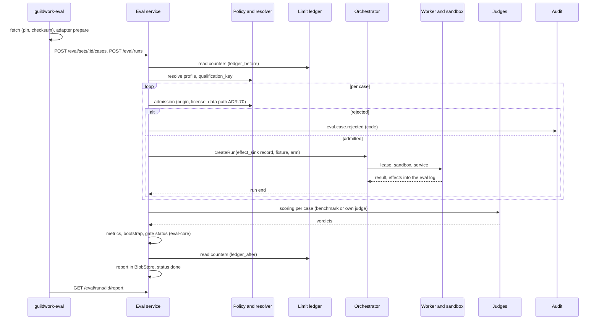
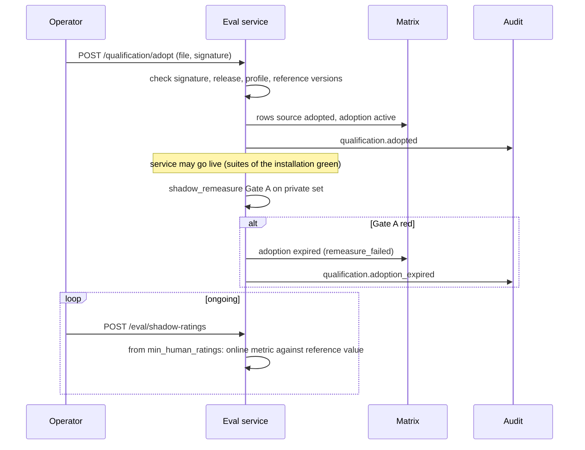
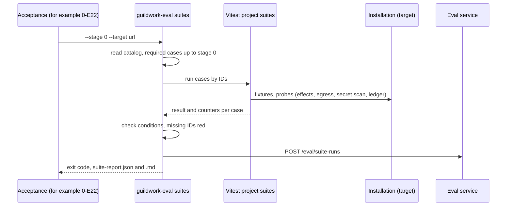

<!--
SPDX-License-Identifier: Apache-2.0
SPDX-FileCopyrightText: The Guildwork Authors
-->
# 07 Eval and qualification

Detailed design for the eval package, statistics, Gate A and Gate B, qualification matrix, reference qualification, the modes `shadow` and `live`, and the framework of the cross-cutting suites S1 to S8. Rulings of this document: FE-700 to FE-799. Source keys and classifications (VERIFIED, CLAIMED, DERIVED, unverified) as in the [architecture README](../architecture/README.md).

This document builds the **framework** that all later stages use. The concrete sets of later stages (P1 to P4, C1p, Q1 and so on) are planned by the areas of the respective services; section 2.15 describes, per set, format, source, license status and gate assignment as a reference for them. Also built in stage 0 are the download pins and scorers for R2, R4 and R5 as well as the label tool and the first labeling round for R1 ([08](../architecture/08-roadmap.md) section 4 stage 0 item 7).

## 1. Purpose and sources

| Topic | Source (binding) | What this document specifies |
|---|---|---|
| Eval run as a platform run with `effect_sink: record`, fixtures instead of SCM | [07](../architecture/07-eval.md) section 1 | Flow of a run, states, repetitions, budget, arms (platform, bare harness, reference) |
| Two-part eval, public and private sets | 07 section 1, ADR-52 | Set and case format, storage, download with pin and checksum |
| Data path of private sets | 07 section 1, ADR-70, [05](../architecture/05-security.md) section 6 condition 10 | Admission check per case before the start, audit, report |
| `origin` lock, license rule | 07 section 1, ADR-50 by analogy, ADR-52 | Rejection rules with error codes |
| Adapters ReviewBench and Harbor | 07 section 1 ([rb-contract], [harbor] VERIFIED) | Adapter interface, preparation, collection, verifier |
| Judges | 07 section 1, [10](../architecture/10-standards-per-layer.md) section 1.5 | Judge interface, multiple judges, calibration, judge outage |
| Statistics | 07 section 1.1, 10 section 1.4, ADR-56 | Algorithms with formulas, pseudocode and test values |
| Gate A and Gate B, status | 10 sections 1.2, 1.4, 1.5, 1.6, ADR-28, ADR-47, ADR-55, ADR-56 | Gate definitions as data, evaluation, status combination, expiry |
| Qualification profile and `qualification_key` | 07 section 2, ADR-66, [04](../architecture/04-configuration-and-limits.md) section 1 rules 5 and 7 | Canonicalization, hash, variant without `credential_kind` |
| Qualification matrix, `shadow` and `live` | 07 section 2, 10 section 1.2, ADR-47, [02](../architecture/02-services.md) section 0 | Matrix query, mode decision, marking "standard not proven" |
| Reference qualification | 07 section 2.1, ADR-52 | Export, signature, adoption, remeasurement in shadow, expiry |
| Cross-cutting suites S1 to S8 | 07 section 5, 08 principles 1 and 5 | Directory, case contribution of a service, catalog per stage, invocation by the acceptance, report format |
| Eval reports | 07 sections 1, 2.1, 10 section 1.5 (contamination) | Format, storage, publication |
| Cost of measurement | 10 section 1.7, O22 | Cost budget per run as a measurement, ledger before and after |

Project-wide specifications (stack, package names, tests) from the [detailed design README](README.md) section 2 apply. Section 3 is the binding source for the columns of the eval and qualification tables; [01-data-model.md](01-data-model.md) section 3.1a lists them with migration 0010 (FE-707, 01 FE-128).

## 2. Modules and responsibility

### 2.1 Directories and packages

```text
eval/
  core/                     @guildwork/eval-core       pure logic, no IO: types, schemas, statistics, gates, report
    src/types.ts            set, case, result, gate, profile (sections 2.2, 2.9)
    src/adapter.ts          adapter base contract, PrepareCtx, RecordedEffect, label and reference rows, ReferenceValue (section 2.16.1)
    src/scorer.ts           scorer contract (section 2.16.1, FE-737)
    src/schemas/            TypeBox schemas: set.schema, case.schema, labels.schema, gates.schema, report.schema, reference-qualification.schema
    src/stats/              rng.ts, metrics.ts, bootstrap.ts, quantile.ts, noninferiority.ts, power.ts, agreement.ts, rule-of-three.ts; index.ts (exports, section 2.16.2)
    src/gates/              evaluate.ts, combine.ts, judges.ts, saturation.ts, rules-hash.ts; index.ts (exports, section 2.16.2)
    src/judges/             spec.ts, select.ts, calibration.ts (section 2.16.3)
    src/report/             build.ts, render-md.ts, publish-filter.ts (section 2.16.4)
  runner/                   @guildwork/eval-runner     command guildwork-eval (section 2.6)
    src/cli.ts              fetch | validate-set | run | status | report | calibrate | label | suites | export-reference
    src/fetch/              fetcher.ts, cache.ts, verify.ts
    src/client/             HTTP client of the control plane eval API
    src/label/              label tool (FE-729)
    src/export-reference.ts reference qualification as a file (section 2.12)
  adapters/
    reviewbench/            @guildwork/eval-adapter-reviewbench (section 2.4)
    harbor/                 @guildwork/eval-adapter-harbor (section 2.5)
  scorers/                  scorers per public set: martian/, reviewbench/, swe-prbench/, aacr/ (section 2.15)
  judges/                   judges as versioned files: <judge-id>/<version>/judge.json (JudgeSpec), prompt.md, schema.json (section 2.16.3)
  bare-prompts/             simple prompts of the bare arm per service: reviewer.md, planner.md, coder.md ...
  gates/                    gate definitions as data: <service>.gates.json (section 2.9)
  references/               read-off reference values per service: <service>.json (FE-738)
  sets/                     public sets: <set-id>/set.json, labels/*.jsonl, refs/*.jsonl, README.md; test fixtures under _<name>/ (FE-739)
  suites/                   @guildwork/eval-suites     framework S1 to S8 (section 2.13)
    src/define.ts           defineSuiteCase, probe interfaces
    src/probes/             effects.ts, egress.ts, secret-scan.ts, ledger.ts, audit.ts
    src/run.ts, src/report.ts, src/lint.ts
    catalog/s1.yaml ... catalog/s8.yaml   required cases per suite with stage
    s1/ ... s8/, e2e/       cases of the installation layer and cross-area cases (FE-736)
apps/control-plane/src/eval/            eval service of the control plane (role orchestrator and web)
  api.ts                    routes /admin/api/v1/eval/*, /admin/api/v1/qualification/* via registerAdminRoutes (FE-745)
  admission.ts              admission per case: origin, license, data path (ADR-70)
  eval-run.ts               state machine of the eval run (section 4.2), start of the case runs (section 2.17.2), job eval-advance (FE-740)
  internal-services.ts      internal services eval-bare (FE-717) and eval-judge (FE-747), section 2.17.3
  service.ts                EvalRunService, JudgingService (section 2.16.5)
  judging.ts                judge and check items via the run of eval-judge (section 2.17.3)
  scoring.ts                scoring per section 2.17.4: scorer, statistics, gates, report (built in 0-E20-T23, FE-749)
  matrix.ts                 qualification matrix, mode decision (section 2.11)
  reference.ts              adoption, re-measurement, expiry (section 2.12)
plugins/eval-fixture/                   @guildwork/plugin-eval-fixture: SCM and ticket responses of the case runs (section 2.17.1, FE-748)
packages/config/src/qualification/      profile and qualification_key (section 2.10, FE-702)
  profile.ts, key.ts, inputs.ts         (JCS is canonicalJson from @guildwork/core, 00 section 2.5; input types FE-750)
packages/db/src/repos/eval/            repositories of the eval tables (section 3; location per 01 section 2.3: src/repos/<area>/)
tools/check-eval-data/                  check tool: no third-party data in the repo (FE-728)
```

Who calls whom:

| Caller | Called | Purpose |
|---|---|---|
| `guildwork-eval run` | Eval API (`POST /admin/api/v1/eval/runs`, FE-745) | Create the run; the runner prepares cases (download, `Scorer.loadCases`, adapter `prepare`) and uploads case inputs into the BlobStore via the API |
| Eval service `eval-run.ts` | Orchestrator (queue `orchestrator-intake` with `EvalRunStartV1`, section 2.17.2, FE-746) | one platform run per case, repetition and arm with `effect_sink: "record"` and a fixture instance |
| Eval service `admission.ts` | Policy (`evaluateWorkItem`, data path) and config resolver (0-E06), SCMProvider (fresh repo data), audit (0-E08) | Admission per case |
| Eval service `judging.ts` | Orchestrator (run of the internal service `eval-judge`), Work API (items `model_call` and `check`), worker steps `eval-benchmark-judge` and `harbor-verify` (section 2.17.3, FE-747) | Scoring |
| Case runs (worker, platform MCP) | Plugin `eval-fixture` (section 2.17.1) | SCM and ticket responses from the fixture instead of from the host |
| Eval service `scoring.ts` | `@guildwork/eval-core` | Metrics, bootstrap, gate status |
| Policy (0-E06) | `matrix.ts` `decideMode`, `isQualifiedForMergeGate` | Mode per service and scope at run start, merge gate condition 2 (stage 5) |
| Config resolver (0-E06) | `packages/config/src/qualification` | Profile and key per service in the snapshot (04 section 1 rule 5) |
| Acceptance of a stage (for example 0-E22) | `guildwork-eval suites --stage <s>` | Suites S1 to S8 with the catalog of the stage |
| Release pipeline (0-E21) | `guildwork-eval export-reference` | Reference qualification as a release file |
| Resolver (0-E06) | `ServiceProfileContribution` of the services via `deps.contributions` (section 2.10, FE-754) | `prompt_v` and effective values per service into the profile |
| Eval service in repo mode (7-E06-T01) | `Scorer.repoCases`, SCMProvider and WorkItemReader of the repo (profile `read`), table `repo_eval_gates` (12) | Cases from the repo, row `triage_t1` (section 2.17.7, FE-756) |

### 2.2 Set and case format

A **set** is a named collection of cases with a scorer, for example R2. A **suite** is a set of kind `cross_suite` (S1 to S8). Both are stored in the table `eval_suites` (name from [08](../architecture/08-roadmap.md) section 4).

```ts
// eval/core/src/types.ts
export type Origin =
  | "public_benchmark" | "own_public" | "human_labeled" | "private_installation" | "vendor_output";
export type LicenseClass = "permissive" | "copyleft" | "noncommercial" | "unknown";
export type LicenseStatus = "verified" | "unverified";           // verified corresponds to VERIFIED: license file read firsthand
export type AdapterKind = "reviewbench" | "harbor" | "custom";
export type ClusterUnit = "pr" | "task" | "issue" | "case";
export type ServiceId =
  | "planner" | "architect" | "coder" | "reviewer" | "qa" | "prfixer"
  | "indexer" | "standards" | "triage" | "docs";

export interface PinnedFile { path: string; sha256: string; bytes?: number }

export type SourceSpec =
  | { kind: "git"; url: string; commit: string; files: PinnedFile[] }        // commit: 40 hex characters
  | { kind: "hf_dataset"; repo: string; revision: string; files: PinnedFile[] } // revision: commit hash, never "main"
  | { kind: "oci"; images: { ref: string; digest: string }[] }                // by digest only
  | { kind: "refs_only" };                                                    // own references, the adapter loads contents per case

export interface SetManifest {
  schema: "guildwork.eval-set/v1";
  id: string;                           // "R2", "R4", "R5-swe-prbench", "C1p"; ^[A-Za-z0-9][A-Za-z0-9._-]{0,63}$
  version: string;                      // SemVer of the manifest including own labels
  title: string;
  service: ServiceId | "cross";
  kind: "dataset" | "cross_suite";
  adapter: AdapterKind;
  scorer: string;                       // directory under eval/scorers/, for example "martian"
  visibility: "public" | "private";
  origin: Origin;                       // default for cases; a case may only be narrower (FE-729)
  license: {
    data_spdx: string;                  // SPDX of the data or "NOASSERTION"
    class: LicenseClass;
    status: LicenseStatus;
    evidence: string;                   // source and read date, for example "[mcr-repo] LICENSE, read 2026-10-31"
    code_of_cases: "upstream" | "own";  // PR code under the licenses of the source repos?
  };
  source: SourceSpec;
  cluster_unit: ClusterUnit;
  metrics: string[];                    // metric IDs from section 2.8.1
  judges?: JudgeRef[];                  // judges of the set (section 2.7)
  regression_subset?: string[];         // case_ids of the regression subset
  repetitions?: number;                 // default 1; ReviewBench 3
  saturation_threshold?: number;        // default 0.9 (10 section 1.5)
  publication?: { title: string; date: string } ; // for the contamination section
  optional_download?: boolean;          // true for noncommercial: only with eval.allow_noncommercial
  repo_mode?: {                         // set can run in repo mode (section 2.17.7, FE-756), for example T1
    gate: "triage_t1";                  // row in repo_eval_gates (12 section 3.1); further gates only with a migration there
    part: string;                       // GatePart.id whose status determines the row, for example "A-T1"
    min_clusters: number;               // fewer clusters from the repo: status not_decidable
    max_cases: number;                  // upper limit of generated cases per run
  };
}

export interface SourceRef {
  repo: string;                         // "<host>/<owner>/<name>"
  commit: string;
  path?: string; lines?: [number, number]; pr?: number; issue?: number;
}

export interface EvalCase {
  set: string;
  case_id: string;                      // unique per set
  cluster_id: string;                   // unit of the cluster bootstrap (PR, task, issue)
  origin: Origin;
  license: string;                      // SPDX of the case (code of the source repo)
  source_ref: SourceRef;
  labeler: string;                      // "benchmark:<name>" | "human:<pseudonym>" | "judge:<id>@<version>"
  base_sha?: string; head_sha?: string;
  snapshot_digest?: string;             // environment as image digest (Harbor, Blueprint)
  input: CaseInput;
  expected: { ref: string } | unknown;  // ref: BlobStore key for large ground truths
  producer?: string[];                  // producers of the ground truth, for example ["ccr:gpt-5.5", "human"] (leave-producer-out)
}

export type CaseInput =
  | { kind: "pull_request"; repo_snapshot: string; base_sha: string; head_sha: string; diff_ref: string;
      title: string; body: string }                                  // ReviewBench adapter
  | { kind: "task"; instruction_ref: string; image: string; verifier_ref: string } // Harbor adapter
  | { kind: "issue"; repo_snapshot: string; at_sha: string; text_ref: string }
  | { kind: "custom"; payload_ref: string };
```

**Storage:**

| What | public set | private set |
|---|---|---|
| `set.json` | `eval/sets/<id>/set.json` in the product repo | BlobStore `eval/private-sets/<id>/set.json` or the operator's eval repo (`eval.private_sets`, section 7) |
| own labels | `eval/sets/<id>/labels/*.jsonl`, one row each `{case_id, label, labeler, labeled_at, note?}` | as on the left, in the private location |
| own references | `eval/sets/<id>/refs/*.jsonl`, one `SourceRef` per row with `case_id` and `cluster_id` | as on the left |
| third-party data | **never** in the repo; cache `eval.cache_dir/<set>/<commit-or-revision>/` (FE-728) | cache on the runner host or BlobStore |

A case only becomes complete at run time: the adapter creates `EvalCase` from the manifest, references, labels and the downloaded data (`prepare`, sections 2.4 and 2.5). The import into `eval_cases` stores only metadata and BlobStore references of the prepared inputs; contents of private cases never leave the installation (section 6).

### 2.3 Download and pins

Download scripts are **declarative**: `set.json` names the source with commit or revision and a checksum per file; a generic fetcher downloads and verifies (FE-703).

```ts
// eval/core/src/types.ts: FetchResult and FetchError are pure types in eval-core (FE-744) so that Scorer.references
// uses them without depending on the runner; the fetcher itself lives in eval/runner/src/fetch/fetcher.ts.
export interface FetchResult { set: string; dir: string; files: { path: string; sha256: string }[]; fetchedAt: string }
export interface Fetcher {
  fetch(m: SetManifest, opts: { cacheDir: string; offline: boolean; signal: AbortSignal }): Promise<Result<FetchResult, FetchError>>;
}
export type FetchError =
  | { code: "EVAL_PIN_MISSING"; detail: string }          // commit/revision missing or is a branch name
  | { code: "EVAL_CHECKSUM_MISMATCH"; path: string; expected: string; actual: string }
  | { code: "EVAL_SOURCE_UNREACHABLE"; url: string; status?: number }
  | { code: "EVAL_OFFLINE_CACHE_MISS"; path: string }
  | { code: "EVAL_HOST_NOT_ALLOWED"; host: string };
```

Rules:
1. Only `https`; hosts from the allowlist `eval.fetch.allowed_hosts` (default: hosts of the pinned sources); with `air_gap: true` only `--offline` with a prefilled cache.
2. `git`: download the archive of the commit (`/archive/<commit>.tar.gz`, host format unverified, task 0-E20-T10 verifies it), unpack, check SHA-256 per file from `files[]`. A commit must match `^[0-9a-f]{40}$`, otherwise `EVAL_PIN_MISSING`.
3. `hf_dataset`: download files via the revision, check SHA-256 per file (path via the public file URL of the hub; unverified, task 0-E20-T10).
4. `oci`: only check that every image is referenced by digest; the worker pulls it at run time.
5. A wrong checksum deletes the cache entry and aborts with `EVAL_CHECKSUM_MISMATCH`; never "continue with warning".
6. The pin is read once and entered when a set is first built (tasks 0-E20-T12 to T14); a change of the pin is a change of the reference (expiry per 10 section 1.6).

### 2.4 Adapter ReviewBench

The ReviewBench container contract ([rb-contract] VERIFIED according to [`ebene-review`](../research/ebene-review.md) section 4): repo at head under `/work/repo`, diff, output `findings.json` with `file`, `start_line`, `end_line`, `message`. Where the diff lies in the container, which environment variables are set and which fields are optional is **unverified** and is read at the pinned commit in task 0-E20-T27 and added here.

```ts
// eval/adapters/reviewbench/src/index.ts
export interface ReviewFinding { file: string; start_line: number; end_line: number; message: string;
  severity?: "P0" | "P1" | "P2" | "P3"; category?: string }
/** Input of prepare: one case from the set data, created by Scorer.loadCases (section 2.16.1) from cache, references and labels. */
export interface RawReviewCase {
  case_id: string; cluster_id: string; source_ref: SourceRef; origin: Origin; license: string; labeler: string;
  repo_dir: string;                       // unpacked repo at head in the cache (eval.cache_dir)
  base_sha: string; head_sha: string;     // 40 hex characters each
  diff?: string;                          // missing: prepare builds it with git diff base..head in repo_dir
  title: string; body: string;            // untrusted, passed on only as a blob
  expected: unknown;                      // ground truth of the set, goes into the BlobStore as expected_ref
  producer?: string[];
}
export interface ReviewBenchAdapter {
  /** Case from set data: repo snapshot at head, base, diff. The result becomes the PR fixture of the platform run. */
  prepare(raw: RawReviewCase, ctx: PrepareCtx): Promise<Result<EvalCase & { input: { kind: "pull_request" } }>>;
  /** Translate findings from the eval log of the run (recorded effects) into findings.json. */
  collect(recorded: RecordedEffect[], c: EvalCase): Result<ReviewFinding[]>;
  /** For the contract probe: run a third-party candidate in the container per the contract (test only). */
  runContainerContract?(image: string, c: EvalCase): Promise<Result<ReviewFinding[]>>;
}
```

Mapping in the platform run:
- `prepare` creates a PR as the SCM fixture `PrFixtureV1` (section 2.17.1: git bundle with base and head, base SHA, diff, title, body) and stores each file via `ctx.store`. If head SHA, base SHA or diff are missing and the diff cannot be built, `prepare` returns the error `EVAL_CASE_INCOMPLETE` instead of a case without a basis for findings (test `reviewbench.prepare_rejects_incomplete`). The reviewer runs as a normal platform run on this PR; SCM responses come from the plugin `eval-fixture`, effects (inline comments, summary, check) land in the eval log (`effect_sink: record`).
- `collect` only takes recorded inline findings (write request `propose_comment` with a position or finding record from `findings`); summaries do not count as findings. Lines outside the diff are kept (the scorer of the set decides).
- The same mapping serves R2, R4, R5 and own review sets; the difference lies only in the `scorer`.

### 2.5 Adapter Harbor

Harbor format ([harbor] VERIFIED according to [`ebene-coding`](../research/ebene-coding.md) section 3.3): task with a public image, instruction and verifier; scoring uses the verifier of the task in a fresh sandbox ("locked protocol", [scale-lb] VERIFIED). The file structure of a Harbor task (names of the files for instruction, environment, verifier and result) is **unverified** and is read at the pinned Harbor commit in task 0-E20-T27.

```ts
// eval/adapters/harbor/src/index.ts
export interface HarborTaskRef { dir: string; taskId: string }
export interface VerifyResult { resolved: boolean; reward?: number; logRef: string; exitCode: number;
  reason?: "verifier_tampered" | "patch_failed" | "verifier_failed" | "timeout" }
export interface HarborVerifyArgs {                      // envelope.check.args of the step harbor-verify (03 section 2.6)
  image: string;                                         // image of the task, by digest only
  patchRef: string; verifierRef: string;                 // BlobStore keys (patch from collect, verifier files from prepare)
  protectedPaths: string[];                              // verifier files of the task; a patch on them yields verifier_tampered
  network: "none" | { allow: string[] };                 // only what the task declares
  timeoutMs: number;                                     // eval.case_timeout_min in ms
}
export interface HarborAdapter {
  /** Instruction becomes TicketFixtureV1 (section 2.17.1), image digest becomes SandboxSpec.image of the service; tag without digest: EVAL_IMAGE_NOT_PINNED. */
  prepare(t: HarborTaskRef, ctx: PrepareCtx): Promise<Result<EvalCase & { input: { kind: "task" } }>>;
  /** Fetch the result bundle of the run (diff or push effect from the eval log). */
  collect(recorded: RecordedEffect[], c: EvalCase): Result<{ patchRef: string }>;
  /** Arguments of the check item for the case (judging.ts enqueues it, section 2.17.3). */
  verifyArgs(c: EvalCase, patchRef: string): HarborVerifyArgs;
}
/** Worker step harbor-verify (needsSandbox true), registered by the worker via registerStep (03 section 2.6, FE-747).
 *  Locked protocol: fresh sandbox from the same image, apply the patch, run the verifier of the task. */
export const HARBOR_VERIFY_STEP: WorkerStepDef<HarborVerifyArgs>;
export function verifyInSandbox(sb: SandboxHandle, a: HarborVerifyArgs, signal: AbortSignal): Promise<Result<VerifyResult>>;
```

Rules:
1. `verify` runs as its own work item `kind: "check"` with step `harbor-verify` (commands via `exec` with role `check`, 01 section 8) in a **new** sandbox; the sandbox of the candidate has already been destroyed by then. The verifier does not see the agent history. The result is in `StepResultV1` as `structured` (`VerifyResult`).
2. Network in the verification sandbox: only what the task declares, otherwise none.
3. A patch that changes verifier files of the task counts as not resolved (`resolved: false`, reason `verifier_tampered`).
4. In stage 0 the adapter is tested with own mini tasks in the Harbor format and the dummy service (0-E16); real coder tasks follow in stage 2.

### 2.6 Eval service and runner

**Arms of a comparison:**

| Arm | What runs | Where |
|---|---|---|
| `platform` | the service with the profile under test | platform run, `effect_sink: record` |
| `bare` | bare harness, same model, simple prompt from `eval/bare-prompts/<service>.md` | internal service `eval-bare` as a platform run in the same sandbox and the same worker (FE-717) |
| `reference` | reference: either a fixed published number or per-case results from the reference file (for example Martian per PR and tool) | no run; from `eval_references` |

**Eval API** (Fastify, registered via `registerAdminRoutes` under `/admin/api/v1` per [06](06-installation-operations-ui.md) FE-643; the paths in the table are relative to this prefix, so for example `POST /admin/api/v1/eval/runs` (FE-745). Session, role, CSRF, audit and problem details as there; without a valid session 401, with an insufficient role 403. How the runner obtains a session: section 2.17.5. Schemas TypeBox; error envelope per [00](00-codebase-and-conventions.md)):

| Method, path | Role | Request | Response | Error codes |
|---|---|---|---|---|
| `POST /eval/sets` | admin | `SetManifest` plus labels, references and the reference values of the set from `eval/references/<service>.json` (multipart, FE-738) | 201 `{ suite_id, version, manifest_sha256 }` | 400 `EVAL_SET_INVALID`, 409 `EVAL_SET_VERSION_EXISTS`, 422 `EVAL_ORIGIN_VENDOR_OUTPUT`, 422 `EVAL_LICENSE_UNKNOWN` |
| `GET /eval/sets`, `GET /eval/sets/:id` | viewer | | List or manifest without contents of private cases | 404 |
| `POST /eval/sets/:id/cases` | admin | prepared cases (metadata, BlobStore references) | 201 `{ imported, rejected: [{case_id, code}] }` | 400, 404 |
| `POST /eval/runs` | admin | `EvalRunRequest` | 202 `{ eval_run_id }` | 400 `EVAL_RUN_INVALID`, 404 `EVAL_SET_NOT_FOUND`, 404 `EVAL_REPO_NOT_FOUND`, 409 `EVAL_POOL_DISABLED`, 422 `EVAL_PROFILE_UNRESOLVABLE`, 422 `EVAL_REPO_MODE_UNSUPPORTED` |
| `POST /eval/configs` | admin | profile file in the format of the repo file (YAML, at most 64 KiB, section 2.17.2) | 201 `{ config_ref }` | 400 `EVAL_CONFIG_INVALID` with key and line |
| `GET /eval/runs/:id` | viewer | | `EvalRunView` (state, counters, cost) | 404 |
| `GET /eval/runs/:id/cases` | viewer | `?status=` | case results (metadata) | 404 |
| `POST /eval/runs/:id/cancel` | admin | | 202 | 409 `EVAL_RUN_TERMINAL` |
| `GET /eval/runs/:id/report` | viewer | `?format=json|md` | `EvalReport` | 404, 409 `EVAL_REPORT_NOT_READY` |
| `POST /eval/suite-runs` | admin | `SuiteReport` (section 2.13) | 201 `{ eval_run_id }` | 400 `SUITE_REPORT_INVALID` |
| `GET /qualification` | viewer | `?service=&release=` | matrix rows with computed status | |
| `GET /qualification/:key` | viewer | | row with parts, runs, validity | 404 |
| `POST /qualification/:key/evaluate` | admin | `{ eval_run_ids[] }` | 200 row with status | 409 `QUAL_RUN_INCOMPLETE`, 422 `QUAL_PROFILE_MISMATCH` |
| `POST /qualification/adopt` | admin | reference file plus signature bundle | 201 `{ adoption_id, adopted_keys[] }` | 422 `QUAL_SIGNATURE_INVALID`, `QUAL_RELEASE_MISMATCH`, `QUAL_PROFILE_MISMATCH`, `QUAL_REFERENCE_EXPIRED` |
| `POST /eval/shadow-ratings` | approver | `{ effect_id, verdict: "useful" \| "not_useful" \| "wrong", note? }` | 201 | 404 `EFFECT_NOT_FOUND`, 409 `RATING_EXISTS` |

```ts
// eval/core/src/types.ts
export interface EvalRunRequest {
  kind: "gate" | "regression" | "shadow_remeasure" | "smoke" | "calibration";
  sets: { id: string; version: string; subset?: "full" | "regression" | string[] }[];
  service: ServiceId | "dummy";
  arms: ("platform" | "bare")[];               // reference comes from eval_references; empty for calibration
  profile?: { config_ref: string };            // BlobStore key eval/configs/<sha256>.yaml (section 2.17.2, FE-746); required except in repo mode
  repetitions?: number;                        // default from set.json, otherwise 1
  max_cost_usd?: number;                       // measurement budget of this run, no cap per O22 unless set here
  judges?: string[];                           // own sets: judge IDs; benchmarks: from set.json
  seed?: string;                               // missing: random, gets stored
  allow_noncommercial?: boolean;               // only effective with eval.allow_noncommercial
  calibration?: { source_eval_run_id: string; sample?: number };   // only kind calibration (FE-751); sample default 50
  repo_mode?: { repo: string;                  // repo_key of a repo of the installation, "<host>/<owner>/<name>"
                gate: "triage_t1";             // must be SetManifest.repo_mode.gate of the set
                max_cases?: number };          // at most SetManifest.repo_mode.max_cases (section 2.17.7, FE-756)
}

export type EvalRunStatus = "queued" | "admitting" | "running" | "judging" | "scoring"
                          | "done" | "partial" | "rejected" | "cancelled" | "aborted_limit" | "failed";
export type CaseStatus = "pending" | "running" | "produced" | "scored" | "rejected" | "error" | "skipped_budget" | "cancelled";
export interface EvalRunView {                 // response of GET /eval/runs/:id
  eval_run_id: string; kind: EvalRunRequest["kind"] | "suite"; status: EvalRunStatus; status_reason?: string;
  service: string; qualification_key: string | null;
  counts: Record<CaseStatus, number>;          // per case, arm and repetition
  cost_usd: number; max_cost_usd: number | null;
  started_at: string | null; ended_at: string | null;
  report_ready: boolean;
}
```

Rules for the request: before creating the run, `POST /eval/runs` checks that every set version is imported (`EVAL_SET_NOT_FOUND`), that `eval.pool` is set and the pool is not `enabled: false` (`EVAL_POOL_DISABLED`), that `config_ref` is readable and can be resolved to a profile with the resolver (`EVAL_PROFILE_UNRESOLVABLE` with key), and that `kind = "calibration"` names exactly one set, at least one judge and the `calibration.source_eval_run_id` of a run in state `done` (`EVAL_RUN_INVALID`). Without `repo_mode`, `profile.config_ref` is required (`EVAL_RUN_INVALID`). With `repo_mode` the following also applies: `kind = "gate"`, exactly one set whose manifest carries `repo_mode` with the same `gate`, and `service` equal to `SetManifest.service` (otherwise `EVAL_REPO_MODE_UNSUPPORTED`); the repo is readable through an SCMProvider instance of the installation (otherwise `EVAL_REPO_NOT_FOUND`); `profile` is absent (if set: `EVAL_RUN_INVALID`), because the key must be the one of operation on this repo (section 2.17.7). The run gets the seed from the request or 32 random hex characters.

**Runner `guildwork-eval`** (command from `@guildwork/eval-runner`, FE-700):

| Command | Effect |
|---|---|
| `fetch <set>` | Download and verify the source (section 2.3) |
| `validate-set <dir>` | Schema, license rule, `origin` rule, pins, labels against references; exit 1 on error |
| `run --sets R2,R4 --service reviewer --arms platform,bare --profile <file>` | Upload the profile file (`config_ref`, section 2.17.2), prepare cases, create the run, show progress every 10 s; exit 0 only in state `done` |
| `status <eval_run_id>`, `report <eval_run_id> --format md` | Query |
| `calibrate --set <id> --judge <id> --source-run <eval_run_id> [--sample 50]` | Judges against human labels (section 2.7, FE-751) |
| `label --set <id> [--batch <n>]` | Label tool (FE-729, section 2.17.6) |
| `run --sets T1 --service triage --arms platform,bare --repo-mode <repo_key> --gate triage_t1 [--max-cases <n>]` | Repo mode (section 2.17.7): no download, no preparation in the runner, no `--profile`; create the run and show progress like `run` |
| `suites --stage <s> --target <local\|url>` | Cross-cutting suites (section 2.13) |
| `export-reference --release <v>` | Reference qualification as a file (section 2.12) |

Exit codes of all commands: 0 success, 1 domain error (invalid set, checksum, run not `done`, suite red), 2 usage error (unknown option, missing or expired session, target unreachable). Errors appear as one line `code: <CODE> <detail without contents>` on stderr; `--json` outputs the same information as JSON on stdout.

### 2.7 Judges

```ts
// eval/core/src/types.ts
export interface JudgeRef { id: string; version: string }   // directory eval/judges/<id>/<version>/
export interface JudgeSpec {
  id: string; version: string;
  kind: "benchmark" | "own";                                 // benchmark: judge of the benchmark, unchanged
  model: { provider: string; model: string };                // pinned, never "latest"
  prompt_file: string; schema_file: string;                  // only for own
  temperature: 0;
  family: string;                                            // "anthropic", "openai" ... for contamination; in the project only "anthropic" (O28)
}
export interface JudgeVerdict { case_id: string; judge: string; repetition: number;
  matches: { finding_index: number; golden_id?: string; verdict: "tp" | "fp" }[]; fn_golden_ids: string[];
  raw_ref: string }
```

Rules:
1. **Benchmark judges** (R2 Martian, R4 ReviewBench) run unchanged from the pinned benchmark repo as a work item `kind: "check"` with step `eval-benchmark-judge` in the sandbox (image with the code of the commit, network only to the LLM endpoint via the credential relay), so that values are comparable (07 section 1; flow section 2.17.3, FE-747). If the runtime of the run is `subscription`, the model call of the benchmark code goes through the model bridge per FE-759 (ADR-73); judges of a benchmark whose provider the installation cannot reach (in the project: all except Claude, O28) are not listed in `EvalRunRequest.judges` and appear in the report as "not scored" with a reason; the part then counts as measured under the remaining judges (FE-760).
2. **Own judges** use the ModelProvider path of the platform: work item `kind: "model_call"` with `GenerateRequest` including `outputSchema` (03 section 2.3, 05 FE-531); the model comes from `models` with `use: [eval_judge]` (04 section 3a, `judge-alt`). The eval service uses `selectOwnJudge` to choose a judge with a different `family` than the candidate model if configured, otherwise a different model of the same family with the note "judge same family" in the report. In the project, `judge-alt` is always a different Claude model than the candidate (O28); `selectOwnJudge` rejects a judge with the same model as the candidate (test `judge.same_model_rejected`). A response outside the schema (`StepStatus` `schema_invalid`) counts as a judge error of the case and is retried like a platform error (test `judge.own.schema_enforced`).
3. **Multiple judges:** every judge scores every case; metrics and gate status are computed per judge; the overall status of a part is the least favorable one (FE-713).
4. **Calibration:** `calibrate` creates a run `kind = "calibration"` (FE-751, flow section 2.17.6) and scores a sample with human labels; reported are agreement and Cohen's kappa with a 95 % interval (cluster bootstrap, section 2.8.4) per set and judge. Result in `eval_runs` (`kind = "calibration"`). If the last calibration of an own judge is older than `eval.judge.calibration_max_age_days` (default 92, "per quarter" from 07 section 1), every report with this judge carries a warning and the control plane raises the alert `eval_judge_calibration_stale` (FE-726).
5. **Judge change** (new model, new prompt) is a new `version`; it does not change `rules_hash`, but every stored status with the old judge expires (10 section 1.6) and the regression run runs again.
6. **Judge outage** (model shut down or unreachable after retries): parts with this judge become **not decidable** (reference value cannot be read off, 10 section 1.4). Replacement only through a documented re-scoring: all reference tools from the raw outputs of the benchmark and the own arm with the same successor judge, stored as a new reference version; whether the raw outputs for this are in the Martian repo is unverified (task 0-E20-T27; backlog M120, M131; FE-715).

### 2.8 Statistics core

All functions live in `eval/core/src/stats/`, are pure (no IO) and deterministic for a given seed. Numbers internally as a fraction (0 to 1); percentage points only in the presentation. Constants: `Z975 = 1.959963984540054`, `Z80 = 0.8416212335729143`.

#### 2.8.1 Metrics

| ID | Formula | Input per cluster |
|---|---|---|
| `proportion` | sum of successes / sum of cases | `{ k, n }` |
| `precision_micro` | Σtp / (Σtp + Σfp); 0 if the denominator is 0 | `{ tp, fp, fn }` |
| `recall_micro` | Σtp / (Σtp + Σfn); 0 if the denominator is 0 | `{ tp, fp, fn }` |
| `fbeta_micro` | (1 + β²) · P · R / (β² · P + R); 0 if P + R = 0 | `{ tp, fp, fn }`, parameter β (R2: 2) |
| `acc_at_k` | share of cases with at least one correct file among the first k | `{ hit: 0|1 }` |
| `resolve_rate` | `proportion` over `resolved` | `{ k, n }` |
| `rate_lower_better` | like `proportion`, direction "less is better" | `{ k, n }` |
| `deterministic_all` | 1 if all cases satisfy the rule, otherwise 0 | `{ ok: boolean }` |
| `deterministic_zero` | number of violations | `{ violations: number }` |

Micro-average means: numerator and denominator are summed over all clusters, then divided (like Martian, 07 section 3.1). **Repetitions** (ReviewBench: three) are first averaged per case: for proportions the mean of `k/n`, for tp/fp/fn the mean of the counts (fractional numbers are allowed), after which the case enters the computation with one value (10 section 1.4).

#### 2.8.2 Random numbers

`sfc32` with 128-bit state, seeded from `splitmix32` over the SHA-256 of the seed string (the first four 32-bit words; FE-709). The seed is in every report. Uniformly distributed integer in `[0, m)` by rejection sampling (no modulo bias).

#### 2.8.3 Cluster bootstrap

Percentile bootstrap over clusters, B = `eval.bootstrap.resamples` (default 10,000), quantile type 7 (linear interpolation; FE-710).

```text
function clusterBootstrap(clusters, statistic, B, rng):
  # clusters: list of clusters; each cluster carries the values of both arms (paired) or of one arm
  m := len(clusters)
  stats := []
  repeat B times:
    sample := [clusters[rng.int(m)] for _ in 1..m]      # draw with replacement, whole clusters
    stats.append(statistic(sample))
  return { point: statistic(clusters), lo: quantile7(stats, 0.025), hi: quantile7(stats, 0.975) }

# paired (Gate A, reference with per-case values): both arms in the same cluster, one draw
statisticPaired(sample) := metric(own over sample) - metric(ref over sample)      # D
# reference only as a published number r: fixed
statisticFixedRef(sample) := metric(own over sample) - r                          # limitation in the report
# direction "less is better": D := ref - own
```

Properties that tests check: a cluster with several findings is always drawn whole; with m = 1 the interval is the point value; all values equal yields width 0; the same `seed` yields bit-identical results.

#### 2.8.4 Agreement between judge and human

Percent agreement `po = (a + d) / n`; Cohen's kappa `κ = (po - pe) / (1 - pe)` with `pe = ((a + b)(a + c) + (c + d)(b + d)) / n²` for the 2x2 table (a: both yes, b: judge yes and human no, c: judge no and human yes, d: both no). Interval by cluster bootstrap over the clusters of the set. If `pe = 1`, κ is undefined and is reported as `null` with a reason.

#### 2.8.5 Non-inferiority and status of a part (10 section 1.4)

```text
type PartStatus = "green" | "red" | "undecidable"

function decidePart(part, data):
  # 1. not decidable up front
  if part.reference.unreadable:                         return UNDECIDABLE("reference_unreadable")
  if part.saturated and not part.saturation_exempt:     return UNDECIDABLE("set_saturated")
  if part.threshold_is_estimate and not part.first_run_done:  return UNDECIDABLE("estimated_threshold")
  if part.kind == "deterministic":                      return data.ok ? GREEN : RED          # no margin
  # 2. interval of D
  ci := clusterBootstrap(...)                           # D = own - reference (direction respected)
  hw := (ci.hi - ci.lo) / 2
  power_ok := hw <= 0.7 * part.margin
  # 3. decision in fixed order (FE-711)
  if ci.lo > -part.margin:                              return GREEN                          # passes, even without minimum power
  if ci.hi < -part.margin:                              return RED
  if power_ok:                                          return RED                            # minimum power reached, not passed
  return UNDECIDABLE("power_not_reached")
```

**Margin per part** from the gate definition (section 2.9); if it is missing, 0.05 applies for Gate B and 0.10 for Gate A (10 section 1.4). **Threshold parts** ("at least 55 %", "at most", "not below" against a fixed number) are computed as `kind: "threshold"` with a fixed reference `r`, D = value minus r, margin from the definition, default 0 (FE-712).

**Saturation** (10 section 1.5): `saturated := max(Bezugswert, Wert des Vergleichsarms) > saturation_threshold` (default 0.9). `saturation_exempt: true` only for explicitly named non-degradations (coder B1).

**Leave-producer-out cap** (R4, 10 section 3 B3): if B3 turns green under the rules above, the point value without the producers (`ccr:`; for a candidate of the Claude family also `llm_review:claude`, `ccr:claude`) is additionally computed; if `voll - ohne_erzeuger > margin`, the status is set to at most `undecidable` (reason `producer_overlap`; FE-714).

#### 2.8.6 Sample size before the run (07 section 1.1)

```text
requiredN(margin, design, p = 0.5, discordant = 0.25):
  k := (Z975 + Z80) / margin                    # corresponds to hw <= 0.7 * margin at 80 % power
  var := design == "independent" ? 2 * p * (1 - p) : discordant
  return ceil(k^2 * var)                         # cases per arm (independent) or pairs (paired)
halfWidthPaired(n, discordant) := Z975 * sqrt(discordant / n)
halfWidthIndependent(n, p) := Z975 * sqrt(2 * p * (1 - p) / n)
```

The share of discordant pairs is the estimate 0.25 until the first run and is afterwards taken per set from the measured run (07 section 7; backlog M54).

#### 2.8.7 Upper bound at zero failures (S7, 07 section 5)

One-sided exact upper bound (Clopper-Pearson) at 0 failures out of n: `u(n) = 1 - 0.05^(1/n)`; the report additionally states the approximation `3/n` (rule of three; FE-734).

#### 2.8.8 Test values (known values)

| Test | Input | Expectation | Tolerance |
|---|---|---|---|
| `stats.fbeta.f2_known` | tp 30, fp 10, fn 70, β 2 | P 0.75, R 0.30, F2 0.340909 | 1e-6 |
| `stats.fbeta.equal_pr` | tp 50, fp 50, fn 50, β 2 | 0.5 | 1e-12 |
| `stats.fbeta.zero` | tp 0, fp 5, fn 5 | 0 | exact |
| `stats.kappa.textbook` | a 20, b 5, c 10, d 15 | po 0.70, pe 0.50, κ 0.40 | 1e-12 |
| `stats.n.independent_10` | margin 0.10, p 0.5, only Z975 (resolution "10 points", 07 section 1.1) | 192.07 | 0.01 |
| `stats.n.power_independent_10` | `requiredN(0.10, "independent")` | 393 (k² · 0.5 = 392.4) | exact |
| `stats.n.power_paired_10` | `requiredN(0.10, "paired")` | 197 (196.2) | exact |
| `stats.n.power_paired_5` | `requiredN(0.05, "paired")` | 785 (784.9) | exact |
| `stats.n.power_independent_5` | `requiredN(0.05, "independent")` | 1,570 (1,569.8) | exact |
| `stats.hw.paired_100` | `halfWidthPaired(100, 0.25)` | 0.0980 | 1e-4 |
| `stats.rule_of_three` | n 30, 100, 300 | 0.0950, 0.0295, 0.00994 | 1e-4 |
| `stats.bootstrap.proportion_400` | 400 clusters, 200 successes, B 10,000, seed "t1" | interval 0.451 to 0.549 | 0.006 |
| `stats.bootstrap.paired_green_without_power` | 100 pairs: 15 own better, 10 reference better, margin 0.10 | D 0.05, interval about -0.047 to 0.147, status green, `power_ok` false | 0.01 |
| `stats.bootstrap.paired_red_clear` | 400 pairs: 16 own better, 84 reference better, margin 0.10 | D -0.17, interval about -0.216 to -0.124, red | 0.01 |
| `stats.bootstrap.paired_red_power` | 400 pairs: 40 own better, 76 reference better | D -0.09, interval about -0.142 to -0.038, hw 0.052, red via minimum power | 0.01 |
| `stats.bootstrap.paired_ne` | 50 pairs: 10 own better, 12 reference better | D -0.04, interval about -0.224 to 0.144, not decidable | 0.015 |
| `stats.bootstrap.cluster_whole` | 2 clusters with 1 and 99 findings respectively | sum of findings per draw lies in {2, 100, 198} (clusters only drawn whole) | exact |
| `stats.bootstrap.deterministic_seed` | same input, same seed, twice | bit-identical | exact |

The expectations of the bootstrap cases are normal approximations (DERIVED: variance per pair `E[d²] - D²`); the tolerance covers the bootstrap spread at B = 10,000.

### 2.9 Gate definitions and gate evaluation

The thresholds have their home in [10](../architecture/10-standards-per-layer.md). The code reads them from `eval/gates/<service>.gates.json`; every part carries the source anchor in 10, and a consistency test checks that margin and threshold appear in the cited section of 10 (FE-716). The exception are parts of kind `stage` (stage criteria, FE-755): their thresholds are not in 10 but in the done criterion of the stage in [08](../architecture/08-roadmap.md) and in the test table of the detailed design that specifies the set (for R6: [09](09-reviewer-companion-features-and-learnings.md) section 8.3); their `source_anchor` points there, and the consistency test checks against exactly that location.

```ts
// eval/core/src/gates/types.ts
export interface GateFile {
  schema: "guildwork.gates/v1";
  service: ServiceId;
  standards_ref: string;                  // "10-standards-per-layer.md#3-review-reviewer"
  parts: GatePart[];
}
export interface GatePart {
  gate: "A" | "B" | "stage";              // stage: stage criterion such as R6a to R6d (FE-755), does not count toward qualification
  id: string;                             // "A-R5", "B1", "B2", "B3", "R6a"
  role: "required" | "report";            // Gate A only knows required
  scope?: string;                         // part or scope per 10 section 1.2 item 3, for example "e2e", "dependency_update", "ci_doctor"
  sets: string[];                         // set IDs
  metric: string;                         // metric ID from 2.8.1, with a parameter for example "fbeta_micro:2"
  direction: "higher_better" | "lower_better";
  kind: "noninferiority" | "threshold" | "deterministic";
  comparator?: "bare" | "reference";      // noninferiority
  reference?: { set: string; part: string; selector: string };   // row in eval_references, for example "tool=<name>"
  threshold?: number;                     // threshold
  threshold_is_estimate?: boolean;        // "starting value, estimate"
  margin?: number;                        // missing: 0.05 (B) or 0.10 (A); threshold: 0
  judges?: "all_of_set" | string[];       // multiple judges: status per judge, the least favorable counts
  saturation_exempt?: boolean;
  leave_producer_out?: { producers: string[]; family_extra?: Record<string, string[]> };
  paired: boolean;
  source_anchor: string;                  // row in 10, for example "10#3 table Gate A and Gate B, row B1";
                                          // for stage the location in 08 or in the detailed design, for example "design/09#83 table, row R6"
}
```

Status values are English in the code and German in reports and the admin UI as in 10: `green` `grün`, `red` `rot`, `undecidable` `nicht entscheidbar`, `open` `offen`; the label `standard_not_proven` appears as `Standard nicht nachgewiesen`.

**Status combination** (FE-733), per qualification row and scope:

| Level | Rule |
|---|---|
| Part with multiple judges | least favorable status across the judges: red before not decidable before green |
| Gate A | all parts green: green; one part red: red; otherwise not decidable. Gate A without a part is an error of the gate file |
| Gate B | a required part red: **red**; otherwise a required part not decidable: **not decidable**; no required part present (only report parts): **open**; otherwise **green**. Report parts never change the status |
| Suites | S1 to S6 of the installation at the same release: all required cases green |
| Stage criterion (`stage`) | like Gate A (all green: green; one part red: red; otherwise not decidable); without a part `null`. Appears only in the eval report and in the stage report, does not go into `qualification_parts` and never into "qualified" (FE-755) |
| Row qualified | Gate A green and Gate B green and suites green and row valid (section 2.11). Never stored, always computed (FE-708) |

**Scope** (FE-757, 10 section 1.2 item 3): a part without `scope` applies to the row without scope and to every scope of the service; a part with `scope` only to that scope. Gate A and Gate B of a scope are combined over the parts without scope plus the parts of this scope. Example `prfixer` from stage 10: parts `scope: "dependency_update"` (F4) and `scope: "ci_doctor"` (CD1, Gate B without a required part, therefore open, 10 section 15); the set assignment is in section 2.15. The matrix row of a scope carries `scope` = this value (section 3, `qualification.scope`).

`rules_hash` = SHA-256 over the canonical form (section 2.10) of the gate file of the service without the parts of kind `stage` (they decide no qualification, FE-755); it is attached to every part result. If the gate file changes, the statuses of this service expire (10 section 1.6).

Validation when loading a gate file (errors reject the file, test `gates.validate.*`): required part on a set with `license.status = "unverified"`, `class = "noncommercial"` or `class = "unknown"` (10 section 1.5); required part on a set with `origin = "private_installation"` in Gate B; part without `source_anchor`; `threshold` without a value; part `stage` with `role: "report"` or `comparator` (stage criteria are fixed thresholds or deterministic, `GATES_STAGE_INVALID`).

**Gate file of the reviewer** (`eval/gates/reviewer.gates.json`): Gate A (R1, R5, R3) and B1 to B5 are created in 0-E20-T04; the parts `R6a` to `R6d` (kind `stage`, set R6, source anchor on [09](09-reviewer-companion-features-and-learnings.md) section 8.3) are added by 6-E07-T06 (`R6a` files in the diff, `deterministic_all`; `R6b` diagrams parsable without invented participants, `deterministic_all`; `R6c` pre-merge verdicts without a wrong verdict, `deterministic_zero`; `R6d` P0/P1 fingerprints equal, `threshold` 0.9 with `threshold_is_estimate: true`). Parts `stage` do not change `rules_hash`; the regression run of Gate A and Gate B in 6-E07-T06 is required by the new quality-relevant keys of stage 6 (ADR-66), not by the R6 parts.

### 2.10 Qualification profile and `qualification_key`

```ts
// packages/config/src/qualification/profile.ts
export interface QualificationProfile {
  schema: "guildwork.qualification-profile/v1";
  service: ServiceId;
  harness: { id: string; version: string; checksum: string };       // checksum from the pin specification (ADR-39)
  credential_kind: string;                                            // api_key | wif | bedrock | subscription | ...
  provider: string;                                                   // provider path of the runtime, for example "anthropic-api", "bedrock"
  runtime_model: string;
  models: Record<string, { provider: string; model: string }>;        // every role from models.*, gate_model, notes_model, resolved
  prompt_v: Record<string, string>;                                   // per stage of the service
  plugins: Record<string, string>;                                    // AgentRuntime, ModelProvider, Analyzer: plugin ID to version (FE-705)
  config: Record<string, unknown>;                                    // JSON pointer to value of all keys with x-qualification: true, default values written out
  library_calls: Record<string, { models: Record<string, { provider: string; model: string }>;
                                  prompt_v: Record<string, string> }>; // library calls inherit the profile of the caller
  derived: Record<string, string>;                                    // effective values of the service, for example verifierModeEffective (FE-741)
}

// packages/config/src/qualification/inputs.ts (FE-750, FE-754): inputs of buildProfile. The resolver (0-E06-T07) fills them from
// ResolveResult (02 section 2.2), the schema marking and the service manifest; qualification/ imports neither resolver nor schema.
export interface QualificationMarkedKey {
  pointer: string;                      // JSON pointer from the root of the effective configuration, for example "/services/reviewer/max_comments"
  default: unknown;                     // default value from the schema; written out if the key is missing
}
export interface EffectiveServiceConfig {
  service: ServiceId;
  effective: Readonly<Record<string, unknown>>;     // ResolveResult.effective, read only
  marked: readonly QualificationMarkedKey[];        // all keys with x-qualification: true
  runtime: { id: string; harness: string; version: string;            // version from "pinned:<x.y.z>" without prefix
             credential_kind: string; provider: string; model: string };   // provider and model resolved by the resolver (04 section 5)
  model_refs: Record<string, string>;              // role (services.<id>.models.*, gate_model, notes_model) to model ID from models[]
  plugins: Record<string, string>;                 // FE-705: AgentRuntime, ModelProvider, Analyzer of the service, plugin ID to version
  prompt_stages: string[];                         // prompt stages according to the service manifest; empty: no contribution needed
  repo: RepoFacts | null;                          // FE-754; null only without a target repo (for example router call with only, then no profile)
}
export interface RepoFacts {                       // facts of the target repo that determine effective values of a service (FE-754)
  repo_class: "private_own" | "external_code";     // ResolveRequest.repoClass (intake or eval service, fresh per run, architecture 05 section 3)
  environment_commands: string[] | null;           // post_build and test from .agents/environment.yaml at the base SHA;
                                                   // null: file missing or blueprint parser not built yet (before stage 2)
}
export interface ResolvedInstallation {
  platform_release: string;                        // release of the running control plane
  models: Record<string, { provider: string; model: string; region: string; use?: string[] }>;   // models[] by id
  harness_pins: Record<string, { version: string; sha256: string }>;   // harness_pins.<harness> (05 FE-521)
  allow_unproven_live: { service: string; scope?: string; reason: string }[];
  pools: { id: string; isolation: ("sysbox" | "gvisor" | "microvm")[]; enabled: boolean }[];   // pools[] from installation.yaml (00 section 2.8)
  isolation_min: Record<"private_own" | "external_code", { runs_repo_code: ("sysbox" | "gvisor" | "microvm")[];
                                                            no_repo_code: ("sysbox" | "gvisor" | "microvm")[] }>;   // isolation_min (00)
}
// Rules: harness.checksum = harness_pins[runtime.harness].sha256 if version is equal, otherwise QUAL_HARNESS_PIN_MISSING;
// models = model_refs resolved via ResolvedInstallation.models to { provider, model }, unknown ID: QUAL_MODEL_REF_UNRESOLVED;
// config = per marked key the value from effective or default; if default and value are missing, null is stored.

// packages/config/src/qualification/contribution.ts (FE-741)
export interface ServiceProfileContribution {
  service: ServiceId;
  /** prompt_v per stage from the prompt loader and effective values that are not in the configuration. Pure, without IO. */
  contribute(effective: EffectiveServiceConfig, install: ResolvedInstallation):
    Result<{ prompt_v: Record<string, string>; derived: Record<string, string>; library_calls?: QualificationProfile["library_calls"] }>;
}

export function buildProfile(effective: EffectiveServiceConfig, install: ResolvedInstallation,
                             contribution?: ServiceProfileContribution): Result<QualificationProfile>;
export function qualificationKey(p: QualificationProfile): string;         // "qk1-" + sha256hex(JCS(p))
export function qualificationKeyNoCred(p: QualificationProfile): string;  // "qx1-" + sha256hex(JCS(p without credential_kind))
```

Canonical means (07 section 2): keys sorted per JCS (RFC 8785; FE-704, implemented as `canonicalJson` in `@guildwork/core`, built in 0-E01-T02), references to ModelProvider resolved to `{provider, model}`, default values of all marked keys written out, no `undefined`, numbers per the JCS rule. The list of marked keys comes from the JSON Schema (`x-qualification: true`, 04 section 7); the schema test "every key under `services.*` is marked" belongs to the config schema (0-E06). `buildProfile` rejects with `QUAL_MODEL_REF_UNRESOLVED` if a model reference points to no entry (same rule as ADR-58).

**Contribution of the services (FE-741, FE-754):** every service exports a `ServiceProfileContribution` (for the reviewer `services/reviewer/src/controller/profile.ts`, 1-E01-T06); the resolver passes it to `buildProfile`. Without a contribution, `prompt_v` and `derived` are empty, and `buildProfile` rejects a service whose manifest names prompt stages (`QUAL_CONTRIBUTION_MISSING`). The contribution only supplies values; canonicalization and hash stay here.

Path and form of the call (FE-754):

```ts
// packages/config/src/qualification/contribution.ts
export type ProfileContributions = ReadonlyMap<ServiceId, ServiceProfileContribution>;
export function profileContributions(list: readonly ServiceProfileContribution[]): Result<ProfileContributions>;
// error QUAL_CONTRIBUTION_DUPLICATE if two contributions name the same service
```

1. **Registration:** at startup `apps/control-plane` collects the contributions from the service packages (the same list as the service definitions for `registerControllers`, 02) and passes them to `createResolver` as `deps.contributions: ProfileContributions` (expectation toward 02, reported). `@guildwork/config` imports no service; the app passes the contributions through.
2. **Call:** per service of the run the resolver calls `buildProfile(effective, install, contributions.get(service))` and stores profile and key in the snapshot (02 section 4.6). `contribute` runs pure and synchronous, without IO, and sees only `EffectiveServiceConfig` and `ResolvedInstallation`.
3. **Repo facts:** the resolver fills `EffectiveServiceConfig.repo` from a new field `ResolveRequest.repoClass` (set by the intake from the same fresh determination that fills `RunStartInput.run.repoClass`, or by the eval service per section 2.17.2) and reads `environment_commands` via `ConfigSources.getFile` at the base SHA as soon as the blueprint parser (`@guildwork/blueprint`, stage 2) exists; before that `null` (expectation toward 02, reported). `repo` itself does **not** go into the profile, only through what the contribution makes of it in `derived` or `prompt_v`.
4. **Verifier mode of the reviewer** (08 FE-835): `reviewerProfileContribution` calls `decideVerifierMode` with `repo.repo_class`, the commands from `services.reviewer.verifier.commands` or `repo.environment_commands`, and `poolHasIsolation` = a pool from `install.pools` with `enabled` and an isolation from `install.isolation_min[repo_class].runs_repo_code`; the result is stored as `derived["verifier.mode_effective"]`. That a pool reports less verified isolation at runtime than configured is only seen by the controller at claim time (08); if its mode differs from the profile, 08 applies (reported to 08).

### 2.11 Qualification matrix and mode decision

```ts
// apps/control-plane/src/eval/matrix.ts
import type { GateStatus } from "@guildwork/eval-core";        // section 2.16.2
export interface MatrixRow {
  qualification_key: string; service: ServiceId; scope: string | null;
  source: "own" | "adopted";
  platform_release: string;
  gate_a: GateStatus; gate_b: GateStatus; suites: "green" | "red" | "missing";
  valid: boolean; invalid_reason?: "release_changed" | "reference_changed" | "rules_changed" | "judge_changed"
                                 | "adoption_expired" | "remeasure_failed";
  qualified: boolean;                                         // computed
}
export interface ModeDecision {
  mode: "off" | "shadow" | "live";
  label?: "standard_not_proven";                      // ADR-47 deviation
  reason: "requested_off" | "requested_shadow" | "qualified" | "adopted" | "unproven_live_allowed"
        | "not_qualified" | "gate_a_missing";
}
export interface QualificationMatrix {
  row(key: string, scope: string | null): Promise<MatrixRow | null>;
  decideMode(service: ServiceId, scope: string | null, requested: "off" | "shadow" | "live",
             key: string, install: ResolvedInstallation): Promise<ModeDecision>;
  isQualifiedForMergeGate(key: string, scope: string | null): Promise<boolean>;   // never via a deviation
  /** Writes qualification_parts from completed runs; route POST /qualification/:key/evaluate (FE-743). */
  evaluate(key: string, evalRunIds: string[], actor: AuditActor):
    Promise<Result<MatrixRow, { code: "QUAL_RUN_INCOMPLETE" | "QUAL_PROFILE_MISMATCH"; detail: string }>>;
}
```

Decision table `decideMode` (ADR-47, 10 section 1.2):

| requested | row qualified (own or adoption valid) | `allow_unproven_live` contains service and scope | Gate A of the row green | Result |
|---|---|---|---|---|
| `off` | any | any | any | `off` |
| `shadow` | any | any | any | `shadow` |
| `live` | yes | any | yes | `live`, reason `qualified` or `adopted` |
| `live` | no | yes | yes | `live` with marking `standard_not_proven`, audit at the first run per snapshot |
| `live` | no | yes | no or row missing | `shadow`, reason `gate_a_missing` (Gate A stays required, 04 section 7) |
| `live` | no | no | any | `shadow`, reason `not_qualified` |

Scope: if a service has parts with its own Gate B, the decision is made per scope; a scope without a green required part runs at most `shadow` (10 section 1.2 item 3). The marking is passed via the Run Record to the status comment, check text and admin UI (the respective areas build the presentation; this document supplies the field).

**Validity of a row** (10 section 1.6), computed on every query: same platform release as the control plane; `rules_hash` of every part equal to the current hash of the gate file; every reference version used equal to the current one in `eval_references`; judge versions equal to the current ones of the sets; for an adoption `qualification_adoptions.status = "active"`. Harness, model, prompt and plugin version are part of the key; a change to them hits a different row.

### 2.12 Reference qualification

**Export** (`guildwork-eval export-reference --release <v>`), file `reference-qualification-<release>.json` (schema `guildwork.reference-qualification/v1`) plus `.md`:

```ts
export interface ReferenceQualificationFile {
  schema: "guildwork.reference-qualification/v1";
  platform_release: string; generated_at: string; generator_commit: string;
  rows: {
    qualification_key: string; qualification_key_nocred: string;
    profile: QualificationProfile;                        // complete, without secrets (contains only IDs and versions)
    scope: string | null;
    gate_a: GateStatus; gate_b: GateStatus;               // also red, not decidable, open (ADR-55)
    parts: PartResult[];                                  // only parts on public sets
    references: ReferenceValue[];                         // with date, source, version, classification (FE-723)
    rules_hash: string;
    cost_usd_total: number; duration_ms_total: number;
    logs: { case_id: string; cluster_id: string; source_ref: SourceRef; metrics: Record<string, number>;
            cost_usd: number; duration_ms: number; transcript_ref?: string }[];   // transcript_ref only FE-722
  }[];
}
```

Rules: only results from sets with `visibility = "public"` and `license.status = "verified"`; parts on sets with an unverified license are missing (10 section 1.5); private sets never (07 section 2.1). Logs contain only metadata, metrics and references; full transcripts only for `origin` `own_public` or `human_labeled` whose source repo licenses have been checked (FE-722, backlog M100). The file is signed in the release path of 0-E21 (FE-725). The suites S1 to S8 are not part of the file (not adoptable, 07 section 2.1).

**Adoption** (`POST /qualification/adopt`):

| Check | Error code |
|---|---|
| Signature valid for the release identity from `qualification.reference_trust` | `QUAL_SIGNATURE_INVALID` |
| `platform_release` equal to the running release | `QUAL_RELEASE_MISMATCH` |
| per row: `qualification_key` of the effective profile of the installation equal, or `qualification_key_nocred` equal **and** same `provider` (10 section 1.2 item 2) | `QUAL_PROFILE_MISMATCH` |
| Reference versions of the file equal to the current ones of the installation | `QUAL_REFERENCE_EXPIRED` |
| Row qualified (Gate A and Gate B green) | Row is not adopted, reason in the result |

After the adoption: `qualification_adoptions` row `active`, audit `qualification.adopted`. The installation still needs its own green suites S1 to S6.

**Remeasurement in shadow** (07 section 2.1):
1. Gate A: a run `kind = "shadow_remeasure"` on the private set of the installation (for the reviewer R3). Fallback only on status **red**; if not decidable, the adoption stays active and the report names the missing quantity (FE-724, backlog M24).
2. Online metric: humans rate shadow outputs (`shadow_ratings`). From `qualification.remeasure.min_human_ratings` (default 50, estimate; backlog M64) the online metric is computed with a cluster bootstrap over runs; if the **upper** bound of the one-sided 95 % interval (percentile 0.95) lies below the published reference value, the adoption expires (`remeasure_failed`).
3. Expiry sets `qualification_adoptions.status = "expired"` with a reason and audit `qualification.adoption_expired`; from the next run onward the mode decision returns `shadow` (no override needed, section 2.11).

### 2.13 Cross-cutting suites S1 to S8

**Framework:** suite cases are Vitest tests with a header declaration via `defineSuiteCase`. Cases that check one module live **next to the code they check** (service, plugin, core module), file name `*.suite.test.ts`; cases of the `installation` layer and cases that check several areas at once (end to end, isolation matrix, campaigns) live under `eval/suites/s<n>/<topic>/` or `eval/suites/e2e/<topic>/` as `*.test.ts` (FE-736). The Vitest project `suites` collects both locations; assignment is always via the catalog ID in `defineSuiteCase`, never via the path. The catalog `eval/suites/catalog/s<n>.yaml` lists the required cases per suite with the stage from which they apply (FE-720).

**Order of the building blocks (FE-752):** the framework is created in two tasks. 0-E20-T29 builds `defineSuiteCase`, `SuiteCaseMeta`, `SuiteCtx`, the Vitest project `suites` and the catalogs; 0-E20-T21 builds lint, run with stage filter and report on top of it. **Every** suite case of every stage, including those of stage 0 (for example 0-E04-T08, 0-E05-T03, 0-E05-T11, 0-E07-T06), is a test with `defineSuiteCase` and a catalog ID; plain Vitest files without `defineSuiteCase` do not count as suite cases (the lint reports their catalog ID as missing). The tasks with suite cases therefore depend on 0-E20-T29, not on 0-E20-T21; this way no cycle arises via the eval API and the E2E stack. The name of the Vitest test is free (for example `S6.object_lock.parallel_events_one_run` in the task); assignment is only via `SuiteCaseMeta.id`, which follows the pattern `^S[1-8]-[a-z0-9-]+$`.

```ts
// eval/suites/src/define.ts
export type SuiteId = "S1" | "S2" | "S3" | "S4" | "S5" | "S6" | "S7" | "S8";
export type SuiteLevel = "unit" | "integration" | "installation";     // installation: against a running installation (--target)
export interface SuiteCaseMeta {
  id: string;                    // "S2-config-invalid-repo-file", unique, ^S[1-8]-[a-z0-9-]+$
  suite: SuiteId;
  level: SuiteLevel;
  variants?: Record<string, string[]>;   // for example { credential_kind: ["api_key", "subscription"], isolation: ["sysbox", "gvisor"] }
  requires?: string[];           // capabilities, for example "KVM"; if one is missing, status "not_applicable" only if the catalog allows it
}
export interface SuiteTarget {                           // --target local: test stack from @guildwork/testkit; --target <url>: running installation
  kind: "local" | "url";
  baseUrl: string; adminSession: string;                 // admin API of the control plane; session as for the runner (section 2.17.5)
  dbUrl?: string; blobPrefix?: string; logDir?: string;  // read only, for probes; if one is missing, probes on it are "not applicable" per the catalog
}
export interface SuiteCtx {
  target: SuiteTarget;           // connection to the installation or in-process setup
  probes: { effects: EffectProbe; egress: EgressProbe; secrets: SecretScanProbe; ledger: LedgerProbe; audit: AuditProbe };
  variant: Record<string, string>;
  record(counter: string, value: number): void;     // measured counters, checked against the catalog
  evidence(name: string, ref: string): void;        // reference to log, blob, Run Record
}
export function defineSuiteCase(meta: SuiteCaseMeta, body: (ctx: SuiteCtx) => Promise<void>): void;

// eval/suites/src/probes/*.ts
export interface EffectProbe { countOutside(command: { runId: string }, since: Date): Promise<number>;     // effects other than the command
                                countApplied(filter: EffectFilter): Promise<number> }
export interface EgressProbe { testHost(): Promise<{ url: string; requests(): Promise<number>; close(): Promise<void> }>;
                                dnsQueriesFromSandbox(sandboxId: string): Promise<number> }
export interface SecretScanProbe { canary(kind: string): string;      // unique canary value per run
                                   scan(canary: string, where: ("db" | "blob" | "logs" | "envelopes" | "snapshots")[]): Promise<{ hits: number; locations: string[] }> }
export interface LedgerProbe { read(keys: LimitKey[]): Promise<Record<string, number>> }   // key "<kind>:<value>:<metric>", value used + reserved
export interface AuditProbe { entries(filter: { action?: string; since: Date }): Promise<AuditEntry[]> }
// Own, read-only views of the probes on tables of the installation (no import from apps/control-plane):
export interface EffectFilter { runId?: string; type?: string; state?: "pending" | "applied" | "shadowed" | "failed" | "rejected"; since: Date }
export interface LimitKey { kind: "org" | "repo_group" | "repo" | "user" | "service" | "provider" | "pool"; value: string;
                            metric: "usd" | "runs" | "tokens" | "concurrency" }      // columns of buckets (01)
export interface AuditEntry { seq: number; at: string; actor_kind: string; actor_ref: string; action: string; subject: string;
                              run_id: string | null }                                   // columns of audit without details (01)
```

The probes only read: the connection via `dbUrl` sets `default_transaction_read_only = on`, a write attempt is an error of the case. If `dbUrl`, `blobPrefix` or `logDir` is missing, the rule from the comment on `SuiteTarget` applies (not applicable only if the catalog names it).

**Catalog** (excerpt `catalog/s2.yaml`):

```yaml
suite: S2
gate: "0 runs or rejection at load time; 0 auto-merges and 0 approves; with a changed profile at most shadow"
cases:
  - id: S2-config-invalid-repo-file
    from_stage: "0"
    source: "07 section 5 S2; ADR-65; 08 stage 0 done criterion"
    expect: { runs_live: 0, effective_merge_mode: human }
  - id: S2-eval-private-case-subscription-not-operator-repo
    from_stage: "0"
    source: "07 section 5 S2; ADR-70"
    expect: { platform_runs_started: 0, audit_eval_case_rejected: ">=1" }
  - id: S2-eval-private-case-runtime-outside-data-policy
    from_stage: "0"
    source: "07 section 5 S2; ADR-70"
    expect: { platform_runs_started: 0, audit_eval_case_rejected: ">=1" }
  - id: S2-qualification-profile-verifier-model-changed
    from_stage: "1"
    source: "07 section 5 S2; ADR-66"
    expect: { live_effects: 0, mode: shadow }
```

Form of a catalog file (schema in `eval/suites/src/catalog.ts`, checked by `suites --lint`):

```ts
// eval/suites/src/catalog.ts (built in 0-E20-T29)
export interface SuiteCatalogFile { suite: SuiteId; gate: string; cases: CatalogCase[] }
export interface CatalogCase {
  id: string;                                   // = SuiteCaseMeta.id
  from_stage: string;                           // stage from 08 section 3, for example "0", "7a", "9"
  source: string;                               // source in 07 or 08 and in the detailed design
  task?: string;                                // task that writes the case, for example "8-E01-T10"
  expect: Record<string, number | string>;
  variants?: Record<string, string[]>;          // like SuiteCaseMeta.variants
  variant_from_stage?: { variant: Record<string, string>; from_stage: string }[];   // for example { isolation: "microvm" } from "9" (FE-721)
  not_applicable_if?: { capability?: string; variant?: Record<string, string> }[];   // missing capability or variant (FE-721)
}
```

A variant with `variant_from_stage` counts as **not applicable** before that stage, without being executed; from that stage on it is required like the case itself. This way the MicroVM variants of the cases S1 to S6 and S8 get `{ variant: { isolation: "microvm" }, from_stage: "9" }`, while the case itself keeps its earlier stage.

`expect` is a mapping from counter to condition (`0`, `">=1"`, `"<=3"`, text equality). A required case of the stage is **green** if the test passes and every condition on the counters reported with `record` is met; **red** on failure or a violated condition; **missing** if no test carries the ID (counts as red); **not applicable** only if the catalog names `not_applicable_if` for a missing capability or variant (for example MicroVM variants before stage 9; FE-721, backlog M132).

**How a service contributes cases:** (1) add the ID to the catalog of the suite (with `from_stage`, `task` and source in 07 or 08), (2) test `*.suite.test.ts` next to the code with `defineSuiteCase` and this ID, (3) measure counters via the probes, never derive them from internal states of the checked module (measurement on the real artifact). Steps 1 and 2 are in the same PR (FE-753). The check step `guildwork-eval suites --lint` (part of `make check`) reports catalog IDs without a test and tests without a catalog ID; because row and test are created together, the lint is strict in every stage.

**Where the case IDs of later stages are (FE-753):** the home of a case ID is the test table of the detailed design of its stage; the catalog gets the row from the task named there, and not in advance from 0-E20-T29 (rows entered in advance without a test would turn the lint red). 0-E20-T29 enters all rows from 07 section 5 and the cases of stage 0 (test `suites.catalog.covers_07_section5`).

| Stage | Case IDs and tasks are in |
|---|---|
| 1 | [08](08-reviewer.md) section 8 (tests) |
| 2, 3, 4, 5 | [10](10-planner-architect-coder.md) and [11](11-qa-prfix-automerge.md), section 8 (tests) |
| 6 | [09](09-reviewer-companion-features-and-learnings.md) section 8.3 |
| 7, 7a | [12](12-expansion.md) and [09](09-reviewer-companion-features-and-learnings.md) section 8.2 |
| 8 | [13](13-stage-8-providers-and-bases.md) section 8.7 (S5 Jira, S2 provider and Codex, S1 per new credential kind and ci-dispatch, S8 Helm and tofu) |
| 9 | [14](14-stage-9-breadth-and-hardening.md) sections 8.3, 8.4 and 8.6 (`S2-gemini-cli-personal-login-rejected` 9-E03-T04, MicroVM variants 9-E04-T03, `S1-injection-detector-never-unlocks` 9-E06-T01, `S3-coder-child-limit` 9-E06-T03) |
| 10 | [15](15-stage-10-edge-layers.md) sections 8.3 and 8.5 |

**Invocation by the acceptance of a stage:** `guildwork-eval suites --stage <s> --target <local|url> [--suite S1,S2]` collects all cases with `from_stage` less than or equal to the stage in the stage graph (ancestors per 08 section 3), runs them (Vitest project `suites`, filter via the IDs), checks the conditions, writes the suite report and uploads it via `POST /eval/suite-runs`. Exit code 0 only if no required case is red or missing. The stage report (for example 0-E22) embeds the suite report.

**Suite report** (`suite-report.json`, schema `guildwork.suite-report/v1`, plus `.md`):

```ts
export interface SuiteReport {
  schema: "guildwork.suite-report/v1";
  stage: string; platform_release: string; git_commit: string;
  installation: { id_hash: string; profile: string; arch: "amd64" | "arm64"; isolation: string[] };
  started_at: string; ended_at: string;
  suites: { suite: SuiteId; status: "green" | "red";
    cases: { id: string; variant: Record<string, string>; status: "green" | "red" | "missing" | "not_applicable";
             counters: Record<string, number>; expect: Record<string, string>; duration_ms: number;
             evidence: { name: string; ref: string }[]; failure?: string }[] }[];
}
```

Storage: BlobStore `eval/suite-reports/<release>/<eval_run_id>.json` and `eval_runs` with `kind = "suite"`; the matrix reads the suite status of the installation (S1 to S6) from there. S8 belongs to the release (08 principle 5) and is published in the release report of 0-E21.

**Initial content of the catalog** (all rows from 07 section 5 as IDs, with stage; the cases are written by the areas that build the checked code). Required cases of stage 0 per 08: S2 "faulty config file", S3 limit abort per level, S6 "completeness of the run state machine", S6 "object lock", S6 "worker and sandbox cannot reach `secrets/`, Postgres and the Docker socket", S8 portability, backup and restore, driver contract suites, telemetry off, air gap; in addition, from this area, S2 "eval run via `subscription` with a private case outside `operator_repos`" and S2 "runtime outside the `data_policy`" (ADR-70) as well as the contract test "start with `subscription`" as an S1 secret scan (ADR-57).

### 2.14 Eval report

`eval-report.json` (schema `guildwork.eval-report/v1`) and `.md`, generated in `scoring.ts`, stored in BlobStore `eval/reports/<eval_run_id>.{json,md}`, reference in `eval_runs.report_ref`.

| Section | Content |
|---|---|
| Header | Run ID, kind, platform release, commit, service, `qualification_key` and profile, arms, seed, B, `rules_hash`, start and end |
| Sets | ID, version, pin (commit or revision), checksum hash, license and status, number of cases and clusters, regression subset yes or no |
| Judges | per judge ID, version, model, family, last calibration with κ and date, warning on age |
| Reference values | per part value, source, version or date, classification; third-party references as "third-party measurement" with source (FE-723) |
| Parts | per part and judge: metric per arm, D, interval, margin, half width, minimum power reached, status with reason; overall status Gate A and Gate B |
| Contamination | producer mix of the ground truth, judge family versus candidate family, training cutoff of the candidate model versus publication of the set, as far as known (10 section 1.5) |
| Rejected cases | per case ID, code (section 5), audit ID; never contents of private cases |
| Cost and time | total and per case (median, maximum), tokens incl. cache, ledger before and after per key (S3) |
| Limitations | fixed reference without per-case values, subsets, error cases, leave-producer-out diagnosis |
| Publishable | `publishable` yes or no with reason (private set, unverified license, noncommercial) |

Publication happens only via the reference qualification (section 2.12) and stage reports; the filter `publish-filter.ts` removes everything that must not go there, and a test checks this (`report.publish_filter.*`).

### 2.15 Set catalog (reference for the service areas)

Source of all information: [07](../architecture/07-eval.md) sections 3 and 4, [10](../architecture/10-standards-per-layer.md). "Adapter" is a proposal of this document; where suitability is unverified, "custom" is given as the fallback. License status as in 07; "unverified" means per 10 section 1.5: at most a report part, results not published.

| Set | Service | Adapter, scorer | Source, format | License status | `origin` | Gate | Built in stage |
|---|---|---|---|---|---|---|---|
| R1 | reviewer | reviewbench, `own-review` with judge | own references (PRs of the R1 source repo) plus human labels as JSONL | code Apache-2.0, labels own | `human_labeled` | Gate A, regression | labels from 0, scoring 1 |
| R2 Martian offline | reviewer | reviewbench, `martian` (benchmark judge, three judges) | `git` pin of the benchmark repo; golden comments and `benchmark_dashboard.json` | MIT VERIFIED; PR code upstream | `public_benchmark` | B1, B2 required | pin and scorer 0, run 1 |
| R3 | reviewer | reviewbench, `own-review` precision by hand | private set of the installation | private | `private_installation` | Gate A precision, remeasurement | 1 |
| R4 ReviewBench | reviewer | reviewbench, `reviewbench` (leaderboard judge, three runs, leave-producer-out) | `git` pin; mirror repos via download | MIT VERIFIED | `public_benchmark` | B3 required | pin and scorer 0, run 1 |
| R5 | reviewer | reviewbench, `swe-prbench` and `aacr` (recall against human feedback, own judge) | `hf_dataset` (SWE-PRBench) and `git` (AACR-Bench) | CC-BY-4.0 or Apache-2.0 VERIFIED | `public_benchmark` | Gate A | pin and scorer 0, run 1 |
| R6 | reviewer | custom, deterministic, scorer `r6` | own cases ([09](09-reviewer-companion-features-and-learnings.md) section 8.3) | own | `own_public` | stage criterion: parts `R6a` to `R6d` of kind `stage` (section 2.9, FE-755) | 6 |
| P1 | planner | custom (localization, Acc@5) | Loc-Bench V0.1 `hf_dataset`, plus C1 cases | Apache-2.0 VERIFIED | `public_benchmark`, `own_public` | Gate A, B1 | 2 |
| P2, P3, P4 | planner | custom with judge | own sets following the method (Ambig-SWE, SWE-RPG method only) | own; Ambig-SWE data unverified | `own_public` | Gate A, report parts | 2 |
| AR1 | architect | custom with judge | DevBench | Apache-2.0 VERIFIED, repo count unverified | `public_benchmark` | report | 2 |
| AR2 to AR4 | architect | custom | planted defects in public documents | own | `own_public` | Gate A, B1, B2 | 2 |
| C1p, C1 | coder | harbor | own cases in the Harbor format, license per case | per case | `own_public`, `private_installation` | Gate A | 2 |
| B1 | coder | harbor | SWE-Bench Pro V2 Full, images by digest (`oci`) | harness MIT, tasks upstream | `public_benchmark` | B1 required (non-degradation, `saturation_exempt`) | 2 |
| B2, B3, B5 | coder | harbor or custom | SWE Atlas, SWE-rebench, SWE-Sharp-Bench and others | unverified | `public_benchmark` | report | 2 |
| B4 | coder | harbor | Terminal-Bench via Harbor | Harbor Apache-2.0; version unverified | `public_benchmark` | report | 2 |
| Q1 | qa | harbor or custom (suitability unverified) | TDD-Bench Verified; SWT-bench Verified download only, internal | Apache-2.0 VERIFIED or without license statement | `public_benchmark` | Gate A, B1 required; SWT report | 3 |
| Q2 to Q4 | qa | custom | own modules, web app, revert cases | own | `own_public`, `private_installation` | Gate A, B3 | 3 |
| Q5 | qa | custom | XRepoTest; TestGenEval only `optional_download` | unverified or CC BY-NC (never required) | `public_benchmark` | report | 3 |
| F1, F1x, F2, F3, F5, F6 | prfixer | harbor or custom | own cases from public repos (human comments, red CI, conflicts) | own, code upstream | `human_labeled`, `own_public`, `private_installation` | Gate A | 4 |
| F4 | prfixer | custom | BUMP subset (download only) plus own Renovate PRs with red CI | BUMP code MIT, data unverified; own cases `own_public` | `public_benchmark`, `own_public` | stage 4: Gate A without scope, only code fixes without profile `dependency_update` ([11](11-qa-prfix-automerge.md) FE-1130); stage 10: parts with `scope: "dependency_update"`, Gate A against the bare harness and B2 per 10 section 8 ([15](15-stage-10-edge-layers.md) section 2.8) | 4, 10 |
| CD1 | prfixer | custom with scoring "cause correct" (commit and file, confirmed by hand) | red runs on default branches of public repos, own references; starting size per [15](15-stage-10-edge-layers.md) section 2.8 (estimate) | own | `own_public` | parts with `scope: "ci_doctor"`: Gate A against the bare harness (10 section 15, 15 FE-1538); Gate B without a required part, therefore open | 10 |
| F2p, BUMP, Merge-Bench, c-CRAB | prfixer | custom | download | unverified | `public_benchmark` | report | 4 |
| K1 to K5, ST1 | indexer, standards | custom | C1p, R1, private; ContextBench, SWE-QA v2, DeepCodeBench, CoIR, RepoQA | K4 Apache-2.0 VERIFIED; K3 unverified | mixed | K1 Gate A, K4 B1 required | 7a, 7 |
| SEC1 | reviewer finder `security`, verifier | custom (vulnerable and patched) | OpenSSF CVE Benchmark, CWE-Bench-Java via download | MIT VERIFIED; case repos upstream | `public_benchmark` | security B2, B3 required | 2 |
| SEC2 | like SEC1 | custom with sanitization (label word test) | Juliet C/C++ and Java 1.3 | CC0 or US government work | `public_benchmark` | regression, report | 2 |
| SEC4 to SEC6 | like SEC1 | custom | own seeds; CyberGym sample | own; CyberGym Apache-2.0 CLAIMED | `own_public`, `public_benchmark` | Gate A, report | 2 |
| AN1 | analyzer plugins | contract suite, no set | 20 fixture repos per analyzer | own | `own_public` | contract suite | 1, 2 |
| T1, T2 | triage | custom with judge | own references (issue numbers) and labels | own | `own_public` | Gate A | 7 |
| DO1, DO4 | docs | custom | own references | own | `own_public` | Gate A | 10 |
| DO2, DO3 | docs | custom | CodeWikiBench, DocAgent | unverified | `public_benchmark` | report | 10 |

### 2.16 Public interfaces of the eval packages

What other areas (scorers and adapters of later sets, policy, admin UI, acceptances) call. The types from sections 2.2 to 2.14 continue to apply; here are the exports that appeared there only as pseudocode or not at all (consistency run component catalog 2026-11-01). The column "built in" is the task after which the interface is usable.

#### 2.16.1 Adapters, scorers, labels and reference values

```ts
// eval/core/src/adapter.ts (built in 0-E20-T01)
export interface PrepareCtx {
  cacheDir: string; signal: AbortSignal; log: Logger;
  /** Stores a prepared input (runner: upload via the eval API) and returns the BlobStore reference. */
  store(name: string, data: Uint8Array | ReadableStream<Uint8Array>): Promise<Result<string>>;
}
/** A recorded effect from the eval log (storage of the Effect Gateway, 04 section 2.1.2 step 8). */
export interface RecordedEffect {
  effectId: string; runId: string; type: string;        // EffectType from 04 section 2.1.1
  target: unknown; payload: unknown; recordedAt: string;
}
export interface EvalAdapter<Raw, K extends CaseInput["kind"], Out> {
  readonly kind: AdapterKind;
  prepare(raw: Raw, ctx: PrepareCtx): Promise<Result<EvalCase & { input: { kind: K } }>>;
  collect(recorded: RecordedEffect[], c: EvalCase): Result<Out>;
}
// ReviewBenchAdapter (2.4) and HarborAdapter (2.5) extend EvalAdapter; later adapters (custom) as well.

export interface LabelLine { case_id: string; label: unknown; labeler: string; labeled_at: string; note?: string }  // label: schema of the scorer
export interface RefLine extends SourceRef { case_id: string; cluster_id: string; license: string }

export interface ReferenceValue {                        // row of eval_references, entry in eval/references/<service>.json
  set: string; part: string; selector: string; judge: string | null;
  value: number; per_case_ref?: string;                  // per-case values for the paired bootstrap
  source: string; version: string; read_at: string;      // source, version or state, read date
  einstufung: "BELEGT" | "GESAGT" | "ABGELEITET" | "ungeprüft";
  third_party: boolean;                                  // "third-party measurement" (FE-723)
}

// eval/core/src/scorer.ts (contract built in 0-E20-T12 with the first scorer, FE-737)
export interface CaseOutput {
  case_pk: string; case_id: string; cluster_id: string;
  arm: "platform" | "bare"; repetition: number;
  status: "produced" | "error";                          // error counts as a failure (FE-718)
  output_ref?: string;                                   // result of collect in the BlobStore
}
export interface CaseScore {
  case_id: string; cluster_id: string; arm: "platform" | "bare"; repetition: number;
  judge: string | null;                                  // one row per judge
  inputs: Record<string, ClusterInput>;                  // metric ID (2.8.1) to input
}
export interface Scorer {
  id: string;                                            // directory under eval/scorers/, = SetManifest.scorer
  labelSchema?: TSchema;                                 // content of LabelLine.label; validate-set checks with it
  needsJudges: boolean;
  score(c: EvalCase, out: CaseOutput, verdicts: JudgeVerdict[]): Result<CaseScore[]>;
  /** Recompute the reference per run from the set data (for example R2 per judge); missing: reference from eval_references. Runs in the runner. */
  references?(m: SetManifest, fetched: FetchResult): Result<ReferenceValue[]>;
  /** Set data to raw cases of the adapter (for example RawReviewCase, 2.4); missing: one raw case { ref, label } per RefLine (adapter custom). Runs in the runner. */
  loadCases?(m: SetManifest, fetched: FetchResult, refs: RefLine[], labels: LabelLine[]): Result<unknown[]>;
  /** Only sets with SetManifest.repo_mode: generate cases from a repo of the installation (section 2.17.7, FE-756).
   *  Runs in the eval service, never in the runner; reads only via src. Built with the set (for T1 in 7-E06-T01). */
  repoCases?(src: RepoCaseSource, opts: { repo: string; maxCases: number; signal: AbortSignal }): Promise<Result<RepoCase[]>>;
}
export interface RepoCaseSource {                        // read-only view of the eval service on exactly one repo (FE-756)
  scm: unknown;                                          // SCMProvider instance of the repo with token profile read (05); methods per 05
  items: unknown | null;                                 // WorkItemReader of the repo (05), null without a ticket instance
  store(name: string, data: Uint8Array): Promise<Result<string>>;   // BlobStore eval/repo-cases/<eval_run_id>/...; returns the key
}
// scm and items are typed as unknown in eval-core (eval-core does not import @guildwork/contracts); the scorer
// casts to the types from @guildwork/contracts, which it may import itself (layering rule, section 10).
export interface RepoCase {
  case_id: string; cluster_id: string;
  source_ref: SourceRef;                                 // repo = opts.repo, commit = HEAD of the default branch at generation time
  input_ref: string; expected_ref: string;               // stored via src.store; contents stay in the installation
  labeler: string;                                       // "repo:<rule>", for example "repo:maintainer-closed-duplicate"
}
// FetchResult is a type from eval/core/src/types.ts (FE-744). Scorers live as packages under eval/scorers/<id>/
// (default export: Scorer); runner and eval service load them via the ID from SetManifest.scorer, unknown ID: EVAL_SCORER_UNKNOWN.
```

**Reference values (FE-738):** read-off references (leaderboard, published number) are stored versioned in `eval/references/<service>.json` as `ReferenceValue[]`; `guildwork-eval run` uploads them with the set via `POST /eval/sets`, and the eval service writes them to `eval_references` (a new `version` sets `current`). References that a scorer computes per run are computed by the runner after the download with `Scorer.references` (only it has the set data in the cache) and uploaded in the same call with `version` = pin of the set; the eval service writes them like the read-off ones.

#### 2.16.2 Statistics and gates

```ts
// eval/core/src/stats/index.ts (built in 0-E20-T02; decision, sample size, upper bound in 0-E20-T03)
export type MetricId = "proportion" | "precision_micro" | "recall_micro" | "fbeta_micro" | "acc_at_k"
                     | "resolve_rate" | "rate_lower_better" | "deterministic_all" | "deterministic_zero";
export type ClusterInput = { k: number; n: number } | { tp: number; fp: number; fn: number } | { hit: 0 | 1 }
                         | { ok: boolean } | { violations: number };
export interface Cluster { id: string; own: ClusterInput[]; ref?: ClusterInput[] }   // one value per case after averaging over repetitions
export interface Rng { int(m: number): number; float(): number }
export function createRng(seed: string): Rng;                                         // sfc32, FE-709
export function meanRepetitions(xs: ClusterInput[]): ClusterInput;
export function metric(id: MetricId, xs: ClusterInput[], param?: number): number;     // param: β or k
export function quantile7(xs: number[], q: number): number;
export function clusterBootstrap(cs: Cluster[], stat: (s: Cluster[]) => number, b: number, rng: Rng):
  Result<{ point: number; lo: number; hi: number }, { code: "STATS_EMPTY" }>;
export function agreement(t: { a: number; b: number; c: number; d: number }):
  { po: number; kappa: number | null; reason?: "pe_equals_one" };

export interface PartSpec {                       // subset of GatePart that the decision needs
  kind: "noninferiority" | "threshold" | "deterministic"; direction: "higher_better" | "lower_better";
  margin: number; threshold?: number; threshold_is_estimate?: boolean;
  saturation_exempt?: boolean; saturation_threshold: number; paired: boolean;
  leave_producer_out?: { producers: string[]; family_extra?: Record<string, string[]> };
}
export interface PartData {
  clusters: Cluster[];
  reference: { kind: "per_case" } | { kind: "fixed"; value: number } | { kind: "unreadable" };
  first_run_done: boolean;
  without_producers?: Cluster[];                  // leave-producer-out (FE-714)
}
export type PartStatus = "green" | "red" | "undecidable";
export interface Decision { status: PartStatus; reason?: string; d: number | null; ci_lo: number | null; ci_hi: number | null;
                            half_width: number | null; power_ok: boolean | null; n_clusters: number }
export function decidePart(spec: PartSpec, data: PartData, opts: { b: number; rng: Rng }): Decision;
export function requiredN(margin: number, design: "independent" | "paired", p?: number, discordant?: number): number;
export function halfWidthPaired(n: number, discordant: number): number;
export function halfWidthIndependent(n: number, p: number): number;
export function upperBoundZeroFailures(n: number): { exact: number; approx: number };   // FE-734

// eval/core/src/gates/index.ts (built in 0-E20-T04)
export type GateStatus = "green" | "red" | "undecidable" | "open";
export interface PartResult extends Decision {
  gate: "A" | "B" | "stage"; part_id: string; role: "required" | "report"; judge: string | null; margin: number;
  scope: string | null;                                                     // FE-757
  rules_hash: string; reference_version?: string; judge_version?: string;
}
export type GateFileError = { code: "GATES_SCHEMA_INVALID" | "GATES_REQUIRED_ON_UNVERIFIED" | "GATES_REQUIRED_PRIVATE_IN_B"
                                  | "GATES_SOURCE_ANCHOR_MISSING" | "GATES_THRESHOLD_MISSING" | "GATES_A_EMPTY" | "GATES_STAGE_INVALID";
                              part?: string; detail: string };
export function loadGateFile(json: unknown, sets: Record<string, SetManifest>): Result<GateFile, GateFileError>;
export function partSpec(p: GatePart, set: SetManifest): PartSpec;           // default margins 0.10 (A), 0.05 (B), 0 (threshold)
export function worstOverJudges(rs: PartResult[]): PartStatus;               // FE-713
export function combineGate(gate: "A" | "B" | "stage", rs: PartResult[], scope?: string | null): GateStatus | null;
                                       // FE-733, FE-755, FE-757: parts without scope plus parts of this scope; null only for stage without a part
export function rulesHash(f: GateFile): string;                              // SHA-256 over canonicalJson without parts with gate "stage" (FE-755)
```

#### 2.16.3 Judges

`eval/judges/<id>/<version>/judge.json` contains the `JudgeSpec` (section 2.7); `prompt.md` and `schema.json` only for `kind: "own"`. Benchmark judges additionally carry `benchmark: { set: string; command: string[] }` (invocation in the image of the pinned benchmark commit; command unverified until 0-E20-T27).

```ts
// eval/core/src/judges/index.ts (built in 0-E20-T16)
export function parseJudgeSpec(json: unknown): Result<JudgeSpec, { code: "JUDGE_SPEC_INVALID" | "JUDGE_MODEL_UNPINNED"; detail: string }>;
export function selectOwnJudge(candidates: JudgeSpec[], subjectFamily: string): { judge: JudgeSpec; sameFamily: boolean };
export function calibrate(pairs: { cluster_id: string; judge: boolean; human: boolean }[], b: number, rng: Rng):
  { n: number; po: number; kappa: number | null; ci: { lo: number; hi: number } | null; reason?: string };
export function calibrationStale(lastAt: string | null, now: string, maxAgeDays: number): boolean;   // FE-726
```

#### 2.16.4 Report

```ts
// eval/core/src/report/index.ts (built in 0-E20-T19)
export interface EvalReport {
  schema: "guildwork.eval-report/v1";
  head: { eval_run_id: string; kind: EvalRunRequest["kind"]; platform_release: string; git_commit: string; service: string;
          qualification_key: string; profile: QualificationProfile; arms: string[]; seed: string; bootstrap_b: number;
          rules_hash: string; started_at: string; ended_at: string; status: string };
  sets: { id: string; version: string; pin: string; checksum_sha256: string; license: SetManifest["license"];
          cases: number; clusters: number; regression_subset: boolean }[];
  judges: { id: string; version: string; model: string; family: string; calibration?: { at: string; kappa: number | null };
            stale: boolean; same_family_as_subject: boolean }[];
  references: ReferenceValue[];
  parts: PartResult[];
  gate_a: GateStatus | null; gate_b: GateStatus | null;            // null for partial (FE-719)
  stage: GateStatus | null;                                        // stage criteria (FE-755); null without a stage part or for partial
  contamination: { producers: Record<string, number>; judge_vs_subject: string; training_cutoff_vs_publication?: string };
  rejected: { case_id: string; code: string; audit_id: string }[];
  cost: { usd_total: number; per_case_median: number; per_case_max: number; tokens: Record<string, number>;
          ledger_before: Record<string, number>; ledger_after: Record<string, number> };
  limitations: string[];
  publishable: { value: boolean; reason?: string };
}
export interface ReportInput {
  head: EvalReport["head"];
  sets: { manifest: SetManifest; manifest_sha256: string; cases: number; clusters: number; regression_subset: boolean }[];
  judges: { spec: JudgeSpec; last_calibration: { at: string; kappa: number | null } | null }[];
  subject: { family: string; training_cutoff?: string };          // family and cutoff date of the candidate model, as far as known
  calibration_max_age_days: number; now: string;                  // for stale (calibrationStale, 2.16.3)
  references: ReferenceValue[];
  parts: PartResult[] | null;                                     // null for partial, rejected, cancelled, aborted_limit, failed (FE-719)
  case_results: { case_id: string; cluster_id: string; arm: "platform" | "bare"; repetition: number; status: CaseStatus;
                  reject_code?: string; audit_id?: string; cost_usd: number; duration_ms: number;
                  tokens: Record<string, number>; producer?: string[] }[];
  ledger_before: Record<string, number>; ledger_after: Record<string, number>;
  limitations: string[];                                          // collected by scoring.ts (fixed reference, subset, error cases, LPO)
}
export function buildReport(input: ReportInput): Result<EvalReport>;     // error REPORT_INPUT_INVALID if a part points to an unknown set
export function renderMarkdown(r: EvalReport): string;                    // sections in the order of the table from 2.14
export function publishFilter(r: EvalReport, sets: SetManifest[]): EvalReport;
```

`publishable.value` is false as soon as a set of the run has `visibility = "private"`, `license.status = "unverified"` or `license.class` `noncommercial` or `unknown` (FE-732); `reason` names the first reason in this order.

#### 2.16.5 Eval service and reference service

```ts
// apps/control-plane/src/eval/service.ts (EvalRunService built in 0-E20-T08, JudgingService in 0-E20-T16)
export interface EvalTriggerV1 { kind: "eval"; eval_run_id: string; case_pk: string; arm: "platform" | "bare"; repetition: number }
export interface EvalRunService {
  create(req: EvalRunRequest, actor: AuditActor): Promise<Result<{ eval_run_id: string }, { code: string; detail: string }>>;
  cancel(evalRunId: string, actor: AuditActor): Promise<Result<void, { code: "EVAL_RUN_TERMINAL" }>>;
  advance(): Promise<void>;          // job eval-advance (FE-740): read states from runs, repetitions, deadlines, budget
}
export interface JudgingService {
  judge(evalRunId: string): Promise<Result<{ verdicts: number; unavailable: string[] }>>;   // writes judge_refs
}

// apps/control-plane/src/eval/reference.ts (built in 0-E20-T20)
export interface ReferenceService {
  adopt(file: ReferenceQualificationFile, signature: SignatureBundle, actor: AuditActor):
    Promise<Result<{ adoption_id: string; adopted_keys: string[]; skipped: { key: string; reason: string }[] },
                   { code: "QUAL_SIGNATURE_INVALID" | "QUAL_RELEASE_MISMATCH" | "QUAL_PROFILE_MISMATCH" | "QUAL_REFERENCE_EXPIRED" }>>;
  rate(r: { effect_id: string; verdict: "useful" | "not_useful" | "wrong"; note?: string }, actor: AuditActor):
    Promise<Result<void, { code: "EFFECT_NOT_FOUND" | "RATING_EXISTS" }>>;
  checkOnline(): Promise<void>;      // job qualification-online-check: online metric and expiry (section 2.12)
}
```

`SignatureBundle` is `{ signature: string; certificate: string }` of the keyless signature that the release path from 0-E21 creates for `reference-qualification-<release>.json` ([06](06-installation-operations-ui.md) section 2.12, `cosign sign-blob`); it is verified against `qualification.reference_trust` (FE-725). That the release path signs the file and publishes it next to `SHA256SUMS` is not yet stated in 06 (reported to area 06).

**Audit actions** (catalog in [04](04-effects-audit-credentials.md) section 2.2.1, extended by this area): `eval.set.imported`, `eval.set.rejected`, `eval.case.rejected`, `eval.run.created`, `eval.run.cancelled`, `eval.run.failed`, `eval.reference.imported`, `eval.repo_gate.written`, `qualification.evaluated`, `qualification.unproven_live_used`, `qualification.adopted`, `qualification.adopt_rejected`, `qualification.adoption_expired`, `qualification.rating_added`. Details only IDs, codes and hashes, never contents of cases.

**Metrics and alerts:** counters `guildwork.eval.case_rejected` (label `code`), `guildwork.eval.case_error` (label `reason`), `guildwork.eval.runs` (labels `kind`, `status`), `guildwork.qualification.adopt_rejected` (label `code`), `guildwork.qualification.unproven_live` (label `service`). Alert rules as `AlertRule` per [00](00-codebase-and-conventions.md) section 2.9: `eval_judge_calibration_stale` (warning), `eval_judge_unavailable` (critical), `eval_profile_drift` (warning), `qualification_fallback_shadow` (warning). Jobs of the orchestrator role: `eval-advance` (interval `eval.advance_interval_s`, singleton) and `qualification-online-check` (daily at `qualification.online_check_at_utc`, singleton); both registered via the queue list from [02](02-control-plane.md) section 4.9 (to be added there, section 10).

### 2.17 Docking points of the eval run (completeness run 2026-11-01)

This section specifies what has so far remained open between sections 2.4 and 2.16: where a case run gets its SCM responses from, how it is created, how judges and verifiers run, who scores, how the runner authenticates and how labels and calibration are created. What of this requires changes to other documents is listed in section 10 as reported.

#### 2.17.1 Fixture provider `eval-fixture`

Built-in plugin package `plugins/eval-fixture` (`@guildwork/plugin-eval-fixture`, built in 0-E20-T28, FE-748) with the kinds SCMProvider (read only) and WorkItemReader. The eval service creates one instance `eval-fixture:<eval_run_id>` per eval run (state in `plugin_instances`, never in `routing`, never as a TriggerSource) and deletes it at the end of the run. The instance only reads fixtures that `prepare` stored via `PrepareCtx.store`.

```ts
// plugins/eval-fixture/src/fixture.ts
export interface PrFixtureV1 {
  schema: "guildwork.eval-pr-fixture/v1";
  repo: string;                         // SourceRef.repo, "<host>/<owner>/<name>"
  number: number;                       // PR number of the source repo or sequential number of the case
  base_sha: string; head_sha: string;   // 40 hex characters each
  title_ref: string; body_ref: string;  // BlobStore, content untrusted
  diff_ref: string;                     // unified diff base..head
  bundle_ref: string;                   // git bundle with base and head (clone of the sandbox)
  files: { path: string; status: "added" | "modified" | "removed" | "renamed"; previous_path?: string }[];
  author: { id: string; kind: "human" };   // pseudonym, never a real login
}
export interface TicketFixtureV1 {
  schema: "guildwork.eval-ticket-fixture/v1";
  key: string;                          // "eval-<case_id>"
  title: string; body_ref: string;      // untrusted
  comments: { author: string; body_ref: string }[];
  repo?: string; at_sha?: string;       // target repo of the task (Harbor: repo in the image, then empty)
}
// Storage: BlobStore eval/fixtures/<eval_run_id>/<case_pk>/pr.json or ticket.json; reference in EvalCase.input (diff_ref, text_ref, instruction_ref)
```

| Method | Behavior |
|---|---|
| `getChange`, `listChangedFiles`, `compare`, `getFile` (at the base or head SHA) | from `PrFixtureV1` and the bundle; file outside the bundle: `PluginError` `not_found` |
| `getPermission` | `write` for `author.id`, otherwise `none` |
| `codeowners` | empty |
| `getItem`, `getComments` | from `TicketFixtureV1`, texts as untrusted |
| `mintToken` (profile `read`) | clone grant on the bundle (presignGet of the BlobStore, expiry like the clone grant from 03 section 2.3); expectation toward 03, reported |
| every writing method, `mintToken` with another profile | `PluginError` `unsupported`, counter `guildwork.eval_fixture.write_attempts` (label `method`); in mode `record` no effect reaches the executor (04 FE-403) |
| missing blob of a fixture | `PluginError` `not_found`, never an empty response (test `fixture.missing_blob_not_found`) |

The plugin passes the read-only required cases of the SCMProvider suite and the suite of the WorkItemReader against a mini fixture and carries a `contract-attestation.json` (load condition, 05). Test `eval.run.no_external_effects` counts via `write_attempts` and the egress counter that an eval run reaches no real SCM endpoint.

#### 2.17.2 Start of the case runs

`eval-run.ts` creates one platform run per admitted case, arm and repetition via the queue `orchestrator-intake` (FE-746), sent with `sendInTx` in the transaction that sets the case to `running`. Router and ingress are not involved. The payload extends `RouteDecision` (02 section 3) with its own variant; its integration into the orchestrator is built by 02 (reported, section 10).

```ts
// apps/control-plane/src/eval/eval-run.ts (form of the payload; acceptance in the orchestrator: detailed design 02)
export interface EvalRunStartV1 {
  kind: "eval_run_start";
  tenantId: string;
  trigger: EvalTriggerV1 | EvalJudgeTriggerV1;            // EvalJudgeTriggerV1: section 2.17.3
  service: ServiceId | "dummy" | "eval-bare" | "eval-judge";
  subjectService?: ServiceId | "dummy";                    // eval-bare: service whose model, sandbox and data path the arm takes over
  objectKey: string;                                       // "eval:<eval_run_id>:<case_pk>:<arm>:<repetition>" or "eval:<eval_run_id>:judge:<judge>"
  repo: RepoRef | null; baseSha: string | null;            // from the fixture; null for eval-judge
  scmInstance: string | null; workItemInstance: string | null;   // "eval-fixture:<eval_run_id>"
  effectSink: "record";                                    // required; the orchestrator sets it in the Run Record, the Effect Gateway enforces it
  configRef: string;                                       // EvalRunRequest.profile.config_ref
  pool: string;                                            // eval.pool
  inputRefs: string[];                                     // BlobStore keys of the fixture or of the judge inputs
  repoClass: "private_own" | "external_code";              // class of the run (rule below, FE-754); goes into the resolver as ResolveRequest.repoClass
}
```

**Repo class of an eval run (FE-754):** a run has exactly one class; it goes into `ResolveRequest.repoClass` and thus into the profile (section 2.10 item 3) and into the isolation of the case runs. Sets with `origin` `public_benchmark`, `own_public` or `human_labeled` consist of code from public repos and run as `external_code` (architecture 05 section 3). A run only over sets with `origin = "private_installation"` runs as `private_own`; a case whose repo the fresh determination at admission (FE-727) classifies as `external_code` is rejected with `EVAL_REPO_CLASS_MISMATCH`. A run that mixes public and private sets is rejected with `EVAL_RUN_INVALID`. In repo mode (section 2.17.7) the class is the freshly determined one of the repo. Consequence: if an effective value of a service depends on the class (reviewer `verifier.mode_effective`, 08 FE-835), public and private sets measure different `qualification_key`s as long as no pool with `microvm` opens the class `external_code` for repo code (section 10, reported to 08).

**Profile of a run:** `config_ref` is the BlobStore key `eval/configs/<sha256>.yaml` that `guildwork-eval run --profile <file>` uploads via `POST /eval/configs` (content-addressed, the same file yields the same key). Content in the format of the repo file `.agents/config.yaml` (02 FE-236), restricted to `services.<service>`, `limits` and path globs; the resolver uses it for case runs in place of the repo level (expectation toward 02: `ResolveRequest` with `evalConfigRef`, reported). Runtime, `models.*` and installation keys come unchanged from the installation.

**Object lock and limits:** `objectKey` is unique per case, arm and repetition, so the object lock (02) does not separate cases from each other; the ledger keys of the run are those of the installation plus pool, no separate eval key is created. `eval-advance` checks `max_cost_usd` via the sum `runs.cost_usd` of the case runs (FE-719).

#### 2.17.3 Internal services `eval-bare` and `eval-judge`, worker steps

Both services are internal service definitions (`defineService` from `@guildwork/sdk-service`, controller via `registerControllers` from 02) in `apps/control-plane/src/eval/internal-services.ts`; they have no command, no trigger and no configuration under `services.*` and can only be started via `EvalRunStartV1`.

| Service | Built in | Steps per run | Item |
|---|---|---|---|
| `eval-bare` (FE-717) | 0-E20-T08 | one step `bare` | `kind: "agent"` with runtime, model and sandbox of the `subjectService`, prompt `eval/bare-prompts/<service>.md` as `task.instruction`, `nativeTools` and platform MCP tools like the candidate (same write requests, so that `collect` sees the same form) |
| `eval-judge` (FE-747) | 0-E20-T16 | per case, arm, repetition one step `judge:<case_pk>:<arm>:<rep>` or `verify:<case_pk>:<arm>:<rep>` | own judge: `kind: "model_call"` with `GenerateRequest` (prompt from `prompt.md`, response schema from `schema.json`, `temperature: 0`); benchmark judge: `kind: "check"`, step `eval-benchmark-judge`; Harbor verifier: `kind: "check"`, step `harbor-verify` (0-E20-T15) |

```ts
// apps/control-plane/src/eval/service.ts
export interface EvalJudgeTriggerV1 { kind: "eval_judge"; eval_run_id: string; judge: string | null;   // null: verifier only (Harbor)
                                      purpose: "judge" | "verify" }
// apps/worker/src/steps/eval-benchmark-judge.ts (registered in 0-E20-T16)
export interface BenchmarkJudgeArgs {
  image: string;                        // image with the code of the pinned benchmark commit, by digest only
  command: string[];                    // JudgeSpec.benchmark.command (2.16.3), unverified until 0-E20-T27
  inputRef: string;                     // BlobStore: findings of the case in the format of the benchmark (findings.json)
  goldenRef: string;                    // BlobStore: ground truth of the case (expected_ref)
  outputPath: string;                   // file in the container with the verdicts; the step uploads it as an artifact
  timeoutMs: number;                    // eval.case_timeout_min in ms
}
```

Flow in `judging.ts`: on the transition from `running` to `judging`, `JudgingService.judge` starts one run of `eval-judge` per judge of the run (for Harbor sets, one with `purpose: "verify"` beforehand). The controller plans the steps, results arrive as `step_succeeded` or `step_failed` (02); `judging.ts` translates `modelResult` or the verdict artifact into `JudgeVerdict` and writes them to `eval_case_results.judge_refs`. An item that fails after `eval.retries` attempts makes the judge `unavailable` for this case; if a judge fails on more than half of the cases, it counts as unavailable for the run (parts `undecidable`, reason `judge_unavailable`, alert `eval_judge_unavailable`). `eval-benchmark-judge` calls the model from the benchmark code via the credential relay; this is an exception to "steps do not call a model" (03 FE-327) that 03 must take up (reported). With a runtime `subscription` (ADR-73, FE-759) the base URL of the benchmark code instead points to the **model bridge** of the worker outside the sandbox: it accepts only chat calls without tools (Anthropic- or OpenAI-compatible path, depending on the library of the benchmark; which one is clarified by 0-E20-T27), executes each call as `claude -p` without tools with the requested Claude model and the start path of `subscription` (conditions like `claude-cli`, architecture ADR-58) and returns the response in the format of the path. No token is present in the container; parameters that `claude -p` does not set (for example `temperature`) are counted by the bridge and reported as a deviation in the report. A call for a model of another provider ends with `judge_provider_unreachable` (error on the item, no retry). The data path of the judge items follows the policy like every run (`evaluateWorkItem`).

#### 2.17.4 Scoring (`scoring.ts`)

Built in 0-E20-T23 (FE-749), runs in state `scoring`:
1. Per set, load the scorer via `SetManifest.scorer`; per case, arm and repetition, build `CaseOutput` from `eval_case_results` (`error` counts as a failure, FE-718) and call `Scorer.score` with the verdicts; result to `eval_case_results.metrics`.
2. Per part of the gate file of the service (`loadGateFile`, `partSpec`) and per judge: average repetitions (`meanRepetitions`), build clusters by `cluster_id`, load the reference from `eval_references` (`current`) or per-case values, `decidePart` with the seed of the run and `eval.bootstrap.resamples`.
3. Build `PartResult` with `rules_hash`, reference and judge version; gate status via `worstOverJudges` and `combineGate`.
4. Report via `buildReport` and `renderMarkdown`, storage `eval/reports/<eval_run_id>.{json,md}`, `eval_runs.report_ref`, `publishable`.
5. Only for `kind` `gate`, `regression` or `shadow_remeasure`, without `repo_mode` and in state `done`: `QualificationMatrix.evaluate(qualification_key, [eval_run_id], system)`; `matrix.ts` is the only writer of `qualification_parts` and skips parts of kind `stage` (FE-755). `smoke` and `calibration` write no parts.
6. Only with `repo_mode` and state `done`: row in `repo_eval_gates` per section 2.17.7; no `qualification_parts`.

An error in steps 1 to 4 (for example `EVAL_SCORER_UNKNOWN`, gate file invalid) sets the run to `failed` with a reason, audit `eval.run.failed`; case results are kept, a new run is needed.

#### 2.17.5 Runner authentication at the eval API

The runner is a client of the admin API (FE-745) without its own rights. It reads `GUILDWORK_EVAL_URL` (base, for example `https://<public_url>`) and the admin session from the file `GUILDWORK_EVAL_SESSION_FILE` (mode 0600, otherwise exit 2 with `EVAL_SESSION_FILE_MODE`), fetches the CSRF token via `GET /admin/api/v1/me` and sends both with each request; 401 yields exit 2 with `EVAL_SESSION_EXPIRED`. In tests the test IdP from the testkit supplies the session. How an operator obtains a session for the command line is specified by 06 (expectation: login via `/admin/auth/login` with handover to a local port of the command; reported); until then the operator copies the session from the browser into the file (instructions in `docs/ops/eval.md`, 0-E20-T09). From stage 1 a developer token with scope `eval` (09) is the intended replacement (reported).

#### 2.17.6 Label tool and calibration

**Label tool** (`guildwork-eval label --set <id> [--batch <n>]`, 0-E20-T24): the content of a label follows the `labelSchema` of the scorer of the set; for R1 this is the schema from 08 FE-826 (`{ issues: [{ path, start_line, end_line, side, description, severity, category }], no_issue: boolean }`), stored as `eval/scorers/own-review/label.schema.ts` in 0-E20-T24 (the scorer itself follows in 1-E09). Per case the tool shows the diff, human review comments and later fix commits as hints (read via the host's public REST API without an account, responses in the cache `eval.cache_dir`; form of the API unverified until 0-E20-T24), filters out every comment of an account from `eval/sets/<id>/README.md` section "third-party product accounts" (O18) and writes one `LabelLine` per case to `labels/<pseudonym>.jsonl`. Batches of `--batch` cases (default `eval.labels.batch_size`) with progress in `labels/.progress-<pseudonym>.json`. An agent never starts the tool in write mode (check: `labeler` must be `human:`, validate-set rejects anything else).

**Calibration** (FE-751): `guildwork-eval calibrate --set <id> --judge <id> --source-run <eval_run_id> [--sample n]` creates a run `kind = "calibration"`. Using the seed of the run, the eval service draws `sample` pairs (finding, ground truth) from the verdicts of the source run for which human verdicts exist (`labels/calibration-<judge>.jsonl`, `label = { finding_index, golden_id?, verdict: "tp" | "fp" }`), and computes `calibrate` (2.16.3) per set and judge. Fewer labeled pairs than `sample`: run `done` with all available pairs and a limitation in the report; zero pairs: run `rejected` with `EVAL_CALIBRATION_NO_LABELS`. Result in `eval_runs` (`kind = "calibration"`, `report_ref`); `calibrationStale` reads the end of the last run of this kind per judge.

#### 2.17.7 Repo mode of a set (FE-756)

For gates that require a result **per repo** (so far only `triage_t1` for `services.triage.auto_close`, [12](12-expansion.md) FE-1217 and FE-1262), a set runs in repo mode: cases from the repo of the installation instead of from the set, the profile of operation instead of an uploaded profile file, result as a row in `repo_eval_gates` instead of in the qualification matrix. Built in 7-E06-T01 with the case generator of T1; table `repo_eval_gates` from 7-E04-T06 (12 section 3.1).

Flow (states as in section 4.2):
1. `POST /eval/runs` with `repo_mode` (checks in section 2.6). The eval service determines the repo class freshly via the SCMProvider (FE-727) and resolves the profile with the resolver as for a real run: target repo `repo_mode.repo`, base SHA = HEAD of the default branch, without `evalConfigRef`, `repoClass` fresh. The `qualification_key` of the run is thus the one of operation on this repo.
2. State `admitting`: the eval service builds `RepoCaseSource` from the SCMProvider and WorkItemReader instance of the repo (token profile `read`, via the broker as in operation) and calls `Scorer.repoCases` with `maxCases` = `repo_mode.max_cases` or `SetManifest.repo_mode.max_cases`. It creates a derived private set: `eval_suites` with `set_id` = `<set>-repo`, `version` = `eval_run_id`, the manifest of the set with `visibility: "private"`, `origin: "private_installation"`, without `repo_mode`; the cases go into `eval_cases` with `origin = "private_installation"` and `input: { kind: "custom", payload_ref: input_ref }`. Then the admission (section 4.4) runs per case as for every private case.
3. Case runs in the arms of the request (for T1 `platform` and `bare`), scoring per section 2.17.4 steps 1 to 4. Parts of the gate file that name the base set compute over the cases of the derived set; only the part `SetManifest.repo_mode.part` is decisive. If the derived set has fewer than `min_clusters` clusters, this part is `undecidable` with reason `too_few_cases` (the case runs are then skipped).
4. Step 6 of the scoring writes `repo_eval_gates` in one transaction (`tenant_id`, `repo_key` = `repo_mode.repo`, `gate`, `qualification_key`, `eval_run_id`, `status`, `measured_at` = end of the run) as an upsert over the primary key; status `green` to `green`, `red` to `red`, `undecidable` to `not_decidable`. Audit `eval.repo_gate.written` with repo key, gate, status and `qualification_key`.
5. If the run does not end in `done` (`partial`, `rejected`, `cancelled`, `aborted_limit`, `failed`), no row is created; an existing row stays unchanged and applies only to its `qualification_key` (FE-1217).

Data path: cases and outputs stay in the BlobStore of the installation (`eval/repo-cases/<eval_run_id>/`), the report is `publishable = false` (private set), the derived set never goes into the reference qualification. Errors: `Scorer.repoCases` returns an error or the repo is not readable at generation time: run `failed` with reason `EVAL_REPO_CASES_FAILED` or `EVAL_DATAPATH_SOURCE_UNREADABLE`, audit `eval.run.failed` with code, no row.

## 3. Data

This document is the source for the columns of these tables; [01-data-model.md](01-data-model.md) section 3.1a lists them with migration 0010, built in 0-E20-T06 (consistency run 2026-11-01; the earlier eval DDL in 01 has been dropped). Every table carries `tenant_id` with row-level security ([05](../architecture/05-security.md) section 7). Tables from 08 section 4 are marked, the others are new (FE-707).

| Table | Columns (type) | Keys, indexes |
|---|---|---|
| `eval_suites` (08) | `id uuid`, `tenant_id`, `set_id text`, `version text`, `kind text` (`dataset`, `cross_suite`), `service text`, `visibility text`, `origin text`, `license jsonb`, `source jsonb`, `manifest jsonb`, `manifest_sha256 text`, `created_at timestamptz` | unique (`tenant_id`, `set_id`, `version`) |
| `eval_cases` (08) | `id uuid`, `tenant_id`, `suite_id uuid` FK, `case_id text`, `cluster_id text`, `origin text`, `license text`, `source_ref jsonb`, `labeler text`, `base_sha text`, `head_sha text`, `snapshot_digest text`, `input_ref text` (BlobStore), `expected_ref text`, `producer text[]`, `created_at` | unique (`suite_id`, `case_id`); index (`suite_id`, `cluster_id`) |
| `eval_runs` (08) | `id uuid`, `tenant_id`, `kind text` (`gate`, `regression`, `shadow_remeasure`, `smoke`, `calibration`, `suite`), `request jsonb`, `service text`, `qualification_key text`, `profile jsonb`, `platform_release text`, `git_commit text`, `judges jsonb`, `seed text`, `bootstrap_b int`, `rules_hash text`, `status text`, `status_reason text`, `cost_usd numeric(12,4)`, `duration_ms bigint`, `ledger_before jsonb`, `ledger_after jsonb`, `report_ref text`, `publishable bool`, `created_by text`, `started_at`, `ended_at` | index (`qualification_key`, `kind`, `ended_at`) |
| `eval_case_results` (new) | `id uuid`, `tenant_id`, `eval_run_id` FK, `case_pk uuid` FK `eval_cases`, `arm text`, `repetition int`, `status text`, `reject_code text`, `run_id uuid` (platform run, nullable), `output_ref text`, `judge_refs jsonb`, `metrics jsonb`, `cost_usd numeric(12,4)`, `tokens jsonb`, `duration_ms bigint`, `attempts int`, `audit_id uuid`, `updated_at` | unique (`eval_run_id`, `case_pk`, `arm`, `repetition`) |
| `qualification` (08) | `qualification_key text`, `tenant_id`, `scope text` (empty for the whole service), `service text`, `profile jsonb`, `qualification_key_nocred text`, `platform_release text`, `source text` (`own`, `adopted`), `adoption_id uuid` nullable, `created_at`, `updated_at` | PK (`tenant_id`, `qualification_key`, `scope`, `platform_release`) |
| `qualification_parts` (new) | `tenant_id`, `qualification_key`, `scope`, `platform_release`, `gate text` (`A`, `B`), `part_id text`, `role text`, `judge text` (empty if without judge), `status text`, `reason text`, `d numeric`, `ci_lo numeric`, `ci_hi numeric`, `half_width numeric`, `margin numeric`, `power_ok bool`, `n_clusters int`, `eval_run_id uuid`, `rules_hash text`, `reference_version text`, `judge_version text`, `computed_at` | PK (`tenant_id`, `qualification_key`, `scope`, `platform_release`, `gate`, `part_id`, `judge`) |
| `eval_references` (new) | `id uuid`, `tenant_id`, `set_id text`, `part_id text`, `selector text`, `judge text`, `value numeric`, `per_case_ref text` (per-case values, nullable), `source text`, `version text`, `read_at date`, `einstufung text`, `current bool` | unique (`tenant_id`, `set_id`, `part_id`, `selector`, `judge`, `version`); partial index `current` |
| `qualification_adoptions` (new) | `id uuid`, `tenant_id`, `file_sha256 text`, `platform_release text`, `adopted_keys text[]`, `adopted_by text`, `adopted_at`, `status text` (`active`, `expired`), `expired_reason text`, `expired_at`, `remeasure_eval_run_id uuid` | index (`status`) |
| `shadow_ratings` (new) | `id uuid`, `tenant_id`, `effect_id uuid` FK `effects`, `run_id uuid`, `service text`, `qualification_key text`, `rater text`, `verdict text`, `note text`, `rated_at` | unique (`effect_id`, `rater`) |

Writing outside its own tables only to `repo_eval_gates` ([12](12-expansion.md) section 3.1, migration 0753 from 7-E04-T06) in repo mode (section 2.17.7). Other tables used (read only or via their services): `runs`, `effects` (the eval log is the set of effects with status `shadowed` or sink `record`), `config_snapshots` (profile and key per service, 04 section 1 rule 5), `audit`, `usage`, `buckets`, `reservations`.

**Messages and envelopes:** the platform run of a case carries `EvalTriggerV1` in the trigger (`{ kind: "eval", eval_run_id, case_pk, arm, repetition }`, section 2.16.5) and `effect_sink: "record"`; the orchestrator passes these details into the Run Record. Work items of benchmark judges and `verify` (Harbor) carry the same identifiers.

**Retention:** `eval_runs`, `eval_case_results`, `qualification*` permanently (06 section 5). BlobStore contents of private cases like the other run data of the installation; public set data in the cache can be reloaded at any time.

## 4. Flows

### 4.1 Sequence of an eval run



### 4.2 States of an eval run

| State | Event | Next state | Effect |
|---|---|---|---|
| `queued` | start | `admitting` | read and store `ledger_before` |
| `admitting` | at least one case admitted | `running` | audit per rejection |
| `admitting` | no case admitted | `rejected` | report with rejection reasons |
| `running` | all case runs finished | `judging` (sets with judges) or `scoring` | |
| `running` | `max_cost_usd` reached | `partial` after the running cases end | open cases `skipped_budget`; no gate status (FE-719) |
| `running` | limit abort by the ledger (S3) | `aborted_limit` | running runs `neutral` with reason; report |
| `running`, `judging` | `cancel` | `cancelled` | runs stopped (`stop`), sandboxes destroyed |
| `judging` | verdicts complete | `scoring` | |
| `judging` | judge unavailable after retries | `scoring` | affected parts `undecidable` (reason `judge_unavailable`) |
| `scoring` | computation done | `done` | `ledger_after`, report, `qualification_parts` written |
| every non-terminal state | deadline `eval.run_deadline_h` | `failed` (reason `deadline`) | report with current state |
| every non-terminal state | internal error after retries | `failed` | audit, alert |

Terminal states: `done`, `partial`, `rejected`, `cancelled`, `aborted_limit`, `failed`.

### 4.3 States of a case (per arm and repetition)

| State | Event | Next state |
|---|---|---|
| `pending` | admission rejected | `rejected` (with `reject_code`) |
| `pending` | admitted | `running` (platform run started) |
| `running` | run `done` | `produced` |
| `running` | run `failed`, `neutral` or lease error; `attempts < eval.retries + 1` | `running` (new attempt, new run) |
| `running` | run finally failed | `error` (counts as a failure, FE-718) |
| `running` | case deadline `eval.case_timeout_min` | `error` (reason `timeout`) |
| `produced` | judge done or no judge | `scored` |
| `pending`, `running` | budget of the run exhausted | `skipped_budget` |
| all non-terminal | run `cancelled` | `cancelled` |

### 4.4 Admission of a case (`admission.ts`)

```text
function admit(case, run, install):
  if case.origin == "vendor_output":                               reject EVAL_ORIGIN_VENDOR_OUTPUT
  set := case.set
  if set.license.class == "unknown":                               reject EVAL_LICENSE_UNKNOWN
  if set.license.class == "noncommercial" and not (run.allow_noncommercial and install.eval.allow_noncommercial):
                                                                   reject EVAL_LICENSE_NONCOMMERCIAL
  if set.license.class == "copyleft" and set.source.kind == "refs_only" and files_in_repo(set):
                                                                   reject EVAL_LICENSE_COPYLEFT_VENDORED
  if case.origin == "private_installation":
    repo := scm.freshRepoInfo(case.source_ref.repo)                # fresh at start, as at claim time (FE-727)
    if repo unreadable:                                            reject EVAL_DATAPATH_SOURCE_UNREADABLE
    cls := repoClass(repo); policy := dataPolicy(cls)
    rt := run.profile.runtime
    if cls != run.repo_class:                                      reject EVAL_REPO_CLASS_MISMATCH   # FE-754, section 2.17.2
    if not policy.allows(rt) or not policy.allowsAll(run.profile.models):  reject EVAL_DATAPATH_POLICY
    if rt.credential_kind == "subscription":
      if case.source_ref.repo not in rt.operator_repos:            reject EVAL_DATAPATH_SUBSCRIPTION_REPO
      if repo.visibility != "private":                             reject EVAL_DATAPATH_SUBSCRIPTION_PUBLIC
  return admitted
```

Public sets over a `subscription` runtime are permitted (05 section 6 condition 10); conditions 1 to 9 are checked by the resolver of the runtime as in operation. For services with a shell in the profile `operator_test`, ADR-72 (FE-758) applies to case runs of public sets: instead of "repo in `operator_repos` and private" and "trigger and ticket author are the operator", the resolver checks that the case run carries `effect_sink: "record"`, that SCM and tickets come only from the instance of `eval-fixture`, that the run was started by an admin session of the operator of this runtime (`eval_runs.created_by` is the identity whose login equals `credential.operator` of the runtime, architecture 04 section 3a) and that the set has `origin` `public_benchmark`, `own_public` or `human_labeled`; otherwise `reject EVAL_SUBSCRIPTION_SHELL_NOT_OPERATOR_EVAL` (tests `admission.subscription_shell_public_set_operator_allowed`, `admission.subscription_shell_foreign_requester_rejected`, `admission.subscription_shell_write_method_rejected`).

### 4.5 Adoption and remeasurement



### 4.6 Suite run of an acceptance



## 5. Failure and abort paths

| Failure or abort | Stored | Audit | Log and metric | What the user sees |
|---|---|---|---|---|
| Case with `origin = vendor_output` | `eval_case_results` `rejected`, `EVAL_ORIGIN_VENDOR_OUTPUT`; on set import, rejection of the set | yes, `eval.case.rejected` or `eval.set.rejected` | counter `eval_case_rejected{code}` | Report: case rejected with code; import: 422 |
| License unknown, noncommercial without enablement, copyleft in the repo | as above with code | yes | counter | as above |
| Data path violated (ADR-70) | as above with `EVAL_DATAPATH_*`; no platform run | yes, with repo class, runtime and reason | counter | Report names case ID and reason, no contents |
| Pin missing, checksum wrong | cache entry deleted, no run | no (local in the runner) | runner log with file, expected and actual checksum | Exit 1 with error code |
| Profile not resolvable | no run | yes | counter | 422 `EVAL_PROFILE_UNRESOLVABLE` with key |
| Snapshot key differs from the requested one | case `error`, reason `EVAL_PROFILE_DRIFT`, run continues | yes | alert `eval_profile_drift` | Report; gate status of the run "not decidable" until a new run |
| Platform run fails | attempts in `attempts`, run IDs, then `error` | via the run | counter `eval_case_error{reason}` | Report: number of error cases, scored as failures |
| Budget of the run exhausted | run `partial`, open cases `skipped_budget` | yes | counter | Report without gate status, note about restart |
| Limit abort (S3) | run `aborted_limit`, ledger before and after | yes | ledger metrics | Report; affected runs `neutral` with reason |
| Judge unavailable | parts `undecidable`, reason `judge_unavailable` | yes | alert `eval_judge_unavailable` | Report names judge and part |
| Judge calibration too old | unchanged | no | alert `eval_judge_calibration_stale` | Warning in the report |
| Reference value cannot be read off | part `undecidable`, reason `reference_unreadable` | no | | Report |
| Abort by admin | run `cancelled`, runs `cancelled` | yes | | Confirmation |
| Adoption rejected | no row | yes, `qualification.adopt_rejected` with code | counter | 422 with code per row |
| Remeasurement red or online metric significantly below | adoption `expired` with reason, run ID | yes, `qualification.adoption_expired` | alert `qualification_fallback_shadow` | Admin UI and status comment show `shadow` with reason (presentation by other areas) |
| Live with deviation | Run Record `unproven_live` with reason from the configuration | yes, `qualification.unproven_live_used` per snapshot | counter | Marking "standard not proven" |
| Suite required case missing | suite report `missing` | no | | Exit 1, list of missing IDs |
| Suite report invalid | nothing | no | | 400 `SUITE_REPORT_INVALID` |
| Case incomplete during preparation (no head, no diff, image without digest) | nothing; case missing from the import | no (local in the runner) | runner log with case ID and code `EVAL_CASE_INCOMPLETE` or `EVAL_IMAGE_NOT_PINNED` | Exit 1 with list of cases; `--skip-incomplete` imports the rest and names the gap in the report as a limitation |
| Blob of a fixture missing in the case run | case `error`, reason `fixture_missing` (counts as a failure, FE-718) | via the run | counter `eval_case_error{reason}` | Report: case with reason |
| Check item `harbor-verify` fails after `eval.retries` | case `error`, reason `verify_failed` | via the run | counter | Report |
| Profile file invalid | nothing | no | | 400 `EVAL_CONFIG_INVALID` with key and line |
| Runner session missing, expired or file with wrong mode | nothing | admin API as for any rejected login (06) | | Exit 2 with `EVAL_SESSION_EXPIRED` or `EVAL_SESSION_FILE_MODE` |
| Scoring fails (scorer unknown, gate file invalid) | run `failed` with reason, case results are kept | yes, `eval.run.failed` | alert like any internal error | Report without gate status, new run needed |
| Calibration without human verdicts | run `rejected`, `EVAL_CALIBRATION_NO_LABELS` | yes | | Report names set and judge |
| Private case whose repo is now `external_code`, or run mixes public and private sets | case `rejected`, `EVAL_REPO_CLASS_MISMATCH`; or no run | yes, `eval.case.rejected` | counter `eval_case_rejected{code}` | Report names case ID and code; or 400 `EVAL_RUN_INVALID` |
| Repo mode: set without `repo_mode`, repo not readable, case generation fails | no run (422 `EVAL_REPO_MODE_UNSUPPORTED`, 404 `EVAL_REPO_NOT_FOUND`) or run `failed` with `EVAL_REPO_CASES_FAILED`; no row in `repo_eval_gates`, an existing one stays | yes, `eval.run.failed` for the run | counter `eval_runs{kind,status}` | Error code in the response or in the report |
| Repo mode: too few cases | part `undecidable` (`too_few_cases`), row `not_decidable` | yes, `eval.repo_gate.written` | | Report names number of clusters and `min_clusters` |
| Part `stage` defined incorrectly | gate file rejected (`GATES_STAGE_INVALID`) | no | | Error at load time with part ID |

Logs contain only IDs, codes, counters and paths, never contents of cases, diffs or judge responses (pino redaction per 00).

## 6. Security

1. **No way around the policy:** every case runs as a platform run through router, policy, ledger, Work API, worker, sandbox and Effect Gateway (07 section 1); the admission (section 4.4) runs server-side in the eval service, not in the runner. The runner is a client without its own rights.
2. **No external effect:** `effect_sink: "record"` is set in the trigger and enforced by the Effect Gateway; a test checks that an eval run makes 0 requests to a real SCM endpoint (the fixture plugin counts; `eval.run.no_external_effects`).
3. **Private sets:** never leave the installation; `publish-filter.ts` and `export-reference` reject `visibility = "private"` and `origin = "private_installation"` (test `reference.export.excludes_private`). Contents of private cases are only in the BlobStore of the installation, never in logs or report texts.
4. **Third-party data in the repo:** `tools/check-eval-data` (part of `make check`) allows under `eval/sets/*/` only `set.json`, `labels/*.jsonl`, `refs/*.jsonl`, `README.md`; directories with the prefix `_` (test fixtures like `_fixtures/<case>/`, `_e2e-dummy/`) may contain the same file kinds one level deeper, only with own contents (FE-739); labels and references are checked against their schema (no free-text fields with code above `eval.labels.max_note_chars`, default 500). FE-728.
5. **Downloads:** only `https`, host allowlist, checksum before every use, execution of third-party benchmark scripts (judges, verifiers) only in the sandbox with an egress allowlist (LLM endpoint via the relay), never on the runner host.
6. **Secrets:** judge and candidate credentials only via the paths from 05 (relay, `CloudIdentity`); reports and logs contain no credentials (the secret scan probe in S1 also checks eval artifacts).
7. **Rights:** writing endpoints only role `admin`; ratings `approver`; reading `viewer` without contents of private cases. Every change to matrix, adoption, reference values is audited.
8. **Integrity of the reference file:** adoption only with a valid signature of the release identity (FE-725); the matrix compares only hashes (ADR-66).
9. **`vendor_output`:** permanently blocked without a switch (FE-706).

## 7. Configuration

Keys in `installation.yaml` (schema ownership with the config schema, 0-E06; all with `x-qualification: false`):

| Key | Type | Default | Effect |
|---|---|---|---|
| `eval.pool` | string | none (required for eval runs) | Pool of the eval runs with its own pool limit (07 section 1) |
| `eval.max_concurrency` | int | 2 | Concurrent case runs of a run |
| `eval.retries` | int | 2 | Retries per case on platform error |
| `eval.case_timeout_min` | int | 60 | Deadline per case |
| `eval.run_deadline_h` | int | 72 | Deadline per run |
| `eval.advance_interval_s` | int | 15 | Interval of the job `eval-advance` (FE-740) |
| `eval.bootstrap.resamples` | int | 10000 | B |
| `eval.cache_dir` | string | `/var/lib/guildwork/eval-cache` | Download cache |
| `eval.fetch.allowed_hosts` | string[] | hosts of the pinned sources | Download allowlist |
| `eval.allow_noncommercial` | bool | false | Noncommercial sets as optional download (never a required part) |
| `eval.private_sets` | `{ id, location }[]` | `[]` | Locations of private sets (`blob://...` or eval repo) |
| `eval.judge.calibration_max_age_days` | int | 92 | Warning and alert for an older calibration |
| `eval.labels.max_note_chars` | int | 500 | Length of free notes in labels |
| `eval.labels.batch_size` | int | 20 | Cases per batch in the label tool (section 2.17.6) |
| `qualification.allow_unproven_live` | as 04 section 7 | `[]` | Deviation (ADR-47) |
| `qualification.remeasure.min_human_ratings` | int | 50 (estimate) | Minimum number of ratings before the online expiry (backlog M64) |
| `qualification.reference_trust` | `{ issuer, identity }` | release identity of the project | Signature check of the reference file |
| `qualification.online_check_at_utc` | string `HH:MM` | `"03:15"` | Time of the daily job `qualification-online-check` |

Judge and check items use `eval.retries` and `eval.case_timeout_min` like case runs. Per run (request, section 2.6): `repetitions`, `max_cost_usd`, `seed`, `judges`, `allow_noncommercial`, `calibration`. Per service: `qualification` in the service manifest (01 section 14) points to the gate file (`evalSuite`).

Runner settings (environment of the command `guildwork-eval`, not `installation.yaml`):

| Variable | Default | Effect |
|---|---|---|
| `GUILDWORK_EVAL_URL` | none (required for `run`, `status`, `report`, `calibrate`, `export-reference`, `suites --target url`) | Base URL of the installation |
| `GUILDWORK_EVAL_SESSION_FILE` | `~/.config/guildwork-eval/session` | File with the admin session, mode 0600 (section 2.17.5) |
| `GUILDWORK_EVAL_CACHE_DIR` | `~/.cache/guildwork-eval` | Download cache of the runner (on the host of the installation `eval.cache_dir` applies) |

## 8. Tests

All tests with Vitest; Postgres as a real container; fixtures for SCM and LLM. Command per package: `pnpm --filter <package> test`.

| Module | Test cases (names) |
|---|---|
| Schemas | `schema.set.valid_minimal`, `schema.set.rejects_branch_pin`, `schema.case.rejects_unknown_origin`, `schema.labels.rejects_long_note`, `schema.gates.rejects_required_on_unverified` |
| Fetcher | `fetch.git.verifies_sha256`, `fetch.git.mismatch_deletes_cache`, `fetch.hf.revision_must_be_hash`, `fetch.offline_cache_miss`, `fetch.host_not_allowed` |
| Statistics | all rows from section 2.8.8; plus `stats.quantile7.matches_reference` (values against a hand calculation), `stats.rng.uniform_chi2` (chi-square over 10 classes, 100,000 draws, p > 0.001), `stats.repetitions.mean_before_bootstrap`, `stats.edge.empty_and_undefined` (empty cluster list yields `STATS_EMPTY`, kappa at pe = 1 yields `null` with reason) |
| Decision | `decide.pre.reference_unreadable`, `decide.pre.saturated`, `decide.pre.saturation_exempt_b1`, `decide.pre.estimated_threshold`, `decide.deterministic.zero_violations`, `decide.threshold.default_margin_zero`, `decide.lower_better_direction`, `decide.lpo_cap_to_ne`, `decide.order.green_without_power` (FE-711) |
| Gates | `gates.combine.red_wins`, `gates.combine.open_without_required`, `gates.combine.report_never_changes_status`, `gates.judges.worst_counts`, `gates.rules_hash.changes_on_margin`, `gates.consistency.reviewer_matches_10` (margin and thresholds are in the cited row of 10; parts `stage` against their location in 08 or in the detailed design), `gates.stage.not_in_rules_hash`, `gates.stage.not_in_qualification`, `gates.validate.stage_report_rejected`, `gates.scope.parts_without_scope_apply_to_all` (FE-757) |
| Profile | `qkey.order_independent`, `qkey.defaults_written`, `qkey.verifier_model_changes_key`, `qkey.prompt_v_stage_changes_key`, `qkey.library_call_inherits_caller`, `qkey.nocred_ignores_credential_kind`, `qkey.unresolved_model_ref_rejected`, `qkey.harness_pin_missing_rejected`, `qkey.uses_core_canonical_json` (key equal to sha256 over `canonicalJson` from core; the RFC 8785 vectors are checked by 0-E01-T02), `qkey.repo_facts_not_in_profile` (same contributions, different `repo`: same profile as long as the contribution does not use them), `qkey.contribution_sees_repo_class_and_pools`, `qkey.contributions_duplicate_rejected` (FE-754) |
| Tables | `db.eval.migration_applies_forward`, `db.eval.rls_isolates_tenants`, `db.eval.unique_case_result` |
| Admission | `admission.repo_class_mismatch_rejected`, `admission.vendor_output_rejected_audited`, `admission.license_unknown_rejected`, `admission.noncommercial_needs_both_flags`, `admission.private_subscription_repo_not_operator_zero_runs`, `admission.private_runtime_outside_data_policy_zero_runs`, `admission.private_repo_turned_public_rejected`, `admission.public_set_over_subscription_allowed`, `admission.subscription_shell_public_set_operator_allowed`, `admission.subscription_shell_foreign_requester_rejected`, `admission.subscription_shell_write_method_rejected` (FE-758) |
| Eval run | `evalrun.states.table_complete` (every non-terminal state has entries for `cancel`, deadline, error), `evalrun.budget_partial_no_gate_status`, `evalrun.retry_then_error_counts_as_failure`, `evalrun.ledger_before_after_recorded`, `evalrun.limit_abort_neutral` (S3), `evalrun.profile_drift_detected`, `eval.run.no_external_effects`, `evalrun.bare_arm_same_sandbox_and_model` (FE-717), `evalrun.start_payload_record_sink` (every `EvalRunStartV1` carries `effectSink: "record"` and the fixture instance), `evalrun.repo_class_public_sets_external`, `evalrun.mixed_public_private_rejected` (FE-754) |
| Repo mode | `repomode.request_validation` (set without `repo_mode`, `profile` set, wrong service), `repomode.profile_equals_live_key` (key equal to that of a real run on the repo), `repomode.cases_private_never_published`, `repomode.writes_one_row_upsert`, `repomode.too_few_cases_not_decidable`, `repomode.no_row_when_not_done`, `repomode.no_qualification_parts` (FE-756); plus the test `t1 repo modus schreibt genau eine gate zeile` from 12 |
| Eval API | `api.eval.roles` (viewer 403 on `POST /eval/runs`, admin 202), `api.eval.private_cases_hidden`, `api.eval.errors` (404 `EVAL_SET_NOT_FOUND`, 409 `EVAL_RUN_TERMINAL`, 409 `EVAL_REPORT_NOT_READY`, 422 `EVAL_PROFILE_UNRESOLVABLE`), `api.eval.config_upload_content_addressed`, `api.shadow_ratings.roles` (viewer 403, approver 201, duplicate 409) |
| Runner | `runner.client.status_against_container`, `runner.session_file_mode_enforced`, `runner.session_expired_exit_2` |
| Fixture provider | `fixture.pr_read_matches_fixture`, `fixture.ticket_read_matches_fixture`, `fixture.writes_unsupported_counted`, `fixture.missing_blob_not_found` |
| Scoring | `scoring.partial_writes_no_parts`, `scoring.gate_run_calls_evaluate`, `scoring.unknown_scorer_fails_run` |
| Adapters | `reviewbench.prepare_creates_pr_fixture`, `reviewbench.collect_only_inline_findings`, `reviewbench.contract_findings_json_shape`, `reviewbench.prepare_rejects_incomplete`, `harbor.prepare_image_by_digest`, `harbor.prepare_rejects_tag`, `harbor.verify_fresh_sandbox`, `harbor.verifier_tampered_not_resolved` |
| Scorers | `martian.f2_core_micro_from_fixture`, `martian.reference_recomputed_per_judge`, `martian.missing_judge_ne`, `reviewbench.lpo_excludes_producers`, `reviewbench.three_runs_mean_per_case`, `reviewbench.no_reference_ne`, `swe_prbench.recall_against_human`, `aacr.recall_against_human` |
| Judges | `judge.own.schema_enforced`, `judge.multi.status_per_judge`, `judge.calibration.kappa_textbook`, `judge.stale_calibration_warns`, `judge.unavailable_parts_ne`, `judge.family_preference`, `judge.same_model_rejected`, `judge.calibration_without_labels_rejected`, `judge.bridge_subscription_no_token_in_container`, `judge.bridge_foreign_provider_unreachable`, `judge.unreachable_judges_reported` (FE-759, FE-760) |
| Matrix | `matrix.decide.live_qualified`, `matrix.decide.unproven_needs_gate_a`, `matrix.decide.unproven_labeled_and_audited`, `matrix.decide.not_qualified_shadow`, `matrix.scope_without_required_shadow`, `matrix.validity.release_changed`, `matrix.validity.reference_changed`, `matrix.merge_gate_ignores_unproven`, `matrix.evaluate_rejects_partial` |
| Reference | `reference.export.excludes_private`, `reference.export.excludes_unverified`, `reference.export.logs_metadata_only`, `reference.export.schema_valid`, `reference.export.empty_fails`, `reference.adopt.signature_invalid`, `reference.adopt.release_mismatch`, `reference.adopt.nocred_same_provider_only`, `reference.remeasure.red_expires`, `reference.remeasure.ne_keeps`, `reference.online.expires_below_reference` |
| Report | `report.stage_section_separate` (parts `stage` in their own section, without influence on Gate A and Gate B), `report.schema_valid`, `report.md_contains_all_sections`, `report.publish_filter.removes_private`, `report.contamination_section_present`, `report.partial_without_gate` |
| Suites | `suites.catalog.schema_valid`, `suites.catalog.variant_from_stage_not_applicable_before`, `suites.lint.plain_vitest_without_define_counts_missing` (FE-752, FE-753), `suites.catalog.ids_unique`, `suites.lint.missing_test_reported`, `suites.lint.test_without_catalog_id`, `suites.run.missing_counts_red`, `suites.run.expect_evaluated`, `suites.run.not_applicable_only_if_catalog`, `suites.report.schema_valid`, `suites.stage_filter_uses_graph`, `suites.catalog.covers_07_section5` |
| Probes | `probe.egress.test_host_counts`, `probe.secret_scan.finds_canary_in_db_blob_logs`, `probe.effects.count_outside_command`, `probe.ledger.before_after`, `probe.secret_scan.negative_and_positive`, `probe.db_connection_read_only` |
| Check tool | `check_eval_data.rejects_foreign_file`, `check_eval_data.accepts_labels_refs` |
| Label tool | `label.writes_jsonl_with_pseudonym`, `label.excludes_vendor_comments`, `label.rejects_non_human_labeler` |
| End to end | `e2e.eval_dummy_set_through_platform` (dummy service, own mini set, report, gate status), suite cases `S2-eval-private-case-subscription-not-operator-repo` and `S2-eval-private-case-runtime-outside-data-policy` |

## 9. Rulings

| No. | Decision | Reason | Rejected alternative |
|---|---|---|---|
| FE-700 | Split into `eval/core` (pure logic), `eval/runner` (command `guildwork-eval`), `eval/adapters/*`, `eval/scorers/*`, `eval/suites`; the eval service with admission, run state machine and matrix lives in `apps/control-plane/src/eval` | Admission and matrix must take effect server-side (policy, ADR-70, ADR-47); statistics are needed identically by control plane and runner; pure logic is testable without infrastructure | everything in the runner (policy could be bypassed); everything in the control plane (statistics not usable without a server) |
| FE-701 | New package names `@guildwork/eval-core`, `@guildwork/eval-runner`, `@guildwork/eval-adapter-reviewbench`, `@guildwork/eval-adapter-harbor`, `@guildwork/eval-suites` (addition to README section 2, which names `eval/runner`, `eval/adapters/*`, `eval/suites/*`) | Scope `@guildwork/`, one package per directory | statistics in `@guildwork/core` (mixes product core and eval) |
| FE-702 | `buildProfile` and `qualificationKey` live in `packages/config/src/qualification`, built in 0-E20, used by the resolver (0-E06) and by the eval service | The profile arises from the effective configuration and the schema markings; one source for policy, eval and merge gate | function in the eval package (product would depend on the eval package) |
| FE-703 | Download "scripts" are declarative pins in `set.json` with a generic fetcher | One verified implementation instead of many scripts; pin and checksum machine-readable for the report | one shell script per set |
| FE-704 | Canonicalization per JCS (RFC 8785), SHA-256, prefix `qk1-` or `qx1-` without `credential_kind` | Standard with test vectors; prefix allows later profile versions | own sort rule without test vectors |
| FE-705 | Plugin versions in the profile: AgentRuntime, ModelProvider and Analyzer of the service; not TriggerSource, SCMProvider, WorkItemProvider, Notifier, drivers | Eval runs use fixtures for SCM and tickets, so their version is not measured; their correctness is secured by contract suites (07 section 5) | all plugins (every SCM version would force requalification without a measured value) |
| FE-706 | `vendor_output` is rejected without a switch | 07 section 1 declares the lock permanent for the project; a switch would offer a function the project cannot take responsibility for | installation switch `eval.allow_vendor_output` |
| FE-707 | Additional tables `eval_case_results`, `qualification_parts`, `eval_references`, `qualification_adoptions`, `shadow_ratings` next to the tables from 08 section 4; columns in section 3, directory and migration 0010 in 01 section 3.1a | Bootstrap needs per-case values; status per part and judge; references with version for expiry; adoption with a lifecycle | everything as JSONB in `eval_runs` and `qualification` (not queryable, no expiry per reference) |
| FE-708 | `qualified` and validity are computed on every query, never stored | A stored status is only valid as long as the rule holds (10 section 1.6) | column `qualified bool` with backfilling |
| FE-709 | Random numbers `sfc32` seeded via `splitmix32` from the SHA-256 of the seed, rejection sampling for integers | Fast, good quality, pure TypeScript without a dependency, reproducible | `Math.random` (not seedable); third-party library |
| FE-710 | Percentile bootstrap, B = 10,000, quantile type 7 | Simple, widespread, usable for ratio metrics (F2) without a variance formula | BCa (more effort, tricky with clusters); normal approximation (wrong for small sets) |
| FE-711 | Decision order: not decidable up front, then green (lower bound above minus margin), then red (upper bound below minus margin or minimum power reached), otherwise not decidable | Implements 10 section 1.4 item "decision" literally and resolves the wording contradiction from backlog M139 in favor of "green even with missed minimum power" | check minimum power before "green" (would contradict the explicit sentence in 10) |
| FE-712 | Threshold parts ("at least X", "at most", "not below" against a fixed number) as `threshold` with a fixed reference and margin from the gate file, default 0 | 10 section 1.4 names the default margin only for "not worse" comparisons; for an absolute threshold the threshold itself is the bound | default margin of 5 points also for absolute thresholds (would silently lower, for example, 55 % to 50 %) |
| FE-713 | Multiple judges: status per judge, overall status the least favorable (red before not decidable before green) | 10 section 1.5 "the judge least favorable to the candidate counts" | mean over judges |
| FE-714 | Leave-producer-out cap for R4 via point values: full minus without producers greater than the margin sets at most "not decidable" | 10 section 3 B3 says "drops by more than the margin" without an interval; point values are the simplest reading | interval comparison (arms not independent, computation unclear) |
| FE-715 | Judge outage: affected parts not decidable; replacement only via re-scoring of both arms with the same successor judge as a new reference version | Corresponds to 10 section 1.4 "reference value cannot be read off"; proposal from backlog M120 and M131 | continue measuring with another judge against old references |
| FE-716 | Gate definitions as data `eval/gates/<service>.gates.json` with source anchor and consistency test against 10; `rules_hash` from the file | Code needs machine-readable values; the home stays 10, the test prevents drift (proposal from backlog M119) | values in code; parser for the tables in 10 |
| FE-717 | Bare arm as the internal service `eval-bare` with a simple prompt in the same sandbox and the same worker | Gate A should only distinguish the platform stages, not environment or network | bare harness outside the platform (a different environment distorts the comparison) |
| FE-718 | A case that ends with a platform error after `eval.retries` attempts counts as a failure and is counted in the report | Leaving it out would push the result upward | remove error cases from the scoring |
| FE-719 | Runs in state `partial` deliver no gate status | Missing cases are not randomly distributed | scoring over the available cases |
| FE-720 | Suite cases as Vitest tests `*.suite.test.ts` next to the checked code with `defineSuiteCase`; catalog per suite with required IDs and stage; a missing required case counts as red | Every area contributes cases without a central file; the catalog makes gaps visible | all cases centrally under `eval/suites` (areas would have to rebuild code of their modules there) |
| FE-721 | Catalog rows carry `from_stage`; variants with MicroVM apply from stage 9, before that "not applicable" per the catalog | MicroVM is only built in stage 9 (08); otherwise no release before stage 9 would be possible (backlog M132) | MicroVM variants required in every release |
| FE-722 | Published logs only metadata, metrics and references; full transcripts only for `own_public` and `human_labeled` with verified source licenses | Code of the source repos would otherwise be passed on via logs (backlog M100) | full logs for all public sets |
| FE-723 | Third-party reference values appear with source, date and version as "third-party measurement"; no own leaderboard | Citing published third-party values is permitted (10 section 16, backlog M94) | references without source attribution |
| FE-724 | Fallback after adoption only on Gate A "red" in the remeasurement; online expiry when the upper bound of the one-sided 95 % interval lies below the reference value, from `min_human_ratings` | "if it fails" means per 10 section 1.4 decidably missed; a too small private set must not randomly topple a valid adoption (backlog M24) | fallback also when not decidable |
| FE-725 | The reference file is signed in the release path (like the images, 0-E21); the adoption verifies the signature against `qualification.reference_trust` | An adopted row unlocks `live`; the origin must be verifiable | unsigned file with checksum |
| FE-726 | Old judge calibration produces a warning and an alert, no status change | 07 requires measurement per quarter but names no blocking effect; a block would halt stages (ADR-55) | parts "not decidable" on old calibration |
| FE-727 | Repo class, visibility and `data_policy` of a private case are determined freshly via the SCMProvider at start | Same rule as at claim time (05 section 6 condition 9, M17); a stored value is only valid as long as the rule holds | take the class from the import |
| FE-728 | Third-party data only in the cache outside the repo; `tools/check-eval-data` allows under `eval/sets/` only manifest, labels, references, README | ADR-52: no copies of third-party data | check only in review |
| FE-729 | Labels and references as JSONL per set; the label tool `guildwork-eval label` shows the state at the PR and writes rows with `labeler = human:<pseudonym>`; a case may only narrow `origin` (for example `public_benchmark` to `human_labeled`), never to `own_public` from `private_installation` | Diffable, reviewable, without a database; pseudonym instead of name (publication) | labels only in the database; labels in a spreadsheet |
| FE-730 | Runner command `guildwork-eval` separate from the installer command `guildwork` | Eval dependencies (adapters, scorers) do not belong in the installer CLI; operators use both separately | subcommand `guildwork eval` |
| FE-731 | The eval service checks that the `qualification_key` in the snapshot of every case run equals the requested one (`EVAL_PROFILE_DRIFT`) | Otherwise a run measures a different row than the one it writes (ADR-66) | store only the key of the request |
| FE-732 | Sets with an unverified, unknown or noncommercial license carry `publishable = false`; gate files with a required part on them are rejected | 10 section 1.5 | check only at publication |
| FE-733 | Status combination Gate B: red before not decidable before open before green; report parts never change the status | 10 section 1.2 item 6 | majority of the parts |
| FE-734 | S7 bound as the exact one-sided upper bound `1 - 0.05^(1/n)`, the approximation `3/n` alongside | Exact value without extra effort; 07 names "about 3/n" | only 3/n |
| FE-735 | A deviation `allow_unproven_live` only takes effect if Gate A of the row is green | 04 section 7: "Gate A stays required" | deviation without Gate A |
| FE-736 | Suite cases of a module live as `*.suite.test.ts` next to the code; cases of the `installation` layer and cross-area cases under `eval/suites/s<n>/<topic>/` or `eval/suites/e2e/<topic>/`; the Vitest project `suites` collects both, assignment only via the catalog ID | The work plan already places many cases (isolation, end to end, campaigns) under `eval/suites/` because they belong to no single module; the catalog ID keeps lint and report independent of the location | only next to the code (cases without a home module would have no location); only central (FE-720) |
| FE-737 | Scorer contract `Scorer` in `@guildwork/eval-core`; the content of a label is specified per scorer via `labelSchema`, `validate-set` checks with it; the contract is created with the first scorer (0-E20-T12) | Every later set (P1, Q1, F1 ...) needs the same interface; labels differ per set (R1 per 08 FE-826) | one label schema for all sets; scorers without a common contract |
| FE-738 | Read-off reference values are stored versioned in `eval/references/<service>.json` and reach `eval_references` with `POST /eval/sets`; references computed per run are written by the eval service from `Scorer.references` | References are diffable and checkable in review; the table stays the one source for matrix and expiry | references entered into the database only by hand (not checkable); separate endpoint (second path) |
| FE-739 | Test fixtures under `eval/sets/_<name>/` with the same file kinds, one level deeper allowed | 0-E20-T01 and T23 need fixtures in the set format; the check tool must not reject them | fixtures outside `eval/sets` (validate-set would have to know other paths) |
| FE-740 | The eval service learns of the end of the case runs via the job `eval-advance`, which reads states from `runs`; no callback from the orchestrator | The orchestrator stays free of eval knowledge; the job is idempotent and survives restarts | callback per run end (new coupling in the run state machine) |
| FE-741 | Services supply their profile part (`prompt_v`, effective values such as `verifierModeEffective`) via `ServiceProfileContribution`; canonicalization and hash stay in `packages/config/src/qualification` | 08 FE-835 requires effective values in the profile that are not in the configuration; one source for the key | the service builds the profile itself (two canonicalizations) |
| FE-742 | `GateStatus`, `PartSpec`, `PartResult` live in `@guildwork/eval-core`; `matrix.ts` imports them | Statistics, gates, report and matrix share the same types; eval-core does not depend on the control plane | types in `matrix.ts` (eval-core would have to import the control plane) |
| FE-743 | `matrix.ts` supplies `evaluate()` (0-E20-T17); the route `POST /qualification/:key/evaluate` and the read routes are registered by `api.ts` (0-E20-T09, which therefore depends on 0-E20-T17), `adopt` and `shadow-ratings` come with 0-E20-T20 | One file for all routes, the logic stays testable without HTTP | route in `matrix.ts` (two places for routes) |
| FE-744 | `FetchResult` and `FetchError` are types in `@guildwork/eval-core`; the fetcher stays in the runner | `Scorer.references` and `Scorer.loadCases` (eval-core) need the type; otherwise a package cycle eval-core to eval-runner would arise | type in the runner (cycle); scorer gets only a directory (checksums would be lost) |
| FE-745 | The eval API lives under `/admin/api/v1/eval/*` and `/admin/api/v1/qualification/*`, registered via `registerAdminRoutes`; the runner authenticates with an admin session from a file | 06 FE-643: endpoints with admin roles only there, `/api/v1/` only with a developer token (only from stage 1); one place for session, role, CSRF and audit | own token mechanism for the runner in stage 0 (second login path without a design); `/api/v1/eval` with admin session (contradicts FE-643) |
| FE-746 | Case runs are created via the queue `orchestrator-intake` with `EvalRunStartV1` (fixture instance, `effectSink: "record"`, `configRef`, pool); the profile of a run is an uploaded file in the format of the repo file | The orchestrator stays the only path to runs (router, policy, ledger, Work API, ADR-27); an eval repo is not a repo of the installation, so the resolver needs the repo level from the run | own run path in the eval service (bypasses policy and ledger); profile only as the snapshot ID of a real run (never measures a new configuration) |
| FE-747 | Judges and Harbor verifiers run as a platform run of the internal service `eval-judge`: own judges as items `model_call`, benchmark judges as item `check` with step `eval-benchmark-judge`, verifiers as item `check` with step `harbor-verify` | Work items need run and step (03 section 2.4.1); model calls only in the worker (05 FE-531); costs go through the ledger like every run | judge calls directly from the control plane (violates FE-531); one judge run per case (many runs without benefit) |
| FE-748 | Case runs read SCM and tickets from the built-in plugin `eval-fixture` with one instance per eval run; write methods are `unsupported` and counted | 07 section 1 "fixtures instead of SCM"; the case runs use the same platform paths as in operation, only the source is the fixture | fixture server of the testkit in the installation (test code in the product); real host with read token (network, rate limits, private repos) |
| FE-749 | The scoring (`scoring.ts`) is created in 0-E20-T23 with the first run over the whole chain; `matrix.ts` is the only writer of `qualification_parts` | Before that the scorer contract is missing (0-E20-T12); one writer keeps the validity rules in one place | own task before 0-E20-T12 (not testable without a scorer); `scoring.ts` writes parts itself (second writer) |
| FE-750 | `buildProfile` takes `EffectiveServiceConfig` and `ResolvedInstallation` as its own input types in `packages/config/src/qualification/inputs.ts`, filled by the resolver | 0-E20-T05 is created before the resolver (0-E06) and must not import it (plan note 0-E20-T05); the fields specify what goes into the key | `ResolveResult` directly (cycle resolver to qualification); free `Record` input (canonicalization differs per caller) |
| FE-751 | Calibration is a run `kind = "calibration"` over the verdicts of a completed source run and human verdicts per pair in `labels/calibration-<judge>.jsonl`; sample default 50 | 08 section 8.4 names 50 pairs per set; a separate run keeps seed, judge version and result traceable in `eval_runs` | calibration locally in the runner (result not in `eval_runs`, alert not derivable) |
| FE-752 | Every suite case of every stage is a test with `defineSuiteCase` and a catalog ID; `defineSuiteCase` and catalog are created in 0-E20-T29 before lint, run and report (0-E20-T21); tasks with suite cases depend on 0-E20-T29 | This way the areas of stage 0 write their cases before the eval API and E2E stack exist, without a cycle; the catalog ID is the only assignment (FE-736) | stage 0 cases as plain Vitest files, rebuilt later (two forms, the lint would not see them); dependency on 0-E20-T21 (cycle via 0-E20-T09 and 0-E16-T03) |
| FE-753 | Catalog rows of later stages are entered by the task that writes the case, in the same PR as the test; the home of the case IDs is the test table of the detailed design of the stage; MicroVM variants carry `variant_from_stage` "9" | One source per ID; the lint stays strict in every stage because row and test are created together; 14 requires MicroVM from stage 9, the case itself applies earlier | all IDs in advance in 0-E20-T29 (lint red until the stage, second list next to 13 to 15); MicroVM as a separate case per suite (duplicate tests) |
| FE-754 | `EffectiveServiceConfig` carries `repo` (repo class from `ResolveRequest.repoClass`, commands from the blueprint), `ResolvedInstallation` carries `pools` and `isolation_min`; the contributions of the services come into `createResolver` as `deps.contributions`; an eval run has exactly one repo class (public sets `external_code`) | 08 FE-835 derives `verifier.mode_effective` from repo class, commands and pools; without these inputs the contribution would not be purely computable; public sets contain third-party code (architecture 05 section 3) | determine the repo class in the contribution itself (IO in the contribution); profile without effective mode (contradicts FE-835); eval runs as `private_own` (weaker isolation for third-party code, ADR-48) |
| FE-755 | Stage criteria such as R6 are gate parts of kind `stage` in the gate file of the service: fixed threshold or deterministic, source anchor on 08 or the detailed design, no influence on `rules_hash`, `qualification_parts` and "qualified" | 08 names R6 as the done criterion of stage 6, 10 contains no threshold for it; the evaluation (scorer, report) is the same as for Gate A | R6 as Gate B parts (distorted Gate B, expiry on every change); separate file per stage criterion (second load and check path) |
| FE-756 | Repo mode: a set with `repo_mode` runs on cases from a repo of the installation that the scorer generates in the eval service, with the profile of operation on this repo; the result is a row in `repo_eval_gates`, never a qualification row | 12 FE-1262 and FE-1217: "green T1 of this repo" with the current key; contents of private repos stay in the installation (section 6) | case generation in the runner (runner reads private repos over the network); profile from an uploaded file (key would differ from operation); result as `qualification_parts` (one repo would qualify the service for all) |
| FE-757 | Parts without `scope` apply to every scope, parts with `scope` only to it; Gate A and Gate B of a scope combine both sets | 10 section 1.2 item 3 names own parts per scope (for example `dependency_update`, `ci_doctor`) without canceling the common parts | scope only with own parts (Gate A of the service would not apply there) |
| FE-758 | Operator eval with shell via `subscription` (architecture ADR-72): case runs of public sets with `effect_sink: "record"`, only `eval-fixture` as SCM and start by the operator of the runtime satisfy, in condition 9, the items "repo private in `operator_repos`" and "trigger and ticket author"; all other conditions apply; repo class stays `external_code` (FE-754) | O28: the project measures only via the subscription; without the rule, coder, QA and PR fixer would not be measurable in the project; a case run has no external effect and no third-party trigger | project account with API key (rejected by the owner); do not measure shell services |
| FE-759 | Model bridge for benchmark judges and re-measured reference tools (for example LocAgent, STRIDE GPT) with `subscription` (architecture ADR-73): base URL of the benchmark code to an endpoint of the worker that executes chat calls without tools as `claude -p`; deviations (parameters not set) in the report; before the first Gate B run, re-scoring of the reference tools from the raw outputs with the bridge | Prompt, response format and evaluation stay unchanged from the pinned code; the subscription token stays in the `claude` process (ADR-57) | token to the benchmark code (violates ADR-57); reimplement benchmark judges (second implementation, less comparable) |
| FE-760 | Judges of a benchmark whose provider the installation cannot reach are not scored; the report names them with a reason, the part counts as "measured under the remaining judges"; in the project these are, for R2, the judges other than Claude (O28) | Honest marking instead of a silent gap; 10 section 1.5 records the deviation of the project | set the part to "not decidable" (would be permanent in the project, although the value is not missing) |

## 10. Open points

| Point | Resolved by |
|---|---|
| ReviewBench contract in detail (location of the diff, environment variables, optional fields), Harbor task format, files of the Martian judge pipeline and whether raw outputs per tool are available for a re-scoring (backlog M120, M131), whether the ReviewBench portal outputs findings per competitor (backlog M117); all unverified | 0-E20-T27 |
| Pins (commits, revisions, checksums) for R2, R4, R5 | 0-E20-T12, T13, T14 |
| Archive and file URLs of the hosts for the fetcher (git archive, dataset files) | 0-E20-T10 |
| Schema keys `eval.*` and `qualification.remeasure.*` into the config schema (location of `qualificationKey` and dependency 0-E22 on 0-E20-T21 were resolved in the consistency run 2026-11-01) | 0-E20-T05, T08 |
| Resolved by O28 (2026-11-01): eval, reference qualification and dogfooding of the project run via the owner's Claude subscription (backlog M127 resolved); what remains open is only whether the pinned benchmark judges (Claude Opus 4.5, Claude Sonnet 4.5, Claude Sonnet 5) can be selected via `claude-cli` and whether the model bridge recomputes the values of the file (FE-759) | 0-E20-T26, 0-E20-T27, 1-E09-T08 |
| Human labels R1 are owner work on the critical path to stage 1 (backlog M133) | 0-E20-T25 |
| Harness version range instead of an exact version in the profile (backlog M130) is an architecture question (ADR-66 names "harness with version"); here the exact version stays | Architecture, after stage 1 |
| Weighting of the cost of the regression per PR (backlog M119): staggering triggers by paths is a matter for the CI (stage R) | Architecture or R-E03 |
| Starting values M23 (precision 55 % versus 70 %) and M54 (T1 size) only after the first run | 1-E09 or 7-E06 |
| The entry of the eval service into the orchestrator is missing in [02](02-control-plane.md): acceptance of `EvalRunStartV1` on `orchestrator-intake` (section 2.17.2), fixture instance instead of SCM instance, `effectSink` in the Run Record, `ResolveRequest` with `evalConfigRef`, jobs `eval-advance` and `qualification-online-check` in the job table, controllers of the internal services `eval-bare` and `eval-judge`; 04 so far knows `record` only as a mode of the whole installation (`effects.mode`), not per run (consistency run 2026-11-01, completeness run 2026-11-01) | Areas 02 and 04 (reported) |
| Expectations toward 03: clone from a git bundle via a presign grant when the SCM instance is `eval-fixture`; exception from "steps do not call a model" (FE-327) for `eval-benchmark-judge` (model call of the benchmark code via the relay) | Area 03 (reported) |
| Expectations toward 06: command-line login at the admin API (session for `guildwork-eval`, section 2.17.5); signature of the reference file in the release path; toward 09: developer token with scope `eval` as the replacement from stage 1 | Areas 06 and 09 (reported) |
| Layering rules: `apps/control-plane` imports `@guildwork/eval-core` and the scorers under `eval/scorers/*`, `apps/worker` the packages of the worker steps (`@guildwork/eval-adapter-harbor`); `eval/core` imports types from `@guildwork/config` (FE-742, FE-750); scorers with `repoCases` import types from `@guildwork/contracts` (FE-756). The groups in `quality/layers.toml` must allow this | Stage R (R-E01-T08) or 0-E20-T01 |
| Form of the host's public REST API for the case selection R1 and the label tool (paths, pagination, rate limit without an account) is unverified | 0-E20-T24 |
| Expectations toward 02 (FE-754): `ResolveRequest.repoClass`, `createResolver` with `deps.contributions`, filling of `EffectiveServiceConfig.repo` (blueprint commands from stage 2) and of `ResolvedInstallation.pools` and `isolation_min` | Area 02 (reported) |
| Consequence of 08 FE-835 for the qualification: because `verifier.mode_effective` depends on the repo class, public sets (`external_code`, `read`) and private sets on `private_own` with build commands (`build`) have different `qualification_key`s; Gate A of the reviewer over R1, R5 and R3 then does not fall into one row. Recommendation to 08: carry the effective mode as a scope of the reviewer (FE-757) or measure Gate A for `build` separately | Area 08 (reported) |
| Deviation between profile and runtime: the contribution uses the configured pools (`installation.yaml`), the controller at claim time the verified capabilities; if the mode differs, 08 specifies what goes into the Run Record and whether FE-731 (drift) applies | Area 08 (reported) |
| Paths of the sets of later stages: the work plan partly names `eval/suites/<set>/` and download scripts, this document `eval/sets/<id>/set.json` with a declarative pin (FE-703); likewise R1 in 08 (`eval/sets/r1/cases.jsonl`, `eval/tools/label-r1`) versus FE-729 | Detailed designs 08, 10, 11, 12 and work plan |
