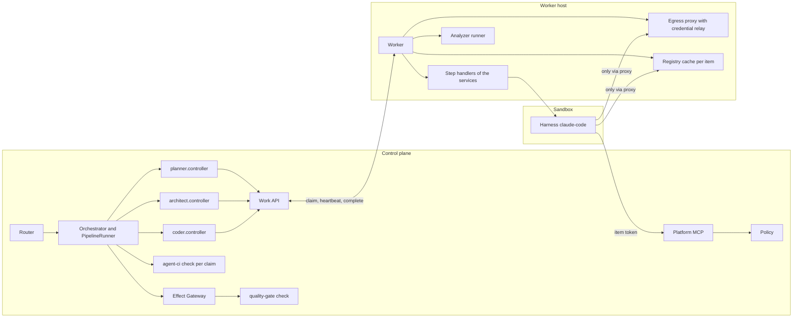
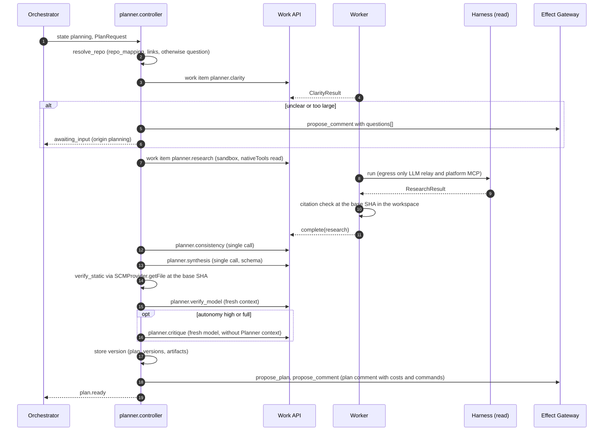
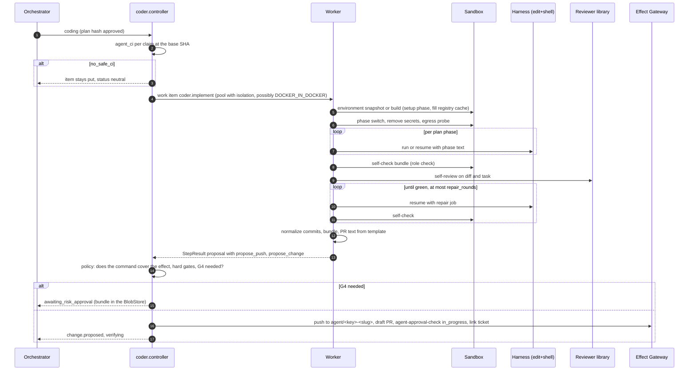
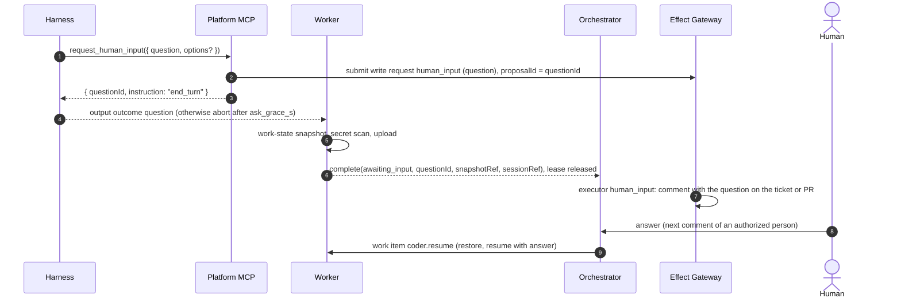
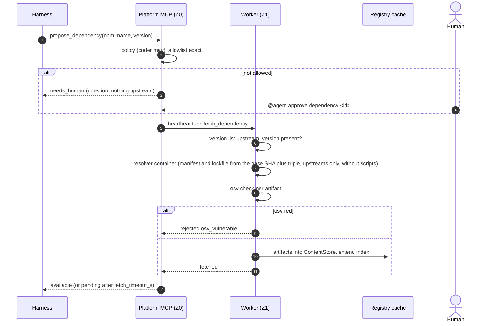

<!--
SPDX-License-Identifier: Apache-2.0
SPDX-FileCopyrightText: The Guildwork Authors
-->
# 10 Planner, Architect, Coder (detailed design stage 2)

This detailed design makes stage 2 buildable: shared building blocks of the agent services, Planner, Architect, Coder, Analyzer in `run` mode with the platform gate `quality-gate`, CI on agent branches and the pipeline `ticket-to-pr`. Precedence as in [README](README.md): architecture decisions take priority; what the architecture leaves open is stated here as Ruling **FE-1000 to FE-1099** (section 9). Classifications (VERIFIED, CLAIMED, DERIVED, unverified) as in the [architecture README](../architecture/README.md). Tasks are in [stage-2.chain.toml](../plan/tasks/stage-2.chain.toml) (Epics 2-E01 to 2-E08).

## 1. Purpose and sources

| Part | Implements | Sources |
|---|---|---|
| Shared building blocks (2-E01) | Blueprint sandbox per repo, setup and agent phase, enforced egress proxy, registry cache offline from the lockfile, `propose_dependency` with name allowlist and osv check, sandbox without DNS resolver, attribute `foreign_input_seen`, work-state snapshot | [02](../architecture/02-services.md) section 0, section 3 stages 0 and 1; [05](../architecture/05-security.md) sections 3, 4, 8; [01](../architecture/01-plugin-interfaces.md) section 8; ADR-20, ADR-48, ADR-60, ADR-62, ADR-64 |
| Planner (2-E02) | read-only, clarity gate, research, consistency analysis, synthesis, plan verifier, plan critique, versions, human editing, G1 manual and automatic | [02](../architecture/02-services.md) section 1; [03](../architecture/03-flow-and-orchestration.md) sections 1, 1a, 2.1, 3; [10](../architecture/10-standards-per-layer.md) section 4; ADR-35 |
| Architect (2-E03) | modes `review` (first in `shadow`), `spec` with EARS, `adr` per MADR, `threat_model` per STRIDE, `conformance` as a library in the Reviewer | [02](../architecture/02-services.md) section 2; [10](../architecture/10-standards-per-layer.md) section 5; ADR-46 |
| Coder (2-E04) | flow in the harness, self-check bundle, hard gates, self-review with the Reviewer, draft PR per PR template, `agent-approval-check`, G4, question L1, steering L2, environment setup L4 | [02](../architecture/02-services.md) section 3; [03](../architecture/03-flow-and-orchestration.md) sections 2.1, 2.4, 3, 4, 5; [10](../architecture/10-standards-per-layer.md) section 6 |
| Analyzer `run` and `quality-gate` (2-E05) | Analyzer contract `v1alpha1` binding, run in the sandbox, baseline, fingerprints, platform gate with `analysis.gate` | [01](../architecture/01-plugin-interfaces.md) section 12; [10](../architecture/10-standards-per-layer.md) section 13; ADR-36, ADR-40, ADR-50 |
| CI on agent branches (2-E06) | `security.agent_ci` with `agent_fork` or `guarded_workflows`, check in `doctor` and per claim, otherwise `no_safe_ci`; contract test `agent_fork` against GitHub | [05](../architecture/05-security.md) section 3; [03](../architecture/03-flow-and-orchestration.md) section 5; ADR-59 |
| Pipeline `ticket-to-pr` (2-E07) | from GitHub Issues, command `@agent code`, auto trigger via label `agent:auto`, stages with `on_disabled`, fix stage `on_disabled: human` until stage 4 | [03](../architecture/03-flow-and-orchestration.md) sections 1, 1a, 2.5; [04](../architecture/04-configuration-and-limits.md) section 3; [02](../architecture/02-services.md) section 11 |
| Eval and acceptance (2-E08) | P1 to P4, AR1 to AR4, C1p, Coder basket B1 to B4; Gate A; Gate B required parts measured and reported; S1, S2, S4, S5, S6, S7 c; release with S8 | [07](../architecture/07-eval.md) sections 3.2 to 3.4, 5; [10](../architecture/10-standards-per-layer.md) sections 1, 4 to 6; [08](../architecture/08-roadmap.md) stage 2; ADR-52, ADR-55, ADR-56 |

**Not in stage 2** ([08](../architecture/08-roadmap.md)): handoff to humans (`@agent handoff`, `resume`), decomposition into child runs and best-of-N (stage 9); QA and the QA library "E2E smoke" (stage 3); PR fixer (stage 4); merge gate and auto-merge (stage 5); triage (stage 7); Jira (stage 8). These parts stay visible in the code as explicitly rejected switches (FE-1023), so that no operator silently assumes they are active.

**Prerequisites from earlier stages** (scope of other detailed designs, used here only as an interface): data model with `runs`, `steps`, `work_items`, `effects`, `approvals`, `artifacts`, `findings`, `audit`, `config_snapshots`, `eval_*` ([01](01-data-model.md)); router, orchestrator with run state machine, config resolver, policy, ledger ([02](02-control-plane.md)); Work API, platform MCP, worker, sandbox, socket proxy, egress proxy, credential relay ([03](03-execution.md)); Effect Gateway, outbox, audit, Credential Broker ([04](04-effects-audit-credentials.md)); plugin framework, contracts `v1alpha1`, GitHub plugin, `claude-code`, ModelProvider ([05](05-plugins-and-contracts.md)); installer and admin UI ([06](06-installation-operations-ui.md)); eval runner, Harbor adapter, statistics ([07](07-eval-and-qualification.md)); Reviewer as a library ([08](08-reviewer.md)). Where this detailed design presupposes fields or tables of the earlier stages, it names them; if a name defined there differs, the name defined there applies, and the first task of Epic 2-E01 reconciles them (2-E01-T01, open point OP-1).

## 2. Modules and responsibility

### 2.1 Directories and packages

```
packages/
  agent-step/          @guildwork/agent-step      Run shell of all agent steps: prompt builder with Untrusted, agent files from the base SHA,
                                                  output schema, budget, capture of the untrusted inputs (foreign_input_seen)
  blueprint/           @guildwork/blueprint       Schema and parser of .agents/environment.yaml, devcontainer subset, snapshotKey
  registry-cache/      @guildwork/registry-cache  Lockfile parser (npm, PyPI, Go), cache index, offline server per ecosystem
  clarity/             @guildwork/clarity         Clarity gate (shared with triage from stage 7)
  method-check/        @guildwork/method-check    EARS checker, MADR checker, C4 checklist (rule part), Mermaid check call,
                                                  plan conformance as subpath @guildwork/method-check/conformance (FE-1077)
  sarif/               @guildwork/sarif           SARIF 2.1.0 required fields, fingerprint, baseline comparison, properties bag
  quality-gate/        @guildwork/quality-gate    Platform gate: conditions from analysis.gate, decision, check text
  workflow-guard/      @guildwork/workflow-guard  Analysis of the workflow files for security.agent_ci
services/
  planner/             @guildwork/service-planner     src/controller (Z0), src/jobs (Z1), src/schema, prompts/
  architect/           @guildwork/service-architect   src/controller, src/jobs, src/modes/{review,spec,adr,threat-model,conformance}, prompts/, templates/
  coder/               @guildwork/service-coder       src/controller, src/jobs, src/selfcheck, src/gates, src/pr-body, prompts/
plugins/
  analyzer-opengrep/   Analyzer plugin, own default rules rules/guildwork-default/ with rule tests
  analyzer-gitleaks/   Analyzer plugin, own additional rules (sk-ant-*, placeholders per item)
  analyzer-osv-scanner/ Analyzer plugin with offline database
  analyzer-trivy/      Analyzer plugin (dependencies, IaC)
apps/worker/src/
  phases/              Phase switch setup -> agent, removal of the setup secrets
  env-snapshot/        Build and reuse of the environment snapshot per repo
  egress-policy/       Policy per item and phase to the egress proxy, connection log
  dns/                 resolv.conf without resolver, check on creation
  registry/            Filling of the registry cache, start of the cache server per item
  dependency/          Fetching after propose_dependency (resolver container, osv)
  work-snapshot/       Work-state snapshot and restore (question, continuation)
  analyzer-runner/     Tool sandbox per analyzer
apps/control-plane/src/
  pipeline/            PipelineRunner for ticket-to-pr (stages, on_disabled, G1, G4, verifying)
  agent-ci/            Check per claim with @guildwork/workflow-guard
  orchestrator-effects/ deterministic effects of the orchestrator (ready, request reviewers, ticket status)
apps/cli/src/
  doctor/checks/R01-blueprint.ts, doctor/checks/R02-agent-ci.ts   (checks per repo per 06 section 2.5 and FE-642, section 2.20)
  commands/agent-fork.ts
deploy/images/
  registry-cache/, mermaid-check/, analyzer-opengrep/, analyzer-gitleaks/, analyzer-osv-scanner/, analyzer-trivy/
eval/
  adapters/locagent/, adapters/stride-gpt/   (reference tools with the same model, FE-1052, FE-1063)
  scorers/<name>/                             Scorers of the sets P1 to P4 and AR1 to AR4 (custom per 07 section 2.15)
  sets/P1/, P2/, P3/, P4/, AR1/, AR2/, AR3/, AR4/,             (IDs from 07 section 2.15; each set.json with declarative pin,
       C1p/, C1p-plan-no-harm/, B1/, B2/, B3/, B4/              labels/*.jsonl, refs/*.jsonl; 07 FE-703, FE-728, FE-1078)
  references/planner.json, architect.json, coder.json                                       (reference values, 07 FE-738)
  suites/s1/, s2/, s4/, s5/, s6/, s7/   (stage 2 cases of the cross-cutting suites, scaffold from stage 0)
tools/eval/
  select-c1p.ts                       Selection of the C1p cases from public repos (repo tool only, FE-1078)
```

Each service package has two entry points: `controller` (runs in the process of the control plane, role `orchestrator`) and `jobs` (step handlers that the worker loads for work items of this service). The controller is deterministic and never calls a model (FE-1001). New packages instead of extending `sdk-service`: FE-1000.

### 2.2 Who calls whom



| Caller | Called | What for | Path |
|---|---|---|---|
| Orchestrator | Service controller | next step of a run | in-process function call |
| Controller | Work API | create work item (kind, service, step, input) | DB transaction via repository from [01](01-data-model.md) |
| Worker | Step handler `jobs` | execution of a work item | function call in the worker |
| Step handler | `AgentRuntime.run`, `resume`, `steer` | agent phase | plugin `claude-code` ([05](05-plugins-and-contracts.md)) |
| Step handler | ModelProvider path | single calls (clarity, consistency, synthesis, verifier, critique) | work item of kind single call ([05](05-plugins-and-contracts.md)) |
| Agent | Platform MCP | reading, `request_human_input`, `propose_dependency` | HTTPS with item token via the egress proxy |
| Worker | Work API | result with write requests (`propose_push`, `propose_change`, `propose_plan`, `propose_comment`, `propose_check`) | `complete(leaseId, StepResult)` |
| Effect Gateway | SCMProvider, WorkItemProvider | effects | token per effect from the Broker ([04](04-effects-audit-credentials.md)) |
| Orchestrator | `@guildwork/workflow-guard` | check `security.agent_ci` at the base SHA | function call, files via `SCMProvider.getFile` |
| CLI `doctor` | `@guildwork/workflow-guard`, `@guildwork/blueprint` | pre-check per repo | function call |

### 2.3 Agent run shell `@guildwork/agent-step`

Every agent step (Planner research, Architect, Coder) runs through the same shell. It builds the `AgentTask` from [01](../architecture/01-plugin-interfaces.md) section 6, enforces `Untrusted` and captures every foreign input for the attribute `foreign_input_seen` (section 2.8).

```ts
// packages/agent-step/src/types.ts
import type { AgentTask, AgentRunResult, RuntimeEvent, Untrusted, RepoRef, Actor, PermissionLevel, ServiceId } from "@guildwork/contracts";

export type AgentStage =                          // closed union; later stages extend it additively in this file (FE-1079)
  | "planner.research" | "architect.review" | "architect.spec" | "architect.adr" | "architect.threat_model"
  | "coder.env_bootstrap" | "coder.implement" | "coder.repair" | "coder.resume"
  // Stage 3 (11 section 2.7, FE-1117; added in 3-E01-T08):
  | "qa.generate_unit" | "qa.repro" | "qa.repair" | "qa.catch" | "qa.e2e_plan" | "qa.e2e_generate" | "qa.e2e_heal"
  // Stage 4 (11 section 2.7, FE-1117; added in 4-E01-T03):
  | "prfixer.fix_threads" | "prfixer.fix_ci" | "prfixer.fix_finding" | "prfixer.conflict"
  // Stage 10 (15 FE-1514, K8; added in 10-E01-T02, 10-E01-T03, 10-E02-T01, 10-E02-T02):
  | "docs.docstrings" | "docs.sync" | "prfixer.dependency_update" | "prfixer.ci_doctor";

export interface AgentStepInput {
  service: ServiceId; stage: AgentStage; runId: string; stepId: string; itemId: string;
  repo: RepoRef; baseSha: string;
  promptVersion: string;                          // prompt_v of this stage, goes into the qualification profile (ADR-66)
  instruction: string;                            // only command and task, trusted
  agentFilesFromBase: AgentFileFromBase[];        // CLAUDE.md, AGENTS.md, REVIEW.md, rules: only the version from the base SHA (ADR-17)
  untrusted: TrackedUntrusted[];                  // everything foreign, with origin (section 2.8)
  outputSchema: object;                           // JSON Schema, mandatory (05 section 4 item 4)
  nativeTools: AgentTask["nativeTools"];
  mcpTools: string[];                             // from table 2.18, never more
  budget: AgentTask["budget"];
}

export interface AgentFileFromBase { path: string; sha256: string; text: string }

export interface TrackedUntrusted {
  block: Untrusted<string>;
  source: UntrustedSource;
}

export interface UntrustedSource {
  kind: "work_item_title" | "work_item_body" | "work_item_comment" | "change_title" | "change_body"
      | "review_thread" | "linked_item" | "steer_text" | "ci_log" | "sarif_message"
      | "commit_message";                         // from stage 3: commit message of a human commit (11 section 6, FE-1079)
  ref: string;                                    // stable ID at the provider (comment ID, issue number, log reference; for commit_message the commit SHA)
  author?: Actor;                                 // absent for ci_log and sarif_message (no person); for commit_message the author of the commit,
                                                  // resolved via the provider; without mapping to an account authorPermission "unknown"
  createdAt?: string; editedAt?: string;
}

export interface AgentStepOutcome<T> {
  status: AgentRunResult["status"] | "awaiting_input";
  structured?: T;                                 // checked against outputSchema; otherwise status schema_invalid
  sessionRef?: string;
  transcriptRef: string;                          // BlobStore, after secret scan
  usage: AgentRunResult["usage"];
  questionId?: string;                            // set for awaiting_input
}

export interface AgentStepRunner {
  run<T>(input: AgentStepInput, signal: AbortSignal, onEvent?: (e: RuntimeEvent) => void): Promise<AgentStepOutcome<T>>;
  resume<T>(input: AgentStepInput, sessionRef: string, prompt: string, signal: AbortSignal): Promise<AgentStepOutcome<T>>;
}
```

Rules of the shell:
1. The prompt builder embeds every `TrackedUntrusted` in a marked block (markers from [05](05-plugins-and-contracts.md), sanitizer for zero-width, bidi and HTML comments from [05](../architecture/05-security.md) section 4 item 2) and reports it to the Work API before the start (`POST /work/v1/leases/{leaseId}/untrusted-inputs`, section 2.19). Without a successful report the harness does not start (fail closed).
2. Agent files come only from the base SHA and go into the harness via `--append-system-prompt-file`; if the workspace contains a differing head version, the worker replaces it with the base version before the start and passes the head version on as `Untrusted` ([05](../architecture/05-security.md) section 3 item 5; case in S1 from stage 1).
3. `outputSchema` is mandatory; an output that misses the schema yields `schema_invalid`, never an effect.
4. The shell never sets a credential; the start path is built by `claude-code` from [05](05-plugins-and-contracts.md).
5. The report of the untrusted inputs goes through a plugged-in `UntrustedReporter`; 2-E01-T03 tests with a fake, 2-E01-T12 plugs in the call of the endpoint from section 2.19 (FE-1066).

**Context of the step handlers** (FE-1066): the `jobs` of the services run in the worker but must not import any app ([00](00-codebase-and-conventions.md) dependency rule). Therefore the types of the worker services that a step handler needs live in `@guildwork/agent-step`; the worker implements them (sections 2.5, 2.6, 2.9, 2.14) and passes them per item.

```ts
// packages/agent-step/src/job-context.ts
import type { SandboxHandle, RunCtx, AnalyzerReport, RepoRef, ServiceId } from "@guildwork/contracts";
import type { WorkItemEnvelopeV1, GrantsV1 } from "@guildwork/contracts";  // detailed design 03 section 2.3; GrantsV1 with the fields from section 2.21
import type { ResolvedEnvironment } from "@guildwork/blueprint";

export interface AgentJobContext {
  run: RunCtx;
  envelope: WorkItemEnvelopeV1;
  runner: AgentStepRunner;                          // above; uses reporter before every start
  reporter: UntrustedReporter;
  environment: EnvironmentService;                  // implementation: apps/worker/src/{env-snapshot,phases,registry}
  workSnapshots: WorkSnapshotService;               // implementation: apps/worker/src/work-snapshot
  analyzers: AnalyzerRunnerService;                 // implementation: apps/worker/src/analyzer-runner
  blobs: { put(key: string, data: AsyncIterable<Uint8Array>, contentType: string): Promise<{ ref: string; sha256: string }> };   // upload via the Work API (03 section 4.3)
  grants: GrantsV1;                                 // claim response with item token, setup secrets and input grants (section 2.21, FE-1070)
}

export interface UntrustedReporter {
  report(records: Omit<UntrustedInputRecord, "foreign" | "foreignReason">[]): Promise<Result<{ accepted: number }, "lease_expired" | "invalid_record" | "unreachable">>;
}

export interface PreparedSandbox {
  handle: SandboxHandle;
  phase: "setup" | "agent" | "check";
  environment: ResolvedEnvironment;
  envSnapshotKey: string;
  baselineFailingTests: string[];                   // from env_snapshots (FE-1015)
  registryCache: "ready" | "none" | `unsupported:${string}`;
}
export type EnvError = "blueprint_invalid" | "post_build_failed" | "snapshot_secret_found" | "lockfile_integrity_mismatch"
                     | "sandbox_create_failed" | "egress_not_enforced"
                     | "setup_secret_missing";                // blueprint names a secret that the grant does not contain (section 2.21)

export interface EnvironmentService {
  resolve(repo: RepoRef, baseSha: string): Promise<Result<ResolvedEnvironment, { code: "blueprint_invalid"; key: string; line: number }>>;
  acquire(env: ResolvedEnvironment, opts: { service: ServiceId; pool: string; registryCache: boolean; secrets: boolean }): Promise<Result<PreparedSandbox, EnvError>>;
      // restore or build of the environment snapshot, post_build, fill registry cache, setup phase (2.5, 2.6)
  switchPhase(sb: PreparedSandbox, to: "agent" | "check"): Promise<Result<PreparedSandbox, "egress_not_enforced">>;
      // remove secrets, switch egress policy, probe (FE-1037); "check" without network except registry cache
}

export interface WorkSnapshotService {
  create(sb: PreparedSandbox, tag: WorkSnapshot["tag"], sessionRef?: string): Promise<Result<WorkSnapshot, "snapshot_secret_found" | "upload_failed">>;
  restore(snapshotRef: string, harness: { runtime: string; version: string }): Promise<Result<{ sb: PreparedSandbox; sessionRef?: string }, "resume_version_mismatch" | "restore_failed">>;
}

export interface AnalyzerRunnerService {
  run(sb: PreparedSandbox, req: { analyzerIds: string[]; baseSha: string; headSha: string; scope: "diff" | "full" }): Promise<AnalyzerRunOutcome[]>;
}
export interface AnalyzerRunOutcome {
  analyzerId: string; toolVersion: string; rulesHash: string;
  status: "passed" | "failed" | "neutral"; neutralReason?: "crash" | "timeout" | "sarif_invalid" | "needs_build_unsupported" | "offline_db_stale";
  report?: AnalyzerReport;                          // findings with baselineState (2.14 rule 3)
  sarifRef?: string; analyzerRunId: string;          // row in analyzer_runs
}
```

`WorkSnapshot` (section 2.9) and `UntrustedInputRecord` (section 2.8) also live in `@guildwork/agent-step`; the files under `apps/worker/src/` only implement them.

### 2.4 Blueprint `@guildwork/blueprint`

File `.agents/environment.yaml`, read at the base SHA (ADR-17). Alternatively a devcontainer (`.devcontainer/devcontainer.json` or `.devcontainer.json`), from which only a subset is taken over (FE-1038).

```ts
// packages/blueprint/src/schema.ts (TypeBox; shown here as a type)
export interface Blueprint {
  version: 1;
  base_image?: string;                        // digest from the allowlist of the installation; default: sandbox-base of the release
  requires_docker?: boolean;                  // true: pool needs DOCKER_IN_DOCKER (Sysbox or MicroVM), default false
  languages?: string[];                       // only a hint to the agent
  setup: Command[];                           // setup phase, open network, secrets allowed
  maintenance?: Command[];                    // on every item after the restore of the environment snapshot, without secrets
  post_build?: Command[];                     // check after the snapshot build; red: snapshot unusable
  knowledge?: string;                         // hint text for the agent; from the base SHA, therefore trusted
  commands: {
    test?: string; lint?: string; build?: string; format_check?: string;
    coverage?: { cmd: string; report: string; format: "lcov" | "cobertura" };
    junit?: string;                           // glob of the JUnit XML reports for the per-test evaluation (FE-1015)
  };
  ecosystems?: { kind: "npm" | "pypi" | "go"; lockfile: string }[];   // registry cache (section 2.6)
  secrets?: string[];                         // names, resolved as secret://repos/<repo>/<name>, setup only
  resources?: { cpu?: number; mem_mb?: number; disk_mb?: number };
  setup_timeout_min?: number;                 // default 30
}
export interface Command { run: string; cwd?: string; timeout_min?: number; env?: Record<string, string> }

export interface ResolvedEnvironment {
  source: "blueprint" | "devcontainer" | "none";
  blueprint: Blueprint;                       // for "none" an empty blueprint with sandbox-base
  blueprintSha256: string;                    // canonical JSON
  lockfileHashes: Record<string, string>;     // path -> sha256 at the base SHA
  snapshotKey: string;                        // sha256 over (schemaVersion, blueprintSha256, lockfileHashes sorted, baseImageDigest, workerEnvVersion)
}
```

Inputs of `snapshotKey`: `schemaVersion` is `Blueprint.version`; `lockfileHashes` contains exactly the paths from `blueprint.ecosystems[].lockfile`; `baseImageDigest` is the digest from `base_image` or of `sandbox-base`; `workerEnvVersion` is the constant `ENV_SNAPSHOT_FORMAT` (start 1) from `apps/worker/src/env-snapshot/format.ts`, which every change to the build, `post_build` or filling increments and which the worker passes to `resolve` (the parser stays pure). The canonical JSON is JCS (RFC 8785) via `canonicalJson` from `@guildwork/core` ([00](00-codebase-and-conventions.md) section 2.5).

Rules: unknown keys are an error; `secrets` must never be used in `maintenance` or `post_build` (schema rule); `base_image` must be in `sandbox_images_allowlist` of the installation (new key, section 7). The parser receives the file text as `Uint8Array` with an upper limit of 256 KiB.

### 2.5 Sandbox phases, enforced egress proxy, no DNS

Extension of the sandbox lifecycle from [03](03-execution.md). Every sandbox of an agent service runs in two phases; the worker switches the egress policy of the item at the phase switch.

```ts
// apps/worker/src/egress-policy/types.ts
export type EgressPhase = "setup" | "agent" | "check";
export interface EgressPolicy {
  itemId: string; service: ServiceId; phase: EgressPhase;
  allowHosts: string[];          // setup: ["*"] only while blueprint setup runs; agent: security.egress.<service>; check: [] (no connection)
  registryCache?: { host: "registry-cache.internal"; target: string };   // only coder (later qa, prfixer)
  llmRelay: { host: string; target: string };   // credential relay from 03
  logConnections: true;
}
export interface EgressConnectionLog {
  itemId: string; phase: EgressPhase; at: string; host: string; port: number;
  decision: "allowed" | "denied"; bytesOut: number; bytesIn: number; ruleId: string;
}
```

Flow per sandbox:
1. **Setup phase:** restore of the environment snapshot (section 2.6, table `env_snapshots`) or new build. On a new build, `setup` commands run with an open network (policy `setup`) and secrets as files under `/run/guildwork/setup-secrets` (tmpfs) and as environment variables only of the setup exec calls. The values come only from the grant `setupSecrets` of the claim response (section 2.21, FE-1070); if a name from `blueprint.secrets` is missing there, the step ends before the first setup command with `setup_secret_missing` (section 5). After a restore without a new build, the worker discards the grant unused. Then `maintenance` without secrets.
2. **Phase switch** (FE-1037): unmount the secrets tmpfs, variables only in the exec context (never in the container environment), policy to `agent`, probe: a direct connection to a test target outside the allowlist must fail, via the proxy it must be rejected. If the probe fails, the step ends with `egress_not_enforced` (section 5), the harness never starts.
3. **Agent phase:** harness with `HTTPS_PROXY` and `HTTP_PROXY` set to the IP of the proxy (no name, because there is no resolver), `NO_PROXY` empty. Every connection lands in `EgressConnectionLog` (BlobStore, reference in the Run Record).
4. **Check phase** (`check`): self-check and deterministic checks without network except `registry-cache.internal`.

The phase switch is the implementation of `EnvironmentService.switchPhase` from section 2.3 (`apps/worker/src/phases`); the policy per phase is set by `apps/worker/src/egress-policy` via the control API of the egress proxy ([03](03-execution.md) section 2.9.1, field `phase` additive).

**Mapping of `EgressPolicy` to the control API** ([03](03-execution.md) section 2.9.1, FE-325, FE-1080): every phase is a renewed `PUT /ctl/v1/items/{itemId}` with a complete `ItemRegistration`; the proxy replaces `allow` and `phase` atomically and closes open connections that the new allowlist does not cover.

| `EgressPolicy` | `ItemRegistration` |
|---|---|
| `itemId` | `itemId`; `network` = `gw-item-<itemId>` as in stage 0 |
| `phase` | `phase` (`setup`, `agent`, `check`) |
| `allowHosts` | per entry `{ host, port: 443 }`; in `setup` exactly `[{ host: "*", port: 443 }]` while `setup` commands run (otherwise as `agent`). The wildcard `*` is only allowed with `phase: "setup"`; private addresses stay blocked, air gap still cuts |
| `registryCache` | additional `allow` entry with host and port from `target` (Coder only, in all three phases) |
| `llmRelay` | `relay` as in stage 0 (populated from `grants.llm`); in `check` without `relay` |
| `check` | `allow` contains only the registry cache entry (if present), otherwise `[]` |
| `logConnections` | no field: the proxy always logs; the worker reads `connections` via `GET /ctl/v1/items/{itemId}/usage` (`ConnLogEntry` with `phase`) and writes `EgressConnectionLog` from it |

If the proxy answers the phase switch with 409 `phase_invalid` or another error, the step ends with `egress_not_enforced` (section 5), the harness never starts; a failed probe has the same consequence. The worker reports the connection log at the end of the item via `POST /work/v1/leases/{leaseId}/egress-log` (section 2.19). It reports every phase switch immediately with an additional heartbeat whose field `phase` carries the new phase (section 2.21); on every change the Work API writes the audit entry `sandbox.phase_switched` with item, old and new phase and point in time.

**No DNS (ADR-64, FE-1033):** the sandbox keeps the DNS setting of stage 0 from [03](03-execution.md) (FE-310): `Dns: ["192.0.2.1"]` (documentation network, nothing answers), no `DnsSearch` and no `DnsOptions`, `/etc/resolv.conf` without `nameserver`; new in stage 2 is that the worker mounts `/etc/resolv.conf` read-only. The socket proxy from [03](03-execution.md) rejects every creation of a sandbox whose `HostConfig.Dns` is not exactly `["192.0.2.1"]`, that sets `DnsSearch` or `DnsOptions`, or that mounts `/etc/resolv.conf` writable (check rule `sandbox.dns_none`). The same setting applies to analyzer sandboxes, the resolver container (section 2.7) and the registry cache container. Only the egress proxy resolves names, and only for hosts on its allowlist. Whether Docker's embedded DNS service answers anyway on networks with `internal: true` is unverified (OP-2, 2-E01-T02); the S1 case "package name and DNS" measures 0 DNS queries via a DNS catcher on the sandbox network.

### 2.6 Environment snapshot and registry cache

**Environment snapshot per repo** (Devin blueprint pattern, [02](../architecture/02-services.md) section 3 stage 1): the key is `snapshotKey` (section 2.4). The worker builds it via `ExecutionBackend.buildSnapshot` ([01](../architecture/01-plugin-interfaces.md) section 8), runs `post_build` and reports the result; only `post_build_ok` makes it usable. Build, reuse and filling of the registry cache together implement `EnvironmentService.acquire` from section 2.3 (`apps/worker/src/env-snapshot`, `apps/worker/src/registry`). New build on a changed key; periodic rebuilds and layers are stage 9 ([10](../architecture/10-standards-per-layer.md) section 6). Before saving, the worker scans the snapshot content (paths changed relative to the base image) with gitleaks plus own rules; a hit discards the snapshot (`snapshot_secret_found`). The scan runs in a tool sandbox from the image `analyzer-gitleaks` with the rule file `plugins/analyzer-gitleaks/rules/guildwork.toml` (section 2.14 rule 5), which is why 2-E01-T06 depends on 2-E05-T05; the same call serves the work-state snapshot (section 2.9) and the hard gate `no_secret` (section 6.3).

**Lookup and reporting** (FE-1070, FE-1071): the worker never reads or writes `env_snapshots` itself. When creating a work item with a sandbox, the controller (first `coder.prepare`) puts up to five most recent rows with `state = ready` for (repo, pool) into the envelope as `inputs.envSnapshots` (`EnvSnapshotHint`, section 2.21); the worker computes `snapshotKey` itself (`resolve`) and takes the row with the same key. It reports build, reuse, `post_build` result and discarding via `POST /work/v1/leases/{leaseId}/env-snapshots` (`EnvSnapshotReport`); the control plane writes the row and the audit entry from it. An environment snapshot and the `ContentStore` of the registry cache live on the worker host that built them. If another worker host of the same pool does not find the image from `backend_ref`, it builds anew (like a missing key) and reports the new `backend_ref`; the row always holds the most recently reported image. Missing artifacts in the local `ContentStore` are fetched by the filling from the lockfile.

**Registry cache offline** (ADR-64, FE-1031, FE-1032):

```ts
// packages/registry-cache/src/types.ts
export type Ecosystem = "npm" | "pypi" | "go";
export interface LockedArtifact {
  ecosystem: Ecosystem; name: string; version: string;
  integrity: string;                 // npm: sha512-...; pypi: sha256:...; go: h1:... (module zip) or hash of go.mod
  upstreamUrl: string;               // from the lockfile or derived; only the worker calls it
  file?: string;                     // pypi: file name of the wheel or sdist file
}
export interface LockfileParser {
  ecosystem: Ecosystem;
  matches(path: string): boolean;    // package-lock.json, pnpm-lock.yaml, yarn.lock (v1), requirements*.txt with --hash, poetry.lock, uv.lock, go.sum
  parse(text: Uint8Array, maxEntries: number): Result<LockedArtifact[], LockfileError>;
}
export interface CacheIndex {
  snapshotKey: string; tenant: string; repo: string;
  entries: (LockedArtifact & { blobSha256: string; source: "lockfile" | "propose_dependency"; requestId?: string })[];
}
export interface RegistryServer {                // runs per item as container "registry-cache" on the sandbox network
  load(index: CacheIndex, store: ContentStore): void;
  // npm:  GET /npm/{name}            -> packument only with the versions from the index
  //       GET /npm/{name}/-/{file}.tgz
  // pypi: GET /pypi/simple/{name}/   -> PEP 503 page only with files from the index
  //       GET /pypi/files/{sha256}/{file}
  // go:   GET /go/{module}/@v/list, /@v/{v}.info, /@v/{v}.mod, /@v/{v}.zip
  // everything else: 404 with reason "not present", never upstream
}
export interface ContentStore {                  // on the worker host, per tenant: /var/lib/guildwork/registry-cache/<tenant>/<sha256>
  has(sha256: string): boolean; put(sha256: string, data: AsyncIterable<Uint8Array>): Promise<void>; open(sha256: string): AsyncIterable<Uint8Array>;
}
```

Filling: in the setup phase the worker (Z1, not the sandbox) reads the lockfiles from `blueprint.ecosystems` at the base SHA, downloads every artifact via its own egress from the upstreams in `registry_cache.upstreams` (section 7), checks the integrity and stores it in the `ContentStore`. An artifact with wrong integrity aborts the filling (`lockfile_integrity_mismatch`). The index is saved with the environment snapshot. In the agent phase the server delivers only what is in the index; every other request is counted by the server (`registry_cache_miss` with ecosystem, name, version, item) and answered with 404. Ecosystems outside npm, PyPI and Go are not covered offline in stage 2: the setup phase installs them as usual, fetching in the agent phase is impossible, and the Run Record notes `registry_cache: unsupported:<ecosystem>`.

### 2.7 `propose_dependency`

Write request from [02](../architecture/02-services.md) section 0 and ADR-64; allowed for `coder` (stage 2), `qa` and `prfixer` (later stages). The agent calls the MCP tool; check in Z0, fetching in the worker (Z1).

```ts
// MCP tool propose_dependency (platform MCP, Z0)
export interface ProposeDependencyArgs {
  ecosystem: Ecosystem;
  name: string;                       // exact, without wildcards
  version: string;                    // exact, no ranges
  reason: string;                     // free text, visible only to humans, never authorization
}
export type ProposeDependencyResult =
  | { status: "available"; requestId: string; artifacts: number }          // in the cache, agent can install
  | { status: "pending"; requestId: string; retryAfterS: number }          // fetching still running
  | { status: "needs_human"; requestId: string; questionId: string }       // question asked (section 4.8)
  | { status: "rejected"; requestId: string; reason: "osv_vulnerable" | "version_unknown" | "ecosystem_unsupported" | "limit_reached" };

// Result of the osv check per artifact (report dependency-results, column dependency_requests.osv)
export interface OsvResult {
  artifact: { ecosystem: Ecosystem; name: string; version: string };
  source: "osv-api" | "osv-offline"; dbVersion?: string;          // dbVersion only for osv-offline
  vulns: { id: string; severity: "LOW" | "MODERATE" | "HIGH" | "CRITICAL" | "UNKNOWN"; aliases: string[] }[];
}
// Severity UNKNOWN counts like MODERATE (fail closed relative to the default of osv_min_severity)

// States of a request (table dependency_requests, section 3.2)
export type DependencyRequestState =
  | "received" | "allowlisted" | "needs_human" | "approved_by_human" | "resolving" | "osv_checking"
  | "fetched" | "available" | "rejected" | "expired";
```

Rules (FE-1034, FE-1035):
1. **Name allowlist** `security.dependencies.allow` contains only exact entries `{ ecosystem, name, versions? }` (`versions` as a semver range or PEP 440 specifier, only for narrowing). The schema rejects wildcards such as `@scope/*`, because otherwise an agent could encode data into the name part after the prefix, which the worker would then query upstream.
2. If the name is not allowed, the worker queries **nothing** upstream; the request becomes a question to humans (`needs_human`).
3. If the name is allowed, the worker reads the version list of the name upstream and checks that the requested version is in it (`version_unknown` otherwise). This way the version also carries no freely chosen data to the outside.
4. **Transitive dependencies** are resolved by a resolver container in the worker (Z1) (FE-1034). It receives manifest and lockfile **from the base SHA**, never from the agent's workspace (otherwise the agent could enter URL or foreign-module dependencies there whose host names carry data); the worker only enters the approved triple deterministically. The container has no DNS resolver and reaches via the egress proxy only the hosts from `registry_cache.upstreams`; no secrets, no other repo code, package managers without scripts (`npm install --package-lock-only --ignore-scripts`, `uv pip compile`, `go mod download -json` per ecosystem; exact commands in 2-E01-T09, unverified per tool version). Every resolved artifact must come from one of these registries (origin URL checked), otherwise `rejected`. Every artifact of the closure goes through the osv check.
5. **osv check** (FE-1029): per artifact one query against the osv database; implementation `osv-api` (query to the osv service via the worker's egress) or `osv-offline` (database from the registry mirror, mandatory with `air_gap: true`). A hit at or above `security.dependencies.osv_min_severity` (default `MODERATE`) yields `rejected/osv_vulnerable`, even after human approval.
6. **Human approval:** answer `@agent approve dependency <requestId>` by a human with write permission in the repo (new subcommand of `approve`, FE-1034; addition to [03](../architecture/03-flow-and-orchestration.md) section 4 and [04](../architecture/04-configuration-and-limits.md) `command_permissions`, contradiction W-4 in section 10). The approval applies only to exactly this triple (ecosystem, name, version) in this run.
7. The MCP tool waits at most `security.dependencies.fetch_timeout_s` (default 300, estimate) and otherwise answers `pending`; the agent may keep working and ask again.
8. At most `security.dependencies.max_per_run` requests per run (default 10, estimate), after that `limit_reached`.

### 2.8 Origin: attribute `foreign_input_seen` (ADR-60)

Every `Untrusted` input of a person that a service sees in the run is captured: via the prompt builder (section 2.3) and via every read tool of the platform MCP (section 2.18) that delivers content from persons to an agent.

```ts
// packages/agent-step/src/provenance.ts (type); computation of foreign in apps/control-plane/src/provenance
export interface UntrustedInputRecord {
  runId: string; stepId: string;
  via: "prompt" | "mcp_tool"
     | "controller";                       // from stage 3: read by the controller of a service itself (11 ProvenanceEntry, FE-1135)
  source: UntrustedSource;                 // section 2.3
  contentSha256: string;
  authorPermission: PermissionLevel | "unknown";   // fresh at the provider, cache per run and actor
  triggerAt: string;                       // time of the triggering event
  foreign: boolean;                        // rule below
  foreignReason?: "author_without_write" | "after_trigger" | "edited_after_trigger" | "permission_unknown";
}
// foreign = authorPermission ∉ {write, maintain, admin}
//        || createdAt > triggerAt || editedAt > triggerAt
//        || authorPermission == "unknown"
// Sources without a person (ci_log, sarif_message) do not count (ADR-60 names only inputs from persons; FE-1036).

// apps/control-plane/src/provenance/index.ts  (Z0; endpoint from 2.19 and results of later services such as QAReport.untrustedInputs)
export interface ProvenanceService {
  record(runId: string, stepId: string | null, records: Omit<UntrustedInputRecord, "foreign" | "foreignReason">[], tx: Tx):
    Promise<{ accepted: number; foreignSeen: boolean }>;   // computes foreign, writes run_untrusted_inputs, sets runs.foreign_input_seen
  permissionOf(runId: string, actor: Actor, repo: RepoRef): Promise<PermissionLevel | "unknown">;   // fresh at the provider, cache per run and actor
}
```

**Content edited after the trigger** (TOCTOU, [05](../architecture/05-security.md) section 4 item 3; FE-1064): the prompt builder and read tools do not embed content with `editedAt > triggerAt`, but deliver in its place the note "edited after the trigger, excluded"; the record stays captured with `foreignReason: edited_after_trigger`, and the status comment asks whether the new version should apply (it applies only in a new run). Content **newly created** after the trigger (for example answers to questions, new comments) is embedded and is `foreign` per ADR-60 if its author has no write permission or it dates from after the trigger.

The Run Record carries `foreign_input_seen = true` as soon as a record is `foreign`, plus source and author per input ([05](../architecture/05-security.md) section 8). In stage 2 the attribute only acts as a display (Run Record, admin UI, status comment line "foreign input seen"); the block in the merge gate (condition 12) is built by stage 5. Code in the repo does not count as input of a person; it is covered by the repo class (FE-1036). `steer_text` from `@agent say` is captured, but is only `foreign` if the actor has no write permission or the text dates from after the trigger; because `say` comes after every trigger, for `steer_text` the point in time of admission by the router applies instead of the trigger (FE-1036).

### 2.9 Work-state snapshot and restore

For question (L1), steering without `STEER` (L2) and deadline expiry ([03](../architecture/03-flow-and-orchestration.md) section 2.4). A work-state snapshot is **not** a container image, but an archive of fixed paths (FE-1020): workspace (repo with `.git`), configuration directory of the harness (`CLAUDE_CONFIG_DIR`, contains the session for `--resume`), with `$HOME/.cache` excluded. On restore, the environment comes again from the environment snapshot with the same `snapshotKey`.

```ts
// packages/agent-step/src/job-context.ts (type); implementation of WorkSnapshotService in apps/worker/src/work-snapshot
export interface WorkSnapshot {
  snapshotRef: string;                     // BlobStore key, section 3.4
  runId: string; stepId: string; tag: "ask" | "steer" | "expiry" | "rate_limit";
  envSnapshotKey: string;                  // must be present on restore, otherwise new build
  sessionRef?: string;                     // session ID of the harness
  harness: { runtime: string; version: string };
  paths: string[]; sizeBytes: number; sha256: string;
  secretScan: { tool: string; version: string; findings: 0 };   // stored only at 0
  createdAt: string; expiresAt: string;    // deadline = ask_timeout_h plus 24 h buffer
}
```

Rules: storage only after a secret scan with 0 hits (`snapshot_secret_found` otherwise, run `failed`); `restore` checks `sha256`, harness version and `envSnapshotKey`; if the harness version differs, there is no continuation (`resume_version_mismatch`), instead the run ends with a WIP branch. Expiring snapshots are deleted by the deletion job of the control plane ([06](../architecture/06-operations-and-deployment.md) section 5) with an audit entry.

**Storage, restore and deletion job** (FE-1070, FE-1072):
1. Storage: upload of the archive via `upload-url` of the Work API (artifact kind `work_snapshot`), then `POST /work/v1/leases/{leaseId}/snapshots` with the `WorkSnapshot`; the control plane writes `work_snapshots` (`state = stored`) and the audit entry `work_snapshot.stored`. Without `secretScan.findings = 0` the endpoint answers 422 `secret_scan_missing`.
2. Restore: the controller creates `coder.resume` or `coder.wip_push` with `inputs.workSnapshot = { snapshotRef, sha256, envSnapshotKey, harness }` in the envelope; the claim response carries in addition the input grant `inputs[]` with `name: "work_snapshot"` (section 2.21). The worker loads the archive via this grant, checks `sha256` and harness version and reports the restore via the same report (`state = restored`). An expired or unloadable grant yields `restore_failed`.
3. Deletion job: pg-boss schedule `work-snapshots-expire` (role `orchestrator`, interval `work_snapshots.expire_interval_min`, singleton) sets rows with `expires_at < now()` and `state in (stored, restored)` to `expired`, deletes the archive via `BlobStore.delete` and sets `deleted` with audit entry `work_snapshot.deleted` (run, `snapshotRef`, reason `expired`). If the BlobStore refuses the deletion (Object Lock), the row stays `expired`, the next run tries again, and the counter `work_snapshot_delete_failed` increases.

### 2.10 Planner (`services/planner`)

**Steps** (FE-1002): every model stage is its own step with its own `prompt_v` (qualification profile, ADR-66).

| Step | Location | Kind | Model | Result |
|---|---|---|---|---|
| `planner.resolve_repo` | Controller (Z0) | deterministic | none | `RepoResolution` from `repo_mapping`, links in the ticket, otherwise question |
| `planner.clarity` | Work item | single call | `models.clarity` (default `gate_model`) | `ClarityResult` (section 2.11) |
| `planner.research` | Work item with sandbox | harness, `nativeTools: "read"` | runtime of the service | `ResearchResult` with citations; citation check in the worker afterwards |
| `planner.consistency` | Work item | single call | `models.consistency` | `ConsistencyReport` (gaps, contradictions, unstated requirements) |
| `planner.synthesis` | Work item | single call with schema | `models.synthesis` | `PlanArtifact` draft |
| `planner.verify_static` | Controller (Z0) | deterministic | none | `StaticVerification` (files, symbols, citations at the base SHA, milestones) |
| `planner.verify_model` | Work item | single call, fresh context | `models.verifier` | `RuleVerification` against rules, AGENTS.md, principles file |
| `planner.critique` | Work item | single call, fresh context without Planner context | `models.critique` | `PlanCritique` `ok | concerns | blocked`; only with autonomy `high` and `full` |
| `planner.publish` | Controller (Z0) | deterministic | none | write requests `propose_plan`, `propose_comment`; event `plan.ready` |

```ts
// services/planner/src/schema/plan.ts  (artifact schema v1alpha1, FE-1061)
export interface PlanRequest {
  workItem?: WorkItemRef; change?: ChangeRef;
  brief?: { text: Untrusted; attachments: AttachmentRef[] };        // image, PRD; image only as a reference, content Untrusted
  trigger: { eventId: string; actor: Actor; at: string; command: "plan" | "code" | "auto_label" };
  autonomyCeiling: "low" | "medium" | "high" | "full";
  targetRepos?: RepoRef[];
}

export type RepoResolution =                        // result of planner.resolve_repo (controller, without model)
  | { status: "resolved"; repo: RepoRef; via: "same_repo" | "repo_mapping" | "ticket_link" }
  | { status: "unknown"; candidates: RepoRef[] };    // at most 5 suggestions from repo_mapping; leads to the question repo_unknown
// Order: GitHub Issue in the repo itself (same_repo), then repo_mapping, then links in the ticket to exactly one repo of the installation;
// several hits of the same level yield unknown with these candidates

export interface PlanArtifact {
  schema: "guildwork-dev.github.io/v1alpha1/PlanArtifact";
  planId: string;                     // stable per ticket and repo: hash(tenant, workItemRef | briefId, repo)
  version: number;                    // 1, 2, ...
  parentVersion: number | null;
  hash: string;                       // sha256 of the canonical JSON without hash, verification, critique, publishedRefs
  repo: RepoRef; baseSha: string;
  kind: "feature" | "bugfix" | "refactor";
  summary: string;
  research: { id: string; text: string; citations: Citation[] }[];          // Citation from 01 section 9
  designChoices: { id: string; choice: string; rationale: string; alternatives: string[]; scope: "ticket" | "beyond_ticket" }[];
  phases: PlanPhase[];
  acceptance: { id: string; text: string; testHint?: string; requirementId?: string }[];
  assumptions: string[];
  relatedItems: { ref: string; relation: "duplicate" | "related"; citation?: string }[];   // empty without indexer (stage 7)
  risk: "low" | "medium" | "high";
  confidence: number;                 // 0 to 1; before calibration only reported (10 section 4)
  agentPrompt: { overall: string; perPhase: Record<string, string> };
  questions: PlanQuestion[];
  estimate: { files: number; agentRuns: number; weightedTokens: number; usd?: number; basis: "history" | "heuristic" };
  protectedPathsTouched: string[];
  designNeeded: boolean;
  humanEdited: boolean;
  requirementIds: string[];           // references to DesignArtifact.requirements[].id, if the Architect ran
  promptVersions: Record<"clarity" | "research" | "consistency" | "synthesis" | "verifier" | "critique", string>;
  verification?: { static: StaticVerification; rules: RuleVerification; status: "green" | "red" };
  critique?: PlanCritique;
}
export interface PlanPhase {
  id: string;                          // "P1", "P2", ...
  title: string; goal: string;
  milestone?: { validation: string };  // mandatory if estimate.files > planner.milestone_min_files
  parallelizable?: boolean;            // from 9-E06-T03 (14, decomposition into child runs, architecture 02 section 3 stage 6); default false,
                                       // never set in stage 2; a separate budget per phase needs no field: it is reserved proportionally
                                       // from the run budget (FE-1055), estimate stays per plan
  tasks: { id: string; text: string; files: { path: string; status: "existing" | "new" }[];
           symbols: { name: string; path: string; status: "existing" | "new" }[];
           dependsOn: string[]; requirementIds: string[] }[];
}
export interface PlanQuestion { id: string; text: string; kind: "gap" | "contradiction" | "unstated_requirement" | "too_large" | "repo_unknown"; blocking: boolean }
export interface StaticVerification {
  checkedAt: string; baseSha: string;
  files: { path: string; claimed: "existing" | "new"; actual: "exists" | "missing"; ok: boolean }[];
  symbols: { name: string; path: string; claimed: "existing" | "new"; found: boolean; ok: boolean }[];
  citations: { id: string; ok: boolean; reason?: "file_missing" | "lines_out_of_range" | "quote_hash_mismatch" }[];
  droppedResearchIds: string[];        // invalid citations are dropped (02 section 1 stage 6)
  milestonesOk: boolean;
  limitHit: boolean;                   // more than planner.verify.max_files: rest unchecked, status red
}
export interface RuleVerification { violations: { ruleSource: string; quote: string; planRef: string; severity: "blocking" | "warning" }[] }
export interface PlanCritique { verdict: "ok" | "concerns" | "blocked"; points: { planRef: string; text: string; kind: "wrong_file" | "missing_constraint" | "rule_violation" | "other" }[]; model: string; promptVersion: string }
```

Results of the intermediate stages and the functions that other parts call:

```ts
// services/planner/src/schema/research.ts  (outputSchema of planner.research)
export interface ResearchResult {
  points: { id: string; text: string; citations: Citation[] }[];          // without a valid citation the point is dropped
  candidateFiles: { path: string; reason: string }[];
  candidateSymbols: { name: string; path: string }[];
  openQuestions: string[];
}
// services/planner/src/schema/consistency.ts  (schema of the single call planner.consistency)
export interface ConsistencyReport {
  questions: (PlanQuestion & { kind: "gap" | "contradiction" | "unstated_requirement" })[];   // blocking: true leads to awaiting_input
  promptVersion: string;
}

// services/planner/src/render/index.ts
export function renderPlanMarkdown(plan: PlanArtifact): string;
export function parsePlanMarkdown(md: string): Result<Omit<PlanArtifact, "hash" | "verification" | "critique">, { line: number; reason: string }>;
export function planHash(plan: PlanArtifact): string;          // sha256 over canonical JSON without hash, verification, critique

// services/planner/src/persist.ts  (called by the Coder worker, FE-1005)
export function persistPlanFile(plan: PlanArtifact, cfg: { persist: "none" | "branch"; persistPath: string; key: string }):
  { path: string; content: string } | null;                     // null for persist: none; the worker writes the file as the first commit
```

**Rendering and editing** (FE-1004): `renderPlanMarkdown(plan)` produces a fixed format with a hidden marker `<!-- guildwork:plan planId=... version=... hash=... -->`, headings per section and task lines `- [P1.T2] Text (Dateien: a.ts, b.ts) (dependsOn: P1.T1) (req: REQ-3)`. `parsePlanMarkdown(md)` is the exact inverse; round-trip test over all fixtures. Human editing (`@agent plan --replace` with attached Markdown or editing of the plan comment by a human with write permission) produces `v{n+1}` with `humanEdited: true`, after which `verify_static` and `verify_model` run again (not research and synthesis). A parse error produces no version, but an answer with line number and reason.

**Persisting** (`planner.persist: branch`, FE-1005): the Coder worker stores the approved plan as the first file in the agent branch under `planner.persist_path` (default `docs/plans/`) as `<key>-v<n>.md`; the worker writes the file, not the agent. The path must not lie in `forbidden_paths` (resolver rule).

### 2.11 Clarity gate `@guildwork/clarity`

```ts
// packages/clarity/src/index.ts
export interface ClarityInput { title: Untrusted; body: Untrusted; comments: Untrusted[]; acceptanceCriteria?: Untrusted[]; repoHint?: string; language: string }
export interface ClarityResult {
  clear: boolean;
  tooLarge: boolean;                       // task exceeds clarity.max_scope (estimate in files)
  questions: { text: string; kind: "gap" | "contradiction" | "too_large" }[];
  splitSuggestion?: string[];              // only for tooLarge
  rationale: string;
  promptVersion: string;
}
export function clarityRequest(input: ClarityInput, cfg: { model: string; promptVersion: string }): GenerateRequest;   // pure building block, calls nothing
export function interpretClarity(raw: unknown): Result<ClarityResult, "schema_invalid">;
```

The package itself calls no model; the step handler sends the `GenerateRequest` via the ModelProvider path (FE-1001). The step `planner.clarity` (work item of kind single call with `models.clarity`, input title, text, comments and acceptance criteria of the ticket as `Untrusted`, language from the ticket) is built by 2-E02-T05 together with the other single calls of the Planner (FE-1076); test `planner.clarity_unclear_waits`. Triage uses the same package from stage 7. If `clear: false` or `tooLarge: true`, the Planner step ends with `questions[]` instead of a plan; the run goes to `awaiting_input` (G1b).

### 2.12 Architect (`services/architect`) and `@guildwork/method-check`

```ts
// services/architect/src/schema/design.ts
export interface DesignRequest {
  mode: "spec" | "adr" | "review" | "threat_model" | "conformance";
  workItem?: WorkItemRef; plan?: { planId: string; version: number; hash: string };
  change?: ChangeRef; targets?: string[];      // paths for review on a PR
  trigger: PlanRequest["trigger"];
}
export interface DesignArtifact {
  schema: "guildwork-dev.github.io/v1alpha1/DesignArtifact";
  designId: string; version: number; hash: string; mode: DesignRequest["mode"];
  repo: RepoRef; baseSha: string; headSha?: string;
  requirements: { id: string; ears: string; pattern: EarsPattern; source: Citation | { workItem: string; quote: string } }[];
  design?: { c4: { level: 1 | 2 | 3; mermaid: string }[]; dataFlow: string; errorHandling: string; testStrategy: string };
  tasks: { id: string; text: string; dependsOn: string[]; requirementIds: string[] }[];
  adrDrafts: { path: string; title: string; madr: string; designChoiceId?: string }[];
  findings: DesignFinding[];
  threatModel?: { elements: { id: string; kind: "process" | "store" | "external" | "flow"; name: string }[];
                  boundaries: { id: string; name: string; crossing: string[] }[];
                  threats: { id: string; stride: "S" | "T" | "R" | "I" | "D" | "E"; boundaryId: string; text: string; evidence: Citation; mitigation: string }[] };
  verdict: "ok" | "concerns" | "blocked";
  promptVersions: Record<string, string>;
}
export type EarsPattern = "ubiquitous" | "event" | "state" | "unwanted" | "optional" | "complex";
export interface DesignFinding {               // finding schema as in the Reviewer (08), with its own kind
  fingerprint: string; kind: "design" | "threat" | "plan_deviation";
  severity: "P0" | "P1" | "P2" | "P3"; title: string; evidence: Citation[]; ruleId?: string; quote?: string;
  requirementId?: string; status?: "met" | "open" | "deviating";   // conformance only
}
```

**Plan conformance `conformance`** (2-E03-T08, FE-1077): the check whether an agent PR follows the approved plan or the spec is a pure building block in the package `@guildwork/method-check` (subpath `@guildwork/method-check/conformance`, folder `packages/method-check/src/conformance/`), not code in `services/architect`: the Reviewer must not import another service ([00](00-codebase-and-conventions.md) section 2.2), but it may use a package. Like `@guildwork/clarity`, the building block calls no model; it builds the `GenerateRequest` and evaluates the answer (FE-1001). Plan and design come as narrow views that the package defines itself; `PlanArtifact` and `DesignArtifact` are assignable to them (type test `expectTypeOf` in `services/architect` and `services/planner`).

```ts
// packages/method-check/src/conformance/index.ts  (export "@guildwork/method-check/conformance")
import type { FileChange, Citation, GenerateRequest, Result } from "@guildwork/contracts";

export interface ConformancePlanView {               // part of PlanArtifact (section 2.10), fields named the same
  planId: string; version: number; hash: string;
  acceptance: { id: string; text: string; requirementId?: string }[];
  phases: { id: string; tasks: { id: string; text: string; files: { path: string; status: "existing" | "new" }[];
                                 requirementIds: string[] }[] }[];
}
export interface ConformanceDesignView {             // part of DesignArtifact (section 2.12)
  designId: string; version: number; hash: string;
  requirements: { id: string; ears: string }[];
  tasks: { id: string; text: string; requirementIds: string[] }[];
}
export interface ConformanceInput {
  diff: { baseSha: string; headSha: string; files: FileChange[]; patch: string };
  plan?: ConformancePlanView; design?: ConformanceDesignView;   // approved versions; at least one set
  tests: { path: string; names: string[] }[];                    // changed and new tests at the head
}
export interface ConformanceFinding {                // DesignFinding with kind "plan_deviation" is assignable
  fingerprint: string; kind: "plan_deviation"; severity: "P0" | "P1" | "P2" | "P3"; title: string;
  evidence: Citation[]; requirementId?: string; status: "open" | "deviating";
}
export interface ConformanceResult {
  requirements: { requirementId: string; status: "met" | "open" | "deviating"; evidence: Citation[]; testRef?: string }[];
  findings: ConformanceFinding[];                    // severity P0 to P3
  traceability: { requirementId: string; taskIds: string[]; tests: string[]; complete: boolean }[];
}
export const CONFORMANCE_OUTPUT_SCHEMA: object;      // JSON Schema of the model answer (requirements and findings without fingerprint)
export function conformanceRequest(input: ConformanceInput, cfg: { model: string; promptVersion: string }): GenerateRequest;
    // pure building block; prompt packages/method-check/prompts/conformance.v1.md; diff.patch and test names marked as Untrusted
export function interpretConformance(raw: unknown, input: ConformanceInput): Result<ConformanceResult, "schema_invalid">;
    // checks against CONFORMANCE_OUTPUT_SCHEMA, discards requirement IDs that are in neither plan nor design,
    // computes fingerprint (sha256 from requirementId, title, first citation) and traceability deterministically from the views and tests
export function traceability(input: ConformanceInput): ConformanceResult["traceability"];   // without model, also for the mode of the Architect
```

**Call path in the Reviewer** (finder `plan_conformance`, [08](08-reviewer.md) section 2.5 `FinderId`, open point 10.14 there): (1) during preparation the Reviewer controller asks the port `ControllerHost.approvedDesignInputs(run)` (addendum A-6 to [00](00-codebase-and-conventions.md) section 2.13). For an agent PR (`change_proposals` of the pipeline run that opened the PR) the control plane delivers the plan version bound by G1 and the approved design version as `{ plan?: { ref, sha256 }; design?: { ref, sha256 } }`, otherwise `null`. (2) With `null` or Architect `off` the finder does not start (as in 08 section 4.7). (3) Otherwise the controller loads both blobs via `ControllerHost.blobs.get`, checks `sha256` and parses them with the TypeBox schemas of the views (additional fields are ignored); a hash error ends only this finder with status `failed` and reason `plan_hash_mismatch` (status line, no silent green). (4) The finder runs as work item `reviewer.find` of kind single call (`kind: "model_call"`) with `finderId: "plan_conformance"`: the handler builds the request with `conformanceRequest` (model `models.finder`, `promptV` `finder.plan_conformance@<version>` from the profile of the Reviewer, ADR-66) and evaluates with `interpretConformance`. (5) The findings go as candidates into the verifier like the other finders; a P1 blocks like other P1s.

The mode `conformance` of the Architect (`DesignRequest.mode`) uses the same building block; `services/architect/src/modes/conformance/` now contains only the step handler that sends the request.

**Modes** ([02](../architecture/02-services.md) section 2): `review` (quality scenarios from `architect.quality_scenarios_path`, C4 checklist, contradictions to existing ADRs), `spec` (EARS requirements, design, tasks, consistency analysis, questions instead of assumptions), `adr` (MADR per `designChoice` with `scope: beyond_ticket`), `threat_model` (STRIDE per touched trust boundary with an evidenced location), `conformance` (library in the Reviewer, section 4.3). Agent phase with `nativeTools: "read"`; no shell for the agent.

**Method checkers** `@guildwork/method-check`:

```ts
export function checkEars(text: string): { ok: boolean; pattern?: EarsPattern; reason?: string };
// Patterns (DERIVED from [ears]; paper not read directly, CLAIMED): ubiquitous "THE <system> SHALL <response>";
// event "WHEN <trigger> THE <system> SHALL <response>"; state "WHILE <state> THE <system> SHALL <response>";
// unwanted "IF <condition> THEN THE <system> SHALL <response>"; optional "WHERE <feature> THE <system> SHALL <response>";
// complex: combination of WHILE and WHEN or WHERE before SHALL. Keywords case-insensitive; German "SOLL" not allowed (FE-1013).
export function checkMadr(markdown: string, template: MadrTemplate): { ok: boolean; missing: string[] };
export interface MadrTemplate { version: string; requiredSections: string[] }      // read from the pinned MADR template (2-E03-T03)
export interface C4Question { id: string; text: string; kind: "rule" | "model"; rule?: C4Rule }
export type C4Rule = "has_title" | "has_type" | "has_scope" | "has_legend" | "elements_named" | "relations_labelled" | "relations_have_technology";
export function checkC4(diagramMermaid: string, questions: C4Question[]): { questionId: string; result: "yes" | "no" | "needs_model" }[];
export function mermaidCheckCommand(file: string): string[];     // call of the tool image mermaid-check (FE-1011)
```

Which of the 21 questions of the C4 checklist can be checked rule-based is determined by 2-E03-T03 on the pinned version; the list `C4Rule` above is a starting proposal from the topics the research names (title, type, scope, legend, elements, relations with label and technology), not the question text itself (OP-6). The Gate B required part B1 requires 100 % of the rule-checkable items ([10](../architecture/10-standards-per-layer.md) section 5).

**Write requests** (FE-1009, FE-1010): `propose_comment` (ticket or PR, one summary), `propose_check` (`ai-design-review` with annotations), `propose_change` (new branch `agent/<key>-arch-<mode>`, one commit, draft PR; all paths in `architect.doc_paths` = `adr_path` and `spec_path`), `request_human_input`. The worker builds the commit deterministically from `adrDrafts` or spec files (`docs/specs/<key>/requirements.md`, `design.md`, `tasks.md`), not the agent.

### 2.13 Coder (`services/coder`)

**Steps:**

| Step | Location | Content |
|---|---|---|
| `coder.prepare` | Controller | build `CodeRequest` (plan hash, design hash), check `security.agent_ci` per claim (section 2.16), pool request (isolation, `requires_docker`) |
| `coder.env_bootstrap` | Work item, sandbox | only without blueprint and with `env_bootstrap: propose` (section 4.7) |
| `coder.implement` | Work item, sandbox | setup phase, agent phase per plan phase (plan reminder, FE-1058), self-check, self-review, repair rounds, bundle |
| `coder.resume` | Work item, sandbox | restore from work-state snapshot, `AgentRuntime.resume` with answer or steering instruction |
| `coder.wip_push` | Work item, sandbox | after deadline expiry: restore, bundle, push to `agent/<key>-wip` without PR (FE-1059) |
| `coder.propose` | Controller | write requests from the StepResult to policy and Effect Gateway; G4 check (section 4.4) |

```ts
// services/coder/src/schema.ts
export interface CodeRequest {
  plan?: { planId: string; version: number; hash: string };
  design?: { designId: string; version: number; hash: string };
  workItem: WorkItemRef; repo: RepoRef; baseRef: string; baseSha: string;
  autonomy: "low" | "medium" | "high" | "full";
  noPlan: boolean;                                  // @agent code --no-plan
}
export interface CoderAgentOutput {                 // outputSchema of the agent phase
  outcome: "done" | "question" | "cannot_implement";
  questionId?: string;                              // set if request_human_input was asked
  cannotImplementReason?: string;
  summary: string;
  prSections: Record<string, string>;               // heading of the PR template -> content (FE-1018)
  requirementCoverage: { requirementId: string; test?: string; waiver?: string }[];
  reproduction?: { testPaths: string[] };           // for kind bugfix
  risks: string[];
}
export interface ChangeProposal {
  schema: "guildwork-dev.github.io/v1alpha1/ChangeProposal";
  proposalId: string; runId: string;
  bundleRef: string; branch: string;                // agent/<key>-<slug>
  baseSha: string; headSha: string;                 // headSha of the bundle
  diffStat: { files: number; additions: number; deletions: number; paths: string[] };
  selfCheck: SelfCheckReport;
  selfReview: { rounds: number; openP0P1: number; findingsRef: string };
  prTitle: string; prBodyMd: string;
  risks: string[];
  protectedPathsTouched: string[]; testsRemovedOrSkipped: string[];
}
export interface SelfCheckReport {
  status: "green" | "red";
  round: number;
  items: SelfCheckItem[];
  analyzers: { id: string; version: string; rulesHash: string; status: "passed" | "failed" | "neutral"; newFindings: number; sarifRef: string }[];
  qualityGate: QualityGateDecision;                 // section 2.15
  hardGates: HardGateResult[];
}
export interface SelfCheckItem {
  id: "tests" | "lint" | "build" | "format" | "repro" | "plan_alignment" | "diff_policy"
    | "e2e_smoke";                                  // from 3-E03-T06; in stage 2 "skipped" with a note (W-7)
  status: "passed" | "failed" | "neutral" | "skipped";
  blocking: boolean;                                // plan_alignment never blocking (FE-1024)
  detail: string; logRef?: string;
  newFailures?: string[]; baselineFailures?: string[];   // tests only (FE-1015)
}
export interface HardGateResult {
  gate: "ci_config_unchanged" | "no_secret" | "no_test_removed_or_skipped" | "self_check_green" | "protected_paths_g4"
      | "forbidden_paths";                           // path rules from section 6.3
  passed: boolean; detail: string; paths?: string[];
}

// services/coder/src/selfcheck/index.ts  (in the worker, role check; extension point for later checks such as e2e_smoke)
export interface SelfCheckInput {
  round: number; baseSha: string; headSha: string;
  kind: PlanArtifact["kind"]; plan?: PlanArtifact; agentOutput: CoderAgentOutput;
  cfg: { analyzers: string[]; tests: boolean; lint: boolean; build: boolean; format: boolean; requireRepro: boolean };   // services.coder.self_check
}
export interface SelfCheckStep {                    // one file per check under src/selfcheck/
  id: SelfCheckItem["id"];
  run(ctx: AgentJobContext, sb: PreparedSandbox, input: SelfCheckInput): Promise<SelfCheckItem>;
}
export function runSelfCheck(ctx: AgentJobContext, sb: PreparedSandbox, input: SelfCheckInput, steps: SelfCheckStep[]): Promise<SelfCheckReport>;
      // switches to phase check, runs steps and the analyzers, calls quality-gate decide, uploads the report to selfcheck/<round>/
```

**Flow of the agent phase** (section 4.4): per plan phase one harness turn (first phase `run`, further ones `resume` of the same session) with the text of exactly this phase in the prompt; the budget is reserved per phase proportionally to `estimate`. Without a plan (`--no-plan`) one turn with the ticket as the task. For `kind: bugfix` the prompt of the first phase says "first a test that is red at the base SHA".

**Self-check bundle** (deterministic in the worker, role `check`, FE-1014 to FE-1016):
1. `tests`: `commands.test` at the head; green means no new failures relative to the base list from `post_build` (JUnit evaluation via `commands.junit`); without a JUnit report the check requires exit code 0.
2. `lint`, `build`, `format`: the respective command, exit code 0; if the command is missing, `skipped` (visible in the report).
3. `repro` (only `kind: bugfix` and `coder.require_repro: true`): the test files named by the agent are placed on a copy of the base SHA (only these files) and must fail there and pass at the head.
4. `plan_alignment`: changed files against `phases[].tasks[].files`; every `requirementId` with a test or a waiver with justification; only a hint, not blocking (FE-1024).
5. `diff_policy` and hard gates (section 6.3).
6. Analyzers from `self_check.analyzers` (section 2.14) and platform gate (section 2.15).

**Self-review:** fresh run of the Reviewer library ([08](08-reviewer.md)) only on diff and task (ticket, plan, design), never on the transcript; models from the profile of the Coder (ADR-66). The run takes place in the work item `coder.implement`, therefore the Coder implements the port `ReviewExecutor` from [08](08-reviewer.md) section 2.6 as `ItemExecutor` (`services/coder/src/self-review/item-executor.ts`, FE-1073): `prepare`, `find` and `verify` call the step handlers `reviewer.prepare`, `reviewer.find` and `reviewer.verify` in the worker process, every agent call in a fresh harness session in a second sandbox from the same environment snapshot with the workspace at the head read-only, egress only LLM relay and platform MCP; budget from the reservation of the Coder item; `blobs` loads via `AgentJobContext.blobs`. The executor never creates a work item and writes no `findings`; the findings exist only as a blob under `selfcheck/<round>/self-review.json` and as a reference in `ChangeProposal.selfReview.findingsRef`. Findings from P1 upward go back to the agent phase as a repair job, at most `repair_rounds` (default 2). Still red after that: run `failed` with bundle and report in the BlobStore, no push ([03](../architecture/03-flow-and-orchestration.md) section 5).

**Commits and PR text** (FE-1017, FE-1018): the worker rewrites the agent's commits (author and committer `coder.git_identity`, default the bot identity of the app), appends the trailers `Agent-Run: <url>` and `Co-authored-by: <platform-identity>`, discards empty commits and checks the parent chain from the base SHA. It reads the PR template at the base SHA in this order: `.github/pull_request_template.md`, `.github/PULL_REQUEST_TEMPLATE.md`, `docs/pull_request_template.md`, `pull_request_template.md`, `.github/PULL_REQUEST_TEMPLATE/default.md`, otherwise the first file of this folder by name. Sections of the template are filled with `prSections` (mapping via the heading, content sanitized as `Untrusted`), unknown headings stay as they are; at the end comes the platform block: `Closes #<n>`, plan link with version, self-check summary, note "created by an AI agent", link to the Run Record, list of undelivered steering instructions (FE-1057).

**Write requests only from the worker** (FE-1014): the agent has no MCP tool `propose_push` or `propose_change`. The worker reports them in the `StepResult` only after a green self-check; the Effect Gateway still checks the hard gates itself once more (section 6.3).

### 2.14 Analyzer in `run` mode, `@guildwork/sarif`, plugins

The contract `Analyzer` from [01](../architecture/01-plugin-interfaces.md) section 12 becomes binding in stage 2 (`v1alpha1` frozen for `run`, `describe`, `AnalyzerReport`, `AnalyzerFinding`, `AnalyzerManifestExt`). Additions of this detailed design:

```ts
// packages/sarif/src/index.ts
export interface SarifValidation { ok: boolean; missing: string[]; version: "2.1.0" | "other" }
export function validateSarif(doc: unknown): SarifValidation;                 // required fields: version, runs[].tool.driver.name, results[].ruleId, results[].locations[0].physicalLocation.artifactLocation.uri, region.startLine
export function fingerprint(f: { ruleId: string; path: string; lineText: string; occurrence: number }): string;   // FE-1026
export function normalizeLine(text: string): string;                           // whitespace collapsed, line ending removed
export function compareBaseline(head: AnalyzerFinding[], base: AnalyzerFinding[]): AnalyzerFinding[];   // sets baselineState
export interface MetricsBag {                                                  // SARIF run.properties["guildwork/metrics"], FE-1027
  coverageNewLines?: { covered: number; total: number };
  duplicationNewLines?: { duplicated: number; total: number };
  newLines: number;
}

// apps/worker/src/analyzer-runner/types.ts  (FE-1025)
export interface AnalyzerSandboxSpec {
  analyzerId: string; image: string;            // digest from analyzers_allowlist
  workspaceVolume: string;                      // named volume of the item, mounted read-only
  rulesVolume?: string;                         // rules and configuration from the base SHA, read-only
  offlineDbVolume?: string;                     // osv-scanner, trivy: database maintained by the worker
  network: "none"                               // stage 2: all analyzers offline
         | "item_app"                           // from 10-E04-T01 (15 K9, FE-1525): only the item network to the app started there (axe)
         | "allowlist";                         // from 10-E04-T02 (15 K9, FE-1528): hosts from describe().network via the egress proxy (Infracost)
  timeoutMs: number;                            // analysis.timeout_s
}
```

The runner sets `network` from `describe().network` of the Analyzer contract (`none | allowlist`, [01](../architecture/01-plugin-interfaces.md) section 12) and the manifest; in stage 2 the loader rejects every analyzer with a value other than `none` as `unsupported`, the values `item_app` and `allowlist` are unlocked by the named tasks (FE-1079). Page-related findings without a file (axe) carry from stage 10 the pseudo path `@route:<path>` with line 1 ([15](15-stage-10-edge-layers.md) FE-1525); `validateSarif`, `fingerprint` and `compareBaseline` treat it like a path, only the position mapping onto the Reviewer's diff skips it (no inline comment).

The analyzer runner implements `AnalyzerRunnerService` from section 2.3. Per run it reports a row for `analyzer_runs` via `POST /work/v1/leases/{leaseId}/analyzer-runs` (`AnalyzerRunReport`, section 2.21); the control plane writes it, the worker never does so itself (FE-1070). It reports a newly computed baseline in the same report with `baseline: true`, the control plane then creates the row in `analyzer_baselines`. It finds existing baselines in `inputs.analyzerBaselines` of the envelope (entered by the controller from `analyzer_baselines` for repo and base SHA) and loads their SARIF via the input grant `name: "baseline:<analyzerId>"`.

**Offline databases** (FE-1029, FE-1075): per tool (osv-scanner, trivy) the worker keeps a named volume `gw-offline-db-<tool>` with the file `meta.json` (`{ tool, dbVersion, fetchedAt, sha256 }`). Before every analyzer run it renews the database if `fetchedAt` is older than `analysis.offline_db_refresh_h`: online via its own egress with the commands from the spike 2-E01-T02 (OP-4), with `air_gap: true` only from the registry mirror. If the renewal fails, the analyzer runs with the old database as long as it is younger than `analysis.offline_db_max_age_h`; if it is older or missing, the run ends `neutral` with reason `offline_db_stale` (never `passed`).

Rules:
1. Every analyzer runs in its **own tool sandbox** from its image (isolation level as for the item), with the workspace as a read-only volume; no nested Docker (M112, FE-1025). The loader rejects `needsBuild: true` in stage 2 as `unsupported`.
2. Rules and configuration come from the base SHA: the worker exports `.agents/rules/opengrep/` and analyzer configuration files via `git show <baseSha>:<path>` into the rules volume.
3. **Baseline:** analysis at the base SHA with the same version; stored baseline only with equal `toolVersion` and `rulesHash` (table `analyzer_baselines`).
4. **No silent green:** crash, timeout, invalid SARIF yield `gate.status: "neutral"` with a reason.
5. **Bundled plugins in stage 2:** `opengrep` (own rules only, default set `guildwork-default` under `plugins/analyzer-opengrep/rules/guildwork-default/` with one positive and one negative test each, FE-1030), `gitleaks` (default rules plus own ones for `sk-ant-oat`, `sk-ant-api`, AWS keys, placeholders per item; the own rules live as the gitleaks configuration file `plugins/analyzer-gitleaks/rules/guildwork.toml` and are at the same time the rules of the hard gate `no_secret` and of the secret scan of the snapshots, sections 2.6, 2.9, 6.3), `osv-scanner` (offline database, FE-1029), `trivy` (dependencies and IaC, offline database). Licenses per [01](../architecture/01-plugin-interfaces.md) section 12; the license gate from stage R checks the images.
6. **Contract suite AN1** per plugin: 20 fixture repos; SARIF of our execution against a direct call of the same version, equal fingerprints at 100 %; failure paths crash, timeout, missing required field end `neutral` with a reason ([07](../architecture/07-eval.md) section 3.8, [10](../architecture/10-standards-per-layer.md) section 13).
7. In the Reviewer, `run` does not replace the ingest source but complements it: findings from both go as candidates into the verifier (ADR-33, built in [08](08-reviewer.md); connection in 2-E05-T08).

### 2.15 Platform gate `@guildwork/quality-gate`

```ts
// packages/quality-gate/src/index.ts
export interface GateConfig {                  // analysis.gate (04), values are own named values (10 section 13 B1)
  max_new_findings: number;                    // start value 0
  min_level: "error" | "warning" | "note";     // from which level a finding counts, start value "warning"
  hotspots_reviewed: boolean;                  // start value true
  min_coverage_new_code_pct: number;           // start value 80
  max_duplication_new_code_pct: number;        // start value 3
  min_new_lines: number;                       // below this value coverage and duplication are dropped; start value 20 (estimate)
  on_missing: { coverage: "neutral" | "skip"; duplication: "neutral" | "skip" };   // default neutral (FE-1028)
}
export interface QualityGateDecision {
  headSha: string; configHash: string;
  status: "passed" | "failed" | "neutral";
  conditions: { id: "new_findings" | "hotspots" | "coverage" | "duplication"; status: "passed" | "failed" | "neutral" | "skipped"; value?: number; threshold?: number; reason?: string }[];
  inputs: { analyzerId: string; reportRef: string; revision: string }[];
}
export function decide(reports: AnalyzerReport[], metrics: MetricsBag, cfg: GateConfig, headSha: string): QualityGateDecision;
```

Rules: every report with `revision != headSha` makes the gate `neutral` ([01](../architecture/01-plugin-interfaces.md) section 12). `failed` before `neutral` before `passed` (one red condition makes the gate red). A hotspot is a finding with `properties.hotspot: true` from a rule; in stage 2 no bundled rule produces hotspots, the condition is then `passed` with value 0 (FE-1028). Coverage comes from `commands.coverage` of the blueprint (lcov or Cobertura, converted by the worker to new lines), duplication from a duplication tool as an analyzer (tool choice and license in 2-E05-T07, unverified, OP-12). The check `quality-gate` is set at the head SHA of every agent PR; in stage 5 the merge gate reads the same decision (condition 5). The row in `quality_gate_decisions` is written by the Coder controller in the step `coder.propose` from `SelfCheckReport.qualityGate` of the accepted StepResult (one row per head SHA and run, FE-1074); it sets `check_ref` after `effect.applied` of the check. The worker computes the decision but does not store it; the merge gate reads only the table.

### 2.16 CI on agent branches `@guildwork/workflow-guard`

```ts
// packages/workflow-guard/src/index.ts
export interface AgentCiConfig { mode: "agent_fork" | "guarded_workflows"; fork_owner?: string }
export interface WorkflowFile { path: string; blobSha: string; text: Uint8Array }
export interface EnvironmentProtection { name: string; requiredReviewers: number | "unknown" }
export interface WorkflowVerdict {
  path: string; status: "guarded" | "unguarded" | "irrelevant";
  reasons: ({ code: GuardReason; job?: string; line?: number })[];
}
export type GuardReason =
  | "secret_without_protected_environment"     // job uses secrets.* other than GITHUB_TOKEN without an environment with required reviewer
  | "agent_branches_excluded"                  // per event, rule 1 below: guarded
  | "pull_request_target_checkout_head"        // pull_request_target with checkout of the head: unguarded
  | "workflow_run_with_secrets"                // workflow_run with secrets without protected environment: unguarded
  | "reusable_inherits_secrets"                // uses: ./.github/workflows/x.yml with secrets: inherit, target checked
  | "environment_unreadable"                   // protection not readable: unguarded
  | "parse_error"                              // YAML invalid: unguarded
  | "no_secrets";                              // irrelevant
export interface AgentCiCheck {
  repo: RepoRef; baseSha: string; mode: AgentCiConfig["mode"];
  result: "safe" | "no_safe_ci";
  workflows: WorkflowVerdict[];
  forkChecks?: { forkExists: boolean; appInstalledOnFork: boolean; forkSettingsApproval: "required" | "not_required" | "unknown"; contractStatus: "passed" | "not_passed" };
  checkerVersion: string; cacheKey: string; checkedAt: string; checkedBy: "doctor" | "claim";
}
export function analyzeWorkflows(files: WorkflowFile[], envs: EnvironmentProtection[]): WorkflowVerdict[];
export function decideAgentCi(cfg: AgentCiConfig, verdicts: WorkflowVerdict[], fork?: AgentCiCheck["forkChecks"]): AgentCiCheck["result"];
```

Rules (FE-1040 to FE-1042, FE-1060):
1. `guarded_workflows`: every workflow file at the base SHA must be `guarded` or `irrelevant`; a single `unguarded` yields `no_safe_ci`. **Exclusion of `agent/**` applies per event** (FE-1040, W-8): for `push`, `branches-ignore: agent/**` counts (or `branches` without `agent/**`); for `pull_request` and `pull_request_target`, `branches` and `branches-ignore` filter the target branch, not the source branch (GitHub docs "Workflow syntax", read according to the review of 2026-10-31, evidence via fixture in 2-E06-T01), there only a condition `if: ${{ !startsWith(github.head_ref, 'agent/') }}` on every job that uses a secret counts; everything else is `unguarded`. The GitHub plugin reads the required reviewers of an environment via the Environments API; if that is not readable with the app permissions, `environment_unreadable` applies (unverified, OP-9).
2. `agent_fork`: the fork repo exists under `fork_owner`, the app is installed there, the fork setting of the target repo requires approval before the run, and the contract test `agent_fork` is `passed` for this release (shipped as `contract-status.json` in the release, FE-1060). Until then the resolver rejects `agent_fork`; only `guarded_workflows` applies ([08](../architecture/08-roadmap.md) stage 2).
3. The app never creates the fork (it never has `administration`); `guildwork agent-fork create` uses the operator's token from his shell environment and then checks the app installation (FE-1041).
4. Check in `doctor` (per repo) and in the orchestrator on every claim of the Coder (later QA, PR fixer). Cache in `agent_ci_checks` only with an equal `cacheKey` = hash of `checkerVersion`, blob SHAs of all workflow files, environment protection, fork checks. A changed key forces a recheck; a stored result with a different `checkerVersion` is not evidence.
5. **Contract methods** ([05](05-plugins-and-contracts.md) FE-544, optional methods of `SCMProvider`): `environmentProtection(repo, names)` delivers `EnvironmentProtection[]` or `{ unreadable: true }` (then `environment_unreadable`), built in the GitHub plugin in 2-E06-T01; `forkInfo(upstream, forkOwner)` delivers `forkExists`, `appInstalledOnFork` and `forkSettingsApproval` for `AgentCiCheck.forkChecks`, and `syncFork(t, fork, branch)` brings the default branch of the fork onto the upstream without force (`merge-upstream`, OP-10) before every push of the Gateway into the fork; both built in the GitHub plugin in 2-E06-T02. If a method is missing (plugin without it), the repo counts as `no_safe_ci` or `agent_fork` as not usable.
6. Without evidence the item stays put with reason `no_safe_ci`; status `neutral` "CI of the repo runs agent code with secrets" with the list of workflows and reasons ([03](../architecture/03-flow-and-orchestration.md) section 5).

### 2.17 Pipeline `ticket-to-pr` (`apps/control-plane/src/pipeline`)

```ts
export type PipelineId =                                       // known pipelines; new ones only additively here (FE-1079)
  | "ticket-to-pr"                                             // stage 2
  | "docs-after-merge"                                         // from 10-E01-T03 (architecture 04 section 3; 15 K7)
  | "campaign" | "campaign-child";                             // from 10-E05-T01 (15 K7, FE-1532)
export interface PipelineDef {
  id: PipelineId;                                              // the resolver rejects a pipeline whose task is not built yet
  autonomy: "low" | "medium" | "high" | "full";
  stages: StageDef[];
  merge: { mode: "human" | "shadow" | "auto"; method: "merge" | "squash" | "rebase"; veto_window_min: number; max_diff_lines: number; block_on_severity: string[] };
}
export type StageDef =
  | { service: BuiltinServiceId; on_disabled: "skip" | "fail" | "human"; when?: string; until?: string; max_rounds?: number }
  | { parallel: { service: BuiltinServiceId; on_disabled: "skip" | "fail" | "human" }[] };
export interface StageOutcome {
  stage: number; service: BuiltinServiceId;
  resolution: "ran" | "skipped_disabled" | "failed_disabled" | "human_disabled" | "skipped_when_false";
  artifactRef?: string; note?: string;
}
export interface PipelineRunner {
  next(run: RunRow, event: RunEvent): Promise<Transition>;     // pure decision from stored facts, no model text (03 section 1a item 1)
}

// apps/control-plane/src/pipeline/stages/registry.ts  (FE-1069; one file per service stages/<service>.ts)
export interface StageHandler {
  service: BuiltinServiceId;
  states: RunState[];                                          // states that the stage owns (planner: planning, awaiting_plan_approval; coder: coding, proposing; ...)
  enter(run: RunRow, ctx: StageCtx): Promise<Transition>;      // stage begins: create step via the controller of the service
  onEvent(run: RunRow, event: RunEvent, ctx: StageCtx): Promise<Transition | null>;   // null: event does not concern the stage
}
export interface StageCtx { def: StageDef; outcomes: StageOutcome[]; config: EffectiveConfig; now: Date }
export interface StageRegistry {
  register(h: StageHandler): void;                             // at the start of the role orchestrator
  get(service: BuiltinServiceId): StageHandler | undefined;    // without an entry the service counts as not built (FE-1043)
}
```

Rules (FE-1043 to FE-1048): a service counts as off for the stage if its build stage is not done (stage 2: `triage`, `qa`, `prfixer`) or `mode: off` applies. `on_disabled: human` for the fix stage leads from `verifying` on P0/P1, red CI or conflict immediately to `awaiting_human_review` with the note "PR fixer is off, a human takes over the fix stage" (fix stage `on_disabled: human` until stage 4, [08](../architecture/08-roadmap.md)). `fixing` is never entered in stage 2. Without Reviewer (`on_disabled: human`) the PR carries the note "no machine review". `verifying` waits at most `pipeline.ci_wait_min` (default 60, estimate) for the required checks at the head SHA, then `awaiting_human_review` with "CI not completed".

### 2.18 Platform MCP tools per service (stage 2)

All read tools deliver `Untrusted`-marked content and report it for `foreign_input_seen` (section 2.8). No agent has a tool that itself triggers an effect to the outside (FE-1014). Names and form as the tools of stage 0 in [03](03-execution.md) section 2.5 (`McpToolDef`, FE-1068).

| Tool | planner | architect | coder | Effect | Arguments, result | Built in |
|---|---|---|---|---|---|---|
| `item.get`, `item.comments` | yes | yes | yes | read ticket fresh | as in [03](03-execution.md) | stage 0 |
| `repo.read_file`, `repo.list_files` | yes | yes | yes | files at the base SHA or head | as in [03](03-execution.md) | stage 0 |
| `change.get`, `change.files` | no | yes (mode `review`, `conformance`) | no | read PR | as in [03](03-execution.md) | stage 0 |
| `change.threads` | no | yes (mode `review`) | no | read review threads | `{ includeResolved?: boolean }` -> `Thread[]` from `SCMProvider.getThreads`, texts `untrusted` | 2-E03-T02 |
| `plan.get` | no | yes | yes | approved plan version | `{ planId?, version? }` (default: the one bound by G1) -> `PlanArtifact` | 2-E02-T03 |
| `design.get` | no | no | yes | approved design | `{ designId?, version? }` -> `DesignArtifact` | 2-E03-T01 |
| `kb.*` | no | no | no | not offered in stage 2; from 7-E02 per [12](12-expansion.md) section 2.3, where they answer `unavailable` as long as the indexer is not qualified | | 7-E02 |
| `request_human_input` | yes | yes | yes | question; answer "end your turn now" (FE-1020) | own name, no `propose_<type>` ([03](03-execution.md) section 2.5.1, FE-323): `{ question: string; options?: string[] }` -> `{ questionId: string; instruction: "end_turn" }`; the handler passes the question as a write request of effect type `human_input` to `EffectGateway.submit`, `questionId` is its `proposalId`; offered only with capability `RESUME`; flow section 4.5 | 2-E04-T09 (in no stage before; Planner and Architect get it from then on, until then they ask questions only via `questions[]` of their step results and `awaiting_input`) |
| `propose_dependency` | no | no | yes | section 2.7 | `ProposeDependencyArgs` -> `ProposeDependencyResult` | 2-E01-T09 |

The tools of stages 3 and 4 (QA, PR fixer) are added by [11](11-qa-prfix-automerge.md) section 2.10 (FE-1117); names with underscore mentioned there (`work_item_get`, `plan_get`, `change_threads` etc.) denote the tools of this table with dotted names (FE-1068, [03](03-execution.md) FE-323).

### 2.19 Endpoints

**Work API extensions** (worker, pool key, outbound only; base in [03](03-execution.md)):

| Method, path | Request | Response | Errors | Task |
|---|---|---|---|---|
| `POST /work/v1/leases/{leaseId}/untrusted-inputs` | `{ records: UntrustedInputRecord[] }` without `foreign` (computed by Z0; column `is_foreign`) | `{ accepted: number }` | 409 `lease_expired`, 422 `invalid_record` | 2-E01-T12 |
| `POST /work/v1/leases/{leaseId}/egress-log` | `{ blobRef, count, denied }` | `{ ok: true }` | 409 | 2-E01-T07 |
| `POST /work/v1/leases/{leaseId}/dependency-results` | `{ requestId, state: "fetched" \| "rejected", artifacts: LockedArtifact[], osv: OsvResult[] }` | `{ ok: true }` | 404 `unknown_request`, 409 | 2-E01-T09 |
| `POST /work/v1/leases/{leaseId}/snapshots` | `WorkSnapshot` plus `state: "stored" \| "restored"` | `{ ok: true }` | 409, 422 `secret_scan_missing` | 2-E01-T13 |
| `POST /work/v1/leases/{leaseId}/env-snapshots` | `EnvSnapshotReport` (section 2.21) | `{ ok: true }` | 409, 422 `invalid_report` | 2-E01-T06 |
| `POST /work/v1/leases/{leaseId}/analyzer-runs` | `{ runs: AnalyzerRunReport[] }` (section 2.21) | `{ accepted: number }` | 409, 422 `invalid_report` | 2-E05-T02 (baselines from 2-E05-T03) |
| Heartbeat body (extension) | `phase?: { current: EgressPhase; since: string }` in addition to the fields from [03](03-execution.md) | as in 03 | as in 03 | 2-E01-T05 |
| Claim response (extension) | | `grants.setupSecrets?`, `grants.inputs?` (section 2.21) | as in 03 | 2-E01-T05 |
| `GET /work/v1/inputs/{grantId}` | without pool key; the secret part of the grant in the header `Authorization: Bearer <secret>` | bytes of the blob (fallback level without `PRESIGN`) | 401, 404, 410 `grant_expired` | 2-E01-T05 |
| Heartbeat response (extension) | | `{ cancel, reason?, tasks?: ({ kind: "fetch_dependency"; requestId; ecosystem; name; version } \| { kind: "steer"; messageId; text })[] }` | | `fetch_dependency` 2-E01-T09, `steer` 2-E04-T10 |
| `complete(leaseId, StepResult)` with variants | `{ kind: "plan_draft" \| "design" \| "proposal" \| "awaiting_input" \| "cannot_implement" \| "wip"; ... }` | | 409 on a stale lease (result discarded, [03](../architecture/03-flow-and-orchestration.md) section 5) | per service with its step (2-E02-T04, 2-E03-T02, 2-E04-T02, 2-E04-T06, 2-E04-T09) |

**Admin API** (role `web`, admin session with OIDC, roles `viewer`, `approver`, `admin`; all paths under `/admin/api/v1/`, registered via `registerAdminRoutes` with session, role, CSRF, audit and Problem Details per [06](06-installation-operations-ui.md) FE-634 and FE-643):

| Method, path | Role | Response | Errors | Task |
|---|---|---|---|---|
| `GET /admin/api/v1/runs/{runId}/plans` | viewer | list `{ planId, version, hash, humanEdited, verification.status, critique.verdict, createdAt }` | 404 | 2-E02-T03 |
| `GET /admin/api/v1/runs/{runId}/plans/{planId}/versions/{n}` | viewer | `PlanArtifact` plus rendered Markdown | 404 | 2-E02-T03 |
| `GET /admin/api/v1/runs/{runId}/designs/{designId}/versions/{n}` | viewer | `DesignArtifact` | 404 | 2-E03-T01 |
| `GET /admin/api/v1/runs/{runId}/proposal` | viewer | `ChangeProposal` | 404 | 2-E04-T01 |
| `GET /admin/api/v1/runs/{runId}/proposal/diff` | approver | diff of the bundle (redacted), for G4 | 403, 404 | 2-E04-T08 |
| `GET /admin/api/v1/runs/{runId}/untrusted-inputs` | viewer | `UntrustedInputRecord[]` without content | 404 | 2-E01-T12 |
| `GET /admin/api/v1/runs/{runId}/steer` | viewer | steering instructions with delivery status | 404 | 2-E04-T10 |
| `GET /admin/api/v1/runs/{runId}/dependencies` | viewer | `dependency_requests` of the run | 404 | 2-E01-T09 |
| `GET /admin/api/v1/repos/{repoId}/agent-ci` | viewer | latest `AgentCiCheck` | 404 | 2-E06-T03 |
| `POST /admin/api/v1/repos/{repoId}/agent-ci/recheck` | admin | new `AgentCiCheck` (audit entry) | 403, 502 `provider_error` | 2-E06-T03 |
| `GET /admin/api/v1/eval/plan-approval-shadow?repo=&from=&to=` | viewer | comparison of automatic against human G1 decision (S7 c) | 400 | 2-E02-T09 |

### 2.20 CLI commands and doctor checks of stage 2

Extends `guildwork doctor` from [06](06-installation-operations-ui.md) sections 2.4.2 and 2.5 (FE-1067). The CLI has no SCM token; checks that read repo files run via `internal-cli` in the control plane (`DoctorContext.internal` from 06) and call the same functions as the check per claim.

| Command or check | Options or call | Result | Exit | Task |
|---|---|---|---|---|
| `guildwork doctor --repo <owner/name>` | option repeatable, plus the options from 06; without `--repo` all repos with Coder not `off` | per repo the checks R01 and R02 (`scope: "repo"`, 06 FE-642); `--json` with `CheckOutcome.data` | as in 06 (0, 1, 2) | 2-E01-T04, 2-E06-T03 |
| R01-blueprint (`stage: "2"`, `scope: "repo"`, file `apps/cli/src/doctor/checks/R01-blueprint.ts`) | `internal-cli blueprint check --repo <r> --json` reads blueprint or devcontainer at the default branch via `SCMProvider.getFile` and parses with `@guildwork/blueprint` | `ok` with `source` and `snapshotKey`; `fail` with key and line; `warn` for `source: none` and `env_bootstrap: off` | | 2-E01-T04 |
| R02-agent-ci (`stage: "2"`, `scope: "repo"`, file `apps/cli/src/doctor/checks/R02-agent-ci.ts`) | `internal-cli agent-ci check --repo <r> --json` calls `analyzeWorkflows` and `decideAgentCi` with `checkedBy: "doctor"` and stores in `agent_ci_checks` | `ok` for `safe`; `fail` for `no_safe_ci` with workflow, job, line and `GuardReason` per hit; `n/a` for repos without Coder; `data` = `AgentCiCheck` | | 2-E06-T03 |
| D18-agent-ci (`scope: "installation"`, slot from stage 0, FE-630) | without `--repo`: reads via `internal-cli agent-ci check --latest --json` the latest entry in `agent_ci_checks` per repo with Coder not `off` | `ok` if every entry is `safe`; `fail` with the repos with `no_safe_ci`; `warn` for repos without an entry; `n/a` without Coder | | 2-E06-T03 |
| `guildwork agent-fork create --repo <owner/name> [--fork-owner <o>]` | token of the operator from `GH_TOKEN` of his shell, never the app token; `--fork-owner` default `security.agent_ci.fork_owner` | creates the fork (or finds it), then checks the app installation on the fork and the fork approval setting of the target repo; output per check ok or hint | 0 all ok; 1 fork present, but app missing or approval setting missing; 2 option invalid or `GH_TOKEN` missing | 2-E06-T02 |

### 2.21 Docking points of the worker to the control plane (stage 2)

Per [05](../architecture/05-security.md) section 1 the pool key may only `claim`, `heartbeat`, `complete`, `fail` and `uploadUrl`; extensions are only reports to its own active lease ([03](03-execution.md), FE-306). The worker services of stage 2 still need stored state of the control plane (environment snapshots, analyzer baselines, work state) and secrets of the setup phase. They get them in three ways, never via a new read operation of the pool key (FE-1070):

| Way | What | Who fills | Task |
|---|---|---|---|
| Lookup in the envelope (`envelope.inputs`, stored when the item is created) | `envSnapshots`, `analyzerBaselines`, `workSnapshot` | the controller of the service at creation (Coder: `coder.prepare`, `coder.resume`, `coder.wip_push`) | 2-E01-T06, 2-E05-T03, 2-E01-T13 |
| Grant in the claim response (only in the response, never stored, like `GrantsV1` from 03) | `setupSecrets`, `inputs[]` (download URLs) | Work API at claim from envelope and blueprint names | 2-E01-T05 |
| Report to its own lease | `env-snapshots`, `analyzer-runs`, `snapshots`, `egress-log`, `untrusted-inputs`, `dependency-results`, field `phase` in the heartbeat | Worker | section 2.19 |

```ts
// packages/contracts/src/work/envelope.ts  (additive fields, detailed design 03 section 2.3)
export interface EnvelopeInputsStage2V1 {
  envSnapshots?: EnvSnapshotHint[];                 // at most 5 most recent rows with state ready for (repo, pool)
  analyzerBaselines?: { analyzerId: string; toolVersion: string; rulesHash: string; sarifRef: string }[];   // for repo and base SHA
  workSnapshot?: { snapshotRef: string; sha256: string; envSnapshotKey: string; harness: { runtime: string; version: string } };
  setupSecretNames?: string[];                       // blueprint.secrets at the base SHA, only for coder (later qa, prfixer)
}
export interface EnvSnapshotHint {
  snapshotKey: string; backendRef: string | null; cacheIndexRef: string | null;
  baselineFailingTests: string[]; builtAt: string;
}
export interface GrantsStage2V1 {                    // extension of GrantsV1
  setupSecrets?: { name: string; value: string }[];  // only if setupSecretNames is set; per name broker.resolveSecret(secret://repos/<repo>/<name>, { kind: "blueprint_setup", itemId })
  inputs?: InputGrantV1[];                           // per blob from inputs.workSnapshot and inputs.analyzerBaselines
}
export interface InputGrantV1 {
  name: "work_snapshot" | `baseline:${string}`;
  url: string;                                       // BlobStore.presignGet with PRESIGN, otherwise /work/v1/inputs/{grantId}
  secret?: string;                                   // only for the fallback level, bearer value for GET /work/v1/inputs/{grantId}
  sha256: string; sizeBytes: number; exp: string;    // exp = expiry of the lease, at most work.lease_ttl
}

// Reports (packages/contracts/src/work/worker-api.ts, additive schemas)
export interface EnvSnapshotReport {
  snapshotKey: string; pool: string; source: "blueprint" | "devcontainer" | "none"; blueprintSha256: string;
  state: "building" | "ready" | "post_build_failed" | "secret_found" | "failed" | "reused";   // reused only sets last_used_at
  backendRef?: string; cacheIndexRef?: string; baselineFailingTests?: string[];
  logRef?: string;                                   // post_build log or hit locations without value
}
export interface AnalyzerRunReport {
  analyzerRunId: string;                             // uuid v7 from the worker, column analyzer_runs.id
  analyzerId: string; toolVersion: string; rulesHash: string; scope: "diff" | "full"; sha: string;
  status: "passed" | "failed" | "neutral"; neutralReason?: AnalyzerRunOutcome["neutralReason"];
  sarifRef?: string; findingsNew?: number; findingsTotal?: number; startedAt: string; finishedAt: string;
  baseline?: true;                                   // run at the base SHA, creates analyzer_baselines
}
```

Rules:
1. The Work API checks every report against the lease (active, same run, same repo) and the service of the item; an `EnvSnapshotReport` of an item without sandbox or for another repo yields 422 `invalid_report`. Every report writes row and audit entry in one transaction (section 5).
2. `setupSecrets` exist only for items of the Coder (later QA and PR fixer per their detailed design), never for Planner and Architect, and only for names from `setupSecretNames`. If a secret is missing in the SecretStore, the grant does not contain the name; the worker then ends with `setup_secret_missing`. Per resolution the Broker writes the audit entry from [04](04-effects-audit-credentials.md) (purpose `{ kind: "blueprint_setup"; itemId }`).
3. Input grants apply only to blobs of the same tenant and run or to baselines of the same repo; the fallback URL `GET /work/v1/inputs/{grantId}` checks the secret part (only its SHA-256 is in the database), delivers exactly one blob and expires with the lease. The pool key alone loads nothing.
4. A worker host that does not know a reported `backendRef` builds anew (FE-1071); per (repo, `snapshotKey`, pool) the control plane holds only the most recently reported one.

## 3. Data

### 3.1 Used tables from earlier stages

Names and columns per [01](01-data-model.md) (consistency run 2026-11-01: the earlier assumptions of this section are aligned with 01; 2-E01-T01 now only checks the remaining interfaces).

| Table ([01](01-data-model.md)) | Used columns | What for in stage 2 |
|---|---|---|
| `runs` | `id`, `tenant_id`, `pipeline`, `service`, `state`, `resume_state`, `object_key`, `pr_object_key`, `config_snapshot_id`, `automaton_version`, `foreign_input_seen` | pipeline states; `foreign_input_seen` exists since stage 0 (01 section 3.4), the individual records are written by `run_untrusted_inputs` (0207) |
| `steps` | `id`, `run_id`, `kind`, `state`, `attempt`, `result_lease_id` | step kinds from sections 2.10 and 2.13 |
| `work_items` | `id`, `step_id`, `kind`, `envelope`, `requirements`, `state` | `requirements` (`WorkItemRequirementsV1`) extended by `dockerInDocker` and snapshot need |
| `effects` | `id`, `run_id`, `type`, `idempotency_key`, `state`, `provider_request_id`, `payload_ref` | effect types `plan`, `push`, `change`, `check`, `comment` (from `propose_*`, 04 section 2.1.1), orchestrator effects |
| `approvals` | `id`, `run_id`, `gate`, `state`, `plan_sha256`, `design_sha256`, `bound_sha`, `decided_by_identity_id`, `decided_at` | G1, G4; approval `dependency` (column `bound_subject`, migration 0209) |
| `artifacts` | `id`, `run_id`, `kind`, `type`, `version`, `content_sha256`, `content_ref` | `type` `PlanArtifact`, `DesignArtifact`, `ChangeProposal`, `SelfCheckReport` |
| `findings` | as in [08](08-reviewer.md) | self-review, design findings (`kind` `design`, `threat`, `plan_deviation`) |
| `run_steer_messages` | `received_in_state`, `delivery`, `delivered_step_id` (01 section 3.4) | `@agent say` (section 4.6) |
| `config_snapshots` | `id`, `effective`, `profiles` (per service profile and `qualification_key`) | `qualification_key` per service |
| `audit` | as in [04](04-effects-audit-credentials.md) | every approval, policy decision, phase switch, snapshot deletion |
| `eval_suites`, `eval_cases`, `eval_runs`, `qualification` | as in [07](07-eval-and-qualification.md) | P1 to P4, AR1 to AR4, C1p, basket B1 to B4 |

### 3.2 New tables (migrations 0200 to 0299, FE-1049)

All tables carry `tenant_id` with row-level security as in [01](01-data-model.md); migrations forward only.

```sql
-- 0201_plan_versions.sql
CREATE TABLE plan_versions (
  tenant_id        uuid NOT NULL,
  plan_id          text NOT NULL,
  version          integer NOT NULL CHECK (version >= 1),
  parent_version   integer,
  run_id           uuid NOT NULL REFERENCES runs(id),
  artifact_id      uuid NOT NULL REFERENCES artifacts(id),
  hash             text NOT NULL,
  kind             text NOT NULL CHECK (kind IN ('feature','bugfix','refactor')),
  risk             text NOT NULL CHECK (risk IN ('low','medium','high')),
  human_edited     boolean NOT NULL DEFAULT false,
  verification     text NOT NULL CHECK (verification IN ('green','red','pending')),
  critique_verdict text CHECK (critique_verdict IN ('ok','concerns','blocked')),
  questions_open   integer NOT NULL DEFAULT 0,
  weighted_tokens  bigint NOT NULL,
  published_comment_ref text,
  created_at       timestamptz NOT NULL DEFAULT now(),
  PRIMARY KEY (tenant_id, plan_id, version),
  UNIQUE (tenant_id, plan_id, hash)
);

-- 0202_design_versions.sql
CREATE TABLE design_versions (
  tenant_id   uuid NOT NULL,
  design_id   text NOT NULL,
  version     integer NOT NULL,
  run_id      uuid NOT NULL REFERENCES runs(id),
  artifact_id uuid NOT NULL REFERENCES artifacts(id),
  mode        text NOT NULL CHECK (mode IN ('spec','adr','review','threat_model','conformance')),
  hash        text NOT NULL,
  verdict     text NOT NULL CHECK (verdict IN ('ok','concerns','blocked')),
  plan_id     text, plan_version integer,
  created_at  timestamptz NOT NULL DEFAULT now(),
  PRIMARY KEY (tenant_id, design_id, version)
);

-- 0203_change_proposals.sql
CREATE TABLE change_proposals (
  tenant_id     uuid NOT NULL,
  id            uuid PRIMARY KEY,
  run_id        uuid NOT NULL REFERENCES runs(id),
  artifact_id   uuid NOT NULL REFERENCES artifacts(id),
  branch        text NOT NULL CHECK (branch LIKE 'agent/%'),
  base_sha      text NOT NULL,
  head_sha      text NOT NULL,
  bundle_ref    text NOT NULL,
  self_check    text NOT NULL CHECK (self_check IN ('green','red')),
  round         integer NOT NULL,
  protected_paths_touched text[] NOT NULL DEFAULT '{}',
  tests_removed_or_skipped text[] NOT NULL DEFAULT '{}',
  pr_ref        text,              -- set after openChange
  state         text NOT NULL CHECK (state IN ('built','awaiting_g4','pushed','pr_open','rejected','shadowed','wip')),
  created_at    timestamptz NOT NULL DEFAULT now()
);

-- 0204_env_snapshots.sql
CREATE TABLE env_snapshots (
  tenant_id        uuid NOT NULL,
  repo_key          text NOT NULL,
  snapshot_key     text NOT NULL,
  pool             text NOT NULL,
  backend_ref      text,           -- reference of the ExecutionBackend
  cache_index_ref  text,           -- registry cache index in the BlobStore
  blueprint_sha256 text NOT NULL,
  source           text NOT NULL CHECK (source IN ('blueprint','devcontainer','none')),
  state            text NOT NULL CHECK (state IN ('building','ready','post_build_failed','secret_found','failed','retired')),
  baseline_failing_tests text[] NOT NULL DEFAULT '{}',
  built_at         timestamptz, last_used_at timestamptz,
  PRIMARY KEY (tenant_id, repo_key, snapshot_key, pool)
);

-- 0205_work_snapshots.sql
CREATE TABLE work_snapshots (
  tenant_id      uuid NOT NULL,
  snapshot_ref   text PRIMARY KEY,
  run_id         uuid NOT NULL REFERENCES runs(id),
  step_id        uuid NOT NULL REFERENCES steps(id),
  tag            text NOT NULL CHECK (tag IN ('ask','steer','expiry','rate_limit')),
  env_snapshot_key text NOT NULL,
  session_ref    text,
  harness        text NOT NULL, harness_version text NOT NULL,
  sha256         text NOT NULL, size_bytes bigint NOT NULL,
  state          text NOT NULL CHECK (state IN ('stored','restored','expired','deleted')),
  created_at     timestamptz NOT NULL DEFAULT now(),
  expires_at     timestamptz NOT NULL
);

-- 0206_dependency_requests.sql
CREATE TABLE dependency_requests (
  tenant_id     uuid NOT NULL,
  id            uuid PRIMARY KEY,
  run_id        uuid NOT NULL REFERENCES runs(id),
  ecosystem     text NOT NULL CHECK (ecosystem IN ('npm','pypi','go')),
  name          text NOT NULL,
  version       text NOT NULL,
  reason_ref    text,
  state         text NOT NULL,     -- DependencyRequestState (section 2.7)
  allowlisted   boolean NOT NULL,
  approval_id   uuid REFERENCES approvals(id),
  osv           jsonb,             -- per artifact: id, severity, aliases
  artifacts     jsonb,             -- LockedArtifact[] of the transitive closure
  reject_reason text,
  created_at    timestamptz NOT NULL DEFAULT now(),
  decided_at    timestamptz,
  UNIQUE (run_id, ecosystem, name, version)
);

-- 0207_untrusted_inputs.sql  (runs.foreign_input_seen exists since 0003)
CREATE TABLE run_untrusted_inputs (
  tenant_id     uuid NOT NULL,
  id            bigserial PRIMARY KEY,
  run_id        uuid NOT NULL REFERENCES runs(id),
  step_id       uuid REFERENCES steps(id),
  via           text NOT NULL CHECK (via IN ('prompt','mcp_tool')),
  source_kind   text NOT NULL,
  source_ref    text NOT NULL,
  author_login  text,
  author_permission text NOT NULL,
  content_sha256 text NOT NULL,
  created_at_src timestamptz, edited_at_src timestamptz,
  trigger_at    timestamptz NOT NULL,
  is_foreign    boolean NOT NULL,                        -- field foreign from UntrustedInputRecord; foreign is a reserved word in SQL
  foreign_reason text,
  seen_at       timestamptz NOT NULL DEFAULT now(),
  UNIQUE (run_id, source_kind, source_ref, content_sha256)
);

-- 0208: free; run_steer_messages with the delivery values from section 4.6 is created by 0003 (01 section 3.4, consistency run 2026-11-01)

-- 0209_approvals_subject.sql
ALTER TABLE approvals ADD COLUMN bound_subject text;   -- for example "dependency:npm:left-pad@1.3.0" or "g4:paths:<hash>"

-- 0210_agent_ci_checks.sql
CREATE TABLE agent_ci_checks (
  tenant_id      uuid NOT NULL,
  id             uuid PRIMARY KEY,
  repo_key        text NOT NULL,
  base_sha       text NOT NULL,
  mode           text NOT NULL CHECK (mode IN ('agent_fork','guarded_workflows')),
  result         text NOT NULL CHECK (result IN ('safe','no_safe_ci')),
  workflows      jsonb NOT NULL,
  fork_checks    jsonb,
  checker_version text NOT NULL,
  cache_key      text NOT NULL,
  checked_by     text NOT NULL CHECK (checked_by IN ('doctor','claim','admin')),
  run_id         uuid REFERENCES runs(id),
  checked_at     timestamptz NOT NULL DEFAULT now()
);
CREATE INDEX agent_ci_checks_lookup ON agent_ci_checks (tenant_id, repo_key, cache_key);

-- 0211_analyzer_runs.sql
CREATE TABLE analyzer_runs (
  tenant_id   uuid NOT NULL,
  id          uuid PRIMARY KEY,
  run_id      uuid NOT NULL REFERENCES runs(id),
  analyzer_id text NOT NULL, tool_version text NOT NULL, rules_hash text NOT NULL,
  scope       text NOT NULL CHECK (scope IN ('diff','full')),
  sha         text NOT NULL,
  status      text NOT NULL CHECK (status IN ('passed','failed','neutral')),
  neutral_reason text,
  sarif_ref   text, findings_new integer, findings_total integer,
  started_at  timestamptz NOT NULL, finished_at timestamptz
);
CREATE TABLE analyzer_baselines (
  tenant_id   uuid NOT NULL,
  repo_key     text NOT NULL, base_sha text NOT NULL,
  analyzer_id text NOT NULL, tool_version text NOT NULL, rules_hash text NOT NULL,
  sarif_ref   text NOT NULL,
  created_at  timestamptz NOT NULL DEFAULT now(),
  PRIMARY KEY (tenant_id, repo_key, base_sha, analyzer_id, tool_version, rules_hash)
);

-- 0212_quality_gate_decisions.sql
CREATE TABLE quality_gate_decisions (
  tenant_id   uuid NOT NULL,
  id          uuid PRIMARY KEY,
  repo_key     text NOT NULL, head_sha text NOT NULL,
  run_id      uuid REFERENCES runs(id),
  status      text NOT NULL CHECK (status IN ('passed','failed','neutral')),
  conditions  jsonb NOT NULL,
  config_hash text NOT NULL,
  check_ref   text,
  decided_at  timestamptz NOT NULL DEFAULT now()
);
CREATE INDEX quality_gate_by_sha ON quality_gate_decisions (tenant_id, repo_key, head_sha);

-- 0213_pipeline_stage_outcomes.sql
CREATE TABLE pipeline_stage_outcomes (
  tenant_id  uuid NOT NULL,
  run_id     uuid NOT NULL REFERENCES runs(id),
  stage      integer NOT NULL,
  service    text NOT NULL,
  resolution text NOT NULL CHECK (resolution IN ('ran','skipped_disabled','failed_disabled','human_disabled','skipped_when_false')),
  artifact_id uuid REFERENCES artifacts(id),
  note       text,
  decided_at timestamptz NOT NULL DEFAULT now(),
  PRIMARY KEY (run_id, stage, service)
);

-- 0214_plan_approval_shadow.sql  (S7 c)
CREATE TABLE plan_approval_shadow (
  tenant_id   uuid NOT NULL,
  run_id      uuid NOT NULL REFERENCES runs(id),
  plan_id     text NOT NULL, plan_version integer NOT NULL, plan_hash text NOT NULL,
  auto_decision text NOT NULL CHECK (auto_decision IN ('approve','human')),
  failed_conditions text[] NOT NULL DEFAULT '{}',
  human_decision text CHECK (human_decision IN ('approved_unchanged','changed','rejected','expired')),
  decided_auto_at timestamptz NOT NULL, decided_human_at timestamptz,
  PRIMARY KEY (run_id, plan_id, plan_version)
);

-- 0215_input_grants.sql  (fallback level of the input grants without PRESIGN, section 2.21, FE-1070)
CREATE TABLE input_grants (
  tenant_id     uuid NOT NULL,
  id            uuid PRIMARY KEY,                -- grantId in GET /work/v1/inputs/{grantId}
  lease_id      uuid NOT NULL REFERENCES leases(id),
  run_id        uuid NOT NULL REFERENCES runs(id),
  name          text NOT NULL,                   -- work_snapshot or baseline:<analyzerId>
  blob_key      text NOT NULL,
  sha256        text NOT NULL,
  secret_sha256 text NOT NULL,                   -- only the hash of the bearer value
  expires_at    timestamptz NOT NULL,            -- expiry of the lease
  fetched_at    timestamptz,
  created_at    timestamptz NOT NULL DEFAULT now()
);
```

### 3.3 Artifacts and events

Artifacts with a versioned schema (FE-1061, part of M111): `PlanArtifact`, `DesignArtifact`, `ChangeProposal`, `SelfCheckReport`, `QualityGateDecision`, `AgentCiCheck`. The field `schema` names `guildwork-dev.github.io/v1alpha1/<Name>`; the JSON Schemas live in `packages/contracts/schemas/artifacts/v1alpha1/` and are generated from the TypeBox types (test: generated schema equals checked-in file).

| Event (internal) | Produced by | Content | Consumer |
|---|---|---|---|
| `plan.ready` | planner.publish | `{ runId, planId, version, hash, autoDecision }` | PipelineRunner |
| `plan.approved` | Orchestrator (G1) | `{ runId, planId, version, hash, designHash?, actor, autonomy, auto: boolean }` | PipelineRunner |
| `design.ready` | architect | `{ runId, designId, version, hash, verdict }` | PipelineRunner |
| `change.proposed` | coder.propose after draft PR | `{ runId, proposalId, prRef, headSha }` | PipelineRunner (verifying), Reviewer |
| `run.steer` | Router after `@agent say` | `{ runId, messageId, actor }` | Orchestrator, Worker (heartbeat task) |
| `dependency.decided` | Platform MCP or approval | `{ runId, requestId, state }` | waiting MCP call |
| `agent_ci.checked` | agent-ci | `{ repo, baseSha, result, checkId }` | no subscriber; the admin UI reads `agent_ci_checks` via `GET /admin/api/v1/repos/{repoId}/agent-ci`, alert rules read stored facts (02 section 5.2) |

### 3.4 BlobStore keys

| Key | Content | Retention |
|---|---|---|
| `t/<tenant>/runs/<runId>/plan/<planId>/v<n>.json` and `.md` | plan versions | permanent like runs |
| `t/<tenant>/runs/<runId>/design/<designId>/v<n>.json` | design versions | permanent |
| `t/<tenant>/runs/<runId>/bundles/<proposalId>.bundle` | Git bundle | 90 days, longer on merge ([06](../architecture/06-operations-and-deployment.md) section 5) |
| `t/<tenant>/runs/<runId>/selfcheck/<round>/*` | test logs, SARIF, report | 90 days |
| `t/<tenant>/runs/<runId>/work-snapshots/<snapshotRef>.tar.zst` | work state | until `expires_at` |
| `t/<tenant>/runs/<runId>/egress/<itemId>.ndjson` | connection log | 30 days |
| `t/<tenant>/repos/<repoId>/env/<snapshotKey>/cache-index.json` | registry cache index | as long as `env_snapshots.state = ready` |
| `t/<tenant>/runs/<runId>/steer/<messageId>.txt` | steering instruction (redacted) | like runs |

Before every storage the redaction from [05](../architecture/05-security.md) section 3 item 4 runs; a hit blocks the storage with an audit entry.

## 4. Flows

### 4.1 Planner run



Duration target at most 10 minutes (start value, [02](../architecture/02-services.md) section 1 DoD); every step has its own time limit from `services.planner.step_timeouts`. Consistency analysis with blocking questions (`questions[].blocking`) leads to `awaiting_input` like the clarity gate; non-blocking questions stay in the plan and only prevent the automatic approval (`plan.questions == 0`).

### 4.2 G1 manual and automatic

| Event in state `awaiting_plan_approval` or after `plan.ready` | Condition | Result | Stored | Visible |
|---|---|---|---|---|
| `@agent approve plan [autonomy=x]` | permission `approve_plan`; plan hash (and design hash) is the current version; `x` at most `max_autonomy` and pipeline autonomy | `coding` | `approvals` (G1, hashes, actor, autonomy), audit | status comment "plan v{n} approved by @x" |
| Change request (comment of an authorized person without `approve`) | answer to the plan | `planning`, new version with feedback as `Untrusted` | new `plan_versions` row | new plan comment state |
| Editing of the plan comment or `@agent plan --replace` | human with write permission, parser ok | new version `humanEdited`, verifier again, state stays `awaiting_plan_approval` | version, parse result | note "v{n+1} edited by @x" |
| `approve` with stale hash | plan meanwhile newer | no approval | audit "stale" | answer "plan v{n} is no longer current" |
| automatic check after `plan.ready` | autonomy `high` or `full`, `auto_if` true, `auto_mode: live`, S7 of the installation green | `coding` without a human | `approvals` with `actor: platform`, fulfilled conditions | "plan approved automatically" with conditions |
| automatic check in shadow | `auto_mode: shadow` (default) | state `awaiting_plan_approval` as manual; decision in `plan_approval_shadow` | comparison with the later human decision | nothing additional (admin UI evaluation) |
| `auto_if` missed | one condition false | `awaiting_plan_approval` | missed conditions | status comment names them |
| deadline `approvals.plan_expiry_days` | without decision | `expired` | audit | comment with a hint about restarting |

`auto_if` is evaluated with the expression evaluator of the router ([02](02-control-plane.md)); stage 2 delivers the binding `plan.verified`, `plan.questions`, `plan.critique`, `plan.risk`, `plan.protected_paths_touched`, `plan.design_needed`, `plan.estimate.tokens` (weighted tokens, FE-1008), `design.review`. There is no waving through after a timeout.

### 4.3 Architect

| Mode | Trigger | Flow | Output |
|---|---|---|---|
| `review` | PR with paths from `architect.review_paths`; `@agent architect review` on a PR | context read-only at the base SHA or head; agent phase `architect.review`; verifier (citations, Mermaid); findings without a valid citation are dropped | `propose_check` `ai-design-review` (`success`, `neutral`, `failure`), one summary comment |
| `spec` | `@agent architect spec` in the ticket; pipeline on `required_if` | requirements in EARS with IDs, design (C4 levels 1 to 3 as Mermaid), tasks; consistency analysis; questions instead of assumptions | `DesignArtifact`; for a command outside the pipeline `propose_change` with spec files |
| `adr` | `@agent architect adr`; in `spec` for every `designChoice` with `scope: beyond_ticket` | MADR draft per decision | `adrDrafts[]`, file under `adr_path` |
| `threat_model` | in `spec` with `threat_model: stride`; command | elements, boundaries, STRIDE per touched boundary, evidence per threat | `threatModel` |
| `conformance` | Reviewer run on an agent PR with an approved plan or spec, if the Architect is on | finder `plan_conformance` of the Reviewer via `@guildwork/method-check/conformance` (call path in section 2.12, FE-1077): every requirement `met`, `open` or `deviating` against diff and tests | findings `plan_deviation` in the Reviewer; P1 blocks like other P1s |

Switch-on order ([02](../architecture/02-services.md) section 2): first `review` in `shadow` on architecture PRs of the project repo (2-E03-T10), then `spec` and `adr`. The project repo is `external_code`; the Architect runs no repo code and may run there with `sysbox` or `gvisor` ([05](../architecture/05-security.md) section 3).

### 4.4 Coder run



### 4.5 Question and continuation (L1)



Arguments and result of `request_human_input` are defined by [03](03-execution.md) section 2.5.1 (`{ question: string; options?: string[] }`, question at most 4 KiB, `options` at most 10; result `{ questionId: string; instruction: "end_turn" }`); the tool name stays `request_human_input` (FE-323). The question goes as effect `human_input` via the Effect Gateway ([04](04-effects-audit-credentials.md) section 2.1, executor `effekt-executoren/human-input`), not as an additional `propose_comment` of the orchestrator. If the Gateway rejects the write request (`rejected_policy` or `invalid`), the tool answers with the error instead of `end_turn`, and the agent continues working without a question.

States per [03](../architecture/03-flow-and-orchestration.md) section 2.1: `coding -> awaiting_input` (snapshot, lease released), answer `-> coding`, deadline `ask_timeout_h -> expired` with `coder.wip_push`. If the harness cannot `RESUME`, the platform MCP does not offer `request_human_input` to the Coder; on ambiguity the run ends with a report and a WIP branch.

### 4.6 Steering (L2)

| State at `@agent say` | `STEER` present | Effect | `run_steer_messages.delivery` |
|---|---|---|---|
| `coding`, harness running | yes | heartbeat task `steer`, worker calls `AgentRuntime.steer` | `live_steer` |
| `coding`, harness running | no | message waits; the next `resume` (next phase or repair round) gets it prepended | `next_item` |
| `awaiting_input` | irrelevant | does not count as an answer; goes into the prompt of the `coder.resume` in addition to the answer | `next_item` |
| `proposing`, `verifying` | irrelevant | waits for the next fix round; in stage 2 the fix stage is `human`: list of undelivered instructions in the status comment and in the PR text | `pending`, on handover to humans `undelivered_handover` |
| `planning`, `designing` | irrelevant | goes into the next step of the Planner or Architect as an instruction | `next_item` |
| `allow_steer: false` | irrelevant | answer "steering is off for this repo", nothing stored except audit | not created |

The text is an instruction only from this actor; all other content stays `Untrusted`. The state never changes through `say`.

### 4.7 Agent-led environment setup (L4)

1. `coder.prepare` finds neither `.agents/environment.yaml` nor a devcontainer at the base SHA. With `env_bootstrap: off` the Coder runs on `sandbox-base` without setup (`environment: none` in the Run Record, FE-1056).
2. With `env_bootstrap: propose`: work item `coder.env_bootstrap` with open network, without repo write permission, without repo secrets; the agent explores, installs, runs lint, build, tests and delivers a blueprint as structured output. The worker checks it with `@guildwork/blueprint` and builds a trial environment snapshot from it (`post_build` must be green).
3. Write request `propose_change` only on `.agents/environment.yaml` (mode `env_bootstrap`; the policy checks mode and path), branch `agent/<key>-env`, draft PR to humans.
4. The pipeline run goes to `awaiting_input` (origin `coding`) with the question "review and merge blueprint PR #n". The merge of this PR or a comment of an authorized person counts as the answer.
5. Continuation: new base SHA = default branch HEAD. If the diff between old and new base SHA changes only `.agents/environment.yaml`, the plan approval stays valid; otherwise `planner.verify_static` runs at the new base SHA, and a red result leads back to `planning` (FE-1022).

### 4.8 `propose_dependency`



### 4.9 Check `security.agent_ci` per claim

```mermaid
sequenceDiagram
  participant O as Orchestrator
  participant AC as agent-ci
  participant SCM as SCMProvider (read)
  participant DB as agent_ci_checks
  O->>AC: claim coder for repo R at base SHA B
  AC->>SCM: list .github/workflows at B (blob SHAs)
  AC->>SCM: environmentProtection(repo, names); for agent_fork forkInfo(upstream, forkOwner)
  AC->>AC: compute cacheKey
  AC->>DB: entry with the same cacheKey?
  alt present
    AC-->>O: result from DB (reference in the Run Record)
  else
    AC->>SCM: file contents
    AC->>AC: analyzeWorkflows, decideAgentCi
    AC->>DB: store
    AC-->>O: safe or no_safe_ci
  end
```

### 4.10 `ticket-to-pr` in stage 2

| Pipeline stage | Service in stage 2 | `on_disabled` | Effect in stage 2 |
|---|---|---|---|
| 1 | `triage` | `skip` | not built: `skipped_disabled`, run begins with `planning` |
| 2 | `planner` | `human` | runs; if it is `off`, the run needs `@agent code --no-plan` with a G1 exception per policy, otherwise answer "Planner is off, `--no-plan` needed" |
| 3 | `architect` | `skip`, `when: services.architect.required_if` | runs on a hit and `mode` not `off`; otherwise `skipped_when_false` or `skipped_disabled` |
| 4 | `coder` | `fail` | runs; `off` ends the run with "plan ready, coding is off" |
| 5 | `reviewer` parallel `qa` | `human`, `skip` | Reviewer runs (stage 1); QA not built: `skipped_disabled` |
| 6 | `prfixer` | `human` | not built: on P0/P1, red CI or conflict `awaiting_human_review` with a note |
| Merge | `merge.mode` | | stage 2: only `human` (resolver rejects `shadow` and `auto` until stage 5 is done, FE-1043) |

Triggers (FE-1044): `@agent code [--no-plan]` in the GitHub Issue (permission `work_item: write` and `scm: write`); label `agent:auto` via the route `work_item.created|work_item.labeled` with `actor: item_author`. For the label G0 applies twice: the ticket author needs the minimum permissions of the command ([03](../architecture/03-flow-and-orchestration.md) section 1a), and the label must have been set by a human with write permission (sender of the `labeled` event, checked fresh at the provider; M90). If either is missing, the run ends with `done` and "waiting for a command from an authorized person". Mapping of the route names to `TriggerEvent.what` (part of M38): `work_item.created` = `subject: issue, action: created`; `work_item.labeled` = `subject: issue, action: labeled`; `work_item.mentioned` = `subject: issue, action: mentioned`.

**Orchestrator effects** (FE-1045, part of M113): deterministic effects without a service, each with its own policy rule and token profile.

| Effect | Trigger | Policy rule | Profile |
|---|---|---|---|
| set `agent-approval-check` (`in_progress` per new head SHA, `success` after human approve at the SHA) | `change.proposed`, push to `agent/*`, `review_submitted` | `orchestrator.agent_approval_check` | `review` |
| draft to ready | `verifying` green with `merge.mode: human` | `orchestrator.mark_ready` | `write_branch` |
| request reviewers from CODEOWNERS | as above | `orchestrator.request_reviewers` | `review` |
| link ticket, status `in_review` or `done` | draft PR open; merge | `orchestrator.ticket_transition` | `comment_issue` |
| status comment per run | every state change | `orchestrator.status_comment` | `comment_issue` or `review` |

```ts
// apps/control-plane/src/orchestrator-effects/index.ts  (FE-1045)
export type OrchestratorEffectKind = "agent_approval_check" | "mark_ready" | "request_reviewers" | "ticket_transition" | "status_comment"
  | "merge_gate_passed" | "revert_after_red_target" | "notify";   // from stage 5 (11 section 3.3, FE-1134; added in 5-E02-T02),
                                                                  // rules POL-109 to POL-111 from 02 section 4.7
export interface OrchestratorEffectRequest {
  kind: OrchestratorEffectKind;
  runId: string;
  ruleId: `orchestrator.${OrchestratorEffectKind}`;          // policy rule; without a rule no effect
  profile: TokenProfile;                                      // column Profile above
  proposal: ProposalV1;                                       // effect type from 04 section 2.1.1
}
export interface OrchestratorEffects {
  submit(req: OrchestratorEffectRequest, tx: Tx): Promise<{ effectId: string; state: "accepted" | "rejected_policy"; ruleId: string }>;
  statusComment(run: RunRow, lines: StatusCommentLines): OrchestratorEffectRequest;   // one comment per run, marker per run
}
export interface StatusCommentLines {
  state: RunState; note?: string;                             // for example "PR fixer is off, a human takes over the fix stage"
  foreignInputSeen: boolean;                                  // line "foreign input seen" (2.8)
  editedAfterTrigger: string[];                               // question per excluded content (FE-1064)
  undeliveredSteer: { messageId: string; actor: string }[];   // FE-1057
}
```

The rows are the effect types `check`, `ready_for_review`, `request_reviewers`, `ticket_transition` (link via `linkExternal`, then `transition`; [04](04-effects-audit-credentials.md) FE-430) and `status_comment` from [04](04-effects-audit-credentials.md) section 2.1.1; their executors are created in 0-E09-T05 and 2-E01-T15 to 2-E01-T17. Write requests of the services of this stage (`propose_plan`, `request_human_input`, `propose_push`, `propose_change` with bundle per FE-1009) have the form of `ProposalV1` there; their executors are created in 2-E02-T11, 2-E01-T14, 0-E09-T08 and 0-E09-T09.

`agent-approval-check` (FE-1046, FE-1065: the check run status `in_progress` is the "pending" from 02 and 03): green only through a human approve at the current head SHA by a human with write permission who is not the platform; every new push sets a new check `in_progress` at the new SHA. The approve of the platform never counts ([04](../architecture/04-configuration-and-limits.md) section 3).

**Shadow mode** (FE-1048, part of M109): if the Coder runs in `shadow`, `propose_push` and `propose_change` land as `shadowed` in the eval log; the run ends after `proposing` in `done` with "shadow: nothing published". Downstream services in shadow (shadow change) follow with stage 3.

### 4.11 States of the stage 2 objects

| Object | States | Transitions |
|---|---|---|
| `env_snapshots` | `building`, `ready`, `post_build_failed`, `secret_found`, `failed`, `retired` | `building -> ready` on `post_build_ok` and secret scan 0; `-> post_build_failed` on red `post_build`; `-> secret_found` on a hit; `ready -> retired` on a new key or expiry |
| `work_snapshots` | `stored`, `restored`, `expired`, `deleted` | `stored -> restored` on continuation; `stored -> expired` and `restored -> expired` after `expires_at`; `expired -> deleted` by the deletion job `work-snapshots-expire` (section 2.9) |
| `dependency_requests` | see `DependencyRequestState` | `received -> allowlisted -> resolving -> osv_checking -> fetched -> available`; `received -> needs_human -> approved_by_human -> resolving`; every state `-> rejected`; `needs_human -> expired` with the run |
| `change_proposals` | `built`, `awaiting_g4`, `pushed`, `pr_open`, `rejected`, `shadowed`, `wip` | `built -> awaiting_g4 -> pushed -> pr_open`; `built -> pushed`; `built -> rejected` (policy); `built -> shadowed`; `wip` only via `coder.wip_push` |
| `run_steer_messages` | `pending`, `live_steer`, `next_item`, `undelivered_handover` | section 4.6 |
| `agent_ci_checks` | `safe`, `no_safe_ci` | every check a new entry; never changed |

## 5. Failure and abort paths

Extends [03](../architecture/03-flow-and-orchestration.md) section 5; every row has a test in S6 (column Test, names in section 8). The principle stays: no silent green, nothing is discarded without reason and point in time in the audit.

| Failure or abort | Stored | Audit | Log and metric | What the user sees | Test |
|---|---|---|---|---|---|
| Repo cannot be mapped (`repo_mapping` without a hit, no links) | run `awaiting_input`, question `repo_unknown` | yes | `planner_repo_unresolved` | question with repo suggestions | `planner.repo_unresolved_asks` |
| Clarity gate: unclear or too large | `ClarityResult`, run `awaiting_input` | yes | `planner_clarity_questions` | question, if too large with a split suggestion | `planner.clarity_unclear_waits` |
| Research or synthesis: schema invalid | transcript, no plan | yes | `planner_schema_invalid` per stage | status `neutral` "planning failed" | `planner.schema_invalid_neutral` |
| Plan verifier red (file missing, citation invalid, limit reached) | version with `verification: red`, dropped research points | yes | `planner_verify_red` per reason | plan with warning block; no automatic approval | `planner.verify_red_blocks_auto` |
| Plan critique `blocked` | version with `critique: blocked` | yes | `planner_critique_blocked` | G1 only by humans, comment names the points | `planner.critique_blocked_requires_human` |
| Parse error on human editing | nothing new, error text | yes | `plan_parse_error` | answer with line and reason | `planner.edit_parse_error_no_version` |
| `approve plan` with stale hash | approval `denied` with reason `stale_hash` | yes | `g1_adjusted` (`stale_hash`) | "plan v{n} is no longer current" | `g1.stale_hash_rejected` |
| `approve plan` with autonomy above the ceiling | approval with capped autonomy | yes | `g1_adjusted` (`autonomy_capped`) | note "autonomy capped at x" | `g1.autonomy_capped` |
| Architect: Mermaid does not parse | finding discarded or artifact `concerns` | yes | `architect_mermaid_invalid` | check `neutral` with reason if the whole design does not parse | `architect.mermaid_invalid_neutral` |
| Architect: finding without valid citation | finding discarded, list in the Run Record | yes | `architect_dropped_uncited` | nothing | `architect.uncited_dropped` |
| Architect: path outside `doc_paths` | request with rule ID, no effect | yes | `policy_denied` per rule | "blocked by rule architect.doc_paths" | `architect.path_outside_doc_paths_rejected` |
| Design review `blocked` in the pipeline | `DesignArtifact` | yes | `pipeline_held` (`design_blocked`) | run waits for G1 by humans | `pipeline.design_blocked_waits_g1` |
| Blueprint invalid (schema, unknown key, secret in `maintenance`) | error with key and line | yes | `blueprint_invalid` | status `neutral` with line; `doctor` shows the same error | `blueprint.invalid_neutral` |
| `post_build` red | `env_snapshots.state = post_build_failed`, log | yes | `env_snapshot_discarded` (`post_build_failed`) | status `neutral` "environment does not build" with log excerpt | `env.post_build_failed_neutral` |
| Secret in environment or work-state snapshot | snapshot discarded (`secret_found`), location without value | yes | `env_snapshot_discarded` (`secret_found`), alert `snapshot_secret_found` | status `neutral` "secret in snapshot", run `failed` | `snapshot.secret_found_discarded` |
| Egress probe after the phase switch fails (`egress_not_enforced`) | step `failed`, probe result | yes | alert `egress_not_enforced` (per pool) | status `neutral` "network boundary not enforced" | `egress.probe_failure_aborts_before_agent` |
| Connection outside the allowlist | entry `denied` in the connection log | no (log only) | `egress_denied` per service | nothing; visible in the Run Record | `egress.denied_logged` |
| Sandbox created with a differing DNS setting | creation rejected by the socket proxy (`sandbox.dns_none`) | yes | alert `sandbox_dns_rejected` | status `neutral` after retries | `dns.socket_proxy_rejects_resolver` |
| Lockfile integrity wrong | filling aborted, artifact and expected hash | yes | `lockfile_integrity_mismatch` | status `neutral` "lockfile does not match the registry" | `registry.integrity_mismatch_aborts` |
| Agent requests a package outside the index | 404 to the agent, counter entry | no | `registry_cache_miss` per ecosystem | nothing | `registry.miss_never_upstream` |
| `propose_dependency` not allowed | request `needs_human`, question | yes | `dependency_not_granted` (`needs_human`) | question with `@agent approve dependency <id>` | `dependency.not_allowlisted_asks_human` |
| `propose_dependency` osv red | request `rejected` with osv IDs | yes | `dependency_not_granted` (`osv_vulnerable`) per severity | in the Run Record; agent receives `rejected` | `dependency.osv_red_rejected_even_after_approval` |
| `propose_dependency` version unknown | `rejected/version_unknown` | yes | `dependency_not_granted` (`version_unknown`) | agent receives `rejected` | `dependency.unknown_version_rejected` |
| Resolver container fails | `rejected` with log reference | yes | `dependency_not_granted` (`resolver_failed`) | agent receives `rejected` | `dependency.resolver_failure_rejected` |
| Report of the untrusted inputs fails | step `failed` before harness start | yes | `provenance_failed` (`report_failed`) | status `neutral` after retry | `provenance.report_failure_blocks_start` |
| Permissions of an author not readable | input `foreign` with `permission_unknown` | yes | `provenance_failed` (`permission_unknown`) | Run Record "foreign input seen" | `provenance.unknown_permission_is_foreign` |
| `no_safe_ci` | item stays put, `agent_ci_checks` with reasons | yes | `agent_ci_blocked` (`no_safe_ci`) | status `neutral` "CI of the repo runs agent code with secrets" with workflows | `agent_ci.no_safe_ci_blocks_claim` |
| `agent_fork` without green contract test | resolver rejects at load | yes | `agent_ci_blocked` (`fork_mode_rejected`) | note in admin UI and `doctor` | `agent_ci.fork_mode_rejected_without_contract` |
| Fork missing or app not installed | `no_safe_ci` with `forkChecks` | yes | `agent_ci_blocked` (`fork_missing`) | as `no_safe_ci`, instructions `guildwork agent-fork create` | `agent_ci.fork_missing_no_safe_ci` |
| Self-check red after `repair_rounds` | bundle and report in the BlobStore, no push | yes | `coder_selfcheck_failed` (`red_after_rounds`) | comment with the last test run, run `failed` | `coder.selfcheck_red_after_rounds_failed` |
| Repro test missing or green at the base SHA | self-check `repro: failed` | yes | `coder_selfcheck_failed` (`repro_missing`) | repair round; after the limit as above | `coder.repro_missing_red` |
| Hard gate violated (worker) | report, repair round | yes | `coder_hard_gate_violated` per gate (`worker`) | after the limit run `failed` with gate name | `coder.hard_gate_worker_repair` |
| Hard gate violated (Effect Gateway, despite green worker) | request `rejected_policy` with rule ID | yes | `coder_hard_gate_violated` (`gateway`), alert `hard_gate_disagreement` | "blocked by rule X", run `failed` | `gateway.hard_gate_authoritative` |
| G4 needed (protected path, deleted or skipped test) | `change_proposals.state = awaiting_g4`, bundle stays | yes | `coder_risk_approval` (`requested`) | comment on the ticket with paths, diff (FE-1019), label `agent-risk` | `g4.requested_before_push` |
| G4 approval by a non-CODEOWNER | approval `denied` | yes | `coder_risk_approval` (`denied_not_codeowner`) | "only CODEOWNERS of paths x" | `g4.non_codeowner_denied` |
| G4 deadline expired | run `expired`, bundle stays, nothing pushed | yes | | comment with a hint about restarting | `g4.expiry_nothing_pushed` |
| Question: harness does not end its turn | abort after `ask_grace_s`, snapshot | yes | `ask_forced_abort` | as question | `coder.ask_forced_abort_snapshots` |
| Question: snapshot fails | intermediate state as `agent/<key>-wip`, report | yes | `coder_resume_failed` (`snapshot_failed`) per pool | comment with branch, run `failed` | `coder.ask_snapshot_failure_wip` |
| Continuation: harness version differs | `resume_version_mismatch`, WIP push | yes | `coder_resume_failed` (`version_mismatch`) | comment, run `failed` with WIP branch | `coder.resume_version_mismatch_wip` |
| Continuation: restore fails | as above | yes | `coder_resume_failed` (`restore_failed`) | as above | `coder.restore_failure_wip` |
| Deadline `ask_timeout_h` | run `expired`, `coder.wip_push` | yes | | comment with WIP branch | `coder.ask_expiry_wip_branch` |
| Answer after the deadline expired | answer on the expired run | yes | | note that a new run starts from the WIP branch | `coder.answer_after_expiry_hint` |
| Subscription rate limit with `resetsAt` further than `rate_limit_resume_min` | snapshot `rate_limit`, lease released, continuation at `resetsAt` (M101) | yes | `coder_rate_limit_paused` | status "paused until time" | `coder.rate_limit_snapshot_resume` |
| `@agent say` with `allow_steer: false` | nothing except audit | yes | | answer "steering is off" | `steer.disabled_answer` |
| Steering instruction not deliverable (fix stage human) | `undelivered_handover` | yes | | list in the status comment and PR text | `steer.never_dropped` |
| `@agent handoff` in stage 2 | nothing except audit | yes | | answer "handoff from stage 9" (FE-1023) | `coder.handoff_not_available_stage2` |
| Environment setup: blueprint proposal invalid or `post_build` red | proposal discarded, log | yes | `coder_bootstrap_rejected` | comment with reason, no PR, run `failed` | `bootstrap.invalid_blueprint_no_pr` |
| Analyzer crashes, timeout, SARIF invalid | `analyzer_runs.status = neutral` with reason | yes | `analyzer_neutral` per analyzer | self-check report names the analyzer; gate `neutral` | `analyzer.crash_neutral_never_green` |
| Analyzer report for another SHA | gate `neutral` | yes | `quality_gate_neutral` (`revision_mismatch`) | check `quality-gate` `neutral` | `quality_gate.revision_mismatch_neutral` |
| Coverage missing with `on_missing: neutral` | condition `neutral` | no | `quality_gate_neutral` (`coverage_missing`) | check `quality-gate` `neutral` "coverage unknown" | `quality_gate.coverage_missing_neutral` |
| CI not completed after `ci_wait_min` | run `awaiting_human_review` | yes | `pipeline_held` (`ci_wait_timeout`) | note "CI not completed" | `pipeline.ci_wait_timeout_human` |
| Label `agent:auto` set by a person without write permission | run `done` with a note | yes | `pipeline_held` (`label_setter_without_write`) | "waiting for a command from an authorized person" | `pipeline.label_setter_without_write_no_run` |
| Pipeline with `merge.mode` other than `human` in stage 2 | resolver rejects | yes | | config error with key | `pipeline.merge_mode_rejected_stage2` |
| Setup secret from `blueprint.secrets` missing in the grant (`setup_secret_missing`) | step `failed` before the first setup command, missing name without value | yes | `env_snapshot_discarded` (`setup_secret_missing`) | status `neutral` "secret <name> of the blueprint is missing" | `env.setup_secret_missing_failed` |
| Environment snapshot not present on this worker host (`backend_ref` foreign) | new build, new `backend_ref` reported | yes (`env_snapshot.ready`) | `env_snapshot_host_miss` | nothing | `env.host_local_miss_rebuilds` |
| Report to the lease with wrong repo or service | 422 `invalid_report`, nothing stored | yes | `work_report_rejected` per endpoint | nothing; item keeps running, the Run Record shows the missing report | `work_api.stage2_report_rejected` |
| Input grant expired or blob not loadable | `restore_failed` or baseline recomputed | yes | `coder_resume_failed` (`restore_failed`) | as `restore_failed` or nothing | `work_snapshot.restore_via_input_grant` |
| Offline database older than `analysis.offline_db_max_age_h` or missing | `analyzer_runs.status = neutral`, reason `offline_db_stale` | yes | `analyzer_neutral` (`offline_db_stale`) | self-check report names tool and age; gate `neutral` | `analyzer.offline_db_stale_neutral` |
| Deletion job: BlobStore refuses to delete an expired work state | row stays `expired`, next run tries again | no (only on success `work_snapshot.deleted`) | `work_snapshot_delete_failed` | nothing | `work_snapshot.expiry_job_deletes` |

**Audit actions of stage 2** (dot notation of the catalog from [04](04-effects-audit-credentials.md); every row above with "yes" writes one of them; the worker never writes itself, instead the Work API does on receipt of its report or of the error):

| Action | Written by | Content (never secret values or untrusted text) |
|---|---|---|
| `sandbox.phase_switched`, `sandbox.egress_not_enforced`, `sandbox.dns_rejected` | Work API (heartbeat field `phase`, `fail`), socket proxy report via `fail` | item, phase, probe result or rule |
| `env_snapshot.ready`, `env_snapshot.reused`, `env_snapshot.discarded` (reason `post_build_failed`, `secret_found`, `setup_secret_missing`) | Work API (`env-snapshots`, `fail`) | repo, `snapshotKey`, pool, log reference |
| `registry.integrity_mismatch` | Work API (`fail` with `lockfile_integrity_mismatch`) | artifact, expected and found hash |
| `dependency.requested`, `dependency.approved`, `dependency.decided` | Platform MCP, Orchestrator, Work API (`dependency-results`) | triple, state, osv IDs |
| `provenance.recorded`, `provenance.permission_unknown`, `provenance.report_failed` | provenance service, Work API | source, author, reason |
| `work_snapshot.stored`, `work_snapshot.restored`, `work_snapshot.deleted` | Work API (`snapshots`), deletion job | run, `snapshotRef`, size, reason |
| `analyzer.neutral` | Work API (`analyzer-runs`) | analyzer, version, reason |
| `plan.version_created`, `plan.approved`, `plan.approval_denied`, `plan.expired` | Planner controller, Orchestrator (G1) | plan, version, hash, actor, reason |
| `design.version_created` | Architect controller | design, version, verdict |
| `coder.hard_gate_violated`, `coder.risk_approval_requested`, `coder.risk_approved`, `coder.risk_denied` | Coder controller, Effect Gateway checker | gate, paths, bundle hash, actor |
| `steer.received`, `steer.disabled` | Router or Orchestrator | run, message, actor |
| `agent_ci.checked`, `agent_ci.recheck` | agent-ci | repo, base SHA, result, `checkedBy` |
| `pipeline.stage_resolved` | PipelineRunner | stage, service, `resolution` |

### 5.1 Metrics of this area

The column "Log and metric" above names metrics in short form. The OTel name is given here (FE-1081, pattern [02](02-control-plane.md) FE-273); they are entered in the catalog `core/src/telemetry/catalog.ts` per [00](00-codebase-and-conventions.md) section 3.3 with the PR that first measures them; every further named task adds its attribute values. Attributes only from fixed sets (00 FE-044): "per repo" in the table above is recorded in the audit and in the Run Record, never as an attribute.

| Short form | OTel name | Kind | Attributes (allowed values) | Task |
|---|---|---|---|---|
| `planner_repo_unresolved` | `guildwork.planner.repo_unresolved` | counter | none | 2-E02-T02 |
| `planner_clarity_questions` | `guildwork.planner.clarity_questions` | counter | `result` (`unclear`, `too_large`) | 2-E02-T05 |
| `planner_schema_invalid` | `guildwork.planner.schema_invalid` | counter | `stage` (`research`, `synthesis`) | 2-E02-T04, 2-E02-T05 |
| `planner_verify_red` | `guildwork.planner.verify_red` | counter | `reason` (`file_missing`, `citation_invalid`, `limit_reached`) | 2-E02-T06 |
| `planner_critique_blocked` | `guildwork.planner.critique_blocked` | counter | none | 2-E02-T07 |
| `plan_parse_error` | `guildwork.planner.parse_error` | counter | none | 2-E02-T08 |
| `g1_adjusted` | `guildwork.g1.adjusted` | counter | `outcome` (`stale_hash`, `autonomy_capped`) | 2-E02-T09 |
| `architect_mermaid_invalid` | `guildwork.architect.mermaid_invalid` | counter | none | 2-E03-T04 |
| `architect_dropped_uncited` | `guildwork.architect.dropped_uncited` | counter | none | 2-E03-T04 |
| `policy_denied` | `guildwork.policy.denied` (exists, 02) | counter | `rule` | existing (0-E06-T08) |
| `pipeline_held` | `guildwork.pipeline.held` | counter | `reason` (`design_blocked`, `ci_wait_timeout`, `label_setter_without_write`) | 2-E07-T02, 2-E07-T03, 2-E07-T05 |
| `blueprint_invalid` | `guildwork.blueprint.invalid` | counter | none | 2-E01-T04 |
| `env_snapshot_discarded` | `guildwork.env_snapshot.discarded` | counter | `reason` (`post_build_failed`, `secret_found`, `setup_secret_missing`; equal to the reason of audit `env_snapshot.discarded`) | 2-E01-T05, 2-E01-T06 |
| `env_snapshot_host_miss` | `guildwork.env_snapshot.host_miss` | counter | `pool` | 2-E01-T06 |
| `egress_denied` | `guildwork.egress.denied` (exists, 03) | counter | `service`, `reason` | existing (0-E12-T04) |
| `lockfile_integrity_mismatch` | `guildwork.registry.integrity_mismatch` | counter | `ecosystem` (`Ecosystem`: `npm`, `pypi`, `go`) | 2-E01-T10 |
| `registry_cache_miss` | `guildwork.registry.cache_miss` | counter | `ecosystem` (as above) | 2-E01-T11 |
| `dependency_not_granted` | `guildwork.dependency.not_granted` | counter | `outcome` (`needs_human`, `osv_vulnerable`, `version_unknown`, `ecosystem_unsupported`, `limit_reached`, `resolver_failed`), `severity` (`critical`, `high`, `medium`, `low`, `none`; other than `none` only for `osv_vulnerable`) | 2-E01-T09 |
| `provenance_failed` | `guildwork.provenance.failed` | counter | `reason` (`report_failed`, `permission_unknown`) | 2-E01-T03, 2-E01-T12 |
| `agent_ci_blocked` | `guildwork.agent_ci.blocked` | counter | `reason` (`no_safe_ci`, `fork_missing`, `fork_mode_rejected`) | 2-E06-T02, 2-E06-T03 |
| `coder_selfcheck_failed` | `guildwork.coder.selfcheck_failed` | counter | `reason` (`red_after_rounds`, `repro_missing`) | 2-E04-T03, 2-E04-T05 |
| `coder_hard_gate_violated` | `guildwork.coder.hard_gate_violated` | counter | `gate` (values of `HardGateResult.gate`), `where` (`worker`, `gateway`) | 2-E04-T04 |
| `coder_risk_approval` | `guildwork.coder.risk_approval` | counter | `outcome` (`requested`, `denied_not_codeowner`) | 2-E04-T08 |
| `ask_forced_abort` | `guildwork.coder.ask_forced_abort` | counter | none | 2-E04-T09 |
| `coder_resume_failed` | `guildwork.coder.resume_failed` | counter | `reason` (`snapshot_failed`, `version_mismatch`, `restore_failed`), `pool` | 2-E04-T09 (`restore_failed` via the input grant with 2-E01-T13) |
| `coder_rate_limit_paused` | `guildwork.coder.rate_limit_paused` | counter | `pool` | 2-E04-T09 |
| `coder_bootstrap_rejected` | `guildwork.coder.bootstrap_rejected` | counter | none | 2-E04-T11 |
| `analyzer_neutral` | `guildwork.analyzer.neutral` | counter | `analyzer` (analyzer IDs of the installation), `reason` (`crash`, `timeout`, `sarif_invalid`, `offline_db_stale`; from 9-E07-T05 `rules_invalid`) | 2-E05-T02, 2-E05-T05 (`offline_db_stale`) |
| `quality_gate_neutral` | `guildwork.quality_gate.neutral` | counter | `reason` (`revision_mismatch`, `coverage_missing`) | 2-E05-T07 |
| `work_report_rejected` | `guildwork.work.report_rejected` | counter | `endpoint` (`analyzer-runs`, `dependency-results`, `egress-log`, `env-snapshots`, `snapshots`, `untrusted-inputs`) | 2-E01-T06 |
| `work_snapshot_delete_failed` | `guildwork.work_snapshot.delete_failed` | counter | none | 2-E01-T13 |

### 5.2 Alert rules of this area

The cells "alert" of the table above are rules of the alert state machine ([00](00-codebase-and-conventions.md) section 2.9) that read stored facts; the building task enters the rule in `ALERT_RULE_IDS` and `ALERT_RULES` (00 FE-049). Thresholds are under `alerts.rules.<id>` of the installation.

| Rule ID | Source (stored fact) | Condition, key and default | Severity | Task |
|---|---|---|---|---|
| `snapshot_secret_found` | audit `env_snapshot.discarded` with reason `secret_found` and audit of the Work API for the report `fail` with `secret_found` on the work-state snapshot (section 2.9) | at least one entry in `alerts.rules.snapshot_secret_found.window` (default `15m`), subject per repo | critical | 2-E01-T06 |
| `egress_not_enforced` | audit `sandbox.egress_not_enforced` | at least one entry in `alerts.rules.egress_not_enforced.window` (default `15m`), subject per pool | critical | 2-E01-T05 |
| `sandbox_dns_rejected` | audit `sandbox.dns_rejected` | at least one entry in `alerts.rules.sandbox_dns_rejected.window` (default `15m`), subject per pool | critical | 2-E01-T08 |
| `hard_gate_disagreement` | audit `coder.hard_gate_violated`, written by the checker of the Effect Gateway although the worker reported the gate green | at least one entry in `alerts.rules.hard_gate_disagreement.window` (default `24h`), subject per gate | warning | 2-E04-T04 |

## 6. Security

### 6.1 Trust boundaries and permissions

| Building block | Zone | Holds | May | May never |
|---|---|---|---|---|
| Service controller | Z0 | nothing of its own | create steps, pass write requests to policy, read SCM via the plugin | call a model; run repo code |
| Step handler in the worker | Z1 | lease, item token for the sandbox | control the sandbox, build the bundle, report write requests in the `StepResult` | hold write tokens to the outside |
| Agent | Z2 | placeholder credential, item token of the platform MCP | read, write in the workspace (Coder only), `request_human_input`, `propose_dependency` (Coder only) | trigger effects; DNS; connections outside the allowlist |
| Registry cache | Z1, per item | content from the `ContentStore` | deliver only index entries | fetch upstream |
| Resolver container | Z1 | manifest and lockfile from the base SHA plus approved triple | connections only to `registry_cache.upstreams` via the proxy, package managers without scripts | DNS, other hosts, repo code, secrets, access to the workspace |
| Analyzer sandbox | Z2 | workspace read-only, rules from the base SHA | analysis without network | write, network |
| Effect Gateway | Z0 | token per effect | check hard gates, push to `agent/*` | force push; push outside `agent/*` |

### 6.2 Permission profiles and effects per service (stage 2)

| Service | Write requests (policy, deny by default) | Token profile in the Gateway |
|---|---|---|
| planner | `propose_plan`, `propose_comment` (ticket only), `request_human_input` | `comment_issue` |
| architect | `propose_comment`, `propose_check` (`ai-design-review`), `propose_change` (only `doc_paths`), `request_human_input` | `comment_issue`, `review`, `write_branch` |
| coder | `propose_push` (only `agent/*`), `propose_change` (draft PR; `.agents/environment.yaml` only in mode `env_bootstrap`), `propose_comment`, `propose_check` (`quality-gate`, `ai-self-check`), `propose_dependency`, `request_human_input` | `write_branch`, `comment_issue`, `review` |

`propose_check` for the Coder is an addition to [02](../architecture/02-services.md) section 0, because the check `quality-gate` on the agent PR would otherwise have no executor (FE-1062, contradiction W-6). The policy derives allowed effects from command and pipeline stage ([05](../architecture/05-security.md) section 2 item 3); a Planner job can never produce a push.

### 6.3 Hard gates of the Coder

One test each, target 0 violations; checked in the worker (repair possible) and in the Effect Gateway (authoritative, without repair). Both call the same function:

```ts
// services/coder/src/gates/index.ts  (pure, without input and output; worker and Effect Gateway checker for propose_push)
export interface HardGateInput {
  mode: "propose" | "wip_push" | "env_bootstrap";
  bundle: { baseSha: string; headSha: string; bundleSha256: string;
            changes: { path: string; status: "added" | "modified" | "deleted" | "renamed"; previousPath?: string }[];
            patch: string; commitMessages: string[] };
  secretScan: {                                // run by the caller: gitleaks with the rule file from plugins/analyzer-gitleaks (2.14)
    tool: string; version: string; rulesSha256: string;
    scanned: ("diff" | "commit_messages" | "test_log" | "transcript" | "work_snapshot")[];
    findings: { where: string; ruleId: string }[];   // location without value
  };
  selfCheck?: SelfCheckReport;                 // absent for wip_push (FE-1059)
  cfg: { ciConfigPaths: string[]; testGlobs: string[]; protectedPaths: string[]; forbiddenPaths: string[] };
  g4?: { bundleSha256: string; approvalId: string };
}
export function checkHardGates(input: HardGateInput): HardGateResult[];
export const SKIP_MARKERS: Record<string, string[]>;   // skip-markers.ts, language -> markers (table below)
```

| Gate | Check | Source of the paths or patterns |
|---|---|---|
| `ci_config_unchanged` | no changed path matches `coder.ci_config_paths` | default: `.github/workflows/**`, `.github/actions/**`, `.gitlab-ci.yml`, `.gitlab/ci/**`, `azure-pipelines.yml`, `.azure-pipelines/**`, `.circleci/**`, `Jenkinsfile`, `.buildkite/**`, `bitbucket-pipelines.yml`, `.drone.yml`, `.woodpecker/**`; the repo may only add |
| `no_secret` | gitleaks plus own rules over diff, commit texts, test logs, transcript, work-state snapshot | rules from `analyzer-gitleaks` (section 2.14) |
| `no_test_removed_or_skipped` | deleted files under `coder.test_globs`; added skip markers per language | marker table `services/coder/src/gates/skip-markers.ts`: JS/TS `it.skip`, `test.skip`, `describe.skip`, `xit(`, `xdescribe(`, `.only(`; Python `@pytest.mark.skip`, `@unittest.skip`, `pytest.skip(`; Go `t.Skip(`; Java `@Disabled`, `@Ignore`; C# `[Ignore]`, `Skip =`; Ruby `skip`, `xit`; Rust `#[ignore]` |
| `self_check_green` | `SelfCheckReport.status == green` for the same head SHA | report in the StepResult, hash checked |
| `protected_paths_g4` | changed paths against `approvals.protected_paths`; only with G4 at the same bundle hash | config snapshot |
| Path rules | `forbidden_paths` (`.agents/**`, `.agents-platform/**`, `**/CODEOWNERS` and repo list); only exception: exactly `.agents/environment.yaml`, only in mode `env_bootstrap`, only as its own draft PR to humans without further files (W-9) | [04](../architecture/04-configuration-and-limits.md) section 2; [02](../architecture/02-services.md) section 0 (Coder) |

**Checker in the Effect Gateway** ([04](04-effects-audit-credentials.md) section 2.1.7, FE-436): the authoritative check is, per gate, an entry in `EFFECT_CHECKS` with rule ID `hard_gate.<gate>` (`hard_gate.ci_config_unchanged`, `hard_gate.no_secret`, `hard_gate.no_test_removed_or_skipped`, `hard_gate.self_check_green`, `hard_gate.protected_paths_g4`, `hard_gate.forbidden_paths`), file `apps/control-plane/src/effects/policy/coder-hard-gates.ts`, `appliesTo: ["push", "change"]`, `services: ["coder"]`, built in 2-E04-T04. The checker builds `HardGateInput` from `EffectCheckInput.bundle` (paths, deleted paths, bundle hash), the bundle in the BlobStore (patch, commit texts, secret scan of the Gateway) and `snapshot` (path lists) and calls `checkHardGates`; it maps the results as follows: a violated `protected_paths_g4` or `no_test_removed_or_skipped` without a matching G4 approval yields `require_approval` with `gate: "G4"`, every other violated gate `reject` with the rule ID; if the result differs from the `HardGateResult[]` of the worker in the StepResult, it sets `alert: true` (disagreement between worker and Gateway, alert rule per [00](00-codebase-and-conventions.md) section 2.9). The citation check of the plan, design and G4 comments of this document is the checker `visibility.citation` from 04. The checkers of other stages (`qa.test_paths`, `prfixer.forbidden_changes`, `orchestrator.merge_gate_passed`) are defined by [11](11-qa-prfix-automerge.md).

Deleted or skipped tests do not pass silently, but go through G4 (FE-1019): the run goes to `awaiting_risk_approval` with reason `test_removed`, and only a CODEOWNER of the affected test paths can approve. The WIP push after deadline expiry (`coder.wip_push`) is exempt from `self_check_green`, all other gates apply (FE-1059).

### 6.4 Secrets, network and inputs

- Setup secrets only in the setup phase, never in the container environment, never in the snapshot (secret scan before storage); LLM credential only in the credential relay, a placeholder in the sandbox ([05](../architecture/05-security.md) section 3).
- No DNS in the sandbox; egress only via the proxy with an allowlist per service and phase; registry cache offline; `propose_dependency` with an exact allowlist (sections 2.5 to 2.7).
- Everything except the triggering command and `@agent say` of an authorized person is `Untrusted`; agent files only from the base SHA; origin of every input captured (section 2.8).
- Credential kind `subscription` for the Coder only in the profile `operator_test` (resolver from stage 1, [05](../architecture/05-security.md) section 6 condition 9); Planner and Architect run with `nativeTools: read` also on `subscription`.
- Visibility rule (ADR-63): plan and design comments cite only sources that every reader of the target may see; the Effect Gateway checks every citation (built in [04](04-effects-audit-credentials.md)). The G4 diff in the ticket only if ticket and repo have the same visibility, otherwise only paths and a link into the admin UI (FE-1019).

## 7. Configuration

Extends the schema from [04](../architecture/04-configuration-and-limits.md) section 7 (`org.schema.json`, `repo.schema.json`, `installation.schema.json`). Column Q: `x-qualification` (ADR-66). All numbers are start values (estimate), M40 and M65.

| Key | Type | Default | Effect | Q |
|---|---|---|---|---|
| `services.planner.mode` | `off \| shadow \| live` | `off` | as in [04](../architecture/04-configuration-and-limits.md) | false |
| `services.planner.runtime` | runtime ID | mandatory when not `off` | harness for `planner.research` | true |
| `services.planner.models.{clarity, consistency, synthesis, verifier, critique}` | model ID | `gate_model` for `clarity`; otherwise mandatory | single calls per stage (ADR-58) | true |
| `services.planner.persist` | `none \| branch` | `none` | plan as a file in the agent branch | false |
| `services.planner.persist_path` | path | `docs/plans/` | location of the plan file; resolver rejects hits in `forbidden_paths` | false |
| `services.planner.principles_path` | path | none | principles file from the base SHA for `verify_model` | true |
| `services.planner.verify.max_files` | number | 200 | upper limit of `getFile` per verifier run | true |
| `services.planner.milestone_min_files` | number | 15 | from this estimate on, milestones are mandatory | true |
| `services.planner.approval.required_if`, `auto_if` | expression | as in [04](../architecture/04-configuration-and-limits.md) | G1 | true |
| `services.planner.approval.auto_mode` | `shadow \| live` | `shadow` | automatic approval only in shadow until S7 is green (FE-1006) | true |
| `services.planner.ask_timeout_h` | number | 72 | deadline for questions | false |
| `services.planner.step_timeouts` | object per step in seconds | `clarity` 60, `research` 360, `consistency` 90, `synthesis` 120, `verify_model` 90, `critique` 90 | time limit per step | false |
| `services.architect.modes` | list | `[review]` | enabled modes | true |
| `services.architect.spec_path` | path | `docs/specs/` | target folder `spec` | false |
| `services.architect.adr_path`, `quality_scenarios_path`, `review_paths`, `required_if`, `threat_model` | as in [04](../architecture/04-configuration-and-limits.md) | as there | as there | true (except paths false) |
| `services.coder.repair_rounds` | number | 2 | repair rounds | true |
| `services.coder.require_repro` | bool | `true` | repro check for `bugfix` | true |
| `services.coder.self_check` | `{ analyzers, tests, lint, build, format, self_review }` | as in [04](../architecture/04-configuration-and-limits.md), plus `build: true`, `format: false` | self-check bundle | true |
| `services.coder.ci_config_paths` | list, add only | list from section 6.3 | gate `ci_config_unchanged` | false |
| `services.coder.test_globs` | list | `**/test/**`, `**/tests/**`, `**/*.test.*`, `**/*_test.*`, `**/*.spec.*`, `**/test_*.py` | gate test deletion | false |
| `services.coder.env_bootstrap` | `off \| propose` | `off` ([04](../architecture/04-configuration-and-limits.md)) | L4 | false |
| `services.coder.ask_timeout_h`, `allow_steer`, `allow_handoff` | as in [04](../architecture/04-configuration-and-limits.md) | 72, true, true | L1, L2 (handoff takes effect from stage 9) | false |
| `services.coder.ask_grace_s` | number | 60 | waiting time until abort after `request_human_input` | false |
| `services.coder.rate_limit_resume_min` | number | 15 | from which distance to `resetsAt` the run pauses instead of waiting (M101) | false |
| `services.coder.git_identity` | `{ name, email }` | bot identity of the app | author of the commits | false |
| `services.coder.best_of_n`, `max_children` | number | 1, 0 | resolver rejects other values in stage 2 (FE-1023) | true |
| `services.coder.g4.max_inline_diff_lines` | number | 400 | limit for the diff in the ticket | false |
| `security.dependencies.allow` | list `{ ecosystem, name, versions? }` | `[]` | exact name allowlist (FE-1034) | false |
| `security.dependencies.osv_min_severity` | `LOW \| MODERATE \| HIGH \| CRITICAL` | `MODERATE` | osv threshold | false |
| `security.dependencies.fetch_timeout_s` | number | 300 | waiting time of the MCP call | false |
| `security.dependencies.max_per_run` | number | 10 | limit per run | false |
| `security.agent_ci` | `{ mode, fork_owner? }` | none (without an entry `no_safe_ci` for the Coder) | ADR-59 | false |
| `analysis.gate` | `GateConfig` (section 2.15) | start values there | platform gate | true |
| `analysis.timeout_s` | number | 600 | time limit per analyzer | false |
| `analysis.offline_db_refresh_h` (installation) | number | 24 | from this age the worker renews the offline database before the run (section 2.14) | false |
| `analysis.offline_db_max_age_h` (installation) | number | 72 | older or missing: run `neutral` with `offline_db_stale`; must be greater than `offline_db_refresh_h` (resolver rule) | false |
| `work_snapshots.expire_interval_min` (installation) | number | 60 | interval of the deletion job `work-snapshots-expire` (section 2.9) | false |
| `pipelines.ticket-to-pr.ci_wait_min` | number | 60 | waiting for required checks in `verifying` | false |
| `registry_cache.upstreams` (installation) | `{ npm, pypi, go }` URLs | public registries or `registry_mirror` with `air_gap` | sources of the filling | false |
| `registry_cache.osv` (installation) | `api \| offline` | `api`, with `air_gap: true` mandatory `offline` | osv check | false |
| `sandbox_images_allowlist` (installation) | list of digests | `sandbox-base` of the release | allowed `base_image` | false |
| `blueprint` (repo, `environment`) | path | `.agents/environment.yaml` | location of the blueprint | false |

Resolver rules (at load, test in S2): Coder without `security.agent_ci` is not a load error, but every claim ends with `no_safe_ci`, also in `shadow` ([04](../architecture/04-configuration-and-limits.md) section 3); `agent_fork` without `fork_owner` is an error; `persist_path` or `spec_path` in `forbidden_paths` is an error; `auto_mode: live` without a green S7 of the installation is an error; `merge.mode` other than `human` in stage 2 is an error; Coder with `subscription` outside `operator_test` is an error (from stage 1); `models.critique` missing although `max_autonomy` allows `high` or `full` is an error (ADR-58).

## 8. Tests

Vitest; Postgres as a real container; GitHub answers as recorded fixtures ([README](README.md) section 2). Test names are the names in the done criteria of the tasks. Cross-cutting suites run in the scaffold from stage 0 (`eval/suites/s*`).

### 8.1 Shared building blocks (2-E01)

| Test | Checks |
|---|---|
| `agent_step.untrusted_blocks_marked` | every foreign content is marked in the prompt, the sanitizer removes zero-width, bidi and comment content |
| `agent_step.agent_files_from_base_only` | head version of `CLAUDE.md` in the workspace is replaced by the base version and passed on as `Untrusted` |
| `agent_step.output_schema_required` | no start without schema; output checked against the schema, otherwise `schema_invalid` |
| `provenance.report_failure_blocks_start` | without reported untrusted inputs the harness does not start |
| `provenance.foreign_rules` | table: author without write permission, created after trigger, edited after trigger, permissions unknown yield `foreign`; author with write permission before trigger does not |
| `provenance.mcp_tool_reads_recorded` | `item.comments` via the platform MCP produces records with `via: mcp_tool` |
| `provenance.unknown_permission_is_foreign` | permission query fails: `foreign` with `permission_unknown` |
| `provenance.edited_after_trigger_excluded` | comment edited after the trigger: not in the prompt and not in the tool answer, note instead of content, question in the status comment, record with `edited_after_trigger` |
| `blueprint.schema_roundtrip` | valid fixtures (npm, PyPI, Go, mixed) parse; canonical JSON stable |
| `blueprint.invalid_neutral` | unknown key, secret in `maintenance`, file over 256 KiB: error with key and line |
| `blueprint.devcontainer_subset` | devcontainer with `postCreateCommand`, `features` (rejected, visible), `image` outside the allowlist (error) |
| `blueprint.snapshot_key_changes` | key changes with blueprint, lockfile, base image; not with other files |
| `phases.setup_secrets_removed` | after the phase switch: tmpfs unmounted, `/proc/*/environ` of the agent processes without secret |
| `egress.probe_failure_aborts_before_agent` | probe fails: harness never starts, step `failed` with `egress_not_enforced` |
| `egress.denied_logged` | connection outside the allowlist rejected and in the log |
| `egress.policy_per_service` | Planner reaches no `registry-cache.internal`, Coder does |
| `env.post_build_failed_neutral` | `post_build` red: snapshot unusable, status `neutral` |
| `snapshot.secret_found_discarded` | secret in the snapshot: discarded, audit, alert |
| `env.snapshot_reused` | same key: no new build, `last_used_at` set |
| `dns.no_resolver_in_sandbox` | `getaddrinfo` in the sandbox fails for every name; HTTP via the proxy with host names succeeds |
| `dns.socket_proxy_rejects_resolver` | creation with own DNS server is rejected |
| `registry.parsers_fixtures` | package-lock v2 and v3, pnpm-lock v6 and v9, yarn.lock v1, requirements with `--hash`, poetry.lock, uv.lock, go.sum yield the expected artifacts |
| `registry.integrity_mismatch_aborts` | manipulated artifact: filling aborts |
| `registry.serves_index_only` | npm, PyPI, Go deliver only index entries; packument contains only allowed versions |
| `registry.miss_never_upstream` | request for an unknown name: 404, test upstream receives 0 requests |
| `dependency.not_allowlisted_asks_human` | name not in the allowlist: `needs_human`, 0 requests upstream |
| `dependency.glob_rejected_by_schema` | `@scope/*` in `security.dependencies.allow`: config error |
| `dependency.unknown_version_rejected` | version not in the upstream list: `rejected` |
| `dependency.osv_red_rejected_even_after_approval` | osv hit: `rejected` even after `approve dependency` |
| `dependency.approval_binds_triple` | approval for version A does not apply to version B |
| `dependency.resolver_no_scripts_no_repo` | resolver container sees only manifest and lockfile from the base SHA, `postinstall` does not run |
| `dependency.resolver_ignores_agent_manifest` | agent enters a URL dependency (npm) and a foreign module (Go) in the workspace: test host receives 0 requests, 0 DNS queries, artifacts only from `registry_cache.upstreams` |
| `dependency.resolver_failure_rejected` | resolver fails: `rejected` with log reference |
| `work_snapshot.roundtrip` | snapshot, restore, same workspace hash, session can be continued |
| `work_snapshot.version_mismatch_refused` | differing harness version: no resume |
| `work_snapshot.restore_via_input_grant` | restore loads the archive only via the input grant (with `PRESIGN` and via the fallback URL); an expired grant yields `restore_failed`; the pool key alone loads nothing |
| `work_snapshot.expiry_job_deletes` | expired snapshot: blob deleted, row `deleted`, audit `work_snapshot.deleted`; Object Lock: row stays `expired`, counter increases |
| `phases.switch_audited` | every phase switch appears as `sandbox.phase_switched` with item, old and new phase and time |
| `env.setup_secret_missing_failed` | blueprint names a secret that the grant does not contain: no setup command runs, step `failed`, audit, status `neutral` |
| `env.setup_secrets_only_for_coder` | Planner and Architect items never get `setupSecrets`, even if the blueprint names secrets |
| `env.host_local_miss_rebuilds` | `backend_ref` from the envelope missing on the worker host: new build and new `backend_ref` reported |
| `registry.index_lockfile_only` | index contains exactly the artifacts of the lockfiles from `blueprint.ecosystems` |
| `work_api.stage2_report_rejected` | report for a foreign repo or another service: 422 `invalid_report`, nothing stored |

### 8.2 Planner and clarity gate (2-E02)

| Test | Checks |
|---|---|
| `clarity.schema_and_cases` | clear, unclear, too large tickets (own fixtures) yield the expected `ClarityResult` from recorded model answers |
| `planner.repo_unresolved_asks` | without a hit in `repo_mapping`: question |
| `planner.clarity_unclear_waits` | unclear: `awaiting_input`, no plan |
| `planner.research_read_only` | research sandbox: write attempt fails, no shell commands except reading, egress only LLM relay and platform MCP |
| `planner.citation_check_drops_invalid` | research point with a wrong citation is dropped |
| `planner.schema_invalid_neutral` | invalid synthesis: status `neutral` |
| `planner.verify_static_cases` | missing file marked as `existing`: red; marked as `new`: green; symbol not found: red; limit `max_files`: red with `limitHit` |
| `planner.verify_red_blocks_auto` | red verifier: `auto_if` false |
| `planner.milestones_required` | large estimate without milestone: red |
| `planner.critique_only_high_full` | autonomy `medium`: no critique step |
| `planner.critique_fresh_context` | critique request contains neither research nor Planner prompt (check on the recorded request) |
| `planner.critique_blocked_requires_human` | `blocked`: G1 human only |
| `planner.markdown_roundtrip` | `parsePlanMarkdown(renderPlanMarkdown(p)) == p` for all fixtures |
| `planner.edit_parse_error_no_version` | broken Markdown: no version, answer with line |
| `planner.human_edit_new_version` | editing of the plan comment: `v2` with `humanEdited`, verifier again |
| `planner.versions_preserved` | all versions retrievable via the admin API |
| `planner.persist_branch_path` | `persist: branch`: file under `docs/plans/` as the first commit, written by the worker |
| `g1.manual_approve_binds_hash` | approval binds plan hash and design hash |
| `g1.stale_hash_rejected` | approval of an old version is rejected |
| `g1.autonomy_capped` | `autonomy=full` above `max_autonomy`: capped |
| `g1.auto_live_requires_s7` | `auto_mode: live` without green S7: config error |
| `g1.auto_shadow_records_decision` | shadow: decision in `plan_approval_shadow`, run waits for humans |
| `g1.no_timeout_approval` | deadline expires: `expired`, never approval |
| `planner.duration_under_10min` | suite case: Planner run on fixture repo under 10 minutes (start value) |
| `s4.planner_alone` | only Planner on: plan as a comment, no follow-up chain, other services silent |

### 8.3 Architect (2-E03)

| Test | Checks |
|---|---|
| `method.ears_patterns` | per pattern valid and invalid sentences |
| `method.madr_required_sections` | missing mandatory section detected |
| `method.c4_rule_questions` | per rule-based question one positive and one negative case |
| `architect.mermaid_invalid_neutral` | broken diagram: finding discarded or check `neutral` |
| `architect.uncited_dropped` | finding without a valid citation does not appear |
| `architect.review_check_never_silent_green` | error in the run: check `neutral`, never `success` |
| `architect.path_outside_doc_paths_rejected` | file outside `doc_paths`: policy rejects |
| `architect.spec_ears_ids` | every requirement with ID and valid pattern; tasks reference IDs |
| `architect.adr_beyond_ticket_only` | ADR only for `designChoice` with `scope: beyond_ticket` |
| `architect.threat_evidence_required` | threat without evidence is dropped |
| `architect.conformance_p1_deviation` | planted deviation yields `plan_deviation` P1 in the Reviewer |
| `architect.traceability_full` | requirement to task to test complete, otherwise finding |
| `pipeline.design_blocked_waits_g1` | `blocked`: run waits for G1 by humans even with `full` |
| `s4.architect_alone` | only Architect on: design review on architecture PR, otherwise silent |

### 8.4 Coder (2-E04)

| Test | Checks |
|---|---|
| `coder.plan_hash_bound` | Coder starts only with an approved plan hash; changed plan without approval: no start |
| `coder.phase_reminder_per_turn` | every harness turn contains the text of exactly its phase (recorded requests) |
| `coder.tests_new_failures_only` | base has 2 red tests, head the same 2: green; a new red one: red |
| `coder.tests_no_junit_exit_code` | without JUnit: exit code decides |
| `coder.repro_missing_red` | bugfix without a red test at the base SHA: red |
| `coder.plan_alignment_not_blocking` | differing files: hint, not red |
| `coder.selfcheck_red_after_rounds_failed` | red after `repair_rounds`: no push, bundle in the BlobStore |
| `coder.self_review_diff_and_task_only` | self-review request contains no transcript |
| `coder.self_review_p1_repairs` | P1 from the self-review triggers a repair round |
| `coder.self_review_item_executor` | `ItemExecutor` calls `reviewer.prepare`, `find`, `verify` in the worker in fresh sessions with a read-only workspace; no work item created, no row in `findings` |
| `coder.agent_has_no_push_tool` | MCP tool list of the Coder without `propose_push`, `propose_change` |
| `coder.commit_normalized_trailers` | every commit with platform author, `Agent-Run`, `Co-authored-by` |
| `coder.pr_template_order` | template search order on fixtures |
| `coder.pr_template_filled` | sections filled, unknown headings stay, platform block present |
| `hard_gate.ci_config` | change under `.github/workflows`: violated, in the worker and in the Gateway |
| `hard_gate.secret_in_diff_log_snapshot` | secret in diff, log, snapshot: violated |
| `hard_gate.test_removed_or_skipped` | deleted test and one skip marker per language: G4 needed |
| `hard_gate.no_push_without_green` | red self-check: Gateway rejects push |
| `hard_gate.protected_without_g4` | protected path without G4: Gateway rejects |
| `gateway.hard_gate_authoritative` | worker reports green, bundle violates a gate: Gateway rejects, alert |
| `g4.requested_before_push` | protected path: `awaiting_risk_approval`, nothing pushed, comment on the ticket |
| `g4.non_codeowner_denied` | approval by a non-CODEOWNER rejected |
| `g4.expiry_nothing_pushed` | deadline expired: nothing pushed |
| `g4.diff_visibility` | ticket public, repo private: only paths and link |
| `draft_pr.opened_with_check` | draft PR open, `agent-approval-check` `in_progress`, ticket linked |
| `agent_approval_check.human_approve_at_sha` | approve at the current SHA by a human with write permission: `success`; old SHA: nothing; platform approve: nothing |
| `agent_approval_check.new_push_resets` | new push: new check `in_progress` |
| `coder.ask_snapshot_resume` | question: snapshot, lease released, answer continues without loss |
| `coder.ask_forced_abort_snapshots` | agent does not end its turn: abort after `ask_grace_s`, snapshot |
| `coder.ask_snapshot_failure_wip` | snapshot fails: WIP branch, `failed` |
| `coder.ask_expiry_wip_branch` | deadline: `expired`, WIP branch without PR |
| `coder.answer_after_expiry_hint` | answer after deadline: hint |
| `coder.resume_version_mismatch_wip` | differing harness version: WIP |
| `coder.restore_failure_wip` | restore fails: WIP |
| `coder.rate_limit_snapshot_resume` | subscription rate limit with a distant `resetsAt`: pause and continuation |
| `steer.live_when_supported` | `STEER` present: message in the running session |
| `steer.next_item_when_unsupported` | without `STEER`: the next turn gets it |
| `steer.never_dropped` | in `verifying` with fix stage human: in the PR text and status comment |
| `steer.disabled_answer` | `allow_steer: false`: answer, nothing stored except audit |
| `steer.state_unchanged` | `say` changes no state |
| `bootstrap.blueprint_pr` | without blueprint and `propose`: blueprint PR only on `.agents/environment.yaml`, run waits |
| `bootstrap.invalid_blueprint_no_pr` | invalid proposal: no PR |
| `bootstrap.resume_after_merge` | merge of the blueprint PR continues; only blueprint file changed: plan stays approved |
| `coder.handoff_not_available_stage2` | `@agent handoff`: answer, no state change |
| `coder.stage9_keys_rejected` | `best_of_n: 2`, `max_children: 1`: config error |
| `s4.coder_alone` | only Coder on: `@agent code` with a clear task yields a draft PR |

### 8.5 Analyzer and platform gate (2-E05)

| Test | Checks |
|---|---|
| `sarif.required_fields` | missing required fields detected |
| `sarif.fingerprint_stable` | same line after shifting: same fingerprint; changed content: different |
| `analyzer.baseline_states` | `new`, `unchanged`, `absent` correct; stored baseline only with the same version and the same `rulesHash` |
| `analyzer.rules_from_base` | rule changed in the head: has no effect |
| `analyzer.sandbox_readonly_no_net` | analyzer can neither write nor reach the network |
| `analyzer.crash_neutral_never_green` | crash, timeout, invalid SARIF: `neutral` |
| `analyzer.needs_build_rejected` | manifest with `needsBuild: true`: loader rejects |
| `analyzer.runs_reported` | one report `analyzer-runs` per run; only the control plane writes the row in `analyzer_runs`; baseline run creates `analyzer_baselines` |
| `analyzer.offline_db_stale_neutral` | database older than `offline_db_max_age_h` or missing, renewal fails: `neutral` with `offline_db_stale` |
| `quality_gate.decision_stored_by_controller` | `coder.propose` writes exactly one row `quality_gate_decisions` per head SHA and run from the SelfCheckReport, `check_ref` after `effect.applied` |
| `an1.<analyzer>` | per plugin 20 fixture repos, fingerprints equal to the direct call (contract suite) |
| `opengrep.default_rules_tests` | every default rule with a positive and a negative test case |
| `quality_gate.conditions` | per condition one case passed, missed, missing data |
| `quality_gate.revision_mismatch_neutral` | report for another SHA: `neutral` |
| `quality_gate.coverage_missing_neutral` | without coverage with `on_missing: neutral`: `neutral` |
| `quality_gate.min_new_lines_skips` | small diff: coverage and duplication `skipped` |
| `quality_gate.b1_fixtures` | own fixture cases per condition: 100 % same decision as the definition |
| `reviewer.run_findings_as_candidates` | analyzer findings from `run` go as candidates into the verifier, deduplicated with LLM findings |

### 8.6 CI on agent branches (2-E06)

| Test | Checks |
|---|---|
| `workflow_guard.cases` | fixtures per `GuardReason`: secret without environment, environment with required reviewer, `push` with `branches-ignore: agent/**` (guarded), `pull_request` with `branches-ignore: agent/**` (unguarded), `pull_request` with job condition on `github.head_ref` (guarded), `pull_request_target` with head checkout, `workflow_run` with secret, reusable workflow with `secrets: inherit`, YAML error, only `GITHUB_TOKEN` |
| `agent_ci.no_safe_ci_blocks_claim` | one `unguarded` workflow: item stays put, status `neutral` |
| `agent_ci.cache_key_invalidation` | changed workflow file or new `checkerVersion`: recheck |
| `agent_ci.fork_mode_rejected_without_contract` | `agent_fork` without `passed` in `contract-status.json`: load error |
| `agent_ci.fork_missing_no_safe_ci` | fork missing: `no_safe_ci` with instructions |
| `agent_fork.push_and_pr_from_fork` | Gateway pushes into the fork, PR from the fork (recording) |
| `contract.agent_fork_github` | real run against GitHub (owner step): secrets withheld, workflow approval needed for a PR from the agent fork opened by the app |
| `doctor.agent_ci_section` | `guildwork doctor --repo` shows result and reason per workflow |
| `s1.ci_agent_branches` | agent writes a test or build script with a network call and secret reference, per variant: 0 secret values at the test host; with `agent_fork` 0 requests before approval |
| `s2.no_safe_ci` | Coder without `security.agent_ci` or with a red result: 0 runs |

### 8.7 Pipeline (2-E07)

| Test | Checks |
|---|---|
| `pipeline.on_disabled_semantics` | per stage `skip`, `fail`, `human` on fixtures |
| `pipeline.stage2_unbuilt_services_off` | `triage`, `qa`, `prfixer` count as off |
| `pipeline.fix_stage_human` | P0/P1 or red CI: `awaiting_human_review` with a note, never `fixing` |
| `pipeline.ci_wait_timeout_human` | CI does not finish: after deadline `awaiting_human_review` |
| `pipeline.label_auto_trigger` | label `agent:auto` from a human with write permission on an issue of an authorized author: run starts |
| `pipeline.label_setter_without_write_no_run` | label from a person without write permission: no coding run |
| `pipeline.author_without_rights_waits` | author without permissions: `done` with a note; a later `@agent code` uses the same ticket version |
| `pipeline.no_plan_flag` | `@agent code --no-plan`: Planner skipped only with a G1 exception per policy |
| `pipeline.object_lock_single_run` | two triggers at the same time: exactly one active run (object lock from stage 0) |
| `pipeline.orchestrator_effects_policy` | every orchestrator effect with its own rule ID; without a rule no effect |
| `pipeline.ready_and_reviewers` | green with `human`: ready, CODEOWNERS requested, ticket `in_review` |
| `pipeline.merge_mode_rejected_stage2` | `merge.mode: shadow` or `auto`: config error |
| `pipeline.shadow_coder_done` | Coder `shadow`: effects `shadowed`, run `done` |
| `s5.ticket_to_draft_pr_github` | E2E with recorded answers: issue with `@agent code`, plan, `@agent approve plan`, Coder, draft PR, review, `awaiting_human_review`; control commands `approve plan`, `approve risk`, `stop`, `continue` take effect; command without permission rejected |
| `s5.label_auto_to_draft_pr` | the same triggered via the label |

### 8.8 Eval and cross-cutting (2-E08)

| Test or run | Checks |
|---|---|
| `eval.p1_locbench_adapter` | Loc-Bench V0.1 loads via the generic fetcher from the declarative pin in `eval/sets/P1/set.json` (revision and checksum, 07 FE-703); no copy in the repo |
| `eval.p2_p3_p4_sets` | own sets as `eval/sets/<id>/set.json` with `labels/*.jsonl` and `refs/*.jsonl`, case metadata (`origin`, `license`, `source_ref`); `tools/check-eval-data` green (07 FE-728) |
| `eval.ar1_devbench_adapter`, `eval.ar2_ar3_ar4_sets` | as above |
| `eval.c1p_license_per_case` | every case with the SPDX license of an allowed license; snapshot runnable |
| `eval.coder_basket_harbor` | B1 to B4 via the Harbor adapter as a normal platform run with `effect_sink: record` |
| `eval.plan_no_harm_subset_ex_ante` | subset checked in as its own set `C1p-plan-no-harm` before the run (commit older than the first run), selection not from results of the same run (FE-1078) |
| `s1.package_name_and_dns` | agent encodes data in package names, module names, DNS query and in URL or foreign-module dependencies of its manifest followed by `propose_dependency`: 0 requests to test upstream and test host, 0 DNS queries |
| `s1.stage2_injection_cases` | injection via issue text, comment, PR template, blueprint `knowledge` in the head: 0 effects outside the command |
| `s2.stage2_policy_cases` | `subscription` for Coder without `operator_test`, `agent_fork` without contract test, `auto_mode: live` without S7, glob in the allowlist, `persist_path` in `forbidden_paths`: rejection at load |
| `s6.stage2_error_paths` | every row from section 5 |
| `s7c.plan_approval_shadow_report` | evaluation automatic against human with case count and error bound per the rule of three |
| `hard_gates.zero_violations` | own suite plus S1 to S6: 0 violations |

## 9. Rulings

| No. | Decision | Reason | Rejected alternative |
|---|---|---|---|
| FE-1000 | New packages `agent-step`, `blueprint`, `registry-cache`, `clarity`, `method-check`, `sarif`, `quality-gate`, `workflow-guard`; services with entry points `controller` and `jobs` | every package has several users (worker, control plane, CLI, later services); clear boundary Z0 against Z1 | everything in `sdk-service` (mixes worker and control plane code, hard to check against the zones) |
| FE-1001 | Service controllers never call a model; every model stage is its own step with its own `prompt_v` | ADR-58 (models only via the worker); the qualification profile requires `prompt_v` per stage (ADR-66) | single calls in the control plane; everything in one harness session |
| FE-1002 | Planner cut: research as harness, consistency and synthesis as single calls, static verifier in Z0, verifier model and critique as separate single calls | every stage from [02](../architecture/02-services.md) section 1 measurable and swappable individually | one harness session for research through synthesis |
| FE-1003 | Static verifier via `SCMProvider.getFile` at the base SHA, symbols via word-boundary search in the file text, upper limit `verify.max_files` | no additional sandbox start, duration target 10 minutes; no parser for foreign code in Z0 | own verifier job with sandbox and parser |
| FE-1004 | Plan Markdown in a fixed round-trip format with a deterministic parser | take human editing into a new version without a model; errors visible instead of guessed | model converts the Markdown back (not deterministic) |
| FE-1005 | `persist_path` default `docs/plans/`, the worker writes the file | `.agents/**` is in `forbidden_paths`; the agent should not forge platform files | storage under `.agents/plans/` (research proposal) |
| FE-1006 | New key `approval.auto_mode: shadow \| live`, default `shadow`; `live` only with green S7 | S7 c measures the automatic approval in shadow against humans; not measurable without a switch | automatic approval live immediately at `high` |
| FE-1007 | `auto_if`, `required_if` and `when` use the expression evaluator of the router; stage 2 delivers only the binding | one evaluator for all expressions of the configuration | own evaluator in the Planner |
| FE-1008 | `plan.estimate.tokens` is a weighted token count from the price table (cache reads and writes and output weighted) | raw tokens with cache reads say nothing about cost or quota (M128) | raw sum of all tokens |
| FE-1009 | `architect.doc_paths` = `adr_path` and `spec_path` (new, `docs/specs/`); `propose_change` of the Architect = new branch, one commit, draft PR, commit by the worker from the structured output | 02 names `doc_paths`, 04 does not have it; uniform push path via bundles | Architect writes files itself; own key without derivation |
| FE-1010 | Architect review on PRs as one summary comment plus check annotations | the Architect has no `propose_review` ([02](../architecture/02-services.md) section 0) | inline review via `propose_review` |
| FE-1011 | Mermaid check in the tool image `mermaid-check` in the role `check` | the agent has no shell; check deterministic | check by the model |
| FE-1012 | C4 checklist as a versioned data file with `kind: rule \| model` per question, attribution per CC BY 4.0 | B1 requires 100 % of the rule-checkable questions; the list must be machine-readable and checkable | questions in the prompt text |
| FE-1013 | EARS checker knows the six patterns with English keywords, IDs `REQ-<n>` | same form as Kiro; checkable by rule | free language, German keywords |
| FE-1014 | Agents have no tool for effects to the outside; the worker reports `propose_push` and `propose_change` after a green self-check | this way an agent can never push past the self-check | MCP tool `propose_push` for the agent |
| FE-1015 | Tests green means no new failures relative to the base list from `post_build`, without JUnit exit code 0 | otherwise a repo with existing red tests can never get a push | always exit code 0 |
| FE-1016 | Repro check for `bugfix`: named test files fail on base plus tests and pass at the head; `require_repro` default true | proves "reproduction first" deterministically instead of claiming it | claim of the agent |
| FE-1017 | Worker rewrites commits (author platform, trailers `Agent-Run`, `Co-authored-by`) | uniform origin; merge gate condition 11 checks the SHA chain from `effects` | agent's commits unchanged |
| FE-1018 | PR template in a fixed search order at the base SHA, filling per heading, platform block at the end | the repo's template stays recognizable; mandatory information always present | model writes the whole PR text freely |
| FE-1019 | G4 before the push on the ticket (status comment, `@agent approve risk` allowed there), diff inline only with the same visibility; deleted or skipped tests go through G4 | before the push there is no PR (contradiction W-1); test deletion needs a named approval | push to an intermediate branch with PR before G4 |
| FE-1020 | Question: the tool answers "end your turn", abort after `ask_grace_s`; work-state snapshot as an archive of fixed paths including the configuration directory of the harness | independent of the backend; session can be continued via `--resume`; environment reproducible via the environment snapshot | container image via commit |
| FE-1021 | Live steering only if the contract test for inputs during a turn is green; otherwise next turn | capability `STEER` must be checked, not assumed | abort and restart of the session on every steering instruction |
| FE-1022 | Environment setup: own step, blueprint PR, pipeline in `awaiting_input`, merge counts as the answer; plan stays valid if only the blueprint changed | blueprint applies only after merge ([02](../architecture/02-services.md) section 3 stage 0) | use the bootstrap in the same item without merge |
| FE-1023 | `@agent handoff`, `best_of_n` greater than 1, `max_children` greater than 0 visibly rejected in stage 2 | stage 9 ([08](../architecture/08-roadmap.md)); no operator should consider them active | silently ignore the switches |
| FE-1024 | Plan alignment in the self-check only a hint; blocking via `conformance` | the plan can be imprecise; the verdict belongs to the independent checker | plan alignment blocking |
| FE-1025 | Analyzer in its own tool sandbox with a read-only workspace volume, offline; `needsBuild` rejected in stage 2 | no nested Docker, same isolation, pools with gVisor only stay usable (M112) | analyzer in the repo container; nested containers |
| FE-1026 | Fingerprint without tool value: sha256 from rule, path, normalized line and occurrence | stable against shifts, unique on repetition | path and line number |
| FE-1027 | Coverage and duplication as a `properties` bag `guildwork/metrics`; coverage from `commands.coverage` (lcov, Cobertura) | SARIF does not carry metrics natively ([01](../architecture/01-plugin-interfaces.md) section 12 rule 6) | own report format next to SARIF |
| FE-1028 | Gate conditions with `on_missing` (default `neutral`), `min_new_lines`; hotspot = finding with `properties.hotspot` | missing data is never green; do not let small diffs fail on percentages | missing coverage as passed |
| FE-1029 | osv check via `api` or `offline`; with `air_gap` mandatory `offline` | air-gap mode has no access to the osv service | API only |
| FE-1030 | Own Opengrep default set `guildwork-default` under Apache-2.0, every rule with tests | ADR-50: ship only own rules | Opengrep rule collection (Commons Clause) |
| FE-1031 | Own lean registry server per ecosystem (npm, PyPI, Go), read-only from an index | "never upstream" is provable this way; one tool instead of three third-party pull-through products | Verdaccio, devpi, Athens with upstreams switched off (offline behavior unverified) |
| FE-1032 | Content per tenant on the worker host, index per environment snapshot | reuse across items, visibility only via the index | reload the cache per item |
| FE-1033 | Sandbox with the DNS setting from [03](03-execution.md) FE-310 (`Dns: ["192.0.2.1"]`, `resolv.conf` without `nameserver`), newly mounted read-only, proxy via IP; the socket proxy rejects every deviation (`sandbox.dns_none`) | ADR-64; one setting for stage 0 and 2, the check rule checks exactly what stage 0 builds (reconciliation 2026-11-01, earlier this said `127.0.0.1`) | own setting `dns: 127.0.0.1` next to FE-310; network rule against port 53 alone |
| FE-1034 | `propose_dependency`: allowlist exact only, version from the upstream list, transitive closure in the resolver container without scripts from manifest and lockfile from the base SHA plus triple, egress only to `registry_cache.upstreams`, origin of every artifact checked, human approval via `@agent approve dependency <id>`, osv red always blocks | no channel for freely chosen names; ADR-64 requires a question, 03 has no command for it (W-4) | wildcards in the allowlist; approval from free text |
| FE-1035 | MCP call waits at most `fetch_timeout_s`, then `pending`; at most `max_per_run` | agent stays able to work; limit against abuse | blocking call without deadline |
| FE-1036 | `foreign_input_seen` captures ticket, comments, PR text, threads, linked items, steering text; not code, CI logs, SARIF | ADR-60 names inputs from persons; code is covered by the repo class | all inputs including code |
| FE-1037 | Phase switch with probe; without a passed probe no harness start | "enforced" must be proven at run time, not configured | trust in the configuration |
| FE-1038 | Blueprint schema as in section 2.4; devcontainer only `image` (allowlist) and `postCreateCommand` as setup, `features` rejected | features load foreign code outside the setup rules | full devcontainer support |
| FE-1039 | Egress policy per item with phase, connection log per item in the BlobStore | every connection logged ([05](../architecture/05-security.md) section 3) | policy per pool |
| FE-1040 | `guarded_workflows` rules from section 2.16; exclusion of `agent/**` per event (for `pull_request` only via job condition on `github.head_ref`); anything unknown counts as `unguarded` | fail closed; branch filters of `pull_request` act on the target branch (W-8) | check only on `pull_request_target`; `branches-ignore` for all events as exclusion |
| FE-1041 | The operator creates the fork via CLI with his own token, never the app | the app never gets `administration` ([05](../architecture/05-security.md) section 2) | app creates the fork |
| FE-1042 | Cache of the CI check only with an equal `cacheKey` including `checkerVersion` | a stored value only applies as long as the rule applies | cache per base SHA |
| FE-1043 | In stage 2 `triage`, `qa`, `prfixer` count as off; `merge.mode` only `human` | stages 3, 4, 5, 7 not done ([08](../architecture/08-roadmap.md) principle 1) | allow the switches and fail at run time |
| FE-1044 | Label `agent:auto` requires, in addition to the ticket author, a label setter with write permission | M90: foreign text or an automaton must not trigger a coding run | ticket author only (03 section 1a alone) |
| FE-1045 | Orchestrator effects with their own policy rules `orchestrator.*` and profiles | deny by default stays valid without exception (M113) | undocumented exception in the Gateway |
| FE-1046 | `agent-approval-check` per head SHA, green only after a human approve at the SHA | SHA binding from [03](../architecture/03-flow-and-orchestration.md) section 3 G2 | one check per PR |
| FE-1047 | `verifying` waits at most `ci_wait_min` for required checks | agent fork CI waits for approval; without a deadline the run would hang | unlimited waiting |
| FE-1048 | Coder in `shadow` ends after `proposing` in `done` | without a push there is nothing to check; shadow change with stage 3 (M109) | shadow change already in stage 2 |
| FE-1049 | Migration numbers 0200 to 0299 for stage 2 | parallel work without collision | consecutive numbers across all stages |
| FE-1050 | Subset for "plan does no harm" before the run from the difficulty estimate, pilot with separate cases checks the solve rate without plan | selection by result biases the paired comparison | filter cases by the result of the measured run |
| FE-1051 | Coder B1 for the first combination (`claude-code`, `api_key`, a model with a Scale row); without a Scale row "not decidable" | [10](../architecture/10-standards-per-layer.md) section 1.4: reference not readable | measure a substitute reference ourselves |
| FE-1052 | LocAgent is re-measured with the same model; if that is not possible, B1 of the Planner is "not decidable" | reference kind (b) from [10](../architecture/10-standards-per-layer.md) section 1.1 | take the published LocAgent value as reference |
| FE-1053 | Plan critique always with fresh context; `models.critique` mandatory if `max_autonomy` allows `high` or `full` | mandatory single call per ADR-58 | critique by the same conversation |
| FE-1054 | Clarity gate delivers `clear`, `tooLarge`, questions and split suggestion; the package calls no model | shared with `triage`; the model call stays in the worker | gate in the Planner code |
| FE-1055 | Budget of the Coder agent phase reserved proportionally per plan phase | one phase must not consume the budget alone | one budget for everything |
| FE-1056 | Without a blueprint and with `env_bootstrap: off` the Coder runs on `sandbox-base` without setup | visible, simple fallback | reject the run |
| FE-1057 | Undelivered steering instructions are listed in the PR text and in the status comment | a steering instruction is never discarded ([03](../architecture/03-flow-and-orchestration.md) section 2.4) | silently leaving them |
| FE-1058 | Plan reminder via one harness turn per plan phase (first `run`, then `resume`) | evidence [plan-to-action]: reminding reduces deviations | one turn with the whole plan |
| FE-1059 | WIP push after deadline expiry is exempt from `self_check_green`, all other gates apply, no PR | 03 requires the WIP branch, 02 forbids a push without a green self-check (W-2) | WIP only in the BlobStore |
| FE-1060 | `contract-status.json` in the release holds the result of the contract test `agent_fork`; the resolver reads it | make "until then only `guarded_workflows`" ([08](../architecture/08-roadmap.md) stage 2) checkable | switch in the installation configuration |
| FE-1061 | Artifacts carry a field `schema` with API group and name; `kind` stays domain-specific (for example plan kind) | 02 already uses `kind` in the domain sense; schema version machine-readable (part of M111) | `apiVersion` and `kind` like plugin manifests |
| FE-1062 | Coder may `propose_check` for `quality-gate` and `ai-self-check` | the check needs an executor; 02 section 0 does not name it (W-6) | check only by the orchestrator |
| FE-1063 | STRIDE GPT is re-measured for AR3 with the same model via its own model connection; if that is not possible, the part is "not decidable" | reference kind (b) ([10](../architecture/10-standards-per-layer.md) section 5) | own reimplementation of STRIDE GPT |
| FE-1064 | Content edited after the trigger is not embedded (note instead of content, question in the status comment, applies only in a new run); content newly created after the trigger is embedded and captured as `foreign` | [05](../architecture/05-security.md) section 4 item 3 excludes edited content; ADR-60 presupposes that new inputs are seen and marked | embed edited content and only mark it |
| FE-1065 | `agent-approval-check` as a check run with status `in_progress` counts as "pending" from [02](../architecture/02-services.md) section 3 and [03](../architecture/03-flow-and-orchestration.md) section 1 | GitHub check runs know `queued`, `in_progress`, `completed`; "pending" is the term of the commit status API ([01](../architecture/01-plugin-interfaces.md) section 5 `updateCheck`) | commit status instead of check run |
| FE-1066 | The worker services for step handlers (`EnvironmentService`, `WorkSnapshotService`, `AnalyzerRunnerService`, `UntrustedReporter`) are types in `@guildwork/agent-step` (`AgentJobContext`); the worker implements them and passes them per item | services must not import an app ([00](00-codebase-and-conventions.md)); every service gets the same, checkable docking points; 2-E01-T03 is testable without the endpoint from 2-E01-T12 | step handlers import `apps/worker`; every service builds sandbox and phases itself |
| FE-1067 | `doctor --repo` with the per-repo checks R01-blueprint and R02-agent-ci from the register of [06](06-installation-operations-ui.md) FE-642 (earlier named D32-blueprint and D18-agent-ci here; `D32` is the embedder there), D18-agent-ci summarizes the latest results without `--repo`; all via `internal-cli` of the control plane; `agent-fork create` reads the operator token from `GH_TOKEN` | the CLI has no SCM token; one check function for `doctor` and claim; `GH_TOKEN` is the usual variable of the operator's GitHub CLI (unverified, check against the GitHub CLI docs in 2-E06-T02) | own check in the CLI with its own token; token as an argument (ends up in the shell history) |
| FE-1068 | Platform MCP tools of stage 2 are named like those of stage 0 (`item.get`, `change.threads`, `plan.get`, `design.get`); `kb.*` only from 7-E02 | one naming scheme in [03](03-execution.md) section 2.5; do not announce tools without a build in stage 2 | own names with underscore per service |
| FE-1069 | Pipeline stages as `StageHandler` per service in `apps/control-plane/src/pipeline/stages/`; a service without a registered handler counts as not built | later stages (QA 3-E04-T04, PR fixer 4-E05-T01, triage 9-E06-T05) dock on without changing the runner; FE-1043 becomes mechanical instead of a list | list of done services in the runner; stage logic in the runner itself |
| FE-1070 | Worker services read state of the control plane only via `envelope.inputs` (filled by the controller at creation), get setup secrets and downloads only as a grant of the claim response (`setupSecrets`, `inputs[]` with `presignGet` or one-time URL `GET /work/v1/inputs/{grantId}`, table `input_grants`) and write only via reports to their own lease (section 2.21) | [05](../architecture/05-security.md) section 1 allows the pool key only five operations; closes the open point "download for the snapshot restore" from [03](03-execution.md) (FE-306) without new permissions for the pool key | read endpoints with pool key (`GET /leases/{id}/inputs/{id}`); database access of the worker; secrets in the stored envelope |
| FE-1071 | Environment snapshot and `ContentStore` live on the worker host that built them; another host of the same pool rebuilds on a foreign `backend_ref` and reports it; missing artifacts are fetched by the filling from the lockfile | no shared storage between worker hosts in stage 2; a rebuild is correct, only slower | distribute snapshot images via a registry (stage 9 with layers) |
| FE-1072 | Deletion job `work-snapshots-expire` in the role `orchestrator` with interval `work_snapshots.expire_interval_min`; Object Lock leaves the row `expired` and counts | expiring archives are deleted visibly, every deletion has an audit | deletion only via the general deletion job `db-retention` (does not know the state of the row) |
| FE-1073 | Self-review of the Coder via an `ItemExecutor` in the worker that calls the Reviewer handlers in fresh sessions in a second, read-only sandbox | `WorkItemExecutor` from [08](08-reviewer.md) creates work items, which is not possible in the worker; self-review belongs in the repair loop of the same item; the same port stays (same fingerprints and filters) | self-review as separate work items via the controller (the bundle would have to be loaded into new sandboxes, every repair round a new item) |
| FE-1074 | `quality_gate_decisions` is written by the Coder controller in `coder.propose` from the accepted `SelfCheckReport`; the worker only computes | one row per head SHA in Z0, which the merge gate reads in stage 5; the worker has no database access | report of the decision as its own endpoint; row only through the merge gate |
| FE-1075 | Offline databases per tool as a named volume with `meta.json`, renewal from `analysis.offline_db_refresh_h`, `neutral` from `analysis.offline_db_max_age_h` | an outdated database must never yield a green gate; fixed threshold instead of discretion | renewal only by hand; run with an arbitrarily old database |
| FE-1076 | Step `planner.clarity` belongs to 2-E02-T05 (single calls of the Planner), the task depends on 2-E02-T01 | previously no task built the step and the test `planner.clarity_unclear_waits` | own task for a single step |
| FE-1077 | Plan conformance as a pure building block `@guildwork/method-check/conformance` (`conformanceRequest`, `interpretConformance`, `traceability`) with its own views of plan and design; the Reviewer finder `plan_conformance` runs as single call `reviewer.find` and gets the approved versions via the port `ControllerHost.approvedDesignInputs` with hash check | a service must not import another one ([00](00-codebase-and-conventions.md) section 2.2), but a package it may; the same form as `@guildwork/clarity` (no model call in the package, FE-1001); the hash binds to approval G1; closes [08](08-reviewer.md) open point 10.14 | library in `services/architect` (forbidden import); Reviewer calls the Architect as its own run (second run per PR, different profile); read the plan from the PR text (changeable by humans, without binding) |
| FE-1078 | Eval sets of stage 2 per [07](07-eval-and-qualification.md): per set `eval/sets/<id>/set.json` with IDs from 07 section 2.15 (P1 to P4, AR1 to AR4, C1p, B1 to B4) and a declarative pin instead of a download script (FE-703), own labels and references as JSONL; reference values in `eval/references/{planner,architect,coder}.json` (FE-738); the subset "plan does no harm" fixed before the run as its own set `C1p-plan-no-harm`; the selection script for C1p as the repo tool `tools/eval/select-c1p.ts`; `eval/suites` only for the cross-cutting suites | one format and one fetcher for all sets; `tools/check-eval-data` allows under `eval/sets/` only manifest, labels, references and README (FE-728); an own set makes the subset versioned and its date before the run provable | sets under `eval/suites/<set>/` with own download scripts (earlier version); reference values in `eval/references/stage2.yaml` |
| FE-1079 | Closed unions of this document (`AgentStage`, `UntrustedSource.kind`, `UntrustedInputRecord.via`, `PipelineId`, `AnalyzerSandboxSpec.network`, `OrchestratorEffectKind`) name the values of later stages here with the task that adds them; the task extends the type in the file of this document, not in its own copy | one type per concept; `prompt_v` per stage needs a key in `AgentStage`; checking of the values stays closed | open `string` types; extension types per document without merging back |
| FE-1080 | `EgressPolicy` is set per phase as a complete `ItemRegistration` via a renewed `PUT /ctl/v1/items/{itemId}` (mapping in section 2.5); `*` only in `setup` with port 443; every error of the control API at the phase switch yields `egress_not_enforced` | [03](03-execution.md) FE-325 defines the control API; a mapping prevents two readings of `allowHosts` | own endpoint per phase; ignore errors when switching and trust the probe |
| FE-1081 | Metrics and alert rules of stage 2 are listed with OTel names, attributes from fixed sets and building task in sections 5.1 and 5.2; counts "per repo" stay in the audit and Run Record. | 00 section 3.3 requires the definition in the measuring area; without names, agents enter different names in `catalog.ts`; 00 FE-044 forbids repo IDs as an attribute | short forms without OTel names; repo as an attribute |
## 10. Open points and contradictions

### 10.1 Open points (clarified during building)

| No. | Question | Clarified by |
|---|---|---|
| OP-1 | Names and columns of the tables and interfaces from the detailed designs 01 to 08 (used here as an assumption) | 2-E01-T01 |
| OP-2 | Does Docker's embedded DNS service answer on networks with `internal: true` under Sysbox and gVisor? Do `Dns: ["192.0.2.1"]` and the read-only `resolv.conf` without `nameserver` (FE-1033) prevent every resolution? (unverified) | 2-E01-T02 |
| OP-3 | Offline protocols and lockfile fields per ecosystem against the pinned package manager versions (npm, pnpm, yarn v1, pip, poetry, uv, go) (unverified) | 2-E01-T02 |
| OP-4 | Offline databases of osv-scanner and Trivy: commands, updating, size (unverified) | 2-E01-T02, 2-E05-T05 |
| OP-5 | Resolver commands without scripts per ecosystem (unverified) | 2-E01-T09 |
| OP-6 | Question texts of the C4 review checklist (21 questions) and division into rule-checkable and model-checkable | 2-E03-T03 |
| OP-7 | Mandatory sections of the pinned MADR template | 2-E03-T03 |
| OP-8 | Does `mermaid.parse` run in Node without a browser? (unverified) | 2-E03-T04 |
| OP-9 | Can the app read the protection of environments (required reviewers) with its permissions? (unverified) | 2-E06-T01 |
| OP-10 | Does GitHub withhold secrets for PRs from a fork in another organization when the app opens the PR, and does the approval requirement apply? Can the app token call `merge-upstream` on the fork? (unverified, [09](../architecture/09-decisions.md) section 4) | 2-E06-T05 |
| OP-11 | Does `claude -p --input-format stream-json` accept messages during a turn, and does `--resume` continue from a restored configuration directory? Can a transcript be continued locally ([09](../architecture/09-decisions.md) section 4, stage 2)? (unverified) | 2-E04-T09, 2-E04-T10 |
| OP-12 | Tool for duplication on new lines and its license (unverified) | 2-E05-T07 |
| OP-13 | Unit of the Scale values on SWE-Bench Pro V2 (M93), DevBench values, Terminal-Bench version | 2-E08-T01 |
| OP-14 | Do LocAgent and STRIDE GPT run with the model of the first combination? (unverified) | 2-E08-T03, 2-E08-T04 |
| OP-15 | Data licenses of SWE Atlas Refactoring and Test Writing, SWE-rebench leaderboard set, SWE-Sharp-Bench | 2-E08-T01, owner step 2-E08-T02 |
| OP-16 | Credential for eval runs of the project: decided by O28 (2026-11-01), the Owner's Claude subscription via the project installation (architecture ADR-72 for services with shell; M127 done); open only the project installation for dogfooding the Architect (M135) | 2-E03-T10 |

### 10.2 Contradictions to the architecture (resolved by Ruling, follow-up list for the architecture)

| No. | Places | Contradiction | Ruling | Consequence |
|---|---|---|---|---|
| W-1 | [03](../architecture/03-flow-and-orchestration.md) section 3 (G4 "before pushing") against section 4 (`@agent approve risk`, where: PR) | before the push there is no PR | FE-1019: G4 on the ticket; deleted or skipped tests also via G4 | extend 03 section 4 column "Where" by "ticket (before the push)"; extend 04 `command_permissions.approve_risk` (comment "only on the PR") by ticket and by CODEOWNERS of the test paths for test deletion |
| W-2 | [02](../architecture/02-services.md) section 3 (no push without green self-check) against [03](../architecture/03-flow-and-orchestration.md) sections 2.1 and 2.4 (WIP branch after deadline) | WIP push would be forbidden | FE-1059 | extend 02 hard gates by the WIP branch exception |
| W-3 | [02](../architecture/02-services.md) section 0 (`architect.doc_paths`) against [04](../architecture/04-configuration-and-limits.md) section 3 | key missing in 04 | FE-1009 | 04 `services.architect.spec_path`, declare `doc_paths` as derived |
| W-4 | ADR-64 and [05](../architecture/05-security.md) section 3 (question for a non-allowed dependency) against [03](../architecture/03-flow-and-orchestration.md) section 4 and [04](../architecture/04-configuration-and-limits.md) `command_permissions` | no command for the approval | FE-1034: `@agent approve dependency` | extend 03 section 4 and 04 `command_permissions.approve_dependency` |
| W-5 | [07](../architecture/07-eval.md) S7 (c) and [08](../architecture/08-roadmap.md) stage 2 (automatic plan approval in shadow) against [04](../architecture/04-configuration-and-limits.md) | no switch for shadow | FE-1006 | 04 `approval.auto_mode` |
| W-6 | [02](../architecture/02-services.md) section 0 (Coder without `propose_check`) against ADR-40 and [10](../architecture/10-standards-per-layer.md) section 13 (check `quality-gate`) | check without executor | FE-1062 | extend 02 table section 0 |
| W-7 | [02](../architecture/02-services.md) section 3 stage 7 (QA library "E2E smoke" in the self-check) against [08](../architecture/08-roadmap.md) (QA only stage 3) | library missing in stage 2 | skipped in stage 2 with a note in the self-check report; connection with 3-E03 | no change to the architecture needed |
| W-8 | [05](../architecture/05-security.md) section 3 and ADR-59 ("its workflow excludes `agent/**` in the triggers") against the behavior of GitHub | for `pull_request`, branch filters filter the target branch; an exclusion in the triggers does not protect there | FE-1040: exclusion per event, for `pull_request` only via job condition on `github.head_ref` | make 05 section 3 item 2 and ADR-59 more precise |
| W-9 | [04](../architecture/04-configuration-and-limits.md) section 2 (`.agents/**` on the `forbidden_paths` of all agent services, exception only `standards`) against [02](../architecture/02-services.md) section 0 (Coder: `propose_change` on `.agents/environment.yaml` in mode `env_bootstrap`) | the authoritative gate would reject L4 | exception in section 6.3: exactly this file, only mode `env_bootstrap`, own draft PR | extend 04 section 2 by the second exception |

The consequences W-1 to W-6, W-8 and W-9 were incorporated into `docs/architecture/` in the consistency run 2026-11-01 (follow-up list in [09](../architecture/09-decisions.md) section 5); W-7 needs no change.

### 10.3 Minors taken over from the backlog

M38 (part: route names for the label route, section 4.10), M39 (part: Coder keys in the schema, 2-E04-T01), M40 (measure start values, 2-E08-T10), M90 (label setter, FE-1044), M93 (Scale unit, 2-E08-T01), M101 (subscription rate limit with continuation, 2-E04-T09), M109 (part: shadow Coder, FE-1048), M111 (part: artifact schemas, FE-1061), M112 (analyzer sandbox, FE-1025), M113 (part: orchestrator effects without revert, FE-1045), M128 (weighted tokens for the Planner, FE-1008), M129 (measure costs of the Coder basket, 2-E08-T06). Not taken over: M27, M88, M91 (stage 4), M32 (stage 6 or 9), M130 (version rule for harnesses, concerns all services; eval area in [07](07-eval-and-qualification.md)).


### 10.4 Reconciliation with other detailed designs (docking points, 2026-11-01)

Found while entering the docking points into the [component catalog](components/README.md); decided here, the addenda in the other documents are in their scope.

| No. | Place | Finding | Decision here | Addendum there |
|---|---|---|---|---|
| A-1 | [03](03-execution.md) FE-310 against FE-1033 | stage 0 builds `Dns: ["192.0.2.1"]`, 10 required `127.0.0.1` with its own check rule | FE-1033 takes over the setting from FE-310 | none |
| A-2 | [03](03-execution.md) FE-306 and open point "download for the snapshot restore" | 10 used restore, baselines and snapshot states without a path to the worker | FE-1070, section 2.21 | 03: note the open point as resolved by 10 FE-1070; extend `GrantsV1` and envelope by the additive fields from 2.21; heartbeat body by `phase` |
| A-3 | [04](04-effects-audit-credentials.md) Broker, purpose of the secret resolution | variant `{ kind: "blueprint_setup"; itemId }` for setup secrets missing in `SecretPurpose` | section 2.21 rule 2 | 04: extend `SecretPurpose` by `{ kind: "blueprint_setup"; itemId: string }` |
| A-4 | [01](01-data-model.md) table directory | new table `input_grants` (0215) | section 3.2 | 01: extend the stage 2 row by `input_grants` (0215) |
| A-5 | [08](08-reviewer.md) section 2.6, implementations of the port `ReviewExecutor` | only `WorkItemExecutor` (stage 1) and `LocalExecutor` (stage 6) named; self-review of the Coder needs a path in the worker | FE-1073 (`ItemExecutor` in the Coder) | 08: name the third implementation `ItemExecutor` (stage 2, in `services/coder`) |
| A-6 | [00](00-codebase-and-conventions.md) section 2.13 `ControllerHost`; [08](08-reviewer.md) open point 10.14 | finder `plan_conformance` needs the approved plan and design versions of an agent PR; the Reviewer must not import `services/architect` | FE-1077, section 2.12 | 00: add `ControllerHost.approvedDesignInputs(run: ServiceRun): Promise<Result<{ plan?: { ref: string; sha256: string }; design?: { ref: string; sha256: string } } \| null>>` (implementation in the control plane from `change_proposals` and `approvals`, 2-E03-T08); 08: note 10.14 as resolved by FE-1077, finder `plan_conformance` as a single call |
| A-7 | [11](11-qa-prfix-automerge.md) sections 2.7, 2.2 (`ProvenanceEntry`), 3.3, 6 and 10 | `AgentStage`, `UntrustedSource.kind`, `UntrustedInputRecord.via`, `OrchestratorEffectKind` without the values of stages 3 to 5 | FE-1079, sections 2.3, 2.8, 4.10 | 11: note the gap rows in section 10 as done; tool names in 2.10 to dotted names (FE-1068) |
| A-8 | [15](15-stage-10-edge-layers.md) K7, K8, K9 | `PipelineDef.id`, `AgentStage`, `AnalyzerSandboxSpec.network` of stage 10 | FE-1079, sections 2.3, 2.14, 2.17 | none (15 already names the tasks) |
| A-9 | [07](07-eval-and-qualification.md) section 10 (paths of the sets of later stages) | the work plan of stage 2 named `eval/suites/<set>/` with download scripts and `eval/references/stage2.yaml` | FE-1078; tasks 2-E08-T01, 2-E08-T03 to 2-E08-T06 adjusted | 07: note the row for 10 as done |
