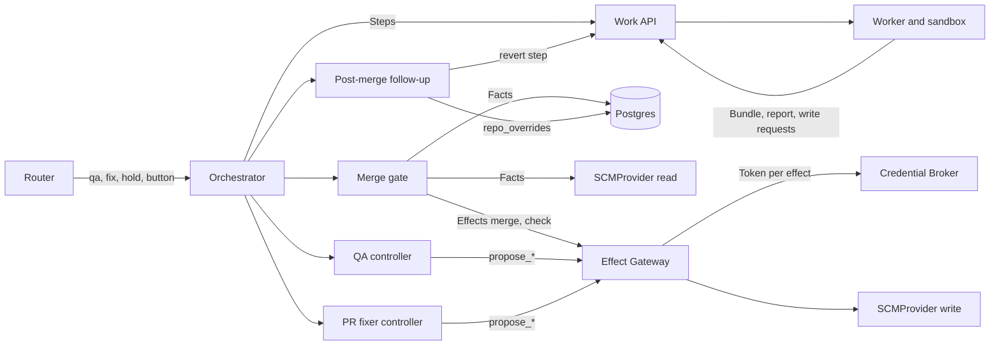
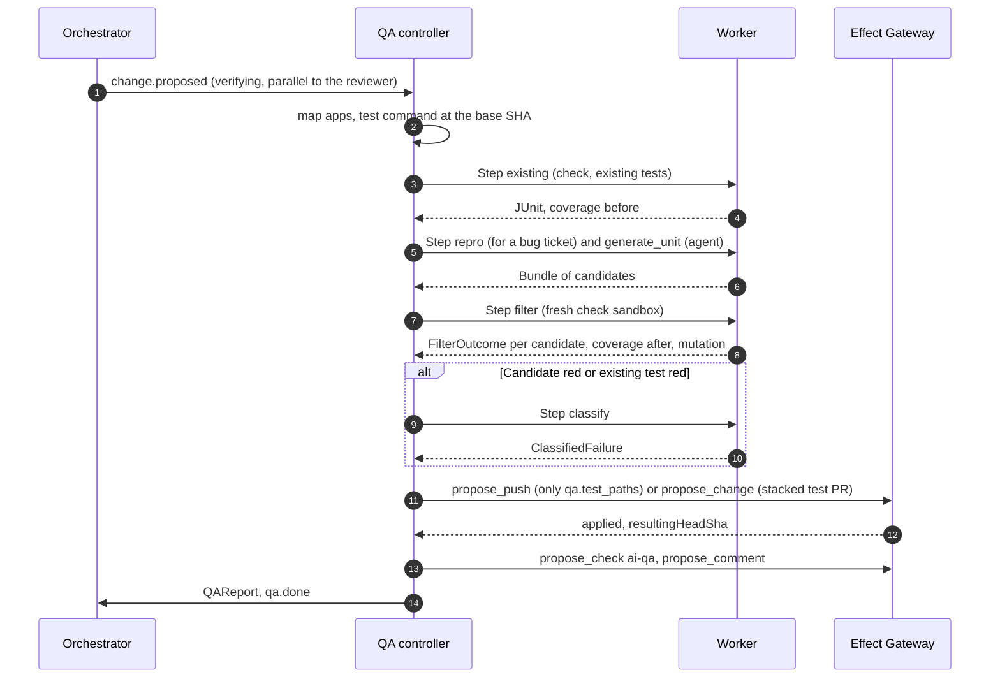
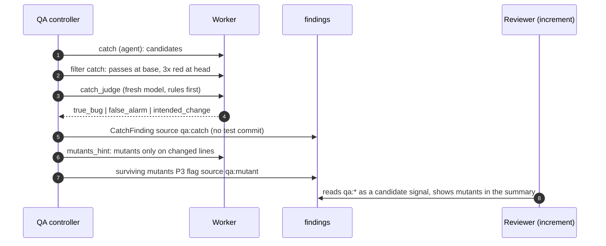
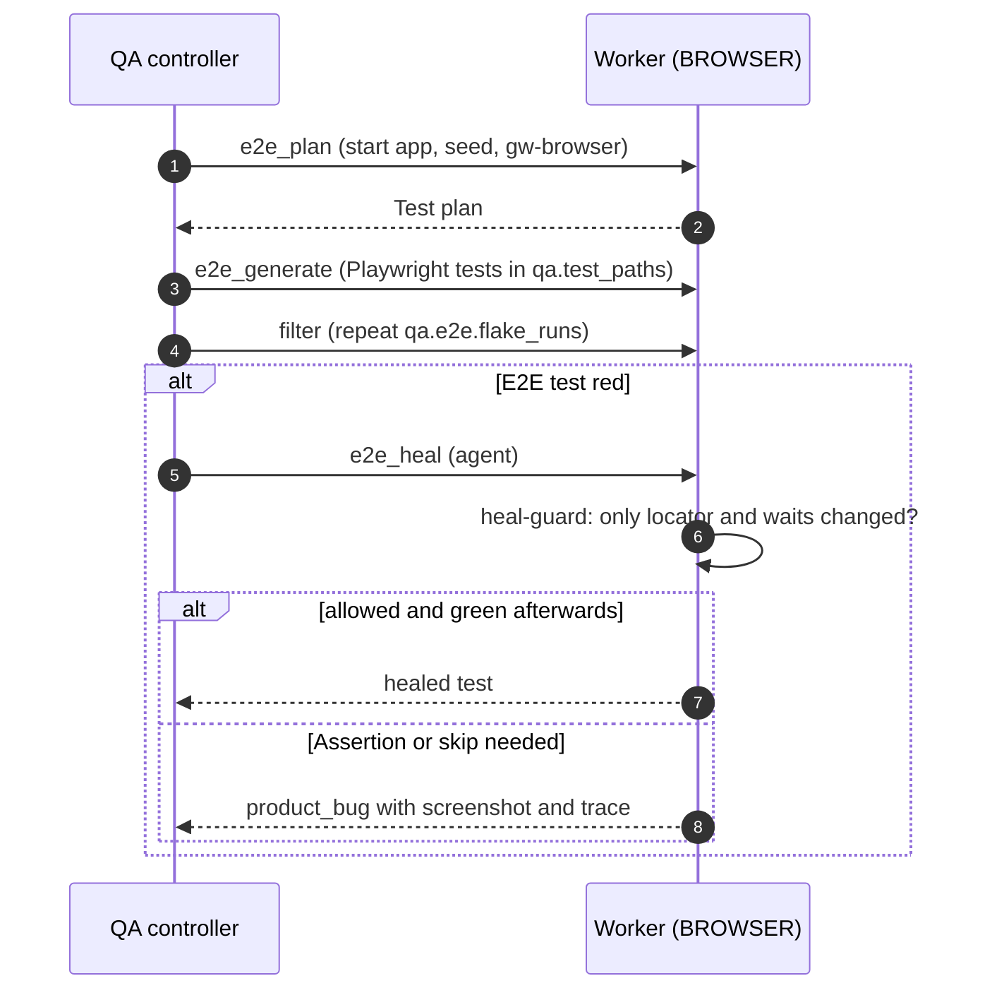
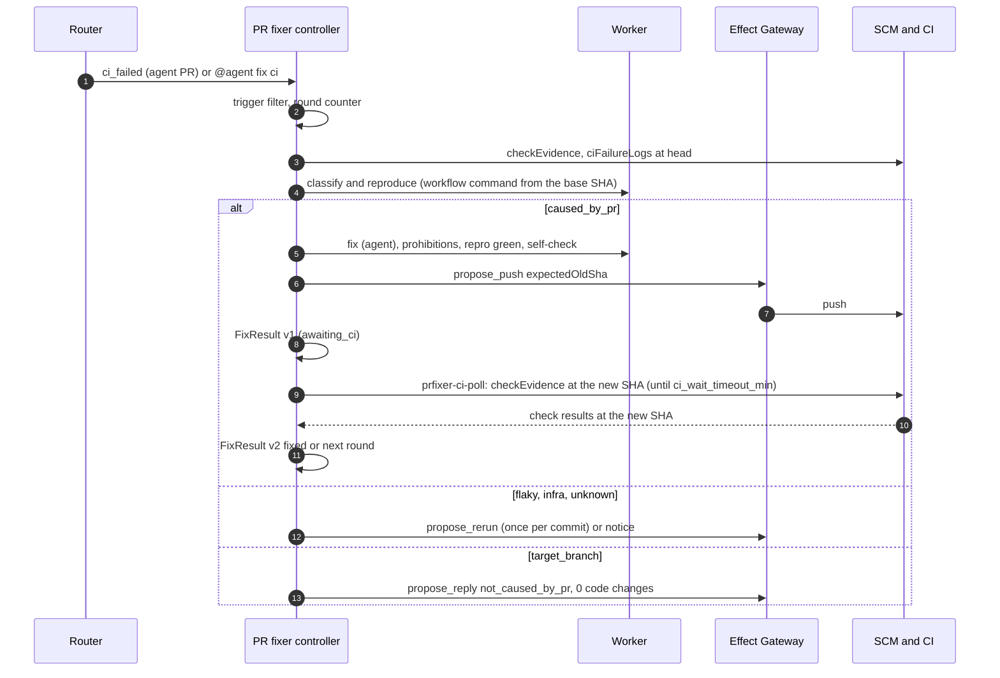
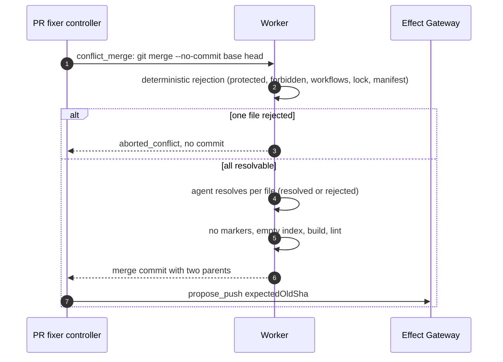
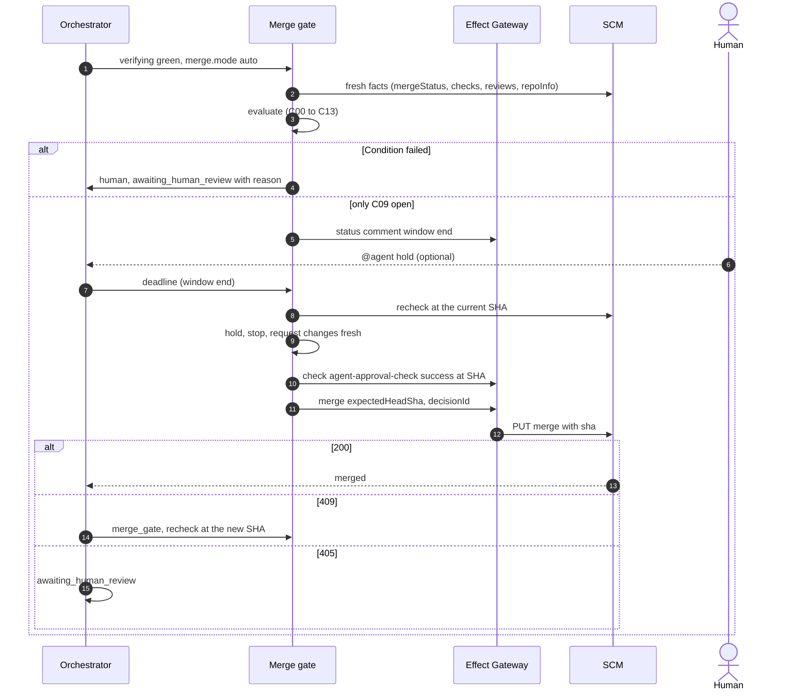
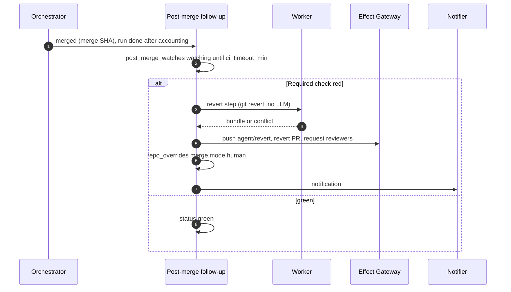

<!--
SPDX-License-Identifier: Apache-2.0
SPDX-FileCopyrightText: The Guildwork Authors
-->
# 11 QA, PR fixer and merge gate (stages 3, 4, 5)

Detailed design for the services `qa` and `prfixer`, the merge gate in the orchestrator, the merge via the SCM contract, the post-merge follow-up after the auto-merge and the autonomous pass. Rulings of this document: FE-1100 to FE-1199. Definitions for all documents (stack, package names) are in the [README](README.md) section 2; terms and classifications as in the [architecture README](../architecture/README.md).

## 1. Purpose and sources

This document makes three expansion stages buildable:

| Stage | Result | Architecture sources |
|---|---|---|
| 3 QA | Service `qa`: test paths only, discovery check, reproduction tests, unit tests with TestGen and mutation filters, E2E following the Playwright Agents pattern, failure classification, report as a check, stacked test PRs, sub-stage 3b Catching, mutants as a hint in the review | [02](../architecture/02-services.md) sections 0 and 5; [10](../architecture/10-standards-per-layer.md) section 7; [07](../architecture/07-eval.md) section 3.5; [08](../architecture/08-roadmap.md) stages 3 and 6; research [`ebene-qa-und-tests`](../research/ebene-qa-und-tests.md) |
| 4 PR fix | Service `prfixer`: review threads including human PRs, CI failures, conflicts, analyzer and security findings with a mandatory rescan, at most 3 attempts, no-op, check buttons, watch mode for agent PRs, `ticket-to-pr` with fix loop | [02](../architecture/02-services.md) section 6; [03](../architecture/03-flow-and-orchestration.md) sections 1, 2, 4, 5; [10](../architecture/10-standards-per-layer.md) section 8; [07](../architecture/07-eval.md) section 3.6; research [`ebene-pr-fix-und-ci`](../research/ebene-pr-fix-und-ci.md) |
| 5 Autonomous pass | Merge gate with all conditions from [03](../architecture/03-flow-and-orchestration.md) section 1a (including condition 12 provenance and the block of `auto` for `external_code`), table `merge_gate_decisions`, merge via the SCM contract with profile `merge`, waiting window, `@agent hold`, revert PR, fallback to `human`, `autonomy: full`, `merge.mode` first `shadow`, then `auto`, branch protection without bypass, watch mode on human PRs as opt-in (O9), S7 complete, shadow period | [03](../architecture/03-flow-and-orchestration.md) sections 1a, 2.1, 2.5, 3, 5; [01](../architecture/01-plugin-interfaces.md) section 5; [05](../architecture/05-security.md) sections 2, 3, 8; [07](../architecture/07-eval.md) section 5 S7; [10](../architecture/10-standards-per-layer.md) section 14 |

ADRs implemented here: ADR-06 (Effect Gateway, command covers effect), ADR-11 (finding state in the DB), ADR-14 (no approve for agent PRs, `merge` only SHA-bound), ADR-17 (configuration and rules from the base SHA), ADR-24 (`Untrusted<T>`), ADR-35 (chain of specialized services), ADR-36 (merge gate), ADR-40 (analyzers, SARIF), ADR-47 (`live` only with gate A and B), ADR-48 (isolation), ADR-50 (licenses of the tools), ADR-55 and ADR-56 (done criterion and statistics), ADR-58 (ModelProvider for mandatory single calls), ADR-59 (CI on agent branches like fork code), ADR-60 (provenance, no `auto` for `external_code`), ADR-63 (visibility), ADR-64 (registry cache offline, `propose_dependency`), ADR-65 (fail closed), ADR-66 (qualification profile), ADR-67 (run state machine as a table), ADR-68 (object lock); owner decisions O8 (autonomy and merge), O9 (stacked PR as default, watch on human PRs as opt-in), O18 and O19 (no outputs from CodeRabbit or SonarQube).

Prerequisites (other documents, connected only via Epics): run state machine, object lock and steps ([02-control-plane.md](02-control-plane.md), Epic `0-E05`), config resolver and policy (`0-E06`), limit ledger (`0-E07`), Effect Gateway (`0-E09`), Credential Broker (`0-E10`), Work API, platform MCP, worker and sandbox (`0-E11`, `0-E12`), GitHub plugin (`0-E14`), `claude-code` and ModelProvider (`0-E15`), findings and increment of the reviewer (`1-E04`, `1-E05`), shared agent building blocks with `foreign_input_seen` (`2-E01`), coder with hard gates and `agent-approval-check` (`2-E04`), analyzers in mode `run` and `quality-gate` (`2-E05`), CI on agent branches (`2-E06`), pipeline `ticket-to-pr` (`2-E07`), eval package (`0-E20`).

## 2. Modules and responsibility

### 2.1 Directories

```text
packages/contracts/src/artifacts/
  qa-report.ts            # QARequest, QAReport, GeneratedTest, FailureClass, CatchFinding (TypeBox)
  fix-result.ts           # FixRequest, FixResult, FixItem, OutOfScopeSuggestion
  merge-gate.ts           # MergeGateConditionId, ConditionResult, MergeGateDecision (for admin UI and eval)
  provenance.ts           # ProvenanceEntry (section 2.2, FE-1135)
services/qa/
  manifest.ts             # ServiceManifest (write requests per 02 section 0)
  src/controller.ts       # deterministic controller: choose scope, create steps, build report
  src/apps.ts             # mapping of diff to qa.apps[], test command per app
  src/steps/
    existing-tests.ts     # existing tests of the affected areas
    generate.ts           # agent step candidates (unit, repro, catch, e2e)
    filter.ts             # check step: filter chain (runs in the worker, FE-1101)
    classify.ts           # failure classification (FE-1108)
    catch-judge.ts        # checker for catch candidates (FE-1112)
    mutants-hint.ts       # mutants on changed lines (FE-1113)
    e2e/planner.ts, e2e/generator.ts, e2e/healer.ts, e2e/heal-guard.ts
  src/filters/
    build.ts, repeat.ts, discovery.ts, isolation.ts, assertion-audit.ts, value.ts
  src/tools/
    coverage/{lcov,cobertura,go-cover,jacoco}.ts   # normal form: ChangedLineCoverage
    mutation/{stryker,mutmut,pit,cargo-mutants}.ts # normal form: MutationReport (FE-1103)
    junit.ts              # read JUnit XML (discovery, FE-1102)
  src/output/
    check.ts              # check ai-qa (FE-1107)
    stacked-pr.ts         # test branch and stacked test PR (FE-1106)
    quarantine.ts         # quarantine proposals (FE-1109)
  src/library/e2e-smoke.ts  # library for the coder (02 section 3 stage 7)
  src/steps/types.ts        # agent stages and output schemas (section 2.7)
  src/worker/checks.ts      # check programs in the worker (section 2.8)
  rules/opengrep/qa-*.yaml   # assertion audit, network, fixed ports, time (FE-1104), each with test cases
  prompts/                   # versioned, prompt_v per stage (section 2.7)
  test/                      # Vitest, fixtures
services/coder/src/selfcheck/e2e-smoke.ts   # SelfCheckStep with id e2e_smoke, calls runSmoke (10 section 2.13, 3-E03-T06)
tools/gw-browser/            # helper in the image sandbox-e2e (section 2.3, FE-1110)
deploy/images/sandbox-e2e/   # sandbox image with Chromium, Playwright, gw-browser
services/prfixer/
  manifest.ts
  src/controller.ts
  src/collect/{threads,ci,conflict,static-analysis}.ts
  src/classify/ci-classifier.ts          # FE-1122
  src/ci/workflow-command.ts             # exact CI command from the workflow file at the base SHA
  src/steps/{reproduce,fix-agent,conflict-merge,rescan,self-check}.ts
  src/policy/forbidden-changes.ts        # prohibitions, FE-1125
  src/rounds.ts                          # round counter, FE-1120
  src/delivery.ts                        # commit or stacked PR, FE-1127
  src/watch.ts                           # watch subscriptions
  src/buttons.ts                         # check actions, FE-1129
  src/steps/types.ts, src/worker/checks.ts   # sections 2.7 and 2.8
  prompts/, test/
apps/control-plane/src/orchestrator/merge-gate/
  facts.ts                # load MergeGateFacts (FE-1140)
  conditions/c00-repo-class.ts ... c13-branch-protection.ts
  evaluate.ts             # pure function
  window.ts               # waiting window, recheck (FE-1142)
  execute.ts              # create merge effect, fencing (FE-1141, FE-1143)
  transitions.ts          # events of the states merge_gate and merging (section 4.9)
  shadow.ts               # shadow evaluation (FE-1148)
  post-merge.ts           # post-merge follow-up, revert job (FE-1145, FE-1146)
  override.ts             # fallback to human via repo_overrides
  combination-key.ts, autonomy-qualification.ts  # S7 evidence per combination (FE-1149)
  branch-protection.ts    # fact branchProtection for C13 and doctor (FE-1152)
apps/control-plane/src/pipeline/stages/qa.ts, prfixer.ts   # StageHandler per service (10 FE-1069), section 4.9
apps/control-plane/src/effects/policy/qa-paths.ts, prfixer-forbidden.ts, orchestrator-merge.ts, orchestrator-revert.ts
                          # checkers in the Effect Gateway (component effect-gateway; 3-E01-T04, 4-E01-T06, 5-E02-T02, 5-E02-T04)
packages/config/src/rules/merge-mode.ts     # resolver rule merge.mode (component config-resolver-regeln, 5-E03-T01)
services/qa/src/provenance.ts, verdict.ts, catch-mode.ts, filters/no-weakening.ts, judges/equivalence.ts, output/comment.ts
services/prfixer/src/accept.ts, finalize.ts, rerun.ts, watch-human.ts, provenance.ts, output/check.ts
apps/control-plane/src/admin/api/qa.ts, merge-gate.ts   # admin API of this area (section 2.12)
apps/admin-ui/src/pages/qa-quarantine.tsx, repo-overrides.tsx, merge-gate-shadow.tsx
apps/cli/src/doctor/branch-protection.ts    # doctor check merge.branch_protection
apps/worker/src/steps/revert.ts            # deterministic revert step without LLM
plugins/github/src/scm/merge.ts            # merge() with expectedHeadSha
plugins/github/src/scm/rerun.ts            # rerunFailedJobs(), fallback stage
plugins/github/src/scm/check-actions.ts    # check buttons
eval/adapters/tdd-bench/, eval/adapters/swt-bench/
eval/sets/q1 ... q5, qa-filters, f1, f1x, f2, f3, f4, f5, f6, prfix-rules   # sets in the format from 07 section 2.2 (FE-1153)
eval/references/qa.json, prfixer.json      # reference values read off (07 FE-738)
eval/suites/s7/                             # suite S7 (cross-cutting, 07 FE-736)
```

The merge gate is not a service: no manifest, no qualification row, no agent, no write request (ADR-36). That is why it lives in the orchestrator (FE-1100).

### 2.2 Shared artifact types

The artifacts are TypeBox schemas in `packages/contracts`, versioned with `artifactVersion`; they are stored in `artifacts` (JSON plus hash) and passed between stages only this way ([03](../architecture/03-flow-and-orchestration.md) section 1a point 3).

```ts
// packages/contracts/src/artifacts/qa-report.ts
export type QAScope = "unit" | "repro" | "catch" | "e2e" | "all" | "mutants_hint";   // mutants_hint: internal, FE-1115
export type QAVerdict = "pass" | "fail" | "blocked";
export type FailureClass = "product_bug" | "test_bug" | "flake" | "environment";

export interface QARequest {
  change: ChangeRef;
  scope: QAScope;
  targets?: string[];                    // paths, optional
  workItem?: WorkItemRef;                // bug ticket for repro
  plan?: { artifactId: string; hash: string };   // acceptance criteria, optional
  trigger: "change.proposed" | "command" | "pipeline" | "button";
}

export interface FilterOutcome {
  filter: "build" | "repeat" | "discovery" | "isolation_net" | "isolation_port" | "isolation_time"
        | "assertion_audit" | "value";
  passed: boolean;
  reason?: string;                       // rule ID or error text, truncated and redacted
  evidenceRef?: string;                  // BlobStore key (log, JUnit XML)
}

export interface GeneratedTest {
  id: string;                            // stable: hash(path, testName)
  path: string;                          // lies in qa.test_paths
  testName: string;
  kind: "unit" | "integration" | "repro" | "e2e";
  appendedTo?: string;                   // existing test file that was appended to
  filters: FilterOutcome[];
  value: { newCoveredLines: number; newCoveredBranches: number; killedMutants: string[] };
  accepted: boolean;                     // all filters green and value > 0
}

export interface ClassifiedFailure {
  test: string;                          // test ID in the test run
  class: FailureClass;
  confidence: "rule" | "model";
  evidenceRef: string;
  reruns: { outcome: "pass" | "fail"; at: string }[];
}

export interface CatchFinding {
  fingerprint: string;
  testRef: { path: string; testName: string; bundleRef: string };   // never committed
  passesAtBase: boolean; failsAtHead: number;                         // number of red runs at head
  verdict: "true_bug" | "false_alarm" | "intended_change";
  severity: "P0" | "P1" | "P2" | "P3";
  reasonMd: string;                      // with quote file:line
}

export interface ChangedLineCoverage { linesTotal: number; linesCovered: number; branchesTotal: number; branchesCovered: number }

export interface QAReport {
  artifactVersion: 1;
  runId: string;
  testedHeadSha: string;                 // state on which the tests ran
  resultingHeadSha?: string;             // after own test commit (FE-1106)
  verdict: QAVerdict;
  blockedReason?: "environment" | "flake_unresolved" | "no_test_command" | "no_qualified_pool" | "budget" | "error";
  tests: GeneratedTest[];
  existingTests: { command: string; passed: number; failed: number; reportRef: string }[];
  catchFindings: CatchFinding[];
  failures: ClassifiedFailure[];
  coverage: { before: ChangedLineCoverage; after: ChangedLineCoverage } | null;
  mutation?: { before: number; after: number; tool: string; toolVersion: string };   // score on changed lines
  evidence: { kind: "screenshot" | "video" | "trace" | "log" | "junit" | "lcov" | "mutation"; ref: string }[];
  output: { mode: "commit" | "pr" | "none"; branch?: string; changeNumber?: number };
  untrustedInputs: ProvenanceEntry[];    // for foreign_input_seen (condition 12)
}
```

```ts
// packages/contracts/src/artifacts/fix-result.ts
export type FixSource = "review_threads" | "ci_failure" | "merge_conflict" | "static_analysis" | "dependency_update";
export type FixOutcome = "fixed" | "no_fix_needed" | "not_caused_by_pr" | "rerun_requested" | "cannot_fix" | "aborted_conflict";
export type CiFailureClass = "caused_by_pr" | "flaky" | "infra" | "target_branch" | "unknown";

export interface FixRequest {
  change: ChangeRef;
  source: FixSource;                     // dependency_update: stage 10, until then rejection "unsupported"
  scope: "thread" | "review" | "pr";
  ids: string[];                         // thread IDs, job IDs or finding fingerprints
  trigger: "command" | "button" | "watch" | "pipeline" | "ci_failed";
  roundScope: "auto" | `human:${string}`;   // FE-1120
}

export interface FixItem {
  id: string;
  status: "fixed" | "no_fix_needed" | "not_caused_by_pr" | "rerun_requested" | "cannot_fix" | "rejected_forbidden"
        | "awaiting_ci" | "ci_not_observed";
  ciClass?: CiFailureClass;
  note: string;
}

export interface OutOfScopeSuggestion { path: string; reason: "workflow" | "lockfile" | "manifest" | "ci_config"
  | "threshold" | "test_removal" | "suppression"; patch: string }   // patch text, redacted, never committed

export interface FixResult {
  artifactVersion: 1;
  revision: 1 | 2;                       // FE-1121: 1 after the push, 2 after the CI result; not the schema version
  runId: string;
  outcome: FixOutcome;
  commits: { sha: string; branch: string; changeNumber: number; stacked: boolean }[];
  perItem: FixItem[];
  outOfScopeSuggestions: OutOfScopeSuggestion[];
  rounds: { scope: string; used: number; max: number; consecutiveOwnRed: number };
  rerun?: { sha: string; jobIds: string[]; viaFallback: boolean };
  untrustedInputs: ProvenanceEntry[];
}
```

```ts
// packages/contracts/src/artifacts/merge-gate.ts
// MergeGateConditionId and ConditionResult are given with comments in section 2.5; their home is this file,
// apps/control-plane/src/orchestrator/merge-gate/evaluate.ts imports them.
export interface MergeGateDecision {     // one row in merge_gate_decisions (section 3.1), read by admin UI and eval
  artifactVersion: 1;
  id: string;                            // UUIDv7
  runId: string; runVersion: number;
  repoKey: string; changeNumber: number; headSha: string;
  mode: "shadow" | "auto";
  phase: "initial" | "window_end" | "pre_merge" | "recheck_409";
  decision: "merge" | "wait_veto" | "human";
  conditions: ConditionResult[];
  failed: MergeGateConditionId[];
  windowEndsAt: string | null;
  combinationKey: string;                // FE-1149
  gateVersion: string;                   // GATE_VERSION from section 2.11
  createdAt: string;
  supersededBy: string | null;
}
```

The JSON Schemas of `QAReport`, `FixResult` and `MergeGateDecision` are generated from the TypeBox types as in [10](10-planner-architect-coder.md) FE-1061 and live under `packages/contracts/schemas/artifacts/v1alpha1/`; the field `schema` of a stored artifact names `guildwork-dev.github.io/v1alpha1/<Name>`.

`ProvenanceEntry` is not a separate type next to the provenance record from `2-E01`, but the part of it that a service knows itself (FE-1135):

```ts
// packages/contracts/src/artifacts/provenance.ts (contracts must not import agent-step, layering rule from 00)
export interface ProvenanceEntry {        // = Omit<UntrustedInputRecord, "runId" | "stepId" | "foreign" | "foreignReason"> from 10 section 2.8
  via: "prompt" | "mcp_tool" | "controller";   // "controller": read by the QA or PR fixer controller itself
  source: { kind: string; ref: string; author?: Actor; createdAt?: string; editedAt?: string };   // UntrustedSource, kind as in 10 section 2.3
  contentSha256: string;
  authorPermission: PermissionLevel | "unknown";
  triggerAt: string;
}
// Type test packages/agent-step/test/provenance-entry.types.test.ts (3-E01-T01): Omit<UntrustedInputRecord, ...> is
// assignable to ProvenanceEntry (expectTypeOf), so that the two forms do not drift apart. "controller" is missing in
// UntrustedInputRecord.via (gap in 10, section 10); until it is added, record() maps it to "prompt".
```

After storing a `QAReport` or `FixResult`, the controller calls `ProvenanceService.record(runId, stepId, report.untrustedInputs, tx)` in the same transaction ([10](10-planner-architect-coder.md) section 2.8); only the control plane computes `foreign`. Inputs already reported by the agent step's `UntrustedReporter` do not appear again in `untrustedInputs` (matched via `contentSha256` and `source.ref`); `untrustedInputs` carries only what the controller read itself (for example PR text for the mapping, thread texts during collection). Commit messages of human commits need `UntrustedSource.kind = "commit_message"` (gap in 10, section 10).

### 2.3 QA

**Controller** (`services/qa/src/controller.ts`, in the control plane process):

```ts
export interface QAController {
  plan(req: QARequest, snap: ConfigSnapshot): Promise<QAPlan>;          // which steps, which apps, which pool
  onStepResult(runId: string, step: QAStepResult): Promise<QANext>;    // deterministic, never from model text
  buildReport(runId: string): Promise<QAReport>;
}
export interface QAPlan {
  apps: ResolvedApp[];                   // from qa.apps[] with path_patterns match; empty means repo as one app
  steps: ("existing" | "repro" | "generate_unit" | "filter" | "classify" | "catch" | "catch_judge"
          | "e2e_plan" | "e2e_generate" | "e2e_heal" | "mutants_hint" | "output")[];
  pool: { requires: ("DOCKER_IN_DOCKER" | "BROWSER")[] };
}
export interface ResolvedApp {
  name: string; pathPatterns: string[];
  testCommand: string[];                 // FE-1105: from qa.apps[].test_command at the base SHA, else blueprint, else detection
  junitReportGlob: string;               // FE-1102
  start?: string; seed?: string; baseUrl?: string; readyCheck?: string;   // E2E only
}
```

**Test command and JUnit report** (`apps.ts`, FE-1105, FE-1138): the first source that yields a command wins; all files are read at the base SHA.

| Rank | Source | Command | `junitReportGlob` |
|---|---|---|---|
| 1 | `qa.apps[].test_command` (with `junit_report`) | as configured | `junit_report`, mandatory next to `test_command` (the resolver rejects one without the other) |
| 2 | `commands.test` from `.agents/environment.yaml` ([10](10-planner-architect-coder.md) section 2.4); coverage from `commands.coverage` | as in the blueprint | `commands.junit`; if missing, rank 2 does not apply (without JUnit no discovery evidence, FE-1102) |
| 3a | `package.json` with `scripts.test`, package manager from the lockfile (`pnpm-lock.yaml`, `yarn.lock`, `package-lock.json`) | `<pm> run test` plus reporter arguments of the detected runner (Vitest, Jest, Playwright) | `reports/junit-*.xml` |
| 3b | `pyproject.toml`, `pytest.ini`, `setup.cfg` or `tox.ini` with a pytest section | `python -m pytest --junitxml=reports/junit-pytest.xml` | `reports/junit-pytest.xml` |
| 3c | `go.mod` | `go test -json ./...`, conversion to JUnit by the adapter `tools/junit.ts` from the JSON stream (own code, no extra tool) | `reports/junit-go.xml` |
| 3d | `*.sln` or `*.csproj` | `dotnet test --logger "trx;LogFileName=gw.trx"`, conversion of TRX to JUnit in the adapter | `reports/junit-dotnet.xml` |
| otherwise | no source | no command: `verdict = blocked`, `blockedReason = no_test_command` | |

The reporter arguments per runner (Vitest `--reporter=junit --outputFile`, Jest with `jest-junit`, Playwright `--reporter=junit`) and the formats of `go test -json` and TRX are unverified; 3-E01-T05 reads them at the source and backs each with a fixture (section 10). If a runner needs an extra package (for example `jest-junit`), rank 3 does not apply to this app and the report says "set `qa.apps[].test_command` with `junit_report`".

**Filter chain** (`services/qa/src/filters/*`, check step in the worker, FE-1101): The agent step delivers only a bundle with test files. The filter step starts a **fresh** sandbox from the same snapshot, applies the bundle and checks with role `check` (no agent processes, no LLM):

```ts
export interface CandidateFilter {
  id: FilterOutcome["filter"];
  run(ctx: FilterContext, candidates: CandidateTest[]): Promise<Map<string, FilterOutcome>>;
}
export interface FilterContext {
  sandbox: SandboxHandle; app: ResolvedApp; baseSha: string; headSha: string;
  changedLines: Map<string, number[]>;   // path -> changed lines at head
  config: QAConfig;
}
```

Order and rule (each stage discards, nothing is repaired):

| No. | Filter | Rule | Source |
|---|---|---|---|
| 1 | `build` | The test command compiles or loads the candidates without errors | 02 section 5 stage 4 |
| 2 | `discovery` | The app's standard test command finds and executes every candidate: the test ID appears in the JUnit XML with status `passed` (FE-1102) | 02 section 5, [ms-skills] |
| 3 | `repeat` | The candidate passes `qa.flake_runs` runs (default 5) in a row, each with a different `TZ` and `LANG` (FE-1104) | 02 section 5 |
| 4 | `isolation_net` | Run with `network: none` (not even the egress proxy); network access makes the test fail, so it drops out at 3; additionally Opengrep rule `qa-net-literal` (URLs, hosts) | 02 section 5 |
| 5 | `isolation_port` | Opengrep rule `qa-fixed-port` (fixed port numbers in test files) | 02 section 5 |
| 6 | `isolation_time` | Opengrep rule `qa-wallclock` (wall clock time without injection), TZ variation from 3 | 02 section 5 |
| 7 | `assertion_audit` | Opengrep rules `qa-assert-*`: no empty tests, no tautologies (`expect(x).toBe(x)`, `assert True`), no tests without an assertion, no `skip`/`only` | [ms-skills] `test-quality-auditor` |
| 8 | `value` | covers at least one new line or branch of the changed lines **or** kills at least one non-equivalent mutant (equivalence judge via ModelProvider, FE-1103) | 02 section 5, [testgen], [ach] |

**Tool adapters** (run in the sandbox, output in normal form):

```ts
export interface CoverageTool {
  id: "lcov" | "cobertura" | "go-cover" | "jacoco";
  languages: string[];
  run(sb: SandboxHandle, app: ResolvedApp, testIds: string[] | "all"): Promise<Result<{ reportRef: string }>>;
  changedLineCoverage(reportRef: string, changed: Map<string, number[]>): Promise<ChangedLineCoverage>;
}
export interface MutationTool {
  id: "stryker-js" | "stryker-net" | "mutmut" | "pit" | "cargo-mutants";
  license: string;                       // Apache-2.0, BSD-style, MIT per the research (read there firsthand)
  languages: string[];
  run(sb: SandboxHandle, app: ResolvedApp, scope: { files: string[]; lines: Map<string, number[]> },
      limits: { maxMutants: number; timeoutMs: number }): Promise<Result<MutationReport>>;
}
export interface MutationReport {        // normal form modeled on the mutation-testing-report-schema (FE-1103, unverified)
  toolVersion: string;
  mutants: { id: string; file: string; line: number; mutator: string; status: "killed" | "survived" | "timeout" | "no_coverage" | "error";
             killedBy?: string[] }[];
}
export interface EquivalenceJudge {      // ModelProvider single call, mandatory per ADR-58
  judge(m: { file: string; line: number; original: string; mutated: string; context: string }): Promise<"equivalent" | "not_equivalent" | "unsure">;
}
```

`unsure` counts like `equivalent` (the mutant does not count as value). Reason: a test may only pass with proven value.

**Agent steps** (`generate`, `catch`, `e2e_*`) use the shared building blocks from `2-E01` (`AgentTask` with `nativeTools: "edit+shell"`, egress only to the control plane, LLM via relay, registry cache offline). Input is only the diff, ticket, plan acceptance criteria, guidelines from the base SHA and marked `Untrusted` context; output is a bundle plus a structured list of candidates (`outputSchema`).

**Failure classification** (`classify.ts`, FE-1108) after every red run:

```ts
export interface FailureClassifier {
  classify(f: RawFailure, ctx: { reruns: number; sandboxExit: SandboxExit; isNewTest: boolean;
           baseResult?: "pass" | "fail" }): Promise<ClassifiedFailure>;
}
```

| Step | Rule | Result |
|---|---|---|
| 1 | Sandbox exit shows OOM, sandbox time limit, image pull, registry cache "not present", DNS, proxy rejection | `environment` |
| 2 | Repetition at the same state (`qa.classify_reruns`, default 3): at least one run green and one red | `flake` |
| 3 | consistently red, test newly generated and the stack trace ends in the test file before reaching product code (setup, import, fixture) | `test_bug` |
| 4 | otherwise: judge via ModelProvider (`models.classifier`) with diff, error, stack trace; answer with a quote | `product_bug` or `test_bug` |
| 5 | Judge without a valid quote or `unsure` | `product_bug` (doubt blocks) |

An existing test that is red is never `test_bug` from step 3 (it does not come from QA), at most from step 4.

**Verdict rule** (deterministic): `fail` if a `product_bug` exists or an existing test is `test_bug`; `blocked` if a class `flake` or `environment` remains after repetition or a `blockedReason` is set; otherwise `pass`. A `flake` or `environment` never leads to `pass` with merge effect ([03](../architecture/03-flow-and-orchestration.md) section 1a condition 4). If `flake` or `environment` remains after classification, the pipeline stage `qa` (`pipeline/stages/qa.ts`) restarts the QA run exactly once at the same head (counted from the completed QA steps of the run in `steps` with the same `testedHeadSha`, at most two per head; no separate field); if it stays that way, the result is `blocked` (3-E04-T04). A test in `qa_quarantine` with status `approved` keeps running; its red counts as `flake` in the report and does not block, its green does not count as evidence for `pass` of a new test.

**Quarantine proposal** (`output/quarantine.ts`, FE-1109, FE-1136): after every run, the classification writes one row per test into `qa_flake_observations` (`pass` or `fail`; only runs at the same SHA with mixed results count as a flake observation). A proposal (`status = proposed`) is created if `qa.quarantine.auto_propose` is on and a test had at least one green and one red run each at at least `qa.quarantine.min_flaky_shas` different SHAs in the last `qa.quarantine.window_days`. Approval sets `expires_at = decided_at + expiry_days`; the job `qa-quarantine-expire` (daily, registered in the queue registry from 02) sets expired entries to `expired`. Lifting (`lifted`) via the same admin route with `decision: "lifted"` (role `approver`).

**E2E** (FE-1110, FE-1111): three agent steps following the pattern of the Playwright Test Agents, but without Playwright MCP; the sandbox image contains Chromium, Playwright and the helper `gw-browser`:

```text
gw-browser open <url>            # opens page, returns ARIA snapshot as JSON (locator.ariaSnapshot)
gw-browser snapshot              # current ARIA snapshot
gw-browser act <json-step>       # click, fill, select with role and name
gw-browser screenshot <name>     # evidence, ends up in the BlobStore via uploadUrl
```

```ts
// tools/gw-browser/src/types.ts: every output is one JSON line on stdout; exit code 0 on ok, 2 on error
export type GwBrowserStep =
  | { action: "click"; role: string; name: string }
  | { action: "fill"; role: string; name: string; value: string }   // value never in logs
  | { action: "select"; role: string; name: string; option: string };
export interface GwBrowserResult {
  ok: boolean;
  url: string;
  aria?: string;                         // text of locator.ariaSnapshot (format per Playwright docs, unverified)
  screenshotRef?: string;                // BlobStore key after upload via uploadUrl
  error?: { code: "timeout" | "not_found" | "navigation_failed" | "password_field"; message: string };
}
```

**Image `sandbox-e2e`** (`deploy/images/sandbox-e2e/Dockerfile`, 3-E03-T01): sandbox image of the execution ([03](03-execution.md) section 2.7) plus Chromium, Playwright with JUnit reporter and `gw-browser`, versions pinned; licenses via the license gate (ADR-50). A pool reports the capability `BROWSER` only if the contract test `apps/worker/test/contract/browser.contract.test.ts` is green for its isolation (M46, section 10). `screenshot` refuses with `password_field` as long as the page shows a filled `password` field (section 6).

- `e2e_plan`: explores the app starting from `qa.apps[].start` and `seed`, derives scenarios from the diff and acceptance criteria, output is a test plan (Markdown plus schema).
- `e2e_generate`: writes Playwright tests into `qa.test_paths`; filter chain as above (with `qa.e2e.flake_runs`, default 3).
- `e2e_heal`: only for a red existing or new E2E test. The **heal guard** (`heal-guard.ts`, deterministic) compares the AST before and after the healing:

| Change | allowed |
|---|---|
| Locator arguments (`getByRole`, `getByText`, `locator(...)`), wait calls (`waitFor`, `toBeVisible` as a wait assertion before interaction), timeouts up to `qa.e2e.max_timeout_ms` | yes |
| Removing, weakening or changing an assertion (`expect`), `test.skip`, `test.fixme`, `test.fail`, `.only`, deleting steps | no |

If a disallowed change is needed, the result is a `ClassifiedFailure` of class `product_bug` with evidence (screenshot, trace), never a healed test (false healing target 0).

**Extension point accessibility (stage 10):** An analyzer against the started app (axe-core, [01](../architecture/01-plugin-interfaces.md) section 12, stage 10 per the architecture) does not belong to stages 3 to 5. It docks on in stage 10 as an additional step `e2e_a11y` after `e2e_generate`; `QAPlan.steps` is extended additively for it, the verdict rule and filter chain stay unchanged (findings only as `findings` with `kind: "flag"`). Defined in [15](15-stage-10-edge-layers.md) section 2.6.1 (K13, FE-1526, FE-1527); the stage 3 tasks build nothing in advance for it, only the order `e2e_plan`, `e2e_generate`, `e2e_heal` stays a fixed list in `controller.ts`, into which 10-E04-T01 inserts the step.

**E2E smoke library** (`library/e2e-smoke.ts`): `runSmoke(app, sandbox): Promise<{ passed: boolean; evidence: Evidence[] }>` starts the app, opens the start page and the routes touched by the diff and stores screenshots. The coder calls it for diffs in `qa.apps[].path_patterns` ([02](../architecture/02-services.md) section 3 stage 7); model and `prompt_v` belong to the coder's profile (ADR-66). The library uses no model.

**Docking point in the coder's self-check** (3-E03-T06): `services/coder/src/selfcheck/e2e-smoke.ts` exports a `SelfCheckStep` with `id: "e2e_smoke"` ([10](10-planner-architect-coder.md) section 2.13, `SelfCheckItem.id` already knows the value). `run` determines the apps like `apps.ts` (diff against `qa.apps[].path_patterns` at the base SHA); if no app matches, the result is `skipped` with `detail: "no app affected"`. Otherwise it calls `runSmoke` per app and returns `passed` or `failed` with `blocking: true` and `logRef` pointing to the evidence; if the pool does not report `BROWSER`, the result is `skipped` with `detail: "no pool with BROWSER"` and `blocking: false` (the report shows it, the self-check stays green). The step is entered into the list `steps` of `runSelfCheck`; the runner itself does not change.

**Catching** (sub-stage 3b, FE-1112): `catch` generates diff-aware tests with the intent of making a behavior change of the diff visible. A candidate counts only if it passes at the base SHA and fails at the head in 3 of 3 runs. Checkers in order:
1. Rules: error in setup, import or in fixtures → discard; assertion checks text from plan acceptance criteria as the new expected behavior → `intended_change`.
2. Fresh model (`models.catch_judge`) without the generator's context: diff, ticket, plan, candidate and error message; verdict `true_bug | false_alarm | intended_change` with a quote; severity P0 to P3.

The result is a `CatchFinding` in `findings` with `source: "qa:catch"` and, for P0/P1 `true_bug`, a `request_human_input` with evidence; never a test commit.

**Mutants as a hint** (FE-1113): scope `mutants_hint` on PR events if `qa.mutants_hint.mode` is not `off`. Mutants only on changed lines, at most `max_per_line` (default 1) per line and `max_per_review` (default 5) per PR, selection by mutator rank (operators with historical value first, starting rank fixed in code, pattern [google-mut]). Surviving mutants go into the DB as `findings` with `kind: "flag"`, severity P3, `source: "qa:mutant"`; the reviewer's summary shows them in the section "Surviving mutants", never inline.

**AST comparison for repair and healing** (`filters/no-weakening.ts`, `steps/e2e/heal-guard.ts`): both read the old and new version with `web-tree-sitter` and the grammars from the reviewer's `grammars.lock.json` ([08](08-reviewer.md), 1-E02-T04); a language without a grammar yields "discarded" (fail closed). The following count as weakening: fewer assertion calls than before; a matcher from the list `STRONG_MATCHERS` (for example `toBe`, `toEqual`, `toStrictEqual`, `assertEqual`, `assert x == y`) replaced by one from `WEAK_MATCHERS` (for example `toBeDefined`, `toBeTruthy`, `not.toBeNull`, `assertIsNotNone`, `assertTrue`); a new skip marker from `SKIP_MARKERS` of the coder's hard gates ([10](10-planner-architect-coder.md) section 6.3); deleted test functions. Both lists are constants in `services/qa/src/filters/matchers.ts` with one fixture per entry; the entries above are examples, the complete lists for TypeScript, Python, Go and C# are defined by 3-E02-T06 (the heal guard uses only the TypeScript part, Playwright tests are TypeScript).

**App start for E2E** (`steps/e2e/app.ts`, check program `qa.e2e_app`): `seed` runs before `start` as a command with exit code 0 (otherwise `environment`); `start` runs in the background via `SandboxHandle.spawn`; `ready_check` is a URL (`http://` or `https://`, ready at status 2xx) or a command (ready at exit code 0) and is checked every second until `qa.e2e.ready_timeout_s` expires; `baseUrl` from `qa.apps[].base_url`, otherwise the URL from `ready_check`. The logs of `start` are evidence (kind `log`, redacted).

**Smoke routes** (`library/e2e-smoke.ts`): "routes touched by the diff" are the entries from `qa.apps[].smoke_routes` (`{ paths: Glob[], route: string }`) whose `paths` match a changed file; without an entry only the start page. There is no derivation of routes from the code.

**Report as check and comment** (`output/check.ts`, `output/comment.ts`, FE-1107): check `ai-qa` at the `testedHeadSha` (or `resultingHeadSha`) with title `QA: <verdict>, <n> neue Tests, <m> verworfen` and a summary in this order: result with reason for `blocked`; new tests (table: test, kind, value in lines and mutants); discarded candidates (collapsible: filter and rule ID); failure classes (test, class, evidence link into the admin UI); coverage of changed lines before and after; note "standard not proven" for an operator deviation (ADR-47). The same text goes out as one comment per PR via `propose_comment` (upsert via the effect marker, one QA comment per PR). If the text is longer than the hoster's limit, it is truncated from the end and a link to the Run Record is appended (limit unverified, 3-E01-T06 verifies it at the contract test).

### 2.4 PR fixer

**Controller** (`services/prfixer/src/controller.ts`):

```ts
export interface PrFixerController {
  accept(ev: ResolvedEvent, snap: ConfigSnapshot): Promise<FixRequest | Skipped>;   // trigger and bot filter
  plan(req: FixRequest): Promise<FixPlan>;
  onStepResult(runId: string, r: FixStepResult): Promise<FixNext>;
  finalize(runId: string, ci: CheckEvidence[] | "timeout"): Promise<FixResult>;
}
export interface FixPlan {
  source: FixSource;
  items: { id: string; kind: "thread" | "ci_job" | "conflict" | "finding" }[];
  steps: ("collect" | "classify" | "reproduce" | "fix" | "conflict_merge" | "rescan" | "self_check" | "deliver" | "await_ci")[];
  delivery: { mode: "agent_branch" | "stacked_pr"; branch: string; base: string; expectedOldSha: string };
}
```

**Extension through modes (stage 10):** The modes `dependency_update` and `ci_doctor` are strategies `PrFixerMode` of the same controller ([15](15-stage-10-edge-layers.md) section 2.4, FE-1543; component `prfixer-modi`). From stage 10 on, `accept` returns the type `FixRequest | CiDoctorRequest | Skipped` and `finalize` returns a `CiDoctorReport` instead of `FixResult` for a `ci_doctor` run. So that this stays additive, the following already applies in stage 4: `accept` first checks the core sources (table "Collecting") and then queries the list of modes from `services.prfixer.modes` (empty until stage 10, no mode registered); a mode that returns `null` is not responsible. `FixSource` already contains `dependency_update` (section 2.2); until stage 10, `accept` rejects it with `Skipped(unsupported)`.

**Collecting** (`collect/*`):

| Source | Input | Rules |
|---|---|---|
| `review_threads` | `getThreads(ref, false)` at the head SHA | open threads with `agent_prompt` (own reviewer) and human threads without; author is a human with write access or a bot from `bot_allowlist`; text as `Untrusted` |
| `ci_failure` | `checkEvidence(repo, head)`, `ciFailureLogs(repo, head, prfixer.max_log_bytes)` | only runs of the head SHA; the same error signature across jobs only once (signature: normalized last 40 lines without timestamps, hash); logs `Untrusted` |
| `merge_conflict` | `mergeStatus(ref)` with `conflicts: true` | conflict files from a merge simulation in the sandbox |
| `static_analysis` | `AnalyzerReport` at the head (own `run` or `ingest`), code scanning alerts via `ingest` | only findings with `llmUse: allowed`; SonarQube sources are never input (O19, ADR-50) |

**Exact CI command** (`ci/workflow-command.ts`): reads the workflow file of the red job **at the base SHA** (never from the head), resolves the job's matrix values and returns the `run:` steps up to and including the red step as a command sequence without secrets (`${{ secrets.* }}` is set to empty and noted). Steps with `uses:` are not executed; if the red step is a `uses:` step, the failure counts as not reproducible (FE-1121).

**CI classification** (`classify/ci-classifier.ts`, FE-1122):

| Step | Check | Class |
|---|---|---|
| 1 | Same job with the same signature red at the current target branch head (`checkEvidence(repo, baseHead)`) | `target_branch` |
| 2 | Signature matches an infrastructure pattern (runner lost, network, 5xx of the registry, abort by the hoster) | `infra` |
| 3 | The same job at the same SHA was already green once, or a red/green switch without code change in the recent runs | `flaky` |
| 4 | Reproduction in the sandbox red at the head and green at the merge base | `caused_by_pr` |
| 5 | Reproduction red at the head and also red at the merge base | `target_branch` |
| 6 | Reproduction green at the head | `flaky` |
| 7 | not reproducible (step with `uses:`, sandbox error) | `unknown` |

Consequence: `caused_by_pr` → fix; `flaky`, `infra`, `unknown` → at most one rerun per commit, otherwise `cannot_fix` with class; `target_branch` → `not_caused_by_pr` with justification and 0 code changes.

**Fix step** (agent, `nativeTools: "edit+shell"`): receives only the items, the error output of the reproduction, the guidelines from the base SHA and `.agents/rules/fix.md`, if present. Afterwards, deterministically in the worker:
1. **Prohibitions** (`policy/forbidden-changes.ts`, FE-1125); matches are removed from the bundle and stored as an `OutOfScopeSuggestion` with patch text. In stages 4 and 5 there is no exception. The only later exception (stage 10, [15](15-stage-10-edge-layers.md) K11, FE-1516) exempts only the categories manifest and lockfile, and only if `FixRequest.source = "dependency_update"` and the bundle carries the check note `lockfile_regenerated: <hash>` of the package manager step whose hash matches the manifest and lockfile in the bundle; all other categories (workflows, CI configuration, tests, thresholds, suppression markers) stay forbidden. The worker detector and the gateway checker `prfixer.forbidden_changes` already accept the context `{ source, lockfileRegenerated? }` from stage 4 on and do not evaluate `lockfileRegenerated` until stage 10.
2. **Reproduction command again** in a fresh check sandbox: green required.
3. **Self-check bundle** ([02](../architecture/02-services.md) section 0) as with the coder (`2-E04`).
4. For `static_analysis`: **rescan** (FE-1126).

**Conflict sub-stage** (`steps/conflict-merge.ts`, FE-1124): merge simulation `git merge --no-commit <base-head>` in the sandbox; the agent resolves per file and reports `resolved | rejected(reason)`. Rejected deterministically (without agent): every conflict file in `approvals.protected_paths`, `forbidden_paths`, workflows, lockfiles, manifests. One rejected file aborts the whole attempt without a commit (`aborted_conflict`). Afterwards: no conflict markers (`<<<<<<<`, `=======`, `>>>>>>>` at the start of a line), empty merge index, build and lint green (the steps `build` and `lint` of the self-check bundle from `2-E04` with its rule for missing commands); the result is a merge commit with two parents, also on agent branches (no rebase).

**Delivery** (`delivery.ts`, FE-1127):

| PR kind | Delivery | Branch |
|---|---|---|
| Agent PR on `agent/*` | Commit on the agent branch | existing head branch, `expectedOldSha` = head |
| human PR | Stacked PR against the PR's head branch | `agent/fix/<pr>-<n>`; with `agent_fork` in the agent fork |
| own stacked PR exists and is open | Commit into this stacked PR | existing `agent/fix/*` |
| Watch mode on a human PR (stage 5, opt-in) | like a human PR: stacked PR, one commit into the same PR per round | `agent/fix/<pr>-watch` |

**Waiting for real CI** (`finalize.ts`, phase `await_ci`, FE-1121, FE-1137): After the push, the controller writes `FixResult` with `revision: 1` (items `awaiting_ci`) and sets the step's deadline to `ci_wait_timeout_min`. There is no event "check green" in the vocabulary ([05](05-plugins-and-contracts.md) section 2.11.1); therefore the job `prfixer-ci-poll` (interval `prfixer.ci_poll_interval_s`, one job per run with phase `await_ci` with `singletonKey = runId`) queries `checkEvidence(repo, newSha)`. Once all jobs that were red before are completed at the new SHA, it calls `finalize(runId, checks)`: all green yields `fixed`, otherwise the next round (counts in `prfix_rounds`; a job that was green before and is red now increments `consecutive_own_red`). A `ci_failed` event at the new SHA acts immediately like a query with a red result. Expiry of the deadline: `finalize(runId, "timeout")` with `ci_not_observed`. For the source `review_threads` without red CI the phase is skipped; `fixed` is then set by the increment review that confirms the thread as `addressed`.

**Round counter** (`rounds.ts`, FE-1120): one row in `prfix_rounds` per (repo, PR, `roundScope`). Automatic triggers (watch, pipeline, `ci_failed`) share `roundScope = "auto"`; a click on a check button counts like an explicit `@agent fix` by the person clicking (FE-1129); rounds between reviewer and fixer count jointly there (one fix push plus the following increment review is one round). An explicit `@agent fix` by a human with write access gets `human:<run_id>` with its own at most `max_rounds`. `consecutiveOwnRed`: counts own consecutive commits after which a previously green job is red; at 3 the run ends ([02](../architecture/02-services.md) section 6 stage 8).

**Bot loop protection** (`controller.accept`): triggers only from humans with write access (checked fresh at the provider) and bots from `prfixer.bot_allowlist` (default `self` = own reviewer). Events with `actor` = own app (push of the Effect Gateway, own comments) never create a fix, only an increment review via the pipeline or the watch subscription. The route `pipeline.ci_failed` filters by the property agent PR (opened by the app, commit chain from `effects`, no fork), not by the branch name (M91).

**Check buttons** (`buttons.ts`, FE-1129): check `ai-fix` with at most 3 actions `fix_review`, `fix_ci`, `fix_conflict`, only visible if the respective source is open; check `ai-review` with action `fix_review`. The event `button` (`check_run.requested_action`) is handled in the router like the command `fix` with an argument, including the permission check of the person clicking (`command_permissions.fix`).

**Watch subscriptions** (`watch.ts`): one row in `watch_subscriptions`. Agent PRs get a subscription if `prfixer.watch.on_agent_prs: true` and the PR was opened by a pipeline (the pipeline holds the object; events are delivered to it, ADR-68). Triggers: `ci_failed` at the head, a review with P0/P1 from the own reviewer or a human "request changes", `mergeStatus.conflicts`. End: PR closed or merged, round limit, `@agent stop`, `@agent ignore`, deactivation by configuration. Green CI ends only the running fix round, not the subscription (the Epic goal "end on green" in `4-E04` means the round); a later red run at the next head triggers again as long as the round limit has not been reached.

### 2.5 Merge gate and post-merge follow-up

```ts
// apps/control-plane/src/orchestrator/merge-gate/evaluate.ts
// MergeGateConditionId and ConditionResult live in packages/contracts/src/artifacts/merge-gate.ts (section 2.2)
export type MergeGateConditionId =
  | "C00_repo_class"          // no auto for external_code (ADR-60), fresh per claim
  | "C01_config"              // autonomy full, merge.mode auto on all layers, no tightening repo_override, S7 evidence (FE-1149)
  | "C02_qualification"       // every contributing service live with a qualified row for exactly its qualification_key
  | "C03_review"              // reviewer run at head, 0 open findings in block_on_severity
  | "C04_qa_and_checks"       // QA pass at head (or off and skip allowed), no open catch P0/P1 true_bug, required checks green
  | "C05_self_check"          // self-check bundle green, hard gates 0, quality-gate green at head (once analyzers run)
  | "C06_protected_paths"     // no protected_path, or G4 by CODEOWNER at the current SHA
  | "C07_size_and_deps"       // diff below max_diff_lines, new dependencies with a green osv match
  | "C08_no_objection"        // no request changes, no stop, no hold, no handed_off, budget ok, mergeable without conflict
  | "C09_veto_window"         // waiting window expired, recheck at the then current SHA
  | "C10_agent_pr"            // agent PR on agent/*, in the repo or agent fork, no other fork
  | "C11_commit_chain"        // every commit base..head pushed by the Effect Gateway
  | "C12_provenance"          // no untrusted input from persons without write access or after the trigger
  | "C13_branch_protection";  // evidence of the branch protection variant (03 section 1a, 05 section 2 point 5)

export interface ConditionResult {
  id: MergeGateConditionId;
  passed: boolean;
  reason: string;                        // machine-readable reason, for example "reviewer_p1_open:fp_ab12"
  evidence: Record<string, unknown>;     // only IDs, SHAs, counters; never foreign text
  readAt: string;                        // time of the provider read
}
export interface MergeGateFacts {        // loaded by facts.ts; if a fact is missing, the condition fails (fail closed)
  run: { id: string; version: number; autonomy: Autonomy; mode: "shadow" | "auto"; flags: { hold: boolean; stop: boolean; handedOff: boolean };
         budgetExhausted: boolean; foreignInputSeen: ProvenanceEntry[]; triggerAt: string };
  snapshot: { effectiveConfig: EffectiveConfig; qualificationKeys: Record<ServiceId, string>; combinationKey: string };
  repo: { classAtClaim: "private_own" | "external_code"; visibility: "public" | "internal" | "private"; overrides: RepoOverride[] };
  change: ChangeRef & { headRef: string; openedByApp: boolean; fromFork: boolean; inAgentFork: boolean };
  commitsBaseToHead: string[];           // compare(base, head)
  gatewayPushedShas: Set<string>;        // from effects (applied, kind push), this repo
  contributions: { service: ServiceId; kind: "artifact" | "commit" | "approval" | "trigger" }[];
  qualification: Record<string, { qualified: boolean; viaDeviation: boolean; gateBStatus: string }>;
  review: { headSha: string; openBySeverity: Record<"P0" | "P1" | "P2" | "P3", number> } | null;
  qa: { report: QAReport | null; mode: "off" | "shadow" | "live"; onDisabled: "skip" | "fail" | "human" };
  catchOpen: { severity: string; verdict: string }[];
  checks: CheckEvidence[]; mergeStatus: { mergeable: boolean; conflicts: boolean; requiredChecks: string[]; blocking: string[] };
  selfCheck: { green: boolean; hardGateViolations: number }; qualityGate: CheckEvidence | null; analyzersActive: boolean;
  touchedPaths: string[]; protectedPaths: string[]; g4: { grantedBy: string; sha: string } | null;
  diffLines: number; newDependencies: { name: string; osvGreen: boolean }[];
  humanReviews: { login: string; state: "APPROVED" | "CHANGES_REQUESTED" | "COMMENTED"; sha: string; at: string }[];
  window: { endsAt: string | null };
  branchProtection: { variant: "approve_required" | "checks_only" | "unknown"; checkBoundToApp: boolean; agentPushOnlyApp: boolean };
  s7: { installationGreen: boolean; repoShadowCases: number };
}
export interface MergeGateResult { decision: "merge" | "wait_veto" | "human"; conditions: ConditionResult[]; failed: MergeGateConditionId[] }
export function evaluateMergeGate(f: MergeGateFacts, now: Date, cfg: MergeConfig): MergeGateResult;   // pure, without I/O
```

**Sources of the facts** (`facts.ts`, 5-E01-T02); "fresh" means read from the provider at every evaluation; a read error sets only the conditions that need the fact to failed with `read_failed:<plugin>`:

| Fact | Source | Condition |
|---|---|---|
| `run.*` | `runs` (state, version, flags `hold`, `stop`, `handed_off`, `trigger_at`), `reservations` (budget exhausted), `run_untrusted_inputs` with `foreign = true` | C08, C12 |
| `snapshot.*` | `config_snapshots` of the run (effective configuration, `qualification_key` per service), `combinationKey` per FE-1149 | C01, C02 |
| `repo.classAtClaim`, `visibility` | fresh `repoInfo()`; `overrides` from `repo_overrides` (active) | C00, C01 |
| `change.*` | fresh `getChange()` (head, head repo, fork), `openedByApp` from `effects` (effect `change` of this run) | C10 |
| `commitsBaseToHead` | fresh `compare(base, head)` | C11 |
| `gatewayPushedShas` | `effects` with `state = applied`, type `push` or `change`, `result.pushedSha`, this repo | C11 |
| `contributions` | `steps` of the run (service per step with artifact), `effects` per service (commit), `approvals` (approval), service of the trigger | C02 |
| `qualification` | `QualificationMatrix.row` per `qualification_key` (row, deviation, gate B status) | C02 |
| `review` | latest `ReviewArtifact` in `artifacts` at the head and open `findings` per severity at the head | C03 |
| `qa`, `catchOpen` | latest `QAReport` with validity rule FE-1106; `findings` with `source = qa:catch`, open, P0/P1, verdict `true_bug`; mode from the snapshot | C04 |
| `checks`, `mergeStatus` | fresh `checkEvidence(repo, head)` and `mergeStatus(ref)` | C04, C08 |
| `selfCheck`, `qualityGate`, `analyzersActive` | `SelfCheckReport` in `artifacts` at the head; `quality_gate_decisions` at the head; analyzer active in the snapshot | C05 |
| `touchedPaths`, `protectedPaths`, `g4` | file list from `compare`; `approvals.protected_paths` from the snapshot; `approvals` G4 with `sha = head` | C06 |
| `diffLines`, `newDependencies` | sum of the lines from `compare`; `dependency_requests` of the run with osv result | C07 |
| `humanReviews` | fresh `listReviews(ref)`, humans only (not the app) | C08 |
| `window.endsAt` | latest decision with `wait_veto` of the run | C09 |
| `branchProtection` | fresh `BranchProtectionReader.read` (always `unknown` until 5-E03-T03) | C13 |
| `s7` | `AutonomyQualification.status` | C01 |

`evaluateMergeGate` has no side effects and no model call; each condition is a file under `conditions/` with its own test file. `decision` is `human` as soon as any condition other than C09 fails; `wait_veto` if only C09 is open; `merge` if all pass.

**Waiting window** (`window.ts`, FE-1142): If all conditions except C09 are met, the gate writes `window_ends_at = now + merge.veto_window_min` into the decision, updates the status comment ("Auto-merge at <time> UTC, object with `@agent hold`") and schedules the mandatory event `deadline` of the state `merge_gate`: the transition sets `runs.deadline_at = window_ends_at` and sends the job `orchestrator-deadline` with `startAfter = deadline_at` and `runVersion` ([02](02-control-plane.md) FE-224); there is no separate queue, the sweeper `orchestrator-sweep` catches a lost job. On `deadline`: full recheck at the then current head (phase `window_end`); if the head is a different one, this counts as a new push (`verifying`).

**Execution** (`execute.ts`, FE-1141, FE-1143, FE-1150): on `decision: merge` in **one** step:
1. Read `hold`, `stop`, human "request changes" fresh (provider and run flags); failed → `awaiting_human_review`.
2. Full evaluation with `MergeGateFactsLoader.load(runId, "pre_merge")` and a new row in `merge_gate_decisions` with phase `pre_merge`; if it is not `merge`, the step ends without an effect with the consequence from section 4.9.
3. Platform effect `check` `agent-approval-check` = `success` at the checked SHA via `OrchestratorEffects.submit` (rule `orchestrator.agent_approval_check`, POL-105; FE-1134).
4. Effect `merge` with `{ expectedHeadSha, method: merge.method, viaQueue: false, idempotencyKey: "merge:<run>:<sha>" }`, fencing field `decisionId` = ID of the row from step 2. The Effect Gateway executes it only if the decision `decisionId` is the latest of this run, has `decision = merge`, carries the same SHA and is younger than `merge.max_decision_age_s` (policy rule `orchestrator.merge_gate_passed`, POL-109; checker `effects/policy/orchestrator-merge.ts`).

Repetition of the step after a crash: steps 3 and 4 are protected by their idempotency keys; if the step finds an effect `merge` with the same key in state `applied`, it reports `merge_submitted` without a new call.

**Post-merge follow-up** (`post-merge.ts`, FE-1145, FE-1146): after `merged`, the orchestrator creates a row in `post_merge_watches` and closes the run after the accounting (`done`, unchanged per ADR-67). The follow-up reads the required checks at the merge SHA until `merge.post_merge.ci_timeout_min` (FE-1137):
- **Polling instead of event:** The event vocabulary ([05](05-plugins-and-contracts.md) section 2.11.1) knows only `ci_failed` with a PR reference for checks and no event "check completed"; after the merge, a commit on the target branch no longer has an open PR. Therefore the job `merge-post-watch-poll` (interval `merge.post_merge.poll_interval_s`, singleton, registered in the queue registry from [02](02-control-plane.md) section 4.9) queries `checkEvidence(repo, mergeSha)` for every row with `status = watching` and calls `onChecks`. Required checks are the names from `MergeGateFacts.mergeStatus.requiredChecks` of the decision `pre_merge`; `start` stores them in `post_merge_watches.required_checks`, because after the merge the PR no longer returns a merge status (unverified whether GitHub still reports it for merged PRs; the stored list makes that irrelevant).
- **Time limit:** `start` sends the job `merge-post-watch-timeout` with `startAfter = deadline` in the same transaction (`sendInTx`); it calls `onTimeout`, which takes effect only as long as the status is `watching`.
- **Result:** all required checks `success` (or `neutral`, `skipped`) yields `green`; a required check `failure`, `cancelled` or `timed_out` yields `red`. On `red`: event `post_merge.red`, revert job (worker step `revert`, deterministic), entry in `repo_overrides` (`merge.mode: human`), notification via the effect `notify`. Result `timeout` creates only a notice, no revert.

**Revert step** (`apps/worker/src/steps/revert.ts`, component worker): clone at the current target branch head; per `merge.method` of the decision: `merge` yields `git revert --no-edit -m 1 <mergeSha>`, `squash` yields `git revert --no-edit <mergeSha>`, `rebase` yields `git revert --no-edit <mergeSha>~<n>..<mergeSha>` with `n` = number of commits base to head from the decision (evidence of C11); beforehand the step checks with `git patch-id` that these `n` commits correspond to the PR commits, otherwise the result is `conflict` (FE-1146, FE-1139). Then bundle, effect `change` with the bundle on `agent/revert/<pr>-<short-sha>` (push and draft PR, profile `write_branch`), then `ready_for_review` and `request_reviewers` with the responsible people from `codeowners()` ([04](04-effects-audit-credentials.md) FE-429). No LLM. Conflict during the revert: no PR, notification with reason, `repo_overrides` nonetheless. The revert PR never goes through the merge gate.

**Shadow evaluation** (`shadow.ts`, FE-1148): with `merge.mode: shadow`, the run goes from `verifying` to `awaiting_human_review` per the table. On entry and on every new head, the gate evaluates as a side calculation (same function, `mode: shadow`), simulates the waiting window (recheck at expiry, `hold` counts) and stores the decision. It records the human outcome from events on the PR (`shadow_outcomes`), one row per latest shadow decision:

| `human_outcome` | Detection |
|---|---|
| `changes_requested` | Review `CHANGES_REQUESTED` by a human after `created_at` of the decision (`listReviews` at the next event on the PR) |
| `closed_unmerged` | Event `change.closed` |
| `merged_after_foreign_commits` | Event `change.merged`, and `compare(decision.headSha, mergeHead)` contains a commit that does not come from the Effect Gateway |
| `merged_unchanged` | Event `change.merged` without such a commit; the row is later rewritten to `reverted` if a revert is detected |
| `reverted` | within `merge.shadow.revert_window_days` after the merge: a merged PR whose commits contain `This reverts commit <mergeSha>` as a line, or a row in `post_merge_watches` with `red`; the job `merge-shadow-revert-scan` (daily) checks `compare(mergeSha, target branch head)` for this per open row (commit texts read only by pattern, never sent to a model) |

A PR that still gets a push after the shadow decision gets a new decision; only the outcome of the latest one is counted.

**Maintenance of `autonomy_qualification`** (`AutonomyQualification.refresh`, 5-E03-T01): `s7_a`, `s7_b`, `s7_d` come from the latest stage 5 suite report of this installation (`suite-report.json`, upload via `POST /eval/suite-runs`, [07](07-eval-and-qualification.md) section 2.13), in which the S7 cases carry `GATE_VERSION` and the `combinationKey` of the checked release as case attributes (set by 5-E05-T01 in every S7 case; a report with a different `GATE_VERSION` does not count); `s7_c_*` and `per_repo` are counted by `refresh` from `shadow_outcomes` with the same `combination_key`. `refresh` runs after every suite upload and daily (job `merge-autonomy-refresh`); if `combination_key` changes, a new row without cases is created, the old one stays as evidence and does not count.

**Autonomy evidence** (`autonomy-qualification.ts`, FE-1149): `combinationKey = sha256(sorted(qualification_key je Service der Pipeline) + gateVersion)`. `auto` takes effect only if, for the installation and `combinationKey`, S7 (a), (b), (d) are green and (c) shows at least 100 agent PRs with 0 wrong decisions and the repo has at least 20 of them ([07](../architecture/07-eval.md) section 5). Otherwise C01 counts as failed.

### 2.6 Who calls whom



The QA and PR fixer controllers run in the control plane process and read only stored facts; agents reach them only via work items. The merge gate reads facts and creates effects, but never calls a service.

### 2.7 Agent stages, output schemas and prompts

Agent steps run through the wrapper `@guildwork/agent-step` ([10](10-planner-architect-coder.md) section 2.3); the stage names of this document extend `AgentStage` additively (FE-1117). Every stage has a mandatory `outputSchema`; an output that misses it yields `schema_invalid` and check `neutral`, never an effect.

```ts
// services/qa/src/steps/types.ts
export type QaAgentStage = "qa.generate_unit" | "qa.repro" | "qa.repair" | "qa.catch"
                         | "qa.e2e_plan" | "qa.e2e_generate" | "qa.e2e_heal";
export interface CandidateTest {         // outputSchema of qa.generate_unit, qa.repro, qa.repair, qa.catch, qa.e2e_generate
  path: string;                          // must lie in qa.test_paths, otherwise discarded before the filter
  testName: string;
  kind: GeneratedTest["kind"];
  appendedTo?: string;
  targets: { file: string; lines: number[] }[];   // changed lines the test is meant to hit
  intent: string;                        // one sentence, display only, never evaluated
  revisionOf?: string;                   // qa.repair only: GeneratedTest.id of the predecessor (3-E02-T06, at most once)
}
export interface CandidateList { candidates: CandidateTest[] }   // test files as artifact kind "bundle" in the StepResultV1
export interface E2ETestPlan {           // outputSchema of qa.e2e_plan; Markdown version as an artifact
  app: string;
  scenarios: { id: string; title: string; startPath: string; steps: string[]; expect: string[];
               basis: { kind: "diff" | "acceptance"; ref: string } }[];   // discarded without basis (3-E03-T03)
}
export interface HealOutcome { test: string; attempted: boolean; note: string }   // outputSchema of qa.e2e_heal; heal-guard decides
// single calls via ModelProvider (ADR-58), outputSchema with STRICT_SCHEMA
export interface ClassifierVerdict {     // models.classifier, step 4 of the classification
  class: "product_bug" | "test_bug" | "unsure";
  quote: { file: string; line: number; text: string } | null;   // without a valid quote, product_bug applies
  reasonMd: string;
}
export interface CatchJudgeVerdict {     // models.catch_judge
  verdict: "true_bug" | "false_alarm" | "intended_change" | "unsure";   // unsure or without a quote: candidate discarded
  severity: "P0" | "P1" | "P2" | "P3";
  quote: { file: string; line: number; text: string } | null;
  reasonMd: string;
}
```

```ts
// services/prfixer/src/steps/types.ts
export type PrFixerAgentStage = "prfixer.fix_threads" | "prfixer.fix_ci" | "prfixer.fix_finding" | "prfixer.conflict";
export interface FixAgentOutput {        // outputSchema of fix_threads, fix_ci, fix_finding; changes as a bundle
  items: { id: string; status: "fixed" | "no_fix_needed" | "cannot_fix"; replyMd?: string; note: string }[];
}
export interface ConflictResolution {    // outputSchema of prfixer.conflict
  files: { path: string; result: "resolved" | "rejected"; reason?: string }[];
}
```

**Prompts** live under `services/<service>/prompts/<name>.md` with header, `prompts.lock.json`, versioning and language as with the reviewer ([08](08-reviewer.md) section 4.15, FE-823); the `prompt_v` of a stage is `<name>@<version>` and goes into the qualification profile (ADR-66).

| File | Stage or single call | Task |
|---|---|---|
| `qa/prompts/generate-unit.md` | `qa.generate_unit`, `qa.repair` | 3-E02-T01, 3-E02-T06 |
| `qa/prompts/repro.md` | `qa.repro` | 3-E02-T05 |
| `qa/prompts/catch.md` | `qa.catch` | 3-E05-T01 |
| `qa/prompts/e2e-plan.md`, `e2e-generate.md`, `e2e-heal.md` | `qa.e2e_*` | 3-E03-T03 to 3-E03-T05 |
| `qa/prompts/equivalence.md`, `classifier.md`, `catch-judge.md` | `models.equivalence`, `models.classifier`, `models.catch_judge` | 3-E02-T04, 3-E04-T01, 3-E05-T02 |
| `prfixer/prompts/fix-threads.md`, `fix-ci.md`, `fix-finding.md`, `conflict.md` | `prfixer.*` | 4-E01-T05, 4-E02-T03, 4-E03-T02, 4-E02-T05 |

### 2.8 Check steps in the worker

Filter, reproduction, rescan and revert run as work items `kind: "check"` without an agent and without an LLM in a fresh sandbox (FE-1101). The task is in the envelope field `check` from [03](03-execution.md) section 2.3 (FE-327): `check.step` = `CheckTaskV1.name`, `check.args` = the remaining fields of `CheckTaskV1`; the result is in `StepResultV1.structured` as `CheckResultV1` (FE-1119). Every program registers with `registerStep(def: WorkerStepDef)` from `apps/worker/src/steps/registry.ts`; `argsSchema` is the TypeBox schema of the respective branch of `CheckTaskV1`, `needsSandbox` is `true` except for `revert` (only Git commands on the clone in Z1). A step error (sandbox does not start, time limit) arrives as `StepErrorV1`, not as `ok: false`.

```ts
// services/qa/src/worker/checks.ts, services/prfixer/src/worker/checks.ts, apps/worker/src/steps/revert.ts
export type CheckTaskV1 =
  | { name: "qa.existing"; app: ResolvedApp; coverage: boolean }
  | { name: "qa.filter"; app: ResolvedApp; bundleRef: string; candidates: CandidateTest[];
      filters: FilterOutcome["filter"][]; flakeRuns: number; changedLines: Record<string, number[]>;
      mutation: { enabled: boolean; maxMutants: number; timeoutMs: number } }
  | { name: "qa.base_head"; app: ResolvedApp; bundleRef: string; testIds: string[];
      expect: "red_base_green_head" | "green_base_red_head"; runsAtHead: number }   // repro or catch
  | { name: "qa.classify_rerun"; app: ResolvedApp; testIds: string[]; reruns: number }
  | { name: "qa.mutants_hint"; app: ResolvedApp; changedLines: Record<string, number[]>; maxPerLine: number; maxPerReview: number }
  | { name: "qa.e2e_app"; app: ResolvedApp }                                  // start, seed, ready_check, evidence
  | { name: "prfixer.reproduce"; commands: string[][]; at: ("head" | "merge_base")[] }
  | { name: "prfixer.verify"; bundleRef: string; reproduce?: string[][]; forbiddenGlobs: string[] }   // prohibitions, repro, self-check
  | { name: "prfixer.rescan"; analyzer: string; toolVersion: string; rulesHash: string; fingerprints: string[];
      minLevel: "error" | "warning" | "note" }
  | { name: "prfixer.conflict_prepare"; baseHead: string; rejectGlobs: string[] }
  | { name: "prfixer.conflict_verify"; bundleRef: string }
  | { name: "revert"; targetBranch: string; mergeSha: string; method: "merge" | "squash" | "rebase";
      commitCount: number; prCommitShas: string[]; branch: string };   // mainline 1 only for method merge
export interface CheckResultV1 {
  name: CheckTaskV1["name"];
  ok: boolean;                           // false means: check failed, not run failed (that is StepErrorV1)
  data: unknown;                         // per name, table below; validated against a schema per name
  evidence: { kind: QAReport["evidence"][number]["kind"]; ref: string }[];
}
```

| `name` | `data` | Task |
|---|---|---|
| `qa.existing` | `{ junitRef, passed, failed, coverage: ChangedLineCoverage \| null }` | 3-E01-T03 |
| `qa.filter` | `{ outcomes: Record<testId, FilterOutcome[]>, value: Record<testId, GeneratedTest["value"]>, mutation?: MutationReport }` | 3-E02-T02 |
| `qa.base_head` | `{ results: Record<testId, { base: "pass" \| "fail"; headFails: number; setupError: boolean }> }` | 3-E02-T05, 3-E05-T01 |
| `qa.classify_rerun` | `{ reruns: Record<testId, ClassifiedFailure["reruns"]>, sandboxExit }` | 3-E04-T01 |
| `qa.mutants_hint` | `{ survived: MutationReport["mutants"] }` | 3-E06-T01 |
| `qa.e2e_app` | `{ ready: boolean, baseUrl, logRef }` | 3-E03-T02 |
| `prfixer.reproduce` | `{ head: "red" \| "green" \| "error", mergeBase?: "red" \| "green" \| "error", logRef }` | 4-E02-T03 |
| `prfixer.verify` | `{ removed: OutOfScopeSuggestion[], reproduceGreen: boolean \| null, selfCheck: SelfCheckReport }` | 4-E01-T06, 4-E01-T08 |
| `prfixer.rescan` | `{ before: string, after: string, stillPresent: string[], newFindings: string[] }` (reports as BlobStore keys) | 4-E03-T02 |
| `prfixer.conflict_prepare`, `prfixer.conflict_verify` | `{ files: string[], rejected: { path, reason }[] }` or `{ markers: boolean, indexEmpty: boolean, build: boolean, lint: boolean, parents: 2 }` | 4-E02-T05 |
| `revert` | `{ outcome: "bundle", bundleRef, branch } \| { outcome: "conflict", files: string[] }` | 5-E02-T04 |

### 2.9 Service manifests

```ts
// services/qa/manifest.ts (3-E01-T01)
export const qaManifest: ServiceManifest = {
  apiVersion: "guildwork-dev.github.io/v1alpha1", kind: "Service", id: "qa", version: "0.1.0",
  license: "Apache-2.0", distribution: "bundled", trust: "first_party",
  controller: { transport: "in_process" },
  commands: [],                          // qa and tests are built-in commands (CommandName, 01 section 2)
  subscribes: [{ subject: "pr", action: "created" }, { subject: "pr", action: "synchronized" }],   // mutants_hint (FE-1115)
  inputSchema: QARequestSchema, outputSchema: QAReportSchema,
  requires: [
    { plugin: "SCMProvider", caps: ["CHECK_RUN", "DRAFT_CHANGE"], level: "fallback" },
    { plugin: "SCMProvider", caps: ["CHECK_ACTIONS"], level: "fallback" },   // quarantine approval at the check (FE-1116)
    { plugin: "AgentRuntime", caps: ["STRUCTURED_OUTPUT", "NATIVE_TOOLS_LOCKABLE", "BUDGET_ABORT"], level: "native" },
    { plugin: "ModelProvider", caps: ["STRICT_SCHEMA"], level: "fallback" },
  ],
  effects: ["propose_check", "propose_comment", "propose_push", "propose_change", "propose_dependency", "request_human_input"],
  jobs: [
    { nativeTools: "edit+shell", minIsolation: "gvisor", egress: ["<llm>", "<control>", "<registry-cache>"] },   // agent stages
    { nativeTools: "none", minIsolation: "gvisor", egress: [] },                                              // check steps, network none
  ],
  platformMcpTools: ["work_item_get", "work_item_comments", "plan_get", "propose_dependency"],   // section 2.10
  qualification: { evalSuite: "qa", gateA: true, gateB: { reference: "10#7-qa-qa" } },
  configSchema: QaConfigSchema,          // packages/config/schema/services/qa.ts (3-E01-T09)
  contractSuite: { version: "1", passedAt: "<at build>", fixturesHash: "<at build>" },
};
```

```ts
// services/prfixer/manifest.ts (4-E01-T01)
export const prfixerManifest: ServiceManifest = {
  apiVersion: "guildwork-dev.github.io/v1alpha1", kind: "Service", id: "prfixer", version: "0.1.0",
  license: "Apache-2.0", distribution: "bundled", trust: "first_party",
  controller: { transport: "in_process" },
  commands: [],                          // fix with arguments is built in (CommandName)
  subscribes: [{ subject: "pr", action: "ci_failed" }, { subject: "pr", action: "review_submitted" },
               { subject: "check", action: "button" }],   // auto_on, watch, check buttons (TriggerAction from 05 section 2.11.1)
  inputSchema: FixRequestSchema, outputSchema: FixResultSchema,
  requires: [
    { plugin: "SCMProvider", caps: ["CHECK_RUN", "CI_LOGS", "THREAD_RESOLVE", "DRAFT_CHANGE"], level: "fallback" },
    { plugin: "SCMProvider", caps: ["CI_RERUN", "CHECK_ACTIONS", "CODE_SCANNING_READ"], level: "fallback" },   // fallback stages FE-1123
    { plugin: "AgentRuntime", caps: ["STRUCTURED_OUTPUT", "NATIVE_TOOLS_LOCKABLE", "BUDGET_ABORT"], level: "native" },
  ],
  effects: ["propose_push", "propose_reply", "propose_change", "propose_rerun", "propose_check", "propose_dependency"],
  jobs: [
    { nativeTools: "edit+shell", minIsolation: "gvisor", egress: ["<llm>", "<control>", "<registry-cache>"] },
    { nativeTools: "none", minIsolation: "gvisor", egress: [] },
  ],
  platformMcpTools: ["change_get", "change_threads", "propose_dependency"],
  qualification: { evalSuite: "prfixer", gateA: true, gateB: { reference: "10#8-pr-fix-und-ci-prfixer" } },
  configSchema: PrFixerConfigSchema,     // packages/config/schema/services/prfixer.ts (4-E01-T01)
  contractSuite: { version: "1", passedAt: "<at build>", fixturesHash: "<at build>" },
};
```

`propose_check` of the PR fixer sets only the check `ai-fix` (FE-1132); `propose_issue` comes only with the mode `ci_doctor` in stage 10 and is then added to `effects` additively (component `prfixer-modi`, [15](15-stage-10-edge-layers.md) section 2.4 and K15). `propose_dependency` is already in `effects` and `platformMcpTools` from stage 4 on, because the architecture grants it to the `prfixer` without a stage restriction ([02](../architecture/02-services.md) section 0, ADR-64); stage 10 adds only the policy rule `prfixer.dependency_update` for the mode. The command `tests` (alias for `qa unit`, [02](../architecture/02-services.md) section 5) is missing in `CommandName` ([05](05-plugins-and-contracts.md) section 2.11.1); until it is added there, the command parser maps `tests` to `qa` with argument `unit` (section 10).

### 2.10 Platform MCP tools per service (stages 3 and 4)

Extends the table in [10](10-planner-architect-coder.md) section 2.18 (FE-1117); all read tools return `Untrusted` and report for `foreign_input_seen`.

| Tool | qa | prfixer | Effect |
|---|---|---|---|
| `work_item_get`, `work_item_comments` | yes (scope `repro`) | no | read the bug ticket |
| `plan_get` | yes | no | acceptance criteria |
| `change_get`, `change_threads` | no | yes | read PR and threads fresh |
| `request_human_input` | no | no | questions are asked by the controller (catch P0/P1, FE-1112), never by the agent |
| `propose_dependency` | yes | yes | [10](10-planner-architect-coder.md) section 2.7 |

### 2.11 Module interfaces of merge gate, post-merge follow-up and shadow mode

```ts
// apps/control-plane/src/orchestrator/merge-gate/index.ts
export const GATE_VERSION: string;       // increases with every change to conditions/ or evaluate.ts; part of combination_key
export type MergeGatePhase = MergeGateDecision["phase"];
export interface MergeConfig {           // pipelines.<p>.merge from section 7, resolved in the snapshot
  mode: "human" | "shadow" | "auto"; method: "merge" | "squash" | "rebase"; vetoWindowMin: number; maxDiffLines: number;
  blockOnSeverity: ("P0" | "P1" | "P2" | "P3")[]; maxDecisionAgeS: number;
  postMerge: { ciTimeoutMin: number; pollIntervalS: number }; shadow: { revertWindowDays: number };
}
export interface MergeGateFactsLoader {  // facts.ts (5-E01-T02); every read error: affected condition failed
  load(runId: string, phase: MergeGatePhase): Promise<MergeGateFacts>;
}
export interface MergeGateDecisionsRepo {   // packages/db/src/repositories/merge-gate.ts (5-E01-T01)
  insert(d: Omit<MergeGateDecision, "id" | "createdAt" | "supersededBy">): Promise<MergeGateDecision>;
  supersede(id: string, by: string): Promise<void>;     // only allowed change (trigger)
  latestForRun(runId: string): Promise<MergeGateDecision | null>;
  listForRun(runId: string): Promise<MergeGateDecision[]>;
}
export interface MergeGateWindow {       // window.ts (5-E01-T07)
  open(runId: string, d: MergeGateDecision, cfg: MergeConfig): Promise<{ endsAt: string }>;   // schedules deadline as a pg-boss job
  onDeadline(runId: string): Promise<MergeGateResult>;                 // full recheck at the current head
}
export interface BranchProtectionReader { // branch-protection.ts (5-E03-T03, FE-1152)
  read(repo: RepoRef, branch: string): Promise<MergeGateFacts["branchProtection"]>;   // read error: variant unknown
}
export interface MergeExecutor {         // execute.ts (5-E02-T02)
  execute(runId: string, decisionId: string): Promise<"merge_submitted" | "awaiting_human_review" | "cancelled">;
}
export interface PostMergeWatcher {      // post-merge.ts (5-E02-T04)
  start(runId: string, mergeSha: string): Promise<{ watchId: string }>;
  onChecks(repoKey: string, sha: string, checks: CheckEvidence[]): Promise<void>;
  onTimeout(watchId: string): Promise<void>;
}
export interface MergeModeFallback {     // override.ts (5-E02-T05)
  fallBackToHuman(repoKey: string, mergeSha: string, rule: "post_merge_red"): Promise<{ overrideId: string }>;
  lift(overrideId: string, by: Actor, reason: string): Promise<void>;   // role admin only, audit entry
}
export interface ShadowEvaluator {       // shadow.ts (5-E03-T02)
  evaluate(runId: string): Promise<MergeGateDecision>;                 // same function with mode shadow
  recordOutcome(ev: ResolvedEvent): Promise<void>;                     // writes shadow_outcomes
  report(q: { repoKey?: string; combinationKey?: string; from: string; to: string }): Promise<ShadowReport>;
}
export interface ShadowReport {
  rows: { repoKey: string; combinationKey: string; cases: number; disagreements: number; upperBound: number }[];   // rule of three
}
export interface AutonomyQualification { // combination-key.ts (5-E01-T03), autonomy-qualification.ts (5-E03-T01)
  combinationKey(qualificationKeys: Record<ServiceId, string>, gateVersion: string): string;
  status(installationId: string, combinationKey: string, repoKey: string):
    Promise<{ green: boolean; repoCases: number; reason?: "s7_missing" | "s7_red" | "too_few_cases" | "repo_below_20" }>;
  refresh(installationId: string, combinationKey: string): Promise<void>;   // from S7 runs and shadow_outcomes
}
```

### 2.12 Admin API endpoints

Under `/admin/api/v1` with roles and error format from [06](06-installation-operations-ui.md) section 2.6 (FE-634, FE-1118); every writing route creates an audit entry.

| Method, path | Role | Request | Response | Errors | Task |
|---|---|---|---|---|---|
| `GET /admin/api/v1/qa/quarantine` | viewer | `?repo&status&cursor` | `{ items: QuarantineView[]; next?: string }` (rows from `qa_quarantine`) | | 3-E04-T02 |
| `POST /admin/api/v1/qa/quarantine/{id}/decision` | approver | `{ decision: "approved" \| "rejected" \| "lifted"; reason: string }` | 200 `QuarantineView` | 404, 409 for `approved`/`rejected` on a status other than `proposed`, or `lifted` on a status other than `approved` | 3-E04-T02 |
| `GET /admin/api/v1/qa/acceptance` | viewer | `?repo&from&to` | `{ rows: { repoKey; proposed; accepted; quarantined; catchPrecision? }[] }` | 400 | 3-E07-T09 |
| `GET /admin/api/v1/runs/{runId}/merge-gate` | viewer | | `MergeGateDecision[]` of the run | 404 | 5-E01-T01 |
| `GET /admin/api/v1/repo-overrides` | viewer | `?repo&active=true` | `RepoOverrideView[]` | | 5-E02-T05 |
| `POST /admin/api/v1/repo-overrides/{id}/lift` | admin | `{ reason: string }` | 200 `RepoOverrideView` | 403, 404, 409 if already lifted | 5-E02-T05 |
| `GET /admin/api/v1/post-merge-watches` | viewer | `?repo&status` | rows from `post_merge_watches` | | 5-E02-T04 |
| `GET /admin/api/v1/merge-gate/shadow` | viewer | `?repo&combination&from&to` | `ShadowReport` | 400 | 5-E03-T02 |
| `GET /admin/api/v1/merge-gate/autonomy` | viewer | `?combination` | rows from `autonomy_qualification` | | 5-E03-T01 |
| `GET /admin/api/v1/repos/{repoId}/branch-protection` | viewer | | `MergeGateFacts["branchProtection"]` read fresh | 404, 502 `provider_error` | 5-E03-T03 |

```ts
// apps/control-plane/src/admin/api/qa.ts and merge-gate.ts: response types (TypeBox, source of the admin UI client)
export interface QuarantineView {
  id: string; repoKey: string; testId: string;
  status: "proposed" | "approved" | "rejected" | "expired" | "lifted";
  proposedByRun: string; evidenceRef: string;            // link into the admin UI, never log text
  observations: { flakyShas: number; windowDays: number };
  decidedBy: string | null; decidedAt: string | null; expiresAt: string | null;
}
export interface RepoOverrideView {
  id: string; repoKey: string; keyPath: string; value: string; reason: string;
  setBy: "orchestrator" | "admin"; setByIdentity: string | null; rule: string | null; ref: string | null;
  createdAt: string; liftedBy: string | null; liftedAt: string | null; active: boolean;   // active = lifted_at is null
}
export interface PostMergeWatchView {
  id: string; repoKey: string; runId: string; changeNumber: number; mergeSha: string; deadline: string;
  status: "watching" | "green" | "red" | "timeout"; revertChangeNumber: number | null; overrideId: string | null; updatedAt: string;
}
```

Lists are sorted by `created_at` descending, page size 50, `cursor` is opaque (format from [06](06-installation-operations-ui.md) section 2.6). `doctor` checks with `merge.branch_protection` per repo via the last route and reports the variant ([06](06-installation-operations-ui.md) section 2.5).

**Admin UI pages:** `qa-quarantine` (list, approval, 3-E04-T02), `repo-overrides` (fallbacks, lifting only by role admin, 5-E02-T05), `merge-gate-shadow` (report per repo and combination, 5-E03-T02); the decisions of the merge gate appear in the Run Record ([06](06-installation-operations-ui.md) section 2.16).

## 3. Data

### 3.1 Tables

This section defines the columns, keys and rules of the tables of these stages; [01-data-model.md](01-data-model.md) section 3.1a lists each with its migration block (stage 3: 0300, stage 4: 0400, stage 5: 0500). `merge_gate_decisions` and `repo_overrides` are given with DDL in 01 (FE-1151). All tables carry `tenant_id` with row-level security ([05](../architecture/05-security.md) section 7).

| Table | Columns | Keys and rules | Stage |
|---|---|---|---|
| `qa_flake_observations` | `id`, `tenant_id`, `repo_key`, `test_id`, `sha`, `outcome` (`pass`, `fail`), `run_id`, `observed_at` | index (`repo_key`, `test_id`, `observed_at`); retention like runs | 3 |
| `qa_quarantine` | `id`, `tenant_id`, `repo_key`, `test_id`, `status` (`proposed`, `approved`, `rejected`, `expired`, `lifted`), `proposed_by_run`, `evidence_ref`, `decided_by`, `decided_at`, `expires_at` | unique (`repo_key`, `test_id`) for `status in (proposed, approved)`; only the admin UI (role `approver`) or the check action sets `approved` | 3 |
| `prfix_rounds` | `tenant_id`, `repo_key`, `change_number`, `round_scope`, `rounds_used`, `max_rounds`, `consecutive_own_red`, `last_sha`, `updated_at` | primary key (`repo_key`, `change_number`, `round_scope`); increment via `UPDATE ... SET rounds_used = rounds_used + 1 WHERE rounds_used < max_rounds RETURNING` | 4 |
| `prfix_reruns` | `tenant_id`, `repo_key`, `sha`, `job_ids`, `run_id`, `via_fallback`, `created_at` | unique (`repo_key`, `sha`): at most one rerun per commit | 4 |
| `watch_subscriptions` | `id`, `tenant_id`, `repo_key`, `change_number`, `kind` (`agent_pr`, `human_opt_in`), `opted_in_by`, `opted_in_sha`, `status` (`active`, `ended`, `revoked`), `end_reason`, `created_at`, `ended_at` | unique (`repo_key`, `change_number`) for `status = active` | 4, 5 |
| `merge_gate_decisions` | DDL in [01-data-model.md](01-data-model.md) section 3.7 with these columns: `id`, `tenant_id`, `run_id`, `run_version`, `repo_key`, `change_number`, `head_sha`, `mode` (`shadow`, `auto`), `phase` (`initial`, `window_end`, `pre_merge`, `recheck_409`), `decision` (`merge`, `wait_veto`, `human`), `conditions` (JSONB, list of `ConditionResult`), `failed` (text array), `window_ends_at`, `combination_key`, `gate_version`, `created_at`, `superseded_by` | append-only (trigger forbids `UPDATE` except `superseded_by`); index (`run_id`, `created_at`) | 0 (table with all columns), 5 (writing) |
| `shadow_outcomes` | `decision_id`, `tenant_id`, `repo_key`, `change_number`, `gate_said` (`merge`, `human`), `human_outcome` (`merged_unchanged`, `merged_after_foreign_commits`, `closed_unmerged`, `changes_requested`, `reverted`), `disagreement` (bool), `observed_at` | `disagreement = (gate_said = 'merge' AND human_outcome <> 'merged_unchanged')` as a generated column | 5 |
| `post_merge_watches` | `id`, `tenant_id`, `repo_key`, `run_id`, `change_number`, `merge_sha`, `merge_method`, `commit_count`, `required_checks` (text array), `deadline`, `status` (`watching`, `green`, `red`, `timeout`), `revert_change_number`, `override_id`, `updated_at` | unique (`repo_key`, `merge_sha`) | 5 |
| `repo_overrides` | DDL in 01 section 3.6: `id`, `tenant_id`, `repo_key`, `key_path`, `value`, `reason`, `set_by` (`orchestrator`, `admin`), `set_by_identity`, `rule` (here `post_merge_red`), `ref` (merge SHA), `created_at`, `lifted_by`, `lifted_at` | created by `0-E02`, written by `0-E06`; this stage writes `key_path = 'merge.mode'`, `value = 'human'`, `set_by = 'orchestrator'`; lifting only by admin with audit | 0, 5 |
| `autonomy_qualification` | `tenant_id`, `installation_id`, `combination_key`, `s7_a`, `s7_b`, `s7_d` (status), `s7_c_cases`, `s7_c_disagreements`, `s7_c_upper_bound` (number, rule of three), `per_repo` (JSONB: repo to cases and disagreements), `report_ref`, `measured_at` | primary key (`installation_id`, `combination_key`); expires when the key changes | 5 |

Also read: `runs`, `steps`, `work_items`, `effects` (commit chain, reruns), `approvals` (G4), `artifacts` (QAReport, FixResult, ReviewArtifact), `findings` (P0/P1, catch, mutants), `config_snapshots` (profiles, `qualification_key`), `qualification` (rows and gate B status), `reservations` and `usage` (budget), `audit`.

### 3.2 Artifacts, events, markers

| Name | Kind | Content | Producer | Consumer |
|---|---|---|---|---|
| `QAReport` v1 | artifact | section 2.2 | QA | orchestrator (C04), status comment, admin UI |
| `FixResult` v1 and v2 | artifact | v1 after push, v2 after CI result (FE-1121 consequence) | PR fixer | orchestrator, status comment |
| `qa.done` | internal event | `{ runId, sha, verdict }` | QA | pipeline |
| `fix.done` | internal event | `{ runId, sha, outcome }` | PR fixer | pipeline |
| `merge_gate.decided` | internal event | `{ runId, decisionId, decision, failed[] }` | merge gate | orchestrator (transitions out of `merge_gate`, section 4.9, 5-E02-T03); the gate writes the status comment and metrics itself |
| `post_merge.red` | internal event | `{ repo, mergeSha, failedChecks[] }` | post-merge follow-up | revert, notifier |
| Status comment line | marker | per run: state, window end, failed conditions, next commands | orchestrator | humans |
| Check `ai-qa` | check | `pass` → `success`, `fail` → `failure`, `blocked` → `neutral` with reason; errors of the run `neutral`; action `approve_quarantine` as long as a proposal is `proposed` (FE-1116) | QA | hoster, C04 |
| Check `ai-fix` | check | only `success` or `neutral`; actions FE-1129 | PR fixer | humans |
| Check `agent-approval-check` | check | set by the gate at the checked SHA for `auto` | merge gate | hoster (required check) |

### 3.3 Effects of the orchestrator

The orchestrator creates effects without a write request from a service; each has its own policy rule and permission profile ([05](../architecture/05-security.md) section 2). This closes the gap named in M113 for these stages. The names in the first column are effect types from [04](04-effects-audit-credentials.md) section 2.1.1; the executors are also listed there (`merge` in 5-E02-T07, the others in earlier stages).

| Effect | Policy rule | Permission profile | Trigger | Test |
|---|---|---|---|---|
| `check` `agent-approval-check` | `orchestrator.agent_approval_check` (POL-105; for `auto` only with a valid gate decision, otherwise only after a human approve at the SHA) | `review` | merge gate, approve event | `merge-gate/execute.test.ts` |
| `merge` | `orchestrator.merge_gate_passed` (fencing, age, SHA) | `merge` (one repo, one effect) | merge gate | `execute.test.ts`, S7 |
| `change` with bundle on `agent/revert/*` (push and draft PR) | `orchestrator.revert_after_red_target` | `write_branch` | post-merge follow-up | `post-merge.test.ts` |
| `ready_for_review` (revert PR) | as above | `write_branch` | post-merge follow-up | as above |
| `request_reviewers` (revert PR) | as above | `review` | post-merge follow-up | as above |
| `status_comment` | `orchestrator.status_comment` | `review` or `comment_issue` | every state change | present from `0-E05` |
| `notify` | `orchestrator.notify` | `comment-on-source`: `comment_issue` or `review`; other notifiers none | revert, fallback | `post-merge.test.ts` |

Rule IDs: `orchestrator.agent_approval_check` POL-105, `orchestrator.merge_gate_passed` POL-109, `orchestrator.revert_after_red_target` POL-110, `orchestrator.notify` POL-111, `orchestrator.status_comment` POL-101 ([02](02-control-plane.md) section 4.7). All these effects go through `OrchestratorEffects.submit` ([10](10-planner-architect-coder.md) section 4.10); this document extends `OrchestratorEffectKind` additively (FE-1134):

```ts
// apps/control-plane/src/orchestrator-effects/types.ts (addition to 10 section 4.10)
export type OrchestratorEffectKindStage5 =
  | "merge_gate_passed"           // effect merge with decisionId as fencing field (POL-109)
  | "revert_after_red_target"     // effects change, ready_for_review, request_reviewers of the revert PR (POL-110); type is in proposal
  | "notify";                     // notification on revert and fallback (POL-111)
// OrchestratorEffectKind = <kinds from 10> | OrchestratorEffectKindStage5; this keeps ruleId = `orchestrator.${kind}` from 10 valid.
// agent-approval-check for auto uses the existing kind "agent_approval_check"; proposal.check then carries decisionId,
// and rule POL-105 allows success without a human approve only with a valid decision (same check as POL-109).
```

### 3.4 Queues of this document

Extends the table in [02](02-control-plane.md) section 4.9 with the same columns; registered via `registerHandlers` of the queue registry, names per FE-270. Values are starting values (estimate).

| Queue | Role | Producer | Retries | Expiry | Special feature | Task |
|---|---|---|---|---|---|---|
| `qa-quarantine-expire` | orchestrator | schedule daily | 3 | 300 s | singleton | 3-E04-T02 |
| `prfixer-ci-poll` | orchestrator | entry into phase `await_ci`, then itself at interval `ci_poll_interval_s` | 3 | 60 s | `singletonKey = runId`; ends without effect if the run has left the phase | 4-E01-T08 |
| `merge-post-watch-poll` | orchestrator | schedule at interval `post_merge.poll_interval_s` | none | 120 s | singleton; all rows with `watching` | 5-E02-T04 |
| `merge-post-watch-timeout` | orchestrator | `PostMergeWatcher.start` via `sendInTx` | 5 | 60 s | `startAfter = deadline`, `singletonKey = watchId` | 5-E02-T04 |
| `merge-shadow-revert-scan` | orchestrator | schedule daily | 3 | 600 s | singleton | 5-E03-T02 |
| `merge-autonomy-refresh` | orchestrator | schedule daily and after suite upload | 3 | 300 s | `singletonKey = installationId` | 5-E03-T01 |

The waiting window of the merge gate uses `orchestrator-deadline` from 02 and has no queue of its own.

## 4. Flows

### 4.1 QA in the pipeline (unit and repro)



### 4.2 Catching and mutant hint



### 4.3 E2E with heal guard



### 4.4 States of a QA run

QA runs are single-service runs or part of `verifying` ([03](../architecture/03-flow-and-orchestration.md) section 2.1). The steps follow the step table from 03 section 2.2; the controller drives these phases:

| Phase | Next phase | Condition |
|---|---|---|
| `existing` | `repro` or `generate` or `report` | scope; with a red existing test, `classify` first |
| `repro` | `filter` | candidate red at base, green at head (otherwise discarded) |
| `generate` | `filter` | bundle present |
| `filter` | `classify` or `output` | red candidates are classified |
| `classify` | `output` or `report` | `product_bug` ends without push with `fail` |
| `catch` | `catch_judge` | only scope `catch`, `all` with `qa.catch.mode` not `off` |
| `output` | `report` | push or stacked PR applied, `shadowed` in shadow mode |
| `report` | end | check and comment applied |

### 4.5 PR fixer on red CI



### 4.6 Conflict



### 4.7 Merge gate, waiting window and merge



### 4.8 Post-merge follow-up and revert



### 4.9 States merge gate and merge (excerpt from 03 section 2.1)

The states and mandatory events are only in the state machine table (ADR-67). This document defines which events the gate triggers there:

| State | Event from this document | Target |
|---|---|---|
| `verifying` | `qa.done` and reviewer finished, all green, `merge.mode: auto` | `merge_gate` |
| `verifying` | green, `merge.mode` `human` or `shadow` | `awaiting_human_review` (shadow evaluation as a side calculation) |
| `merge_gate` | `decision: human` | `awaiting_human_review` with failed conditions |
| `merge_gate` | `decision: wait_veto` | stays, `deadline` scheduled |
| `merge_gate` | `deadline` | recheck; `merge` → `merging` |
| `merge_gate` | new push | `verifying` |
| `merge_gate` | `hold` | `awaiting_human_review` (flag `hold` stays on the run, FE-1147) |
| `merging` | effect `merge` 200 | `merged` |
| `merging` | 409 | `merge_gate` (phase `recheck_409`); if a reviewer or QA run is missing at the new SHA: `verifying` |
| `merging` | 405 | `awaiting_human_review` |
| `merging` | effect `merge` finally `failed` (`error_after_retries`) or `rejected_policy` (fencing) | `awaiting_human_review`, or for fencing `merge_gate` with a new evaluation; never `merging` again without an evaluation |
| `merge_gate`, `merging` | `stop` before the merge call | `cancelled`, PR stays open, no effect `merge` |
| `merged` | accounting finished | `done`; `post_merge_watches` takes over (FE-1145) |
| `fixing` | fix pushed | `verifying` |
| `fixing` | round limit, conflict rejected, change outside the assignment | `awaiting_human_review` |

### 4.10 Watch subscription

| State | Event | Target |
|---|---|---|
| (none) | pipeline opens an agent PR with `watch.on_agent_prs` | `active` (`agent_pr`) |
| (none) | `@agent fix watch` by an author with write access, org allows `opt_in`, no fork | `active` (`human_opt_in`) |
| `active` | `ci_failed`, P0/P1 of the own reviewer, human "request changes", conflict | fix round (counts in `round_scope = auto`) |
| `active` | round limit | `ended` (`max_rounds`), status comment |
| `active` | PR closed or merged | `ended` |
| `active` | `@agent fix unwatch`, `@agent stop`, `@agent ignore`, org sets `off` | `revoked` |

## 5. Failure and abort paths

Every row has a test in S6 or in the module's suite (section 8). "Audit yes" means an entry in `audit` with the run ID.

| Failure or abort | Stored | Audit | Log and metric | What the user sees |
|---|---|---|---|---|
| QA: no test command determinable | `QAReport.verdict = blocked`, `blockedReason = no_test_command` | yes | `qa_blocked_total{reason}` | check `ai-qa` `neutral` "no test command, set `qa.apps[].test_command`" |
| QA: candidate fails a filter | `GeneratedTest.accepted = false` with `FilterOutcome` | no | `qa_filter_rejected_total{filter}` | row in the report (collapsible) |
| QA: push outside `qa.test_paths` | effect `rejected_policy` with rule `qa.test_paths` | yes | `policy_rejected_total{rule}` | comment "blocked by rule qa.test_paths" |
| QA: class `environment` or `flake` remains | report `blocked` | yes | `qa_failure_class_total{class}` | check `neutral` with class and evidence; never a merge |
| QA: `product_bug` | report `fail`, evidence in the BlobStore | yes | `qa_failure_class_total{class="product_bug"}` | check `failure` with evidence, finding in the comment |
| QA: heal guard rejects healing | heal attempt and diff in the BlobStore, `product_bug` | yes | `qa_heal_rejected_total` | finding with screenshot |
| QA: pool without `BROWSER` or `DOCKER_IN_DOCKER` | item stays `available`, reason `no_qualified_pool` | yes | `claims_no_isolation_total` | after the deadline check `neutral` "no suitable pool" |
| QA: quarantine proposal | `qa_quarantine` `proposed` | yes | `qa_quarantine_proposed_total` | notice in the report, approval in the admin UI or check action |
| PR fixer: trigger without permission or bot outside the allowlist | event `Skipped(permission)` or `Skipped(bot_not_allowlisted)` | yes | `prfix_skipped_total{reason}` | no reply for bots; for humans "no permission", if configured |
| PR fixer: round limit reached | `prfix_rounds`, last state | yes | `prfix_rounds_exhausted_total` | status comment, run `awaiting_human_review` or `done` (single run) |
| PR fixer: three own consecutive commits red | `consecutive_own_red = 3`, commits | yes | `prfix_recovery_stop_total` | status comment "run ended after 3 own failed fixes" |
| PR fixer: not caused | `FixResult.outcome = not_caused_by_pr`, class | yes | `prfix_ci_class_total{class}` | reply with justification, 0 code changes |
| PR fixer: rerun already done for the commit | `prfix_reruns` conflict on (`repo_key`, `sha`) | yes | `prfix_rerun_denied_total` | notice "already restarted" |
| PR fixer: rerun only as a fallback level | `prfix_reruns.via_fallback = true` | yes | `fallback_used_total{cap="CI_RERUN"}` | comment to humans with a link to the job |
| PR fixer: not reproducible | `FixItem.status = cannot_fix`, reason `not_reproducible` | yes | `prfix_not_reproducible_total` | reply with reason |
| PR fixer: forbidden change needed | `outOfScopeSuggestions` with patch, no commit of these parts | yes | `prfix_forbidden_change_total{reason}` | comment with patch proposal, run `awaiting_human_review` |
| PR fixer: conflict rejected | `aborted_conflict`, file and reason | yes | `prfix_conflict_aborted_total` | comment with file and reason, no commit |
| PR fixer: rescan still shows the finding or new findings | scan reports before and after, no push | yes | `prfix_rescan_failed_total` | `cannot_fix` with fingerprints |
| PR fixer: head moves before the push | effect `failed` (`conflict`, `expectedOldSha`) | yes | `effect_failed_total{code="conflict"}` | run ends, next trigger starts anew; does not count as a round |
| PR fixer: CI result does not arrive | `FixResult` v2 with `ci_not_observed`, `outcome = cannot_fix` | yes | `prfix_ci_wait_timeout_total` | status comment "fix pushed, CI result not seen" |
| Merge gate: condition failed | `merge_gate_decisions` with all results | yes | `merge_gate_condition_failed_total{condition}` | status comment names the condition, run `awaiting_human_review` |
| Merge gate: fact not readable (provider error) | condition failed with reason `read_failed:<plugin>` | yes | `merge_gate_fact_read_failed_total` | as above, never a merge |
| Merge gate: `hold` in the window | flag `hold` on the run, decision `human` | yes | `merge_gate_hold_total` | confirmation in the comment |
| Merge: 409 | effect `failed` with response, decision `superseded_by` | yes | `merge_result_total{code="409"}` | comment "head has moved, new check" |
| Merge: 405 | effect `failed`, run `awaiting_human_review` | yes | `merge_result_total{code="405"}` | comment with the hoster's reason |
| Merge: effect failed after N attempts | effect `failed` | yes | `effect_failed_total` | run `awaiting_human_review`, never `merging` repeated without a check |
| Merge: fencing fails (outdated decision) | effect `rejected_policy` rule `orchestrator.merge_gate_passed` | yes | `merge_fencing_rejected_total` | nothing; the gate checks again |
| Post-merge follow-up: required check at the merge SHA red | `post_merge_watches.status = red`, revert PR, `repo_overrides` | yes | alert `post_merge_red` | revert PR, notification, repo falls back to `human` |
| Post-merge follow-up: revert conflict | `revert_change_number` empty, reason | yes | alert `revert_conflict` | notification "revert not possible automatically", repo falls back to `human` |
| Post-merge follow-up: time limit | `status = timeout` | no | `post_merge_timeout_total` | notice in the admin UI |
| Resolver: `merge.mode: auto` for `external_code` | load error with key | yes | `config_rejected_total{rule="external_code_auto"}` | notice on the PR or in the admin UI |
| Resolver: `auto` without S7 evidence | load error or C01 failed | yes | `merge_gate_condition_failed_total{condition="C01_config"}` | notice "S7 not green for this combination" |
| Watch: opt-in by a non-author or without write access | event `Skipped(permission)` | yes | `watch_optin_denied_total` | "only the author with write access can turn on watch" |
| Watch: org blocks | subscription `revoked` | yes | | notice in the status comment |
| QA: agent output misses the schema | step `schema_invalid`, no bundle used | yes | `qa_blocked_total{reason="error"}` | check `ai-qa` `neutral`, `blockedReason = error` |
| QA: judge (`models.equivalence`, `classifier`, `catch_judge`) not reachable or answer invalid | candidate discarded (`value`) or `product_bug` (classification) or catch candidate discarded; error on the step | yes | `qa_judge_failed_total{judge}` | row in the report; never `accepted` and never `pass` from a missing verdict |
| QA: app does not start (`ready_check` within `e2e.ready_timeout_s`) | `ClassifiedFailure` `environment` with log evidence | yes | `qa_failure_class_total{class="environment"}` | check `neutral` with log link |
| QA: quarantine expired | `qa_quarantine.status = expired` | yes | | test counts normally again; notice in the next report |
| QA: check action without `CHECK_ACTIONS` at the provider | no action set, fallback in the audit (`fallbackUsed`) | yes | `fallback_used_total{cap="CHECK_ACTIONS"}` | approval only in the admin UI (FE-1133) |
| PR fixer: query `prfixer-ci-poll` fails (provider error) | next interval, deadline keeps running | no | `prfix_ci_poll_failed_total` | nothing; at the deadline `ci_not_observed` |
| Merge: `stop` before the merge call | run `cancelled`, decision stays | yes | `merge_gate_cancelled_total` | confirmation in the comment, PR stays open |
| Post-merge follow-up: query fails | next interval; time limit keeps running | no | `post_merge_poll_failed_total` | nothing; at the deadline `timeout` |
| Post-merge follow-up: rebase revert, commits do not match the PR commits (`patch-id`) | like a revert conflict | yes | alert `revert_conflict` | like a revert conflict |
| Post-merge follow-up: notification without a usable notifier instance | effect `notify` `unsupported`, text in the Run Record | yes | `effect_failed_total{code="unsupported"}` | admin UI; the alert `post_merge_red` runs independently via `log` and `webhook` |

Principle as in [03](../architecture/03-flow-and-orchestration.md) section 5: never a silent green; `ai-fix` never `failure`, `ai-qa` `neutral` on errors of the run.

## 6. Security

- **Path policy of QA in the Effect Gateway:** `propose_push` of QA only to `agent/qa/*` or the run's agent branch and only paths from `qa.test_paths`; build manifests only if the change is exactly the registration of a new test project (allowlist `qa.manifest_registration`, default empty); production code never. The check runs in the gateway, not in the worker alone (test `qa-path-policy.test.ts`).
- **Prohibitions of the PR fixer twice:** in the worker (bundle cleaned, proposal created) and in the Effect Gateway (rejection `rejected_policy`). The only exception is the profile `dependency_update` from stage 10 on, only for manifest and lockfile with the check note `lockfile_regenerated` (mechanism in section 2.4 under "Fix step", defined in [15](15-stage-10-edge-layers.md) K11).
- **No merge request:** No service has `propose_merge`; the policy rejects every write request of kind `merge` from a service (S7 case "merge attempt via write request"). The merge gate reads no model text; finding texts, thread replies, CI logs and comments never go into `MergeGateFacts` (only IDs, counters, SHAs).
- **Merge token:** profile `merge` per effect, only one repo, `contents:write` and `pull_requests:write`; the broker mints it only at execution, the gateway revokes it after the call (FE-1143; whether GitHub allows the revocation this way: unverified, contract test). Merge always with the `sha` of the checked head; never a bypass (the app has no `administration` or bypass permissions).
- **Required check bound to the app:** `agent-approval-check` must be bound to the app as the source in the ruleset, push to `agent/*` only by the app (C13). Without evidence the repo stays on `human` (05 section 2 point 5, check task in stage 5).
- **Provenance (ADR-60):** QA and PR fixer report every seen `Untrusted` input from persons (PR text, thread replies, comments, commit messages of human commits) with author, permission and time in `untrustedInputs`; the control plane writes `foreign_input_seen` into the Run Record. CI logs and SARIF messages are `Untrusted`, but not inputs from persons (they come from tools) and do not set the marker; they nevertheless stay data only (S1).
- **No `auto` for `external_code`:** the resolver at load time, the orchestrator at every claim (C00); a repo that has since become public falls back to `human`.
- **Sandbox and isolation:** QA and PR fixer execute repo code; minimum isolation per repo class (ADR-48), on `external_code` only with MicroVM (stage 9). E2E requires `BROWSER`; under gVisor only after the contract test (M46). Filter sandboxes run with `network: none`.
- **CI on agent branches (ADR-59):** QA test branches and stacked fix PRs are agent branches; with `agent_fork` they go into the agent fork. No commit on human branches (FE-1127).
- **Visibility (ADR-63):** replies and reports quote only the PR's repo; the gateway checks quotes.
- **Secrets:** redaction before every storage (logs, traces, screenshots: text in images is not checked, therefore no screenshots of pages with `password` fields in a filled state, rule in the helper `gw-browser`).

## 7. Configuration

Keys extend the published schema ([04](../architecture/04-configuration-and-limits.md) section 7); `x-q` means `x-qualification: true`. Inheritance only tightening where [04](../architecture/04-configuration-and-limits.md) section 1 rule 1 requires it.

| Key | Type | Default | Effect | `x-q` |
|---|---|---|---|---|
| `services.qa.mode` | `off \| shadow \| live` | `off` | service mode | no |
| `services.qa.runtime`, `pool` | reference | org | harness and pool | yes (runtime) |
| `services.qa.models.equivalence` | reference `models` | mandatory with `mutation: true` (ADR-58) | equivalence judge | yes |
| `services.qa.models.classifier` | reference | mandatory | classification step 4 | yes |
| `services.qa.models.catch_judge` | reference | mandatory with `catch.mode` not `off` | catch checker | yes |
| `services.qa.output` | `pr \| commit` | `pr` | output; human PRs always `pr` (FE-1106) | no |
| `services.qa.flake_runs` | int 3 to 20 | 5 | filter `repeat` | yes |
| `services.qa.classify_reruns` | int 1 to 10 | 3 | repetitions of the classification | yes |
| `services.qa.test_paths` | glob list | `["**/test/**", "**/tests/**", "**/*.test.*", "**/*_test.*"]` ([04](../architecture/04-configuration-and-limits.md) section 7) | allowed paths for push and candidates | no (policy) |
| `services.qa.manifest_registration` | glob list | `[]` | manifests only for registration | no |
| `services.qa.apps[]` | list `{ name, path_patterns, test_command?, junit_report?, start?, seed?, base_url?, ready_check?, smoke_routes? }` | `[]` | mapping, test command (table in section 2.3), app start, smoke routes; `test_command` only together with `junit_report` | no |
| `services.qa.mutation` | `{ enabled: bool, max_mutants: int, timeout_min: int }` | `{ true, 50, 20 }` | mutation filter | yes |
| `services.qa.coverage` | bool | `true` | coverage before and after | yes |
| `services.qa.catch` | `{ mode: off \| shadow \| live, max_candidates: int }` | `{ off, 10 }` | sub-stage 3b; `live` only with green Q4 (gate B per part) | yes |
| `services.qa.mutants_hint` | `{ mode, max_per_line, max_per_review }` | `{ off, 1, 5 }` | mutants in the review | yes |
| `services.qa.e2e` | `{ enabled: bool, flake_runs: int, max_heal_attempts: int, max_timeout_ms: int, ready_timeout_s: int, pool: string \| null }` | `{ false, 3, 3, 15000, 120, null }` | E2E; `ready_timeout_s`: deadline for `ready_check` at app start, afterwards `environment` with log evidence; `pool`: pool with `BROWSER` (section 10), without it no E2E | yes (except `pool`) |
| `services.qa.quarantine` | `{ auto_propose: bool, window_days: int, min_flaky_shas: int, expiry_days: int }` | `{ true, 14, 3, 30 }` | proposal per FE-1136, expiry | no |
| `services.prfixer.ci_poll_interval_s` | int 30 to 600 | 60 | interval of `prfixer-ci-poll` (FE-1137) | no |
| `services.prfixer.commit_mode` | `agent_branch_or_stacked_pr` | `agent_branch_or_stacked_pr` | fixed; only value from [04](../architecture/04-configuration-and-limits.md) section 7 (FE-1127) | no |
| `services.qa.required_check` | bool | `false` | recommend `ai-qa` as a required check (`doctor` notice) | no |
| `services.prfixer.mode` | `off \| shadow \| live` | `off` | | no |
| `services.prfixer.max_rounds` | int 1 to 3 | 3 | lower only | no |
| `services.prfixer.recovery_max_consecutive` | int 1 to 3 | 3 | end after own failed fixes; lower only | no |
| `services.prfixer.sources` | list `FixSource` | `[review_threads, ci_failure, merge_conflict, static_analysis]` | lower only | no |
| `services.prfixer.bot_allowlist` | list | `[self]` | loop protection | no |
| `services.prfixer.allow_on_human_branches` | `never` | `never` | fixed (FE-1127) | no |
| `services.prfixer.auto_on` | list; only value `ci_failed_agent_pr` (`[]` turns it off) | `[ci_failed_agent_pr]` | automatic trigger without a command, only on agent PRs (property as in M91); P0/P1 and conflicts trigger only via watch subscriptions | no |
| `services.prfixer.watch` | `{ on_agent_prs: bool, on_human_prs: off \| opt_in }` | `{ true, opt_in }` | watch; org blocks with `off` and `lock` | no |
| `services.prfixer.rerun_unrelated` | `once_per_commit \| never` | `once_per_commit` | reruns | no |
| `services.prfixer.forbidden_change_globs` | glob list | list in FE-1125 | prohibitions, extend only | no |
| `services.prfixer.static_analysis.new_finding_min_level` | `error \| warning \| note` | `warning` | rescan threshold | yes |
| `services.prfixer.ci_wait_timeout_min` | int | 60 | waiting for real CI | no |
| `services.prfixer.max_log_bytes` | int | 200000 | logs per job | yes |
| `services.prfixer.check_buttons` | bool | `true` | check actions | no |
| `pipelines.<p>.autonomy` | `low \| medium \| high \| full` | `medium` | upper limit `max_autonomy` | no |
| `pipelines.<p>.merge.mode` | `human \| shadow \| auto` | `human` | upper limit `merge.max_mode`; `auto` requires `autonomy: full`, never `external_code`, S7 evidence | no |
| `pipelines.<p>.merge.method` | `merge \| squash \| rebase` | `squash` | the hoster's merge method | no |
| `pipelines.<p>.merge.veto_window_min` | int, at least 5 | 30 | waiting window | no |
| `pipelines.<p>.merge.max_diff_lines` | int | 400 | C07 | no |
| `pipelines.<p>.merge.block_on_severity` | list | `[P0, P1]` | C03, tighten only | no |
| `pipelines.<p>.merge.max_decision_age_s` | int | 120 | fencing | no |
| `pipelines.<p>.merge.post_merge.ci_timeout_min` | int | 120 | post-merge follow-up | no |
| `pipelines.<p>.merge.post_merge.poll_interval_s` | int 30 to 900 | 120 | interval of `merge-post-watch-poll` (FE-1137) | no |
| `max_autonomy`, `merge.max_mode` (only `installation.yaml`) | as in [04](../architecture/04-configuration-and-limits.md) section 1 rule 1 | `medium`, `human` | upper limits; the rule `merge-mode.ts` (5-E03-T01) checks pipelines against them | no |
| `pipelines.<p>.merge.shadow.revert_window_days` | int | 14 | definition of "human would not have merged" | no |

All numbers are starting values (estimate) per the lead sentence of [04](../architecture/04-configuration-and-limits.md); measurement in the acceptance Epics.

## 8. Tests

Vitest; Postgres as a real container; provider responses as recorded fixtures ([README](README.md) section 2). Test names are the done criteria of the tasks.

**QA (`services/qa/test`)**
- `contracts`: "QAReport schema rejects verdict pass with product_bug"; "GeneratedTest without filters is never accepted".
- `apps.test.ts`: "diff in web/** selects app web"; "test_command comes from the base SHA, not from the head".
- `path-policy.test.ts` (gateway): "push with a file outside test_paths becomes rejected_policy"; "manifest only with the registration allowlist"; "push to a human branch is rejected".
- `filters/*.test.ts`: per filter one green and one red fixture case, among them "test with a network call fails with network none", "fixed port is detected by qa-fixed-port", "tautology is detected by qa-assert-tautology", "candidate without new coverage and without a killed mutant is discarded", "unsure of the equivalence judge does not count".
- `discovery.test.ts`: "test that the standard command does not find does not count"; "JUnit status skipped counts as not found".
- `opengrep-rules`: per rule a positive and a negative fixture (`opengrep --test`).
- `classify.test.ts`: one case per row of the table in section 2.3; "judge without a quote yields product_bug".
- `heal-guard.test.ts`: "locator change allowed"; "removed assertion rejected"; "test.skip rejected"; "false healing counts 0 on the Q3 fixture".
- `catch.test.ts`: "candidate green at base and red three times at head counts"; "catch finding never creates a push"; "P0 true_bug creates request_human_input".
- `mutants-hint.test.ts`: "mutants only on changed lines"; "at most max_per_review".
- `output.test.ts`: "human PR always gets a stacked test PR"; "repetition commits into the existing test PR"; "QAReport applies to resultingHeadSha after own test commit".
- `check.test.ts`: "error in the run yields neutral, never success"; "without CHECK_ACTIONS no action, approval only in the admin UI" (FE-1133).
- `apps.test.ts` additionally: one case per rank of the test command table; "blueprint without commands.junit is not applicable" (FE-1138).
- `quarantine.test.ts`: "flake at one SHA creates no proposal"; "three SHAs with mixed results within 14 days create a proposal"; "lifted only from approved" (FE-1136).
- `provenance.test.ts`: "input already reported by the UntrustedReporter does not appear twice in untrustedInputs" (FE-1135); type test `provenance-entry.types.test.ts`.

**PR fixer (`services/prfixer/test`)**
- `accept.test.ts`: "comment of a bot outside the allowlist triggers nothing"; "push of the own app triggers no fix"; "ci_failed on branch agent/x of a fork triggers nothing (M91)".
- `rounds.test.ts`: "fourth automatic round is rejected"; "reviewer and fixer rounds count jointly"; "human @agent fix gets its own counter"; "three own consecutive commits red end the run".
- `ci-classifier.test.ts`: one case per class; "target_branch yields 0 code changes".
- `workflow-command.test.ts`: "command from the base SHA, head change to the workflow has no effect"; "step with uses yields not_reproducible".
- `forbidden-changes.test.ts`: one case per category (workflow, lockfile, manifest, CI configuration, deleted test, skipped test, lowered threshold, suppression marker); "proposal contains the patch, commit does not contain it".
- `conflict.test.ts`: "conflict in protected_path aborts without a commit"; "result has two parents"; "marker in the result aborts"; "no rebase".
- `rescan.test.ts`: "different toolVersion yields cannot_fix"; "new finding from warning up prevents the push"; "llmUse forbidden never becomes input".
- `delivery.test.ts`: "agent PR gets a commit"; "human PR gets a stacked PR"; "wrong expectedOldSha yields no push and no round".
- `noop.test.ts`: "green CI yields no_fix_needed"; "not reproducible yields cannot_fix with reason".
- `finalize.test.ts`: "prfixer-ci-poll with all previously red jobs green yields FixResult v2 fixed"; "ci_failed at the new SHA ends the waiting immediately"; "deadline expiry yields ci_not_observed" (FE-1137).
- `buttons.test.ts`: "click without write access is rejected"; "at most three actions".
- `watch.test.ts`: state table section 4.10 per row.

**Merge gate (`apps/control-plane/src/orchestrator/merge-gate/test`)**
- per condition `cNN.test.ts` with "met" and at least one "failed"; additionally "read error of a fact yields failed".
- `evaluate.test.ts`: "only C09 open yields wait_veto"; "one condition failed yields human".
- `window.test.ts`: "hold in the window yields awaiting_human_review"; "new head at window end yields verifying".
- `execute.test.ts`: "fencing rejects an outdated decision"; "agent-approval-check before merge"; "409 leads to merge_gate"; "405 leads to awaiting_human_review".
- `post-merge.test.ts`: "merge-post-watch-poll detects a red required check from required_checks" (FE-1137); "rebase revert with a differing patch-id yields a revert conflict" (FE-1139); "red required check creates revert PR and repo_override"; "revert conflict creates notification and override without PR"; "repo file with auto does not lift the override".
- `shadow.test.ts`: one case per `human_outcome` following the detection table in section 2.5; "push after the decision counts only the latest"; "rule of three: 0 of 100 yields bound 3 %".
- `autonomy-qualification.test.ts`: "changed qualification_key invalidates the evidence"; "repo with 19 cases stays human".

**Contract and permission tests**
- GitHub `merge`: recorded responses 200, 405, 409 (`plugins/github/test/merge.contract.test.ts`).
- GitHub rerun and check actions (recorded; permissions on a real app in stage 4, M66).
- Permission test against a real app on the test repo: "merge token only at the checked SHA, 409 on a moved head" (stage 5).
- Branch protection check: ruleset binds `agent-approval-check` to the app; push to `agent/*` only by the app (stage 5).

**Suites:** S1 (injection via CI log, thread reply, test output, SARIF message; QA push outside the test paths), S2 (watch by a non-author, `auto` on `external_code`, `auto` without S7), S4 (QA alone on, PR fixer alone on), S5 (`ci_failed` during `verifying` goes to the pipeline; `@agent fix` on a pipeline PR is delivered), S6 (section 5 per row), S7 complete (section 4.9 and [07](../architecture/07-eval.md) section 5).

## 9. Rulings

| No. | Decision | Reason | Rejected alternative |
|---|---|---|---|
| FE-1100 | Packages `services/qa`, `services/prfixer`; merge gate, waiting window, shadow evaluation and post-merge follow-up as modules of the orchestrator in `apps/control-plane` | The merge gate is deterministic, without an agent and without a qualification row (ADR-36) | separate service `merge-gate` with manifest |
| FE-1101 | Filters run as a check step in a fresh sandbox from the same snapshot with the candidate bundle, without LLM | The agent cannot leave behind background processes or prepared files; filters are reproducible | filters in the agent sandbox after the agent ends |
| FE-1102 | Discovery check via the JUnit XML report of the standard test command; list mode of the runners only as acceleration | One format for all languages; "found and executed" is proven, not just "listed" | list mode per runner as the truth |
| FE-1103 | Mutation and coverage via adapters with a normal form (`MutationReport` modeled on the mutation-testing-report-schema, LCOV or Cobertura); mutants only on changed lines; the judge's `unsure` does not count | Same filter logic for all languages; Google pattern; value only when proven | separate filter logic per tool |
| FE-1104 | Assertion audit, network, port and time checks as Opengrep rules with test cases plus a run with `network: none` and `TZ`/`LANG` variation; no LLM filter | Opengrep ships with own rules from stage 2 on (ADR-50); deterministic; no tool with GPL needed (such as libfaketime) | LLM judge for test quality; time faking via libfaketime |
| FE-1105 | Test command per app from `qa.apps[].test_command` at the base SHA, otherwise blueprint entry `test`, otherwise detection (package manager script, `pytest`, `go test ./...`); the agent cannot change it | ADR-17; an agent must not choose its own check | command from the agent's answer |
| FE-1106 | Test branch `agent/qa/<pr>-<short-sha>`; human PRs always a stacked test PR; agent PRs per `qa.output`; a QAReport applies to `resultingHeadSha` if all commits in between are own QA pushes only in `test_paths` | Merge gate C04 needs QA at the head; without the rule, the own test commit would trigger an endless loop | rerun QA after every own commit |
| FE-1107 | Check name `ai-qa` with mapping `pass` → `success`, `fail` → `failure`, `blocked` → `neutral`; check `ai-fix` only `success` or `neutral` | 02 names no name for the QA check; consistency with `ai-review` | name `qa` |
| FE-1108 | Failure classification deterministic first, judge only for `product_bug` versus `test_bug`; doubt yields `product_bug` | A wrong `test_bug` could let a real bug through to merge; `product_bug` blocks safely | classification by model only |
| FE-1109 | Quarantine on the platform side in `qa_quarantine`, approval through the admin UI (role `approver`) or a check action by a human with write access; never changes repo files | 02 requires approval by a human; the command list in 03 has no quarantine command | new command `@agent quarantine`; quarantine as a repo file |
| FE-1110 | E2E without Playwright MCP: agents use the Playwright CLI and the helper `gw-browser` via shell | [05](../architecture/05-security.md) section 3 point 5 allows only the platform MCP (`--strict-mcp-config`); the pattern of the Playwright Test Agents uses MCP tools ([playwright-agents]) | Playwright MCP as a second MCP server in the sandbox |
| FE-1111 | The heal guard compares the AST deterministically and allows only locator, wait and limited timeout changes | False healing target 0 must not depend on a model verdict | checking the healing with a second model |
| FE-1112 | A catch candidate counts only if green at base and 3 of 3 red at head; verdict `true_bug \| false_alarm \| intended_change`; finding in `findings` with `source: qa:catch` | JiT pattern ([jit]); `intended_change` separates intended behavior changes | finding without a base run |
| FE-1113 | The QA service computes the mutant hint; the reviewer only displays it (P3, `flag`, `source: qa:mutant`) | The reviewer usually runs without a build (`verifier.build: false`); mutation needs test runs | mutation in the reviewer verifier |
| FE-1114 | Flake rate "0 over 20 runs" is measured by acceptance with 20 runs of the CI-equivalent test command in the sandbox per new test, online additionally in pilot repos | No push into foreign CI for a measurement; same command as the CI | 20 real CI runs per test at the hoster |
| FE-1115 | Internal scope `mutants_hint` without its own command, triggered by PR events when `qa.mutants_hint.mode` is not `off` | The command list in 03 stays unchanged | command `@agent mutants` |
| FE-1116 | Approval of a quarantine at the hoster via the check action `approve_quarantine` on `ai-qa`, visible only with an open proposal; the router handles the event `button` with a fresh check of the clicking person's write access and writes `approved` with `decided_by`; one click applies to all open proposals of the PR | FE-1109 requires a check action but names no identifier; one click per PR keeps the number of actions below the limit of 3 ([gh-checks]) | one action per test (exceeds the limit) |
| FE-1117 | Agent stages `qa.*` and `prfixer.*` extend `AgentStage` additively; agents of QA and the PR fixer have no `request_human_input`, questions (catch P0/P1) are asked by the controller as a write request; tools per section 2.10 | Questions should arise only from deterministic rules; table 2.18 in 10 covers only stage 2 | agent may ask on its own |
| FE-1118 | Admin API of this area under `/admin/api/v1` (section 2.12) with roles from 06; lifting a fallback only role `admin`, quarantine decision role `approver` | Same format as 06 FE-634; lifting loosens the autonomy and is therefore an admin matter | separate API per service |
| FE-1119 | Check steps carry their task in the envelope field `check` (`step` = `CheckTaskV1.name`, `args` = remaining fields) and return `CheckResultV1` in `StepResultV1.structured`; every program is a `WorkerStepDef` of the registry from 03 (version 2026-11-01, previously inline input `application/vnd.guildwork.check-task+json`) | 03 FE-327 introduced the field `check` with a step registry; a second way to name the program would be a copy | inline input with its own `mediaType` (earlier version) |
| FE-1120 | Round counter per PR and trigger kind: automatic triggers share `auto` with `max_rounds`; an explicit `@agent fix` by a human gets its own counter | Bot loops arise only from automatic triggers; a human should not be locked out after three failed attempts | one counter per PR forever |
| FE-1121 | Fix only after reproduction in the sandbox; not reproducible yields `cannot_fix` (`not_reproducible`); `fixed` only with FixResult v2 after a green job at the new SHA, otherwise after `ci_wait_timeout_min` `cannot_fix` with `ci_not_observed` | 02 stages 3 and 8; `FixOutcome` has no value "pushed, unconfirmed" | delivery without reproduction (pattern of a vendor) |
| FE-1122 | CI classification per table 2.4; `unknown` yields at most one rerun, then `cannot_fix` | Gitar pattern ([gitar-ci]); no fix without evidence of the cause | `unknown` like `caused_by_pr` |
| FE-1123 | At most one rerun per commit via uniqueness (`repo_key`, `sha`); GitHub Actions jobs without `actions:write` only as the fallback level "notice to humans", until the contract test in stage 4 proves otherwise | The main app never has `actions:write` ([05](../architecture/05-security.md) section 2, M66) | `actions:write` for the main app |
| FE-1124 | Conflict resolution always as a merge commit with two parents, never rebase, also on agent branches | Rebase requires a force push, which the push contract excludes (M88) | `rebase` on agent branches with force-with-lease |
| FE-1125 | Prohibition detectors: globs (`.github/workflows/**`, `.gitlab-ci.yml`, `azure-pipelines.yml`, `Jenkinsfile`, `.circleci/**`, lockfiles `*.lock`, `package-lock.json`, `pnpm-lock.yaml`, `poetry.lock`, `Cargo.lock`, `go.sum`, manifests `package.json`, `pyproject.toml`, `Cargo.toml`, `go.mod`, `pom.xml`, `*.csproj`, `build.gradle*`), deleted or skipped tests (like the coder's hard gates), lowered thresholds (known keys such as `fail_under`, `coverageThreshold`, `--cov-fail-under`, `minimumCoverage`), new suppression markers (`eslint-disable`, `@ts-ignore`, `@ts-expect-error`, `# noqa`, `# type: ignore`, `//nolint`, `#[allow(`, `@SuppressWarnings`) | "false greens" target 0 ([07](../architecture/07-eval.md) section 3.6) | path prohibitions only |
| FE-1126 | Rescan with the same `toolVersion` and the same `rulesHash`; fixed only without the triggering fingerprint, without new findings from `new_finding_min_level` up (default `warning`) and with green tests | [02](../architecture/02-services.md) section 6 stage 4, schema per [gh-autofix-ru] | checking only the one finding |
| FE-1127 | The PR fixer never commits to human branches, not even in watch mode; watch on human PRs is a continuous loop with delivery into a stacked PR (architecture since the consistency run 2026-11-01: ADR-71, O9 adjusted) | Push only to `agent/*` ([05](../architecture/05-security.md) section 2 point 4, [01](../architecture/01-plugin-interfaces.md) push check) and CI on agent code only like fork code (ADR-59); a commit on the human branch would run with the repo's secrets. Contradiction to the reading in 01, 02 and 08 ("commits of the PR fixer in watch mode"), see section 10 | commit on the human branch after opt-in |
| FE-1128 | Opt-in for watch on human PRs via `@agent fix watch`, end via `@agent fix unwatch`; only the author with write access, no fork PR; the org blocks with `watch.on_human_prs: off` and `lock` | No new command, only an argument of the existing `fix` | new command `@agent watch` |
| FE-1129 | Check actions `fix_review`, `fix_ci`, `fix_conflict` on `ai-fix` and `fix_review` on `ai-review`; a click is like `@agent fix <arg>` with a permission check | GitHub allows at most 3 actions per check ([gh-checks]) | buttons on foreign CI checks (not possible) |
| FE-1130 | F4 in stage 4 measures only code fixes on update PRs with red CI without the profile `dependency_update`; cases that need a new lockfile generation expect `cannot_fix` | 08 requires F4 in stage 4, the profile only comes in stage 10 | measure F4 only in stage 10 |
| FE-1131 | Outputs of the PR fixer agents only as `FixAgentOutput` or `ConflictResolution` (section 2.7); the agent's `status` is a proposal, `fixed` is set only by `finalize` after the prohibition, repro and self-check and FixResult v2 | No result from model text (03 section 1a point 1) | agent's status directly in `FixItem` |
| FE-1132 | The PR fixer gets `propose_check`, restricted to the check `ai-fix` including actions (policy rule `prfixer.check_name`) | FE-1107 and FE-1129 need an executor; [02](../architecture/02-services.md) section 0 does not name it (same case as 10 FE-1062); follow-up list for the architecture in section 10 | check by the orchestrator |
| FE-1133 | The check action `approve_quarantine` (FE-1116) is built in stage 3 against the contract (`updateCheck` with `actions`, capability `CHECK_ACTIONS`) and the reference fake; without `CHECK_ACTIONS` at the provider, QA sets no action and approval runs only via the admin UI. The GitHub implementation including length limits is delivered by 4-E04-T01; only then does the action appear at the hoster | Stages 3 and 4 are side by side in the stage graph, 3-E04-T02 must not depend on 4-E04-T01; the fallback is already provided for in the manifest (`level: fallback`) | pulling check actions into the GitHub plugin in stage 3 (the plugin's area, duplicate work with 4-E04-T01) |
| FE-1134 | Effects of the merge gate and the post-merge follow-up go through `OrchestratorEffects.submit` from 10; `OrchestratorEffectKind` is extended additively by `merge_gate_passed`, `revert_after_red_target` and `notify`, `agent-approval-check` for `auto` uses the existing kind with `decisionId` | One path for all orchestrator effects; `ruleId = orchestrator.<kind>` from 10 stays valid and matches the rules from 02 (POL-105, POL-109 to POL-111) | separate effect path in the merge gate |
| FE-1135 | `ProvenanceEntry` is the part of `UntrustedInputRecord` (10 section 2.8) that a controller knows itself; only `ProvenanceService.record` computes `foreign`; duplicate reports are detected via `contentSha256` and `source.ref` | One rule for `foreign_input_seen` in all stages; a separate type with `afterTrigger` would be a second calculation | separate type with `afterTrigger` computed by the service (earlier version) |
| FE-1136 | Quarantine proposal after `min_flaky_shas` different SHAs with mixed results within `window_days`; expiry via the job `qa-quarantine-expire`; lifting as decision `lifted` | A single flake at one SHA is not a pattern; counting over SHAs separates real flakes from a red commit | proposal after the first flake |
| FE-1137 | PR fixer (`await_ci`) and post-merge follow-up learn check results by polling `checkEvidence` at a fixed interval (`prfixer-ci-poll`, `merge-post-watch-poll`); `ci_failed` events only accelerate | The event vocabulary from 05 has no event for completed green checks, and after the merge there is no PR reference anymore (section 10) | new event `ci_passed` (change to 05 and to the GitHub plugin, follow-up list) |
| FE-1138 | Test command and JUnit report in a fixed order of precedence (configuration, blueprint `commands.test` with `commands.junit`, detection per ecosystem); without a JUnit report no test command | Discovery needs the JUnit evidence (FE-1102); a fixed order of precedence makes the result reproducible | detection without an order of precedence; test command without a report |
| FE-1139 | The revert of a rebase merge takes the last `n` commits at the merge SHA (`n` from C11) and checks them via `git patch-id` against the PR commits; a deviation counts as a revert conflict | The merge API returns only the last SHA; without a check, the revert could hit foreign commits | forbid rebase merge for `auto` |
| FE-1140 | Merge gate as a pure function over loaded facts; conditions C01 to C12 from 03 plus C00 (repo class per claim) and C13 (evidence of branch protection); a missing fact means failed | Testable per condition; fail closed; C00 and C13 are in 03 section 1a as rules outside the numbering | conditions with their own I/O per file |
| FE-1141 | Every evaluation is one row in `merge_gate_decisions` (append-only); the merge effect carries `decisionId` as fencing, valid for at most `max_decision_age_s` | An outdated decision must never merge; audit per condition at the SHA | store only the last decision per run |
| FE-1142 | Waiting window via the mandatory event `deadline` of the state `merge_gate`; `hold`, `stop` and "request changes" are read fresh in the merge step immediately before the effect | 03 condition 9; ADR-67 | second state `merge_window` |
| FE-1143 | Merge as an effect of the orchestrator with policy rule `orchestrator.merge_gate_passed`; token profile `merge` only at execution, revoked afterwards | no `propose_merge` (ADR-36); short validity | token on entry into `merge_gate` |
| FE-1144 | Stage 5 uses only the merge API with `sha`; the hoster's merge queue counts as `none` until a check proves it; repos with a mandatory queue stay `human` | 09 section 4 leaves open whether the merge needs the queue; the SHA protection is proven only for the merge API ([gh-merge]) | connect the merge queue right away |
| FE-1145 | Post-merge follow-up as `post_merge_watches` outside the run state machine; the run ends in `done` after accounting | The state machine table (ADR-67) stays unchanged; a run does not wait for hours on foreign CI | run stays in `merged` until the CI is finished |
| FE-1146 | Revert as a deterministic worker step without LLM on `agent/revert/*`, PR to humans; on conflict no PR, but fallback to `human` | 03 post-merge follow-up; M113 (executor was missing) | revert by the PR fixer agent |
| FE-1147 | `@agent hold` stays set for the run; lifting it means merging by a human | 03 knows no command to lift it; an objection must not silently expire | hold only until the next push |
| FE-1148 | Shadow evaluation as a side calculation on entry into `awaiting_human_review` and per new head; "human would not have merged" means closed without merge, merge after foreign commits, "request changes" after the decision, or revert within `revert_window_days` | S7 (c) needs a checkable definition; the state machine table stays unchanged | state `shadow_merge_gate` in the state machine |
| FE-1149 | S7 evidence per installation and `combination_key` in `autonomy_qualification`; the gate checks the repo minimum of 20 at runtime (C01) | [07](../architecture/07-eval.md) sections 2 and 5; the number is runtime knowledge, not a schema value | check only when loading the configuration |
| FE-1150 | For `auto`, the gate sets `agent-approval-check` to `success` at the checked SHA immediately before the merge call in the same step | The required check must be green before the merge; if the head moves, the merge fails with 409 | set the check already at window start |
| FE-1151 | This document defines the columns of its tables; 01 lists them in the table index with the migration block and carries the DDL of `merge_gate_decisions` and `repo_overrides` with the columns from here (consistency run 2026-11-01, 01 FE-128) | One home per piece of information | carry the DDL here as a duplicate |
| FE-1152 | The fact `branchProtection` is read fresh via `BranchProtectionReader` at every evaluation; `doctor` uses the same read via the admin API; the SCMProvider's read method is still missing and is added additively in 5-E03-T03 (section 10) | A ruleset can change at any time; a stored doctor result would be evidence only as long as the rule holds | result of the last doctor run as a fact |
| FE-1153 | The sets Q1 to Q5, F1, F1x, F2 to F6 as well as the measurement sets `qa-filters` and `prfix-rules` live in the set format from [07](07-eval-and-qualification.md) section 2.2 under `eval/sets/<id>/` (`set.json` with a declarative pin instead of a download script per 07 FE-703, `labels/*.jsonl`, `refs/*.jsonl`, `README.md`); directory names lowercase (`q1`, `f1x`). The cases' own code (modules of Q2, web app of Q3, copies with built-in bugs of F5) lives in a separate public repo of the project under the project license (selection in the ops repo as for R1) and is pinned via `source.kind = "git"` with a commit like R1 in [08](08-reviewer.md); reference values read off (for example Q1 for gate B) are in `eval/references/<service>.json` (07 FE-738), not in a `reference.md`. `eval/suites/` carries only the suite S7 and the QA and PR fixer cases of the other suites (07 FE-736). The tasks 3-E07-T01 to T06 and 4-E03-T03, 4-E06-T01 to T05 name this location (aligned) | 07 section 2.2 is the home of the set format, `tools/check-eval-data` allows only manifest, labels, references and README under `eval/sets/*/` (FE-728); same rule as [15](15-stage-10-edge-layers.md) FE-1537 | location under `eval/suites/<set>/` with download scripts (earlier version); code of the Q3 web app in the product repo under `eval/sets/` (violates FE-728) |

## 10. Open points

| Point | Kind | Resolved in |
|---|---|---|
| done in the consistency run 2026-11-01: watch mode on human PRs delivers only stacked PRs (ADR-71; O9, 01 section 5, 02 section 6, 03 section 1a, 04, 08 stage 5 adjusted) | architecture | |
| Whether GitHub lets a ruleset bind the required check to an app, and agent PRs pass without approve next to human PRs with mandatory approve ([05](../architecture/05-security.md) section 2 point 5, 09 section 4) | unverified | `5-E03-T03` |
| Whether the merge queue is needed (09 section 4) | unverified | `5-E02-T01` |
| Revocation of an installation token after the merge (FE-1143) | unverified | `5-E02-T02` |
| Permissions for restarting workflow jobs (M66) | unverified | `4-E02-T04` |
| Docker-in-Docker and Chromium under gVisor (M46) | unverified | `3-E03-T01` |
| Output formats of mutmut, PIT and cargo-mutants and their mapping to the normal form; license of the mutation-testing-report-schema | unverified | `3-E02-T03` |
| Length of the identifiers and labels of check actions | unverified | `4-E04-T01` (contract test) |
| Whether workflows run without approval after a push with an app token in the agent fork; `ci_wait_timeout_min` depends on it | unverified | `4-E02-T03` |
| Data license of XRepoTest, SWT-bench, CI-Repair-Bench, JetBrains LCA, BUMP, Merge-Bench, c-CRAB | owner step (the request acts externally) | `3-E07-T07`, `4-E06-T06` |
| Reference value TDD-Bench Verified with a comparable model (not read today) | unverified | `3-E07-T02` |
| Effect of the Playwright agents without MCP (FE-1110) on quality | measurement | `3-E07-T04` (Q3) |
| done by 03 FE-327: field `check` in the envelope (FE-1119 adjusted). Still open: no requirement `browser` in `WorkItemRequirementsV1` next to `dockerInDocker` (for `QAPlan.pool.requires`); until it is added in 03, the QA controller sets `requires.pool = services.qa.e2e.pool` for E2E (a pool whose workers all report `BROWSER`; `doctor` checks this via `internal-cli workers list`); without a set pool no E2E step and `blockedReason = no_qualified_pool` | gap in 03 | `3-E03-T01` |
| done for this document (backlog M150): rule name `orchestrator.agent_approval_check` (POL-105) instead of `orchestrator.approval_check`, rule IDs in section 3.3 | consistency | |
| Length limit of the check summary and comment at the hoster (section 2.3, report as check) | unverified | `3-E01-T06` (contract test) |
| Reporter arguments of Vitest, Jest and Playwright for JUnit, format of `go test -json` and TRX for the conversion (section 2.3, FE-1138) | unverified | `3-E01-T05` |
| `ServiceManifest` (architecture 01 section 14) has no entry in the component catalog of `@guildwork/contracts` and no version in 05 | gap in 05 and in the catalog | next run over 05 |
| `OrchestratorEffectKind` in [10](10-planner-architect-coder.md) section 4.10 without the kinds of these stages (FE-1134, additively `merge_gate_passed`, `revert_after_red_target`, `notify`); `UntrustedInputRecord.via` without `controller` (FE-1135) | gap in 10 | `5-E02-T02`, `3-E01-T08` |
| Event vocabulary ([05](05-plugins-and-contracts.md) section 2.11.1) without "check completed" or `ci_passed`; PR fixer and post-merge follow-up therefore poll (FE-1137) | gap in 05 | `4-E02-T03`, `5-E02-T04` |
| `AgentStage` in [10](10-planner-architect-coder.md) section 2.3 without the stages from section 2.7 (FE-1117); `UntrustedSource.kind` without `commit_message` for commit messages of human commits (section 6) | gap in 10 | `3-E01-T08`, `4-E01-T03` |
| `CommandName` ([05](05-plugins-and-contracts.md) section 2.11.1) without `tests`; `SCMProvider` without a read method for rulesets and branch protection (FE-1152) | gap in 05 | `3-E01-T02`, `5-E03-T03` |
| [02](../architecture/02-services.md) section 0 names no `propose_check` for `prfixer` (FE-1132) | architecture, follow-up list | next architecture run |
| Estimate: the sum of the tasks lies well above the weekly estimate in [08](../architecture/08-roadmap.md) for stages 3 to 5 | estimate | measurement after stage 3 ([plan/README](../plan/README.md) section 6) |
