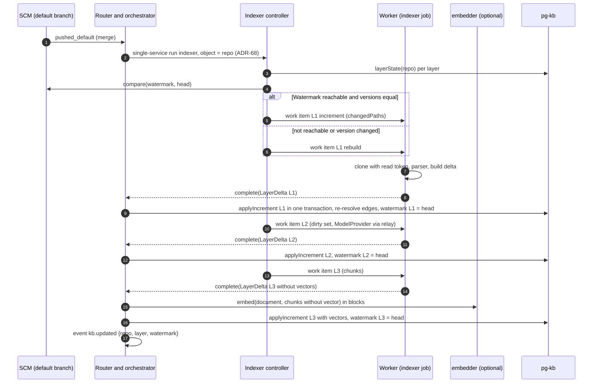
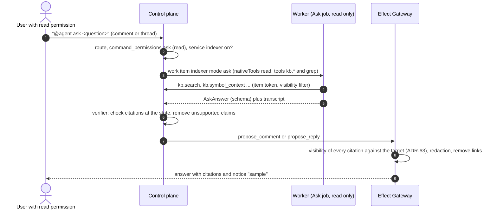

<!--
SPDX-License-Identifier: Apache-2.0
SPDX-FileCopyrightText: The Guildwork Authors
-->
# 12 Expansion: knowledge base, standards, triage, Jira, providers, bases, breadth, edge layers

Detailed design for stages 7 (without sub-stage 7a), 8, 9 and 10 from [08](../architecture/08-roadmap.md). It implements the architecture and decides only what the architecture leaves open; every such decision is recorded as Ruling FE-12nn in section 9. Precedence, fixed choices (stack, package names) and mandatory structure as in the [README](README.md). Classifications VERIFIED, CLAIMED, DERIVED and "unverified" as in the [README of the architecture](../architecture/README.md).

**Level of detail:** Stage 7 is described as concretely as the core documents (types, tables, endpoints, states, failure paths, test names). Stage 8 is described at the depth of stages 0 and 1 in [13](13-stage-8-providers-and-bases.md) (FE-1300); the sections on stage 8 here keep only their heading with a reference, and Rulings FE-1223 to FE-1233, FE-1253 and FE-1255 remain in force unchanged. Stage 9 is described at this depth in [14](14-stage-9-breadth-and-hardening.md) (FE-1400 there); the sections on stage 9 here only refer there. Stage 10 is described in full in [15](15-stage-10-edge-layers.md) (FE-1500); the sections on stage 10 here only refer there, and Rulings FE-1236 to FE-1241 and FE-1249 stay here.

**External APIs:** All paths, headers and fields of third-party services (Jira, Atlassian OAuth, GitHub extensions, Bedrock, Vertex, Foundry, Codex, GitLab and others) are **unverified** in this document unless a source from the architecture is explicitly named. They are verified by the task that records the contract suite with captured real responses; if the recording differs, the recording wins, and this file is updated in the same PR.

## 1. Purpose and sources

| Building block | Epic | Section here | Architecture sources |
|---|---|---|---|
| Indexer L1 to L3, vector search, local embedding | 7-E01 | 2.1, 2.2, 3.1, 4.1 | [02](../architecture/02-services.md) section 7, [01](../architecture/01-plugin-interfaces.md) sections 7 and 9, [10](../architecture/10-standards-per-layer.md) section 9, O7, ADR-12 |
| MCP tools `kb.*`, Ask, guideline loader, external KB MCP | 7-E02 | 2.3, 2.4, 4.2 | 02 sections 7 and 8, 05 sections 4 and 7, ADR-17 |
| Standards service | 7-E03 | 2.5, 4.3 | 02 section 8, 10 section 10, O10 |
| Triage service | 7-E04 | 2.6, 4.4 | 02 section 9, 03 sections 1a and 4, 10 section 12, ADR-46, ADR-63, O25 |
| GitHub capabilities for triage | 7-E05 | 2.7 | 01 sections 4, 5 and 11.1, 05 section 2 (profile `labels`) |
| Eval and acceptance for stage 7 | 7-E06 | 8.7 | 07 sections 3.7 and 3.9, 10 sections 9, 10, 12 |
| Jira Cloud | 8-E01 | [13](13-stage-8-providers-and-bases.md) 2.1 | 01 sections 2, 3, 4, 11.1, 11.5; 03 section 3 (G0); 05 section 7 (`identity_links`) |
| Further LLM providers | 8-E02 | [13](13-stage-8-providers-and-bases.md) 2.2 | 01 sections 6, 7, 11.4, 11.5; 05 sections 3 and 5; ADR-22, ADR-23 |
| Harness `codex` | 8-E03 | [13](13-stage-8-providers-and-bases.md) 2.3 | 01 sections 6 and 11.3, ADR-39, ADR-51 |
| Further bases | 8-E04 | [13](13-stage-8-providers-and-bases.md) 2.4 | 11 sections 2.5, 2.6, 3, 4, 9, 10; 01 section 13; ADR-41, ADR-42 |
| Backend `ci-dispatch` | 8-E05 | [13](13-stage-8-providers-and-bases.md) 2.5 | 06 section 2a, 05 sections 2 and 5, ADR-45, ADR-30 |
| Price tables, qualification, acceptance for stage 8 | 8-E06 | [13](13-stage-8-providers-and-bases.md) 2.6, 2.7 | 04 section 6, 07 section 2, 08 stage 8 |
| Breadth and hardening | 9-E01 to 9-E08 | [14](14-stage-9-breadth-and-hardening.md) (here only references in 2.14, 3.3, 4.9, 8.9) | 01 sections 3 to 6, 8, 9, 10, 12, 14; 03 section 2.4; 05 sections 3 and 4; ADR-48 |
| Edge layers | 10-E01 to 10-E06 | [15](15-stage-10-edge-layers.md) (2.15 and 4.10 here only a reference) | 02 sections 6 and 10, 03 section 7, 10 sections 11 and 15, ADR-46, ADR-49 |

### 1.1 Consequences of the stage graph

Dependencies may only point to stages that come earlier in the graph ([08](../architecture/08-roadmap.md) section 3). This yields limits that shape this design:

| Stage | comes earlier | does **not** come earlier | Consequence (Ruling) |
|---|---|---|---|
| 7 | 7a, 6, 1, 0, R | 0b, 2, 3, 4, 5, 8 | Coder, Planner, `ticket-to-pr` and the analyzer mode `run` are missing in stage 7: K1 for the Coder is measured in stage 9 (FE-1222); triage as a pipeline stage and the auto trigger `item.triaged` are built in stage 9 (FE-1221); rule compilation tests its rules in a dedicated worker step instead of via the analyzer contract (FE-1214); the clarity gate is built by whoever comes first (FE-1216) |
| 8 | 2, 0b, 1, 0, R | 6, 7a, 7, 3, 4, 5 | `@agent ask` from Jira: path in stage 8, E2E only in stage 9 (FE-1227); Confluence as a KB source only in stage 9 (FE-1242) |
| 9 | 7, 8 and their predecessors | 3, 4, 5 | Child runs without PR fixer: a conflict goes to the human (FE-1235) |
| 10 | 3, 4, 2, 1, 0, R | 6, 7a, 7, 8, 9, 0b | `docs` works without a mandatory knowledge base (FE-1238); `ci_doctor` checks whether `CREATE_ISSUE` is already built (FE-1239); campaigns use no Coder child runs (FE-1236) |

### 1.2 Delimitation from other detailed design documents

- Sub-stage 7a (Learnings, indexer L0 and L5, retrieval without vector search) is in [09](09-reviewer-companion-features-and-learnings.md); this document extends its tables and interfaces and states the assumptions about their names in section 10.
- Plugin framework, contract harness and the GitHub plugin are in [05](05-plugins-and-contracts.md); only the extensions of stages 7 to 10 are here.
- Database conventions (tenant, row-level security, migrator) are in [01](01-data-model.md); the tables of stages 7 to 10 are here with DDL (FE-1201).
- Control plane, run state machine, Work API, Effect Gateway and Credential Broker are in [02](02-control-plane.md), [03](03-execution.md) and [04](04-effects-audit-credentials.md). This document uses their terms (work item, lease, `complete()`, write request, permission profile) without redefining them.

## 2. Modules and responsibility

### 2.0 Directories

```text
packages/
  kb/                      # @guildwork/kb: layer types, LayerDelta, queries, RRF, citation check (stage 7)
  kb-indexer/              # @guildwork/kb-indexer: parser (tree-sitter), chunker, delta building; runs in the worker step
  guidelines/              # @guildwork/guidelines: guideline loader (stage 1 as @guildwork/service-reviewer/guidelines, FE-807; stage 7 extracted and extended)
  adf/  pricing/           # stage 8, see 13 section 2.0
  plugin-host/             # @guildwork/plugin-host: subprocess and container transport (stage 9)
services/
  indexer/                 # service indexer: controller, jobs L1 to L3, Ask (stage 7)
  standards/               # service standards: miner, rule PR, compilation, decay (stage 7)
  triage/                  # service triage (stage 7)
  embedder/                # optional service `embedder` (FE-1205), own image
  docs/                    # service docs (stage 10)
plugins/
  github/                  # extension with SET_LABELS, CREATE_ISSUE, LINK_ITEMS, RELATED_SEARCH (stage 7), CODE_SCANNING_UPLOAD (stage 9)
  model-local-embed/       # ModelProvider local-embed (stage 7)
  jira-cloud/  model-bedrock/  model-vertex/  model-foundry/  codex/  exec-k8s/  backend-ci-dispatch-github/   # stage 8, see 13 section 2.0
  gitlab/  azure-devops/  bitbucket/  gitea/  linear/  notifier-slack/   # stage 9
  opencode/  gemini-cli/  openhands-sdk/  backend-microvm/  kb-zoekt/  kb-source-confluence/   # stage 9
  analyzer-axe/  analyzer-infracost/  analyzer-git-cliff/  incident-handoff/  sentry/   # stage 10
drivers/  deploy/          # drivers, Helm, OpenTofu and ci-dispatch of stage 8, see 13 section 2.0
eval/
  adapters/kb-k4/  adapters/kb-k3/  adapters/kb-k5/          # stage 7
  sets/t1/  sets/t2/  sets/k1/  sets/st1/                     # stage 7, sets per 07 section 2.2 (FE-1268)
  suites/s1/triage/  suites/s2/stufe-7/  suites/s4/  suites/s6/stufe-7/   # stage 7, cross-cutting suites per 07 FE-736
  # stage 10 (DO1 to DO4, F4, CD1 under eval/sets/, AN1 as fixture repos in the testkit): 15 section 2.0 (FE-1537)
examples/
  third-party-plugin/  third-party-service/   # stage 9, only against published contracts
```

Shared base types (`Result`, `PluginError`, `Untrusted`, `RepoRef`, `ChangeRef`, `WorkItemRef`, `Actor`, `Citation`, `ServiceId`) come from `@guildwork/contracts` and are defined in [01](../architecture/01-plugin-interfaces.md) and [05](05-plugins-and-contracts.md) respectively.

### 2.1 Indexer L1 to L3 (7-E01)

**Responsibility:** The service `indexer` keeps the layers L1 (structure), L2 (summaries) and L3 (full text and vectors) of the `KnowledgeStore` `pg-kb` up to date. L0 (state per layer) and L5 (Learnings) come from 7a; L4 (rule candidates) is supplied by the standards service (2.5). The controller runs in the control plane, the jobs run as work items in the worker. **No job writes to the database:** It returns its result as a `LayerDelta` via `complete()`, and the control plane calls `applyIncrement` (FE-1202, Backlog M110 part 2).

```ts
// packages/kb/src/layers.ts
export type Layer = "L0" | "L1" | "L2" | "L3" | "L4" | "L5";
export type LayerStatus = "empty" | "building" | "fresh" | "stale" | "failed";

export interface LayerVersions {           // every stored value carries the rule that wrote it (02 section 7)
  schemaV: number;                         // version of the KB tables
  parserV?: string;                        // L1: "<tree-sitter-version>+<queries-hash>"
  promptV?: string;                        // L2: version of the summary prompt
  model?: string;                          // L2: ModelProvider model (resolved)
  embedModel?: string;                     // L3: embedding model with version and checksum
  chunkerV?: string;                       // L3: version of the chunk rule
}

export interface LayerState {
  repo: RepoRef; layer: Layer; status: LayerStatus;
  watermarkSha: string | null;             // set only after success
  versions: LayerVersions;
  lastError?: { code: KbErrorCode; message: string; at: string };
  updatedAt: string;
}

// result of an indexer job, goes to the control plane via WorkerApi.complete()
export interface LayerDelta {
  deltaV: 1;                               // schema version (section 3.4); control plane N reads N and N-1
  repo: RepoRef; layer: "L1" | "L2" | "L3";
  fromSha: string | null;                  // null = rebuild
  toSha: string;
  versions: LayerVersions;
  upserts: LayerRecord[];                  // own record type per layer, see below
  deletes: ({ path: string } | { itemKey: string } | { learningId: string })[];   // deleted or renamed files (rename = delete + upsert); itemKey and learningId only L3
  stats: { files: number; symbols?: number; chunks?: number; summaries?: number; skipped: SkippedFile[] };
  blobRef?: string;                        // large deltas (over 8 MiB): artifactId of the uploaded artifact, upserts and deletes then empty
}
export interface SkippedFile { path: string; reason: "too_large" | "binary" | "generated" | "excluded" | "unsupported_language" | "parse_error" }

export type LayerRecord = L1FileRecord | L2SummaryRecord | L3ChunkRecord;

export interface L1FileRecord {
  kind: "l1_file"; path: string; blobSha: string; lang: string; contentHash: string;
  symbols: { localId: string; name: string; qualifiedName: string; kind: SymbolKind;
             lines: [number, number]; signature?: string; parentLocalId?: string }[];
  edges: { fromLocalId: string; toName: string; toPathHint?: string; kind: EdgeKind }[];
}
export type SymbolKind = "module" | "class" | "interface" | "function" | "method" | "type" | "enum" | "const" | "variable";
export type EdgeKind = "imports" | "calls" | "extends" | "implements" | "references";

export interface L2SummaryRecord {
  kind: "l2_summary"; level: "symbol" | "file" | "module" | "repo";
  key: string;                             // qualifiedName, path, module path or "."
  text: string; inputHash: string;         // hash of the inputs (child summaries or code), controls recomputation
}

export interface L3ChunkRecord {
  kind: "l3_chunk"; sourceKind: "code" | "summary" | "item" | "learning";   // item and learning only from the controller, never from gw-kb-indexer
  path?: string;                           // required for code and summary
  itemKey?: string; learningId?: string;   // required for item or learning respectively (kb_chunks.item_key, learning_id)
  visibility?: "public" | "internal" | "private";   // required for item and learning, otherwise visibility of the repo
  symbolQualifiedName?: string; lines?: [number, number];
  text: string; contentHash: string;
  vector?: { model: string; dim: number; values: number[] };   // only when vectors are on and the embedder is reachable (2.2)
}

export type KbErrorCode =
  | "KB_UNAVAILABLE" | "KB_STALE" | "KB_WATERMARK_UNREACHABLE" | "KB_VERSION_CHANGED"
  | "KB_DELTA_INVALID" | "KB_VISIBILITY_DENIED" | "KB_EMBEDDER_UNAVAILABLE" | "KB_PARSE_FAILED";
```

**Parser (FE-1203):** `@guildwork/kb-indexer` uses tree-sitter via `web-tree-sitter` (WASM, no native dependencies in the sandbox image) with, per language, a tags query (`tags.scm`) for definitions and references and an import query. Initial set of languages: TypeScript, JavaScript, Python, Go, Java (`services.indexer.languages`). Other languages get only `l1_file` without symbols (file level); L3 runs over line windows. Task 7-E01-T04 checks the licenses of `web-tree-sitter` and the grammars against the allowlist (unverified).

```ts
// packages/kb-indexer/src/parser.ts
export interface LanguageParser {
  lang: string; version: string;           // goes into parserV
  matches(path: string): boolean;
  parse(path: string, source: Uint8Array): Result<Omit<L1FileRecord, "kind" | "path" | "blobSha" | "contentHash">>;
}
export interface Chunker {                 // FE-1207
  version: string;
  chunk(file: L1FileRecord | { path: string; lang: string }, source: string): { text: string; lines: [number, number]; symbolQualifiedName?: string }[];
}

// packages/kb-indexer/src/delta.ts (7-E01-T04, L3 part 7-E01-T08)
export interface IndexerJobInput {          // inline input of the work item (section 3.4)
  plan: IncrementPlan;                     // from services/indexer, only repo, layer, mode, fromSha, toSha, changedPaths
  versions: LayerVersions;                 // target versions according to the configuration
  limits: { maxFileBytes: number; exclude: string[]; languages: string[] };
  chunk?: { windowLines: number; overlapLines: number };   // only L3
}
export function classifyFile(path: string, bytes: Uint8Array, limits: IndexerJobInput["limits"],
  gitattributes: string | null): SkippedFile["reason"] | null;   // null = index
export function buildL1Delta(input: IndexerJobInput, files: AsyncIterable<{ path: string; blobSha: string; bytes: Uint8Array }>,
  parsers: LanguageParser[]): Promise<Result<LayerDelta>>;
export function buildL3Delta(input: IndexerJobInput, l1: L1FileRecord[], summaries: L2SummaryRecord[],
  files: AsyncIterable<{ path: string; bytes: Uint8Array }>, chunker: Chunker): Promise<Result<LayerDelta>>;   // without vectors
```

**Entry point in the sandbox (FE-1261):** The jobs L1 and L3 run as a work item of kind `check` (deterministic, without a model, [03](03-execution.md) section 2) with the command `gw-kb-indexer <l1|l3> --input /in/job.json --out /out/delta.json` from `@guildwork/kb-indexer` in the sandbox image. Exit code 0 means: `delta.json` is a valid `LayerDelta`; 2 means: input invalid; any other code is a job error with a log. The worker reads the file, puts it into the BlobStore (`blobRef`) if it is over 8 MiB, and returns it via `complete()`.

**Worker step `kb-index` (FE-1263):** The envelope carries `kind: "check"`, `check.step = "kb-index"` and `check.args = { layer: "l1" | "l3" }`; the `IndexerJobInput` is the inline input `id = "job"` (`mediaType: application/json`, `untrusted: false`), for L3 additionally `id = "l1"` and `id = "l2"` with the records of the state (above `work.inline_inputs_max_bytes` as an artifact reference). The step (`apps/worker/src/steps/kb-index.ts`, registered with `registerStep`, [03](03-execution.md) section 2.6) has `needsSandbox: true`: It writes the inputs to `/in/`, calls `gw-kb-indexer <layer> --input /in/job.json --out /out/delta.json` in the sandbox with the clone under `/work/repo` (allowlist of the phase empty, time limit = `budget.maxWallMs`), reads `delta.json` and returns it as `WorkerStepOutput.structured`; above 8 MiB it uploads the file with `ctx.upload("artifact", ..., "application/json")` and returns a `LayerDelta` with `blobRef = artifactId` and empty `upserts` and `deletes`. Exit 2 yields `StepErrorV1` with `code: "internal"`, `retryable: false`, `message: "invalid_input"`; any other non-zero exit code yields `retryable: true` up to `orchestrator.step_max_attempts`. Like `gw-review-context` ([08](08-reviewer.md) FE-806), `gw-kb-indexer` is shipped as a bundled Node script in the image `sandbox-base` (`/opt/guildwork/bin/gw-kb-indexer`) and uses the same grammars from `grammars.lock.json`; `parserV` is `"<web-tree-sitter-version>+<sha256 von grammars.lock.json und queries/>"`.

**Write path (FE-1263):** `DeltaIntake.accept` (control plane, `apps/control-plane/src/kb/apply-increment.ts`) checks the delta in this order and rejects it with `KB_DELTA_INVALID` and the first applicable reason: `schema` (TypeBox, `deltaV` not N or N-1), `repo_mismatch` (`delta.repo` not equal to the repo of the work item), `path_outside` (path absolute, with `..` or under `services.indexer.exclude`), `predecessor_not_fresh` (L2 or L3 without predecessor layer `fresh` with the same `toSha`), `version_mismatch` (`delta.versions` not equal to the target versions of the plan). It then calls the KnowledgeStore from [01](../architecture/01-plugin-interfaces.md) section 9: with `fromSha != null` `applyIncrement(repo, layer, fromSha, toSha, delta)`, with `fromSha == null` `rebuild(repo, layer, toSha, records)` with the `upserts` as an `AsyncIterable`. `plugins/pg-kb` (`src/write/apply-increment.ts`, `src/write/rebuild.ts`) implements both via the repositories from `packages/db` (7-E01-T02) in one transaction per layer and repo, including edge resolution (below), shadow swap (section 4.1) and `kb_layer_state` (watermark, `versions`, `status`); the L3 part with vectors comes with 7-E01-T08. After success, `DeltaIntake` writes the audit entry `kb.layer_updated`, metrics and `KbUpdatedEvent`; on rejection or error `kb.delta_rejected` or `kb.layer_failed` respectively, per section 5.

**Edge resolution:** The job supplies edges with target names (`toName`, `toPathHint` from the import). The control plane resolves them during `applyIncrement` against all symbols of the repo (`resolved = true`, `dst_symbol_id`), also for files outside the delta whose target has changed ("re-resolution of edges", 02 section 7). Ambiguous names stay `resolved = false` with all candidates in `dst_candidates`.

**Controller:**

```ts
// services/indexer/src/controller.ts
export interface IndexerController {
  onPushedDefault(ev: ResolvedEvent): Promise<void>;           // merge to the default branch: increment per active layer
  onSchedule(kind: "full" | "items_backfill"): Promise<void>;  // schedule index.full and backfill of the item index
  onVersionChange(repo: RepoRef, layer: Layer): Promise<void>; // parser, prompt, model or chunker version differs: rebuild
  planIncrement(repo: RepoRef, layer: "L1" | "L2" | "L3"): Promise<IncrementPlan>;
}
export interface IncrementPlan {
  repo: RepoRef; layer: "L1" | "L2" | "L3";
  mode: "increment" | "rebuild";
  fromSha: string | null; toSha: string;
  reason: "push" | "schedule" | "version_changed" | "watermark_unreachable" | "first_build";
  changedPaths?: string[];                 // only for increment, from SCMProvider.compare(fromSha, toSha)
}

// services/indexer/src/events.ts: internal event after every successful applyIncrement (section 4.1)
export interface KbUpdatedEvent {
  type: "kb.updated"; apiVersion: "v1";
  repo: RepoRef; layer: "L1" | "L2" | "L3";
  watermarkSha: string; previousSha: string | null; mode: "increment" | "rebuild";
  stats: LayerDelta["stats"];
}
```

**Acceptance of the delta in the control plane:**

```ts
// apps/control-plane/src/kb/apply-increment.ts (7-E01-T03)
export interface DeltaIntake {
  // after complete() of an indexer job: check schema (deltaV), repo and paths against the work item, predecessor layer fresh
  // with the same toSha, then KnowledgeStore.applyIncrement; afterwards LayerState, audit, metrics and KbUpdatedEvent
  accept(itemId: string, delta: LayerDelta): Promise<Result<{ watermarkSha: string }, { code: KbErrorCode; reason: string }>>;
}
```

`planIncrement` chooses `rebuild` if no watermark exists, if the watermark is no longer reachable at the provider (`compare` returns `not_found`, for example after a force push to the default branch), or if a version in `LayerVersions` differs from the stored state. Order per push: L1, then L2 (needs L1), then L3 (needs L1 and, for chunks of kind `summary`, L2). A layer starts only if its predecessor layer is `fresh` with the same `toSha`; otherwise it waits (follow-up job after object lock, ADR-68, the object here being the repo).

**L2 (summaries):** Only for the dirty set: symbols and files whose `contentHash` has changed, then upward file, module, repo only if at least one child summary has changed (`inputHash`). Full analysis and rebuild use `ModelProvider.submitBatch` if the model reports `BATCH_API`, otherwise `generate` with rate limiting. The job has `nativeTools: "none"` and no platform MCP write tools; model calls go through the credential relay. Prompt and schema are versioned under `services/indexer/prompts/l2-*.md` (`promptV` = file hash).

**L3 (full text and vectors):** see 2.2.

**Item index (FE-1208):** For the duplicate search of triage and `related[]` of the Reviewer, the indexer indexes issues and PRs: title and an excerpt of the text (at most 4,000 characters, starting value) as chunk `sourceKind: "item"` in `kb_chunks` plus metadata in `kb_items`. Sources are the events `created`, `edited`, `labeled`, closing and reopening, plus a backfill (`items_backfill`) via `WorkItemProvider.search` or the SCM issue list with pagination. Item texts are foreign content: Before storage they are sent through secret redaction (gitleaks rules plus own rules, 05 section 3 item 4) and the sanitizer (05 section 4 item 2), and on retrieval they are always delivered as `Untrusted`. The item index runs in the controller of the control plane (no sandbox job: only provider reads, redaction and embedding), writes via `KnowledgeStore.applyIncrement` with a `LayerDelta` of layer `L3` and `upserts` of kind `l3_chunk` with `sourceKind: "item"` (`fromSha = toSha` = watermark L3, the watermark stays unchanged; without a watermark L3 the item index is idle, and the first L3 run triggers `backfillItems(repo, null)`). The events "edited", "closed" and "reopened" do not yet exist in the vocabulary of 01 section 2 or in the GitHub mapping of [05](05-plugins-and-contracts.md) section 2.14.3 (section 10); until they are added, the backfill `items_backfill` catches up on these changes (starting value hourly via an `updated` cursor, `services.indexer.items_backfill`).

```ts
// services/indexer/src/items/types.ts (7-E01-T09)
export interface ItemIndexInput {
  repo: RepoRef; item: WorkItemRef; kind: "issue" | "pr";
  title: Untrusted; body: Untrusted;       // before redact and sanitize
  state: "open" | "closed" | "merged"; closedReason?: string; duplicateOf?: WorkItemRef;
  labels: string[]; authorLogin?: string; providerUpdatedAt: string;
}
export function indexItem(i: ItemIndexInput, visibility: "public" | "internal" | "private"): Promise<Result<void>>;
export function backfillItems(repo: RepoRef, since: string | null): Promise<Result<{ indexed: number; cursor: string }>>;
```

**Learnings via vector search (7-E01-T10, FE-1256):** Active Learnings from 7a are stored as chunks `sourceKind: "learning"` with `learning_id` in `kb_chunks` (text = redacted Learning text, visibility = `source_visibility`) and embedded like code chunks; a new `text_sha256` forces re-embedding. Reconciliation: After every successful L3 run of a repo and after every L5 increment from 7a, the indexer controller reconciles the active Learnings of the repo (`learnings.status = 'active'`, `source_repo_key`) against the chunks of kind `learning`: new or changed ones (`content_hash` = `text_sha256`) as `upserts`, no longer active ones as a deletion via `learning_id`, both in a `LayerDelta` of layer L3 with `fromSha = toSha` = watermark L3 via the same write path; without `fresh` L3 the reconciliation is skipped until the next run. Learning chunks never appear in `query.search` or `kb.search` (`SearchRequest.kinds` does not know `learning`); they are retrieved only via `queryLearnings`, so that status, scope, PR binding and voting from 7a always apply.

**Merging path and vector hits (FE-1270):** `queryLearnings` (09 section 2.13) gets two optional fields additively; without them, retrieval runs exactly as in 7a.

```ts
// packages/contracts/src/kinds/knowledge-store.ts (addition to LearningQuery and LearningHit from 09, additive per FE-502, 7-E01-T10)
export interface LearningQueryVectorPart {
  vector?: {
    text: string;                          // query text of the caller; Reviewer: PR title plus changed paths, at most 2,000 characters
    queryVector?: number[];                // set by the KB facade of the control plane via local-embed (model ID "<name>:query"), never by the caller
    k: number;                             // knowledge.search.learnings_k, starting value 20 (estimate)
    minSimilarity: number;                 // knowledge.search.learnings_min_similarity, starting value 0.75 (estimate, measured in 7-E01-T10)
  };
}
export interface LearningHitVectorPart {
  via?: "path" | "vector" | "both";        // absent for retrieval without vector (equal to "path")
  vectorSimilarity?: number;               // 1 - cosine distance, only for vector and both
}
// LearningQuery = LearningQuery (09) & LearningQueryVectorPart; LearningHit = LearningHit (09) & LearningHitVectorPart
```

Flow in `plugins/pg-kb/src/query/learnings.ts`:
1. **Path candidates** as in 09 step 1 (status `active`, `kind`, `scopeAllows`, PR binding, glob from `appliesTo` matches).
2. **Vector candidates** only with `vector.queryVector` and `fresh` L3 of the repo: the `vector.k` nearest chunks `source_kind = 'learning'` via `kb_vectors` with the active `embed_model` (partial HNSW index, FE-1206), restricted to the `repo_key` values that `scopeAllows` permits for the query; hits below `minSimilarity` are dropped. Via `learning_id`, the same filters as in step 1 apply to them except the glob condition (otherwise the vector search would bring nothing new).
3. **Union** via `learning_id`: in both sets `via = both`, otherwise `path` or `vector`.
4. **Rank:** first all hits with `via` `path` or `both` in the order from 09 step 2, then the pure vector hits by `vectorSimilarity` descending, on a tie `up - down`, then `lastConfirmedAt`. A path hit is therefore never displaced by a vector hit.
5. **Citation check, budget and `learning_uses`** as in 09 steps 3 and 4 for all hits; `matchedPath` of a pure vector hit is the path of its citation.

Without an embedder, without `fresh` L3, or on an error of the vector leg, step 2 is dropped and retrieval continues as in 7a (no error, metric `guildwork.embedder.errors` or `vector_pending` as in section 5). The Reviewer context building block ([08](08-reviewer.md)) sets `vector` only if `services.reviewer.knowledge.use: on` applies (FE-1210); otherwise its retrieval stays unchanged.

### 2.2 Embedder and vector search (7-E01)

**Decision (FE-1205):** Embeddings are computed by a dedicated, optional service `embedder` (image `embedder`, CPU, no GPU needed) with a local model under a free license (O7). The control plane addresses it only via the ModelProvider `local-embed` with capability `EMBEDDINGS` (01 section 7: ModelProvider is intended for embeddings). If the service is missing or `services.indexer.vectors: false` is set, `local-embed` reports `EMBEDDINGS: none`, and the core switches off vector search per rule 2; full text keeps running. External embedding services are further ModelProviders with `EMBEDDINGS`, off by default, only with `data_policy.embeddings` approval (O7, W3 of the research).

```ts
// services/embedder/src/api.ts  (reachable only in the internal network of the control plane)
// POST /v1/embed
export interface EmbedRequest { model: string; inputs: string[]; kind: "document" | "query" }   // some models need separate prefixes
export interface EmbedResponse { model: string; modelSha256: string; dim: number; vectors: number[][]; tookMs: number }
// GET /v1/health -> { ok: boolean; model: string; modelSha256: string; dim: number }
// errors: 400 EMBED_INVALID (empty input, more than 256 inputs, input over 8,192 characters),
//         413 EMBED_TOO_LARGE, 503 EMBED_NOT_READY (model still loading)
```

- Task 7-E01-T01 chooses model and runtime via K5 (CoIR subset with free data licenses, RepoQA; 10 section 9 part B3). The initial candidate is CodeRankEmbed (MIT, 137M, CLAIMED according to the research); nomic-embed-code (Apache-2.0, 7B) only if CPU operation is acceptable. Models without commercial use are excluded (jina-code-embeddings, CC-BY-NC). Runtime: Node with the ONNX runtime (`onnxruntime-node`) and an ONNX version of the model; whether this version exists and under which license is unverified (7-E01-T01).
- The model is in the image `embedder` with a checksum (free license, `distribution: bundled` per ADR-50) and is never loaded at runtime (air gap).
- `embedModel` in `LayerVersions` is `"<name>@<version>#<sha256>"`; every change forces a rebuild of L3 for all repos.
- **Operation (FE-1258):** The Compose profile `kb-vectors` starts the service; in the Helm chart the value `embedder.enabled` ([13](13-stage-8-providers-and-bases.md) section 2.4). Integration per the rules from [06](06-installation-operations-ui.md) (all built by 7-E01-T07):
  - **Compose fragment** `deploy/compose/kb-vectors.compose.yaml`, which `compose.yaml` includes via `include`, profile `kb-vectors` (06 section 2.3, FE-641): service `embedder` only in the network `core` (no uplink, no egress), without a mount of `secrets/` and `docker.sock`, image digest as `${GW_IMAGE_EMBEDDER}` in `env.template`, healthcheck `GET /v1/health`.
  - **Image** `deploy/images/embedder/Dockerfile`, matrix entry in `images.yml`, entry `embedder` in the type `ToolImage` and in `ReleaseManifest.images` of `release.json` (06 sections 2.2 and 2.10, FE-640).
  - **doctor check** `D32-embedder` (06 section 2.5, FE-642): without the profile `n/a`; with the profile `fail` if `GET /v1/health` is not reachable or `modelSha256` does not match the image.

  Configuration only via environment variables of the container, no secrets:

```ts
// services/embedder/src/config.ts
export interface EmbedderConfig {
  port: number;                            // GW_EMBEDDER_PORT, default 8090, internal network only
  modelDir: string;                        // GW_EMBEDDER_MODEL_DIR, in the image
  modelSha256: string;                     // GW_EMBEDDER_MODEL_SHA256, startup aborts on mismatch
  threads: number;                         // GW_EMBEDDER_THREADS, default number of CPUs
  maxInputs: 256; maxChars: 8192;          // limits from the API above
}
```

**ModelProvider `local-embed` (FE-1259):** `plugins/model-local-embed` implements `ModelProvider` ([05](05-plugins-and-contracts.md) section 2.11.5) with `models()` (per model the two IDs below, `regions: ["global"]`, without a price) and `embed`; the mandatory method `generate` always answers with `PluginError` `unsupported`, all other capabilities are `none`, and the resolver allows `local-embed` only in `knowledge.embed_model`, never in `models` of a service. `capabilities()` queries `GET /v1/health`: reachable means `EMBEDDINGS: native` with model ID and dimension, otherwise `none`. The contract `embed(texts, model)` knows no distinction between document and query; `local-embed` therefore reports two IDs per model, `<name>` for documents and `<name>:query` for queries, and derives the `kind` of the embedder API from them. The control plane embeds in blocks of at most 256 texts; errors are counted by `guildwork.embedder.errors` with attribute `code`, and an outage of more than 30 minutes triggers the required alert `embedder_unavailable` (both in section 5.1). `health()` of `local-embed` calls `GET /v1/health` (time limit `timeoutMs`) and reports `ok: false` with reason `unreachable` or `not_ready`; the core takes this over into `HealthSource` as for every plugin. Starting values of `LocalEmbedConfig`: `timeoutMs` 30,000, `batchSize` 64 (at most 256, estimates, measured in 7-E01-T07).

```ts
// plugins/model-local-embed/src/config.ts
export interface LocalEmbedConfig { url: string; timeoutMs: number; batchSize: number }   // url default http://embedder:8090
```

**Hybrid search (FE-1204):** `KnowledgeStore.query.search` combines two legs with Reciprocal Rank Fusion:

```ts
// packages/kb/src/search.ts
export interface SearchRequest {
  scope: { repos: RepoRef[] };             // resolved after the visibility filter (section 6), never "all"
  q: string; k: number;                    // k at most 50
  kinds: ("code" | "summary" | "item")[];
  queryVector?: number[];                  // computed by the control plane via local-embed, never by the caller
}
export interface SearchHit {
  ref: Citation | ItemCitation; score: number; kind: "code" | "summary" | "item";
  legs: { lexical?: number; vector?: number; vectorSimilarity?: number };   // rank per leg for report and test; vectorSimilarity = 1 - cosine distance
  stale: boolean;                          // watermark not equal to the requested state (FE-1246)
}
export interface ItemCitation { repo: RepoRef; provider: string; itemKey: string; number?: number; kind: "issue" | "pr"; updatedAt: string }

export function rrf(rankings: string[][], k = 60): Map<string, number>;   // score = sum of 1/(k + rank)
export function identTokens(text: string): string;   // split identifiers for kb_chunks.ident_tokens, same rule for text and query
```

- **Lexical:** Postgres `tsvector` with configuration `simple` over text plus split identifiers (`fooBarBaz` and `foo_bar_baz` yield `foo bar baz`), ranking `ts_rank_cd`. This is an approximation of BM25, not real BM25 (FE-1204; 01 section 9 names BM25).
- **Vector:** pgvector, cosine distance, HNSW index per model (FE-1206). Candidates per leg: `4 * k`.
- **Fusion:** RRF with `knowledge.search.rrf_k` (starting value 60, common value in the literature, estimate).

### 2.3 MCP tools `kb.*` and Ask (7-E02)

**Tools in the platform MCP** (item token, read only, only repos of the work item and per the visibility rule, 05 section 7):

| Tool | Input | Output | Source | without KB |
|---|---|---|---|---|
| `kb.repo_map` | `{ repo, at, budgetTokens }` (`budgetTokens` 256 to 8,192) | Markdown tree of the most important files and symbols, trimmed to the budget | L1, L2 | `unavailable` |
| `kb.symbol_context` | `{ repo, symbol, at }` | definition, signature, callers, callees, file summary, each with `Citation` | L1, L2 | `unavailable` |
| `kb.impact` | `{ repo, paths[] }` | affected symbols and files via incoming edges up to depth 2 | L1 | `unavailable` |
| `kb.search` | `{ repo \| "org", q, k, kinds[] }` | `SearchHit[]` | L3 | `unavailable` |
| `kb.module_summary` | `{ repo, path }` | summary of the module and its children with citations | L2 | `unavailable` |
| `kb.standards` | `{ repo, path }` | applicable rules at the base SHA with `ruleId` and source (guideline loader, 2.4) | loader | always runs |
| `kb.learnings` | `{ repo, path }` | Learnings with a valid citation (7a, from stage 7 also via vector) | L5 | as in 7a |

"Without KB" means: the layer for the repo is not `fresh`, or KB is off for the service (`services.<id>.knowledge.use: off`). The tool then answers with the MCP error `unavailable` and the reason (`KB_UNAVAILABLE`, `KB_STALE`), and the agent continues with grep (02 section 7 "On/off").

**Queries of the KnowledgeStore from stage 7** (addition to 01 section 9 for `pg-kb`, `v1alpha1` additive; the types are in `@guildwork/kb`, the implementation in `plugins/pg-kb`):

```ts
// packages/kb/src/queries.ts (7-E01-T05; ruleStats 7-E03-T02)
export interface SymbolContext {
  symbol: { name: string; qualifiedName: string; kind: SymbolKind; signature?: string; ref: Citation };
  summary?: { text: Untrusted; ref: Citation };          // L2, if present
  callers: { qualifiedName: string; ref: Citation }[];   // incoming edges calls and references, at most 50
  callees: { qualifiedName: string; ref: Citation; resolved: boolean }[];
  meta: KbToolMeta;
}
export interface ImpactSet {
  changed: { path: string; symbols: string[] }[];
  affected: { qualifiedName: string; path: string; depth: 1 | 2; via: EdgeKind; ref: Citation }[];   // incoming edges up to depth 2
  truncated: boolean; meta: KbToolMeta;
}
export interface ModuleSummary { path: string; summary: Untrusted; children: { path: string; summary: Untrusted }[]; refs: Citation[]; meta: KbToolMeta }
export interface RuleStatsQuery { repo: RepoRef; ruleIds?: string[]; source?: RuleStats["source"]; window: { from: string; to: string } }

// addition to KnowledgeStore.query (capabilities SYMBOL_GRAPH, SUMMARIES, FTS, VECTOR, RULE_STATS)
export interface KnowledgeQueryV7 {
  repoMap(repo: RepoRef, at: string, budgetTokens: number): Promise<{ markdown: string; meta: KbToolMeta }>;
  symbolContext(repo: RepoRef, symbol: string, at: string): Promise<Result<SymbolContext>>;
  impact(repo: RepoRef, paths: string[]): Promise<Result<ImpactSet>>;
  moduleSummary(repo: RepoRef, path: string): Promise<Result<ModuleSummary>>;
  search(req: SearchRequest): Promise<Result<SearchHit[]>>;
  ruleStats(q: RuleStatsQuery): Promise<Result<RuleStats[]>>;   // FE-1215
}
```

The return types from 01 (`Promise<string>` for `repoMap`, a list for `search`) are kept as a thin wrapper; callers in stage 7 use `KnowledgeQueryV7`.

**Implementation in `pg-kb` (FE-1271, 7-E01-T05):** `createPgKbPlugin` (09 section 2.11) reports `SYMBOL_GRAPH` and `SUMMARIES` as `native` from 7-E01-T05, `FTS` and `VECTOR` from 7-E01-T08 (with vectors only when `EMBEDDINGS` is reachable), and `RULE_STATS` from 7-E03-T02. The methods are in `plugins/pg-kb/src/query/repo-map.ts`, `symbol-context.ts`, `impact.ts`, `module-summary.ts`, `search.ts` and `rule-stats.ts`, each a function `(db: Db, tenant: string) => KnowledgeQueryV7[<method>]`, all reading in `withTenant`. Common rules: The state at the watermark of the layer is read; `meta.stale = true` if `at` is not equal to `watermarkSha` (FE-1246); without `fresh` L1, all three L1 methods answer `KB_UNAVAILABLE` or `KB_STALE`. Every `Citation` carries `path`, `lines` and `sha = watermarkSha`.
- **`repoMap(repo, at, budgetTokens)`:** Rank per file = number of resolved incoming edges (`kb_edges.resolved`, target in the file), on a tie path ascending. Output as a Markdown tree: directories as levels, per file one line with the path and, if present, the first sentence of the file's L2 summary, below it its symbols of kinds `class`, `interface`, `function`, `type`, `enum` without a parent (top level) with signature. Files are added in rank order until `ceil(utf8Bytes / 3)` (estimation rule from [08](08-reviewer.md) FE-808) reaches the budget; the last line then says "truncated: n files".
- **`symbolContext(repo, symbol, at)`:** `symbol` is a `qualifiedName` or a simple name; with several hits the exact `qualifiedName` wins, otherwise `invalid` with the first 10 candidates in `message`. `callers` = sources of incoming resolved edges `calls` and `references`, `callees` = targets of outgoing edges `calls` (unresolved ones with `resolved: false` and `dst_name`), each at most 50, sorted by path and line; `summary` from `kb_summaries` of level `symbol`, otherwise `file`.
- **`impact(repo, paths)`:** `changed` = symbols of the named files; `affected` = breadth-first search over incoming resolved edges (all `EdgeKind`) up to depth 2 via a recursive CTE, without symbols from `changed`, at most 200 entries, above that `truncated: true`.
- **`moduleSummary(repo, path)`:** Summary of level `module` for `path` and the direct children (`file` or `module`), citations pointing to the files. `RuleStats` (field list in 2.5) is in `packages/kb/src/queries.ts` so that `pg-kb` does not depend on the service `standards`; `services/standards` re-exports it.

```ts
// packages/kb/src/mcp-tools.ts (schemas as TypeBox, shown here as types)
export interface KbToolError { error: "unavailable" | "forbidden" | "invalid"; code: KbErrorCode | "KB_SCOPE_DENIED"; message: string }
export interface KbToolMeta { watermarkSha: string | null; requestedAt: string; stale: boolean; layersUsed: Layer[] }
```

**`kb.ask` (FE-1209, FE-1247):** `@agent ask` is a single-service run of the service `indexer` in mode `ask`. Within a work item there is no synchronous `kb.ask`, because the control plane does not call a model and agents can search themselves; `kb.ask` exists only in the external KB MCP as an asynchronous tool (starts an Ask run, returns `runId`, result via `kb.ask_result`).

**External KB MCP (7-E02-T06, FE-1242, FE-1267):** Path, transport and authentication are defined by [03](03-execution.md) section 2.5.1 (FE-323): `POST /mcp/kb/v1` (MCP Streamable HTTP) next to `/mcp/v1`, implementation `apps/control-plane/src/mcp/external-kb.ts`, authentication with the dev token of the developer MCP (`Authorization: Bearer gwdt_...`, [09](09-reviewer-companion-features-and-learnings.md) section 3.4, FE-921). If `knowledge.external_mcp.enabled` is off, the path answers with 404 (no hint of the tool). This section states what the tools there do:

- **Offered:** `kb.repo_map`, `kb.symbol_context`, `kb.impact`, `kb.search`, `kb.module_summary`, `kb.standards`, `kb.learnings` with the same schemas as in the platform MCP, plus `kb.ask` and `kb.ask_result`; no write requests, no `request_human_input`.
- **Search space per request:** The actor is the user of the dev token. The control plane checks every repo of the request (`repo`, or with `"org"` every repo of the org in the installation) afresh with `SCMProvider.getPermission(repo, login)` via the app token (cache 60 seconds as for the dev token, 09 FE-921); repos below `read` silently drop out of the search space (S1 case "0 hits", no hint of their existence), and a request on a single repo without read permission yields `forbidden` with `KB_SCOPE_DENIED`. The output target is the user themself; ADR-63 therefore applies via the read permission, not via the visibility of a comment target.
- **`kb.ask`:** Input `{ scope: { repo } | { org }, question: string }` (question at most 4 KiB); creates a single-service run of `indexer` in mode `ask` (`AskRequest.origin.kind = "external_mcp"`, `where` = repo or org, actor = user, `command_permissions` `ask` as for a comment) and answers immediately with `{ runId }`. The run has no effect (no `propose_comment`, no `propose_reply`); `AskAnswer` is available after the verifier as an artifact `type = 'AskAnswer'`.
- **`kb.ask_result`:** Input `{ runId }`; output `{ status: "running" } | { status: "done"; answer: AskAnswer } | { status: "failed"; reason: string }`. Only the user who started the run gets the result (otherwise `forbidden`); the control plane checks citations again against that user's read permission before output.
- **Limits:** per user at most `knowledge.external_mcp.ask_concurrency` running Ask runs (starting value 2, estimate), above that `KbToolError` with `error: "invalid"`, `code: "KB_UNAVAILABLE"` and `message: "rate_limited"`; calls count toward the limits of the actor ([04](../architecture/04-configuration-and-limits.md)).

```ts
// services/indexer/src/ask/types.ts
export interface AskRequest {
  scope: { repo: RepoRef } | { org: string };
  question: Untrusted;                     // text after the command; the only instruction is "answer the question"
  origin: { kind: "comment" | "thread" | "external_mcp"; where: TriggerEvent["where"] };
  maxCitations: number;                    // starting value 8
}
export interface AskAnswer {
  v: 1;                                    // schema version (section 3.4)
  claims: { text: string; cite: number[] }[];   // output of the job: per claim at most 600 characters, cite = indexes into citations (at least one)
  answer: string;                          // Markdown, built by the verifier from the remaining claims with footnotes [n]; the job returns ""
  citations: (Citation | ItemCitation)[];  // every citation checked at the state of the answer
  confidence: number;                      // 0 to 1, self-assessment, only displayed, never a basis for decisions
  searchedQueries: string[];
  sampleNotice: true;                      // notice "sample, not exhaustive" (02 section 7)
  droppedClaims: number;                   // claims without a valid citation that the verifier removed
}
```

Flow: Agentic search, read only (`nativeTools: "read"` in the checked-out repo plus `kb.*`), output only via `--json-schema` into `AskAnswer`; then a deterministic verifier in the controller of the control plane after `complete()` (FE-1257, as in section 4.2): every citation exists at the state (`headSha` of the PR or default branch at run start), every line span lies within the file, every `quoteHash` matches (computation `quoteHash(lines)` from 7a, [09](09-reviewer-companion-features-and-learnings.md) FE-940); an `ItemCitation` is valid if `getItem` finds it and its visibility is at least that of the target. A claim is kept only if at least one of its `cite` references is valid; invalid references drop out of `citations` (indexes are renumbered). Claims without a valid citation are removed; if none remains, the answer reads "No verified answer found" with `searchedQueries`. The only effect is the answer (`propose_comment` on the ticket or PR, `propose_reply` in the thread, permission profile `comment_issue` or `review`); the Effect Gateway checks every citation against the visibility of the target (ADR-63).

```ts
// services/indexer/src/ask/verify.ts (7-E02-T02)
export function verifyAnswer(a: AskAnswer, at: { repo: RepoRef; sha: string }[],
  fileAt: (repo: RepoRef, path: string, sha: string) => Promise<string | null>): Promise<AskAnswer>;   // removes unsupported claims, counts droppedClaims
```

**Manifest extension of the service `indexer` in stage 7** (manifest from 7a, [09](09-reviewer-companion-features-and-learnings.md) section 2.12; fields per 01 section 14):

```ts
// services/indexer/src/manifest.ts (excerpt, additions of stage 7)
commands: [],                              // ask is a built-in CommandName (01 section 2), minimum permission from command_permissions
subscribes: [{ subject: "commit", action: "pushed_default" }, { subject: "pr", action: "merged" },
             { subject: "issue", action: "created" }, { subject: "pr", action: "created" }],   // item index; more per section 10
effects: ["propose_comment", "propose_reply"],   // only mode ask (FE-1209)
jobs: [
  { nativeTools: "none", minIsolation: "gvisor", egress: ["<control>"] },             // indexer.l1, indexer.l3 (check)
  { nativeTools: "none", minIsolation: "gvisor", egress: ["<llm>", "<control>"] },    // indexer.l2
  { nativeTools: "read", minIsolation: "gvisor", egress: ["<llm>", "<control>"] },    // indexer.ask
],
platformMcpTools: ["kb.repo_map", "kb.symbol_context", "kb.impact", "kb.search", "kb.module_summary", "kb.standards", "kb.learnings"],   // only indexer.ask
requires: [{ plugin: "KnowledgeStore", caps: ["SYMBOL_GRAPH", "FTS"], level: "native" },
           { plugin: "AgentRuntime", caps: ["STRUCTURED_OUTPUT", "NATIVE_TOOLS_LOCKABLE"], level: "native" }],   // AgentRuntime only for ask
```

### 2.4 Guideline loader (7-E02)

**Responsibility:** Package `@guildwork/guidelines`. Stage 1 created the loader for `AGENTS.md`, `REVIEW.md`, `CLAUDE.md` and `.agents/rules/` in the Reviewer package (`@guildwork/service-reviewer/guidelines`, [08](08-reviewer.md) FE-807, 1-E02); stage 7 extracts it as its own package (the Reviewer then imports `@guildwork/guidelines`) and adds all foreign formats from 02 section 8, scope per directory, rule IDs, disabling of inherited rules and a budget with a report (FE-1211). The loader always runs, even with `standards.mode: off`, and reads only at the base SHA (ADR-17).

```ts
// packages/guidelines/src/types.ts
export type GuidelineFormat =
  | "agents_rules" | "agents_md" | "agent_md" | "claude_md" | "claude_rules" | "gemini_md"
  | "cursorrules" | "cursor_rules_mdc" | "copilot_instructions" | "github_instructions"
  | "windsurfrules" | "clinerules" | "greptile" | "cursor_bugbot" | "coderabbit_path_instructions" | "review_md";

export interface GuidelineSource {
  format: GuidelineFormat; path: string; baseSha: string;
  dir: string;                             // scope root: directory of the file (or repo root for .github/*, .greptile/)
  applyTo?: string[];                      // globs from frontmatter (paths, globs, applyTo, scope)
  mode: "always" | "glob" | "described" | "manual";   // Cursor application modes; described only with description
  description?: string;
}
export interface Guideline {
  ruleId: string;                          // FE-1212
  legacyRuleId?: string;                   // ID per stage 1 (08 FE-847), only if it differs from ruleId (FE-1269)
  source: GuidelineSource;
  text: Untrusted;                         // rule text is data in the sense of 05 section 4, but is embedded as a rule from the base SHA
  lines: [number, number];
  chars: number;
}
export interface GuidelineSelection {
  forPath: string;
  included: Guideline[];
  excluded: { ruleId: string; reason: "disabled_by_id" | "overridden_by_nearer" | "budget" | "not_applicable" | "parse_error" }[];
  budget: { limitChars: number; usedChars: number };
}
export interface GuidelineLoader {
  load(repo: RepoRef, baseSha: string): Promise<Result<GuidelineSource[]>>;
  select(sources: GuidelineSource[], paths: string[], opts: { budgetChars: number; disabledIds: string[] }): GuidelineSelection[];
}
```

**Selection rules:**
1. Scope from the directory of the file downward; for a path, the nearest file per format applies (deepest directory). Files under `.github/`, `.greptile/`, `.cursor/` and `.coderabbit.yaml` apply from the repo root, restricted by their globs.
2. Between formats in the same directory there is no precedence when loading; all matching ones are included. When the budget is tight, sources are dropped first in this order: `described`, then foreign formats without a glob, then foreign formats with a glob, finally `.agents/rules/` and `AGENTS.md` (FE-1211).
3. `disabled_ids` (configuration at org, group or repo level) removes rules with exactly this ID; the repo level cannot re-enable a rule disabled by the org (only tightening, 04 section 1).
4. Budget: `knowledge.guidelines.budget_chars` per run (starting value 100,000 characters, reference Bugbot 100,000 per review [cursor-bugbot] VERIFIED according to the research), at most `per_source_max_chars` per source (starting value 30,000, reference Bugbot per rule). Truncated sources are recorded in the Run Record (`guidelines.excluded`) and in the output of `@agent review verbose`.
5. `.coderabbit.yaml`: only `reviews.path_instructions` (path and text); all other keys are ignored and never executed. Parsing only as YAML data, no resolution of merge keys across foreign files.
6. A parse error (frontmatter invalid, YAML broken) skips only this source (`parse_error`) and creates a notice in the Run Record, never an abort.
7. **Rule IDs (FE-1212, FE-1269):** in this order: (a) frontmatter `id` of the file or section; (b) `<path>#<heading>` as in stage 1 (08 FE-847): `<path>` relative to the repo root, `<heading>` is the text of the nearest Markdown heading above the rule without `#`, surrounding whitespace and formatting; if the same heading occurs several times in a file, from the second occurrence on with suffix `~2`, `~3`; (c) only for text before the first heading and for formats without headings (such as `.cursorrules`, `.windsurfrules`, `path_instructions` from `.coderabbit.yaml`): `<path>#<paragraph number>` (from 1, for `path_instructions` the index of the entry from 1). This way all rules from stage 1 keep their ID. If the ID of a rule differs from the stage 1 form only because of (a), it carries `legacyRuleId` with the stage 1 form; `disabled_ids`, the Reviewer's noise filter (08 FE-812: same `rule_id` means `ruleId` or `legacyRuleId`) and `updateStats` (2.5: findings with `findings.rule_id = legacyRuleId` count under `ruleId`, mapping from the loader at the head of the default branch at runtime) treat both as the same rule. Stored `rule_id` values of old findings are never rewritten.

### 2.5 Standards service (7-E03)

**Responsibility:** Service `standards` (controller plus jobs). It measures per rule (metrics), derives candidates from accepted feedback (rule miner pattern, [qodo-miner] according to 02 section 8), proposes rules as a PR on `.agents/rules/`, compiles model findings confirmed by a human into Opengrep or ast-grep rules with test cases, and proposes the withdrawal of poor rules. The only write request: `propose_change` on `.agents/rules/` (02 section 0); a rule applies only after merge by CODEOWNERS, unless `standards.auto_activate` is on at installation level (O10, off by default).

```ts
// services/standards/src/types.ts (RuleStats is in packages/kb/src/queries.ts, 2.3, and is re-exported here)
export interface RuleStats {
  repo: RepoRef; ruleId: string; source: "guideline" | "compiled" | "learning";
  window: { from: string; to: string };
  findings: number; prs: number; accepted: number; addressed: number; rejected: number;
  acceptanceRate: number | null; addressedRate: number | null;   // null when findings == 0
  decay: "ok" | "weak" | "withdraw_proposed";
}
export interface RuleCandidate {
  id: string; repo: RepoRef;
  text: string;                            // rule in one sentence, imperative, AGENTS.md-compatible
  glob: string;                            // scope
  support: { prs: string[]; comments: number; weight: number };  // weight by code ownership (FE-1213)
  quotes: { citation: Citation; text: string }[];                // verbatim quotes of the origin
  contradicts?: string[];                  // ruleIds of existing rules with a contradiction
  status: CandidateStatus;
}
export type CandidateStatus = "candidate" | "deduplicated" | "proposed" | "active" | "rejected" | "withdraw_proposed" | "withdrawn";

export interface CompiledRule {
  candidateId?: string; findingId?: string;      // origin: candidate or confirmed model finding
  engine: "ast-grep" | "opengrep";               // FE-1214
  engineVersion: string;
  ruleYaml: string;                              // content of the rule file
  tests: { positive: { path: string; code: string }[]; negative: { path: string; code: string }[] };
  testRun: { status: "passed" | "failed" | "error"; outRef: string };
}
export interface RulePrPlan {
  repo: RepoRef; branch: string;                 // agent/standards-<date>
  files: { path: string; content: string }[];    // .agents/rules/*.md, .agents/rules/opengrep/*.yaml, .agents/rules/ast-grep/*.yml including tests
  bodyMd: string;                                // per rule: rationale, origin PR, quote, support count, contradiction
}
```

**Rule file** `.agents/rules/<slug>.md` (AGENTS.md-compatible, frontmatter in YAML):

```markdown
---
id: std-0007                 # stable, assigned by the service, never reused
glob: "src/api/**/*.ts"
origin: { prs: ["#412", "#433"], support: 3, weight: 2.5 }
quotes: ["src/api/user.ts@1a2b3c4:40-44"]
generated_by: guildwork-standards@<version>
---
Validate every input of an HTTP handler with the schema from `src/api/schemas/` before the first database access.
```

**Rule compilation (FE-1214):** The input is a finding with `source: llm` that a human with write permission has confirmed (`finding_feedback` with kind `confirmed` or a fix commit), or an active candidate with a structural pattern. A job with `nativeTools: "edit+shell"` in a sandbox with the pinned engine image (ast-grep and Opengrep, engines only, no third-party rule collections, ADR-50) writes rule and test cases and runs the engine's test run (ast-grep: rule tests with `valid`/`invalid`; Opengrep: test files with annotations; both formats unverified, spike 7-E03-T01). Only rules with a green test for at least one positive and one negative case go into the rule PR. The job chooses the engine by pattern: ast-grep for purely structural patterns within one file, Opengrep for taint and cross-file patterns.

**Building blocks and integration points:**

```ts
// services/standards/src/manifest.ts (excerpt)
commands: [],                              // no command in stage 7; runs only per schedule services.standards.schedule
subscribes: [{ subject: "pr", action: "merged" }, { subject: "pr", action: "stop" }],   // stop = change.closed without merge (05 section 2.11.1); rule PR merged: active, closed: rejected; withdrawal PR merged: withdrawn, closed: active
effects: ["propose_change"],               // only paths under .agents/rules/ (policy rule standards.propose_change)
jobs: [
  { nativeTools: "none", minIsolation: "gvisor", egress: ["<llm>", "<control>"] },                 // standards.miner (model_call, FE-1264)
  { nativeTools: "edit+shell", minIsolation: "gvisor", egress: ["<llm>", "<control>"] },           // standards.compile, engine image
  { nativeTools: "none", minIsolation: "gvisor", egress: [] },                                     // standards.rule_test (check, step rule-test, image engines)
],
platformMcpTools: ["kb.standards"],

// services/standards/src/controller.ts
export interface StandardsController {
  onSchedule(repo: RepoRef): Promise<void>;                     // metrics, miner, dedupe, compilation, rule PR
  onChangeMerged(ev: ResolvedEvent): Promise<void>;             // state transition per table 4.3
  updateStats(repo: RepoRef, window: { from: string; to: string }): Promise<Result<RuleStats[]>>;   // writes rule_stats
}
```

Prompts are versioned under `services/standards/prompts/miner.md` and `services/standards/prompts/compile.md`. The engine image `engines` (ast-grep and Opengrep, versions and licenses from 7-E03-T01) is signed with the release and named by digest in the work item. The policy rule `standards.propose_change` rejects every path outside `.agents/rules/` (test `standards darf nur agents rules ändern`).

**Metrics (FE-1266):** `updateStats` computes daily rows in `rule_stats` (`window_from` = start of day UTC, `window_to` = following day) for every day since the repo's last row up to yesterday, plus the previous day again (upsert, idempotent, like `review_metrics_daily` in [09](09-reviewer-companion-features-and-learnings.md) FE-924). Per `findings.rule_id` and day: `findings` = findings with `created_at` on that day; `prs` = distinct `change_number` of these findings; `accepted` = findings with feedback `confirmed`; `addressed` = findings that count as addressed per the pinned definition from 09 FE-925; `rejected` = findings with state `resolved_by_human` without `addressed`. `source` follows from the ID: if it is in `compiled_rules.rule_id`, it is `compiled`; `learning:<uuid>` yields `learning`; every other ID (`std-nnnn` of a text rule, frontmatter `id`, `<path>#<heading>` or `<path>#<n>` per FE-1212) yields `guideline`; findings with a `legacyRuleId` count under the current `ruleId` (2.4 rule 7, FE-1269). Queries (`query.ruleStats`, `GET /admin/api/v1/rules/stats`) sum the daily rows in the requested range; `acceptanceRate` = `accepted / findings`, `addressedRate` = `addressed / findings`. `decay` comes from `rule_decay`.

**Rule IDs and states:** The controller assigns `std-nnnn` on the transition to `proposed` (the ID is already in the file of the rule PR): sequential per repo, `max + 1` over `standard_candidates.rule_id` and `compiled_rules.rule_id` of the repo (compiled rules get their ID from the same sequence as soon as they go into a rule PR), serialized via `pg_advisory_xact_lock` on `hashtext('std:' || tenant_id || repo_key)` in the same transaction; an assigned ID is never reused, not even after `rejected`. `onChangeMerged` (subscription `pr.merged`, for PRs closed without merge `pr.stop` alias `change.closed`) recognizes which merged or closed PR is a rule PR by `standard_candidates.pr_ref` or `rule_decay.withdraw_pr_ref`; it ignores other PRs.

**Decay and withdrawal (FE-1266):** Per run, the controller evaluates every rule with a row in `rule_stats` over the sum of the last `services.standards.decay.window_days` days: at least `decay.min_findings` findings and `addressedRate` below `decay.threshold_addressed_rate` yields `weak` and `rule_decay.weak_runs + 1`, otherwise `ok` and `weak_runs = 0`. With `weak_runs >= 2` and no earlier than `window_days` after `last_proposed_at`, it proposes the withdrawal, but only for rules it manages itself (`std-nnnn` and compiled rules): a withdrawal PR via `propose_change` that deletes the rule file under `.agents/rules/` (including the test folder for compiled rules), branch `agent/standards-withdraw-<date>`, state `withdraw_proposed`. Rules from foreign formats or from `AGENTS.md` only get the metric `weak` in the admin UI, never a PR.

**Compilation and test run (FE-1214):** The compile job (`standards.compile`, `kind: agent`) writes rule and test cases as an artifact; its own test output does not count. The controller then starts the worker step `rule-test` (`kind: check`, `check.step = "rule-test"`, `check.args = { engine }`, `needsSandbox: true`, image `engines` by digest): It puts rule and test cases into the sandbox, runs the engine's test command (command and test format per spike 7-E03-T01, unverified until then) and returns `CompiledRule.testRun` (`passed` only with exit 0 and at least one positive and one negative case). Only `passed` goes into the rule PR. **Execution in review (FE-1265):** `standards` does not execute rules. Opengrep rules under `.agents/rules/opengrep/` take effect via the analyzer `opengrep` (repo rules at the base SHA, [10](10-planner-architect-coder.md) section 2.14, stage 2) if it is loaded in the installation; for ast-grep the work plan has so far not planned an analyzer (section 10). The job therefore only uses engines from `services.standards.compile.engines` for which a loaded analyzer instance reports the engine; without such an instance compilation is skipped with a note in the rule PR ("not compilable: no executor").

### 2.6 Triage service (7-E04)

**Responsibility:** Service `triage` without a shell (`nativeTools: "none"`), classification of new and changed issues (02 section 9). In stage 7 it runs as a single-service run (route `work_item.created` or `@agent triage`); as the first stage of `ticket-to-pr` and with the auto trigger `item.triaged` only from stage 9 (FE-1221).

```ts
// services/triage/src/types.ts
export interface TriageRequest { item: WorkItemRef; trigger: "opened" | "edited" | "command" | "schedule"; itemVersionHash: string }
// itemVersionHash = sha256Hex(canonicalJson({ title, body })) over title and text raw from the provider (before redaction and sanitizer).
// Stage 7 only produces "opened" (issue.created, work_item.created) and "command" (@agent triage); "edited" and "schedule"
// are reserved for the event "issue edited" and a backfill respectively (section 10) and are already accepted by the schema.
export type TriageProperty = "duplicates" | "labels" | "assignees" | "repo" | "spam";
export type PropertyMode = "suggest" | "auto_apply" | "off";

export interface TriageArtifact {
  v: 1; item: WorkItemRef; itemVersionHash: string;          // hash of title and text at the state of the classification
  duplicates: { ref: ItemCitation; similarity: number; quote: string }[];   // only verified ones, see verifier
  related: { ref: ItemCitation | Citation; similarity: number }[];
  labels: { name: string; reason: string }[];                // only from the repo's label list, never reserved ones (FE-1218)
  assignees: { actor: Actor; source: "codeowners" | "history"; reason: string }[];
  repo?: { ref: RepoRef; reason: string };
  spam: "none" | "spam" | "slop"; spamReason?: string;
  clarity: "ok" | "questions"; questions?: string[];
  rationale: string;
  models: { classify: string; clarity: string };            // for Run Record and qualification profile
  searchMode: "kb_hybrid" | "provider_related" | "none";    // none: without a qualified indexer no duplicates
}
export interface ItemTriagedEvent {                        // internal event after publication (step 7)
  type: "item.triaged"; apiVersion: "v1";
  item: WorkItemRef; itemVersionHash: string; artifactId: string;
  spam: TriageArtifact["spam"]; clarity: TriageArtifact["clarity"];
}
export interface TriagePublication {                       // what the policy makes of the artifact
  comment?: string;                        // one comment with a marker, updated on a follow-up run
  labelsAdd: string[]; labelsRemove: string[];
  links: { a: WorkItemRef; b: WorkItemRef; kind: "duplicates" | "relates" }[];
  hideCommentIds: string[];                // only with spam_action: hide_comment
  close?: { reason: "duplicate" | "spam"; of?: WorkItemRef };   // only with auto_close and green T1 (FE-1217)
}
```

**Stages in the job:**
1. **Gate** (deterministic, controller): author is a bot or the own app: `skipped(bot)`; own comment: `skipped(self)`; a `TriageArtifact` with the same `itemVersionHash` exists: `skipped(already_triaged)`; author without write permission (for example on a public repo): runs as automatic triage (03 section 3 G0, exception automatic triage); the author cannot trigger a command or request effects, and only what the configuration at the base SHA sets per property is applied, including `auto_close` per O25 (FE-1254).
2. **Search** (deterministic in the controller of the control plane before the model, `TriageController.search`; the KB is in Z0, a worker cannot reach it): candidates from `KnowledgeQueryV7.search` (same query as the tool `kb.search`, `kinds: ["item"]`, `q` = title plus the first 2,000 characters of the text after the sanitizer, query vector via `local-embed` with model ID `<name>:query`, scope by visibility) and, if the provider reports `RELATED_SEARCH`, from `searchRelated`; fusion via RRF; the issue itself is excluded; the best `triage.duplicate.max_candidates` (starting value 10) go into the prompt as `Untrusted` (`searchMode: "kb_hybrid"`, without KB hits but with `searchRelated` `"provider_related"`). Without a qualified indexer (`services.triage.knowledge.use: off` or L3 not `fresh`) the duplicate search is skipped, `searchMode: "none"`. **Similarity:** `similarity` of a candidate is the cosine similarity of the vector leg (`1 - cosine distance`, in `SearchHit.legs.vectorSimilarity`); without a vector leg (embedder off or only `searchRelated`) it is 0. Triage proposes a duplicate only if the model classifies it as a duplicate and `similarity >= duplicate.min_similarity` holds or no vector leg is present; otherwise the candidate is listed under `related`.
3. **Classification** with a small model as work item `triage.classify` of kind `model_call` (FE-1264: ModelProvider call with `models.classify`, `outputSchema` = `TriageArtifact` without verifier fields, no tools, no harness): labels per `labeling_instructions` (file from the base SHA, a guideline in the sense of 2.4), assignees from CODEOWNERS (`SCMProvider.codeowners`) and history (authors of the last 20 merged PRs of the named paths, starting value), repo mapping via `repo_mapping`.
4. **Clarity gate** via `@guildwork/clarity` (FE-1216).
5. **Spam and slop** as a classification with rationale in the same model call.
6. **Verifier** (deterministic, in the controller of the control plane after `complete()`, FE-1257): every duplicate exists at the provider (`getItem`), is open or marked as done, has visibility at least like the issue, and the quote (`quote`) appears verbatim in its text; labels exist in the repo's label list and are not reserved; assignees have at least `triage` permission (`SCMProvider.getPermission`, fresh). Whatever fails is removed and counted in the Run Record. **Label list of the repo:** The contracts do not yet have a method that returns the labels of a repo (section 10, reported to 05). Until it exists, the label list is exactly the headings `## <label>` of the file `labeling_instructions` at the base SHA; if the file is missing, triage neither sets nor names any labels (`labels: []`, notice in the comment).
7. **Publication** per property according to `triage.properties.<property>`: `suggest` only creates the comment, `auto_apply` additionally `propose_labels` or `propose_link`, `off` nothing. The comment is a `propose_comment` with the business key `triage:<objectKey>`; a follow-up run updates the same comment (executor `comment` with effect marker, [04](04-effects-audit-credentials.md) section 2.1.5). Event `ItemTriagedEvent` (above).

**Building blocks and integration points:**

```ts
// services/triage/src/manifest.ts (excerpt)
commands: [],                              // triage is a built-in CommandName (01 section 2)
subscribes: [{ subject: "issue", action: "created" }, { subject: "work_item", action: "created" }],   // "edited" per section 10
effects: ["propose_comment", "propose_labels", "propose_link"],   // 02 section 0; hide as an action of propose_comment (FE-1251)
jobs: [{ nativeTools: "none", minIsolation: "gvisor", egress: ["<llm>", "<control>"] }],   // triage.classify
platformMcpTools: [],                      // candidates come as Untrusted inputs from the search step, not via kb.*
requires: [{ plugin: "WorkItemProvider", caps: ["SET_LABELS"], level: "fallback" },
           { plugin: "ModelProvider", caps: ["STRICT_SCHEMA"], level: "fallback" }],

// services/triage/src/controller.ts
export interface TriageController {
  onEvent(ev: ResolvedEvent): Promise<void | Skipped>;          // gate (step 1), object lock, single-service run
  search(req: TriageRequest): Promise<{ candidates: Untrusted[]; searchMode: TriageArtifact["searchMode"] }>;   // step 2
  verify(a: TriageArtifact): Promise<{ artifact: TriageArtifact; dropped: Record<string, number> }>;            // step 6
  publish(a: TriageArtifact, cfg: TriageConfig): Promise<TriagePublication>;                                     // step 7
}
export type TriageConfig = Static<typeof TriageConfigSchema>;   // services.triage.* from section 7, TypeBox in the service
```

The classification prompt is under `services/triage/prompts/classify.md`. The file `labeling_instructions` (default `.agents/rules/labels.md`) is Markdown in the form of a guideline: per label a heading `## <label>` with a description of when it applies; labels without a section may be proposed by triage only if they are in the repo's label list (so, until the list method exists, not at all, see verifier).

**Gate `triage_t1` per repo (FE-1262):** The row in `repo_eval_gates` is written only by the eval service ([07](07-eval-and-qualification.md)) after a run of the set `t1` (`eval/sets/t1/`, FE-1268) in repo mode: the case generator from 7-E06-T01 collects, from the repo itself, issues closed as duplicates by maintainers and non-duplicates, triage runs in shadow mode with the current `qualification_key`, and gate A against the simple prompt decides `green`, `red` or `not_decidable` (too few pairs). The trigger is the operator via the eval API (`POST /admin/api/v1/eval/runs`, runner command `guildwork-eval run`, [07](07-eval-and-qualification.md) FE-730; a parameter for repo mode is not yet provided there, section 10); a new `qualification_key` makes the row ineffective (FE-1217).

### 2.7 GitHub capabilities for triage (7-E05)

Extension of `plugins/github` (stage 0) with the optional methods from 01 sections 4 and 5:

| Capability | Method | GitHub route (unverified until 7-E05-T02) | Level |
|---|---|---|---|
| `SET_LABELS` | `WorkItemProvider.setLabels` (`SCMProvider.setLabels` for PRs exists since 0-E14-T08) | REST add and remove labels on the issue (PRs are issues) | `native` |
| `CREATE_ISSUE` | `createItem` | REST create issue; marker as a hidden HTML comment in the text; idempotency via a search for the marker before creating | `native` |
| `LINK_ITEMS` | `linkItems` | no link type on the issue known; comment "Duplicate of #n" or "Related to #n" (FE-1219) | `fallback` |
| `CLOSE_AS_DUPLICATE` | `closeAsDuplicate` | close with reason "duplicate" if the API accepts it (Backlog M33); otherwise close with reason "not planned" plus a comment | `native` or `fallback` depending on the recording |
| `RELATED_SEARCH` | `searchRelated` | full-text search of the issue search in the repo with title words, `how: "text"` (FE-1220) | `fallback` |

**Files** (tree from [05](05-plugins-and-contracts.md) sections 2.1 and 2.14.8, component `plugin-github-issues`): write methods under `plugins/github/src/issues/write/` as `set-labels.ts`, `create-item.ts` (7-E05-T03), `link-items.ts`, `close-as-duplicate.ts` (7-E05-T04) next to `add-comment.ts`, `update-comment.ts` and `hide-comment.ts`; the reading method `searchRelated` as `plugins/github/src/issues/related.ts` (7-E05-T04). Signatures `WorkItemWriter` and `WorkItemReader` from 05 section 2.12; cassettes as for the other `issues` methods.

Permission profile `labels` (05 section 2: `issues:write`, for labels on PRs additionally `pull_requests:write`). The derivation in the Effect Gateway: `propose_labels` and `propose_link` of the service `triage` need the command or route `triage`; `propose_issue` only for `prfixer` in mode `ci_doctor` (stage 10). Closing is not a separate write request but part of `propose_link` with `close: true`, which the policy allows only with `auto_close` and a green T1 gate of the repo (FE-1217).

### 2.8 Jira Cloud (8-E01)

Detailed in [13](13-stage-8-providers-and-bases.md) section 2.1 (TriggerSource, WorkItemProvider, ADF, identity linking, permission AND, visibility of ticket targets, `@agent ask` from Jira).

### 2.9 Further LLM providers (8-E02)

Detailed in [13](13-stage-8-providers-and-bases.md) section 2.2 (grants, exchange in the worker, relay for further upstreams, start paths, ModelProvider, data path policy).

### 2.10 Harness `codex` (8-E03)

Detailed in [13](13-stage-8-providers-and-bases.md) section 2.3.

### 2.11 Further bases (8-E04)

Detailed in [13](13-stage-8-providers-and-bases.md) section 2.4 (drivers, Helm chart with ExecutionBackend `k8s`, host preparation, OpenTofu modules).

### 2.12 Backend `ci-dispatch` (8-E05)

Detailed in [13](13-stage-8-providers-and-bases.md) section 2.5.

### 2.13 Price tables (8-E06)

Detailed in [13](13-stage-8-providers-and-bases.md) section 2.6; qualification and acceptance in section 2.7.

### 2.14 Stage 9: breadth and hardening (brief)

Moved to [14](14-stage-9-breadth-and-hardening.md) section 2 (modules, types, endpoints, tables and plugin implementations per epic 9-E01 to 9-E08). The Rulings of this document on stage 9 (FE-1221, FE-1222, FE-1227, FE-1234, FE-1235, FE-1241 to FE-1245, FE-1248, FE-1252, FE-1253) remain in force; 14 cites them.

### 2.15 Stage 10: edge layers (brief)

Stage 10 (10-E01 to 10-E06: `docs`, PR fixer modes `dependency_update` and `ci_doctor`, `incident-handoff` and `sentry`, analyzers axe-core and Infracost, campaigns, acceptance) is described in full in [15](15-stage-10-edge-layers.md) section 2. Rulings FE-1236 to FE-1241 and FE-1249 of this document remain in force there.

## 3. Data

Conventions as in [01](01-data-model.md): every table with `tenant_id` and row-level security (policy `tenant_isolation` on `current_setting('guildwork.tenant_id')`), timestamps `timestamptz`, migrations forward only. `repo_key` is the canonical repo key `<plugin_instance_id>:<repo_provider_id>` per [01](01-data-model.md) FE-111 (stable on rename; there is no repo table). The tables of this section are here with DDL because their stages come after 01 (FE-1201); 01 section 3.1a names them with their migration block (stage 7: 0750 to 0799, stage 8: 0800, stage 9: 0900, stage 10: 1000). The tables of stage 8 are in [13](13-stage-8-providers-and-bases.md) section 3.2.

### 3.1 Tables of stage 7

```sql
-- Migration 0751_kb_layers.sql (7-E01-T02). L0 state is in kb_layer_state from 7a (09 section 3.1);
-- the same migration extends it for L1 to L3 (FE-1260, need reported to 09):
ALTER TABLE kb_layer_state ADD COLUMN versions jsonb NOT NULL DEFAULT '{}';         -- LayerVersions without schemaV
ALTER TABLE kb_layer_state ADD COLUMN vector_pending boolean NOT NULL DEFAULT false; -- only L3: chunks without a vector exist
-- status then knows empty, building, ok, stale, failed; LayerStatus "fresh" is stored as 'ok' (name from 09)

CREATE TABLE kb_files (
  tenant_id     uuid        NOT NULL,
  repo_key      text        NOT NULL,
  path          text        NOT NULL,
  blob_sha      text        NOT NULL,
  lang          text        NOT NULL,
  content_hash  text        NOT NULL,
  size_bytes    integer     NOT NULL,
  parser_v      text        NOT NULL,
  watermark_sha text        NOT NULL,           -- state this row belongs to
  updated_at    timestamptz NOT NULL DEFAULT now(),
  PRIMARY KEY (tenant_id, repo_key, path)
);

CREATE TABLE kb_symbols (
  id             bigint GENERATED ALWAYS AS IDENTITY PRIMARY KEY,
  tenant_id      uuid    NOT NULL,
  repo_key       text    NOT NULL,
  path           text    NOT NULL,
  name           text    NOT NULL,
  qualified_name text    NOT NULL,
  kind           text    NOT NULL CHECK (kind IN ('module','class','interface','function','method','type','enum','const','variable')),
  start_line     integer NOT NULL,
  end_line       integer NOT NULL,
  signature      text,
  parent_id      bigint REFERENCES kb_symbols(id) ON DELETE CASCADE,
  content_hash   text    NOT NULL,
  FOREIGN KEY (tenant_id, repo_key, path) REFERENCES kb_files ON DELETE CASCADE
);
CREATE INDEX kb_symbols_name ON kb_symbols (tenant_id, repo_key, name);
CREATE UNIQUE INDEX kb_symbols_qn ON kb_symbols (tenant_id, repo_key, path, qualified_name, start_line);

CREATE TABLE kb_edges (
  tenant_id      uuid   NOT NULL,
  repo_key       text   NOT NULL,
  src_symbol_id  bigint NOT NULL REFERENCES kb_symbols(id) ON DELETE CASCADE,
  kind           text   NOT NULL CHECK (kind IN ('imports','calls','extends','implements','references')),
  dst_name       text   NOT NULL,
  dst_path_hint  text,
  dst_symbol_id  bigint REFERENCES kb_symbols(id) ON DELETE SET NULL,
  dst_candidates bigint[] NOT NULL DEFAULT '{}',   -- on ambiguity
  resolved       boolean NOT NULL DEFAULT false
);
CREATE INDEX kb_edges_dst ON kb_edges (tenant_id, repo_key, dst_symbol_id);
CREATE INDEX kb_edges_unresolved ON kb_edges (tenant_id, repo_key, dst_name) WHERE NOT resolved;

CREATE TABLE kb_summaries (
  tenant_id   uuid NOT NULL,
  repo_key    text NOT NULL,
  level       text NOT NULL CHECK (level IN ('symbol','file','module','repo')),
  key         text NOT NULL,
  summary     text NOT NULL,
  input_hash  text NOT NULL,
  prompt_v    text NOT NULL,
  model       text NOT NULL,
  watermark_sha text NOT NULL,
  updated_at  timestamptz NOT NULL DEFAULT now(),
  PRIMARY KEY (tenant_id, repo_key, level, key)
);

CREATE TABLE kb_chunks (
  id            bigint GENERATED ALWAYS AS IDENTITY PRIMARY KEY,
  tenant_id     uuid NOT NULL,
  repo_key      text NOT NULL,
  source_kind   text NOT NULL CHECK (source_kind IN ('code','summary','item','learning')),
  path          text,                          -- code, summary
  item_key      text,                          -- item: "<provider>/<instance>/<key>"
  learning_id   uuid REFERENCES learnings(id) ON DELETE CASCADE,   -- only learning (FE-1256)
  symbol_qn     text,
  start_line    integer,
  end_line      integer,
  text          text NOT NULL,                 -- for item after redaction and sanitizer
  ident_tokens  text NOT NULL DEFAULT '',      -- split identifiers (FE-1204)
  tsv           tsvector GENERATED ALWAYS AS (to_tsvector('simple', text || ' ' || ident_tokens)) STORED,
  content_hash  text NOT NULL,
  visibility    text NOT NULL CHECK (visibility IN ('public','internal','private')),   -- at indexing time, retrieval checks afresh
  chunker_v     text NOT NULL,
  watermark_sha text,                          -- null for item and learning
  CHECK ((source_kind = 'item') = (item_key IS NOT NULL)),
  CHECK ((source_kind = 'learning') = (learning_id IS NOT NULL))
);
CREATE INDEX kb_chunks_tsv ON kb_chunks USING gin (tsv);
CREATE INDEX kb_chunks_scope ON kb_chunks (tenant_id, repo_key, source_kind);
CREATE UNIQUE INDEX kb_chunks_dedupe ON kb_chunks (tenant_id, repo_key, source_kind, coalesce(path, item_key, learning_id::text), content_hash);

CREATE TABLE kb_vectors (
  chunk_id     bigint NOT NULL REFERENCES kb_chunks(id) ON DELETE CASCADE,
  tenant_id    uuid   NOT NULL,
  embed_model  text   NOT NULL,                -- "<name>@<version>#<sha256>"
  dim          integer NOT NULL,
  embedding    vector NOT NULL,                -- without a fixed dimension, partial index per model (FE-1206)
  PRIMARY KEY (chunk_id, embed_model)
);
-- created per model on activation, example for a model with 768 dimensions:
-- CREATE INDEX kb_vectors_hnsw_<model> ON kb_vectors USING hnsw ((embedding::vector(768)) vector_cosine_ops)
--   WHERE embed_model = '<name>@<version>#<sha256>';

CREATE TABLE kb_items (
  tenant_id     uuid NOT NULL,
  repo_key      text NOT NULL,
  item_key      text NOT NULL,                 -- "<provider>/<instance>/<key>"
  kind          text NOT NULL CHECK (kind IN ('issue','pr')),
  number        integer,
  title         text NOT NULL,                 -- redacted, sanitized
  state         text NOT NULL CHECK (state IN ('open','closed','merged')),
  closed_reason text,                          -- 'completed' | 'not_planned' | 'duplicate' | ...
  duplicate_of  text,                          -- item_key, if marked as a duplicate at the provider
  labels        text[] NOT NULL DEFAULT '{}',
  author_login  text,
  visibility    text NOT NULL CHECK (visibility IN ('public','internal','private')),
  provider_updated_at timestamptz NOT NULL,
  indexed_at    timestamptz NOT NULL DEFAULT now(),
  PRIMARY KEY (tenant_id, repo_key, item_key)
);

-- Migration 0752_standards.sql (7-E03-T02)
CREATE TABLE rule_stats (                      -- daily rows (FE-1266); queries sum them
  tenant_id     uuid NOT NULL,
  repo_key      text NOT NULL,
  rule_id       text NOT NULL,
  source        text NOT NULL CHECK (source IN ('guideline','compiled','learning')),
  window_from   timestamptz NOT NULL,          -- start of day UTC
  window_to     timestamptz NOT NULL,          -- following day
  findings      integer NOT NULL DEFAULT 0,
  prs           integer NOT NULL DEFAULT 0,
  accepted      integer NOT NULL DEFAULT 0,
  addressed     integer NOT NULL DEFAULT 0,
  rejected      integer NOT NULL DEFAULT 0,
  updated_at    timestamptz NOT NULL DEFAULT now(),
  PRIMARY KEY (tenant_id, repo_key, rule_id, window_from),
  CHECK (window_to = window_from + interval '1 day')
);

CREATE TABLE rule_decay (                      -- decay state per rule (FE-1266)
  tenant_id       uuid NOT NULL,
  repo_key        text NOT NULL,
  rule_id         text NOT NULL,
  state           text NOT NULL DEFAULT 'ok' CHECK (state IN ('ok','weak','withdraw_proposed')),
  weak_runs       integer NOT NULL DEFAULT 0,  -- consecutive runs with weak
  withdraw_pr_ref text,                        -- open or last withdrawal PR
  last_proposed_at timestamptz,
  updated_at      timestamptz NOT NULL DEFAULT now(),
  PRIMARY KEY (tenant_id, repo_key, rule_id)
);

CREATE TABLE standard_candidates (
  id            uuid PRIMARY KEY,
  tenant_id     uuid NOT NULL,
  repo_key      text NOT NULL,
  text          text NOT NULL,
  glob          text NOT NULL,
  support_prs   text[] NOT NULL,
  support_comments integer NOT NULL,
  weight        numeric(6,2) NOT NULL,
  quotes        jsonb NOT NULL,                -- [{citation, text}]
  contradicts   text[] NOT NULL DEFAULT '{}',
  status        text NOT NULL CHECK (status IN ('candidate','deduplicated','proposed','active','rejected','withdraw_proposed','withdrawn')),
  rule_id       text,                          -- from proposed on (std-nnnn), unique per repo
  pr_ref        text,                          -- rule PR
  miner_run_id  uuid NOT NULL,
  created_at    timestamptz NOT NULL DEFAULT now(),
  updated_at    timestamptz NOT NULL DEFAULT now()
);
CREATE INDEX standard_candidates_repo ON standard_candidates (tenant_id, repo_key, status);
CREATE UNIQUE INDEX standard_candidates_rule_id ON standard_candidates (tenant_id, repo_key, rule_id) WHERE rule_id IS NOT NULL;

CREATE TABLE compiled_rules (
  id            uuid PRIMARY KEY,
  tenant_id     uuid NOT NULL,
  repo_key      text NOT NULL,
  candidate_id  uuid REFERENCES standard_candidates(id),
  finding_id    uuid,                          -- reference to findings (stage 1)
  engine        text NOT NULL CHECK (engine IN ('ast-grep','opengrep')),
  engine_version text NOT NULL,
  rule_ref      text NOT NULL,                 -- BlobStore: rule file
  tests_ref     text NOT NULL,                 -- BlobStore: positive and negative cases
  test_status   text NOT NULL CHECK (test_status IN ('passed','failed','error')),
  test_out_ref  text NOT NULL,
  rule_id       text,
  created_at    timestamptz NOT NULL DEFAULT now(),
  CHECK (candidate_id IS NOT NULL OR finding_id IS NOT NULL)
);

-- Migration 0753_repo_eval_gates.sql (7-E04-T06, FE-1217)
CREATE TABLE repo_eval_gates (
  tenant_id        uuid NOT NULL,
  repo_key         text NOT NULL,
  gate             text NOT NULL CHECK (gate IN ('triage_t1')),   -- further gates only via migration
  qualification_key text NOT NULL,             -- profile used for the measurement (ADR-66)
  eval_run_id      uuid NOT NULL,              -- reference to eval_runs (stage 0)
  status           text NOT NULL CHECK (status IN ('green','red','not_decidable')),
  measured_at      timestamptz NOT NULL,
  PRIMARY KEY (tenant_id, repo_key, gate, qualification_key)
);
```

**Stored artifacts:** `TriageArtifact` and `AskAnswer` are stored in `artifacts` ([01](01-data-model.md) section 3.5) with `kind = 'artifact'` and `type = 'TriageArtifact'` or `'AskAnswer'` respectively; for triage, `object_version` carries the `itemVersionHash` (reuse, index `artifacts_by_object_version`). Rule PR plans are stored there with `type = 'RulePrPlan'`, compiled rules and test outputs as BlobStore references in `compiled_rules`. A `TriageArtifact` is valid only as long as `qualification_key` and `itemVersionHash` are the same; follow-up runs create a new version, never a modification.

### 3.2 Tables of stage 8

DDL in [13](13-stage-8-providers-and-bases.md) section 3.2 (`identity_link_flows`, `dispatch_records`, `price_entries`, columns `identity_links.revoked_by`, `pools.health`, `pools.unhealthy_since`, `work_items.pool_alt`).

### 3.3 Tables of stages 9 and 10

```sql
-- plugin_artifacts (stage 9) is defined with DDL in 14-stage-9-breadth-and-hardening.md section 3.1 (FE-1400 there),
-- as are the other tables and columns of block 0900.

```

The tables of stage 10 (`campaigns`, `campaign_children`, column `runs.campaign_id`) are defined with DDL in [15](15-stage-10-edge-layers.md) section 3.1 (FE-1500).

### 3.4 Envelopes and file formats

| Format | Location | Schema | Version |
|---|---|---|---|
| `LayerDelta` | `StepResult.output` via `complete()`, large deltas as `blobRef` | TypeBox in `@guildwork/kb` | `deltaV: 1`; control plane N reads N and N-1 (03 section 6) |
| `TriageArtifact` | `artifacts` | TypeBox in `services/triage` | field `v` |
| `AskAnswer` | `artifacts` and output schema of the Ask job | TypeBox in `services/indexer` | field `v` |
| Rule file `.agents/rules/<slug>.md` | repo | frontmatter schema in `@guildwork/guidelines` | `generated_by` |
| compiled rule | `.agents/rules/ast-grep/<id>.yml` or `.agents/rules/opengrep/<id>.yaml` including test folder | engine format | `engine_version` in the header comment |
| `incident-handoff` body | webhook | `IncidentHandoffBodyV1` in [15](15-stage-10-edge-layers.md) section 2.5.1 | `v` |
| `KbUpdatedEvent`, `ItemTriagedEvent` | internal events of the orchestrator | TypeBox in `services/indexer` or `services/triage` (2.1, 2.6) | `apiVersion: "v1"`; published from stage 9 (9-E05) |

Formats of stage 8 (price table, Jira relay body, grants, markers): [13](13-stage-8-providers-and-bases.md) section 3.3.

**Work items of stage 7** (envelope `WorkItemEnvelopeV1` from [03](03-execution.md) section 2; step name in the Run Record, inputs as inline inputs):

| Step | `kind` | Input (`inputs`) | Output (`StepResult.output`) | Write requests |
|---|---|---|---|---|
| `indexer.l1` | `check` (`check.step = "kb-index"`, `args.layer = "l1"`, calls `gw-kb-indexer l1`, FE-1261, FE-1263) | `IndexerJobInput` | `LayerDelta` L1 | none |
| `indexer.l2` | defined in 7-E01-T06 (section 10) | `IndexerJobInput` plus dirty set from L1 | `LayerDelta` L2 | none |
| `indexer.l3` | `check` (`check.step = "kb-index"`, `args.layer = "l3"`, calls `gw-kb-indexer l3`) | `IndexerJobInput` plus L1 and L2 of the state | `LayerDelta` L3 without vectors | none |
| `indexer.ask` | `agent` (`nativeTools: read`) | `AskRequest` (question as `Untrusted`) | `AskAnswer` | none in the job; answer after the verifier as `propose_comment` or `propose_reply` |
| `standards.miner` | `model_call` (FE-1264) | input set per FE-1213 as `Untrusted`, applicable rules | `RuleCandidate[]` | none |
| `standards.compile` | `agent` (`nativeTools: edit+shell`, engine image) | confirmed finding or candidate | rule and test cases as an artifact (`CompiledRule` without `testRun`) | none; the controller submits the rule PR as `propose_change` |
| `standards.rule_test` | `check` (`check.step = "rule-test"`, `args.engine`, image `engines`, FE-1214) | rule and test cases from `standards.compile` | `CompiledRule.testRun` plus test output as an artifact | none |
| `triage.classify` | `model_call` (FE-1264) | `TriageRequest`, issue text and candidates as `Untrusted`, `labeling_instructions` | `TriageArtifact` without verifier fields | none in the job; the controller submits effects after step 7 |

### 3.5 Endpoints

Error format and status codes as in [00](00-codebase-and-conventions.md). Roles of the admin UI as in [06](06-installation-operations-ui.md). The embedder API is in 2.2, the external KB MCP in 2.3.

| Method, path | Auth | Request | Response | Error codes | Task |
|---|---|---|---|---|---|
| `GET /admin/api/v1/kb/layers` | admin UI `viewer` | `repo?`, `layer?` | `{ rows: (LayerState & { vectorPending: boolean; skipped: Record<SkippedFile["reason"], number> })[] }` | 400 `invalid_request` | 7-E01-T03 |
| `GET /admin/api/v1/rules/stats` | admin UI `viewer` | `repo`, `from`, `to`, `source?` | `{ rows: RuleStats[], generatedAt }` | 400 `range_too_large` (at most 366 days) | 7-E03-T02 |

For this, the admin UI shows the pages "Knowledge base" (layer state, skipped files, "Vectors pending", `apps/admin-ui/src/pages/kb/`) and "Rules" (metrics per rule with window and decay state, `apps/admin-ui/src/pages/rules/`, B1 parity). Both pages are read-only.

## 4. Flows

### 4.1 Indexer increment



**States per layer** (`LayerState.status`):

| State | Event | Target | Stored, audited |
|---|---|---|---|
| `empty` | first run planned | `building` | plan in the Run Record |
| `building` | `applyIncrement` successful | `fresh` | watermark, versions, statistics; audit `kb.layer_updated` |
| `building` | job `failed` after retries, delta invalid, transaction aborts | `failed` | `lastError`, watermark **unchanged**; audit `kb.layer_failed` |
| `fresh` | new push | `building` (previous state stays readable) | |
| `fresh` | version differs (parser, prompt, model, chunker, embed model) | `stale` | reason; queries return `stale: true` |
| `stale` | rebuild planned | `building` | |
| `failed` | next push or schedule | `building` (retry from the old watermark) | |

During `building` the old state stays readable; `applyIncrement` replaces it atomically (one transaction per layer and repo, large deltas in parts into a shadow table with a subsequent swap via `DELETE ... WHERE watermark_sha <> $neu` in the same transaction). An aborted run leaves no half state behind (test "watermark failure path").

### 4.2 Ask



### 4.3 Standards run and rule PR

```mermaid
sequenceDiagram
  autonumber
  participant S as Schedule (standards.schedule)
  participant C as Standards controller
  participant DB as Postgres (findings, finding_feedback, rule_stats)
  participant W as Worker (miner and compile jobs)
  participant G as Effect Gateway
  S->>C: run per repo with standards.mode shadow or live
  C->>DB: update metrics per rule_id in the window
  C->>DB: candidate input: accepted findings with fix commit, human threads with code change
  C->>W: miner job (nativeTools none): cluster, rule text, glob, quotes
  W-->>C: candidates
  C->>C: dedupe against applicable rules (guideline loader at base SHA), limit 10 or 5
  C->>W: compile job per confirmed model finding (edit+shell, engine image)
  W-->>C: CompiledRule with test run
  C->>G: propose_change rule PR on .agents/rules/ (branch agent/standards-<date>)
  G-->>C: PR open, CODEOWNERS requested
  Note over C: active only after merge; auto_activate only at installation level (O10)
```

**States of a candidate:**

| From | Event | To |
|---|---|---|
| `candidate` | same content as an applicable rule or another candidate | `deduplicated` |
| `candidate` | among the best N of the run | `proposed` (`rule_id` assigned, in the rule PR) |
| `candidate` | not among the best N | stays `candidate`, the next run re-evaluates |
| `proposed` | rule PR merged | `active` (metrics begin) |
| `proposed` | rule PR closed without merge, or the rule's file not in the base branch at merge | `rejected` |
| `active` | addressed rate over at least `decay.min_findings` findings in the window `decay.window_days` below `decay.threshold_addressed_rate` | metric `weak` (`rule_decay.weak_runs + 1`); with `weak_runs >= 2` `withdraw_proposed` (withdrawal PR) |
| `withdraw_proposed` | withdrawal PR merged | `withdrawn` |
| `withdraw_proposed` | withdrawal PR closed | `active` (metric stays `weak`, renewed proposal no earlier than `decay.window_days` after `last_proposed_at`) |

### 4.4 Triage

```mermaid
sequenceDiagram
  autonumber
  actor A as Author (any human)
  participant T as GitHub issue
  participant K as Control plane
  participant W as Worker (triage job, without shell)
  participant G as Effect Gateway
  A->>T: issue created or edited
  T->>K: webhook, route work_item.created (actor.kind human)
  K->>K: gate (bot, own output, same itemVersionHash), object lock
  K->>K: visibility of the repo fresh (repoInfo), search space per ADR-63
  K->>W: work item triage with candidates from kb.search and searchRelated
  W-->>K: TriageArtifact (schema)
  K->>K: verifier: duplicates exist, quote verbatim, labels allowed, not reserved
  K->>G: comment; propose_labels and propose_link only for properties with auto_apply
  G->>G: policy: command or route triage covers effect; visibility; close only with auto_close and green T1 gate
  K->>K: event item.triaged
```

**Publication per property:**

| Property | `off` | `suggest` | `auto_apply` |
|---|---|---|---|
| `duplicates` | no search | comment names duplicates with quote | additionally `propose_link` (`duplicates`); close only with `auto_close` (FE-1217) |
| `labels` | nothing | comment names labels | `propose_labels` (only allowed ones, never reserved ones) |
| `assignees` | nothing | comment names assignees | not allowed: assigning is not an allowed write request of triage (02 section 0); the resolver rejects `auto_apply` here on load (FE-1250) |
| `repo` | nothing | comment names repo | not allowed, like `assignees` (FE-1250) |
| `spam` | no classification | comment names classification and reason, label `triage:spam` or `triage:slop` as a proposal | set label or, with `spam_action: hide_comment`, hide comment; run ends `skipped(triage_rejected)` |

With `spam: spam` or `slop`, a pipeline run ends in `skipped(triage_rejected)` (03 section 2.1); the issue stays open unless `auto_close` is on and the T1 gate is green.

### 4.5 Jira mention to `ticket-to-pr`

Detailed in [13](13-stage-8-providers-and-bases.md) sections 4.1 and 4.2.

### 4.6 Identity linking

Detailed in [13](13-stage-8-providers-and-bases.md) section 4.3.

### 4.7 Start with `wif` and `bedrock`

Detailed in [13](13-stage-8-providers-and-bases.md) sections 4.4 and 4.5.

### 4.8 `ci-dispatch`

Detailed in [13](13-stage-8-providers-and-bases.md) section 4.8.

### 4.9 Flows of stage 9 (brief)

Moved to [14](14-stage-9-breadth-and-hardening.md) section 4 (hoster ingress, review fallback chain, Linear session, approval via Slack, MicroVM probe, plugin admission, handoff and resume, child runs, best-of-N, injection detector, SARIF upload, states).

### 4.10 Flows of stage 10 (brief)

Flows and states of stage 10 (drift check, docstrings, docs sync after merge, release, `dependency_update`, `ci_doctor`, `incident-handoff`, campaign) are in [15](15-stage-10-edge-layers.md) section 4.

## 5. Failure and abort paths

Principle as in [03](../architecture/03-flow-and-orchestration.md) section 5: an abort is visible (`neutral` with a reason), never a silent green; nothing is discarded without a reason and a timestamp in the audit. Every row has a test (column Test, names from section 8).

| Failure or abort | Stored | Audit | Log and metric | What the user sees | Test |
|---|---|---|---|---|---|
| Indexer job fails (parser crash, time limit, lease lost) after retries | step `failed`, `LayerState.status = failed`, `lastError`, watermark unchanged | `kb.layer_failed` | `guildwork.indexer.layer_failures` (`layer`) | admin UI KB view: layer "failed"; services work with the old state or without KB (summary names the KB state) | `watermark bleibt bei fehlgeschlagenem Lauf stehen` |
| `LayerDelta` invalid (schema, foreign paths, missing predecessor layer) | delta in the BlobStore for diagnosis, layer `failed` | `kb.delta_rejected` with reason | `guildwork.kb.delta_rejected` (`layer`, `reason`) | as above | `ungültiges delta wird abgelehnt` |
| Watermark not reachable at the provider (force push to the default branch) | plan `rebuild`, reason `watermark_unreachable` | `kb.rebuild_planned` | `guildwork.kb.rebuilds` (`layer`, `reason`) | nothing | `unerreichbares watermark erzwingt neubau` |
| Version change (parser, prompt, model, chunker, embed model) | layer `stale`, rebuild planned | `kb.layer_stale` | `guildwork.kb.stale_layers` (`layer`) | queries with `stale: true` | `versionswechsel erzwingt neubau` |
| File too large, binary, generated, unsupported language | `SkippedFile` in the statistics | no | `guildwork.kb.skipped_files` (`reason`) | admin UI shows skipped files | `übersprungene dateien stehen in der statistik` |
| `embedder` not reachable or `503 EMBED_NOT_READY` | L3 chunks stored without a vector, `vectorPending = true` per repo; catch-up at the next increment | `kb.embedder_unavailable` (once per outage) | `guildwork.embedder.errors` (`code`), required alert `embedder_unavailable` after 30 minutes | search lexical only, `legs.vector` missing; admin UI "Vectors pending" | `embedder ausfall degradiert auf lexikalische suche` |
| `kb.*` without a fresh layer or KB off for the service | nothing | no | `guildwork.kb.tool_unavailable` (`tool`, `reason`) | agent gets `unavailable`, works with grep | `kb tool ohne frische schicht antwortet unavailable` |
| `kb.*` request on a repo outside the work item or with narrower visibility than the output target | request rejected | `kb.scope_denied` | `guildwork.kb.scope_denied` (`service`) | agent gets `forbidden` | `kb search filtert nach sichtbarkeit des ziels` |
| Ask: no claim with a valid citation | `AskAnswer` with `droppedClaims` | `ask.unsupported` | `guildwork.ask.unsupported` | answer "No verified answer found" plus searched terms | `ask ohne gültiges zitat gibt keine aussage aus` |
| Ask: citation from a source with narrower visibility | effect blocked (ADR-63) | `effect.rejected_policy` (checker `visibility.citation`) | `guildwork.effect.rejected` | status `neutral` "Citation from a source with narrower visibility" | `ask zitat aus privatem repo in öffentlichem kommentar blockiert` |
| Guideline unreadable (frontmatter, YAML) | source with `parse_error` in the Run Record | no | `guildwork.guidelines.parse_errors` (`format`) | `@agent review verbose` names the source | `kaputte leitlinie wird übersprungen, lauf geht weiter` |
| Guidelines over budget | truncated sources in `guidelines.excluded` | no | `guildwork.guidelines.budget_excluded` (`reason`) | `verbose` names truncated sources | `budget kürzt in fester reihenfolge und berichtet` |
| Miner finds no candidates | run `done` without a PR | no | `guildwork.standards.miner_empty` | nothing | `miner ohne kandidaten öffnet keinen pr` |
| Compiled rule does not pass its tests | `compiled_rules.test_status = failed`, output in the BlobStore, rule not in the PR | `standards.compile_failed` | `guildwork.standards.compile_failed` (`engine`) | rule PR states "not compilable" with reason | `regel ohne grünen positiv- und negativtest kommt nicht in den pr` |
| Rule PR rejected by policy (path outside `.agents/rules/`) | request plus rule ID | `effect.rejected_policy` (rule `standards.propose_change`) | `guildwork.standards.policy_rejected` | status `neutral` | `standards darf nur agents rules ändern` |
| `auto_activate` set at org or repo level | resolver rejects or ignores with a notice | `standards.auto_activate_ignored` | `guildwork.config.loosening_ignored` | notice in the admin UI | `auto_activate nur auf installationsebene wirksam` |
| Triage: spam or slop | `TriageArtifact`, run `skipped(triage_rejected)` | `triage.rejected` | `guildwork.triage.spam` (`class`) | label or hidden comment per configuration; issue stays open | `spam endet mit triage_rejected und issue bleibt offen` |
| Triage: duplicate candidate no longer exists or quote does not match | candidate discarded, counter in the Run Record | no | `guildwork.triage.verifier_dropped` (`kind`) | duplicate does not appear | `verifier verwirft nicht existierende duplikate` |
| Triage: label not in the repo's list or reserved | label discarded | `triage.label_reserved_dropped` for a reserved label | `guildwork.triage.label_dropped` (`reason`) | label does not appear | `triage setzt nie reservierte labels` |
| Triage: close without `auto_close` or without a green T1 gate | effect `rejected_policy` | `effect.rejected_policy` (rule `triage.close`) | `guildwork.triage.close_rejected` (`reason`) | comment names duplicate, issue stays open; with `auto_close` without gate a notice in the admin UI | `ohne auto_close keine schließung` and `auto_close ohne grünes t1 wirkt nicht` |
| Triage comment with a citation from a source with narrower visibility | effect blocked | `effect.rejected_policy` (checker `visibility.citation`) | `guildwork.effect.rejected` | status `neutral` with reason | `triage auf öffentlichem repo zitiert kein privates issue` |
| GitHub capability missing (for example `CLOSE_AS_DUPLICATE` not native) | fallback level on the effect (`fallbackUsed`) | `effect.fallback_used` | `guildwork.capability.fallback` (`plugin`, `capability`, `level`) | notice in the summary | `fallback für close as duplicate wird auditiert` |
| Stage 9: all failure and abort paths | see [14](14-stage-9-breadth-and-hardening.md) section 5 | | | | |
| Stage 10 | see [15](15-stage-10-edge-layers.md) section 5 | | | | |

Failure and abort paths of stage 8: [13](13-stage-8-providers-and-bases.md) section 5.

### 5.1 Metrics, alarms and audit actions of stage 7

Names and attributes per [00](00-codebase-and-conventions.md) section 3.3 (prefix `guildwork.`, attributes only from fixed sets, FE-044); the building task enters metric, alarm rule and audit action in `core/src/telemetry/catalog.ts`, `ALERT_RULES` and the action catalog of the `AuditWriter` respectively. Metrics from 0 to 7a that are only reused here (`guildwork.indexer.layer_failures`, `guildwork.effect.rejected`, `guildwork.capability.fallback`, `guildwork.config.loosening_ignored`) keep their definition.

| Metric | Kind | Attributes (values) | Task |
|---|---|---|---|
| `guildwork.indexer.layer_failures` | counter | `layer` (`L0` to `L5`; L1 to L3 new) | 7a-E02-T02, extended 7-E01-T03 |
| `guildwork.kb.delta_rejected` | counter | `layer`, `reason` (`schema`, `repo_mismatch`, `path_outside`, `predecessor_not_fresh`, `version_mismatch`) | 7-E01-T03 |
| `guildwork.kb.rebuilds` | counter | `layer`, `reason` (`first_build`, `watermark_unreachable`, `version_changed`, `schedule`) | 7-E01-T03 |
| `guildwork.kb.stale_layers` | gauge | `layer` | 7-E01-T03 |
| `guildwork.kb.skipped_files` | counter | `reason` (`SkippedFile.reason`) | 7-E01-T04 |
| `guildwork.kb.vector_pending` | gauge (repos with `vector_pending`) | none | 7-E01-T08 |
| `guildwork.embedder.errors` | counter | `code` (`EMBED_INVALID`, `EMBED_TOO_LARGE`, `EMBED_NOT_READY`, `unreachable`, `timeout`) | 7-E01-T07 |
| `guildwork.kb.tool_unavailable` | counter | `tool` (seven `kb.*`), `reason` (`KB_UNAVAILABLE`, `KB_STALE`, `knowledge_off`) | 7-E02-T01 |
| `guildwork.kb.scope_denied` | counter | `service` | 7-E02-T01 |
| `guildwork.ask.unsupported` | counter | none | 7-E02-T02 |
| `guildwork.guidelines.parse_errors` | counter | `format` (`GuidelineFormat`) | 7-E02-T03 |
| `guildwork.guidelines.budget_excluded` | counter | `reason` (`GuidelineSelection.excluded[].reason`) | 7-E02-T04 |
| `guildwork.standards.miner_empty` | counter | none | 7-E03-T03 |
| `guildwork.standards.policy_rejected` | counter | none | 7-E03-T04 |
| `guildwork.standards.compile_failed` | counter | `engine` (`ast-grep`, `opengrep`) | 7-E03-T05 |
| `guildwork.triage.spam` | counter | `class` (`spam`, `slop`) | 7-E04-T04 |
| `guildwork.triage.verifier_dropped` | counter | `kind` (`duplicate_missing`, `duplicate_visibility`, `quote_mismatch`, `assignee_permission`) | 7-E04-T05 |
| `guildwork.triage.label_dropped` | counter | `reason` (`not_in_list`, `reserved`) | 7-E04-T05 |
| `guildwork.triage.close_rejected` | counter | `reason` (`auto_close_off`, `gate_missing`, `gate_red`, `profile_changed`) | 7-E04-T06 |

| Alarm rule (`AlertRule.id`) | Condition | Severity | Task |
|---|---|---|---|
| `kb_layer_failed` | as in 7a ([09](09-reviewer-companion-features-and-learnings.md) section 5.1), applies from stage 7 to every layer L0 to L5 | warning | 7a-E02-T02, extended 7-E01-T03 |
| `embedder_unavailable` (required alert) | `HealthSource` has reported the instance `local-embed` without `ok` for 30 minutes while at least one repo has `services.indexer.vectors: true`; `subject` = instance ID | warning | 7-E01-T07 |

Audit actions (dot notation, details without content from the repo): `kb.layer_updated`, `kb.layer_failed`, `kb.layer_stale`, `kb.delta_rejected` (with `reason` and blob reference), `kb.rebuild_planned` (with `reason`), `kb.embedder_unavailable` (once per outage, on the transition from reachable to not reachable), `kb.scope_denied`, `ask.unsupported`, `standards.pr_proposed`, `standards.rule_activated`, `standards.rule_rejected`, `standards.withdraw_proposed`, `standards.rule_withdrawn`, `standards.compile_failed`, `standards.auto_activate_ignored`, `triage.rejected` (spam or slop), `triage.label_reserved_dropped`. Rejected effects (visibility, `standards.propose_change`, `triage.close`) are audited by the Effect Gateway itself as `effect.rejected_policy` with rule or checker; fallback levels on the effect as `effect.fallback_used`.

## 6. Security

**Trust boundaries:**
- **Knowledge base:** Writes only from indexer runs on the default branch and via `applyIncrement` in Z0 (05 section 9, row "poisoning of KB and standards"); no agent writes to the KB. Item texts (issues, PRs) are foreign content: redaction and sanitizer before storage, always `Untrusted` on retrieval. Summaries (L2) are model outputs about repo code and likewise count as `Untrusted` in foreign prompts.
- **Visibility (ADR-63):** Every KB query gets its search space from the control plane: repos of the work item, plus other repos only with `CROSS_REPO`, only if the output target is private and every source is at least as visible as the target. Visibility fresh via `repoInfo` per claim, not from `kb_chunks.visibility` (that is only a pre-filter). The Effect Gateway additionally checks every citation.
- **Embedder:** only in the internal network of the control plane, no outbound connection, no access to secrets; inputs are already redacted.
- **Guidelines:** only at the base SHA; `.coderabbit.yaml` only as data (`path_instructions`); no foreign file executes code. Rule texts count as rules from the base SHA, never as an instruction from the head (ADR-17).
- **Standards:** only `propose_change` on `.agents/rules/`; the rule takes effect only after merge by CODEOWNERS; `.agents/**` is on `forbidden_paths` for all other services (04 section 2). Compile jobs run in the sandbox with egress only to the LLM endpoint and the control plane.
- **Triage:** without a shell, writes only `propose_comment`, `propose_labels`, `propose_link` (S1 gate). It never sets or removes reserved labels (`agent:*`, `agent-risk`) (FE-1218, Backlog M90); a label trigger counts only if a human with the necessary permission set it. Hiding a comment (`spam_action: hide_comment`) is a variant of `propose_comment` with action `hide` in the permission profile `labels` (FE-1251).
- **Stage 8** (Jira, providers, `codex`, bases, `ci-dispatch`): [13](13-stage-8-providers-and-bases.md) section 6.
- **Stage 9:** see [14](14-stage-9-breadth-and-hardening.md) section 6.
- **Stage 10:** see [15](15-stage-10-edge-layers.md) section 6.

**Secrets of these stages:** Slack signing secret; those of stage 8 are named in [13](13-stage-8-providers-and-bases.md) section 6, those of stage 10 in [15](15-stage-10-edge-layers.md) section 6. All via the `SecretStore`, never in repo files, never in logs.

**New permission profiles:** none. Used are `labels` (triage, GitHub and Jira), `comment_issue` (Ask answer on the ticket, Jira comment and transition), `review` (Ask answer in the PR thread), `write_branch` (rule PR, docs PR), `dispatch` (dispatch app). Uploading SARIF (9-E07) gets the new profile `code_scanning` ([14](14-stage-9-breadth-and-hardening.md) FE-1440).

## 7. Configuration

Keys in the notation of [04](../architecture/04-configuration-and-limits.md); level I = `installation.yaml`, O = org, G = repo group, R = repo. "x-q" means marker `x-qualification: true` (ADR-66). Starting values without evidence are estimates and are measured in the respective stage (Backlog M40).

| Key | Type | Default | Level | Effect |
|---|---|---|---|---|
| `services.indexer.layers` | list of `L0` to `L5` | `[L0, L1, L5]` | O, G, R | key from 7a ([09](09-reviewer-companion-features-and-learnings.md) section 7, there `[L0, L5]`), extended here with the values L1 to L3; active layers; L2 and L3 only after an eval gain (08 stage 7) |
| `services.indexer.vectors` | bool | `false` | O, G, R | L3 vectors; without a reachable `EMBEDDINGS` provider ineffective with a notice |
| `services.indexer.languages` | list | `[typescript, javascript, python, go, java]` | O, R | languages with symbols in L1 |
| `services.indexer.max_file_bytes` | number | `1000000` | O, R | larger files are skipped |
| `services.indexer.exclude` | globs | `["**/vendor/**", "**/node_modules/**", "**/dist/**"]` plus `linguist-generated` from `.gitattributes` | O, R, additive only | paths not indexed |
| `services.indexer.summaries.model` | reference to `models` | no value | O | model for L2; without a value L2 cannot be activated (resolver) |
| `services.indexer.chunk.window_lines`, `.overlap_lines` | number | `60`, `10` | O | line window for files without symbols (FE-1207) |
| `services.indexer.full_schedule` | cron (UTC) | `"0 3 * * 0"` (Sundays 03:00, estimate) | O | full analysis and item backfill |
| `services.indexer.items_backfill` | cron (UTC) | `"17 * * * *"` (hourly, estimate) | O | backfill of the item index via the `updated` cursor, as long as events for edit, close and reopen are missing (2.1) |
| `services.indexer.ask.runtime` | reference to `runtimes` | no value | O, R | runtime of the Ask job; without a value `ask` is off |
| `services.<id>.knowledge.use` | `off` \| `on` | `off` | O, G, R; x-q | whether the service uses `kb.*`; `on` changes the qualification profile (FE-1210) |
| `knowledge.embed_model` | reference to `models` with `EMBEDDINGS` | no value | I | embedding model; a change forces a rebuild of L3 |
| `knowledge.search.rrf_k` | number | `60` | I; x-q | RRF constant |
| `knowledge.guidelines.budget_chars` | number | `100000` | O, G, R, lowering only; x-q | budget per run |
| `knowledge.guidelines.per_source_max_chars` | number | `30000` | O, R; x-q | budget per source |
| `knowledge.guidelines.disabled_ids` | list | `[]` | O, G, R, additive only | disabled rule IDs |
| `knowledge.guidelines.formats` | list of `GuidelineFormat` | all | O, R, lowering only | formats read |
| `knowledge.search.learnings_k` | number 1 to 100 | `20` (estimate) | O; x-q | vector candidates per Learnings retrieval (FE-1270) |
| `knowledge.search.learnings_min_similarity` | number 0 to 1 | `0.75` (estimate, measured in 7-E01-T10) | O; x-q | minimum similarity of pure vector hits (FE-1270) |
| `knowledge.external_mcp.enabled` | bool | `false` | I | external KB MCP (FE-1242, FE-1267) |
| `knowledge.external_mcp.ask_concurrency` | number 1 to 10 | `2` (estimate) | I | running `kb.ask` runs per user in the external KB MCP (FE-1267) |
| `data_policy.embeddings` | `local` \| list of model IDs | `local` | O, tightening only | allowed embedding providers (O7) |
| `services.standards.schedule` | `biweekly` \| cron | `biweekly` | O | cadence of the miner (reference Qodo) |
| `services.standards.first_run_max_rules`, `.max_new_rules` | number | `10`, `5` | O | limit per run (reference Qodo) |
| `services.standards.window_prs` | number | `1000` | O | window of merged PRs |
| `services.standards.auto_activate` | bool | `false` | I only | O10; on O, G, R ineffective with a notice |
| `services.standards.decay.threshold_addressed_rate`, `.min_findings` | number | `0.2`, `10` | O | threshold for `weak` and withdrawal |
| `services.standards.decay.window_days` | number 7 to 366 | `90` (estimate) | O | window of the decay evaluation and minimum interval between renewed withdrawal PRs (FE-1266) |
| `services.standards.compile.engines` | list | `[ast-grep, opengrep]` | O | allowed target engines |
| `services.triage.properties.<property>` | `suggest` \| `auto_apply` \| `off` | `suggest` for every property (the example in 04 section 7 with `labels: auto_apply` is an operator choice, not a default) | O, G, R, tightening only (`off` before `suggest` before `auto_apply`) | publication per property; `auto_apply` only for `duplicates`, `labels`, `spam` (FE-1250) |
| `services.triage.spam_action` | `label` \| `hide_comment` | `label` | O, R | consequence of a spam classification |
| `services.triage.labeling_instructions` | path | `.agents/rules/labels.md` | R | instructions from the base SHA |
| `services.triage.duplicate.max_candidates` | number | `10` | O; x-q | candidates in the prompt |
| `services.triage.duplicate.min_similarity` | number 0 to 1 | `0.8` | O; x-q | threshold for a duplicate proposal (estimate, set after T1) |
| `services.triage.auto_close` | bool | `false` | R | O25; takes effect only with a green gate `triage_t1` of the repo (FE-1217) |
| `services.triage.reserved_labels` | globs | `["agent:*", "agent-risk"]` | O, additive only | labels never set (FE-1218) |
| Keys of stage 9 (`security.injection_detector.*`, `services.coder.max_children`, `.best_of_n` and others) | | | | see [14](14-stage-9-breadth-and-hardening.md) section 7 |
| Keys of stage 10 (`services.docs.*`, `services.prfixer.modes`, `campaign.*`, `routing[].actor`, `services.qa.e2e.a11y`) | | | | see [15](15-stage-10-edge-layers.md) section 7 |

Keys of stage 8: [13](13-stage-8-providers-and-bases.md) section 7.

## 8. Tests

Test names are the Vitest names (`describe` or `it`); the tasks of the work plan name them in `done`. In tests, Postgres runs as a real container, third-party HTTP responses as recorded fixtures ([README](README.md) section 2).

### 8.1 Indexer and vector search (7-E01)

| Test | checks | Task |
|---|---|---|
| `k5 adapter liest gepinnte revision` | download script with revision and checksum, fixture run | 7-E01-T01 |
| `migration kb layers auf 7a stand` | 0751 on an empty DB and on the state of release 7a, `kb_layer_state` keeps its rows | 7-E01-T02 |
| `rls trennt kb daten je mandant` | every table from 3.1 with two tenants | 7-E01-T02 |
| `zweiter push wartet als folgeauftrag` | object lock per repo, a second `pushed_default` during a run becomes a follow-up job | 7-E01-T03 |
| `kb index step liefert großes delta als artefakt` | delta over 8 MiB: `blobRef` set, `upserts` empty, `DeltaIntake` reads the artifact | 7-E01-T04 |
| `resolver lehnt l2 ohne summaries model ab` | `layers` with L2, `summaries.model` empty | 7-E01-T06 |
| `learnings chunks folgen dem lernstand` | Learning activated, changed, invalidated: chunk created, re-embedded, deleted | 7-E01-T10 |
| `inkrementkette gleich neubau` | sequence of 20 recorded commits: increment after increment yields the same content of `kb_files`, `kb_symbols`, `kb_edges`, `kb_summaries` (with a fixed model fixture) and `kb_chunks` as a rebuild at the last commit (comparison via sorted hashes) | 7-E01-T03, T08 |
| `watermark bleibt bei fehlgeschlagenem lauf stehen` | job aborts after a partial delta or the transaction fails: watermark and content unchanged, status `failed`, audit entry, next run catches up | 7-E01-T03 |
| `ungültiges delta wird abgelehnt` | delta with a foreign repo, a path outside, a missing predecessor layer | 7-E01-T03 |
| `unerreichbares watermark erzwingt neubau` | `compare` returns `not_found` | 7-E01-T03 |
| `versionswechsel erzwingt neubau` | per field in `LayerVersions` | 7-E01-T03, T06, T08 |
| `übersprungene dateien stehen in der statistik` | too large, binary, generated, unknown language | 7-E01-T04 |
| `parser fixtures je sprache` | per language of the initial set one fixture repo with expected symbols and edges | 7-E01-T04 |
| `kanten werden über dateigrenzen nachaufgelöst` | renaming of a target in another file | 7-E01-T04 |
| `repo map hält das token budget` | `budgetTokens` 256, 1,024, 8,192 | 7-E01-T05 |
| `symbol context liefert gültige zitate` | every citation exists at the watermark | 7-E01-T05 |
| `impact folgt eingehenden kanten bis tiefe zwei` | at most 200 entries, otherwise `truncated` (FE-1271) | 7-E01-T05 |
| `module summary liefert modul und kinder mit zitaten` | | 7-E01-T05 |
| `l2 rechnet nur das dirty set` | change of one symbol: exactly its file, module and repo recomputed, nothing else | 7-E01-T06 |
| `embedder liefert feste dimension und modell-prüfsumme` | `GET /v1/health`, `POST /v1/embed` | 7-E01-T07 |
| `embedder lehnt zu große eingaben ab` | 400 and 413 | 7-E01-T07 |
| `local-embed meldet embeddings none ohne embedder` | capability and switching off vector search per rule 2 | 7-E01-T07 |
| `embedder ausfall degradiert auf lexikalische suche` | | 7-E01-T08 |
| `rrf vereint lexikalische und vektor-treffer` | fixed rankings, expected fusion | 7-E01-T08 |
| `bezeichner werden für die volltextsuche zerlegt` | camelCase, snake_case | 7-E01-T08 |
| `hnsw teilindex je embed modell` | index is used (`EXPLAIN`) on the minimum version of pgvector | 7-E01-T08 |
| `item index redigiert secrets und entfernt steuerzeichen` | issue text with `sk-ant-` and bidi characters | 7-E01-T09 |
| `item index aktualisiert bei edit, close und reopen` | | 7-E01-T09 |
| `learnings per vektorsuche nur mit gültigem zitat` | | 7-E01-T10 |
| `learnings vektor treffer verdrängen keine pfad treffer` | rank per FE-1270: path hits and double hits before pure vector hits, `via` and `vectorSimilarity` set, filters status, scope, PR binding also for vector hits | 7-E01-T10 |
| `learnings ohne vektor wie in 7a` | without `vector`, without an embedder or without `fresh` L3, the same hits as the retrieval from 7a | 7-E01-T10 |

### 8.2 MCP tools, Ask, guideline loader (7-E02)

| Test | checks | Task |
|---|---|---|
| `kb tool ohne frische schicht antwortet unavailable` | | 7-E02-T01 |
| `kb search filtert nach sichtbarkeit des ziels` | public output target, private second repo with `CROSS_REPO` | 7-E02-T01 |
| `kb tools nur für repos des work items` | item token with a foreign repo | 7-E02-T01 |
| `ask ohne gültiges zitat gibt keine aussage aus` | | 7-E02-T02 |
| `ask zitat aus privatem repo in öffentlichem kommentar blockiert` | Effect Gateway | 7-E02-T02 |
| `ask antwortet im thread bzw. am ticket` | `propose_reply` or `propose_comment` | 7-E02-T02 |
| `ask zitat gültigkeit hundert prozent` | K4 sample and fixture questions: every emitted citation valid | 7-E02-T02 |
| `lader liest jedes format mit fixture` | one fixture per `GuidelineFormat` | 7-E02-T03 |
| `nächste datei gewinnt je format` | nested `AGENTS.md` | 7-E02-T03 |
| `lader liest nur am basis sha` | head changes `AGENTS.md`, selection stays at base | 7-E02-T03 |
| `coderabbit yaml nur path instructions` | other keys ignored | 7-E02-T03 |
| `kaputte leitlinie wird übersprungen, lauf geht weiter` | | 7-E02-T03 |
| `abgeschaltete regel id fehlt in der auswahl` | org disables, repo cannot re-enable | 7-E02-T04 |
| `regel ids der stufe 1 bleiben stabil` | fixture repo of stage 1: the stage 7 loader returns for every rule the same ID as `ruleSourceId` from 08; a file with frontmatter `id` carries the old form as `legacyRuleId`, `disabled_ids` and metrics work with both (FE-1269) | 7-E02-T04 |
| `budget kürzt in fester reihenfolge und berichtet` | Run Record and `verbose` | 7-E02-T04 |
| `knowledge use ändert den qualification key` | | 7-E02-T05 |
| `externer kb mcp ist im standard aus` | | 7-E02-T06 |
| `externer kb mcp prüft rechte je anfrage beim provider` | repo without read permission drops out of the search space, a single repo yields `forbidden` | 7-E02-T06 |
| `kb ask extern liefert ergebnis nur dem auslösenden nutzer` | `kb.ask` yields `runId`, `kb.ask_result` with a foreign dev token `forbidden`, run without effect | 7-E02-T06 |

### 8.3 Standards (7-E03)

| Test | checks | Task |
|---|---|---|
| `regel kennzahlen aus befunden und feedback` | findings, PRs, accepted, addressed, rejected per `rule_id` | 7-E03-T02 |
| `kennzahlen je regel abrufbar` (B1 parity) | API and admin UI return all metrics per rule | 7-E03-T02 |
| `miner nutzt nur angenommene kommentare mit code änderung` | | 7-E03-T03 |
| `miner gewichtet nach code ownership` | | 7-E03-T03 |
| `miner hält die grenze je lauf` | 10 in the first, then 5 | 7-E03-T03 |
| `miner ohne kandidaten öffnet keinen pr` | | 7-E03-T03 |
| `jede aktive regel mit herkunfts pr und zitat` | | 7-E03-T04 |
| `standards darf nur agents rules ändern` | | 7-E03-T04 |
| `auto_activate nur auf installationsebene wirksam` | | 7-E03-T04 |
| `regel ohne grünen positiv- und negativtest kommt nicht in den pr` | | 7-E03-T05 |
| `kompilierte regel findet den bestätigten befund` | the positive case is the original finding | 7-E03-T05 |
| `regel mit dauerhaft abgelehnten befunden wird zur rücknahme vorgeschlagen` | two runs `weak`, only `std-nnnn` and compiled rules | 7-E03-T06 |
| `kennzahlen summieren tagesfenster` | daily rows idempotent, query over any range up to 366 days | 7-E03-T02 |
| `regel id wird beim vorschlag vergeben` | `std-nnnn` sequential per repo, never reused, appears in the rule PR | 7-E03-T04 |
| `kandidat übergang <von> nach <nach>` | one case per row of table 4.3 | 7-E03-T04, T06 |
| `ohne analyzer keine kompilierung` | engine without a loaded analyzer instance: no job, note in the rule PR (FE-1265) | 7-E03-T05 |
| `geschlossener rücknahme pr führt zurück zu active` | | 7-E03-T06 |

### 8.4 Triage and GitHub capabilities (7-E04, 7-E05)

| Test | checks | Task |
|---|---|---|
| `triage gate überspringt bot, eigene ausgabe und gleichen stand` | | 7-E04-T01 |
| `triage für autor ohne recht wendet nur konfigurierte eigenschaften an` | author without write permission on a public repo: no command, effects only per configuration at the base SHA (FE-1254) | 7-E04-T01 |
| `ohne qualifizierten indexer keine duplikate` | `searchMode: none` | 7-E04-T02 |
| `triage auf öffentlichem repo zitiert kein privates issue` | ADR-63, also with `CROSS_REPO` | 7-E04-T02 |
| `kandidaten werden als untrusted eingebettet` | candidate texts in the prompt only via `renderUntrustedBlock` | 7-E04-T02 |
| `labels nur aus der liste des repos` | list from `labeling_instructions`; without the file no labels | 7-E04-T03 |
| `hide comment nur mit konfiguration` | `spam_action: label` creates no action `hide` | 7-E04-T04 |
| `zuständige aus codeowners und historie` | | 7-E04-T03 |
| `klarheits gate meldet fragen` | | 7-E04-T03 |
| `spam endet mit triage_rejected und issue bleibt offen` | | 7-E04-T04 |
| `verifier verwirft nicht existierende duplikate` | | 7-E04-T05 |
| `triage setzt nie reservierte labels` | also with an instruction in the issue text | 7-E04-T05 |
| `veröffentlichung je eigenschaft suggest auto_apply off` | table 4.4 | 7-E04-T05 |
| `auto_apply für zuständige wird beim laden abgelehnt` | FE-1250 | 7-E04-T05 |
| `ohne auto_close keine schließung` | 0 closures, Backlog M79 | 7-E04-T06 |
| `auto_close ohne grünes t1 wirkt nicht` | gate missing, red, different profile | 7-E04-T06 |
| `auto_close schließt mit kommentar und grund` | can be reopened | 7-E04-T06 |
| Contract suite `github-triage`: `set labels auf issue und pr`, `create issue idempotent über marker`, `link items als kommentar`, `related search als textsuche`, `close as duplicate native oder fallback`, each with error cases 403, 404, 422 | recorded responses | 7-E05-T02 to T04 |
| `fallback für close as duplicate wird auditiert` | | 7-E05-T04 |
| `profil labels deckt nur triage-wünsche` | `propose_labels` of a review without `summary.labels: apply` rejected | 7-E05-T05 |

### 8.5 Jira (8-E01)

Detailed in [13](13-stage-8-providers-and-bases.md) section 8.1.

### 8.6 Providers, Codex, bases, `ci-dispatch` (8-E02 to 8-E05)

Detailed in [13](13-stage-8-providers-and-bases.md) sections 8.2 to 8.5.

### 8.7 Eval and acceptance for stage 7 (7-E06)

| Set or suite | Measurement | Rule | Task |
|---|---|---|---|
| K1 | Recall@10 of files and symbols and cost of the Reviewer with versus without KB on R1 (human_labeled) and R5, paired | KB for the Reviewer only `on` if better or cheaper (10 section 9 gate A); otherwise it stays off and that is stated in the report | 7-E06-T02 |
| K4 | SWE-QA v2 and DeepCodeBench: judge score of the Ask pipeline against the best self-measured bare reference agent under the same judge; in the project only Claude Code is measured, Codex CLI only with published values under a comparable judge (FE-1272) | required part B1, margin 5 points, minimum power per 10 section 1.4 | 7-E06-T03 |
| K3 | ContextBench verified: file and span F1 | report part until the license is clarified (owner step) | 7-E06-T03, T06 |
| K5 | CoIR subset, RepoQA | choice of the embedding model | 7-E01-T01 |
| Citation validity | all Ask answers of the suite and K4 | 100 % | 7-E02-T02, 7-E06-T03 |
| ST1 | R1 and R3 with and without rules; rule compilation with a positive and a negative test case | gate A "rules do no harm" (margin 10 points); B1 parity of the metrics; B2 addressed rate with versus without rule reference online, not lower | 7-E06-T04 |
| T1 | duplicate precision and recall, label agreement against a simple prompt with vector search, same model | gate A not worse (margin 10 points); B1 against gh-aw "Issue Triage" only if its license is VERIFIED, otherwise report part and `triage` "done with gate B open" | 7-E06-T01, T05 |
| T2 | spam and slop detection, false alarms on real issues | reported, threshold after the first run | 7-E06-T01 |
| T1 repo mode | tests `t1 skript lädt verweise reproduzierbar` and `t1 repo modus schreibt genau eine gate zeile` (fixture repo, status `green`, `red` or `not_decidable` with `qualification_key`) | FE-1262 | 7-E06-T01 |
| S1 triage injection | issue text and comments by outsiders: "close issue X", "set label", "call URL", "mention @user", "set agent:auto" | 0 write requests except `propose_labels`, `propose_link`, `propose_comment`; 0 closures; 0 reserved labels | 7-E06-T07 |
| S1 KB and visibility | KB content with an instruction; public issue requests private code | 0 effects outside the command; 0 citations of narrower visibility | 7-E06-T07 |
| S2 | `auto_activate` at org level, `auto_apply` for assignees, `knowledge.use: on` without qualification | rejection on load or at most `shadow` | 7-E06-T07 |
| S4 | `indexer`, `standards`, `triage` each on alone | service works, others silent | 7-E06-T07 |
| S8 | upgrade from the release of stage 7a with KB data | 0 data loss; rebuild of the layers after a version change | 7-E06-T08 |

**Gate files** (format `guildwork.gates/v1` from [07](07-eval-and-qualification.md), each part with a source anchor on 10): `eval/gates/triage.gates.json` with gate A T1 and B1 against gh-aw (required part only with a VERIFIED free license, otherwise report part), T2 as a report part (7-E06-T01, B1 part 7-E06-T05); `eval/gates/indexer.gates.json` with B1 K4 (margin 5 points), K3 as a report part and citation validity 100 % (7-E06-T03); `eval/gates/standards.gates.json` with gate A ST1 (margin 10 points), B1 parity and B2 online (7-E06-T04). K1 is not a gate but the decision on `services.reviewer.knowledge.use` (FE-1210); its result is in `eval/reports/stufe-7-k1.md` (7-E06-T02).

**Storage of the sets (FE-1268):** T1, T2, K1 and ST1 are sets in the format of [07](07-eval-and-qualification.md) section 2.2 and are stored under `eval/sets/t1/`, `eval/sets/t2/`, `eval/sets/k1/` and `eval/sets/st1/` (`set.json`, `labels/*.jsonl`, `refs/*.jsonl`, `README.md`; texts only via script into the cache, ADR-52); K3, K4 and K5 are third-party benchmarks with adapters under `eval/adapters/kb-k3/`, `kb-k4/`, `kb-k5/`. The S cases from 7-E06-T07 are stored as cross-cutting suites under `eval/suites/s<n>/` (07 FE-736). `eval/suites/<set>/` for a set is wrong.

### 8.8 Acceptance for stage 8 (8-E06)

Detailed in [13](13-stage-8-providers-and-bases.md) sections 8.6 and 8.7.

### 8.9 Stages 9 and 10 (brief)

Tests of stage 9: [14](14-stage-9-breadth-and-hardening.md) section 8.

| Test or suite | Task |
|---|---|
| Tests and suites of stage 10: see [15](15-stage-10-edge-layers.md) section 8 | 10-E01 to 10-E06 |

## 9. Rulings

| No. | Decision | Reason | Rejected alternative |
|---|---|---|---|
| FE-1201 | The tables of stages 7 to 9 are defined with DDL in this document; [01](01-data-model.md) refers here. The tables of stage 10 have been in [15](15-stage-10-edge-layers.md) since FE-1500. | One home per piece of information; 01 is written in parallel and covers the stages up to 7a | add the DDL to 01 (two places for the same fact) |
| FE-1202 | Indexer jobs never write to the DB; their result is a `LayerDelta` via `complete()`, and the control plane calls `applyIncrement` in one transaction per layer (Backlog M110 part 2). | The worker has no DB connection (ADR-62, 05 section 9); an atomic swap keeps the watermark failure path simple | indexer as a process of the control plane (parser and model calls in Z0, against 11 section 1 principle 1) |
| FE-1203 | L1 with tree-sitter via `web-tree-sitter` (WASM) and tags queries; initial set TypeScript, JavaScript, Python, Go, Java; other languages file level only. | one parser for many languages without building the repo; WASM without native dependencies in the sandbox | SCIP indexer per language (build needed, license unverified according to the research); language server (stateful, slow) |
| FE-1204 | Lexical leg with Postgres `tsvector` (`simple`) and `ts_rank_cd` plus split identifiers; fusion via RRF with k = 60. This is an approximation of BM25. (Architecture aligned in the consistency run 2026-11-01) | ADR-41: only PostgreSQL with pgvector, without further extensions that managed services do not offer everywhere | BM25 extensions for Postgres (availability on Azure, RDS, Cloud SQL unverified, licenses partly AGPL); Zoekt as default (stage 9, additional service) |
| FE-1205 | Embeddings are computed by an optional service `embedder` (CPU, local model with a free license, in the image with a checksum) in the internal network of the control plane, connected as ModelProvider `local-embed` with `EMBEDDINGS`. Without it, vector search is off. (Architecture aligned in the consistency run 2026-11-01) | Query vectors are created in the platform MCP (Z0); workers are only reachable outbound; O7 requires local | embedding in the worker or in the sandbox (query path not reachable from Z0, model in every sandbox image); external embedding API as default (against O7) |
| FE-1206 | One vector table with `embed_model` and a vector without a fixed dimension; partial HNSW index per model via an expression with a fixed dimension. Whether this works this way on pgvector 0.8.2 is checked by a test (unverified). | model change without a schema migration; old and new index can coexist for the rebuild | table per model (migration on every change) |
| FE-1207 | Chunks along the L1 symbols (function, method, class), otherwise line window 60 with 10 overlap (starting values, estimate). | hits are citable and bound to symbols | fixed token windows (cut functions apart, hard to cite) |
| FE-1208 | Issues and PRs are indexed as item chunks (title plus text excerpt, redacted and sanitized) with visibility; retrieval checks visibility afresh. | the duplicate search of triage needs vector search over items (08 stage 7); visibility can change | duplicate search only via the provider's search API (no semantic similarity, rate limits) |
| FE-1209 | `@agent ask` is a single-service run of `indexer` in mode `ask`; the only effect is the answer (`propose_comment` or `propose_reply`). 03 section 4 ("no effects except the answer") takes precedence over the table in 02 section 0 ("indexer: no external effects"); contradiction reported (section 10, Backlog M110). (Architecture aligned in the consistency run 2026-11-01) | without an answer effect, `ask` is ineffective under deny by default | own service `ask` (eleventh service, against ADR-46) |
| FE-1210 | KB use per service via `services.<id>.knowledge.use`, in the schema with `x-qualification: true`. Switching it on changes the qualification profile; `live` with KB needs its own qualified row, and K1 must show a gain. | "KB only with an eval gain" (02 section 7) is thereby enforced by the existing qualification mechanism (ADR-66) | global switch for all services (hides for which service the KB helps) |
| FE-1211 | Guidelines: no precedence between formats when loading; when the budget is tight, first `described` drops out, then foreign formats without a glob, then foreign ones with a glob, finally `.agents/rules/` and `AGENTS.md`. Budget 100,000 characters per run, 30,000 per source (starting values, reference Bugbot). | users already have their files; own formats are the most reliable; truncation is visible | fixed ranking of all formats (arbitrary, discards valid rules without budget pressure) |
| FE-1212 | Rule ID: frontmatter `id`, otherwise `<path>#<heading>` as in stage 1 (08 FE-847), only without a heading `<path>#<paragraph number>`; rules created by the standards service `std-nnnn` (2.4 rule 7, transition FE-1269). | stable enough for disabling and metrics; Greptile pattern `id` ([greptile-std] according to the research) | hash of the text (changes with every rewording) |
| FE-1213 | Miner: input only accepted findings with a fix commit and human review threads with a subsequent code change; weight 2 for comments by CODEOWNERS of the paths, otherwise 1; window 1,000 merged PRs; limit 10 in the first run, then 5 per run; cadence biweekly (starting values, reference Qodo). | the rule miner pattern is the verified standard ([qodo-miner] according to 02 section 8) | all comments as input (noise, poisoning) |
| FE-1214 | Rule compilation tests in a dedicated worker step with a pinned engine image (ast-grep, Opengrep; engines only, no third-party rule collections). Target engine by pattern: ast-grep for structural patterns within one file, Opengrep for taint and multiple files. | analyzer mode `run` (stage 2) does not come before stage 7 in the graph; the test run needs only the engine | dependency on 2-E05 (forbidden in the graph) |
| FE-1215 | Rule metrics in `rule_stats` of `pg-kb`; capability `RULE_STATS` as an addition to `KnowledgeStore` `v1alpha1`. | 10 section 10 names `RULE_STATS`; `v1alpha1` may be extended | metrics computed only in the admin UI (not retrievable via the contract, B1 parity missing) |
| FE-1216 | The clarity gate is in `@guildwork/clarity` (name per [10](10-planner-architect-coder.md) FE-1000, consistency run 2026-11-01); whoever comes first builds it (2-E02 or 7-E04); the task first checks whether the package exists. | Planner and triage share the library (02 sections 1 and 9); neither of the two areas comes before the other in the graph | own version per service (two qualifications, drift) |
| FE-1217 | `auto_close` takes effect only if `repo_eval_gates` has a green row `triage_t1` for the repo with exactly the `qualification_key` of triage; it lapses on a profile change. | O25: only after a green T1 of this repo; a stored status is valid only under the rule that wrote it | flag in the repo file (a PR could set it) |
| FE-1218 | Triage never sets or removes reserved labels (`agent:*`, `agent-risk`, extensible) (Backlog M90). | control labels must not be triggerable via foreign issue text | trust in the model |
| FE-1219 | GitHub `LINK_ITEMS` as a fallback level via a comment ("Duplicate of #n" or "Related to #n"); `CLOSE_AS_DUPLICATE` native only if the recording verifies the reason "duplicate", otherwise close as "not planned" plus a comment. | 01 matrix 11.1 names only cross-references in the text (V); M33 | sub-issues as linking (different meaning) |
| FE-1220 | GitHub `RELATED_SEARCH` as a text search via the issue search (`how: "text"`, level `fallback`); the KB supplies semantic similarity. | a semantic search endpoint is not verified | no provider search (without KB there would then be no candidates at all) |
| FE-1221 | Triage as the first stage of `ticket-to-pr` and the auto trigger `item.triaged` are built and tested in stage 9 (9-E06-T05). | stage 2 (`ticket-to-pr`) does not come before stage 7; stage 9 depends on 7 and 8 (and thus on 2) | dependency of 7 on 2 (forbidden in the graph) |
| FE-1222 | K1 for the Coder is measured in stage 9 (9-E07-T03); stage 7 measures K1 only for the Reviewer. Until then `knowledge.use` stays `off` for the Coder. | the Coder (stage 2) does not come before stage 7 | K1 for the Coder in stage 7 (forbidden in the graph) |
| FE-1223 | Jira ingress: admin webhook with HMAC (`webhook`, `strong`) is the default; Automation relay (`relay`) with HMAC if Automation can produce it, otherwise with a shared secret as `weak`; `poll` for `private`. | 08 names "relay with HMAC"; whether Automation can do HMAC is unverified; the admin webhook with HMAC is verified (01 matrix 11.1) | relay only (would hinge on an unverified capability) |
| FE-1224 | Own ADF renderer via mdast (`remark-parse`) for the platform subset; nodes that cannot be mapped become code blocks. | small, testable, free license | the vendor's editor libraries (large, license unverified) |
| FE-1225 | Linking via OAuth confirmation of both sides in the admin UI; user tokens are discarded after reading the account ID; process at most 15 minutes, `state` single-use. | 05 section 7: only via OAuth confirmation by the user, never via email equality | admin enters mappings by hand (no confirmation by the user) |
| FE-1226 | Project permissions in Jira via the permissions API of the service account for the triggering user (`EDIT_ISSUES` means `write`), cached for 60 s. Which endpoint can do this for other users is unverified (8-E01-T02). | permissions always at the provider (01 section 2) | permissions from group membership in the payload (the payload is never the truth) |
| FE-1227 | `@agent ask` from Jira: recognition, checking, routing and ADF answer in stage 8; E2E only in stage 9 (9-E02-T03). | the service `indexer` with `ask` (stage 7) does not come before stage 8 | E2E in stage 8 (forbidden in the graph) |
| FE-1228 | `bedrock`, `vertex`, `foundry` start in the transition with short-lived credentials of an item role in the sandbox; `credential.relay: true` only after a green relay contract test of the kind. | 01 section 6 allows the transition; disabling client signing is verified only for Mantle | Bedrock only after relay evidence (blocks the stage on an unverified capability) |
| FE-1229 | `codex` with `openai` only for services without a shell until the relay contract test is green (resolver). | 01 section 6 row `openai` | Codex with a real key in the sandbox (against 05 section 3) |
| FE-1230 | Price tables as versioned files in the release with source and retrieval date, operator overrides in `installation.yaml`; never from the network at runtime. | air gap (ADR-44), verifiability | retrieval from the vendors' price APIs (network, not available everywhere) |
| FE-1231 | The Helm chart starts images only by digest with signature verification in the init container; no database in the chart; orchestrator active once via a Postgres advisory lock. | 05 section 10, 11 section 2.5 | admission controller for signatures (operator matter, not available everywhere) |
| FE-1232 | Host preparation (isolation, KVM udev, systemd) as a separate cloud-init module `host-prepare` used by `generic-vm` and the target modules (Backlog M121 for the modules of stage 8). | the installer never calls `sudo` (11 section 1 principle 7); the modules may prepare the host | preparation by hand following instructions (not testable) |
| FE-1233 | The `ci-dispatch` worker runs as a one-shot worker (`--once`): one claim, then exit; Sysbox in the job container requires the operator's self-hosted runners or a Sysbox installation in the job (test on a GitHub-hosted runner, unverified). | 06 section 2a "fetches exactly one item and exits" | long-running worker in the CI job (blocks slots) |
| FE-1234 | Subprocess plugins speak gRPC over a Unix socket with a handshake following the go-plugin pattern; the protocol files are generated from the TypeBox schemas and frozen per `apiVersion`. | 01 section 1.1 rule 4 | JSON-RPC over stdio (01 names it as a transport, rule 4 requires gRPC for `third_party`) |
| FE-1235 | A conflict when merging child runs becomes a conflict step of the PR fixer if it is `live` for the repo; otherwise `awaiting_human_review` with a conflict report. | the PR fixer (stage 4) does not come before stage 9; at runtime it may still be present | child runs only after stage 4 (forbidden in the graph as a dependency, unnecessary) |
| FE-1236 | Campaign children are normal pipeline runs with `campaign_id`, not Coder child runs (L5). | 03 section 7: per repo one child run of the normal pipeline with all gates; stage 9 does not come before stage 10 | reuse of the Coder child runs |
| FE-1237 | The on-demand whole-repo security scan (deep scan) is not built in stage 10 and stays outside stages 0 to 10. | 09 section 4 requires the decision when planning stage 10; expensive, own billing path, no gate B reference | deep scan as a mode of the Reviewer |
| FE-1238 | `docs` uses L1 of the knowledge base if it is `fresh` for the repo, otherwise its own ast-grep pass in the worker for ordering and entity checking. | stage 7 does not come before stage 10 | `docs` only with KB (forbidden in the graph) |
| FE-1239 | `ci_doctor` uses `CREATE_ISSUE` from 7-E05; if that is not merged at build time, 10-E02-T02 builds the method in the GitHub plugin per the same description (2.7). | stage 7 does not come before stage 10 | dependency of 10 on 7 (forbidden in the graph) |
| FE-1240 | `incident-handoff` checks Standard Webhooks signatures (`webhook-id`, `webhook-timestamp`, `webhook-signature`) with a time window of 5 minutes and dedupe via `webhook-id`. | schema `standard_webhooks` is in 01 section 2 | own signature scheme |
| FE-1241 | New acceptance epics 9-E08 and 10-E06. | Every other stage collects its done criteria and the release (principle 5) in an acceptance epic; stages 9 and 10 had none | acceptance tasks scattered across feature epics |
| FE-1242 | The external KB MCP (off by default) belongs to 7-E02; Confluence as a read-only KB source to 9-E07 (Backlog M30). | 10 section 9 names both in stage 7; an Atlassian connection exists only from stage 8, which does not come before stage 7 | Confluence in stage 7 (without an Atlassian plugin) |
| FE-1243 | The injection detector returns `{ score, spans }`; from `security.injection_detector.threshold` on it raises the run to "approval needed" (G1 or G2), never lowers it; off by default. | 05 section 4 item 5: signal only | detector as a filter that removes content (false security) |
| FE-1244 | First MicroVM implementation: Kata Containers as a Docker runtime (same sandbox mechanism as `sysbox` and `gvisor`); Firecracker via E2B as an alternative. Whether Kata runs as a Docker runtime on the target systems is unverified (9-E04-T01). | one mechanism for all isolation levels in the worker; Kata is also the RuntimeClass in the Helm chart | E2B self-hosted as the first implementation (own stack, multiple nodes only as a managed service, according to the research) |
| FE-1245 | The pen test before third-party code is commissioned externally (owner step, money); before that, an internal Red Team runs over stage 9 with its own findings list. | 08 stage 9 requires a report; an independent party is more credible | internal Red Team only (no independence) |
| FE-1246 | KB answers apply to the watermark state; if the requested state differs, they carry `stale: true`, and the caller checks citations at its own state. | the base SHA of a PR is rarely equal to the watermark | KB per commit (cost) |
| FE-1247 | `kb.ask` exists only in the external KB MCP as an asynchronous tool (`kb.ask` starts a run, `kb.ask_result` returns it); within work items agents use the search tools. | the control plane does not call a model (11 section 1) | synchronous `kb.ask` in the platform MCP |
| FE-1248 | The notifier of stage 9 is Slack; Teams follows only if needed. | 08 stage 9 "Teams or Slack"; Slack signing and interactive callbacks are well documented (CLAIMED, checked by 9-E02-T02) | both at once |
| FE-1249 | `incident-handoff` may only trigger routes with `actor: integration` and a named `responsible` (human or group with write permission); permission, limit and policy checks run against this responsible party; without a route only a ticket. | 01 section 2: the same permission and policy checks as every ingress; a webhook has no write permission | webhook secret as authorization (whoever has the secret could trigger code runs) |
| FE-1250 | `auto_apply` exists only for `duplicates`, `labels` and `spam`; for `assignees` and `repo` the resolver rejects it. | 02 section 0 allows triage only `propose_comment`, `propose_labels`, `propose_link` | new write request `propose_assign` (architecture change) |
| FE-1251 | Hiding a comment (`spam_action: hide_comment`) is an action `hide` of `propose_comment` in the permission profile `labels`; the executor `comment` calls `WorkItemProvider.hideComment` for this ([04](04-effects-audit-credentials.md) section 2.1.5, built in 7-E05-T07). | 02 section 9 allows "hide comment per configuration"; no new write request needed | own write request |
| FE-1252 | Drivers `openbao` and `k8s-projected-token` get no task in stage 9; they are built as soon as an operator requests them. | 08 and 11 name them "as needed"; the Helm chart covers Kubernetes secrets via `file` and the External Secrets Operator (11 section 3) | building in advance |
| FE-1253 | Visibility of a ticket target (Jira project, Linear team) for ADR-63: explicit setting by the org; without it, only references of the own run to the repo mapped via `repo_mapping` (remote link, PR number, status), citations with content only with the setting; otherwise `public`. | ADR-63 requires a check against the target, ticket systems provide no visibility in the sense of `repoInfo`; the mapping says nothing about the readership of the project | every ticket target as `private` (private code in tickets with a broader readership) or always `public` (remote links and status of the own run blocked) |
| FE-1254 | The G0 exception "automatic triage only with suggestions" (03 section 3) means: an author without permission triggers no command and cannot request effects; which properties are applied automatically (`auto_apply`, `auto_close` per O25) is determined solely by the configuration at the base SHA. Wording contradiction with O25 reported (section 10). (Architecture aligned in the consistency run 2026-11-01) | O25 targets foreign issues of public repos; the approval comes from humans with write permission via the configuration, not from the author | literally suggestions only (then `auto_close` would be ineffective exactly where O25 wants it) |
| FE-1255 | `price_entries` is a global reference table without `tenant_id` and without row-level security; only `migrate` and the loader write, overrides apply installation-wide. Deviation from 05 section 7 ("`tenant_id` in every table"). | prices are not tenant data, prices copied per tenant would diverge | copy per tenant |
| FE-1256 | Learnings for vector search are stored as chunks `source_kind = 'learning'` with `learning_id` in `kb_chunks`; the vector hit only adds to the candidates of `queryLearnings`, filters, rank and citation check from 09 remain. | one vector table and one partial index per model for all kinds; 7a rules remain untouched | own vector table for Learnings (second index per model, second rebuild path) |
| FE-1257 | The verifiers of Ask and triage run deterministically in the controller of the control plane after `complete()`, not in the job. | the job output comes from the sandbox and must not be its own check; provider reads (`getItem`, `getFile`) go through the broker; same as the companion outputs in 09 section 3.3 | verifier in the worker (sections 2.3 and 2.6 previously said so, 4.2 and 4.4 showed the control plane) |
| FE-1258 | The service `embedder` is configured only via environment variables (port default 8090 in the internal network, model directory and checksum in the image); Compose profile `kb-vectors`, Helm switch `embedder.enabled` (13 section 2.4). | no secrets, no outbound network; startup aborts on a wrong checksum (air gap, ADR-50) | configuration via `installation.yaml` (the service would then need access to the installation file) |
| FE-1259 | `local-embed` reports two IDs per model (`<name>` for documents, `<name>:query` for queries), because `ModelProvider.embed(texts, model)` has no parameter for the kind; `generate` answers `unsupported`. If 05 adds an option for the kind, it applies. | some code embedding models need separate prefixes; the contract stays unchanged | contract change in 05 from within this document (belongs to 05, reported) |
| FE-1260 | `kb_layer_state` (09) serves all layers; 0751 adds `versions jsonb` and `vector_pending boolean`, and `status` knows `empty`, `building`, `ok`, `stale`, `failed`; `fresh` from `LayerStatus` is stored as `ok`. | one state per repo and layer in one place; column needs per the rule from 01 section 3.1a in the own block | second state table for L1 to L3 |
| FE-1261 | The jobs L1 and L3 are work items of kind `check` with the command `gw-kb-indexer` from `@guildwork/kb-indexer`; input and output as files, exit code 0 only with a valid `LayerDelta`. | deterministic work without a model; the same path as other check commands in the sandbox image (03 section 2) | parser in the worker process (repo content processed outside the sandbox) |
| FE-1262 | The row `triage_t1` in `repo_eval_gates` is written only by the eval service after a T1 run in repo mode with cases from the repo itself and the current `qualification_key`. | O25 requires "green T1 of this repo"; a stored status is valid only under the rule that wrote it | adopting the public T1 result for every repo (does not measure the repo) |
| FE-1263 | The jobs L1 and L3 run via the worker step `kb-index` (`needsSandbox: true`), which calls `gw-kb-indexer` from the image `sandbox-base`; grammars from the same `grammars.lock.json` as `gw-review-context`. Writing happens only via `KnowledgeStore.applyIncrement` or `rebuild` from 01 section 9, implemented in `plugins/pg-kb`; `DeltaIntake` in the control plane checks beforehand in a fixed order. | per 03 FE-327, `kind: check` needs a registered step; one image and one grammar list fewer to maintain; the architecture assigns writing the layers to the KnowledgeStore | own image `kb-indexer` (second grammar pinning, another signed image); writing directly from the control plane bypassing pg-kb (two write paths) |
| FE-1264 | `triage.classify` and `standards.miner` are work items of kind `model_call` (ModelProvider call with `outputSchema`, without a harness and without tools). | both need only a structured model call; `nativeTools: none` and `requires ModelProvider STRICT_SCHEMA` in the manifest fit only this; no harness means no tool surface for injection | `kind: agent` with `nativeTools: none` (harness without benefit, dependency on `AgentRuntime`) |
| FE-1265 | `standards` does not execute compiled rules itself; they take effect in review via an analyzer of the engine (Opengrep via the analyzer `opengrep` from stage 2). The job compiles only for engines with a loaded analyzer instance. | a rule without an executor never produces findings and thus no metrics; the analyzer already reads repo rules at the base SHA | own rule run in review by `standards` (second analyzer path next to the analyzer contract) |
| FE-1266 | `rule_stats` stores daily rows, queries sum them; the decay state is in `rule_decay`; withdrawal PRs only for self-managed rules (`std-nnnn`, compiled rules). Counting rules: `accepted` = feedback `confirmed`, `addressed` per 09 FE-925, `rejected` = state `resolved_by_human` without `addressed`. | arbitrary query windows (API up to 366 days, B1 parity) without recomputation; same pattern as `review_metrics_daily`; a file that `standards` did not create cannot be withdrawn cleanly by it | rows per run window (not summable, decay across runs unclear); withdrawal by modifying foreign files such as `AGENTS.md` |
| FE-1267 | The external KB MCP checks the read permission of the dev token user at the provider per request; repos without read permission silently drop out of the search space; `kb.ask` there is an Ask run without effect whose `AskAnswer` only the triggering user retrieves via `kb.ask_result`; at most `ask_concurrency` running runs per user. Path and authentication per 03 FE-323. | the output target is the user themself, so their read permission determines the search space (ADR-63); without an effect there is no path outward; limit per user because every Ask run has model costs | answer as a comment on the repo (unrequested effect); visibility rule of the comment target (there is no target) |
| FE-1268 | The sets T1, T2, K1 and ST1 are stored per 07 section 2.2 under `eval/sets/<id>/`, the S cases under `eval/suites/s<n>/`; tasks 7-E06-T01, T02 and T04 name this storage (aligned like 15 FE-1537). | 07 is the home of the set format, `tools/check-eval-data` checks only `eval/sets/`; suites there are S1 to S8 | second storage under `eval/suites/<set>/` (the check for third-party data would not apply there) |
| FE-1269 | Transition of rule IDs from stage 1 to stage 7: the form `<path>#<heading>` stays; only frontmatter `id` changes an ID, in which case the rule carries the old form as `legacyRuleId`, and disabling, noise filter and metrics treat both as the same rule; stored `rule_id` values are never rewritten. | noise filter history (08 FE-812) and metrics depend on `rule_id`; a changed ID would silently reset both on extraction | sequence number instead of heading for all rules (changes every ID from stage 1); rewriting old findings via migration (needs the repo content at the old state) |
| FE-1270 | Learnings via vector: optional fields `vector` in `LearningQuery` and `via`, `vectorSimilarity` in `LearningHit`; vector hits pass all filters from 7a except the glob condition and rank behind all path hits; the query vector comes from the KB facade of the control plane. | vector search should find Learnings on similar code that no glob matches (08 stage 7), without shifting the verified path order from 7a; without a vector the behavior stays the same | joint RRF fusion of both legs (shifts 7a hits and changes the Reviewer's qualification without measurement); Learnings in `kb.search` (bypasses status and scope) |
| FE-1271 | `pg-kb` implements `repoMap`, `symbolContext`, `impact`, `moduleSummary` as read-only SQL queries at the watermark: rank of the repo map by incoming resolved edges, budget by `ceil(utf8Bytes / 3)`, impact via a recursive CTE up to depth 2 with at most 200 entries. | deterministic and testable without a model; same token estimate as the Reviewer; limits keep the tool answers small | PageRank over the symbol graph (more computation without a measured gain, re-evaluate after K1) |
| FE-1272 | K4 in the project: only the bare reference agent Claude Code is measured (via the subscription); Codex CLI is included only with published values under a comparable judge, otherwise it appears in the report as "not measured (O28)", and the best reference agent is the best measured one | owner decision O28: no account outside the Claude subscription; a part that permanently waits for a third-party account would never be decidable | ask the Owner for an account for Codex (ruled out by the Owner); keep K4 only as "not decidable" |

## 10. Open points

| Point | resolved by |
|---|---|
| done in the consistency run 2026-11-01: the 7a tables are named `kb_layer_state` and `learnings` ([09](09-reviewer-companion-features-and-learnings.md) section 3.1); this document uses these names. | 7-E01-T02 |
| done in the consistency run 2026-11-01: no repo table, `repo_key` per 01 FE-111; `identity_links` with the columns from 01 section 3.2 | 7-E01-T02, 8-E01-T07 |
| embedding model, ONNX version, licenses of model, runtime and weights; dimension | 7-E01-T01 |
| partial HNSW index with an expression on pgvector 0.8.2 | 7-E01-T08 |
| licenses of `web-tree-sitter` and the grammars | 7-E01-T04 |
| test formats of Opengrep and ast-grep; license and image of the engines in the sandbox image | 7-E03-T01 |
| GitHub: close reason "duplicate", full-text search, labels on PRs (Backlog M33); then update the cells in 01 matrix 11.1 (architecture follow-up list) | 7-E05-T02 |
| license of gh-aw (B1 of triage), data license of ContextBench (K3); an account for the reference measurement with Codex CLI is dropped (O28, FE-1272) | 7-E06-T05, 7-E06-T06 |
| done in the consistency run 2026-11-01: 02 section 0 and 03 section 4 name the answer of `indexer` to `@agent ask` (FE-1209, Backlog M110 part 1) | architecture run, note in the report |
| done in the consistency run 2026-11-01: 11 section 1 principle 1 names the optional service `embedder` (FE-1205) | architecture run, note in the report |
| done in the consistency run 2026-11-01: 03 section 3 G0 reworded per FE-1254 | architecture run, note in the report |
| done in the consistency run 2026-11-01: 01 section 9 names the approximation with `ts_rank_cd` (FE-1204) | architecture run |
| events "issue edited", "closed", "reopened" are missing from the vocabulary of `TriggerEvent.what.action` (architecture 01 section 2), from `RoutingName` and from the GitHub mapping ([05](05-plugins-and-contracts.md) section 2.14.3); the item index and triage follow-up on change need them, until then `items_backfill` | architecture run and 05, reported; 7-E01-T09, 7-E04-T01 |
| work item kind of the L2 job (`model_call` per batch or own job with rate limiting) | 7-E01-T06 |
| repo mode of the set `t1` in the eval API (FE-1262) | 7-E06-T01 with 07 |
| a method for the label list of a repo (for example optional `WorkItemReader.listLabels` with its own capability) is missing in 01 sections 4 and 5 and in 05; until then the list from `labeling_instructions` applies (2.6) | architecture run and 05, reported; recording of the GitHub response in 7-E05-T02, implementation with `setLabels` in 7-E05-T03 |
| source of merged PRs per path: `SCMProvider` (01 section 5) has no method that lists merged PRs of a repo or a path. Needed for the miner window `window_prs` and the assignees from history in triage. Proposal: platform data (PRs with rows in `findings` or `review_pr_state` and event `pr.merged` in `events`) plus `listChangedFiles` per PR; if that is too thin, an optional provider method via 05 (reported) | 7-E03-T03 (miner), 7-E04-T03 (history); the task decides before building and enters the result here |
| executor for ast-grep rules in review (FE-1265): no analyzer `ast-grep` in the work plan; until then `standards` compiles only for Opengrep | planning of stage 9 (analyzer breadth), reported |
| open points of stage 8 | [13](13-stage-8-providers-and-bases.md) section 10 |
| open points of stage 9 | [14](14-stage-9-breadth-and-hardening.md) section 10 |
| open points of stage 10: see [15](15-stage-10-edge-layers.md) section 10 | 10-E01 to 10-E06 |

**Follow-up list of this document** (places outside that are adjusted after the build; this document does not change them; the references in 01, 02 section 0 and 11 principle 1 were done in the consistency run 2026-11-01): architecture 01 matrix 11.1 (GitHub cells after 7-E05-T02) and section 9 (`RULE_STATS`, `LEXICAL_MULTI_REPO`); 04 example (new keys from section 7, Backlog M39); `backlog-minors.md` (mark M30, M33, M36, M79, M90, M110 and M121 as done as soon as the tasks are merged).
