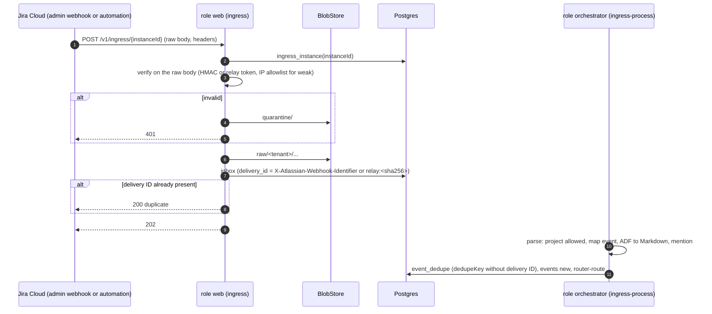
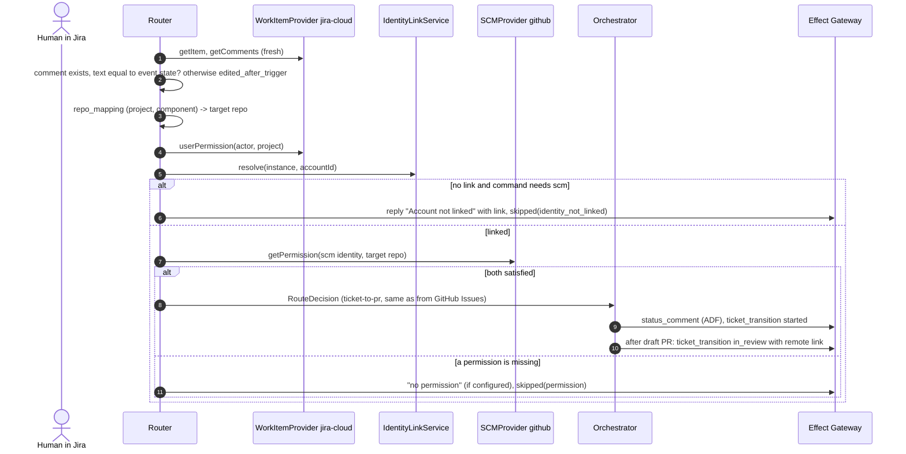
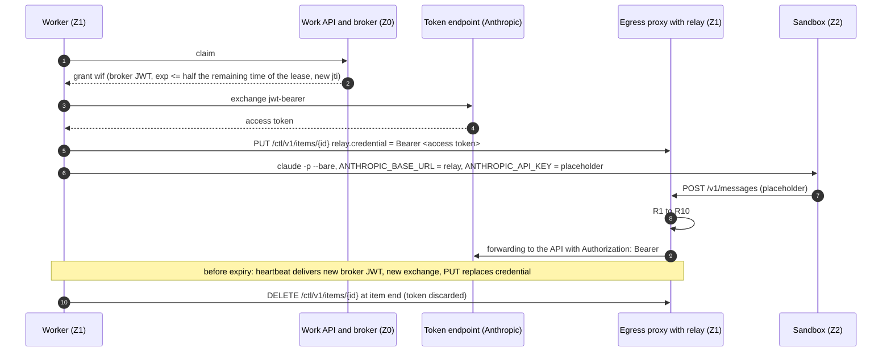
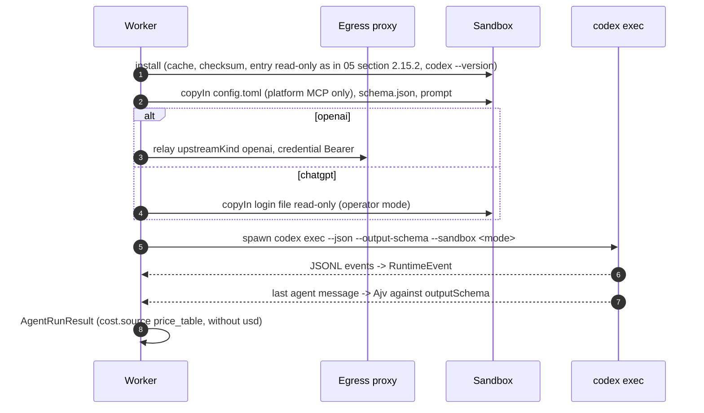
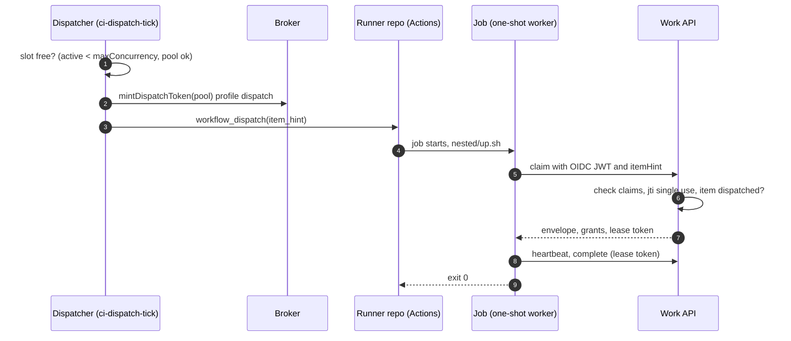

<!--
SPDX-License-Identifier: Apache-2.0
SPDX-FileCopyrightText: The Guildwork Authors
-->
# 13 Stage 8: Jira, further providers and bases

Detailed design of stage 8 from [08](../architecture/08-roadmap.md) at the depth of stages 0 and 1: Jira Cloud as TriggerSource and WorkItemProvider, identity linking and the permission AND check, the credential kinds `wif`, `bedrock`, `vertex`, `foundry`, the second harness `codex`, the bases (drivers `gcs`, `aws-secretsmanager`, `gcp-secretmanager`, identities `azure-managed-identity`, `aws`, `gcp`, Helm chart, OpenTofu `aws`, `gcp`, `hetzner`, host preparation), the backend `ci-dispatch`, price tables, qualification and acceptance. Rulings of this document: FE-1300 to FE-1399. The rulings of stage 8 from [12](12-expansion.md) (FE-1223 to FE-1233, FE-1253, FE-1255) continue to apply unchanged and are cited here by their number; this document replaces the brief stage 8 part of 12 (FE-1300).

Work plan: epics `8-E01` to `8-E06` in [stage-8.provider.toml](../plan/tasks/stage-8.provider.toml). Order of precedence, fixed choices (stack, package names) and required structure as in the [README](README.md). Classifications VERIFIED, CLAIMED, DERIVED and "unverified" as in the [architecture README](../architecture/README.md); in tables (B), (A), (u).

**External APIs:** All paths, headers, fields, variables and resource names of third-party services (Jira, Atlassian OAuth, GitHub OIDC and Actions, Anthropic token endpoint, Bedrock, Vertex, Foundry, Codex CLI, OpenAI, AWS, Google Cloud, Azure, Hetzner, Helm, cosign) are **unverified** in this document, unless a source from the architecture is explicitly named. They are proven by the spike tasks (8-E01-T02, 8-E02-T02, 8-E03-T01) against the public documentation and by the contract suites with cassettes from the documentation ([05](05-plugins-and-contracts.md) FE-564); the project has no account with these vendors (owner decision O28, FE-1366). If an optional owner run delivers real recordings and they differ, the recording applies, and this document is adjusted in the same PR.

## 1. Purpose and sources

| Building block | Epic | Section here | Architecture sources |
|---|---|---|---|
| Jira Cloud: TriggerSource, WorkItemProvider, ADF, identity linking, permission AND, visibility of ticket targets, `@agent ask` from Jira | 8-E01 | 2.1, 4.1 to 4.3 | [01](../architecture/01-plugin-interfaces.md) sections 2, 3, 4, 11.1, 11.5; [03](../architecture/03-flow-and-orchestration.md) sections 3 (G0) and 4; [05](../architecture/05-security.md) section 7; ADR-08, ADR-09, ADR-32, ADR-63, ADR-68 |
| Further LLM providers: `wif`, `bedrock`, `vertex`, `foundry`, data path policy | 8-E02 | 2.2, 4.4, 4.5 | 01 sections 6, 7, 11.4, 11.5; 05 sections 3 and 5; [04](../architecture/04-configuration-and-limits.md) section 5; ADR-22, ADR-23 |
| Harness `codex` with `openai` and `chatgpt` | 8-E03 | 2.3, 4.6 | 01 sections 6 and 11.3; 05 section 6; ADR-39, ADR-51 |
| Drivers, Helm chart, ExecutionBackend `k8s`, host preparation, OpenTofu modules | 8-E04 | 2.4, 4.7 | 01 sections 8 and 13; [06](../architecture/06-operations-and-deployment.md) section 2; [11](../architecture/11-installation-and-hosting.md) sections 2.5, 2.6, 3, 4, 9, 10, 11; ADR-41, ADR-42, ADR-48 |
| Backend `ci-dispatch` | 8-E05 | 2.5, 4.8 | 06 sections 2a and 4; 05 sections 2 and 5; ADR-30, ADR-45 |
| Price tables, qualification, acceptance | 8-E06 | 2.6, 2.7, 4.9, 8.6, 8.7 | 04 section 6; [07](../architecture/07-eval.md) sections 2, 2.1, 5; 08 stage 8; ADR-44, ADR-52, ADR-66 |
| Owner steps (accounts, money, applies) | 8-E01-T01, 8-E02-T01, 8-E04-T10, 8-E05-T01 | 2.8 | [09](../architecture/09-decisions.md) O22; 11 section 9 |

Done criteria of the stage according to 08 stage 8, each with the place in this document: E2E Jira mention equals GitHub mention (S5, 4.2, 8.7); permission AND check (2.1.7); out-of-order and repetition test with Jira fixtures (4.1, 4.2, 8.1); contract test "start with `<kind>`" per credential kind (2.2, 2.3, 8.2, 8.3); data path policy test against every new provider resolution (2.2.7, S2); qualification per new combination (2.7); S8 for Helm on kind or k3d and `tofu validate`/`plan` per module, real applies only as an optional owner run with O22, not a done criterion (2.4, 2.8, 8.4, FE-1366); `ci-dispatch` with nested sandbox and enforced proxy (backlog M4) and slot limit (2.5, 8.5).

### 1.1 Consequences of the stage graph

Stage 8 depends on 2 and 0b (and thus on 1, 0, R), not on 3, 4, 5, 6, 7a, 7 ([12](12-expansion.md) section 1.1). Consequences:

- `@agent ask` from Jira: detection, permissions, route and reply path in stage 8; the service `indexer` in mode `ask` comes from stage 7, the E2E test runs in 9-E02-T03 (FE-1227).
- `ticket-to-pr` from Jira runs up to the draft PR and review; until stage 4 the fix stage is taken over by a human (`on_disabled: human`, 08 section 3 "Note on the order").
- No dependency on the knowledge base: price tables, providers and bases use only core building blocks of stages 0 to 2.

### 1.2 Boundaries with other detailed design documents

- Contracts `v1alpha1` (types, capability enums, contract harness) are in [05](05-plugins-and-contracts.md) section 2.11; this document implements against them and does not change them. `WorkItemProvider` is still a sketch there (05 section 2.12) and, according to 05, becomes binding with `jira-cloud`; the implementation targets the complete version in [01](../architecture/01-plugin-interfaces.md) section 4 (FE-1303).
- Work API, envelope, grants, egress proxy, credential relay and harness environment are in [03](03-execution.md); here are only the extensions of stage 8, marked as additive fields (FE-1320, FE-1321, FE-1340).
- Effect Gateway, executors `comment`, `status_comment`, `ticket_transition`, Credential Broker and driver loader are in [04](04-effects-audit-credentials.md); here only the Jira mapping and the new broker paths (`dispatch`, cloud grants).
- Router, run state machine, config resolver are in [02](02-control-plane.md); here only the permission AND check and the data path rules of the new providers.
- Installer, admin UI, release chain, OpenTofu `generic-vm` and `azure`, `host-prepare.sh` are in [06](06-installation-operations-ui.md); here the stage 8 modules and the Helm chart.
- Eval runner, qualification matrix, reference qualification and suite catalog are in [07](07-eval-and-qualification.md); here only the combinations and suite cases of stage 8.

## 2. Modules and responsibility

### 2.0 Directories and packages

```text
packages/
  adf/                         # @guildwork/adf: Markdown <-> Atlassian Document Format (8-E01-T03, FE-1224)
    src/index.ts  src/to-adf.ts  src/from-adf.ts  src/subset.ts  src/mentions.ts
    test/fixtures/             # one Markdown and one ADF fixture per node type
  pricing/                     # @guildwork/pricing: price tables as files plus loader (8-E06-T01, FE-1230)
    tables/<provider>.json     # anthropic, bedrock, vertex, foundry, openai
    tables/reference-models.json
    src/types.ts  src/load.ts  src/lookup.ts  src/sync.ts  src/schema.ts
  config/src/resolver/
    data-policy.ts             # extension: regions per credential kind and ModelProvider (8-E02-T07)
    region-facts.ts            # table of verified regions per provider (FE-1326)
  config/src/schema/
    credentials.ts             # extension: RuntimeCredentialConfigStage8 (2.2.2, FE-1327)
  config/src/rules/
    relay-proven.ts            # relay approval per credential kind from the attestation (FE-1322)
    codex-credentials.ts       # FE-1229, ADR-51 for codex (8-E03-T03)
  contracts/src/work/envelope.ts   # additive grant variants of stage 8 (FE-1320)
plugins/
  jira-cloud/                  # TriggerSource and WorkItemProvider (8-E01, ADR-09)
    manifest.json  contract-attestation.json
    src/index.ts  src/config.ts  src/capabilities.ts
    src/client/rest.ts  src/client/errors.ts  src/client/paginate.ts  src/client/rate-limit.ts  src/client/auth.ts
    src/trigger.ts  src/trigger/verify.ts  src/trigger/parse.ts  src/trigger/map-events.ts  src/trigger/poll.ts
    src/workitems/read.ts  src/workitems/write.ts  src/workitems/status.ts  src/workitems/marker.ts
    contract/fixtures/  contract/targets/test-site.yaml  contract/record-guard.ts
    test/
  model-bedrock/  model-vertex/  model-foundry/     # ModelProvider (8-E02-T04 to T06), Vercel AI SDK
  claude-code/src/credentials/ # wif.ts, bedrock.ts, vertex.ts, foundry.ts, cloud.ts (extension, 8-E02)
  codex/                       # AgentRuntime codex (8-E03)
    src/index.ts  src/runtime.ts  src/install.ts  src/launch.ts  src/events.ts  src/result.ts
    src/credentials/openai.ts  src/credentials/chatgpt.ts
    contract/transcripts/  contract/
  exec-k8s/                    # ExecutionBackend k8s for Helm operation (FE-1345, 8-E04-T11)
  backend-ci-dispatch-github/  # ExecutionBackend ci-dispatch-github (8-E05)
    src/backend.ts  src/app-token.ts  src/limits.ts  src/metrics.ts
drivers/
  blob-gcs/  secret-aws-secretsmanager/  secret-gcp-secretmanager/
  identity-azure-managed-identity/  identity-aws/  identity-gcp/
apps/control-plane/src/
  identity/links.ts  identity/oauth-atlassian.ts  identity/oauth-github.ts  identity/routes.ts
  router/permissions-and.ts    # permission AND check (8-E01-T08)
  effects/policy/ticket-visibility.ts   # FE-1253, FE-1314
  broker/cloud-grants.ts  broker/dispatch-tokens.ts
  work/oidc.ts                 # OIDC login of the one-shot worker (8-E05-T03)
  ci-dispatch/dispatcher.ts    # job ci-dispatch-tick (8-E05-T02)
apps/admin-ui/src/pages/identity-link/
apps/worker/src/
  credentials/wif-exchange.ts  credentials/cloud.ts
  harness/env.ts               # extension for wif, bedrock, vertex, foundry, openai, chatgpt
  once.ts                      # mode --once (FE-1233)
apps/egress-proxy/src/relay/
  upstreams.ts  sigv4.ts  usage-openai.ts  usage-bedrock.ts   # relay for further upstreams (FE-1321)
deploy/
  helm/guildwork/              # chart (8-E04-T04, FE-1231)
  tofu/host-prepare/  tofu/aws/  tofu/gcp/  tofu/hetzner/
  ci-dispatch/runner-workflow.yml  ci-dispatch/nested/
eval/
  suites/s1/ci-dispatch/  suites/s2/provider/  suites/s5/jira/  suites/s8/helm/
  reports/spike-jira.md  reports/spike-federation.md  reports/spike-codex.md  reports/stufe-8-qualifikation.md
.github/workflows/
  s8-helm.yml  tofu-apply-aws.yml  tofu-apply-gcp.yml  tofu-apply-hetzner.yml
```

Dependency direction as in [05](05-plugins-and-contracts.md) section 2.1: plugins and drivers import only `core`, `contracts`, `config` (types only) and `@guildwork/adf` (FE-1311); never `db`, `pricing`, `apps/*` or other plugins. `@guildwork/pricing` is used only by the control plane and the eval package (FE-1360).

Shared base types (`Result`, `PluginError`, `Untrusted`, `RepoRef`, `WorkItemRef`, `Actor`, `PermissionLevel`, `StatusCategory`, `SecretRef`, `SecretValue`, `ScopedToken`, `CredentialKind`, `PinnedVersion`, `SandboxHandle`) come from `@guildwork/contracts` ([05](05-plugins-and-contracts.md) sections 2.3 and 2.11).

### 2.1 Jira Cloud (8-E01)

#### 2.1.1 Package, manifest and capabilities

One package `plugins/jira-cloud` (`@guildwork/plugin-jira-cloud`) with two kinds (ADR-09). Manifest:

```json
{
  "apiVersion": "guildwork-dev.github.io/v1alpha1",
  "kind": ["TriggerSource", "WorkItemProvider"],
  "id": "jira-cloud",
  "version": "0.1.0",
  "license": "Apache-2.0",
  "distribution": "bundled",
  "trust": "first_party",
  "transport": "in_process",
  "configSchema": { "$ref": "#/jira-cloud-instance" },
  "secrets": [
    { "name": "secret_ref", "kind": "webhook_secret", "required": false, "description": "HMAC key or relay token of the ingress" },
    { "name": "auth_ref", "kind": "token", "required": false, "description": "Credential of the service account" },
    { "name": "email_ref", "kind": "other", "required": false, "description": "Account email for auth.kind api_token" },
    { "name": "token_ref", "kind": "api_key", "required": false, "description": "API token for auth.kind api_token" }
  ],
  "egress": ["{config.site}"],
  "contractSuite": { "version": "1.0.0", "passedAt": "<from attestation>", "fixturesHash": "sha256:<from attestation>" }
}
```

Which secrets are required depends on the kind of instance; this is checked by the `configSchema` (`if`/`then` per `mode` or `auth.kind`), not by `required` in the manifest.

| Capability | Level | Reason |
|---|---|---|
| TriggerSource `WEBHOOK`, `WEBHOOK_HMAC` | native | Admin webhook with HMAC ([01](../architecture/01-plugin-interfaces.md) matrix 11.1 B) |
| `RELAY` | native | Automation "Send web request" (01 section 3, [jira-automation] B) |
| `POLL`, `RECONCILE` | native | JQL search with cursor (A) |
| `NATIVE_BOT_MENTION` | native | ADF `mention` (01 matrix 11.1 B) |
| `ACK_REACTION`, `AGENT_SESSION`, `BUTTON_ACTIONS`, `CI_EVENT` | none | no reactions on the comment (u); status comment with marker instead of session |
| WorkItemProvider `RICH_TEXT_ADF`, `TRANSITIONS`, `EXTERNAL_LINK`, `NATIVE_BOT_MENTION` | native | 01 matrix 11.1, 11.5 |
| `PERMISSION_API` | native, if 8-E01-T02 proves the endpoint for other users; otherwise none (FE-1226) | permissions only at the provider |
| `SET_LABELS`, `LINK_ITEMS`, `CREATE_ISSUE` | native (V, proven with 8-E01-T06) | labels field, issue links, creation |
| `CUSTOM_FIELDS` | fallback | only `acceptanceCriteriaField` |
| `ATTACHMENTS` | none | stage 8 reads no attachments |
| `DEV_PANEL` | none | apps only (01 matrix 11.5) |
| `CLOSE_AS_DUPLICATE`, `RELATED_SEARCH`, `DELEGATION`, `PLAN_NATIVE` | none | not needed in stage 8 |

Without `PERMISSION_API` the instance loads, but every route with `min_permission.work_item` ends with `skipped(permission_lookup_failed)` and an alert; an error is never counted as a permission ([02](02-control-plane.md) section 4.3).

#### 2.1.2 TriggerSource jira-cloud

**Instances (FE-1301):** One instance per ingress mode (`webhook` or `relay`), because ingress takes the signature scheme and mode from the instance, never from the request ([02](02-control-plane.md) FE-201). `poll` and `reconcile` are add-ons of every instance. The ingress path is the general ingress `POST /v1/ingress/{instanceId}` ([02](02-control-plane.md) section 4.1); there is no separate path per plugin.

```ts
// plugins/jira-cloud/src/config.ts
export interface JiraTriggerConfig {
  site: string;                            // "<name>.atlassian.net", host only
  mode: "webhook" | "relay";               // FE-1223, FE-1301
  verify: "hmac_sha256_hex" | "shared_secret";   // webhook always hmac_sha256_hex; relay hmac_sha256_hex only after proof (8-E01-T02)
  secretRef: SecretRef;                    // HMAC key or relay token
  workItems: string;                       // instance ID of the WorkItemProvider of the same site (FE-1312)
  botAccountId: string;                    // accountId of the service account
  handle: string;                          // text mention as fallback, default "agent"
  projectAllowlist: string[];              // events of other projects: Skipped("project_not_allowed")
  poll?: { enabled: boolean; intervalS: number; overlapS: number; maxPages: number };   // trigger.poll_interval, required with ingressMode private
  auth?: JiraAuthConfig;                   // required if poll.enabled (same values as the WorkItemProvider instance)
  ipAllowlist?: string[];                  // CIDR, only for strength weak (05 section 9)
}
export type JiraAuthConfig =
  | { kind: "service_account"; ref: SecretRef }                       // kind per site, unverified (8-E01-T02)
  | { kind: "api_token"; emailRef: SecretRef; tokenRef: SecretRef };
```

```ts
// plugins/jira-cloud/src/trigger.ts
export interface JiraTriggerSource extends TriggerSource {}   // no methods beyond the contract
export const JIRA_ACK_DEADLINE_MS = 10_000;  // response deadline per 01 matrix 11.1 "?", starting value as for GitHub (estimate)
export interface RelayBodyV1 {             // body of the automation rule (section 3.3)
  relayV: 1;
  webhookEvent: "comment_created" | "comment_updated" | "jira:issue_created" | "jira:issue_updated";
  issue: { key: string };
  comment?: { id: string };
  relayId?: string;                        // unique delivery ID, if automation provides one (u)
}
```

**`verify(headers, rawBody, secret)`** (`trigger/verify.ts`), on the raw body before any parsing:

| Mode | Check | Result |
|---|---|---|
| `webhook` | HMAC-SHA-256 over the raw body with `secretRef`, compared with the signature header (name and prefix unverified, 8-E01-T02) via `timingSafeEqual` after a length check | `scheme: hmac_sha256_hex`, `strength: strong` |
| `relay` with `verify: hmac_sha256_hex` | as above with the header set by the automation rule (`X-Guildwork-Signature: sha256=<hex>`, only if automation can do HMAC, u) | `strong` |
| `relay` with `verify: shared_secret` | header `X-Guildwork-Relay-Token` equal to the secret (constant time); with `ipAllowlist` set, additionally the source IP must be in it (ingress provides it as header `x-guildwork-peer`, set by the reverse proxy, FE-1302) | `scheme: shared_secret`, `strength: weak` |

A missing header yields `verified: false, reason: "missing_signature"`; an IP outside yields `reason: "ip_not_allowed"`.

**Source IP (FE-1316):** `x-guildwork-peer` is set only by the reverse proxy in front of the role `web` (Caddy in the Compose bundle, in Helm operation the operator's ingress, 2.4.4) from the address of the TCP connection, overwriting any value the client sends. If the header is missing while `ipAllowlist` is set, this counts as an IP outside (`ip_not_allowed`), never as allowed (test `jira relay ohne peer header wird bei ip allowlist abgelehnt`). Without `ipAllowlist` the header is not read.

**`parse(headers, rawBody)`** (`trigger/parse.ts`, `trigger/map-events.ts`):

| Input (event name unverified) | `what.subject` | `what.action` | Remark |
|---|---|---|---|
| `comment_created` with ADF mention `mention.attrs.id == botAccountId` | `work_item` | `mentioned` | `mention.native: true`; command from the text after the mention (FE-1310) |
| `comment_created` with text `@<handle>` | `work_item` | `mentioned` | `mention.native: false` (fallback) |
| `comment_created` without mention | `work_item` | `commented` | only for `reconcile` matching, no route without a command |
| `comment_updated` | as `comment_created` | as above | `text.editedAfterTrigger` is set only by the router after a fresh read ([02](02-control-plane.md) section 4.2) |
| `jira:issue_created` | `work_item` | `created` | |
| `jira:issue_updated` with a change of assignee to `botAccountId` | `work_item` | `assigned` | from the changelog of the payload; router reads fresh |
| `jira:issue_updated` with a label change | `work_item` | `labeled` | label in `command.args.label`, `origin: label` |
| Relay body `relayV: 1` | from `webhookEvent` | as above | content (comment text, labels) never comes from the relay body, but from `getComments`/`getItem` at the router; `parse` sets only keys (FE-1302) |
| Project not in `projectAllowlist` | | | `Skipped("project_not_allowed")` |
| everything else | | | `Skipped("unsupported_event:<name>")` |

- `id`: header `X-Atlassian-Webhook-Identifier` ([jira-webhooks] per 01 section 2 B); for the relay `relayId`, otherwise `relay:<sha256(rawBody)>` (FE-1302); for `poll`/`reconcile` `reconcile:<dedupeKey>` (02 FE-205).
- `dedupeKey`: unchanged `dedupeKey()` from `@guildwork/contracts` ([05](05-plugins-and-contracts.md) section 2.11.1); the delivery ID is not included, so that `poll` and webhook hit the same event (FE-1302).
- `where.workItem = { provider: "jira-cloud", instance: <workItems>, project, key }`; `where.thread.commentId` for comments. `where.repo` stays empty; the repo assignment is done by the router via `repo_mapping`.
- `actor`: `providerId = accountId`, `login = displayName` (display), `kind`: `app` for `accountType: app`, otherwise `human` (field name u); `email` is never set.
- `text`: comment ADF via `adfToMarkdown` (2.1.5) as `Untrusted` with `origin` `jira:comment:<id>`.
- `isSelf(actor)`: `actor.providerId === botAccountId`.
- `ack`: not present (capability `ACK_REACTION: none`); `describe().ackDeadlineMs = JIRA_ACK_DEADLINE_MS`.
- `poll(cursor)` and `reconcile(since)` (`trigger/poll.ts`): JQL `project in (<allowlist>) AND updated >= "<cursor - overlapS>" ORDER BY updated ASC` via the search API with page token (u), `getComments(since)` per hit; from that `TriggerEvent`s with `source.mode: "poll"`, signature `{ scheme: "none", verified: true, strength: "strong" }`. Cursor = latest `updated`; limit `poll.maxPages` per run, beyond that audit `jira.poll_truncated`.
- `install`, `renew`: not present; admin webhooks are created by the operator (2.8), app webhooks with 30-day expiry do not exist in stage 8.

#### 2.1.3 WorkItemProvider jira-cloud reading

```ts
// plugins/jira-cloud/src/config.ts
export interface JiraWorkItemConfig {
  site: string;
  auth: JiraAuthConfig;
  projectAllowlist: string[];
  statusMapping: Record<string, Partial<Record<StatusCategory, string>>>;   // status_mapping per project (04 section 3)
  remoteLinkGlobalIdPrefix: string;        // "guildwork:<installation>:" (FE-1306)
  acceptanceCriteriaField?: string;        // field ID, if acceptance criteria are in a separate field
  permissionCacheS: number;                // default 60 (FE-1226)
}
```

```ts
// plugins/jira-cloud/src/workitems/read.ts (signatures from 01 section 4, FE-1303)
export interface JiraWorkItemReader {
  getItem(ref: WorkItemRef): Promise<Result<WorkItem>>;
  getComments(ref: WorkItemRef, since?: string): Promise<Result<{ id: string; author: Actor; body: Untrusted; at: string; updatedAt: string }[]>>;
  search(jql: string, cursor?: string): Promise<Result<Page<WorkItemRef>>>;
  getAttachments(ref: WorkItemRef): Promise<Result<AttachmentRef[]>>;   // always [] (ATTACHMENTS none)
  getLinks(ref: WorkItemRef): Promise<Result<{ url: string; kind: string }[]>>;
  userPermission(user: Actor, project: string): Promise<Result<PermissionLevel>>;
  whoami(): Promise<Result<Actor>>;
  renderMention(user: Actor): string;      // "@[<accountId>]", turned into ADF mention by markdownToAdf (FE-1310)
  rateLimitState(): Promise<RateLimitSnapshot | null>;
}
```

| Method | Jira path (u, proven with 8-E01-T02) | Mapping |
|---|---|---|
| `getItem` | read issue with fields `summary`, `description`, `status`, `assignee`, `labels`, `components`, `updated` and `acceptanceCriteriaField` | `title`, `body` as `Untrusted` (ADF to Markdown); `status.category` per FE-1305; `url` = browse URL of the site |
| `getComments` | comments of the issue, paginated, ascending by creation; `since` filters locally by `updated` | `body` as `Untrusted`, `origin` `jira:comment:<id>` |
| `search` | JQL via the search API with page token | only projects of the `projectAllowlist` (JQL is extended by `project in (...)`, never replaced) |
| `getLinks` | remote links and issue links of the issue | `kind` `remote` or name of the link type |
| `userPermission` | permission check for another user in the project (endpoint u, FE-1226); `ADMINISTER_PROJECTS` to `admin`, `EDIT_ISSUES` to `write`, `BROWSE_PROJECTS` to `read`, otherwise `none` (FE-1307) | cache `(instance, accountId, project)` for `permissionCacheS` |
| `whoami` | own account | `kind: "app"`, `isSelf` |

- Errors per [05](05-plugins-and-contracts.md) section 2.7; 429 with `retry-after` yields `rate_limited` with `retryAfterMs` (header u). Plugins do not retry themselves (05 FE-507); the caller uses `withRetry` (test `jira 429 wird mit pause wiederholt` checks the chain plugin plus `withRetry`).
- `RateLimitSnapshot` from the response headers (names u).
- The payload of an event is never the truth; the router calls `getItem` and `getComments` before every decision (test `jira router liest getitem frisch statt payload`).

#### 2.1.4 WorkItemProvider jira-cloud writing

Write methods are called only by the Effect Gateway with one token per effect ([01](../architecture/01-plugin-interfaces.md) section 1.1 rule 5). Jira has no short-lived tokens per effect; the "token" is the credential of the service account, which the broker issues per effect as a `ScopedToken` with `weak: true` and profile `comment_issue` or `labels` (FE-1308). The executors from [04](04-effects-audit-credentials.md) section 2.1.5 stay unchanged; only the mapping is new:

| Method | Executor (04) | Jira path (u) | Idempotency and errors |
|---|---|---|---|
| `addComment(ref, md, { marker })` | `comment`, `status_comment`, `plan`, `human_input` | comment with body from `markdownToAdf`; marker as comment property `guildwork.marker`, otherwise as last paragraph with inline code `gw-marker:<marker>` (FE-1304) | `reconcile` searches for the marker; an ADF error yields a plain text fallback (`fallbackUsed: adf_plaintext`) |
| `updateComment(ref, id, md)` | `status_comment`, `plan` | replace comment | only own comments (author `botAccountId`), otherwise `permission` |
| `transition(ref, target)` | `ticket_transition` | read available transitions, choose the one with target `statusMapping[project][target]`, execute (FE-1305) | target already reached: `applied` without a call; no matching transition: `invalid` with `detail.providerCode = "no_transition"` and list of possible targets |
| `linkExternal(ref, link)` | `ticket_transition` | remote link with `globalId = prefix + link.kind + ":" + link.url` (upsert via `globalId`, FE-1306) | same `globalId` yields an update instead of a new link |
| `assign(ref, who)` | (no effect type, 12 FE-1250) | set assignee; `"agent"` means `botAccountId` | built only for the contract test |
| `setLabels(ref, add, remove)` | `labels` | labels field via update operation `add`/`remove` | reserved labels are checked by the policy, not the plugin |
| `linkItems(a, b, kind)` | `link` | issue link with type from `link_types` (`relates`, `duplicates`, `blocks`, names per site u) | existing identical link: `applied` |
| `createItem(project, item)` | `issue` | create issue; marker as issue property `guildwork.marker` (FE-1304); JQL search for the marker beforehand | marker found: existing item returned |

Status comment instead of agent session: `session` is absent; the executor `status_comment` writes the one comment per object (04 section 2.1.5). External links and images are removed by the Effect Gateway before rendering (05 section 2 point 4).

**Token per effect (FE-1308, built in 8-E01-T06):** The broker gets a second minting path next to `mintScmToken` ([04](04-effects-audit-credentials.md) section 2.3.5):

```ts
// apps/control-plane/src/broker/work-item-tokens.ts
export interface WorkItemTokenRequest {
  tenantId: string; effectId: string;
  instance: string;                        // instance ID of the WorkItemProvider (plugins.work_items[].id)
  profile: "comment_issue" | "labels";     // from the effect catalog as with mintScmToken
}
export function mintWorkItemToken(req: WorkItemTokenRequest): Promise<Result<ScopedToken>>;
// ScopedToken: { profile, weak: true, expiresAt = now + broker.effect_token_ttl_s, value = credential from auth of the instance }
```

- The only caller is the effect dispatcher for targets `work_item` of a ticket system outside the SCM; it chooses the path by the kind of the target instance (WorkItemProvider without an SCM instance of the same ID), never by the provider name.
- The value comes from `auth` of the WorkItemProvider instance via `resolveSecret(ref, { kind: "plugin", instanceId: instance })` (for `api_token` email and token as `email:token`, the plugin builds the header from it); it is never stored and, like every resolved value, registered as an exact redaction value. An error while resolving ends like a failed `mintScmToken` (effect `failed`, code `auth`, audit), never with a write without a token.
- The plugin checks `token.weak === true` and `token.profile` in every write method; a missing or wrong profile yields `permission` without a call to Jira (test `jira schreibt nur mit token je effekt`).

**Stage 8 and the later executors:** In stage 8 only `comment`, `status_comment`, `plan`, `human_input` and `ticket_transition` (profile `comment_issue`) call the plugin. `setLabels`, `linkItems`, `createItem` and `assign` are built and checked with the contract suite; their executors `labels` (6-E01-T09), `link` (7-E05-T06) and `issue` (10-E02-T05) come into being in stages on which stage 8 does not depend, and call them only there. `mintWorkItemToken` nevertheless already accepts the profile `labels`, because Jira knows no app permissions per profile (an installation with these stages needs no change to the broker).

```ts
// plugins/jira-cloud/src/workitems/status.ts
export function categoryOf(status: { name: string; categoryKey: string }, project: string,
                           mapping: JiraWorkItemConfig["statusMapping"]): StatusCategory;   // FE-1305
export function pickTransition(available: { id: string; to: { name: string } }[], project: string, target: StatusCategory,
                               mapping: JiraWorkItemConfig["statusMapping"]): Result<{ id: string; toName: string }>;
```

#### 2.1.5 ADF renderer and ADF reader

Package `@guildwork/adf` (FE-1224), pure functions without network, dependencies only `remark-parse` and `unified` (MIT according to research, license gate in 8-E01-T03).

```ts
// packages/adf/src/index.ts
export interface AdfDoc { version: 1; type: "doc"; content: AdfNode[] }
export type AdfNode = { type: string; attrs?: Record<string, unknown>; content?: AdfNode[]; marks?: { type: string; attrs?: Record<string, unknown> }[]; text?: string };
export interface ToAdfOptions {
  mentions: Record<string, string>;        // "@[<accountId>]" and "@login" -> accountId
  maxBytes: number;                        // limit of the comment (effects.comment_max_bytes)
}
export function markdownToAdf(md: string, opts: ToAdfOptions): Result<{ doc: AdfDoc; fallbacks: string[] }>;
export function adfToMarkdown(doc: unknown, opts?: { botAccountId?: string; handle?: string }): { md: string; unsupported: string[] };
export const ADF_SUBSET: readonly string[];   // node types of the platform subset
```

| Markdown (platform subset) | ADF | Way back |
|---|---|---|
| Paragraph, line break | `paragraph`, `hardBreak` | same |
| Heading 1 to 3 | `heading` with `level` | same; level 4 to 6 becomes 3 |
| List, numbered list, nested | `bulletList`, `orderedList`, `listItem` | same |
| Code block with language | `codeBlock` with `language` | same |
| Inline code, bold, italic, link | text with marks `code`, `strong`, `em`, `link` | same |
| Table without merged cells | `table`, `tableRow`, `tableHeader`, `tableCell` | same |
| `@[<accountId>]` or `@login` with an entry in `mentions` | `mention` with `attrs.id` | `@[<accountId>]`; a mention of the bot with `botAccountId` becomes `@<handle>` (FE-1310) |
| everything else (HTML, images, footnotes, quotes beyond three levels) | `codeBlock` with the source text, `fallbacks` names the kind | |
| ADF nodes outside the subset (panel, media, status, expand) | | `[unsupported:<type>]` plus text content, `unsupported` names the kind |

Rules: Content is never discarded; characters are not changed except for the sanitization of `Untrusted` (05 section 2.3, `sanitize`). If the result exceeds `maxBytes`, it is cut off at the end with the paragraph "truncated" (`fallbacks` contains `truncated`).

#### 2.1.6 Identity linking

Linking per FE-1225: the user confirms both accounts personally via OAuth; the control plane reads only the account ID on each side and discards the user tokens immediately.

```ts
// apps/control-plane/src/identity/links.ts
export interface IdentityLink {             // row in identity_links (01 section 3.2)
  id: string; tenant: TenantRef;
  workItemIdentityId: string;              // identities row of the Jira account under the WorkItemProvider instance (FE-1312)
  scmIdentityId: string;                   // identities row of the GitHub account under the SCM instance
  platformUserId: string;                  // hex of oauth_subject_sha256 (FE-1313)
  confirmedAt: string; confirmedVia: "oauth";
  revokedAt?: string; revokedReason?: string; revokedBy?: string;
}
export type IdentityLinkStep = { done: false; next: "github" } | { done: true; link: IdentityLink };
export type IdentityLinkError =
  | "state_unknown" | "state_expired" | "state_used" | "oauth_denied" | "oauth_exchange_failed"
  | "account_linked_elsewhere" | "page_disabled" | "secret_store_read_only";
export interface IdentityLinkService {
  start(req: { workItemInstance: string; scmInstance: string }, session: AdminSession): Promise<Result<{ redirectUrl: string; state: string }>>;
  callback(provider: "atlassian" | "github", code: string, state: string, session: AdminSession): Promise<Result<IdentityLinkStep>>;
  resolve(workItemInstance: string, accountId: string): Promise<IdentityLink | null>;   // active only
  listOwn(session: AdminSession): Promise<IdentityLink[]>;
  listAll(tenant: TenantRef, page: { cursor?: string }): Promise<Page<IdentityLink>>;  // role admin only
  revoke(linkId: string, by: AdminSession | "self", reason: string): Promise<Result<void>>;
}
// apps/control-plane/src/identity/oauth-atlassian.ts and oauth-github.ts
export interface OAuthIdentityClient {
  authorizeUrl(state: string, pkceChallenge: string, redirectUri: string): string;
  exchange(code: string, pkceVerifier: string, redirectUri: string): Promise<Result<{ accountId: string; login?: string }>>;   // token only local within the function
}
```

**Endpoints** (role `web`, admin API from [06](06-installation-operations-ui.md) section 2.6, cookie session, CSRF header on write calls):

| Method and path | Purpose | Permission | Responses |
|---|---|---|---|
| `GET /admin/api/v1/identity-links` | own links | any OIDC session (FE-1313) | `200 IdentityLink[]` without IDs of other accounts |
| `GET /admin/api/v1/identity-links?scope=all&cursor=` | all links of the tenant | `admin` | `200 Page<IdentityLink>` |
| `POST /admin/api/v1/identity-links/flows` | start flow `{ workItemInstance, scmInstance }` | any OIDC session, never emergency admin | `201 { redirectUrl, state }`; `409 page_disabled` without `identity_link.oauth.*`; `409 secret_store_read_only` |
| `GET /admin/oauth/identity-link/atlassian/callback?code&state` | Atlassian callback (browser) | session of the flow | `302` to the GitHub login or error page |
| `GET /admin/oauth/identity-link/github/callback?code&state` | GitHub callback (browser) | session of the flow | `302` to the page "Link accounts" with result |
| `DELETE /admin/api/v1/identity-links/{id}` | revocation `{ reason }` | owner of the link or `admin` | `204`, audit `identity.revoked` |

**Admin UI** (`apps/admin-ui/src/pages/identity-link/`): page "Link accounts" with selection of the Jira site (WorkItemProvider instance) and GitHub instance, button "Start linking", list of own links with revocation; for `admin` additionally the list of all links with revocation and a required reason. Error pages: "Link expired", "Account already linked, an admin must revoke the old link".

**Rules:**
1. Flow at most 15 minutes (`identity_link.flow_ttl_s`), `state` 32 random bytes base64url, single use (column `step` is set from `atlassian` to `github` or `done` in the same transaction on callback; a second callback does not find the old step).
2. PKCE with `S256`; the verifier is in the SecretStore under `secret://identity-link/<state>/pkce` and is overwritten after use (`put` with an empty value, because the contract has no `delete`); without `WRITE` on the SecretStore the page is off (FE-1309). Whether both vendors accept PKCE for these apps is unverified (8-E01-T07).
3. On each side only the account ID is read (Atlassian `accountId`, GitHub `id` and `login`); the user token lives only in the function `exchange` and is never stored, logged or passed to the browser (secret scan after a test run).
4. The callback session must be the same admin session that started the flow (column `admin_session` as SHA-256 of the session ID).
5. `identities` rows are created via upsert over `(plugin_instance_id, provider_user_id)`: Jira under the WorkItemProvider instance, GitHub under the chosen SCM instance (FE-1312).
6. Email equality never links; the vendor responses are reduced to `accountId` or `id` before any code processes them further.
7. A Jira account with an active link to another platform user yields `account_linked_elsewhere` (unique index `identity_links_one_scm_per_item_identity`).
8. Expiry and deletion: a callback with `expires_at < now()` sets `step = 'expired'` and responds with the error page "Link expired". The deletion job `db-retention` ([01](01-data-model.md) section 2.2, `runRetention`) gets the class `identity_link_flow`: rows with `expires_at + 1 day < now()` are deleted, before that the verifier under `pkce_verifier_ref` is overwritten with an empty value, if it has not been overwritten yet; counted in `guildwork.retention.deleted{class="identity_link_flow"}` (test `identity link vorgänge werden nach ablauf gelöscht`). The class is added in 8-E01-T07.

#### 2.1.7 Permission AND check and visibility of ticket targets

Extension of router step 7 ([02](02-control-plane.md) section 4.3) for events with `where.workItem` of a ticket system outside the SCM:

```ts
// apps/control-plane/src/router/permissions-and.ts
export interface AndPermissionInput {
  ev: TriggerEvent;                        // where.workItem set, where.repo empty
  targetRepo: RepoRef;                     // from repo_mapping (router step 2)
  minPermission: { work_item?: PermissionLevel; scm?: PermissionLevel };   // from command_permissions or route
}
export type AndPermissionResult =
  | { ok: true; permission: ResolvedEvent["permission"]; identity: { platformUserId: string } }
  | { ok: false; skip: "identity_not_linked" | "permission" | "permission_lookup_failed";
      detail: { workItem?: PermissionLevel; scm?: PermissionLevel; linkUrl?: string } };
export interface AndPermissionChecker {
  check(i: AndPermissionInput): Promise<AndPermissionResult>;
}
```

Flow: (1) `userPermission(actor, project)` fresh at the WorkItemProvider (cache 60 s, FE-1226); (2) `IdentityLinkService.resolve(workItem.instance, actor.providerId)`; without an active link and with `minPermission.scm`: `identity_not_linked`; (3) `SCMProvider.getPermission({ providerId, login } of the SCM identity, targetRepo)`; (4) both values against `minPermission` via `PERMISSION_ORDER`. Commands without an `scm` requirement (such as `ask` with read permission on the ticket) need no link. Result `permission.source = "jira-cloud+identity_links"`. An error of the provider is never counted as a permission (`permission_lookup_failed`, retry by the router job).

`identity_not_linked` is a new `skip_reason` (step 7, audit yes, visible reply by default yes: "Account not linked" with a link to `<public_url>/admin/identity-link`). `permission` replies only with `routing.reply_on_skip.permission: true` and does not name either value (only "no permission"); the values are in the audit.

**Visibility of ticket targets (FE-1253, location FE-1314):** The policy of the Effect Gateway (`apps/control-plane/src/effects/policy/ticket-visibility.ts`) determines the visibility for every target `work_item` of a ticket system outside the SCM and uses it to check every quote and every reference (rule `POL-070` from 04):

```ts
// apps/control-plane/src/effects/policy/ticket-visibility.ts
export type Visibility = "public" | "internal" | "private";
export interface TicketTargetContext {
  explicit?: Visibility;                   // plugins.work_items[].visibility.<PROJECT>, org level only
  mappedRepo?: RepoRef;                    // repo_mapping of the ticket
  runRepo?: RepoRef;                       // repo of the own run
}
export function ticketTargetVisibility(ctx: TicketTargetContext): Visibility;   // explicit, otherwise "public"
export function allowedOnTicket(source: { repo: RepoRef; visibility: Visibility; kind: "quote" | "own_run_reference" },
                                ctx: TicketTargetContext): { allow: boolean; rule: "explicit" | "own_run_reference" | "public_default" };
```

| Source | without setting | with setting `v` |
|---|---|---|
| Reference of the own run to `mappedRepo` (remote link, PR number, branch name, status with state and cost) | allowed | allowed |
| Quote with code or text content from `mappedRepo` | allowed only if `mappedRepo` is `public` | allowed if the visibility of the source is at least as open as `v` (rule from 05 section 7) |
| Quote from another repo | only `public` sources | as above |

Filling the context: the policy knows no provider name (FE-1314); `TicketTargetContext` is filled by the caller in the Effect Gateway from the target `work_item` of the intent:

| Field | Jira project (stage 8) | Linear team (from stage 9, [14](14-stage-9-breadth-and-hardening.md) FE-1449) |
|---|---|---|
| Project key | `WorkItemRef.project` = Jira project key | `WorkItemRef.project` = team key |
| `explicit` | `plugins.work_items[<instance>].visibility.<PROJECT>` | `plugins.work_items[<instance>].visibility.<TEAM>` |
| `mappedRepo` | `repo_mapping` of the router ([02](02-control-plane.md) section 4.3 step 2) with the project key | `repo_mapping` with the team key as project |
| `runRepo` | repo of the own run | repo of the own run |

The type and the functions stay the same for every ticket system outside the SCM; a further system only supplies this mapping (no move, no copy in the plugin, FE-1449 in 14). The key `visibility.<PROJECT>` has the same name for every system; for Linear it holds the team key (section 7).

#### 2.1.8 Ask and control commands from Jira

- Route `work_item.mentioned` with command `ask` (minimum permission `work_item: read`, 03 section 4) goes to the service `indexer`; if it is `off` for the assigned repo or not installed, the event ends with `skipped(service_disabled)` and the reply "Service indexer is off for this repo" (02 section 4.3, table `skip_reason`; the done criterion of 8-E01-T10 names it in short form "Service indexer is off"). The reply of the ask run goes out as effect `comment` via `addComment` in ADF (FE-1227).
- `approve plan` and `stop` from Jira hit the run via `objectKey` `item:<instance>:<project>:<key>` ([05](05-plugins-and-contracts.md) section 2.11.1); permissions as from GitHub, additionally permission AND if the command has a code consequence (`approve plan` leads from G1 to `coding`).
- `code`, `plan` from Jira start `ticket-to-pr` (stage 2) with `where.workItem`; the status comment, the transition `started` at the start and `in_review` at the draft PR, and the remote link to the PR run via the executors `status_comment` and `ticket_transition` (04 section 2.1.5).

#### 2.1.9 Spike, fixtures and recording

- Recording script `plugins/jira-cloud/contract/record-guard.ts` extends `RecordingHttp` ([05](05-plugins-and-contracts.md) section 2.10) with the target check: only the site from `contract/targets/test-site.yaml` is allowed, projects only from its list; any other site aborts before the network with `RecordingBlocked` (test `jira aufnahme verweigert fremde sites`). Writing recordings only in mode `writes_to_test_targets` with `--allow-writes`.
- Webhook fixtures are re-signed with `contract-test-webhook-secret`; relay fixtures with `contract-test-relay-token`.
- Result of the spike `eval/reports/spike-jira.md`: for each open point from section 10, VERIFIED with a reference in the public documentation (or a recording from an optional owner run on a test site, FE-1366), or refuted, or "unverified" with a consequence; deviations are carried over into this document in the same PR.

### 2.2 Further LLM providers (8-E02)

#### 2.2.1 Overview per credential kind

| Kind | Harness `claude-code` | ModelProvider | Identity (`CloudIdentity`) | Grant (FE-1320) | Transition until relay contract test |
|---|---|---|---|---|---|
| `wif` | `--bare`, `ANTHROPIC_BASE_URL` = relay, placeholder key; worker exchanges the broker JWT ([an-wif] B per 01 section 6) | `anthropic-api` with WIF via the same relay | issuer `self-issuer`; cloud issuers per FE-1324 | `wif` (stage 0, fields added) | none, the relay is the starting path |
| `bedrock` | `--bare`, `CLAUDE_CODE_USE_BEDROCK=1`, target `ANTHROPIC_BEDROCK_BASE_URL` = relay with SigV4 | `model-bedrock` | `aws` (`exchange("aws_sts")`) | `bedrock` | STS credentials of the item role in the sandbox (FE-1228) |
| `vertex` | `--bare`, `CLAUDE_CODE_USE_VERTEX=1`, `CLOUD_ML_REGION`, target relay | `model-vertex` | `gcp` (`exchange("gcp_sts")`) | `vertex` | short-lived access token per item |
| `foundry` | `--bare`, `CLAUDE_CODE_USE_FOUNDRY=1`, `ANTHROPIC_FOUNDRY_RESOURCE`, target relay | `model-foundry` | `azure-managed-identity` (`exchange("entra")`) | `foundry` | short-lived Entra token per item |

Variables other than those with a source in 01 sections 6 and 11.4 are unverified; 8-E02-T02 fixes the allowlist for `vertex` and `foundry` (backlog M36).

#### 2.2.2 Grants and broker

```ts
// packages/contracts/src/work/envelope.ts (additive to 03 section 2.3, FE-1320)
export type LlmGrantV1 =
  | { kind: "api_key"; header: "x-api-key"; value: string; placeholder: string }
  | { kind: "gateway"; header: "authorization"; value: string; placeholder: string }
  | { kind: "wif"; brokerJwt: string; exp: string; placeholder: string;
      exchange?: { tokenUrl: string; params: Record<string, string> } }        // additive, no secrets in params
  | { kind: "bedrock"; mode: "relay" | "transition"; region: string; placeholder?: string;
      sts: { accessKeyId: string; secretAccessKey: string; sessionToken: string; expiration: string } }
  | { kind: "vertex"; mode: "relay" | "transition"; project: string; region: string; placeholder?: string;
      accessToken: string; exp: string }
  | { kind: "foundry"; mode: "relay" | "transition"; resource: string; placeholder?: string;
      accessToken: string; exp: string }
  | { kind: "openai"; header: "authorization"; value: string; placeholder: string };   // codex (2.3.4)
```

```ts
// packages/config/src/schema/credentials.ts (variants of stage 8, additive to the kinds of stages 0 and 1; keys from section 7 in camelCase)
export type RuntimeCredentialConfigStage8 =
  | { kind: "wif"; workspace: string; tokenUrl: string; audience: string; issuer: "self-issuer" | string; relay: true }
  | { kind: "bedrock"; regionPrefix: string; identityRef: string; maxTtlS: number; relay: boolean }
  | { kind: "vertex"; project: string; region: string; identityRef: string; maxTtlS: number; relay: boolean }
  | { kind: "foundry"; resource: string; identityRef: string; maxTtlS: number; relay: boolean }
  | { kind: "openai"; ref: SecretRef; relay: boolean }
  | { kind: "chatgpt" };                     // login file only in worker.yaml (FE-1332)
// RuntimeCredentialConfig = kinds of stages 0 and 1 | RuntimeCredentialConfigStage8
// apps/control-plane/src/broker/cloud-grants.ts
export interface CloudGrantRequest {
  tenantId: string; itemId: string; leaseExpiresAt: Date;
  runtime: { id: string; credential: RuntimeCredentialConfig };   // runtimes[].credential (section 7)
  relay: boolean;                          // effective value per FE-1322
}
export interface CloudGrantIssuer {
  issue(req: CloudGrantRequest): Promise<Result<LlmGrantV1>>;
}
```

- The broker calls `CloudIdentity.exchange(target, { audience, ttlS })` of the driver named in `runtimes[].credential.identity_ref` with `ttlS = min(credential.max_ttl_s, remaining time of the lease)`; the result lives only in memory and in the claim response (03 FE-304). For `aws_sts`, `credential` is a JSON value `{ accessKeyId, secretAccessKey, sessionToken }` (FE-1325).
- The item role, service account or Entra application allows only the model call: Bedrock only `InvokeModel*` on the allowed `eu.` profiles (01 section 6), Vertex only prediction on Anthropic models of the region, Foundry only inference of the resource; the permissions are created by the operator, the OpenTofu module of the base offers them as a resource (2.4.6). The control plane does not check the role (unverified whether a query is possible); the contract test "start with `<kind>`" checks that a call outside (such as another model) fails with `permission`.
- `issueLlmGrant` from [04](04-effects-audit-credentials.md) section 2.3.6 delegates to `CloudGrantIssuer` for `bedrock`, `vertex`, `foundry` and to the ring for `wif`; every other kind stays `unsupported`.
- Audit `broker.llm_grant_issued` with kind, runtime, expiry, mode (`relay`/`transition`), fingerprint; never the value. A rejected exchange yields `broker.llm_grant_refused` and the item ends with `credential_unavailable` (section 5).
- The grant `openai` (codex, 2.3.4) needs no exchange: the broker resolves `runtimes[].credential.ref` via `resolveSecret(ref, { kind: "llm_grant", itemId })` and issues `{ kind: "openai", header: "authorization", value: "Bearer <key>", placeholder }`.

**Which task builds what** (the parts are in components of other areas; the catalog entry follows with the build):

| Task | Part |
|---|---|
| 8-E02-T03 | variant `wif` with `exchange` in `envelope.ts`; `issueLlmGrant` for `wif` with broker JWT; `WifSession` in the worker; replacement of the relay credential via `PUT` |
| 8-E02-T04 | `CloudGrantIssuer` (`broker/cloud-grants.ts`) and variant `bedrock`; upstream profile `bedrock` with SigV4; `relay-proven.ts` with `RELAY_NOT_PROVEN` (first relay case) |
| 8-E02-T05, 8-E02-T06 | variants and issuer branches `vertex` and `foundry`; upstream profiles `vertex` and `foundry` |
| 8-E03-T03 | variant `openai` and its branch in `issueLlmGrant`; upstream profile `openai` with `usage-openai.ts` |

```ts
// packages/config/src/rules/relay-proven.ts (8-E02-T04, FE-1322)
export type RelayKind = "bedrock" | "vertex" | "foundry" | "openai";   // wif and api_key always run via the relay
export type RelayProven = Readonly<Partial<Record<RelayKind, true>>>;
// Source: contract-attestation.json of the loaded harness plugins; case "start mit <art> über relay" (claude-code)
// or "start mit openai" (codex) with result "passed" (05 section 2.10). Never from a configuration.
export function relayProvenFrom(attestations: ContractAttestation[]): RelayProven;
export type RelayRuleError = { code: "RELAY_NOT_PROVEN"; ref: string; kind: RelayKind };   // ref: runtimes[<id>] or models[<id>]
export function checkRelayProven(cfg: EffectiveConfigView, proven: RelayProven): RelayRuleError[];
```

The rule runs like the other consistency rules at load time ([02](02-control-plane.md) `ConsistencyRule`); a hit rejects only the affected runtime or model entry (test `relay true ohne grünen relay fall wird abgelehnt`). `checkRelayProven` checks only `bedrock`, `vertex` and `foundry`; `openai` always runs via the relay, limited there until the proof `CODEX_OPENAI_SHELL_BEFORE_RELAY` (2.3.4) via the same value `RelayProven`.

#### 2.2.3 Exchange in the worker for wif

```ts
// apps/worker/src/credentials/wif-exchange.ts
export interface WifExchangeResult { accessToken: SecretValue; expiresAt: string }
export type WifExchangeError = "rejected" | "jti_replayed" | "issuer_unknown" | "transient" | "invalid_response";
export function exchangeWif(grant: Extract<LlmGrantV1, { kind: "wif" }>, http: EgressHttp, clock: Clock):
  Promise<Result<WifExchangeResult>>;     // POST <tokenUrl> with grant_type jwt-bearer ([an-wif] B), other fields u
export interface WifSession {              // per item in the worker
  current(): SecretValue;                  // access token for the relay
  refreshIfDue(now: Date): Promise<Result<void>>;   // new broker JWT via heartbeat grant, new exchange
  dispose(): void;                         // discard token with the item
}
```

- The worker calls the token endpoint itself (Z1), via its own egress permission, never from the sandbox. The endpoint is listed as `llm.tokenHost` in the egress allowlist of the worker, not of the sandbox.
- The access token goes via `PUT /ctl/v1/items/{itemId}` as `relay.credential = { header: "authorization", value: "Bearer <token>" }` to the egress proxy ([03](03-execution.md) section 2.9.1); the sandbox sees only the placeholder.
- Renewal: if the access token expires before the item (lifetime at most twice the remaining time of the broker JWT, 01 section 6), the worker fetches a new broker JWT at the next heartbeat (heartbeat response `grants`, 03 section 2.4.2), exchanges again and replaces the credential in the proxy via `PUT`.
- Rejected exchange (4xx of the endpoint): item ends with `credential_unavailable`, `StepStatus` `auth_failed`, `retryable: false`; audit `wif.exchange_rejected`, alert `wif_exchange_failed`.

#### 2.2.4 Credential relay for further upstreams

Extension of the relay from [03](03-execution.md) section 2.10 (FE-1321): the relay knows one upstream kind per item; rules R1, R2, R4, R7 to R10 apply to all kinds, R3, R5, R6 and the usage reading per kind.

```ts
// apps/egress-proxy/src/ctl.ts (additive to ItemRegistration.relay, 03 section 2.9.1)
export type RelayUpstreamKind = "anthropic" | "bedrock" | "vertex" | "foundry" | "openai";   // default "anthropic"
export type RelayCredential =
  | { header: "x-api-key" | "authorization"; value: string }
  | { sigv4: { accessKeyId: string; secretAccessKey: string; sessionToken: string; region: string; service: "bedrock" } };
// ItemRegistration.relay gets: upstreamKind?: RelayUpstreamKind; credential: RelayCredential
// apps/egress-proxy/src/relay/upstreams.ts
export interface UpstreamProfile {
  kind: RelayUpstreamKind;
  pathAllow: RegExp[];                     // R3 per kind
  modelFrom: "body" | "path";              // R7: model from the body or from the path
  bodyRules: ("no_mcp_servers" | "tools_custom_only" | "tools_function_only")[];   // R5, R6
  usage(res: Response | AsyncIterable<Uint8Array>): AsyncIterable<{ model: string; in: number; out: number; cacheRead: number; cacheWrite: number }>;
  sign?(req: Request, cred: RelayCredential): Promise<Request>;   // bedrock only: SigV4
}
```

| Kind | allowed paths (u, 8-E02-T02 or 8-E03-T01) | Model from | Body rules | Usage |
|---|---|---|---|---|
| `anthropic` | `POST /v1/messages`, `POST /v1/messages/count_tokens` (03 R3) | body | `no_mcp_servers`, `tools_custom_only` | JSON and SSE (03) |
| `bedrock` | call of a model via the Invoke API, also with streaming | path | as `anthropic` (body in Messages format, u) | JSON or AWS event stream (u) |
| `vertex` | raw prediction of an Anthropic model in project and region of the runtime, also streaming | path | as `anthropic` | JSON and SSE (u) |
| `foundry` | Messages endpoint of the resource | body | as `anthropic` | JSON and SSE (u) |
| `openai` | Responses API (codex, 2.3.4) | body | `tools_function_only`, no `mcp` tool | JSON and SSE (u) |

The relay of a kind is used only once the relay contract test of that kind is green (FE-1322); until then, in the transition, the worker writes the credentials of the item role into the harness environment (2.2.5) and registers at the proxy only `allow` for the upstream host without relay.

#### 2.2.5 Starting paths and harness environment

Extension of `buildHarnessEnv` ([03](03-execution.md) section 2.11, rule 3) and `plugins/claude-code/src/credentials/*.ts` (FE-1323):

Division of work as in [05](05-plugins-and-contracts.md) FE-550: the credential variables of every kind are set solely by the `spawn` wrapper of the worker. The worker passes `run` a wrapper of the `SandboxHandle` (05 section 2.15.3); its `spawn` with `role: "agent"` passes `opts.env` as `runtimeExtra` to `buildHarnessEnv`, calls `planCloudCredential` for the kinds `wif`, `bedrock`, `vertex` and `foundry` with the grant of the item and the proxy address, and passes `CloudCredentialPlan.sandboxEnv` as field `cloud` of `HarnessEnvInput` (additive); `buildHarnessEnv` checks every variable against the allowlist of the kind (table below) and starts with the result. `planCloudCredential` is a pure function without input and output, exported as `@guildwork/plugin-claude-code/credentials` and called only by the worker (like `subscriptionHealth`, 05 FE-550); the runtime plugin itself sees neither grant nor plan, its `run` supplies only `runtimeExtra` without credential variables (rule 4 from 03). For `codex` the same wrapper applies with the kinds `openai` and `chatgpt` (2.3.4).

```ts
// plugins/claude-code/src/credentials/cloud.ts
export interface CloudCredentialPlan {
  kind: "wif" | "bedrock" | "vertex" | "foundry";
  relay: boolean;                          // effective value per FE-1322
  sandboxEnv: Record<string, string>;      // only variables of the allowlist of the kind
  expiresAt: string;                       // at most end of lease
  runRecordNote?: "transition_short_lived_cloud_credentials_in_sandbox";
}
export function planCloudCredential(grant: LlmGrantV1, proxy: { ip: string; relayPort: number }): Result<CloudCredentialPlan>;
// Export @guildwork/plugin-claude-code/credentials; the only caller is the spawn wrapper of the worker (FE-550, FE-1323)

// apps/worker/src/harness/env.ts (additive to 03 section 2.11)
export interface HarnessEnvInput { /* fields from 03 */ cloud?: CloudCredentialPlan["sandboxEnv"] }
```

| Kind | shared variables (03) plus | additionally in the transition | never |
|---|---|---|---|
| `wif` | `ANTHROPIC_BASE_URL=http://<proxyIp>:3129`, `ANTHROPIC_API_KEY=<placeholder>` | | federation variables, `ANTHROPIC_AUTH_TOKEN` |
| `bedrock` | `CLAUDE_CODE_USE_BEDROCK=1`, `AWS_REGION`, with relay `ANTHROPIC_BEDROCK_BASE_URL=http://<proxyIp>:3129` and turning off client signing (variable u, 01 section 6) | `AWS_ACCESS_KEY_ID`, `AWS_SECRET_ACCESS_KEY`, `AWS_SESSION_TOKEN` of the item role | `AWS_PROFILE`, files under `~/.aws` |
| `vertex` | `CLAUDE_CODE_USE_VERTEX=1`, `CLOUD_ML_REGION`, project variable (u), with relay base URL pointing to the relay and turning off client login (variables u) | access token of the item identity (path u, 8-E02-T02) | key file of a service account |
| `foundry` | `CLAUDE_CODE_USE_FOUNDRY=1`, `ANTHROPIC_FOUNDRY_RESOURCE`, with relay base URL pointing to the relay (u) | Entra token of the item identity (variable u) | client secret of an application |

- Every kind starts with `--bare` and the shared starting path from [05](05-plugins-and-contracts.md) section 2.15.3; from stage 8 `supports(kind)` reports `ok: true` with conditions `["bare", "env_allowlist", "relay" | "transition"]` instead of `contract_test_stage_8` (05 FE-529).
- The check "foreign credential variables" (03 rule 4) applies unchanged: in the test the worker environment deliberately contains `ANTHROPIC_API_KEY`, `AWS_*`, `GOOGLE_*`, `AZURE_*`, `OPENAI_*`, `CLAUDE_CODE_OAUTH_TOKEN`, and `/proc/<pid>/environ` of the harness contains only the values of the table.
- In the transition the Run Record notes "Transition: short-lived cloud credentials in the sandbox" (`runRecordNote`), and the lifetime of the credential is at most the lease.

#### 2.2.6 ModelProvider bedrock, vertex and foundry

One plugin per provider with kind `ModelProvider`, Vercel AI SDK with the vendor's package ([aisdk] B per 01 section 7; package names and options u), location worker as work item `model_call` (05 FE-531). Shared pattern as for `anthropic-api` ([05](05-plugins-and-contracts.md) section 2.16): `fetch: ctx.http.asFetch()`, base URL relay with `relay: true`, structured output re-checked with Ajv, `untrusted` parts via `renderUntrustedBlock`, `cost: { source: "price_table" }` without `usd` (FE-1360).

| Plugin | Manifest `id` | Capabilities | `models()` |
|---|---|---|---|
| `plugins/model-bedrock` | `bedrock` | `TOOLS` native, `STRICT_SCHEMA` fallback (Ajv, u whether native), `PROMPT_CACHE` native with note "regional" (01 matrix 11.5 B), `REGION_EU` native for `eu.` profiles, `BATCH_API`, `EMBEDDINGS`, `COST_FROM_PROVIDER`, `LIMIT_HEADERS` none | profiles from the configuration (`models[]`), regions from the profile prefix |
| `plugins/model-vertex` | `vertex` | `TOOLS` native, `STRICT_SCHEMA` fallback, `PROMPT_CACHE` none until proven (01 matrix 11.4 "?"), `REGION_EU` per FE-1326, rest none | from the configuration |
| `plugins/model-foundry` | `foundry` | `TOOLS` native, `STRICT_SCHEMA` fallback, `REGION_EU` none (01 matrix 11.5), rest none | from the configuration |

Configuration per entry in `models[]` (FE-1327); the credential never comes from the plugin, but as a grant of the work item `model_call` (broker as in 2.2.2), the plugin sees only base URL and placeholder or, in the transition, the short-lived credential from the grant:

```ts
// plugins/model-bedrock/src/config.ts, plugins/model-vertex/src/config.ts, plugins/model-foundry/src/config.ts
export interface CloudModelEntryBase {
  id: string;                              // models[].id, referenced from services.<id>.models
  credential: RuntimeCredentialConfig;     // same form as runtimes[].credential of the kind (section 7)
  models: { name: string; contextTokens?: number }[];   // what models() reports; names as in the price table (2.6)
}
export interface BedrockModelConfig extends CloudModelEntryBase { plugin: "bedrock"; credential: RuntimeCredentialConfig & { kind: "bedrock" } }
export interface VertexModelConfig extends CloudModelEntryBase { plugin: "vertex"; credential: RuntimeCredentialConfig & { kind: "vertex" } }
export interface FoundryModelConfig extends CloudModelEntryBase { plugin: "foundry"; credential: RuntimeCredentialConfig & { kind: "foundry" } }
```

Rules: `relay: true`, as for the runtime, only with a green relay case (FE-1322; the case `start mit <art> über relay` applies to harness and ModelProvider of the same kind, because both use the same relay profile); the data path policy (2.2.7) checks every entry; `models()` reports only the configured names, regions from `credential.region_prefix` or `credential.region`.

`anthropic-api` gets the kind `wif`: the worker sets base URL relay and placeholder as for `api_key`; the exchange runs as in 2.2.3. Contract suites per plugin per [05](05-plugins-and-contracts.md) section 2.10 (suite `ModelProvider`) with recorded responses from the accounts of 8-E02-T01.

#### 2.2.7 Data path policy per provider resolution

Resolver rule (ADR-23) in `packages/config/src/resolver/data-policy.ts`, called on every resolution of `services.<id>.runtime`, `models.*` and on every fallback (04 section 5 order point 1):

```ts
// packages/config/src/resolver/region-facts.ts (FE-1326)
export type Region = "eu" | "us" | "global";
export interface RegionFact {
  match: { credentialKind?: CredentialKind; modelPlugin?: string; regionPrefix?: string; cloudRegion?: RegExp };
  regions: Region[];                       // what the resolution satisfies
  source: string; classification: "BELEGT" | "ABGELEITET" | "ungeprüft";
}
export const REGION_FACTS: readonly RegionFact[];
// packages/config/src/resolver/data-policy.ts
export type DataPolicyError =
  | { code: "DATA_POLICY_REGION"; ref: string; required: Region[]; offered: Region[]; fact: string }
  | { code: "DATA_POLICY_PROVIDER_NOT_ALLOWED"; ref: string; repoClass: string }
  | { code: "DATA_POLICY_FALLBACK_REJECTED"; ref: string; failed: ("region" | "allowlist" | "qualification" | "limits")[] };
export function checkProviderResolution(ref: ResolvedProviderRef, policy: EffectiveDataPolicy): DataPolicyError[];
```

| Resolution | satisfies | Source |
|---|---|---|
| `api_key`, `wif` (Anthropic 1P), `anthropic-api` | `global`, `us` | `inference_geo` only `global` and `us` (01 matrix 11.4 B) |
| `bedrock` with prefix `eu.` | `eu` | 01 matrix 11.4 B |
| `bedrock` with another prefix | `us` or `global` according to the prefix | DERIVED |
| `vertex` in an EU region | `eu` only if 8-E02-T02 proves EU regions for Claude; until then like `global` | 01 matrix 11.4 (u) |
| `foundry` | `us`; never `eu` as long as no EU zone is proven | 01 matrix 11.5 B |
| `codex` with `openai`, `chatgpt` | `global` | unverified (01 matrix 11.4 "?") |

A violation rejects the runtime or the service at load time (not the installation) and appears in `config validate`, `doctor` and the admin UI with rule and key (S2). A fallback provider is used only if it passes all four checks from 04 section 5 (`DATA_POLICY_FALLBACK_REJECTED` otherwise).

### 2.3 Harness codex (8-E03)

#### 2.3.1 Manifest and capabilities

Package `plugins/codex` (`@guildwork/plugin-codex`), kind `AgentRuntime`. Codex CLI is under Apache-2.0 ([codex-repo] B per 01 section 6); the adapter is `distribution: bundled`, the CLI itself is loaded, like every harness, at the operator via `install(sb, pin)` and never put into the image (06 section 8, FE-1330). Manifest: `id: "codex"`, `kind: ["AgentRuntime"]`, `license: "Apache-2.0"`, `trust: "first_party"`, `transport: "in_process"`, `egress: ["{config.registry_host}", "{config.mirror_host}"]`.

```ts
// plugins/codex/src/runtime.ts
export interface CodexRuntimeConfig {
  pin: PinnedVersion;                      // package "@openai/codex" (u), source npm | operator_mirror
  sandboxMode: "read-only" | "workspace-write";   // from nativeTools: read -> read-only, edit|edit+shell -> workspace-write
  credential: { kind: "openai"; relay: boolean } | { kind: "chatgpt" };
  reasoningEffort?: "low" | "medium" | "high";   // x-qualification
}
```

| Capability | `openai` | `chatgpt` | Reason |
|---|---|---|---|
| `STRUCTURED_OUTPUT` | native | native | `--output-schema` ([codex-exec] B per 01) |
| `NATIVE_TOOLS_LOCKABLE` | fallback | fallback | sandbox modes block writing, not the execution of commands (FE-1331) |
| `SHELL_VIA_SANDBOX_ONLY` | native | native | process runs in the sandbox |
| `SUBAGENTS_GATED` | none | none | no pre-tool hook (01 matrix 11.3) |
| `COST_USD` | none | none | price table (2.6) |
| `CACHE_TOKENS` | native | native | `cached_input_tokens` (01 matrix 11.3 B) |
| `BUDGET_ABORT` | fallback | fallback | abort by the worker via `AbortSignal`, wall time and turn counting from the event stream |
| `RESUME` | none until 8-E03-T01 | none | unverified |
| `BARE_MODE`, `OTEL_NATIVE`, `LIMITS_READABLE`, `STEER`, `EXPORT_SESSION` | none | none | |

`supports(kind)`: `openai` ok with `["relay", "native_tools_min_read", "shell_only_after_relay_test"]`; `chatgpt` ok with `["personal_mode", "single_operator_pool", "native_tools_max_read", "host_auth_file"]`; all others `ok: false` with `["other_harness"]`. `nativeTools: "none"` is rejected by `supports` for both (FE-1331).

#### 2.3.2 install

Flow, cache and path into the sandbox exactly as for `claude-code` in [05](05-plugins-and-contracts.md) section 2.15.2 (rulings FE-522 and FE-550): cache entry in the worker under `/var/lib/guildwork/harness/codex/<version>/<sha256>/` with `.verified`, checksum over the loaded artifact before the `rename`, file lock against double loading; in the sandbox the entry is visible read-only under `/opt/harness/codex/<version>/<sha256>/` (step 5 there, error `harness_not_mounted`). This document does not define a path of its own: if the path in 05 section 2.15.2 changes, it applies to `codex` as well (one place for all harnesses, 06 section 8). The key is `harness_pins.codex` in `installation.yaml`. A deviating checksum yields `invalid` with `detail.providerCode = "pin_mismatch"`, audit `harness.pin_mismatch`, alert. Step 6 checks `codex --version` against `pin.version`. Whether the npm package downloads a native binary per platform is checked by 8-E03-T01; if so, `install` loads the binary for the platform of the sandbox image from the same pinned source.

#### 2.3.3 run and event mapping

`run(task, sb, sink, signal)`:
1. Create an empty configuration directory per item (`/run/guildwork/codex-home`, mode 0700, variable of the Codex home u), containing `config.toml` with only the entry of the platform MCP (format u) and the switches for telemetry and update check turned off (names u, air gap).
2. Repo configuration stays `untrusted`; files in the repo that Codex reads as project configuration are not evaluated (switch u, 8-E03-T01); if this cannot be turned off, they are in `denyReadPaths`.
3. `sb.spawn(["codex", "exec", "--json", "--output-schema", "/run/guildwork/schema.json", "--sandbox", sandboxMode, ...], { role: "agent", env, user: "agent" })` via the `spawn` wrapper of the worker (2.2.5, 05 FE-550): `env` contains only `runtimeExtra` (Codex home, switches, OTel), base URL and placeholder for `openai` are set by the wrapper via `buildHarnessEnv`; prompt via stdin as for `claude-code` (`instruction` plus `renderUntrustedBlock` blocks, system part as a file, option u).
4. Read JSONL from stdout and map it:

| Event from `--json` (names u, 8-E03-T01) | `RuntimeEvent` |
|---|---|
| Start of the run or turn | `started` (once) |
| Message of the agent | `message` with `textHash` |
| Command execution, file change, MCP call started | `tool_use` with `name` (`shell`, `apply_patch`, `mcp__guildwork__<tool>`) and `argsHash` |
| the same finished | `tool_result` with `ok` |
| Turn finished with usage (`input_tokens`, `cached_input_tokens`, `output_tokens`) | `usage` (cache read from `cached_input_tokens`, `cacheWrite: 0`) |
| Turn or run failed, error event | `error` with code |
| Process end | `finished` |

5. Result as in 05 section 2.15.4 point 5: `ok` only with a last agent message that Ajv confirms against `outputSchema`; otherwise `schema_invalid`. `cost = { source: "price_table" }` without `usd` (the control plane computes, FE-1360). `usage` per model from the events. Wall time, `maxTurns` (counted turns) and `maxOutputTokens` lead to `SIGTERM`, after `claude_code.kill_grace_ms` to `SIGKILL`, status `budget_exceeded`; `AbortSignal` to `cancelled`; 401 or login error to `auth_failed`; rate limit to `rate_limited`.

#### 2.3.4 Credential kinds openai and chatgpt

- **`openai`:** broker grant `openai` (2.2.2) with key from `runtimes[].credential.ref`; the worker registers the relay at the proxy with `upstreamKind: "openai"` and sets the base URL of the relay and the placeholder in the sandbox (variable names u). Whether Codex supports the base URL change is proven by the contract test "start with `openai`"; until it is green, the resolver allows `codex` with `openai` only for services with `nativeTools: read` (FE-1229, FE-1331), rule `CODEX_OPENAI_SHELL_BEFORE_RELAY` in `packages/config/src/rules/codex-credentials.ts`.
- **`chatgpt`:** personal operator mode (ADR-51) like `subscription`: `credentials.personal_modes.chatgpt.acknowledge_terms` required, only pool with `single_operator`, only `nativeTools: read`, trigger only the operator. The login file is created by the operator with `codex login` in the unmodified CLI on the worker host; the path is only in `worker.yaml` (`credentials.chatgpt.auth_file`, check as in 03 section 2.11: owner, mode 0400 or 0600). The worker copies the file per item read-only into the Codex home of the sandbox and never back; items of this kind run one after another per worker (FE-1332).

```ts
// packages/config/src/rules/codex-credentials.ts
export type CodexCredentialError =
  | { code: "CODEX_OPENAI_SHELL_BEFORE_RELAY"; runtime: string; service: ServiceId }
  | { code: "CODEX_NATIVE_TOOLS_NONE"; runtime: string; service: ServiceId }
  | { code: "CHATGPT_SHELL_SERVICE"; runtime: string; service: ServiceId }
  | { code: "CHATGPT_POOL_NOT_SINGLE_OPERATOR"; runtime: string; pool: string };
export function checkCodexCredentials(cfg: EffectiveConfigView, relayProven: RelayProven): CodexCredentialError[];
```

- `PERSONAL_MODE_LOCKED` for `chatgpt` without `acknowledge_terms` is reported by the existing rule `checkPersonalModes` (1-E07-T01, 05 section 2.18), which already knows `chatgpt`; `checkCodexCredentials` does not report it a second time. The key `credentials.personal_modes.chatgpt.acknowledge_terms` comes from the same task; new in stage 8 is only `credentials.chatgpt.auth_file`.
- The upstream profile `openai` of the relay (2.2.4: path only Responses API, model from the body, `tools_function_only`, usage from JSON and SSE in `apps/egress-proxy/src/relay/usage-openai.ts`) comes into being in 8-E03-T03 (test `relay openai erlaubt nur die responses api`).

#### 2.3.5 Contract suite codex

Suite `AgentRuntime` from [05](05-plugins-and-contracts.md) section 2.10 with recorded runs under `plugins/codex/contract/transcripts/` and the fake binary of the harness test kit, extended by a Codex replay program (`packages/testkit/src/contract/fake-codex/`): `supports` per kind, `install` with a wrong checksum, `run` with `ok`, `schema_invalid`, `budget_exceeded`, `rate_limited`, `auth_failed`, `cancelled`, event sequence `started` to `finished`, `usage` and `cost.source = "price_table"`. Load condition per 01 section 1.1 rule 1: without an attestation with a passed suite the plugin does not load (test `codex plugin lädt nur mit bestandener suite`).

### 2.4 Further bases (8-E04)

All drivers follow the framework from [04](04-effects-audit-credentials.md) section 2.4.1 (manifest, capabilities via probe at `init`, `health()` every 60 s, contract suite as load condition) and the contracts from [05](05-plugins-and-contracts.md) section 2.11.7. Libraries: official SDKs of the vendors (package names and licenses u, license gate per task).

#### 2.4.1 BlobStore gcs

```ts
// drivers/blob-gcs/src/config.ts
export interface GcsBlobConfig {
  driver: "gcs"; bucket: string; prefix?: string;
  auth: { kind: "ambient" } | { kind: "self_issuer"; workloadIdentityProvider: string; serviceAccount: string };   // FE-1340
  presign: { serviceAccount?: string };     // signing account for signed URLs (u)
}
```

- `put`, `get`, `delete`, `list` (cursor = page token) via the JSON API of the SDK; `etag` = generation of the object.
- Probe at `init`: read the bucket; `VERSIONING` if object versioning is on; `OBJECT_LOCK` if a retention policy is locked or object retention is allowed (u); `PRESIGN` by creating and using a signed URL on a probe key (V4 signature via the signing account, u).
- `put` with `retainUntil`: object retention until the date (u); without `OBJECT_LOCK` `unsupported`. `delete` under retention yields `permission`.
- Without `PRESIGN` the worker uploads via the Work API (fallback level with audit, 03 FE-305).
- Error mapping: 404 to `ok(null)` for `get`, 429 and 503 to `rate_limited`, 401 to `auth`, 403 to `permission`.

#### 2.4.2 SecretStore aws-secretsmanager and gcp-secretmanager

```ts
// drivers/secret-aws-secretsmanager/src/config.ts
export interface AwsSecretsConfig {
  driver: "aws-secretsmanager"; region: string; namePrefix: string;   // secret://<name>/<field> -> "<namePrefix><name>", JSON field <field>
  auth: { kind: "ambient" } | { kind: "self_issuer"; roleArn: string };
  kms?: { signKeyId: string };              // SIGN via KMS, only ES256 (ECC P-256) or RS256 per key
}
// drivers/secret-gcp-secretmanager/src/config.ts
export interface GcpSecretsConfig {
  driver: "gcp-secretmanager"; project: string; namePrefix: string;
  auth: { kind: "ambient" } | { kind: "self_issuer"; workloadIdentityProvider: string; serviceAccount: string };
  kms?: { signKeyVersion: string };         // Cloud KMS, asymmetric
}
```

| Method | aws-secretsmanager (u) | gcp-secretmanager (u) |
|---|---|---|
| `get(ref, version?)` | read value, `version` = version ID; JSON field from the value | read version (`latest` if not given); JSON field from the value |
| `put(ref, value)` (`WRITE`) | set new value; if the secret is missing, create it; replace the field in the JSON | add new version; if the secret is missing, create it |
| `sign(keyRef, payload, alg)` (`SIGN`) | KMS signature over SHA-256 of the payload | Cloud KMS signature |
| `publicKey(keyRef)` | KMS public key as JWK | Cloud KMS public key as JWK |
| unknown version | `not_found` | `not_found` |

The driver reports `SIGN` only if the probe at `init` creates a signature and verifies it with the public key; otherwise `SIGN: none` (done criterion 8-E04-T02). Field mapping: one secret per `<name>`, content a JSON object with fields (FE-1341), so that `secret://github-app/key` and `secret://github-app/id` share one secret.

#### 2.4.3 CloudIdentity azure-managed-identity, aws and gcp

```ts
// drivers/identity-*/src/config.ts
export interface AzureMiConfig { driver: "azure-managed-identity"; clientId?: string; tenantId: string;
  source: "ambient" | "self_issuer"; federatedApp?: { clientId: string } }        // self_issuer: Entra application with federated credential
export interface AwsIdentityConfig { driver: "aws"; region: string;
  source: "ambient" | "self_issuer";                                               // ambient: instance profile, IRSA, Pod Identity
  itemRoleArn: string; sessionPolicy?: string; maxTtlS: number }
export interface GcpIdentityConfig { driver: "gcp"; project: string;
  source: "ambient" | "self_issuer"; workloadIdentityProvider?: string; itemServiceAccount: string; maxTtlS: number }
```

| Driver | `ambientToken(aud)` | `exchange` | Capabilities |
|---|---|---|---|
| `azure-managed-identity` | token of the managed identity for `aud` via the metadata service (u) | `entra`: access token for the Foundry resource; `anthropic_wif`: Entra JWT as issuer token for WIF ([an-wif] B: Entra as WIF issuer) | `AMBIENT` native (only on Azure), `SELF_ISSUER` none |
| `aws` | web identity token of the base, if present (u) | `aws_sts`: assume role `itemRoleArn`, with `source: self_issuer` via web identity with the JWT of the own issuer; `anthropic_wif` only with an existing web identity token (u) | `AMBIENT` per probe |
| `gcp` | identity token of the metadata service (u) | `gcp_sts`: token exchange via Workload Identity Federation, then access token of `itemServiceAccount` (u); `anthropic_wif` with the identity token | `AMBIENT` per probe |

- `source: self_issuer` (FE-1340): the driver has the broker mint a JWT of the own issuer (key ring from [04](04-effects-audit-credentials.md) section 2.3.3) and exchanges it at the vendor; this way Bedrock, Vertex and Foundry also run on a control plane without a cloud identity (`single-host`). For this the driver receives `issuer.mint(aud, ttlS): Promise<{ jwt, jti, exp }>` in its context; every `exchange` (and every login of `gcs`, `aws-secretsmanager`, `gcp-secretmanager` with `self_issuer`) mints a fresh JWT with a new `jti`, recorded in `issued_jwts` ([01](01-data-model.md) section 3.8); a `jti` is never used twice (test `jti wird beim wif tausch nie wiederverwendet`).
- Form and location of `issuer.mint` (FE-1342, built in 8-E04-T03; 8-E04-T01 and 8-E04-T02 therefore depend on 8-E04-T03):

```ts
// packages/contracts/src/drivers/context.ts (additive to the driver context from 05 section 2.11.7)
export interface DriverIssuer {
  mint(aud: string, ttlS: number): Promise<Result<{ jwt: string; jti: string; exp: string }>>;
}
// The context from DriverContextFactory (04 section 2.4.1) gets: issuer?: DriverIssuer
// apps/control-plane/src/broker/driver-issuer.ts
export function createDriverIssuer(keyRing: IssuerKeyRing, db: Db, clock: Clock, driver: string): DriverIssuer;
```

  `createDriverIssuer` signs with the active key of the ring (`iss` = `issuer_url` of the `self-issuer`, `sub` = `driver:<driver>`, `aud` as requested, `exp` = now + `ttlS`; clamping to `maxTtlS` is done by the caller), records `jti` in `issued_jwts` before returning and rejects `ttlS <= 0` with `invalid`. The factory sets `issuer` only in the control plane and only for drivers whose configuration chooses `self_issuer`; if no `self-issuer` is configured in `cloud_identity`, `loadDrivers` aborts with a configuration error naming key and driver (test `self issuer treiber ohne self-issuer wird beim start abgelehnt`).
- `ttlS` is clamped to `maxTtlS` and the vendor's lower bound; the result carries the actual `exp`.
- A rejected exchange yields `auth` or `permission` with `detail.providerCode` of the vendor; audit `identity.exchange_rejected`.

#### 2.4.4 Helm chart

`deploy/helm/guildwork` per 11 section 2.5 and FE-1231:

```text
deploy/helm/guildwork/
  Chart.yaml  values.yaml  values.schema.json  README.md
  templates/
    _helpers.tpl  serviceaccounts.yaml  rbac-worker.yaml
    web-deployment.yaml  web-service.yaml  orchestrator-deployment.yaml
    migrate-job.yaml                 # hook pre-install, pre-upgrade
    worker-deployment.yaml           # per entry in pools[]
    egress-proxy-deployment.yaml     # per pool, the only way out for the sandbox pods
    sandbox-namespace.yaml  networkpolicy-sandbox.yaml  networkpolicy-control.yaml
    embedder-deployment.yaml         # only embedder.enabled
    verify-init.yaml                 # init container cosign verify (included in every workload)
    pdb.yaml
  tests/                             # helm unittest or template snapshots (tool u, license gate)
```

`values.yaml` (keys normative, values example; `values.schema.json` with `additionalProperties: false` per object):

```yaml
image:
  registry: ghcr.io/<org>
  controlPlane: { digest: "sha256:<...>" }
  worker: { digest: "sha256:<...>" }
  egressProxy: { digest: "sha256:<...>" }
  sandboxBase: { digest: "sha256:<...>" }
  embedder: { enabled: false, digest: "sha256:<...>" }
verify:
  enabled: true                       # false only with acknowledgeUnsigned (schema error otherwise)
  certificateIdentityRegexp: "<from release.json>"
  certificateOidcIssuer: "<from release.json>"
  offline: false                      # air gap: trusted root as ConfigMap (u)
installation: { existingSecret: guildwork-installation }   # installation.yaml as a Secret, never as a value
database:                             # no Postgres in the chart
  urlSecretRef: { name: guildwork-db, key: url }
  migrateUrlSecretRef: { name: guildwork-db, key: migrate-url }
web: { replicas: 2, resources: {} }
orchestrator: { replicas: 1 }         # schema: const 1 in stage 8 (FE-1347)
migrate: { backoffLimit: 0 }
pools:
  - { id: cloud, runtimeClassName: runsc, maxConcurrency: 10, isolation: [gvisor], sandboxNamespace: guildwork-sandbox,
      secretName: guildwork-pool-cloud }   # keys pool-key and egress-ctl-secret, created by the operator
networkPolicy: { enabled: true }
ingress: { enabled: false }           # the operator's responsibility
```

Rules:
1. Every workload starts images only by digest; an init container `verify` runs `cosign verify` with identity and issuer from `release.json` against every digest of the workload ([05](../architecture/05-security.md) section 10 point 1, FE-1231); if the check fails, the init container ends with exit 1 and the pod does not start (test `helm startet kein unsigniertes image`). Whether `cosign` can verify in the air gap without a transparency log is unverified (8-E04-T04); until then `verify.offline: true` requires a supplied trusted root.
2. `migrate` runs as a job before the rollout (hook `pre-install`, `pre-upgrade`, `backoffLimit: 0`); if it fails, the upgrade aborts and the old pods keep running (06 section 2.10).
3. Sandbox pods run in a separate namespace; `networkpolicy-sandbox.yaml` allows egress only to the egress proxy of the pool (ports 3128 and 3129) and forbids all ingress; the egress proxy is the only pod with egress to the network (11 section 2.5).
4. Worker pods have RBAC only in the sandbox namespace: create and delete pods, `exec`, `attach`, create and delete NetworkPolicies; no access to Secrets (FE-1345). Sandbox pods have `automountServiceAccountToken: false`.
5. `embedder` only with `embedder.enabled` (stage 7, 12 FE-1205). Stage 8 does not depend on stage 7; in stage 8 the template is only rendered and checked by a template test, never started.
6. Configuration and secrets of the pods (FE-1348): `installation.existingSecret` is mounted read-only into every control plane pod under `/etc/guildwork/installation.yaml`, `GUILDWORK_CONFIG` points to it (the only platform variable besides `GUILDWORK_LOG_LEVEL`, [00](00-codebase-and-conventions.md)). `database.urlSecretRef` and `database.migrateUrlSecretRef` are set as `GW_SECRET_DATABASE__URL` and `GW_SECRET_DATABASE__MIGRATE_URL`; with that, `database.url_ref: secret://database/url` and `database.migrate_url_ref: secret://database/migrate-url` resolve with `secrets.driver: env` (mapping of the driver `env`). If the installation uses another SecretStore, the two values stay empty and the references point there. Only the job `migrate` gets `migrate_url`. Per pool the worker pod mounts `pools[].secretName`: `pool-key` as a file (`GW_POOL_KEY_FILE`), `egress-ctl-secret` for the control API of the egress proxy of the same pool (test `helm werte bilden secrets auf die umgebung ab`).
7. Orchestrator (FE-1347): exactly one replica; the schema allows only `1`. Whether several instances of the role `orchestrator` may run at the same time is not defined by [02](02-control-plane.md); until that is proven, it stays at one (test `helm orchestrator hat genau eine replik`). Rollout with `strategy: Recreate`, so that two never run during an upgrade.
8. No collector and no ingress in the chart: `observability.otlp.*` in `installation.yaml` points to the operator's collector; the operator's ingress must set `x-guildwork-peer` from the connection address and overwrite a value sent along (FE-1316), otherwise the IP allowlist of relay ingresses does not work (fail closed). Both are stated in the `README.md` of the chart.

**ExecutionBackend k8s (FE-1345, built in 8-E04-T11):** package `plugins/exec-k8s`, implementation `k8s` from 01 section 8 ("stage 8 with Helm"), loaded in the worker pod:

```ts
// plugins/exec-k8s/src/backend.ts
export interface K8sBackendOptions {
  namespace: string;                       // sandbox namespace of the pool
  runtimeClassName: "runsc" | "sysbox-runc" | "kata";
  egressProxy: { service: string; ctlUrl: string };
  podTemplate: { uid: 10001; resources: { cpu: string; memory: string; ephemeralStorage: string } };
}
export class K8sExecutionBackend implements ExecutionBackend {
  create(spec: SandboxSpec, ctx: RunCtx): Promise<Result<SandboxHandle>>;   // pod plus NetworkPolicy per item
  pools(): Promise<PoolInfo[]>; maxConcurrency(pool: string): number;
}
```

- `create`: NetworkPolicy `gw-item-<itemId>` (egress only to the egress proxy), then pod `gw-item-<itemId>` with `runtimeClassName`, `securityContext` (`runAsUser: 10001`, `readOnlyRootFilesystem`, `allowPrivilegeEscalation: false`, capabilities `drop: ALL`), `dnsPolicy: None` with an unreachable nameserver (03 FE-310), volumes `emptyDir` for `/workspace`, `/tmp`, `/home/agent`; binding to the item at the proxy via the pod IP (`PUT /ctl/v1/items/{itemId}` with `sourceIp`, FE-1346).
- `exec`, `spawn`: `exec` of the Kubernetes API with role as in 03 section 2.7; `copyIn`/`copyOut` via tar streams through `exec`; `destroy`: delete pod and NetworkPolicy, idempotent, in `finally`.
- Verified capabilities (`WorkerCaps.verified.runtimeClasses`, 03 section 2.6): RuntimeClass present and a probe pod with this class starts; `egressProxy` via probe pod as in 03.

#### 2.4.5 Host preparation host-prepare

`deploy/tofu/host-prepare` (FE-1232, backlog M121): module without cloud resources that renders a cloud-init part, which downloads `host-prepare.sh` from the release bundle ([06](06-installation-operations-ui.md) FE-619) with a checksum and runs it.

| Variable | Type | Default | Meaning |
|---|---|---|---|
| `guildwork_version` | string | required | version, never `latest` |
| `bundle_sha256` | string | required | checksum from `release.json` |
| `isolation` | list of `gvisor`, `sysbox`, `microvm` | `["gvisor"]` | what is registered; `sysbox` only on supported kernels (check in the script, abort with reason) |
| `kvm` | bool | `false` | udev rule for `/dev/kvm` (only if present) |
| `role` | `"full"` \| `"worker"` | `"worker"` | with `worker` systemd unit of the worker package (11 section 2.7) |
| `supported_distros` | list | `["ubuntu-24.04", "debian-12"]` | abort on other systems (list per isolation in the README of the module) |

Output `cloud_init_part` (YAML without secret). `generic-vm` and the modules `aws`, `gcp`, `hetzner` use the output (multi-part cloud-init). After the start, `doctor` reports the registered isolation levels (06 section 2.5).

#### 2.4.6 OpenTofu aws, gcp and hetzner

Rules as in [06](06-installation-operations-ui.md) section 2.14 and 11 section 2.6: no secrets as input or output (passwords are created in the module and go only into the secret service of the base), state encrypted, providers pinned exactly with a lock file, outbound only 443 (and 80 for ACME), SSH only from `ssh_source_cidrs`. Control plane on a VM; Fargate (aws) and Cloud Run (gcp) only behind `control_plane_platform` with default `vm`, as long as long-poll and background jobs are not proven there (backlog M98, 11 section 11 point 5). Resource names according to the provider documentation are unverified and are checked against the pinned provider version.

| Module | Network | Control plane | Database | Object storage, secrets, identity | Worker |
|---|---|---|---|---|---|
| `aws` | VPC with subnets `control`, `worker`, `db` (private), security groups | EC2 with cloud-init from `generic-vm` (`role = "full"`, Postgres external) | RDS PostgreSQL 17 with `vector` (pgvector 0.8.2 or newer, 11 section 3) | S3 bucket (versioning, Object Lock for `audit-anchor`), Secrets Manager, IAM role of the control plane, item role for Bedrock (only `InvokeModel*` on `eu.` profiles) | EC2 pool with `host-prepare` (`role = "worker"`), types with nested virtualization only for `microvm` |
| `gcp` | VPC, subnets, firewall rules | GCE with cloud-init as above | Cloud SQL PostgreSQL with `vector` | GCS (versioning, retention for `audit-anchor`), Secret Manager, service accounts with Workload Identity, item service account for Vertex | GCE pool on Intel, not E2 (11 section 3) |
| `hetzner` | network and firewall | cloud server with `generic-vm` (Compose bundle, Postgres in the bundle) | in the bundle (no managed service) | Object Storage via `s3` (the operator stores the credentials in the SecretStore, never as a variable), `file`, `self-issuer` | cloud server with `host-prepare`; `microvm` only on dedicated servers; the KVM question is a precondition of the real apply (8-E04-T10) |

Shared variables: `name_prefix`, `region` or `location`, `guildwork_version`, `bundle_sha256`, `cli_sha256`, `control_vm_size`, `worker_vm_size`, `worker_count`, `isolation`, `ssh_source_cidrs`, `admin_ssh_public_key`, `public_hostname`, `pg_version` (default 17), `tags`. Outputs: `admin_url`, `control_public_ip`, `db_endpoint`, `bucket_name`, `secret_store_ref`, `worker_private_ips`, `item_role_ref`; no output contains a secret, none is `sensitive` (test).

CI (`tofu.yml`, every PR touching `deploy/tofu/**`): `tofu fmt -check`, `tofu init -backend=false`, `tofu validate`, `tofu test` with fake providers, `tofu plan` against fake credentials (test `tofu validate und plan je modul`); check `tools/tofu/no_secret_io.py`: no variable and no output whose name or description points to a secret or that is `sensitive` (test `tofu modul ohne secret als variable oder ausgabe`).

### 2.5 Backend ci-dispatch (8-E05)

#### 2.5.1 Plugin and configuration

Package `plugins/backend-ci-dispatch-github`, kind `ExecutionBackend` with `dispatch()` ([05](05-plugins-and-contracts.md) section 2.11.6), loaded only in the control plane (FE-1350): `pools()`, `maxConcurrency()`, `dispatch()`; `create()` returns `unsupported`, because the one-shot worker in the job creates the sandbox with `exec-docker`.

```ts
// plugins/backend-ci-dispatch-github/src/backend.ts
export interface CiDispatchPoolConfig {
  id: string; runnerRepo: string;          // "<owner>/<repo>", the dispatch app is installed only there (ADR-45)
  workflow: string;                        // file name in the runner repo
  ref: string;                             // branch or tag of the workflow
  maxConcurrency: number;                  // below the slot count of the runners (06 section 2a)
  dispatchAppRef: { appIdRef: SecretRef; keyRef: SecretRef };   // profile dispatch only
  oidc: { issuer: string; audience: string; allowedRepository: string; allowedWorkflowRef: string;
          allowedRunnerEnvironment: ("self-hosted" | "github-hosted")[] };
  isolation: Isolation[];                  // what the job container may offer; what is reported is verified (ADR-48)
  claimTimeoutS: number;                   // ci_dispatch.claim_timeout_s
  fallbackPool?: string;                   // other pool on expiry, if configured
}
export interface DispatchRecord {
  itemId: string; pool: string; state: "requested" | "dispatched" | "claimed" | "completed" | "failed" | "expired";
  dispatchedAt?: string; claimedAt?: string; endedAt?: string; ghRunId?: string; reason?: string;
}
export interface CiDispatchBackend extends ExecutionBackend {
  dispatch(item: WorkItemEnvelopeV1): Promise<Result<{ started: boolean; reason?: "slot_limit" | "pool_unhealthy" }>>;
  mintDispatchToken(pool: string): Promise<Result<ScopedToken>>;   // called only by the broker (2.5.2); profile "dispatch", TTL 300 s
}
```

#### 2.5.2 Broker profile dispatch and dispatch app

- The dispatch app is created via the manifest flow like the main app ([05](05-plugins-and-contracts.md) section 2.14.9) with `buildAppManifest({ profiles: ["dispatch"] })`: permissions only `actions: write` (plus implicit reading of metadata, u), no events, no webhook; installed only on the runner repo (2.8). CLI: `guildwork github-app create --dispatch --repo <runnerRepo>`; the switch and the profile `dispatch` in `buildAppManifest` come into being in 8-E05-T02 and are tested against fixtures (test `github app create dispatch erzeugt manifest nur mit actions write`). The test app of the owner task 8-E05-T01 is created before that via the GitHub web interface with exactly these values from the decision sheet (FE-1354); its permissions are checked by the record via an API query.
- Token minting (`apps/control-plane/src/broker/dispatch-tokens.ts`, `plugins/backend-ci-dispatch-github/src/app-token.ts`): the broker calls `mintDispatchToken(pool)` of the plugin; the plugin builds the app JWT with the key from `dispatchAppRef` (via `ctx.secrets.resolve`, access audited) and requests an installation token only for `runnerRepo` with `permissions: { actions: write }`. Result `ScopedToken` with `profile: "dispatch"`, TTL 300 s. The broker rejects `dispatch` for every other repo and every other app ([04](04-effects-audit-credentials.md) section 2.3.5 row `dispatch`); the main app never gets `actions: write` (test `github.profiles.never` from 05 stays green).
- `dispatch()` is not an effect in the sense of the Effect Gateway, but an infrastructure call without content (FE-1351): the only input of the workflow is `item_hint` (item ID); audit `ci_dispatch.dispatched` with item, pool, fingerprint of the token.

```ts
// apps/control-plane/src/ci-dispatch/dispatcher.ts (job ci-dispatch-tick, role orchestrator, every 5 s)
export interface CiDispatcher {
  tick(pool: string): Promise<{ requested: number; dispatched: number; refused: number; expired: number }>;
}
```

Flow per tick: available items of the pool without an active `dispatch_records` entry in priority order; per item slot check (2.5.6), row `requested`, token, `workflow_dispatch` (u: response 204 without run ID), row `dispatched`; expired rows to `expired` (states 4.8).

#### 2.5.3 Runner workflow and one-shot worker

Template `deploy/ci-dispatch/runner-workflow.yml` for the runner repo (checked by the workflow policy from stage R: actions pinned by SHA, `permissions` minimal):

```yaml
on:
  workflow_dispatch:
    inputs:
      item_hint: { required: true, type: string }
permissions: { id-token: write, contents: none }
concurrency: { group: "gw-${{ inputs.item_hint }}", cancel-in-progress: false }
jobs:
  work:
    runs-on: [self-hosted, guildwork]          # or ubuntu-24.04 for the test on GitHub-hosted runners
    timeout-minutes: 120
    steps:
      - uses: <checkout-action>@<sha>          # only the Compose file of the nested setup
      - run: ./nested/up.sh --item-hint "${{ inputs.item_hint }}"
```

- No secret in the workflow: login happens with the OIDC token of the run (2.5.4). Platform credentials are never stored as CI secrets (ADR-45).
- One-shot worker `guildwork-worker run --once --pool <id> --item-hint <id>` (FE-1233, `apps/worker/src/once.ts`): one claim with `itemHint`, run, `complete` or `fail`, end with exit 0; without an item (`204`) end with exit 0 and log `no_item`.

#### 2.5.4 OIDC login at the Work API

Extension of the Work API ([03](03-execution.md) section 2.4.2) with a second login kind (FE-1352):

```ts
// apps/control-plane/src/work/oidc.ts
export interface CiOidcClaims { iss: string; aud: string; sub: string; repository: string; job_workflow_ref: string;
                                runner_environment: "self-hosted" | "github-hosted"; run_id: string; jti: string; exp: number }
export type CiOidcError = "signature" | "issuer" | "audience" | "repository" | "workflow_ref" | "runner_environment"
                        | "expired" | "jti_replayed" | "pool_unknown";
export function verifyCiOidc(jwt: string, pool: CiDispatchPoolConfig, jwks: JwksCache, clock: Clock): Promise<Result<CiOidcClaims>>;
export interface LeaseTokenClaims { iss: string; aud: "guildwork-work-api"; sub: `lease:${string}`; lease: string; pool: string; exp: number; jti: string }
```

| Step | Rule |
|---|---|
| Request | `POST /work/v1/claim` with `Authorization: Bearer <OIDC-JWT>`, header `X-Guildwork-Auth: ci-oidc`, body `{ pool, caps, waitMs: 0, itemHint }` |
| Check | signature against the JWKS of the issuer (cache, host in the egress allowlist of the control plane), `iss`, `aud`, `repository`, `job_workflow_ref`, `runner_environment` against `oidc.*` of the pool, `exp`, `jti` single use (column `dispatch_records.oidc_jti`) |
| Selection | exactly the item `itemHint`, if it is `available` and its row in `dispatch_records` is `dispatched`; otherwise `204` |
| Response | like the normal claim plus `leaseToken` (JWT of the own issuer, `typ: gw-lease+jwt`, valid until `deadline_at`); heartbeat, `complete`, `fail` and `upload-url` of this lease accept only this lease token, no pool key |
| Rejection | `401` with code from `CiOidcError`; audit `workapi.oidc_rejected` with code and pool, alert on accumulation |

#### 2.5.5 Nested setup

`deploy/ci-dispatch/nested/` (06 section 2a, backlog M4): Compose file and `up.sh`, started in the job.

```text
Runner (VM)
  job container with Sysbox runtime (self-hosted runner with registered sysbox-runc; FE-1233)
    worker          guildwork-worker run --once        networks: egress-out (only to the Work API via the proxy), worker-egress
    egress-proxy    apps/egress-proxy                  networks: egress-out (the only one with egress), worker-egress, gw-item-<id>
    sandbox         sandbox-base by digest             network: gw-item-<id> with internal: true
```

- The worker talks to Docker in the job container via the socket proxy (03 section 2.8); pool lease token and LLM credential stay in worker and proxy.
- On GitHub-hosted runners without Sysbox (test of task 8-E05-T04), `up.sh` starts the same three containers directly on the runner VM with gVisor (registration via `host-prepare.sh --isolation gvisor`); checks (a) to (d) apply unchanged. Whether Sysbox can be installed in the job is unverified (section 10).
- The isolation is as strong as the job container: `private_own` yes, `external_code` only for services without execution of repo code (06 section 2a); claim matching uses the verified capabilities like every pool.

#### 2.5.6 Slot limit, expiry and metrics

```ts
// plugins/backend-ci-dispatch-github/src/limits.ts
export interface SlotState { pool: string; active: number; max: number; unhealthy: boolean; unhealthySince?: string }
export function canDispatch(s: SlotState): { ok: true } | { ok: false; reason: "slot_limit" | "pool_unhealthy" };
export function nextState(r: DispatchRecord, ev: DispatchEvent, now: Date, cfg: CiDispatchPoolConfig): DispatchRecord;
export type DispatchEvent = { t: "dispatch_accepted" } | { t: "dispatch_rejected"; status: number } | { t: "claimed"; runId: string }
  | { t: "completed" } | { t: "failed" } | { t: "lease_expired" } | { t: "tick" };
```

- Rows in `requested`, `dispatched`, `claimed` are active; with `active >= maxConcurrency` no further job starts (`slot_limit`, item stays `available`, counter `ci_dispatch_slot_full`, section 5.1).
- Expiry: `dispatched` without a claim after `claimTimeoutS` becomes `expired`; the slot is free; with `fallbackPool` the dispatcher does not change `requirements.pool` of the item, but additionally releases the item for the other pool (column `work_items.pool_alt`, FE-1353).
- Required alert `ci_dispatch_failing` after `ci_dispatch.failure_alarm_count` (starting value 3, estimate) rejected dispatches within 10 minutes; the pool becomes `unhealthy` (column `pools.health`) until a dispatch is accepted.
- Extensions outside the plugin, built in 8-E05-T05: the claim of the Work API ([03](03-execution.md) section 2.4.2) chooses items with `requirements.pool = <pool>` or `pool_alt = <pool>` (test `abgelaufener dispatch gibt item für rückfall pool frei`); `PoolView` of the admin API ([06](06-installation-operations-ui.md) section 2.6) additively gets `health: "ok" | "unhealthy"` and `unhealthySince?: string`, the pools page shows "degraded" (test `pool ansicht zeigt gestörten pool`).
- Metrics (OTel, 06 section 4; names and attributes in section 5.1): `guildwork.ci_dispatch.wait` (histogram `dispatched_at` to `claimed_at`), `guildwork.ci_dispatch.active`, `guildwork.ci_dispatch.expired`, `guildwork.ci_dispatch.failed`, `guildwork.ci_dispatch.slot_full`, each with `pool`.

### 2.6 Price tables (8-E06)

Package `@guildwork/pricing` (FE-1230). Prices are kept as versioned files in the repo, are shipped with the release and are never loaded from the network at runtime (air gap); the operator can override individual entries in `installation.yaml`.

```ts
// packages/pricing/src/types.ts
export interface PriceTableFile {
  provider: "anthropic" | "bedrock" | "vertex" | "foundry" | "openai" | string;
  version: string;                         // date of the check, "YYYY-MM-DD"
  currency: "USD";
  source: { url: string; retrievedAt: string; classification: "BELEGT" | "GESAGT" };
  entries: PriceEntry[];
}
export interface PriceEntry {
  model: string;                           // as reported in the ModelProvider or harness
  region?: string;                         // for regional prices (bedrock eu.)
  validFrom: string; validTo?: string;
  perMTok: { input: number; output: number; cacheRead?: number; cacheWrite5m?: number; cacheWrite1h?: number; reasoning?: number };
}
export interface PriceLookup {
  price(provider: string, model: string, at: string, region?: string): Result<PriceEntry & { origin: "release" | "operator_override"; tableVersion: string }>;
  cost(usage: Usage, entry: PriceEntry): number;   // sum per counter / 1e6 * price; cacheWrite with cacheWrite5m, if missing, with input
}
// packages/pricing/src/load.ts, sync.ts
export function loadReleaseTables(dir: string): Result<PriceTableFile[]>;            // schema check with Ajv
export function syncPriceEntries(db: Kysely<DB>, files: PriceTableFile[], overrides: (PriceEntry & { provider: string })[]):
  Promise<{ inserted: number; deleted: number; unchanged: number }>;               // in one transaction
export function referenceModels(dir: string): Result<{ provider: string; model: string; region?: string }[]>;
```

- Loading: after the migrations the role `migrate` calls `syncPriceEntries` (entries with `origin = 'release'` replaced, overrides from `pricing.overrides` replaced as `operator_override`); the roles `web` and `orchestrator` only read (FE-1255, FE-1361).
- Users: ledger reservation (04 section 6 point 1), settlement at `complete` for every result with `cost.source = "price_table"` and without `usd` (Work API `results.ts`, FE-1360), cost forecast at G1, eval reports.
- Missing price: `price` returns `not_found`; the reservation uses the upper bound `limits.service.<id>.usd_run`, `cost.usd` stays empty, audit `pricing.price_missing` once per model and day, metric `guildwork.pricing.price_missing` with `provider` (section 5.1), notice in the admin UI.
- Old table: a `version` older than `pricing.max_age_days` creates a notice in `doctor` and admin UI, no abort.
- The raw counters stay stored separately; changing the limit unit (backlog M128) is not part of the stage.
- The plugin's own table `plugins/model-anthropic/price-tables/anthropic.yaml` (05 section 2.16) is merged into `packages/pricing/tables/anthropic.json` (FE-1362); procedure in the next paragraph. The key `pricing.max_age_days` stays the one from 05 section 2.16 (name, type and starting value unchanged).

**Replacement of the table of `model-anthropic` (FE-1362, FE-1364), all in 8-E06-T01:**

| Step | Location | What |
|---|---|---|
| 1 | `packages/pricing/tables/anthropic.json` | one `PriceEntry` per model of `anthropic.yaml`: `inPerMTok` to `perMTok.input`, `outPerMTok` to `output`, `cacheReadPerMTok` to `cacheRead`, `cacheWritePerMTok` to `cacheWrite5m`, `asOf` to `validFrom` and table `version`, `source` to `source.url`; `source.classification` is `BELEGT` only for values that 0-E15-T08 read from the pricing page, otherwise `GESAGT`. No new values during the move. |
| 2 | `plugins/model-anthropic/` | The file is then called `models.yaml` and keeps only `id`, `regions`, `contextTokens`, `maxOutputTokens` (schema `ModelTableSchema` in `src/models.ts` instead of `PriceTableSchema`); `models()` returns `ModelInfo` without `price` (the field is optional, 05 section 2.11). The instance key `price_table` is dropped; a set value is ignored and reported as outdated by `doctor`. |
| 3 | `plugins/model-anthropic/src/generate.ts` | `generate` always reports `cost: { source: "price_table" }` without `usd` (FE-1360); settlement is done by the Work API (4.9 step 3). The plugin's log entry `price_missing` is dropped; it is replaced by audit `pricing.price_missing` with metric `guildwork.pricing.price_missing`. |
| 4 | `health()` of the plugin | The notice about the old table is dropped in the plugin; from here on `pricing.max_age_days` is evaluated only by `@guildwork/pricing` (field `version` of every table, notice in `doctor` and admin UI). |
| 5 | Tests | `pricing`: `anthropic tabelle übernimmt alle modelle der plugin tabelle` (every model of the last `anthropic.yaml` has an entry with the same values); `model-anthropic`: `generate meldet ab stufe 8 kosten ohne usd`. |

Until 8-E06-T01 is merged, 05 section 2.16 applies unchanged (the file in the plugin is the only source). After that there is exactly one price source for Anthropic, `price_entries`. The changes in steps 2 to 4 are in `plugins/model-anthropic` and belong to this task (follow-up list in section 10).

**Selection of a price (FE-1363):** `price(provider, model, at, region)` takes the rows with the same `provider` and `model` whose validity contains `at` (`valid_from <= at` and `valid_to` empty or greater); first with the same `region`, without a hit with `region = ''`. Among the hits `operator_override` wins over `release`, then the latest `valid_from`. No hit yields `not_found` (test `preis auswahl nach region, override und gültigkeit`).

```ts
// packages/pricing/src/lookup.ts
export function loadPriceLookup(db: Kysely<DB>): Promise<Result<PriceLookup>>;   // reads price_entries once
```

The roles `web` and `orchestrator` call `loadPriceLookup` at startup; overrides take effect after the next `migrate` run and the subsequent restart of the roles (FE-1361), which happens during an upgrade anyway.

**Integration (8-E06-T01, subtask S04):** `Ledger.reserve` ([02](02-control-plane.md) section 4.8) gets `PriceLookup` as a dependency and uses it to reserve instead of the upper bound when a price exists; the settlement in `results.ts` of the Work API ([03](03-execution.md) section 2.4.2) sets, for `cost.source = "price_table"` without `usd`, the amount from `cost(usage, entry)` per model, `cost_source = 'price_table'`. Both changes are in components of other areas and belong to this task.

### 2.7 Qualification and acceptance (8-E06)

**Combinations of stage 8** (harness or ModelProvider, credential kind, provider, models; list in `eval/reports/stufe-8-qualifikation.md`):

| Combination | Services for which gate A is measured or adopted | Path |
|---|---|---|
| `claude-code` with `wif` | `reviewer`; `coder`, `planner`, `architect`, if the project qualifies them in stage 8 | measurement with the eval runner ([07](07-eval-and-qualification.md)) or adoption of the reference qualification with the same `qualification_key_nocred` (07 section 2.12) |
| `claude-code` with `bedrock` (eu profiles) | as above | as above |
| `claude-code` with `vertex`, `foundry` | as above, if the provider is enabled in 8-E02-T01 | as above |
| `codex` with `openai` | `reviewer` | measurement (new harness, no adoption) |
| ModelProvider `bedrock`, `vertex`, `foundry` for required single calls | `reviewer` (gate model) | measurement |

A combination is measured only if an optional owner run provides the account (O28, FE-1366); otherwise it is listed in the stage report as "not measured, no account in the project". Per measured combination one row with gate A and gate B status in `qualification`; costs of every run with source (`provider`, `price_table`) in the report, measured on the account before and after the run (O22). Deferred providers are listed with a reason in the stage report.

**Acceptance:** `guildwork-eval suites --stage 8` with the cases from 8.7; stage report `docs/berichte/stufe-8.md` with every done criterion from 08 stage 8 individually with evidence (command and output or job log); signed release with SBOM (06 section 2.12); guard test `effects/catalog every effect type has an executor or a planned stage` with `BUILT_STAGES` extended by `8` ([04](04-effects-audit-credentials.md) FE-428).

### 2.8 Owner steps and decision sheets

Owner tasks cost money, create accounts or act externally (O22, global rule "decision sheet"). Per O28 (FE-1366) the account steps for Jira, Claude API WIF, Bedrock, Vertex, Foundry and the real applies are optional: the tasks 8-E01-T01, 8-E02-T01 and 8-E04-T10 first deliver what the stage needs without an account (cassettes and fixtures from the public documentation, apply workflows), and name the account step as an optional owner run; a sheet is created only if the owner wants it. 8-E05-T01 uses only the owner's GitHub account and stays required. Agents prepare one sheet per task in the ops repo (`ops/entscheidungen/stufe-8-<topic>.md`), the owner gives the go.

| Task | Sheet contains | Record afterwards (no secrets) |
|---|---|---|
| 8-E01-T01 Jira test site | accounts (test site on the free tier, service account with project permissions comment, transition, link, labels; OAuth app for linking), costs according to the vendor (unverified), effect, teardown; step-by-step guide for admin webhook and automation rule with body `relayV: 1` (section 3.3) | site, project key, `accountId` of the service account; secrets only in the SecretStore of the test installation |
| 8-E02-T01 cloud accounts | per provider account, federation rule or role for the issuer of the test installation, estimated costs per contract run, measuring method before and after every run, risks | per provider enabled or deferred with reason |
| 8-E04-T10 real applies | per module cost estimate, throwaway environment, destroy plan, cost query afterwards; workflows `tofu-apply-<module>.yml` only via `workflow_dispatch` in an environment with required reviewer (11 section 9); on Hetzner `kvm-ok` on a test instance | job logs and cost queries in the stage report or deferral with reason |
| 8-E05-T01 runner repo, dispatch app | runner repo, app via manifest flow (only `actions: write`, only the runner repo), runner choice (GitHub-hosted standard runners for tests, self-hosted only with a separate sheet), no paid runners | API query of the installations of the app in the record |

## 3. Data

### 3.1 Tables used

Conventions as in [01](01-data-model.md) section 3.1 (tenant with row-level security, `timestamptz`, forward-only migrations, expand/contract). `repo_key` per 01 FE-111.

| Table (leading document) | Use in stage 8 |
|---|---|
| `plugin_instances` (01 section 3.2) | instances `jira-cloud`, `codex`, `bedrock`, `vertex`, `foundry`, `ci-dispatch-github`; cursor of `poll` in `health.cursor` |
| `identities`, `identity_links` (01 section 3.2) | Jira and GitHub identities, links; new column `revoked_by` (3.2) |
| `inbox`, `events`, `event_dedupe` (01 section 3.3) | Jira events like GitHub |
| `work_items`, `leases` (01 section 3.4) | `ci-dispatch`; new column `work_items.pool_alt` (3.2) |
| `pools`, `workers`, `issued_jwts` (01 section 3.8) | `pools.health` (3.2); `issued_jwts` for broker JWTs of kind `wif`, lease tokens and self-issuer exchange of the drivers |
| `effects`, `artifacts` (01 section 3.5) | Jira effects; transcripts of `codex` |
| `usage`, `reservations` (01 section 3.6) | costs from price tables |
| `qualification`, `qualification_adoptions`, `eval_runs` ([07](07-eval-and-qualification.md) section 3) | combinations of stage 8 |

### 3.2 Tables of stage 8

Block 0800 ([01](01-data-model.md) FE-126). Tenant tables with policy `tenant_isolation` in the same file (01 section 3.9); `price_entries` installation-wide without `tenant_id` (FE-1255).

```sql
-- 0801_identity_links.sql (8-E01-T07)
ALTER TABLE guildwork.identity_links ADD COLUMN revoked_by text;   -- "self" or "admin:<sha256 of the subject>"

CREATE TABLE guildwork.identity_link_flows (       -- open linking flow, at most 15 minutes
  state             text PRIMARY KEY,              -- 32 random bytes base64url, single use
  tenant_id         uuid NOT NULL REFERENCES guildwork.tenants(id),
  admin_session_sha256 bytea NOT NULL CHECK (length(admin_session_sha256) = 32),
  subject_sha256    bytea NOT NULL CHECK (length(subject_sha256) = 32),   -- OIDC subject of the session (FE-1313)
  work_item_instance_id uuid NOT NULL REFERENCES guildwork.plugin_instances(id),
  scm_instance_id   uuid NOT NULL REFERENCES guildwork.plugin_instances(id),
  step              text NOT NULL CHECK (step IN ('atlassian','github','done','expired','failed')),
  partial           jsonb NOT NULL DEFAULT '{}',   -- already confirmed account IDs, never tokens
  pkce_verifier_ref text NOT NULL CHECK (pkce_verifier_ref LIKE 'secret://%'),
  failure_reason    text,
  created_at        timestamptz NOT NULL DEFAULT now(),
  expires_at        timestamptz NOT NULL
);
CREATE INDEX identity_link_flows_expiry ON guildwork.identity_link_flows (expires_at) WHERE step IN ('atlassian','github');

-- 0802_dispatch_records.sql (8-E05-T02)
CREATE TABLE guildwork.dispatch_records (
  tenant_id     uuid NOT NULL REFERENCES guildwork.tenants(id),
  item_id       uuid NOT NULL REFERENCES guildwork.work_items(id),
  pool_id       text NOT NULL,                     -- pool_key from installation.yaml
  state         text NOT NULL CHECK (state IN ('requested','dispatched','claimed','completed','failed','expired')),
  attempt       integer NOT NULL DEFAULT 1,
  gh_run_id     text,                              -- from the OIDC claim run_id at claim time
  oidc_jti      text UNIQUE,                       -- an OIDC token claims at most once
  reason        text,
  requested_at  timestamptz NOT NULL DEFAULT now(),
  dispatched_at timestamptz,
  claimed_at    timestamptz,
  ended_at      timestamptz,
  PRIMARY KEY (tenant_id, item_id, attempt)
);
CREATE INDEX dispatch_records_active ON guildwork.dispatch_records (tenant_id, pool_id)
  WHERE state IN ('requested','dispatched','claimed');
ALTER TABLE guildwork.pools ADD COLUMN health text NOT NULL DEFAULT 'ok' CHECK (health IN ('ok','unhealthy'));
ALTER TABLE guildwork.pools ADD COLUMN unhealthy_since timestamptz;
ALTER TABLE guildwork.work_items ADD COLUMN pool_alt text;   -- second allowed pool after expiry (FE-1353)

-- 0803_price_entries.sql (8-E06-T01)
CREATE TABLE guildwork.price_entries (             -- installation-wide, without tenant_id and without RLS (FE-1255)
  provider      text NOT NULL,
  model         text NOT NULL,
  region        text NOT NULL DEFAULT '',
  valid_from    date NOT NULL,
  valid_to      date,
  per_mtok      jsonb NOT NULL,                    -- {input, output, cacheRead, cacheWrite5m, cacheWrite1h, reasoning}
  table_version text NOT NULL,
  source_url    text NOT NULL,
  retrieved_at  date NOT NULL,
  origin        text NOT NULL CHECK (origin IN ('release','operator_override')),
  PRIMARY KEY (provider, model, region, valid_from, origin),
  CHECK (valid_to IS NULL OR valid_to > valid_from)
);
-- Permissions as for installation-wide tables (01 section 3.9): write only guildwork_migrate, read guildwork_app.
```

Retention: `identity_link_flows` are deleted by the job `db-retention` after `expires_at + 1 day` (2.1.6 rule 8); `dispatch_records` like `work_items` (01 section 3.11).

### 3.3 Envelopes and file formats

| Format | Location | Schema | Version |
|---|---|---|---|
| Jira relay body | Automation "Send web request" | `RelayBodyV1` (2.1.2): required fields `relayV`, `webhookEvent`, `issue.key`; `comment.id` for comments; everything else is ignored, the router reads fresh | `relayV: 1` |
| Comment marker | comment property `guildwork.marker` or last paragraph `gw-marker:<marker>` | `{ v: 1, marker: string }` | `v` |
| `LlmGrantV1` variants of stage 8 | claim response, never stored | 2.2.2 | `envelopeVersion` 1 (additive) |
| Relay registration with `upstreamKind` | control API of the egress proxy | 2.2.4 | additive |
| Price table | `packages/pricing/tables/<provider>.json` | `PriceTableFile` | `version` |
| Reference models | `packages/pricing/tables/reference-models.json` | `{ provider, model, region? }[]` | release |
| Runner workflow input | `workflow_dispatch` | `{ item_hint: string }` | |
| Lease token | claim response with OIDC | `LeaseTokenClaims`, `typ: gw-lease+jwt` | |

### 3.4 Events and audit actions

| Action | Trigger | Fields (never secrets, never content) |
|---|---|---|
| `ingress.rejected` (existing, 02) | Jira signature invalid | instance, reason |
| `jira.poll_truncated` | `poll.maxPages` reached | instance, cursor |
| `identity.link_started`, `identity.linked`, `identity.link_failed`, `identity.revoked` | 2.1.6 | instances, identity IDs, reason, actor as hash |
| `router.skipped` with `identity_not_linked` | 2.1.7 | event, instance |
| `broker.llm_grant_issued`, `broker.llm_grant_refused` | 2.2.2 | kind, runtime, mode, expiry, fingerprint |
| `wif.exchange_rejected` | 2.2.3 | item, HTTP status, error code of the vendor |
| `identity.exchange_rejected` | 2.4.3 | driver, target, code |
| `harness.pin_mismatch` (existing, 05) | `codex` | package, version |
| `ci_dispatch.dispatched`, `ci_dispatch.refused`, `ci_dispatch.expired` | 2.5 | item, pool, reason |
| `workapi.oidc_rejected` | 2.5.4 | pool, code |
| `pricing.price_missing`, `pricing.tables_synced` | 2.6 | provider, model or count, version |

Internal events: no new `RoutingName`; Jira uses `work_item.created`, `work_item.mentioned`, `work_item.labeled`, `work_item.assigned` ([05](05-plugins-and-contracts.md) section 2.11.1).

## 4. Flows

### 4.1 Jira ingress to inbox



Jira delivers up to five times and out of order ([jira-webhooks] per 01 matrix 11.1 B): repetitions of the same delivery end at the inbox (`delivery_id`), the same event via `poll` at `event_dedupe` (`dedupeKey`). `poll` runs per instance on a schedule and uses the same path from `inbox` on.

### 4.2 Jira mention to ticket-to-pr



**States of a Jira event** (`events.state`, reasons from [02](02-control-plane.md) section 4.3 plus `identity_not_linked`):

| From | Event | To | Stored, audited |
|---|---|---|---|
| `new` | project not allowed (already at parsing) | (no event, inbox `skipped`) | inbox reason |
| `new` | comment deleted or changed after the trigger | `skipped` (`edited_after_trigger`) | audit, clarifying question |
| `new` | no repo can be assigned | `skipped` (`repo_unresolved`) | audit, clarifying question with suggestions |
| `new` | link missing | `skipped` (`identity_not_linked`) | audit, reply with link |
| `new` | permission missing on one side | `skipped` (`permission`) | audit with both values |
| `new` | permission query fails | `new` (retry), after `router.max_attempts` `skipped` (`permission_lookup_failed`) | audit, alert |
| `new` | all checks passed | `routed` | `resolved` with `permission`, `identity` |

Order independence: because the router always reads fresh and dedupe runs via delivery ID and `dedupeKey`, swapped, delayed and repeated deliveries create at most one run (object lock, ADR-68).

### 4.3 Identity linking

```mermaid
sequenceDiagram
  autonumber
  actor U as User (OIDC session of the admin UI)
  participant K as Control plane (identity/routes.ts)
  participant S as SecretStore
  participant A as Atlassian OAuth
  participant H as GitHub OAuth
  U->>K: POST /admin/api/v1/identity-links/flows
  K->>S: put PKCE verifier
  K->>K: identity_link_flows step atlassian, state, expires_at
  K-->>U: redirectUrl (Atlassian, state, PKCE challenge)
  U->>A: login, consent
  A-->>K: callback code, state
  K->>A: exchange (code, verifier) -> token, read accountId, discard token
  K->>K: step github, partial.atlassian = accountId
  K-->>U: 302 GitHub login
  U->>H: login
  H-->>K: callback code, state
  K->>H: exchange -> token, read id and login, discard token
  K->>K: identities upsert, identity_links insert, step done; audit identity.linked
  K-->>U: page with result
```

| State (`identity_link_flows.step`) | Event | To | Stored, audited |
|---|---|---|---|
| (new) | start in the admin UI | `atlassian` | row, PKCE verifier in the SecretStore; audit `identity.link_started` |
| `atlassian` | callback with valid `code` and `state`, account ID read | `github` | `partial.atlassian`; token discarded |
| `github` | callback with valid `code` and `state`, `id` and `login` read | `done` | row in `identity_links`; audit `identity.linked` |
| `atlassian`, `github` | `state` unknown, expired or used; other session | `failed` or `expired` | audit `identity.link_failed` with reason |
| `atlassian`, `github` | vendor rejects or exchange fails | `failed` | audit with `oauth_denied` or `oauth_exchange_failed` |
| `github` | Jira account actively linked with another platform user | `failed` | audit `account_linked_elsewhere`; notice to the user |
| `done` | revocation by owner or admin | (link `revoked_at`, `revoked_by`) | audit `identity.revoked` |

### 4.4 Start with wif



### 4.5 Start with bedrock, vertex and foundry

```mermaid
sequenceDiagram
  autonumber
  participant K as Broker (Z0)
  participant I as CloudIdentity (aws, gcp, azure-managed-identity)
  participant W as Worker (Z1)
  participant P as Egress proxy (Z1)
  participant S as Sandbox (Z2)
  K->>I: exchange(aws_sts | gcp_sts | entra, ttlS <= remaining time of the lease)
  I-->>K: short-lived credential of the item role
  K-->>W: grant (mode relay or transition)
  alt relay (relay contract test of the kind green)
    W->>P: registration upstreamKind, credential (SigV4 or Bearer)
    W->>S: start with base URL relay, placeholder
  else transition
    W->>P: only allow for the upstream host
    W->>S: start with credential of the item role in the environment; Run Record notes transition
  end
```

| State of the kind (`relay-proven.ts`) | Event | To | Effect |
|---|---|---|---|
| `transition` | contract case `start mit <art> über relay` in the attestation of `claude-code` `passed` | `relay_allowed` | resolver allows `credential.relay: true` |
| `relay_allowed` | configuration sets `relay: true` | (runtime with relay) | grant `mode: relay` |
| `relay_allowed` | attestation without the case (new plugin version, case missing) | `transition` | runtime with `relay: true` is rejected at load time (`RELAY_NOT_PROVEN`) |

### 4.6 Codex run



### 4.7 Helm install, upgrade and S8

1. `helm install` with `installation.existingSecret`, `database.urlSecretRef`; hook `migrate` (init container `verify` first) creates the schema and loads the price tables.
2. `web` and the one `orchestrator` (FE-1347) start after `verify`.
3. The worker per pool checks RuntimeClass and egress proxy (probe pods) and reports `WorkerCaps.verified`.
4. Smoke run (`eval/suites/s8/helm/`) with `tools/portability/smoke.py` from 0-E21-T05 against the cluster: fixture server for GitHub as a pod, signed webhook, effect in `shadow`; expected run `done`, effect `shadowed`, Run Record complete.
5. Upgrade N-1 to N with data: installation N-1 with runs in `awaiting_human_review`, `paused_budget` and one running run, `helm upgrade`; row counts and checksums equal (06 section 2.13 point 6).
6. Workflow `.github/workflows/s8-helm.yml`: matrix `kind` and `k3d`, each with RuntimeClass `runsc` (gVisor registered in the node image, path u); the isolation matrix names only levels that stage 8 supports (`gvisor`; `sysbox-runc` on kind unverified, `kata` only from stage 9, backlog M132).

### 4.8 ci-dispatch



| State (`dispatch_records.state`) | Event | To | Effect |
|---|---|---|---|
| (new) | item ready for pool, slot free, pool `ok` | `requested` | active dispatches +1 |
| `requested` | `workflow_dispatch` accepted | `dispatched` | `dispatched_at` |
| `requested` | dispatch rejected (401, 404, 422) | `failed` | item stays `available`; audit; after `failure_alarm_count` within 10 minutes pool `unhealthy` and required alert |
| `dispatched` | claim with valid OIDC token | `claimed` | `claimed_at`, `gh_run_id`, `oidc_jti`, metric wait time |
| `dispatched` | no claim until `claimTimeoutS` | `expired` | slot free; item stays `available`, `pool_alt` set if `fallbackPool` |
| `claimed` | `complete` or `fail` | `completed` or `failed` | slot free |
| `claimed` | lease expires | `expired` | like lease expiry ([03](03-execution.md) section 4.2) |
| `expired`, `failed` | new dispatch of the same item | new row with `attempt + 1` | |

### 4.9 Loading prices and booking costs

| Step | Location | What |
|---|---|---|
| 1 | role `migrate` | `loadReleaseTables` (schema), `syncPriceEntries` with `pricing.overrides`; audit `pricing.tables_synced` |
| 2 | orchestrator at the transition `received` to `queued` | reservation per item: `price()` for the model of the runtime; without a price upper bound `limits.service.<id>.usd_run` |
| 3 | Work API `results.ts` at `complete` | for `cost.source = "price_table"` without `usd`: `cost(usage, entry)` per model, sum in `usage.usd`, `cost_source = 'price_table'` |
| 4 | ledger | booking against the reservation as for `provider` (02 section 4.8) |

## 5. Failure and abort paths

Principle as in [03](../architecture/03-flow-and-orchestration.md) section 5: an abort is visible (`neutral` with reason), never a silent green; nothing is discarded without reason and time in the audit. Every row has a test (names from section 8).

| Failure or abort | Stored | Audit | Log and metric | What the user sees | Test |
|---|---|---|---|---|---|
| Jira signature invalid (webhook or relay), header missing, IP not allowed | raw payload in quarantine, inbox `quarantined`, no event | `ingress.rejected` with reason | `ingress_rejected` (`plugin` `jira-cloud`), alert `ingress_rejected_burst` | nothing | `jira ungültige signatur wird vor dem parsen abgelehnt` |
| Jira event duplicated, swapped or delayed | inbox `duplicate` or `event_dedupe.hits + 1`; fresh state read | no | `ingress_duplicate` | nothing | `jira wiederholte zustellung erzeugt einen run`, `jira vertauschte reihenfolge nutzt frischen stand` |
| Jira comment changed or deleted after the trigger | event `skipped(edited_after_trigger)` | yes | `router_skipped{reason}` | clarifying question in the ticket | `jira editierter kommentar wird nicht als befehl genutzt` |
| Webhook missed | caught up via `poll`, dedupe | no | `jira_poll_events` | nothing | `jira poll holt verpasste ereignisse nach` |
| Project not in the allowlist | inbox `skipped(project_not_allowed)` | no | `ingress_skipped` (`project_not_allowed`) | nothing | `jira projekt ausserhalb der allowlist wird übersprungen` |
| Link from Jira to SCM missing | event `skipped(identity_not_linked)` | yes | `router_skipped{reason}` | reply with link to the linking page | `ohne identity link kein code-lauf aus jira` |
| Permission AND not met | event `skipped(permission)` with both values in the audit | yes | `router_permission_denied` per side | "no permission", if configured | `rechte und prüfung verlangt ticket und repo` |
| Permission query at the provider fails (also `PERMISSION_API: none`) | event stays `new`, then `skipped(permission_lookup_failed)` | yes | alert `router_permission_lookup_failed` | nothing | `rechte fehler wird nie als recht gewertet` |
| No matching Jira transition | effect `failed` (`invalid`) with list of possible targets | yes | `effect_failed` (`invalid`) | status comment names the missing mapping | `fehlende transition meldet mögliche ziele` |
| ADF render error or node that cannot be mapped | code block fallback, effect applied, `fallbackUsed: adf_plaintext` | yes (`capability.fallback`) | `capability_fallback` | comment partly as a code block | `adf renderer fällt auf codeblock zurück` |
| Jira rate limit (429) | retry with `retryAfterMs` via `withRetry` | no | `provider_rate_limited` per plugin | after retries status `neutral` | `jira 429 wird mit pause wiederholt` |
| Quote from a source with narrower visibility into a ticket | effect `rejected_policy` (`POL-070`) | yes | `effect_rejected` (`POL-070`) | status `neutral` "Quote from a source with narrower visibility" | `ticket ziel sichtbarkeit nach festlegung, zuordnung, sonst public` |
| OAuth callback with wrong, expired or used `state` | flow `failed` or `expired` | yes | `identity_link_failed` (`state_invalid`) | error page "Link expired" | `identity link state ist einmalig` |
| OAuth rejected or exchange fails | flow `failed` | yes | `identity_link_failed` (`oauth_denied`, `exchange_failed`) | error page with reason | `identity link verlangt beide oauth bestätigungen` |
| Jira account already linked with another user | flow `failed` | yes | `identity_link_failed` (`account_taken`) | notice, admin must revoke | `identity link konto bereits verknüpft wird abgelehnt` |
| SecretStore without `WRITE` | page off, start `409` | no | `doctor` notice | page names reason | `identity link ohne write am secret store ist aus` |
| WIF exchange rejected (rule, `jti` duplicated, issuer unknown) | step `failed`, `auth_failed`, `retryable: false` | `wif.exchange_rejected` | alert `wif_exchange_failed` | status `neutral`, admin notification | `wif tausch abgelehnt endet auth_failed` |
| STS, token or Entra exchange rejected (bedrock, vertex, foundry) | grant missing, item `credential_unavailable`, `auth_failed` | `broker.llm_grant_refused`, `identity.exchange_rejected` | alert `llm_grant_refused` (per provider) | as above | `bedrock sts abgelehnt endet auth_failed` |
| Runtime with `relay: true` without a green relay case | runtime rejected at load time (`RELAY_NOT_PROVEN`) | yes | | admin UI names rule | `relay true ohne grünen relay fall wird abgelehnt` |
| Provider resolution violates `data_policy` | runtime or service rejected at load time | yes | `provider_resolution_rejected` (`data_policy`) | admin UI shows rule and key | `foundry für eu wird beim laden abgelehnt` |
| Fallback provider fails a check | no fallback, item waits or run `neutral` | yes | `provider_resolution_rejected` (`fallback_check_failed`) | status names reason | `datenweg policy je provider auflösung` |
| Codex: checksum differs | `install` `invalid` (`pin_mismatch`) | `harness.pin_mismatch` | `harness_install_failed`, alert `harness_pin_mismatch` | status `neutral` | `codex install bricht bei abweichender prüfsumme ab` |
| Codex: schema invalid or empty | transcript, no effect | yes | `harness_schema_invalid` per runtime | check `neutral` | `codex schema ungültig endet neutral` |
| Codex with `openai` and shell before a green relay test | configuration rejected | yes | | admin UI names reason | `codex openai mit shell vor relay-test abgelehnt` |
| `chatgpt` without `acknowledge_terms` | runtime rejected (`PERSONAL_MODE_LOCKED`) | yes | | admin UI | S2 case `S2-codex-chatgpt-without-acknowledge-terms` |
| Driver error (`gcs`, Secrets Manager, identity) | `PluginError` at the call, `health()` red | yes | alert `driver_unhealthy` | admin UI; required alert | contract suite failure cases |
| Signed URL expired or not available | upload via the Work API (fallback level) | yes (`capability.fallback`) | `capability_fallback` | nothing | contract case `presign abgelaufen` |
| Helm: image signature does not match | init container exit 1, pod does not start | (cluster event) | Kubernetes event | pod `Init:Error` with reason | `helm startet kein unsigniertes image` |
| Helm: `migrate` fails | upgrade aborts, old pods keep running | (job log) | | `helm upgrade` reports an error | `helm migrate fehler stoppt den rollout` |
| `tofu`: secret as variable or output | CI red | no | | PR check | `tofu modul ohne secret als variable oder ausgabe` |
| `ci-dispatch`: slot limit reached | item stays `available`, `reason: slot_limit` | no | `ci_dispatch_slot_full` | nothing, as long as the wait time is below the deadline | `slot grenze startet keinen weiteren job` |
| `ci-dispatch`: dispatch rejected | row `failed`; after accumulation pool `unhealthy` | yes | `ci_dispatch_failed`, required alert `ci_dispatch_failing` | admin UI pool "degraded" | `gehäufte dispatch fehler setzen pool unhealthy` |
| `ci-dispatch`: OIDC claims do not match or `jti` duplicated | claim `401` | `workapi.oidc_rejected` | alert `ci_oidc_rejected` | nothing | `oidc mit fremdem workflow ref wird abgelehnt` |
| `ci-dispatch`: job does not claim before the deadline | `expired`, slot free | yes | `ci_dispatch_expired`, `ci_dispatch_wait`, alert `ci_dispatch_expired` | after the deadline status `neutral` "no runner free" | `nicht abgeholter dispatch läuft ab` |
| Sandbox in the job reaches a host directly | connection fails (intended) | no | proxy log | nothing | `verschachtelte sandbox erreicht testhost nicht direkt` |
| Price missing in the table | cost source empty, reservation with upper bound | yes (once per model and day) | `price_missing` (`provider`) | admin UI "Price missing" | `fehlender preis nutzt obergrenze und meldet` |
| Price table violates the schema | `migrate` aborts, release test red | no | log | `migrate` reports file and path | `preistabelle mit ungültigem schema wird abgelehnt` |

### 5.1 Metrics of this area

The column "Log and metric" above names metrics in short form. The OTel name is given here (FE-1365, pattern [02](02-control-plane.md) FE-273); they are entered in the catalog `core/src/telemetry/catalog.ts` per [00](00-codebase-and-conventions.md) section 3.3 with the PR that measures them first; every further task named adds its attribute values. Attributes only from fixed sets (00 FE-044); model IDs, repos and tickets are in the audit, never as an attribute.

| Short form | OTel name | Kind | Attributes (allowed values) | Task |
|---|---|---|---|---|
| `ingress_rejected`, `ingress_duplicate`, `ingress_skipped`, `router_skipped` | `guildwork.ingress.rejected`, `guildwork.ingress.duplicate`, `guildwork.ingress.skipped`, `guildwork.event.skipped` (existing, 02 section 5.1) | counter | as in 02; new values: `reason` `project_not_allowed` for `ingress.skipped`, `reason` `identity_not_linked` for `event.skipped` | 8-E01-T04 (`project_not_allowed`), 8-E01-T08 (`identity_not_linked`) |
| `jira_poll_events` | `guildwork.jira.poll_events` | counter | none | 8-E01-T04 (test in 8-E01-T09) |
| `router_permission_denied` | `guildwork.router.permission_denied` | counter | `side` (`work_item`, `scm`) | 8-E01-T08 |
| `effect_failed`, `effect_rejected` | `guildwork.effect.failures`, `guildwork.effect.rejected` (existing, 04 section 2.5) | counter | as in 04 | existing; new values with 8-E01-T06 (transition) and 8-E01-T08 (`POL-070`) |
| `capability_fallback` | `guildwork.capability.fallback` (exists, 00) | counter | `plugin`, `capability`, `level` | existing; new values with 8-E01-T03 (ADF) and 8-E04-T01 (presign) |
| `provider_rate_limited` | `guildwork.provider.rate_limited` | counter | `plugin` (plugin ID) | 8-E01-T05 |
| `identity_link_failed` | `guildwork.identity_link.failed` | counter | `reason` (`state_invalid`, `oauth_denied`, `exchange_failed`, `account_taken`) | 8-E01-T07 |
| `provider_resolution_rejected` | `guildwork.provider.resolution_rejected` | counter | `reason` (`data_policy`, `fallback_check_failed`) | 8-E02-T07 |
| `harness_install_failed` | `guildwork.harness.install_failed` (exists, 03) | counter | `pool`, `runtime` | existing; value `codex` with 8-E03-T02 |
| `harness_schema_invalid` | `guildwork.harness.schema_invalid` | counter | `runtime` (runtime IDs of the installation) | 8-E03-T02 |
| `ci_dispatch_wait` | `guildwork.ci_dispatch.wait` (row in 00 section 3.3) | histogram, s (`dispatched_at` to `claimed_at`) | `pool` | 8-E05-T05 |
| `ci_dispatch_active` | `guildwork.ci_dispatch.active` | gauge | `pool` | 8-E05-T05 |
| `ci_dispatch_expired` | `guildwork.ci_dispatch.expired` | counter | `pool` | 8-E05-T05 |
| `ci_dispatch_failed` | `guildwork.ci_dispatch.failed` | counter | `pool`, `status` (`401`, `404`, `422`, otherwise `other`) | 8-E05-T05 |
| `ci_dispatch_slot_full` | `guildwork.ci_dispatch.slot_full` | counter | `pool` | 8-E05-T05 |
| `price_missing` | `guildwork.pricing.price_missing` | counter | `provider` (provider IDs of the installation); the model is in the audit `pricing.price_missing` | 8-E06-T01 |

### 5.2 Alert rules of this area

The "alert" cells of the table above are rules of the alert engine ([00](00-codebase-and-conventions.md) section 2.9) that read stored facts; the building task enters the rule in `ALERT_RULE_IDS` and `ALERT_RULES` and adds the row in 00 section 2.9 (00 FE-049). Thresholds are under `alerts.rules.<id>` of the installation; "estimate" means: starting value without measurement.

| Rule ID | Source (stored fact) | Condition, key and default | Severity | Task |
|---|---|---|---|---|
| `ingress_rejected_burst`, `router_permission_lookup_failed` | existing ([02](02-control-plane.md) section 5.2) | apply to `jira-cloud` without change | as in 02 | existing |
| `wif_exchange_failed` | audit `wif.exchange_rejected` | at least one entry in `alerts.rules.wif_exchange_failed.window` (default `15m`), subject per runtime instance | warning | 8-E02-T03 |
| `llm_grant_refused` | audit `broker.llm_grant_refused` and `identity.exchange_rejected` | at least one entry in `alerts.rules.llm_grant_refused.window` (default `15m`), subject per provider instance | warning | 8-E02-T04 (bedrock); vertex and foundry with their tasks in 8-E02 |
| `harness_pin_mismatch` | audit `harness.pin_mismatch` | at least one entry in `alerts.rules.harness_pin_mismatch.window` (default `24h`), subject per runtime | critical | the same rule as the alert from [05](05-plugins-and-contracts.md) section 2.15.2 step 3; if it is still missing there, 8-E03-T02 enters it |
| `ci_dispatch_failing` | `pools.health = unhealthy` (set after `ci_dispatch.failure_alarm_count` rejected dispatches within 10 minutes, section 2.5.6) | pool `unhealthy`; resolves when a dispatch is accepted; required alert | critical | 8-E05-T05 |
| `ci_oidc_rejected` | audit `workapi.oidc_rejected` | at least `alerts.rules.ci_oidc_rejected.count` (default 3, estimate) in `15m`, subject per pool | warning | 8-E05-T03 |
| `ci_dispatch_expired` | rows in `dispatch_records` with state `expired` | at least `alerts.rules.ci_dispatch_expired.count` (default 3, estimate) in `1h`, subject per pool | warning | 8-E05-T05 |
| `driver_unhealthy` | exists (00); the drivers `gcs`, Secrets Manager and identities report via `health()` | as in 00 | as in 00 | existing; new drivers with 8-E04-T01 to 8-E04-T03 |

## 6. Security

**Trust boundaries:**
- **Jira:** signature before parsing; payload and relay body never the truth, content only from a fresh `getItem`/`getComments`; permissions always fresh; permission AND; a `weak` ingress (relay with shared secret) can at most trigger a run for a real comment of a real user, never invent a command. The service account has only project permissions from `project_allowlist` (comment, transition, remote link, labels), never admin. Ticket targets have a visibility per FE-1253.
- **Identity linking:** only via OAuth confirmation of both sides by the user personally; user tokens live only within one function; PKCE and single-use `state`; callback only in the same admin session; the emergency admin never links.
- **Providers:** long-lived credentials never in the sandbox; the exchange runs in the worker (`wif`) or in the broker (cloud grants), the result lives only in memory; transition states only until the green relay case and with a note in the Run Record; env allowlist per kind (backlog M36). Item roles allow only the model call.
- **Codex:** repo configuration `untrusted`, separate empty Codex home per item, no subagents; `chatgpt` only as operator mode with a file on the worker host, never in control plane, envelope, log or transcript.
- **Drivers:** `source: self_issuer` uses the key ring only via `issuer.mint`; the private key does not leave the SecretStore (with `SIGN`); every JWT single use (`issued_jwts`).
- **Helm:** only signed images by digest; sandbox pods without a ServiceAccount token, egress only to the egress proxy; worker RBAC only in the sandbox namespace, never Secrets.
- **OpenTofu:** no secrets as input or output; real applies only via the environment with required reviewer (O22).
- **`ci-dispatch`:** separate dispatch app only on the runner repo, only `actions: write` (ADR-45); platform credentials never as CI secrets; OIDC claims checked, `jti` single use; after that only the lease token; sandbox only on the internal network; the only input of the workflow is the item ID.

**Secrets of this stage:** Jira service account credential, HMAC or relay secret, Atlassian and GitHub OAuth client data of the linking, PKCE verifier (short-lived), OpenAI key, cloud federation configuration (no keys with `self_issuer`), dispatch app key. All via the `SecretStore`, never in files of the repos, never in logs; redaction additionally knows the prefixes of the new kinds (`sk-` for OpenAI, AWS access keys, prefixes u) and registers every resolved value as an exact redaction value (04 section 2.3.2).

**Permission profiles:** no new ones. Used are `comment_issue` (Jira comment, transition, remote link), `labels` (Jira labels, links, creation), `dispatch` (dispatch app, enabled from stage 8), `read` (clone).

## 7. Configuration

Keys in the notation of [04](../architecture/04-configuration-and-limits.md); layer I = `installation.yaml`, O = org, G = repo group, R = repo, W = `worker.yaml`. "x-q" means `x-qualification: true` (ADR-66). Starting values without evidence are estimates.

| Key | Type | Default | Layer | Effect |
|---|---|---|---|---|
| `plugins.triggers[jira-cloud].*` | `JiraTriggerConfig` | `mode: webhook` | O | ingress per instance (FE-1223, FE-1301) |
| `plugins.triggers[jira-cloud].poll.enabled` | bool | `false`; required `true` with `ingress_mode: private` | O | catching up via JQL on |
| `plugins.triggers[jira-cloud].poll.interval_s`, `.overlap_s`, `.max_pages` | number | `60`, `120`, `10` | O | catching up via JQL; required with `ingress_mode: private` |
| `plugins.triggers[jira-cloud].handle` | text | `agent` | O | text mention as fallback |
| `plugins.work_items[jira-cloud].*` | `JiraWorkItemConfig` | | O | site, auth, projects, `status_mapping` |
| `plugins.work_items[jira-cloud].permission_cache_s` | number | `60` | O | cache of the project permissions (FE-1226) |
| `plugins.work_items[].visibility.<PROJECT>` | `public` \| `internal` \| `private` | no value (FE-1253) | O only | visibility of a ticket target for ADR-63; for Jira `<PROJECT>` is the project key, for Linear from stage 9 the team key (2.1.7, 14 FE-1449) |
| `identity_link.oauth.atlassian`, `.github` | `{ client_id_ref, client_secret_ref }` | no value | I | linking page; without values it is off |
| `identity_link.flow_ttl_s` | number | `900` | I | maximum duration of a flow (FE-1225) |
| `routing.reply_on_skip.identity_not_linked` | bool | `true` | O | reply with link if the link is missing |
| `runtimes[].credential` for `wif` | `{ kind, workspace, token_url, audience, issuer: self-issuer \| <identity-id> }` | | O | exchange in the worker |
| `runtimes[].credential` for `bedrock` | `{ kind, region_prefix, identity_ref, max_ttl_s, relay }` | `relay: false` | O | item role via `aws` |
| `runtimes[].credential` for `vertex` | `{ kind, project, region, identity_ref, max_ttl_s, relay }` | `relay: false` | O | via `gcp` |
| `runtimes[].credential` for `foundry` | `{ kind, resource, identity_ref, max_ttl_s, relay }` | `relay: false` | O | via `azure-managed-identity` |
| `runtimes[].credential` for `openai` | `{ kind, ref, relay }` | `relay: true` | O | relay with placeholder (codex) |
| `runtimes[].credential.relay` | bool | `false` for `bedrock`, `vertex`, `foundry`; `true` for `wif`, `api_key`, `openai` | O | `true` only with a green relay case of the kind (FE-1228, FE-1322) |
| `runtimes[].credential.max_ttl_s` | number | `3600` | O | upper bound of short-lived credentials; effective at most the remaining time of the lease |
| `models[]` with `plugin: bedrock \| vertex \| foundry` | `BedrockModelConfig` \| `VertexModelConfig` \| `FoundryModelConfig` (2.2.6) | | O | ModelProvider for single calls; `credential` like `runtimes[].credential` of the kind (FE-1327) |
| `harness_pins.codex` | like `harness_pins.claude-code` (05 section 2.15.2) | no value | I | required for runtimes with `harness: codex` |
| `services.<id>.runtime` with `harness: codex` | reference | | O, G, R; x-q | harness `codex` |
| `runtimes[].reasoning_effort` | `low` \| `medium` \| `high` | no value | O; x-q | `codex` only |
| `credentials.personal_modes.chatgpt.acknowledge_terms` | text | no value | I only | ADR-51 |
| `credentials.chatgpt.auth_file` | path | no value | W | login file of the operator (FE-1332) |
| `blob` with `driver: gcs` | `GcsBlobConfig` | | I | driver `gcs` |
| `secrets` with `driver: aws-secretsmanager \| gcp-secretmanager` | `AwsSecretsConfig` \| `GcpSecretsConfig` | | I | drivers |
| `cloud_identity[]` with `driver: azure-managed-identity \| aws \| gcp` | configuration from 2.4.3 | | I | identities |
| `cloud_identity[].max_ttl_s` (`aws`, `gcp`) | number | `3600` | I | upper bound per exchange; effective is the minimum with `runtimes[].credential.max_ttl_s` |
| `cloud_identity[].source` | `ambient` \| `self_issuer` | `ambient` | I | `self_issuer` requires a `self-issuer` in `cloud_identity` (FE-1342) |
| `pools[]` with `plugin: k8s` | `{ id, runtime_class_name, max_concurrency, isolation, sandbox_namespace }` | `enabled: false` | I | pool in Helm operation (FE-1345) |
| `pools[ci-dispatch].*` | `CiDispatchPoolConfig` | `enabled: false` | I | backend `ci-dispatch` |
| `ci_dispatch.claim_timeout_s` | number | `900` | I | deadline until the claim |
| `ci_dispatch.tick_s` | number | `5` | I | cycle of the dispatcher |
| `ci_dispatch.failure_alarm_count` | number | `3` (within 10 minutes) | I | threshold for `unhealthy` and required alert |
| `pricing.overrides` | list of `PriceEntry` with `provider` | `[]` | I | operator prices take precedence over the release table |
| `pricing.max_age_days` | number | `90` | I | notice for an old table |

Helm values are in 2.4.4 (`values.schema.json`), OpenTofu variables in 2.4.5 and 2.4.6. The new keys belong in the JSON Schema of `installation.yaml` or `org.yaml` (04 section 7); the example in 04 is updated via the follow-up list (section 10).

## 8. Tests

Test names are the Vitest names (`describe` or `it`); the tasks of the work plan name them in `done`. In tests Postgres runs as a real container, third-party HTTP responses as recorded fixtures ([README](README.md) section 2).

### 8.1 Jira (8-E01)

| Module | Test | checks | Task |
|---|---|---|---|
| `jira-cloud/contract` | `jira aufnahme verweigert fremde sites` | recording script aborts before the network | 8-E01-T02 |
| `adf` | `adf roundtrip der plattform teilmenge` | per node type Markdown to ADF to Markdown equal | 8-E01-T03 |
| `adf` | `adf renderer fällt auf codeblock zurück` | HTML, image, footnote become a code block, `fallbacks` set | 8-E01-T03 |
| `adf` | `adf leser markiert unbekannte knoten` | panel, media yield `[unsupported:<type>]` | 8-E01-T03 |
| `jira-cloud/trigger` | `jira ungültige signatur wird vor dem parsen abgelehnt` | `webhook` and `relay`, unparsable body with wrong signature | 8-E01-T04 |
| `jira-cloud/trigger` | `jira adf erwähnung des service accounts ist native erwähnung` | `mention.native: true`, command recognized | 8-E01-T04 |
| `jira-cloud/trigger` | `jira text erwähnung als rückfall` | `@agent code` in the text, `mention.native: false` | 8-E01-T04 |
| `jira-cloud/trigger` | `jira projekt ausserhalb der allowlist wird übersprungen` | `Skipped("project_not_allowed")` | 8-E01-T04 |
| `jira-cloud/trigger` | `jira relay mit shared secret ist weak und prüft ip` | `strength: weak`, IP outside rejected | 8-E01-T04 |
| `jira-cloud/trigger` | `jira relay ohne peer header wird bei ip allowlist abgelehnt` | missing `x-guildwork-peer` counts as IP outside (FE-1316) | 8-E01-T04 |
| Contract suite `jira-cloud` (trigger part) | required cases of the TriggerSource suite (05 section 2.10) | against the fixtures from 8-E01-T02 | 8-E01-T04 |
| `jira-cloud/workitems` | contract cases of all read methods including 401, 403, 404 | `getItem`, `getComments`, `search`, `userPermission`, `whoami`, `getLinks` | 8-E01-T05 |
| `jira-cloud/workitems` | `jira 429 wird mit pause wiederholt` | `retryAfterMs` and `withRetry` | 8-E01-T05 |
| `control-plane/router` | `jira router liest getitem frisch statt payload` | payload with wrong text, router uses `getItem` | 8-E01-T05 |
| `jira-cloud/workitems` | `jira transition über status mapping` | per category | 8-E01-T06 |
| `jira-cloud/workitems` | `fehlende transition meldet mögliche ziele` | `invalid` with list | 8-E01-T06 |
| `jira-cloud/workitems` | `remote link ist idempotent über global id` | second call updates | 8-E01-T06 |
| `jira-cloud/workitems` | contract cases of all write methods | `addComment` with marker, `updateComment` only own, `assign`, `setLabels`, `linkItems`, `createItem` | 8-E01-T06 |
| `control-plane/broker`, `jira-cloud/workitems` | `jira schreibt nur mit token je effekt` | `mintWorkItemToken` with `weak: true` and profile; without token or with wrong profile `permission` without a call | 8-E01-T06 |
| `control-plane/identity` | `identity link verlangt beide oauth bestätigungen` | only Atlassian confirmed yields no link | 8-E01-T07 |
| `control-plane/identity` | `identity link state ist einmalig` | second callback, expired, other session | 8-E01-T07 |
| `control-plane/identity` | `e-mail gleichheit verknüpft nie` | same email, no confirmation | 8-E01-T07 |
| `control-plane/identity` | `identity link konto bereits verknüpft wird abgelehnt` | unique index | 8-E01-T07 |
| `control-plane/identity` | `identity link ohne write am secret store ist aus` | driver `env` | 8-E01-T07 |
| `control-plane/identity` | `identity link widerruf wird auditiert` | `revoked_at`, `revoked_by`, audit | 8-E01-T07 |
| `db/retention` | `identity link vorgänge werden nach ablauf gelöscht` | class `identity_link_flow`, verifier overwritten beforehand | 8-E01-T07 |
| `db` | migration test `0801` | expand without data loss | 8-E01-T07 |
| Secret scan | `secret scan nach verknüpfung findet kein nutzer token` | tables, logs, BlobStore | 8-E01-T07 |
| `control-plane/router` | `rechte und prüfung verlangt ticket und repo` | four combinations | 8-E01-T08 |
| `control-plane/router` | `ohne identity link kein code-lauf aus jira` | `skipped(identity_not_linked)` with reply | 8-E01-T08 |
| `control-plane/router` | `rechte fehler wird nie als recht gewertet` | provider error | 8-E01-T08 |
| `control-plane/effects` | `ticket ziel sichtbarkeit nach festlegung, zuordnung, sonst public` | quote from another private repo blocked; quote from the assigned private repo without setting blocked; remote link to the own draft PR allowed | 8-E01-T08 |
| `jira-cloud/test/ordering`, `control-plane/test/ingress-jira` | `jira wiederholte zustellung erzeugt einen run` | 5 repetitions of the same delivery | 8-E01-T09 |
| the same | `jira vertauschte reihenfolge nutzt frischen stand` | event B before A | 8-E01-T09 |
| the same | `jira editierter kommentar wird nicht als befehl genutzt` | `updated` newer than the event | 8-E01-T09 |
| the same | `jira poll holt verpasste ereignisse nach` | `reconcile` via JQL cursor | 8-E01-T09 |
| E2E `eval/suites/s5/jira` | `jira erwähnung gleich github erwähnung` | same state sequence and effects up to the draft PR | 8-E01-T10 |
| E2E | `jira approve plan führt von g1 nach coding` | S5 | 8-E01-T10 |
| E2E | `jira ask wird erkannt, gerechtsprüft und an indexer geroutet` | route and permissions | 8-E01-T10 |
| E2E | `jira ask ohne indexer antwortet service aus` | reply "Service indexer is off for this repo" | 8-E01-T10 |

### 8.2 Providers (8-E02)

| Module | Test | checks | Task |
|---|---|---|---|
| Contract `claude-code` | `start mit wif` | exchange in the worker, `--bare`, model call via the relay, no real credential in environment, file system and process list of the sandbox | 8-E02-T03 |
| `control-plane/broker` | `wif broker jwt exp höchstens halbe restlaufzeit der lease` | | 8-E02-T03 |
| `control-plane/broker` | `wif jeder tausch mit frischem jti` | `issued_jwts` | 8-E02-T03 |
| `worker/credentials` | `wif tausch abgelehnt endet auth_failed` | | 8-E02-T03 |
| `worker/harness` | `fremde credential variablen erscheinen nicht im harness` | per new kind, `/proc/<pid>/environ` | 8-E02-T03 to T06 |
| Contract `claude-code` | `start mit bedrock` | transition: only STS of the item role, lifetime at most the lease; with relay only placeholder | 8-E02-T04 |
| Contract `claude-code` | `start mit bedrock über relay` | SigV4 in the relay; result sets `RELAY_PROVEN.bedrock` | 8-E02-T04 |
| `control-plane/broker` | `bedrock sts abgelehnt endet auth_failed` | | 8-E02-T04 |
| `config/rules` | `relay true ohne grünen relay fall wird abgelehnt` | FE-1322 | 8-E02-T04 |
| Contract suite `model-bedrock` | suite ModelProvider | cassettes from the documentation (05 FE-564), recordings only from an optional owner run | 8-E02-T04 |
| Contract `claude-code` | `start mit vertex` | | 8-E02-T05 |
| Contract suite `model-vertex` | suite ModelProvider | | 8-E02-T05 |
| Contract `claude-code` | `start mit foundry` | | 8-E02-T06 |
| Contract suite `model-foundry` | suite ModelProvider | | 8-E02-T06 |
| `config/resolver` | `foundry für eu wird beim laden abgelehnt` | S2 | 8-E02-T07 |
| `config/resolver` | `datenweg policy je provider auflösung` | matrix repo class times provider and region, fallback | 8-E02-T07 |

### 8.3 Codex (8-E03)

| Module | Test | checks | Task |
|---|---|---|---|
| `codex/runtime` | `codex schema ungültig endet neutral` | `schema_invalid`, no effect | 8-E03-T02 |
| `codex/runtime` | `codex meldet kostenquelle price_table ohne geladene tabelle` | `cost.usd` empty, notice | 8-E03-T02 |
| `codex/install` | `codex install bricht bei abweichender prüfsumme ab` | `invalid` | 8-E03-T02 |
| `codex/events` | `codex ereignisse werden auf runtime events abgebildet` | fixture run | 8-E03-T02 |
| `codex/runtime` | `codex abbruch über abortsignal endet cancelled` | | 8-E03-T02 |
| Contract `codex` | `start mit openai` | placeholder, relay; until green only `nativeTools: read` | 8-E03-T03 |
| `config/rules` | `codex openai mit shell vor relay-test abgelehnt` | | 8-E03-T03 |
| `config/rules` | `codex mit native tools none wird abgelehnt` | FE-1331 | 8-E03-T03 |
| `egress-proxy/relay` | `relay openai erlaubt nur die responses api` | path allowlist, `tools_function_only`, usage from JSON and SSE | 8-E03-T03 |
| S2 | `S2-codex-chatgpt-without-acknowledge-terms` | rejection at load time | 8-E03-T03 |
| Contract suite `codex` | suite AgentRuntime with fixtures, `fixturesHash` in the manifest | | 8-E03-T04 |
| `contracts/host` | `codex plugin lädt nur mit bestandener suite` | load condition | 8-E03-T04 |

### 8.4 Bases (8-E04)

| Module | Test | checks | Task |
|---|---|---|---|
| Contract suite `blob-gcs` | suite BlobStore including `presign abgelaufen` and deletion under retention | | 8-E04-T01 |
| Contract suites `secret-aws-secretsmanager`, `secret-gcp-secretmanager` | suite SecretStore including unknown version; `sign` only with a proven probe | | 8-E04-T02 |
| Contract suites `identity-azure-managed-identity`, `identity-aws`, `identity-gcp` | suite CloudIdentity including rejected exchange | test issuer plus cassettes from the documentation (05 FE-564) | 8-E04-T03 |
| `drivers/identity-*` | `jti wird beim wif tausch nie wiederverwendet` | `issued_jwts`, two calls | 8-E04-T03 |
| `control-plane/drivers` | `self issuer treiber ohne self-issuer wird beim start abgelehnt` | `loadDrivers` names key and driver (FE-1342) | 8-E04-T03 |
| `deploy/helm` | `helm lint und schema der werte` | `helm lint`, schema check | 8-E04-T04 |
| `deploy/helm` | `helm startet kein unsigniertes image` | init container | 8-E04-T04 |
| `deploy/helm` | `helm migrate fehler stoppt den rollout` | hook | 8-E04-T04 |
| `deploy/helm` | `helm networkpolicy lässt sandbox nur zum egress proxy` | template test | 8-E04-T04 |
| `deploy/helm` | `helm werte bilden secrets auf die umgebung ab` | `GUILDWORK_CONFIG`, `GW_SECRET_DATABASE__URL` only for the control plane, `MIGRATE_URL` only for `migrate`, pool secret only in the worker pod (FE-1348) | 8-E04-T04 |
| `deploy/helm` | `helm orchestrator hat genau eine replik` | schema rejects `replicas: 2`, `strategy: Recreate` (FE-1347) | 8-E04-T04 |
| `plugins/exec-k8s` | contract suite ExecutionBackend against kind | `create`, `exec`, `spawn`, `copyIn`, `copyOut`, `destroy` in the failure path, network | 8-E04-T11 (FE-1345) |
| `apps/egress-proxy` | `proxy bindet pod über source ip` | connection of the pod IP assigned to the item, foreign source IP rejected (FE-1346) | 8-E04-T11 |
| S8 | `helm install und smoke auf kind` and `helm install und smoke auf k3d` | RuntimeClass `runsc`, smoke in `shadow` | 8-E04-T05 |
| S8 | `helm upgrade n-1 nach n mit daten` | 0 data loss | 8-E04-T05 |
| `deploy/tofu/host-prepare` | `host prepare registriert runsc und prüft kvm` | cloud-init in a fake VM (container with systemd) | 8-E04-T06 |
| `deploy/tofu` | `tofu validate und plan je modul` | `aws`, `gcp`, `hetzner` with fake credentials | 8-E04-T07 to T09 |
| `deploy/tofu` | `tofu modul ohne secret als variable oder ausgabe` | | 8-E04-T07 to T09 |

### 8.5 ci-dispatch (8-E05)

| Module | Test | checks | Task |
|---|---|---|---|
| `broker` | `dispatch profil nur aus der dispatch app und nur für das runner repo` | main app never `actions: write` | 8-E05-T02 |
| `backend-ci-dispatch-github` | `dispatch zustandsübergänge je zeile` | table 4.8 | 8-E05-T02 |
| `backend-ci-dispatch-github` | `dispatch eingabe enthält nur die item id` | | 8-E05-T02 |
| `cli` | `github app create dispatch erzeugt manifest nur mit actions write` | no events, no webhook (FE-1354) | 8-E05-T02 |
| `workapi` | `oidc mit fremdem workflow ref wird abgelehnt` | also foreign repo, wrong environment, `jti` duplicated | 8-E05-T03 |
| `worker` | `einmal worker claimt genau ein item und endet` | `--once` | 8-E05-T03 |
| Workflow policy | `runner workflow besteht die workflow policy` | check from stage R | 8-E05-T03 |
| `deploy/ci-dispatch/nested` | `verschachtelte sandbox erreicht testhost nicht direkt` (a) | | 8-E05-T04 |
| the same | `proxy lehnt testhost außerhalb der allowlist ab` (b) | | 8-E05-T04 |
| the same | `llm aufruf über das relay gelingt im job` (c) | | 8-E05-T04 |
| S1 | `S1-ci-dispatch-nested-credential-scan` (d) | 0 hits of a real credential outside the relay | 8-E05-T04 |
| `limits` | `slot grenze startet keinen weiteren job` | | 8-E05-T05 |
| `limits` | `nicht abgeholter dispatch läuft ab` | | 8-E05-T05 |
| `limits` | `gehäufte dispatch fehler setzen pool unhealthy` | required alert | 8-E05-T05 |
| `metrics` | `ci wartezeit im otel export` | | 8-E05-T05 |
| `workapi` | `abgelaufener dispatch gibt item für rückfall pool frei` | claim via `pool_alt` | 8-E05-T05 |
| `admin-api` | `pool ansicht zeigt gestörten pool` | `PoolView.health` | 8-E05-T05 |

### 8.6 Price tables, qualification, acceptance (8-E06)

| Module | Test | checks | Task |
|---|---|---|---|
| `pricing` | `preistabelle je provider vollständig für die referenzmodelle` | `reference-models.json` against tables | 8-E06-T01 |
| `pricing` | `fehlender preis nutzt obergrenze und meldet` | | 8-E06-T01 |
| `pricing` | `betreiber preis geht release preis vor` | | 8-E06-T01 |
| `pricing`, `workapi` | `codex kosten aus der preistabelle` | with loaded table | 8-E06-T01 |
| `pricing` | `preistabelle mit ungültigem schema wird abgelehnt` | | 8-E06-T01 |
| `pricing` | `preis auswahl nach region, override und gültigkeit` | FE-1363 | 8-E06-T01 |
| `pricing` | `anthropic tabelle übernimmt alle modelle der plugin tabelle` | FE-1364, same values per model | 8-E06-T01 |
| `model-anthropic` | `generate meldet ab stufe 8 kosten ohne usd` | FE-1360, FE-1364 | 8-E06-T01 |
| Report | per new combination one row with gate A and gate B status or adoption note | | 8-E06-T02 |
| Acceptance | guard test `effects/catalog every effect type has an executor or a planned stage` with `BUILT_STAGES` extended by 8 | 04 FE-428 | 8-E06-T03 |

### 8.7 Suite cases of stage 8

Cases in the catalog of [07](07-eval-and-qualification.md) section 2.13 with `from_stage: "8"`:

| Suite | Case ID | Expectation | Task |
|---|---|---|---|
| S5 | `S5-jira-mention-equals-github-mention` | same state sequence and effects up to the draft PR | 8-E01-T10 |
| S5 | `S5-jira-control-commands` | `approve plan` and `stop` from Jira work as from GitHub | 8-E01-T10 |
| S2 | `S2-jira-ticket-permission-without-repo-permission` | 0 runs | 8-E01-T08 |
| S2 | `S2-provider-resolution-data-policy` per new kind | rejection at load time | 8-E02-T07 |
| S2 | `S2-codex-openai-shell-before-relay` | rejection at load time | 8-E03-T03 |
| S2 | `S2-codex-chatgpt-without-acknowledge-terms` | rejection at load time | 8-E03-T03 |
| S1 | `S1-credential-exfiltration-<kind>` for `wif`, `bedrock`, `vertex`, `foundry`, `openai` | `env`, `/proc`, file search, comment, write request, bundle: 0 hits except the documented transition | 8-E06-T03 |
| S1 | `S1-ci-dispatch-nested-credential-scan` | 0 hits outside the relay | 8-E05-T04 |
| S8 | `S8-helm-kind`, `S8-helm-k3d` | install, smoke, upgrade | 8-E04-T05 |
| S8 | `S8-tofu-validate-plan-<module>` | green per module | 8-E04-T07 to T09 |
| S8 | `S8-upgrade-from-stage-2-or-0b` | 0 data loss | 8-E06-T03 |

## 9. Rulings

| No. | Decision | Reason | Rejected alternative |
|---|---|---|---|
| FE-1300 | The detailed design of stage 8 is in this document; 12 keeps the headings with a reference to here and its rulings FE-1223 to FE-1233, FE-1253, FE-1255, which apply here unchanged. The DDL of stage 8 is here in section 3.2. | one home per piece of information; numbers stay stable because other documents and tasks cite them | moving rulings here with new numbers (breaks references) |
| FE-1301 | One instance per mode of the Jira ingress (`webhook` or `relay`); the path is the general ingress `POST /v1/ingress/{instanceId}`; `poll`/`reconcile` are add-ons of every instance. | 02 FE-201: signature scheme and mode come from the instance, never from the request; the path `/ingress/jira-cloud/{instanceId}` from 12 contradicts 02 | one path per plugin; mode from a header of the request |
| FE-1302 | The relay body carries only keys (`relayV: 1`); delivery ID `relayId` or `relay:<sha256(rawBody)>`; `dedupeKey` unchanged from `contracts` without delivery ID; the source IP for the IP allowlist comes as header `x-guildwork-peer` from the reverse proxy. | content from the relay could be forged; the formula from 05 is the only one, otherwise `poll` and webhook would not hit the same event (12 named the delivery ID in the formula) | delivery ID in the `dedupeKey`; content from the relay body |
| FE-1303 | `jira-cloud` implements the WorkItemProvider against the complete version from 01 section 4; making it binding in `v1alpha1` with API snapshot and contract suite belongs to 05 (gap reported). | 05 names `jira-cloud` as the occasion, but carries the types only as a sketch | defining the types here as binding (second source of the contract) |
| FE-1304 | Marker on Jira comments and issues as property `guildwork.marker`; if 8-E01-T02 does not prove this, as last paragraph with inline code `gw-marker:<marker>`. | ADF has no invisible text; properties are invisible to users (u) | marker in the visible text as default |
| FE-1305 | Status category: first reverse mapping via `status_mapping` (status name equals target value), otherwise Jira category (`new` to `todo`, `indeterminate` to `started`, `done` to `done`); transition via the name of the target status; target already reached is `applied` without a call. | Jira does not know `in_review` and `blocked` as categories; the configuration is the source | transition ID in the configuration (breaks on workflow changes) |
| FE-1306 | Remote link with `globalId = remoteLinkGlobalIdPrefix + kind + ":" + url`; upsert via `globalId`. | idempotent without a separate mapping table | search by URL before creating |
| FE-1307 | Project permissions: `ADMINISTER_PROJECTS` to `admin`, `EDIT_ISSUES` to `write`, `BROWSE_PROJECTS` to `read`, otherwise `none`; `triage` and `maintain` do not exist in Jira. | mapping onto `PERMISSION_ORDER` from 05; extends FE-1226 by `admin` | groups from the payload |
| FE-1308 | Writing to Jira uses the credential of the service account; the broker issues it per effect as a `ScopedToken` with `weak: true`. | rule 5 from 01 requires one token per effect; Jira knows no short-lived tokens per effect | plugin reads the credential itself on every write without the broker |
| FE-1309 | The linking page requires `WRITE` on the SecretStore (PKCE verifier); without `WRITE` it is off and `doctor` names the reason. | 12 puts the verifier in the SecretStore; the contract has no `delete`, hence overwriting after use | verifier in the database row (secret outside the SecretStore) |
| FE-1310 | Mentions: platform Markdown uses `@[<accountId>]`; the ADF reader writes the mention of the bot as `@<handle>`, so that `parseCommand` recognizes commands unchanged; `mention.native` is set by `parse` according to the ADF node. | one command parser for all ingresses | separate command parser for ADF |
| FE-1311 | Plugins may import `@guildwork/adf` (pure functions without network and without state). | according to 01 matrix 11.5 ADF rendering belongs in the adapter | ADF rendering in the control plane before the plugin call |
| FE-1312 | Jira identities belong to the WorkItemProvider instance of the site; every TriggerSource instance names it (`workItems`) and sets it as `where.workItem.instance`; `resolve` searches there. | one identity per account and site, regardless of which ingress the event came through | identities per trigger instance (linking would have to be repeated per ingress) |
| FE-1313 | The platform user of a link is the OIDC subject of the admin session, stored only as SHA-256 (`oauth_subject_sha256`, `platformUserId` = hex); every OIDC session (including `viewer`) may link its own accounts, the emergency admin never. | developers are rarely admins of the installation; the emergency admin is not a person | separate user management for links |
| FE-1314 | The visibility rule for ticket targets (FE-1253) is in the policy of the Effect Gateway (`effects/policy/ticket-visibility.ts`), not in the plugin. | applies to Jira and from stage 9 to Linear; the plugin does not know the visibility of the repos; the core never queries the provider name | function in `plugins/jira-cloud/src/visibility.ts` (12) |
| FE-1315 | The credential of the service account for Jira effects comes from `mintWorkItemToken` of the broker (`work-item-tokens.ts`, built in 8-E01-T06), selected by the kind of the target instance; the plugin checks `weak` and profile before every write. | FE-1308 named the path, but no location and no task; `mintScmToken` is bound to repos | credential in the plugin via `ctx.secrets` on every write (bypasses the broker) |
| FE-1316 | `x-guildwork-peer` is set only by the reverse proxy from the connection address and overwrites client values; if it is missing while `ipAllowlist` is set, the request is rejected. | a forgeable source must never satisfy an allowlist (fail closed) | taking over the client header (`X-Forwarded-For`) |
| FE-1320 | Grants of stage 8 are additive variants of `LlmGrantV1` (`bedrock`, `vertex`, `foundry`, `openai`, optional `exchange` for `wif`); `envelopeVersion` stays 1. | grants are never stored; control plane N and worker N-1 tolerate an unknown variant as `credential_unavailable` | new envelope version |
| FE-1321 | The credential relay knows one upstream kind per item with its own path allowlist, model source, body rules and usage reading; for Bedrock the relay signs with SigV4. | the target of all kinds is the relay (01 section 6); one implementation with profiles keeps R1 to R10 in one place | separate relay per provider |
| FE-1322 | `credential.relay: true` is allowed only if the attestation of the harness plugin contains the case `start mit <art> über relay` as `passed`; the resolver reads this from the attestation, not from a configuration. | enforce the condition instead of assuming it; the evidence is the artifact | switch in `installation.yaml` |
| FE-1323 | The harness environment of the new kinds is built by `buildHarnessEnv` (03) from the allowlist of the kind; credential variables never come from `runtimeExtra`. It is called only from the `spawn` wrapper of the worker (05 FE-550); `planCloudCredential` is a pure function of the plugin that only the worker calls (2.2.5). | 03 rule 4 stays valid; one place for all kinds | variables per runtime plugin |
| FE-1324 | In stage 8 the WIF issuer is `self-issuer` by default; a cloud issuer (`exchange("anthropic_wif")` of an identity driver) is allowed only if the driver can deliver an `exp` of at most half the remaining time of the lease and a fresh `jti` (probe at `init`), otherwise the resolver rejects the runtime. | the rule from 01 section 6 (lifetime follows the IdP JWT) applies to every issuer | cloud token without checking the lifetime |
| FE-1325 | `CloudIdentity.exchange("aws_sts")` delivers a JSON `{ accessKeyId, secretAccessKey, sessionToken }` in `credential`; the other targets deliver the token as text. | the contract has one `SecretValue`; STS consists of three parts | changing the contract (only additive changes allowed, unnecessary here) |
| FE-1326 | Regions per provider are in the code as table `REGION_FACTS` with source and classification; Vertex counts as `eu` only after proof, Foundry never, Claude API only `global` and `us`. | facts with evidence in one place; change only with a new source | regions from the operator's configuration |
| FE-1327 | The ModelProviders `bedrock`, `vertex`, `foundry` get the credential via the grant of the work item `model_call`, like the runtime of the same kind; `models[].credential` has the form of `runtimes[].credential`, and the relay case of the kind applies to both. | one path per credential kind (broker, relay, transition); the plugin never reads a credential itself (01 section 1.1 rule 5); 2.2.6 only said "as in 04 section 3", without credential | separate credential fields per ModelProvider; separate relay case per ModelProvider |
| FE-1330 | The adapter `codex` is `distribution: bundled`; the Codex CLI is loaded only via `install(sb, pin)`, never put into the image. | Apache-2.0 allows shipping it, but one path for all harnesses (06 section 8) | CLI in the sandbox image |
| FE-1331 | For `codex`, `nativeTools: read` means sandbox `read-only` with command execution; `codex` does not support `none`; "without shell" in FE-1229 means at most `read` for `codex`. | Codex executes commands in every sandbox mode (unverified whether this can be turned off, 8-E03-T01); the boundary stays the container, read-only workspace and egress proxy | issuing `none` as `read-only` (false promise) |
| FE-1332 | `chatgpt`: login file only on the worker host (`worker.yaml`), per item read-only into the sandbox, never copied back; items of this kind run one after another per worker. | operator mode like ADR-57; copying back would write from Z2 into a host file; parallel copies of a refresh token could invalidate each other (u) | login by the platform |
| FE-1340 | Cloud drivers know `source: ambient \| self_issuer`; with `self_issuer` the broker mints a JWT of the own issuer with a new `jti` per exchange (`issued_jwts`). | Bedrock, Vertex, Foundry also without a cloud identity of the control plane (`single-host`); 8-E02-T02 checks the federation "from the own OIDC issuer role" | ambient identity only (cloud providers usable only on the respective cloud) |
| FE-1341 | `SecretRef` `secret://<name>/<field>` maps in the cloud SecretStores to a secret `<namePrefix><name>` with JSON object and field `<field>`. | few secrets at the vendor, same form as `file` | one secret per field |
| FE-1342 | Drivers with `self_issuer` get `issuer.mint` via the `DriverContextFactory`; built in 8-E04-T03, on which 8-E04-T01 and 8-E04-T02 depend; every minting records its `jti` in `issued_jwts`. | FE-1340 named the function without location and task; three tasks need it, one builds it | separate signing path per driver (the key would leave the SecretStore) |
| FE-1345 | Helm operation needs the ExecutionBackend `k8s` (01 section 8, "stage 8 with Helm") in `plugins/exec-k8s`: sandbox as a pod with RuntimeClass in its own namespace, NetworkPolicy per item, worker RBAC only there. | without a backend the worker starts no sandbox in the cluster; the smoke run of 8-E04-T05 needs it; built in 8-E04-T11 | Docker in the worker pod (privileged, against ADR-48) |
| FE-1346 | In Helm operation the egress proxy binds connections to the item via the source IP of the sandbox pod (registration with `sourceIp`). | 03 FE-311 binds via the proxy IP per item network; pods have no separate network per item | separate proxy pod per item (resources, startup time) |
| FE-1347 | Helm starts exactly one replica of the role `orchestrator` (schema `const 1`, `strategy: Recreate`). | 02 does not define operation with several orchestrators; the previous draft assumed an advisory lock that does not exist | advisory lock as leader election (not defined in 02) |
| FE-1348 | Helm mounts `installation.yaml` as a Secret file (`GUILDWORK_CONFIG`) and maps database and pool secrets to environment variables per the driver `env` or to a file; no collector and no ingress in the chart. | configuration and secrets stay on the existing paths (driver `env`, `GW_POOL_KEY_FILE`); collector and ingress are the operator's responsibility | secrets as Helm values; own collector in the chart |
| FE-1350 | `ci-dispatch-github` is loaded only in the control plane (`dispatch`, `pools`, `maxConcurrency`); `create` is `unsupported`, the one-shot worker in the job uses `exec-docker`. | one sandbox mechanism in the job; 05 section 2.2 otherwise loads backends in the worker | separate sandbox implementation in the CI backend |
| FE-1351 | `workflow_dispatch` is not an effect of the Effect Gateway, but an infrastructure call of the dispatcher with a broker token (profile `dispatch`) and audit. | it carries no content and no object of a user; the only input is the item ID | effect type `dispatch` with outbox |
| FE-1352 | The one-shot worker logs in with the OIDC token of the CI run, claims exactly the reported item and afterwards uses only a lease token of the own issuer; an OIDC token claims at most once. | no platform credentials in CI; OIDC tokens are short-lived (u); one token per item prevents multiple claims | pool key as CI secret |
| FE-1353 | After a dispatch expires, `work_items.pool_alt` additionally releases the item for the fallback pool; `requirements.pool` stays unchanged. | the envelope stays immutable; fallback only if configured (06 section 2a) | re-queue the item with a new pool |
| FE-1354 | The dispatch app of the owner task 8-E05-T01 is created via the GitHub web interface with the values of the decision sheet; `github-app create --dispatch` comes into being in 8-E05-T02 for operators. | in the plan the owner task comes before the build task; its permissions are checked by the record via an API query | placing the owner task after 8-E05-T02 (then the recordings for T02 would be missing) |
| FE-1360 | Costs from price tables are computed only by the control plane (reservation in the orchestrator, settlement in the Work API at `complete`); plugins report `cost.source = "price_table"` without `usd`. | one source of prices (database with overrides); plugins do not import `pricing` | price table in the plugin or worker |
| FE-1361 | `price_entries` is written only by the role `migrate` (release entries and overrides in one transaction); overrides take effect after the next `migrate` run. | FE-1255: only `migrate` and the loader write; one writer keeps the permissions simple | loading at every start of the role `web` |
| FE-1362 | The price table of `model-anthropic` (05 section 2.16) is merged into `packages/pricing/tables/anthropic.json`. | one home per price | two tables for Anthropic |
| FE-1363 | Price selection: same region before `region = ''`, `operator_override` before `release`, then latest `valid_from`; the roles load the prices at startup. | unambiguous result with overrides and regional prices; `price_entries` changes only through `migrate` | override replaces all regions of a model |
| FE-1364 | Replacement of the Anthropic table in one step (8-E06-T01): prices move to `packages/pricing/tables/anthropic.json`, the plugin keeps only model master data (`models.yaml`), reports costs without `usd` and no longer checks the table age. | FE-1360 and FE-1362: one price source, plugins do not import `pricing`; two age checks for the same prices would diverge | plugin keeps computing itself until stage 9 (two sources, divergence with overrides); model master data also into `pricing` (the package is for prices, `models()` belongs to the contract of the plugin) |
| FE-1365 | Metrics and alert rules of stage 8 are listed with OTel names, attributes from fixed sets and building task in sections 5.1 and 5.2; Prometheus names like `ci_dispatch_wait_seconds` are dropped. | 00 section 3.3 requires the definition in the measuring area and lists `guildwork.ci_dispatch.wait`; a model as an attribute violates 00 FE-044 | short forms without OTel names; `model` as attribute |
| FE-1366 | Stage 8 without accounts of the project (owner decision O28): Jira, Claude API WIF, Bedrock, Vertex, Foundry, Codex with `openai` and the cloud modules aws, gcp, hetzner are checked against cassettes and fixtures from the public documentation (05 FE-564), emulators and `tofu plan` with fakes; contract tests "start with `<kind>`" run against a stub of the vendor endpoint in the relay test. Account steps, recordings, real applies and qualification runs per combination are optional owner runs and not a done criterion; the stage report states per vendor "checked from documentation" or "proven against the real system" | O28: no other vendor account and no cloud account as a prerequisite; the features stay product scope for third parties | accounts of the project at every vendor (excluded by the owner); stage 8 without contract suites (load condition) |

## 10. Open points

| Point | resolved by |
|---|---|
| Jira: can Automation compute an HMAC over the body; signature header of the admin webhook; unique delivery ID in the relay; auth kind of the service account; endpoint for permissions of other users; marker as property; remote link upsert via `globalId`; rate limit headers; event names and fields (`accountType`) | 8-E01-T02 |
| Response deadline of the Jira ingress (01 matrix 11.1 "?") | 8-E01-T02 |
| Atlassian OAuth (3LO) and GitHub App user login with PKCE; endpoints and fields for `accountId` or `id` | 8-E01-T07 |
| Federation details Bedrock, Vertex, Foundry from the own issuer; WIF claims and token endpoint; Vertex EU regions for Claude; turning off client signing for Bedrock with base URL; env allowlist `vertex` and `foundry` (backlog M36); paths of the Invoke APIs and usage in the AWS event stream | 8-E02-T02 |
| Cloud issuers for WIF: lifetime and `jti` of the tokens from Entra, AWS, Google (FE-1324) | 8-E02-T02, 8-E04-T03 |
| Codex: base URL change via the relay, variable of the Codex home, event names of `--json`, turning off command execution, ignoring repo configuration, `RESUME`, plan limits, telemetry and update switches, refresh behavior of the `chatgpt` login | 8-E03-T01 |
| GCS: signed URLs for `presignPut` with Workload Identity, object retention as `OBJECT_LOCK`, emulator (license and coverage) | 8-E04-T01 |
| KMS signature in Secrets Manager and Cloud KMS as `SIGN` | 8-E04-T02 |
| Path of the harness cache into the sandbox: 03 FE-333 (`copyIn` to `/opt/guildwork/harness`) and 05 FE-522, FE-550 (read-only volume under `/opt/harness`) contradict each other; 2.3.2 follows 05 section 2.15.2 and adopts its resolution without a definition of its own | reconciliation of 03 and 05 before 8-E03-T02 |
| `cosign verify` in the air gap without a transparency log; template test tool for Helm and its license | 8-E04-T04 |
| done: the ExecutionBackend `k8s` (FE-1345) is built by its own task 8-E04-T11; 8-E04-T04 and 8-E04-T05 depend on it | work plan |
| gVisor as RuntimeClass in the node image of kind and k3d; Sysbox on kind | 8-E04-T05 |
| Fargate and Cloud Run as location of the control plane (backlog M98); `/dev/kvm` on Hetzner Cloud; resource names of the pinned provider versions | 8-E04-T07 to T10 |
| Sysbox on GitHub-hosted runners in the job; response of `workflow_dispatch` with run ID; lifetime of the OIDC tokens of Actions | 8-E05-T03, 8-E05-T04 |
| Look up prices per provider at the source (VERIFIED or CLAIMED with retrieval date) | 8-E06-T01 |

**Follow-up list of this document** (places outside that are adjusted after the build or that have a gap): [05](05-plugins-and-contracts.md) section 2.12 (WorkItemProvider binding, FE-1303), 2.15.1 (`supports` from stage 8), 2.16 (price table, FE-1362 and FE-1364: file `models.yaml` without prices, instance key `price_table` dropped, age notice in `health()` dropped) and 2.15.2 (path of the harness cache into the sandbox; 03 FE-333 names `copyIn` to `/opt/guildwork/harness`, 05 FE-522 and FE-550 the read-only volume under `/opt/harness`; 13 section 2.3.2 follows 05 and adopts any resolution there); [03](03-execution.md) sections 2.4.2 (OIDC and lease token, FE-1352; claim via `pool_alt`, settlement with price table), 2.9.1 and 2.10 (`upstreamKind`, `sourceIp`, FE-1321, FE-1346), 2.11 (kinds of stage 8, FE-1323); [02](02-control-plane.md) section 4.3 (`skip_reason` `identity_not_linked`), section 4.1 (ingress passes `x-guildwork-peer` on to `verify`, FE-1316) and section 4.8 (`Ledger.reserve` with `PriceLookup`, FE-1363); [04](04-effects-audit-credentials.md) sections 2.3.5 (`mintWorkItemToken`, FE-1315), 2.3.6 (cloud grants), 2.4.1 (`issuer` in the driver context, FE-1342) and 2.4.6 (`anthropic_wif` of the `self-issuer`); [01](01-data-model.md) section 2.2 (deletion class `identity_link_flow`); [06](06-installation-operations-ui.md) section 2.6 (`PoolView.health`) and the Caddy routes of the Compose bundle (set `x-guildwork-peer` and overwrite the client value, FE-1316); architecture 04 example (new keys from section 7, backlog M39); 01 matrix 11.1 and 11.4 (cells after the spikes); `backlog-minors.md` (mark M4, M36, M98, M121, M128 partially, M132 as done as soon as the tasks are merged).
