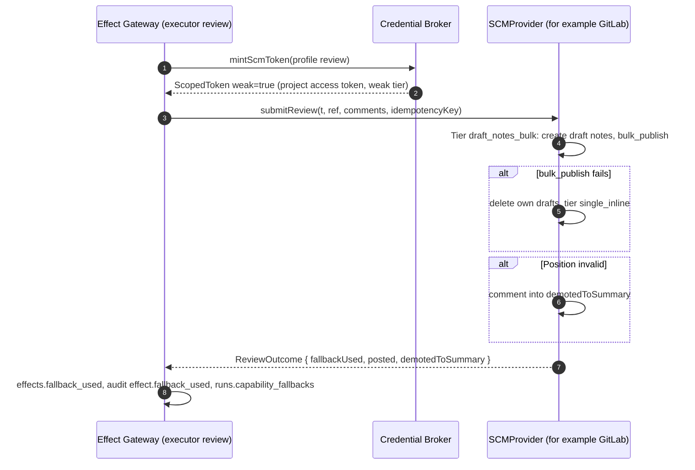
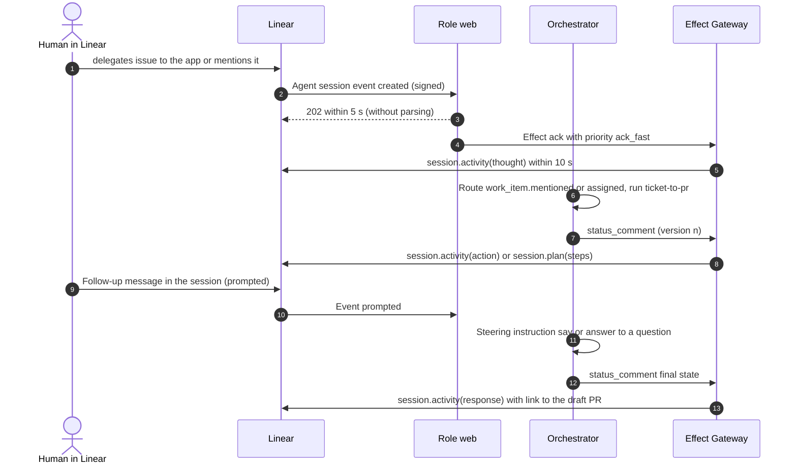
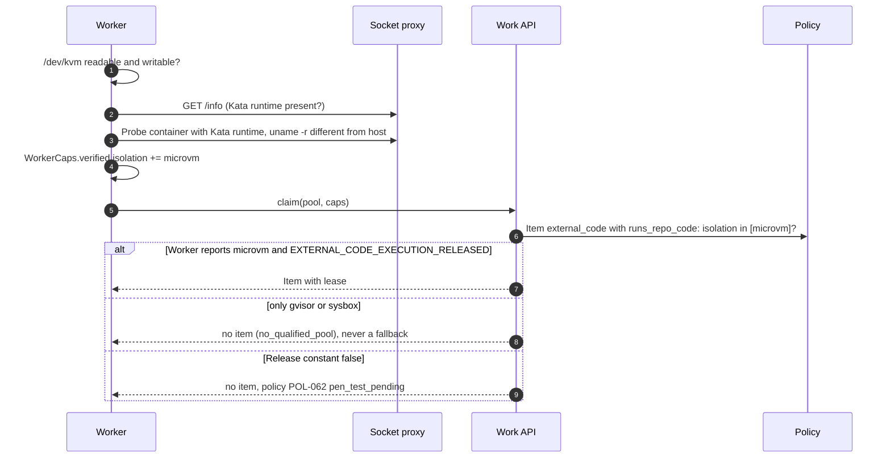
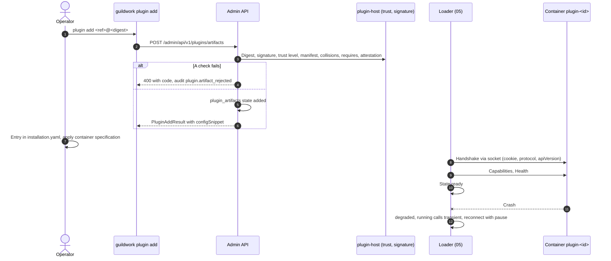
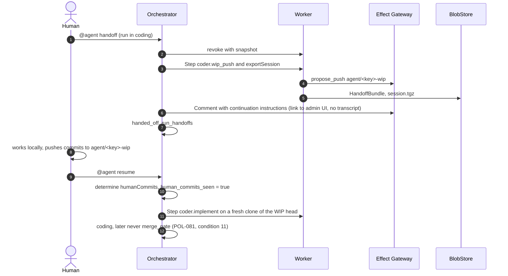
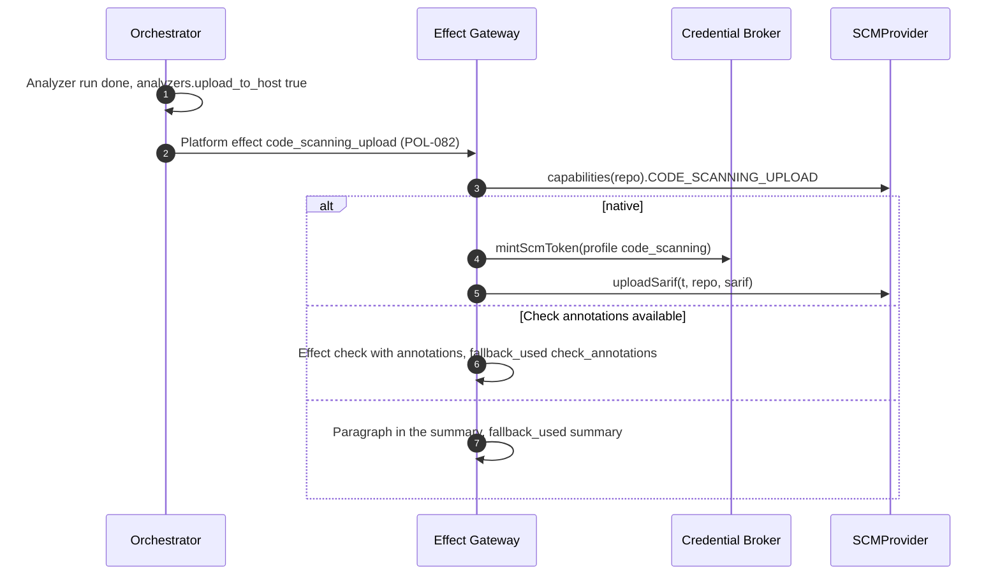

<!--
SPDX-License-Identifier: Apache-2.0
SPDX-FileCopyrightText: The Guildwork Authors
-->
# 14 Stage 9: Breadth and Hardening

Detailed design for stage 9 from [08](../architecture/08-roadmap.md): further code hosts, Linear and notifiers, further harnesses, MicroVM backend with pen test, third-party plugins and services, control for advanced users, SARIF upload, Zoekt, K1 for the coder, Confluence as a KB source, analyzer ast-grep, and the acceptance of the stage. Work plan: epics `9-E01` to `9-E08` in [stage-9.breadth.toml](../plan/tasks/stage-9.breadth.toml). Rulings of this document: FE-1400 to FE-1499. Precedence, fixed choices (stack, package names) and required structure as in the [README](README.md); classifications VERIFIED, CLAIMED, DERIVED and "unverified" as in the [architecture README](../architecture/README.md), in tables (B), (G), (A), (u).

**External APIs:** All paths, headers, field names and limits of third-party services (GitLab, Azure DevOps, Bitbucket, Gitea, Forgejo, Linear, Slack, OpenHands SDK, OpenCode, Gemini CLI, Kata Containers, Zoekt, Confluence) are **unverified** here unless a source from the architecture is named. They are verified by the spikes (`9-E01-T02`, `9-E02-T01` part S01, `9-E03-T01`, `9-E04-T01`) against the public documentation and by the contract suites with cassettes from the documentation ([05](05-plugins-and-contracts.md) FE-564), Gitea and Forgejo against containers; the project has no account with these vendors (owner decision O28, FE-1456). If an optional owner run delivers recordings and they deviate, the recording applies, and this document is adjusted in the same PR (as [12](12-expansion.md) for stages 7 and 8).

## 1. Purpose and Sources

| Building block | Epic | Section here | Architecture sources |
|---|---|---|---|
| GitLab, Azure DevOps, Bitbucket Cloud, Gitea and Forgejo, contract revision, weak token tier | 9-E01 | 2.1, 4.1, 4.2, 8.1 | [01](../architecture/01-plugin-interfaces.md) sections 1.1, 2 to 5, 11.1, 11.2, 11.5; [05](../architecture/05-security.md) sections 2 and 9; 08 principle 3; backlog M44, M86, M104 |
| Linear, notifier Slack, ask from tickets, health of the drivers | 9-E02 | 2.2, 4.3, 4.4, 8.2 | 01 sections 2 to 4, 10, 11.1, 11.5; [03](../architecture/03-flow-and-orchestration.md) sections 3 and 4; 05 section 7; ADR-63; backlog M37 |
| OpenHands SDK, OpenCode, Gemini CLI | 9-E03 | 2.3, 8.3 | 01 sections 6, 11.3, 11.5; ADR-39, ADR-50; backlog M34 |
| MicroVM backend, routing `external_code`, Red Team and pen test | 9-E04 | 2.4, 4.5, 8.4 | ADR-48, ADR-62; 01 section 8; 05 section 3; [11](../architecture/11-installation-and-hosting.md) sections 3, 9, 10; backlog M132 |
| Trust level, subprocess transport, published schemas, OCI distribution, examples | 9-E05 | 2.5, 4.6, 8.5 | 01 sections 1.1 (rules 1, 4, 6, 7) and 14; 11 section 5; [06](../architecture/06-operations-and-deployment.md) section 3 row "plugin mechanics"; backlog M111, M115 |
| Injection detector, handoff and resume, child runs, best-of-N, triage in `ticket-to-pr` | 9-E06 | 2.6, 4.7 to 4.10, 8.6 | [02](../architecture/02-services.md) section 3 stages 5, 6, 9; 03 sections 1a, 2.1, 2.4; 05 section 4 point 5 |
| SARIF upload, Zoekt, K1 for the coder, Confluence, analyzer ast-grep | 9-E07 | 2.7, 4.11, 8.7 | 01 sections 5, 9, 12; [07](../architecture/07-eval.md) sections 3.7 and 3.8 (ST1, AN1); [10](../architecture/10-standards-per-layer.md) sections 9 and 10; [02](../architecture/02-services.md) section 8 (rule compilation); backlog M30 |
| Capability matrix, suites, stage report, release | 9-E08 | 2.8, 8.8 | 08 stage 9; 10 section 1.2 point 6; 07 section 5 |

ADRs read: ADR-06, ADR-08, ADR-09, ADR-10, ADR-14, ADR-17, ADR-39, ADR-40, ADR-44, ADR-46, ADR-47, ADR-48, ADR-50, ADR-60, ADR-62, ADR-63, ADR-67, ADR-68. Detailed design foundations: plugin framework, contracts and loader from [05](05-plugins-and-contracts.md); run state machine, policy and router from [02](02-control-plane.md); worker, sandbox and socket proxy from [03](03-execution.md); Effect Gateway, executors and Credential Broker from [04](04-effects-audit-credentials.md); admin UI and CLI from [06](06-installation-operations-ui.md); suites from [07](07-eval-and-qualification.md); coder from [10](10-planner-architect-coder.md); PR fixer and merge gate from [11](11-qa-prfix-automerge.md); knowledge base, triage and Jira from [12](12-expansion.md).

### 1.1 Scope and Consequences of the Stage Graph

- Stage 9 depends on 7 and 8 and therefore on 0, 0b, 1, 2, 6, 7a ([08](../architecture/08-roadmap.md) section 3), **not** on 3, 4 and 5. This yields the rulings already made in [12](12-expansion.md), which continue to apply here and are not repeated: FE-1221 (triage as a stage of `ticket-to-pr`), FE-1222 (K1 for the coder), FE-1227 (E2E `ask` from Jira), FE-1234 (gRPC over a Unix socket), FE-1235 (child run conflict without PR fixer), FE-1241 (acceptance epic), FE-1242 (Confluence), FE-1243 (injection detector), FE-1244 (Kata first), FE-1245 (external pen test), FE-1248 (Slack first), FE-1252 (`openbao`, `k8s-projected-token` not planned), FE-1253 (visibility of ticket targets).
- **Contracts:** This document implements against `guildwork-dev.github.io/v1alpha1` from [05](05-plugins-and-contracts.md) section 2.11 and does not change it. Where stage 9 needs an additive extension (new optional method, new capability value, release of a sketch), it is stated here as a need with a ruling and in section 10 as a follow-up item for 05; the building task enters it in 05 (rule from 05 section 2.4, FE-502).
- **Tables:** The DDL of stage 9 is in section 3.1 (migration block 0900 per [01](01-data-model.md) FE-126). Columns that stage 9 needs on tables of other documents are stated there as a need; the building task adds them via an expand migration in block 0900 and records them in the leading document (01 section 3.1a).
- **Not in stage 9:** `ci-dispatch-gitlab` (only the spike checks the GitLab counterpart to the dispatch app, backlog M44, FE-1447), stacked PRs from child runs (FE-1438), notifier Teams (FE-1248), harness `goose` and `acp-generic` (FE-1420), drivers `openbao` and `k8s-projected-token` (FE-1252).

## 2. Modules and Responsibility

### 2.0 Directories and Packages

```text
packages/
  scm-common/              # @guildwork/scm-common (FE-1402): pure host helpers without network, used by all SCM plugins
    src/diff.ts            #   parseUnifiedDiff, hunksToPositions (position mapping for inline comments)
    src/markers.ts         #   marker format "<!-- gw-effect:... -->", label marker (FE-1408)
    src/fallback.ts        #   runFallbackChain(): tiers one after another, result with fallbackUsed
    src/http-errors.ts     #   mapHttpError() per 05 section 2.7 (table), extensible per plugin with extra rules
    src/check-as-status.ts #   CheckAsStatus: startCheck/updateCheck as commit or PR status plus summary (FE-1405)
  plugin-host/             # @guildwork/plugin-host (stage 9, README section 2): trust, subprocess transport, container specification
    src/trust.ts  src/signature.ts  src/subprocess.ts  src/grpc.ts  src/container.ts  src/host-service.ts  src/artifacts.ts
    proto/guildwork/plugin/v1alpha1/plugin.proto     # generated from the TypeBox schemas, frozen per apiVersion (FE-1234)
  contracts/src/published/ # event and artifact schemas for third parties (FE-1431); export as schemas/<apiVersion>/*.schema.json
plugins/
  gitlab/  azure-devops/  bitbucket/  gitea/          # each TriggerSource, SCMProvider, WorkItemProvider (FE-1401)
  linear/                                             # TriggerSource, WorkItemProvider with session
  notifier-slack/                                     # Notifier
  openhands-sdk/  opencode/  gemini-cli/              # AgentRuntime
  backend-microvm/                                    # ExecutionBackend with isolation microvm (FE-1421)
  kb-zoekt/  kb-source-confluence/                    # KnowledgeStore (FE-1441, FE-1442)
  analyzer-ast-grep/                                  # analyzer for repo rules .agents/rules/ast-grep/ (FE-1453)
  github/src/scm/sarif-upload.ts                      # extension of the GitHub plugin with uploadSarif (FE-1440)
apps/control-plane/src/
  ingress/callbacks.ts                                # POST /callbacks/notifier/slack/{instanceId} (FE-1413)
  drivers/health-monitor.ts                           # state and reporting of driver health from driverHealth() (FE-1415, 04 FE-451)
  policy/injection-detector.ts                        # signal evaluation, escalation (FE-1434)
  broker/static-scm-tokens.ts                         # weak token tier with rotation (FE-1406)
  plugins/third-party.ts                              # intake, state and wiring of the plugin artifacts
  effects/executors/code-scanning-upload.ts           # executor of the new effect type (FE-1440)
  admin/capabilities.ts                               # capability matrix (FE-1443)
services/
  coder/src/handoff.ts  coder/src/children/*.ts  coder/src/best-of-n.ts
  indexer/src/zoekt/*.ts  indexer/src/doc-sources/*.ts
apps/cli/src/commands/plugin-add.ts                   # guildwork plugin add <ref>@<digest>
apps/admin-ui/src/pages/capabilities/  apps/admin-ui/src/pages/plugins/
deploy/compose/profiles/zoekt.yaml  deploy/helm/guildwork/templates/zoekt.yaml
deploy/images/analyzer-ast-grep/                      # only the ast-grep binary, version as image engines (FE-1453)
apps/worker/src/analyzer-runner/                      # entry "ast-grep" in REPO_RULE_DIRS (2.7.5)
examples/third-party-plugin/  examples/third-party-service/       # only against published schemas (FE-1433)
eval/suites/e2e/{gitlab,azure-devops,bitbucket,gitea,linear}/  eval/suites/isolation-microvm/  eval/suites/s5/ask-tickets/
```

**Dependency direction:** as in [05](05-plugins-and-contracts.md) section 2.1: `core` < `contracts` < `scm-common`, `testkit`, `config` < `plugins/*`. Plugins import no other plugin; the only new exception is `backend-microvm`, which uses the sandbox core from `@guildwork/plugin-exec-docker/sandbox` (FE-1421, following the pattern of 05 FE-533). `plugin-host` imports `contracts` and `core`, never `db`; intake and state of the artifacts are written by the control plane (`apps/control-plane/src/plugins/third-party.ts`).

### 2.1 Further Code Hosts (9-E01)

#### 2.1.1 Common Host Framework

One package per host with the kinds `TriggerSource`, `SCMProvider` and, where available, `WorkItemProvider` (FE-1401); manifest as in [05](05-plugins-and-contracts.md) section 2.4 with `trust: first_party`, `transport: in_process`, `distribution: bundled`, `license: Apache-2.0`. All run in the control plane (Z0) like the GitHub plugin (05 section 2.2), never in the worker; the worker receives `cloneSpec` and a `read` token in the envelope.

```ts
// packages/scm-common/src/types.ts
export type HosterId = "gitlab" | "azure-devops" | "bitbucket" | "gitea";
export interface HosterInstanceConfig {
  baseUrl: string;                          // API base of the instance; host goes into manifest.egress as "{config.baseUrl}"
  webUrl: string;                           // for links in comments
  botLogin: string;                         // identity of the platform at the host (isSelf, isOwn)
  handle: string;                           // text mention, default "@agent"
  webhookSecretRef: SecretRef;              // HMAC key, plain-text token or Basic Auth password
  verify: "hmac_sha256_hex" | "standard_webhooks" | "shared_secret" | "basic_auth";
  ipAllowlist?: string[];                   // only for weak (FE-1403)
  tokens: StaticTokenConfig;                // FE-1406
  projectAllowlist?: string[];              // projects or repos to which the instance applies
  statusMapping?: Record<string, Partial<Record<StatusCategory, string>>>;   // WorkItemProvider, like Jira (13 section 2.1.4)
}
export interface StaticTokenConfig {
  kind: "project_access_token" | "pat" | "repository_access_token" | "app_token";
  repos: Record<string, {                   // key "<namespace>/<repo>" as at the host; two tokens per repo (FE-1406)
    read: SecretRef;                        // token with read rights only
    write: SecretRef;                       // token with write rights for all writing profiles
  }>;
  rotate: { enabled: boolean; days?: number };  // days without value: scm.static_token.rotate_days (section 7)
}
export interface DiffPosition { path: string; side: "new" | "old"; line: number; hunk: number; oldPath?: string }
export function parseUnifiedDiff(patch: string): DiffHunk[];
export function hunksToPositions(file: FileChange): Map<string, DiffPosition>;   // key "<side>:<line>"
export function renderEffectMarker(effectId: string, runId: string): string;      // <!-- gw-effect:<effectId> run:<runId> -->
export interface FallbackStep<T> { name: ReviewOutcome["fallbackUsed"] | string; available: boolean; run(): Promise<Result<T>> }
export function runFallbackChain<T>(steps: FallbackStep<T>[], onStep: (name: string, r: Result<T>) => void):
  Promise<Result<T & { fallbackUsed: string }>>;   // first available tier with ok wins; invalid (position) leads to the next tier
export function mapHttpError(status: number, headers: Headers, body: unknown,
  extra?: (status: number, body: unknown) => PluginError | null): PluginError;
```

**Rules for all hosts:**
1. **Signature before parsing** (01 section 2) and strength from the scheme: HMAC and Standard Webhooks yield `strong`, plain-text token and Basic Auth `weak` (FE-1403). `verify` compares in constant time. **IP allowlist:** If `ipAllowlist` of the instance is set and the scheme is `weak`, `verify` additionally checks the source IP from the header `x-guildwork-peer`, which the reverse proxy sets and the ingress passes on (same path as Jira, [13](13-stage-8-providers-and-bases.md) FE-1302); if the header is missing or the IP lies outside, the result is `verified: false, reason: "ip_not_allowed"`. With `strong`, `ipAllowlist` is rejected at load time (consistency error `ip_allowlist_requires_weak`), because it protects nothing there and only causes outages.
2. **The payload is never the truth:** The router reads fresh (`getChange`, `getComments` or `getItem`) and compares the comment text with the trigger ([02](02-control-plane.md) section 4.3 step 3). With `weak` this is the boundary: a forged event can at most trigger a run for a real comment by a real user.
3. **Rights always at the host** via `getPermission` or `userPermission`, never from the payload; mapping of the host roles to `PermissionLevel` per plugin in a table with a test (table "Roles per host" below). A role missing from the table yields `none` and the warning `permission_role_unknown` in the log with the role name, never a guessed right.

**Roles per host** (mapping to `PermissionLevel`; role names unverified until `9-E01-T02`, the recording applies):

| Host | `none` | `read` | `write` | `maintain` | `admin` |
|---|---|---|---|---|---|
| GitLab | Guest, no membership | Reporter | Developer | Maintainer | Owner |
| Azure DevOps | no group with repo right | Readers | Contributors | Build Administrators (u) | Project Administrators |
| Bitbucket Cloud | none | `read` | `write` | (no tier, never granted) | `admin` |
| Gitea, Forgejo | none | `read` | `write` | (no tier, never granted) | `admin`, repo owner |

Tests: `gitlab rollen auf permission level`, `azure devops rollen auf permission level`, `bitbucket rollen auf permission level`, `gitea rollen auf permission level` (each every row of the table plus an unknown role).
4. **Capabilities instead of names:** Every gap from 01 section 11.5 is reported as `fallback` or `none`; fallback levels run via `runFallbackChain` and end up in `fallback_used` on the effect, in the audit and in the run summary (01 rule 2).
5. **No retry of its own in the plugin** (05 FE-507); fallback chains within one method are allowed.
6. **Contract suite** per plugin from the abstract suites of 05 section 2.10 plus host-specific cases; cassettes from the public documentation (05 FE-564, built in `9-E01-T01`), replaced by recordings from optional owner runs against test accounts in the profile `writes_to_test_targets` (FE-1456); Gitea and Forgejo against containers in CI.
7. **Signature tier visible from the first host on:** `9-E01-T03` extends `RunRecordView.trigger` with `signature: { scheme: SignatureScheme; strength: "strong" | "weak" }` from `events.signature` of the triggering event (need on [06](06-installation-operations-ui.md) section 2.16, field additive), so that the admin UI shows the tier per run before the capability matrix (`9-E08-T01`, depends on all epics of the stage) shows it per instance.

**Capabilities per host** (target tier; the column applies only once the recording verifies it, source 01 matrix 11.2 and 11.5):

| Capability | GitLab | Azure DevOps | Bitbucket Cloud | Gitea, Forgejo |
|---|---|---|---|---|
| `WEBHOOK_HMAC` (trigger) | `native` from 19.0 (Standard Webhooks), otherwise `none` (B) | `none` (B) | `native` (B) | `native` (B) |
| `RECONCILE`, `POLL` | `native` (merge request and note lists since a point in time, u) | `native` (u) | `native` (u) | `native` (u) |
| `BATCH_REVIEW` | `fallback` (draft notes plus `bulk_publish`, B) | `none` (B) | `none` (B according to PR-Agent) | `native` (B) |
| `REVIEW_REQUEST_CHANGES` | `native` only Premium and Ultimate, otherwise `none` (B) | `fallback` (vote, V) | `native` (B) | `native` (B) |
| `SUGGESTION_BLOCK` | `native` `suggestion:-0+N` (B) | `none` | `none` | `none` until recording (u) |
| `THREAD_RESOLVE` | `native` (B) | `native` thread status (B) | `none` until recording (u) | `none` until recording (u) |
| `CHECK_RUN` | `fallback` commit status (FE-1405) | `fallback` PR status (B) | `native` Code Insights report (B) | `fallback` commit status |
| `CHECK_ANNOTATIONS` | `none` (B) | `none` (B) | `native` Code Insights annotations, at most 1,000 per report (B) | `none` (V) |
| `CHECK_ACTIONS` | `none` | `none` | `none` | `none` |
| `COMMIT_STATUS` | `native` | `native` | `native` | `native` |
| `LABELS`, `SET_LABELS` | `native` | `fallback` tags (V) | `fallback` comment marker (FE-1408) | `native` |
| `SCOPED_SHORT_TOKEN` | `none`, project access token as weak tier (B, FE-1406) | `none` (u) | `none` (u) | `none` |
| `PERMISSION_API` | `native` (u) | `native` (u) | `native` (u) | `native` (u) |
| `CODEOWNERS` | `native` (read file, parser from `scm-common`) | `fallback` file without host rules (A) | `fallback` file (A) | `fallback` file (A) |
| `CI_LOGS` | `native` job logs (u) | `native` build logs (u) | `native` pipeline logs (u) | `native` Actions logs (u) |
| `CODE_SCANNING_UPLOAD` | `none` (artifact only, B) | `none` | `none` | `none` |
| `MERGE_SHA_GUARDED`, `APPROVE_HUMAN` | `none` in stage 9 (FE-1446) | `none` | `none` | `none` |

**Who calls whom:** as for GitHub ([05](05-plugins-and-contracts.md) section 2.2): the ingress calls `verify` and `parse`; the reconciler calls `reconcile` or `poll`; the Credential Broker calls `mintToken` and `cloneSpec`; the platform MCP and the orchestrator call the read methods; only the executors of the Effect Gateway call write methods ([04](04-effects-audit-credentials.md) FE-428).

#### 2.1.2 GitLab

**Package** `plugins/gitlab` (`@guildwork/plugin-gitlab`), kinds `TriggerSource`, `SCMProvider`, `WorkItemProvider` (issues). Basis 01 sections 3 to 5, matrix 11.1, 11.2, 11.5.

```ts
// plugins/gitlab/src/config.ts
export interface GitlabInstanceConfig extends HosterInstanceConfig {
  verify: "standard_webhooks" | "shared_secret";   // standard_webhooks from GitLab 19.0 (B), otherwise shared_secret (weak)
  serviceAccount: { userId: string; login: string }; // mention and delegation via the service account (01 matrix 11.1)
  tier: "free" | "premium" | "ultimate" | "unknown"; // for display only; capabilities come from capabilities(scope)
}
// plugins/gitlab/src/trigger.ts
export interface GitlabTriggerSource extends TriggerSource {
  // verify: standard_webhooks -> headers webhook-id, webhook-timestamp, webhook-signature (scheme from 01 section 2), time window
  //         5 minutes as in 12 FE-1240; shared_secret -> header with plain-text token (name u), strength "weak"
  // parse: merge request (open, update with new commit, close, merge), note on MR with position (review_comment) or
  //        without (comment), issue (open, update), note on issue; mention of the service account -> mention.native true
  // dedupeKey: as in 05 section 2.11.1; id = delivery ID from webhook-id or event UUID header (u)
  // isSelf: actor.providerId == serviceAccount.userId
  // ackDeadlineMs: 10000 (u, as for GitHub; GitLab disables webhooks after repeated failures, B)
}
```

| Method | GitLab path (unverified until 9-E01-T02) | Remark |
|---|---|---|
| `getFile`, `compare`, `getChange`, `listChangedFiles` | repository files at the ref, comparison of two commits, merge request with changes | `FileChange.truncated` for truncated diffs |
| `getThreads` | discussions of the MR with notes and position | `isOwn` via `serviceAccount` |
| `getPermission` | membership with access level (Guest, Reporter, Developer, Maintainer, Owner) | mapping: Reporter `read`, Developer `write`, Maintainer `maintain`, Owner `admin`, Guest `none` |
| `repoInfo` | project visibility `public`, `internal`, `private`; fork origin | fresh per claim (ADR-63) |
| `submitReview` | fallback chain FE-1404 | `ReviewOutcome.fallbackUsed` |
| `upsertSummary`, `reply`, `resolveThread` | MR note with marker; reply in discussion; resolve discussion | |
| `startCheck`, `updateCheck` | commit status with name and target URL plus summary (FE-1405) | tier `fallback` |
| `push` | Git bundle without force as in 05 FE-516 | branch prefix `agent/` |
| `openChange`, `updateChange` | MR as draft | idempotency as in 04 FE-434 |
| `setLabels` | labels on the MR or issue | |
| WorkItemProvider `getItem`, `getComments`, `search`, `userPermission`, `addComment`, `updateComment`, `transition` | issues, notes, search; `transition` only `done` (close) and `todo` (open), otherwise via labels per `statusMapping` | like GitHub Issues (04 section 2.1.5) |

**Review output (FE-1404):** `submitReview` uses `runFallbackChain` with the tiers `draft_notes_bulk` (one draft note with position per comment, then `bulk_publish`), `single_inline` (one discussion with position per comment, position errors go to `demotedToSummary`), `summary_only` (everything into the summary). Code suggestions are rendered by `renderSuggestion` as a `suggestion:-a+b` block (01 section 5). If `bulk_publish` fails after drafts were created, the plugin deletes its own drafts of this `idempotencyKey` (marker in the text) and moves to the next tier; the deleted ones are listed in `result.draftsDiscarded`. `verdict: request_changes` only with `REVIEW_REQUEST_CHANGES: native`, otherwise `comment` with a note in the summary.

**Token tier:** project access token per repo as a weak tier (FE-1406, section 2.1.7); `mintToken` returns `ScopedToken` with `weak: true`, `permissions` per the scopes of the stored token (read via the token info, u) and `expiresAt` equal to the expiry of the stored token, capped to `ttlS` for the use. The run summary and the admin UI carry the notice "SCOPED_SHORT_TOKEN missing: weak token tier".

#### 2.1.3 Contract Revision after the Second Host

Task `9-E01-T05` checks the `SCMProvider` contract against GitHub and GitLab (backlog M86, M104, 08 principle 3).

```ts
// tools/contracts/scm-revision.ts (tool of the task, generates the report)
export interface ContractDeviation {
  member: string;                           // for example "SCMProvider.submitReview" or "ScmCap.CHECK_ACTIONS"
  kind: "only_one_impl" | "fallback_chain_mismatch" | "enum_unused" | "enum_missing" | "shape_mismatch" | "semantics_differ";
  github: string; gitlab: string;           // finding per implementation with location (file, test)
  decision: "keep" | "additive_v1alpha1" | "breaking_v1alpha2" | "document_only";
  reason: string;
}
export interface ScmRevisionReport { generatedAt: string; deviations: ContractDeviation[]; apiVersionAfter: ApiVersion; deprecation?: DeprecationPlan }
export interface DeprecationPlan { from: ApiVersion; to: ApiVersion; announceRelease: string; removeAfterRelease: string }
```

Rules (FE-1407): additive changes stay in `v1alpha1` (05 FE-502); a breaking change creates `v1alpha2`, not `v1beta1`, and the core carries both per 01 rule 6 until the end of the deprecation plan. The report is in the PR and as a file in the product repo; both contract suites run green on the valid version, and the GitHub plugin is adjusted in the same PR. Azure DevOps, Bitbucket and Gitea are built only afterwards (`9-E01-T06` to `T08` depend on `T05`).

#### 2.1.4 Azure DevOps

**Package** `plugins/azure-devops`, kinds `TriggerSource` (service hooks), `SCMProvider` (repos and pull requests), `WorkItemProvider` (work items).

```ts
// plugins/azure-devops/src/config.ts
export interface AzureDevopsInstanceConfig extends HosterInstanceConfig {
  organization: string; projects: string[];
  verify: "basic_auth" | "shared_secret";    // no HMAC (B); both "weak" (FE-1409)
  auth: { kind: "pat"; ref: SecretRef } | { kind: "entra_app"; tenantId: string; clientId: string; secretRef: SecretRef };   // kind unverified (9-E01-T02)
  workItemTypes: string[];                   // for example ["Bug", "User Story", "Task"]
}
```

- **Inbound:** service hook per project to `POST /v1/ingress/{instanceId}` with Basic Auth (password from `webhookSecretRef`) or a fixed header; strength `weak` (FE-1403, FE-1409), optional `ipAllowlist`. Events: PR created, updated (new push), comment on PR, work item created and commented (names of the event types u).
- **Review output:** `BATCH_REVIEW: none`, hence fallback chain `single_inline` (one thread with position per finding) and `summary_only`; result status as PR status (`CHECK_RUN: fallback`, FE-1405). `REVIEW_REQUEST_CHANGES` via a vote is unverified (01 matrix 11.5); `none` until the recording.
- **Work items:** `transition` via `statusMapping` (work item state per type), `linkExternal` as a hyperlink on the work item (u), labels as tags (`SET_LABELS: fallback`).

#### 2.1.5 Bitbucket Cloud

**Package** `plugins/bitbucket`, kinds `TriggerSource`, `SCMProvider` (no `WorkItemProvider`: 01 matrix 11.1 "not applicable").

```ts
// plugins/bitbucket/src/config.ts
export interface BitbucketInstanceConfig extends HosterInstanceConfig {
  workspace: string;
  verify: "hmac_sha256_hex";                 // HMAC-SHA256 (B); header name unverified
  insights: { reportKey: string };           // key of the Code Insights report per service, for example "guildwork-review"
}
```

- **Review output:** `single_inline` plus summary, then `summary_only` (no batch, 01 matrix 11.2).
- **Status and annotations:** `startCheck` creates a Code Insights report on the commit (key `insights.reportKey` plus name), `updateCheck` sets the result and writes annotations in blocks; more than 1,000 annotations per report (B) go into the summary truncated with a note.
- **Labels (FE-1408):** `SET_LABELS: fallback` via a dedicated comment with marker `<!-- guildwork:labels v1 a,b -->` and a visible line "Labels (platform): a, b"; reading via the same marker. Label routes (`change.labeled`) never fire on Bitbucket; the admin UI shows this in the capability matrix.

#### 2.1.6 Gitea and Forgejo

**Package** `plugins/gitea` for both hosts with `flavor` (FE-1401); differences (header names, version check) only in `flavor.ts`.

```ts
// plugins/gitea/src/config.ts
export interface GiteaInstanceConfig extends HosterInstanceConfig {
  flavor: "gitea" | "forgejo";
  verify: "hmac_sha256_hex";                 // HMAC-SHA256 (B); header per flavor (u)
  minVersion: string;                        // minimum version per flavor, from the CI matrix (9-E01-T08)
}
```

- **Review output:** `BATCH_REVIEW: native` (review with several comments, B), otherwise like GitHub; status as commit status plus summary; issues as `WorkItemProvider`.
- **Thread resolving:** unverified (01 matrix 11.5); until the recording `THREAD_RESOLVE: none`, and `thread_resolve` then ends with `fallback_used = "reply_only"` (04 section 2.1.5).
- **CI containers:** contract suite and E2E run against one Gitea and one Forgejo container each in CI (images by digest, licenses MIT and GPL-3.0-or-later respectively according to the host, u, only as a test service, not shipped).

#### 2.1.7 Weak Token Tier in the Credential Broker

Hosts without `SCOPED_SHORT_TOKEN` get no short-lived tokens per effect. The broker then uses stored tokens per repo as a **weak tier** (01 section 5 fallback chain "short-lived token", 05 section 2; FE-1406).

```ts
// apps/control-plane/src/broker/static-scm-tokens.ts
export type StaticTokenClass = "read" | "write";
export const PROFILE_CLASS: Record<TokenProfile, StaticTokenClass | "refused"> = {
  read: "read", review: "write", comment_issue: "write", labels: "write", rerun: "write", write_branch: "write",
  merge: "refused", dispatch: "refused", audit_anchor: "write",
};
export interface StaticScmTokenStore {
  get(instanceId: string, repo: RepoRef, cls: StaticTokenClass): Promise<Result<{ value: SecretValue; expiresAt: string; version: string }>>;
  rotateDue(now: Date): Promise<{ instanceId: string; repoKey: string; cls: StaticTokenClass }[]>;   // rows from scm_static_tokens
  rotate(instanceId: string, repo: RepoRef, cls: StaticTokenClass): Promise<Result<{ version: string; expiresAt: string }>>;
}
```

- `mintScmToken` ([04](04-effects-audit-credentials.md) section 2.3.5) remains the only interface; for instances with `SCOPED_SHORT_TOKEN: none` it calls `SCMProvider.mintToken`, and the plugin fetches the stored token of the class via `ctx.secrets`. The broker always refuses `merge` and `dispatch` on the weak tier (`stage_not_enabled` or `weak_token_refused`).
- **Rotation:** job `broker-rotate-static-tokens` daily; if `rotate.enabled` is set and the token is older than `rotate.days`, the plugin calls the rotation endpoint of the host (GitLab: token rotation, u) and writes the new value via `SecretStore.put` (capability `WRITE` required, otherwise a notice in `doctor` and the admin UI). Audit `broker.static_token_rotated` with fingerprint, never the value.
- **Marking:** `ScopedToken.weak = true`; `runs.capability_fallbacks` gets `{ cap: "SCOPED_SHORT_TOKEN", level: "none", note: "weak_token" }`; the status comment and the admin UI show "weak token tier".
- **State** per token in `scm_static_tokens` (section 3.1), never the value. The broker creates the rows when loading or reloading the instance (`syncStaticTokens(instanceId)`: upsert per entry in `tokens.repos` and class with `secret_ref`, `fingerprint` and `scopes` from the token info of the host; entries that are no longer configured are deleted).
- **Repo without entry:** `mintToken` returns `permission` with `detail.providerCode = "no_static_token"`; the effect ends `failed` without retry, and the status comment says "no token stored for this repo". Because the `read` token is then missing as well, the fresh re-read in the router already fails with `permission_lookup_failed` ([02](02-control-plane.md) section 4.3), and no run is created; the effect case only occurs if the entry was removed between routing and effect.

#### 2.1.8 Spike and Test Accounts

- `9-E01-T01` (agent, FE-1456): cassettes per host (GitLab, Azure DevOps, Bitbucket, Linear for `9-E02-T01`) from the public documentation per 05 FE-564, with source URL and reading date. Optional owner run, not a done criterion: test accounts (GitLab group with the tier needed for draft notes and project access tokens, Azure DevOps organization, Bitbucket workspace, Linear test workspace) with a decision sheet and recordings that replace the documentation cassettes; credentials only in the SecretStore of the test installation, never in the repo.
- `9-E01-T02` (spike): clarifies the rows marked (u) in this section and from 2.2.1 against the documentation (against test accounts only if the optional owner run took place), records fixtures per host with `fixturesHash` and enters results into the tables here (VERIFIED with source or "unverified" with consequence). In addition backlog M44: whether GitLab CI has a counterpart to the dispatch app with a minimal pipeline trigger right; result only as a note (FE-1447).
- `9-E02-T01` part S01 (spike Linear): result in `eval/reports/spike-linear.md` (signature scheme, stop signal, auth kind of the app, `RECONCILE` path) and fixtures under `plugins/linear/contract/fixtures/`; per question VERIFIED with source or unverified with consequence.

### 2.2 Linear and Notifiers (9-E02)

#### 2.2.1 Linear

**Package** `plugins/linear`, kinds `TriggerSource` and `WorkItemProvider` with `session` (01 section 4). Only operating mode `public` (01 matrix 11.5: response within 5 s, needs public inbound); in `private` the loader rejects the instance with `PRIVATE_MODE_NO_POLL`, because `POLL: none` is reported (05 section 2.5 condition 14).

```ts
// plugins/linear/src/config.ts
export interface LinearInstanceConfig {
  workspace: string;
  apiUrl: string;                            // instance host, in manifest.egress as "{config.apiUrl}"
  appActorId: string;                        // identity of the app in the workspace (isSelf)
  auth: { kind: "oauth_app"; clientIdRef: SecretRef; clientSecretRef: SecretRef; tokenRef: SecretRef };   // kind unverified
  webhookSecretRef: SecretRef;               // signature of the agent events (scheme unverified, 9-E02-T01-S01)
  teamAllowlist: string[];
  statusMapping: Record<string, Partial<Record<StatusCategory, string>>>;   // team -> category -> workflow status
}
// Capabilities: TriggerSource AGENT_SESSION native, NATIVE_BOT_MENTION native, POLL none, RECONCILE fallback (u);
// WorkItemProvider AGENT_SESSION native, PLAN_NATIVE native, DELEGATION native, EXTERNAL_LINK native (externalUrls, B),
// TRANSITIONS native, SET_LABELS native (V), CREATE_ISSUE native (V), LINK_ITEMS native (V).
```

**Events:** agent session `created` (delegation or mention) becomes `what.subject = agent_session`, `what.action = delegated` or `mentioned`; `prompted` (follow-up message of the user in the session) becomes `action = prompted` and is delivered as a steering instruction (`say`) or as an answer to a question ([02](02-control-plane.md) section 4.4 control commands); a stop signal of the session (form unverified, 09 section 4) becomes `action = stop`.

**Deadlines (FE-1410):** The response to the webhook comes from the role `web` within 5 s, because the ingress does not parse (02 FE-204). The first activity within 10 s is written by the platform effect `ack`: for Linear, `TriggerSource.ack` calls the method `session.activity(id, { type: "thought", body: "Angenommen, Run <id>" })`. So that this happens within 10 s, the ingress processing creates the `ack` effect with priority `ack_fast`, and the dispatcher of the Effect Gateway serves this priority before all others (queue `effects-ack-fast`, section 3.2). The time from `inbox.received_at` to `effects.applied_at` is measured (metric `guildwork.effect.ack_latency`, section 5.1); the contract case checks the deadline against a fake clock, the E2E case against the real recording.

**Session instead of status comment (FE-1411):** Exactly one session per run and work item (`work_item_sessions`, section 3.1). The executor `status_comment` ([04](04-effects-audit-credentials.md) section 2.1.5) writes, with `AGENT_SESSION: native`, instead of the comment:
- on the first effect `session.start(ref)` (if the session is not already known from the event) and `session.activity(id, { type: "thought" })` with the rendered state;
- on every new version an activity `action` (state change), `elicitation` (question, `awaiting_input`), `response` (final state with a link to the PR or plan) or `error` (`failed`);
- for a plan artifact `session.plan(id, steps)` with all steps (Linear always replaces the whole plan, 01 section 4);
- idempotency via `work_item_sessions.last_version`; a smaller or equal version is not written (`result.skipped = "newer_version"` as for the comment).
Failure path: If no session exists and `session.start` fails with `not_found` or `unsupported`, the executor writes the normal status comment with marker (`fallback_used = "comment"`).

**Visibility:** A Linear team as an output target is treated like a Jira project per FE-1253 (`plugins.work_items[linear].visibility.<TEAM>`). The check already lives centrally in the policy of the Effect Gateway (`apps/control-plane/src/effects/policy/ticket-visibility.ts`, `ticketTargetVisibility` and `allowedOnTicket`, [13](13-stage-8-providers-and-bases.md) section 2.1.7, FE-1314) and needs no move: `9-E02-T01` only fills `TicketTargetContext.explicit` for targets of a Linear instance from the team key of the work item (`WorkItemRef.project` = team key) and `mappedRepo` via the repo mapping of the router (`repo_mapping`, [02](02-control-plane.md) section 4.3 step 2, team key as project) (FE-1449). Test `linear team sichtbarkeit nach fe-1253`: without a setting only references of the own run, with `private` a quote from a private repo is allowed, with `public` blocked.

#### 2.2.2 Notifier Slack

**Package** `plugins/notifier-slack`, kind `Notifier`. With this plugin the contract `Notifier` becomes binding in `v1alpha1` (05 section 2.12: "Notifier in stage 9"); the task `9-E02-T02` freezes the sketch from 01 section 10 with the kinds `alert` and `report`, creates the abstract suite `notifier.suite.ts` with a reference fake and adds the types to the API snapshot (FE-1412).

```ts
// packages/contracts/src/kinds/notifier.ts (binding from 9-E02-T02; content as in 01 section 10, spelled out)
export type NotifyCap = "THREADS" | "INTERACTIVE_APPROVAL" | "DM" | "MENTION";
export type NotifyKind = "approval_needed" | "run_failed" | "budget_warning" | "done" | "plugin_unhealthy"
                       | "driver_unhealthy" | "alert" | "report";
export interface Audience { kind: "channel" | "user" | "group"; ref: string }   // channel ID, linked user, group
export interface Link { title: string; url: string }
export interface MessageRef { instance: string; channel: string; ts: string; thread?: string }
export interface ApprovalRequest { gate: "G1" | "G4" | "G5"; runId: string; expiresAt: string;
                                   approvalId: string; summaryMd: string; links: Link[] }
export interface Notifier extends PluginBase<NotifyCap> {
  send(to: Audience, msg: { title: string; md: string; runId: string; links: Link[]; kind: NotifyKind;
       severity: "info" | "action" | "alert" }, idempotencyKey: string): Promise<Result<MessageRef>>;
  update(ref: MessageRef, md: string): Promise<Result<void>>;
  requestApproval?(to: Audience, req: ApprovalRequest, idempotencyKey: string): Promise<Result<MessageRef>>;
  verifyCallback?(headers: Headers, rawBody: Uint8Array, secret: SecretRef): Promise<VerifyResult>;
  parseCallback?(headers: Headers, rawBody: Uint8Array): Promise<Result<NotifierCallback>>;
}
export interface NotifierCallback { approvalId: string; action: "approve" | "reject"; clicker: { providerId: string; login: string };
                                    messageRef: MessageRef; at: string }
```

Added compared with the sketch in 01 section 10: `ApprovalRequest.approvalId`, `summaryMd` and `links`, the parameter `idempotencyKey` of `requestApproval` as well as `verifyCallback` and `parseCallback` (callback check in the plugin like `TriggerSource.verify`, FE-1412). Because the contract is a sketch until stage 9 (05 FE-503), this is not a break.

**Callback (FE-1413):** `POST /callbacks/notifier/slack/{instanceId}` in the role `web`:
1. Instance active and of type `notifier-slack`, otherwise `404`.
2. `verifyCallback` on the raw body before any parsing (signature and timestamp, window `notifier.callback_max_age_s`, start value 300); invalid yields `401`, raw body into quarantine as for the ingress (02 section 4.1).
3. `parseCallback`, then lookup of `notifier_approvals` via `approvalId`: unknown, expired or already used yields `200` with a notice text in Slack ("approval invalid or expired") and audit `notifier.approval_rejected`.
4. The clicking user is mapped to an SCM identity via `identities` (Slack identity of the instance) and `identity_links` (kind `chat`, FE-1413). If the link is missing, response "account not linked" with a link to the page "Link accounts" ([12](12-expansion.md) FE-1225), no effect.
5. Otherwise the callback creates exactly the control command of the approval point (`approve plan` for G1, `approve risk` for G4, `continue` for G5) as a `StoredEvent` with `command.origin = button`, `actor` = linked SCM identity and `run=<runId>`; it runs through router and orchestrator with the same permission checks as a comment (`command_permissions`, `run_trigger`, `codeowner_of`, plan hash equal). The click is therefore never the approval itself, but a command with this identity.
6. Response `200` within the Slack deadline (value u); the executor `notify` reports the result via `update` on the message.

**Creation of the approval:** If a run enters `awaiting_plan_approval` (G1), `awaiting_risk_approval` (G4) or the wait state of G5 and `approvals.notify` names an instance for this gate, the orchestrator creates, in the same transaction, a row `notifier_approvals` (`approval_id` as UUIDv4, `bound_hash` = plan hash for G1, head SHA for G4 and G5, `expires_at` = `runs.deadline_at` of the wait state, without a deadline now plus `notifier.approval_ttl_h`) and the effect `notify` variant `approval`. If the run leaves the wait state another way (comment command, `stop`, deadline), the orchestrator sets open rows to `expired` and updates the message via `update` ("no longer needed").

**Messages:** Every send is a platform effect `notify` via the Effect Gateway with the executor from `1-E05-T11` ([04](04-effects-audit-credentials.md) section 2.1.5): instance `notifier-slack` via `Notifier.send` or `update`; approval requests via `requestApproval` as variant `approval` of the effect `notify` (need on 04, FE-1412). `MessageRef` is stored in `effects.result`; `update` finds it via `notifier_messages` (section 3.1). The Slack bot token and the signing secret live only in the SecretStore; the plugin gets them via `ctx.secrets`.

#### 2.2.3 Ask from Jira and Linear

No new component: `9-E02-T03` builds the E2E cases per FE-1227. `@agent ask` from Jira or an agent session mention with command `ask` from Linear runs via the route `work_item.mentioned` to the service `indexer` in mode `ask` ([12](12-expansion.md) sections 2.3 and 4.2). The answer goes, for Jira, as `propose_comment` in ADF (13 section 2.1.5), for Linear as session activity `response` (variant of the executor `comment` for targets with `AGENT_SESSION: native`, same path as 2.2.1). The Effect Gateway checks every quote against `ticketTargetVisibility` (FE-1253): without an explicit setting by the org only references of the own run, no quotes with code or text content.

#### 2.2.4 Health Reports of the Drivers

Backlog M37: The notifier kind `driver_unhealthy` (01 section 10) is connected to the health check of the drivers (FE-1415).

```ts
// apps/control-plane/src/drivers/health-monitor.ts (in the directory of the driver loader, 04 section 2.4.1)
export interface DriverHealthState { driver: string; kind: DriverKind; ok: boolean; consecutiveFailures: number;
                                     lastReport: HealthReport; lastChangeAt: string }
export interface DriverHealthMonitor {
  tick(now: Date): Promise<DriverHealthState[]>;          // reads driverHealth() (04 FE-451), never calls health() itself
}
// Alert rule (00 section 2.9, AlertRule): driver_unhealthy fires when consecutiveFailures >= drivers.unhealthy_after;
// recovery after an ok report. Every state change creates the platform effect notify with kind driver_unhealthy
// (or "done" on recovery) to notifier.alert_audience, if a notifier instance other than comment-on-source is configured.
```

Schedule (04 FE-451, 02 FE-278): There is exactly one query of the driver health, `pollDriverHealth` in the handler of the queue `drivers-health` of the role `orchestrator`; from 9-E02-T04 it runs every `drivers.health_interval_s` (start value 60 as before, section 7) with the time limit `drivers.health_timeout_ms`. In the same handler the role then calls `DriverHealthMonitor.tick`; the monitor has no job and no query of its own. The state (`consecutiveFailures`, last report) lives in the memory of the role `orchestrator`; the monitor mirrors it on every state change into `plugin_instances.health` and `health_at` of the driver instance (sole writer of these columns for drivers), because the admin UI page "Status" runs in the role `web` and does not see the memory of the orchestrator. The page shows state and last report per driver from this column. If the notifier itself fails, the mandatory alert remains via the sinks `log` and `webhook` ([00](00-codebase-and-conventions.md) FE-019).

### 2.3 Further Harnesses (9-E03)

#### 2.3.1 Spike and Common Harness Framework

`9-E03-T01` reads the license of each harness from the file `LICENSE` or from the package entry (backlog M34), checks structured output, installation path with checksum, credential paths via the relay and, for Gemini, the replacement by Antigravity CLI in free tiers (01 section 6). Result per harness: build, later or rejected, with the reason in the report `eval/reports/spike-harnesses.md`; a rejected task is set to `dropped` in the plan (FE-1420).

Common rules for all three adapters (like `claude-code` and `codex`, [05](05-plugins-and-contracts.md) section 2.15, [13](13-stage-8-providers-and-bases.md) section 2.3):
- `install(sb, pin)` only with `PinnedVersion` from `harness_pins` of the installation; a wrong checksum yields `invalid`. `distribution: bundled` only if the license is in `bundled_licenses` (ADR-50); otherwise `operator_supplied`.
- **Path into the sandbox (FE-1452, per [03](03-execution.md) FE-333):** download and checksum in the harness cache of the worker host (the directory `runtimes.claude_code.cache_dir` from 03 section 2.6, which the worker uses for all harnesses; entry `<id>/<version>/<sha256>/` with marker `.verified`, lock and `rename` as in 05 section 2.15.2), then `copyIn` of the checked entry to `/opt/guildwork/harness/<id>/<version>/` in phase `setup`, owner `root`, `readOnly: true` (directories 0555, files 0444); `<id>` is the plugin ID (`openhands-sdk`, `opencode`, `gemini-cli`). There is no cache volume and no mount of the cache in the sandbox; `/opt/guildwork` is one of the three roots from `COPY_IN_ROOTS` (03 section 2.7). A differing checksum yields `invalid` with `providerCode = "pin_mismatch"`; afterwards `install` checks the version against `pin.version` via `sb.exec([<bin>, "--version"], { role: "setup" })` (deviation: `invalid` with `providerCode = "version_mismatch"`), like `codex` in [13](13-stage-8-providers-and-bases.md) section 2.3.2.
- **Credential only via the relay:** placeholder in the sandbox, real key only in the credential relay (Z1); environment empty plus allowlist of the kind ([03](03-execution.md) section 2.11). Contract test "start with `<kind>`" per supported kind.
- Events are mapped to `RuntimeEvent`; the first message is `started`, the last `finished`.
- Costs: `cost.source = "provider"` only if the harness delivers real costs; otherwise `price_table` ([13](13-stage-8-providers-and-bases.md) section 2.6).
- `nativeTools` lockable, or the adapter reports `NATIVE_TOOLS_LOCKABLE: none`, and the resolver admits the harness only for services with `nativeTools: none` (like FE-1229).

```ts
// packages/contracts/src/kinds/agent-runtime.ts: no change. Each adapter implements AgentRuntime:
// plugins/<harness>/src/runtime.ts
export interface HarnessAdapterBase {
  bin: string;                                // path in /opt/guildwork/harness/<id>/<version>/ (FE-1452)
  buildEnv(task: AgentTask, cred: CredentialRef): Record<string, string>;   // empty plus allowlist
  mapEvent(line: unknown): RuntimeEvent | null;
  result(final: unknown, events: RuntimeEvent[]): AgentRunResult;
}
```

#### 2.3.2 Harness openhands-sdk

**Package** `plugins/openhands-sdk`, kind `AgentRuntime`. OpenHands Agent SDK under MIT ([oh-sdk-repo] B according to 01 section 6; checked against `LICENSE` before `distribution: bundled`). Goal: a free harness that can be qualified for coder and PR fixer (01 section 6).

- **Structure (FE-1417):** The adapter starts, in the sandbox via `sb.spawn`, a Python process with the fixed entry script `guildwork_oh_entry.py` (part of the plugin, MIT, placed with the SDK via `copyIn` at `/opt/guildwork/harness/openhands-sdk/<version>/` during `install`, FE-1452). The script reads exactly one instruction from stdin and writes JSON lines to stdout.
- **Protocol** (schema `guildwork.oh-bridge/v1`):

```ts
// plugins/openhands-sdk/src/protocol.ts
export type OhBridgeIn = {
  v: 1; task: { instruction: string; context: string[]; workdir: string; outputSchema?: JSONSchema };
  llm: { model: string; baseUrl: string; apiKey: string };     // baseUrl = relay, apiKey = placeholder per item
  limits: { maxTurns: number; maxWallMs: number; maxUsd?: number };
  tools: { native: "none" | "read" | "edit" | "edit+shell"; mcp: { url: string; token: string; tools: string[] } };
};
export type OhBridgeOut =
  | { t: "started"; sdkVersion: string }
  | { t: "event"; kind: "message" | "tool_use" | "tool_result" | "error"; name?: string; hash: string; ok?: boolean }
  | { t: "usage"; model: string; in: number; out: number; cacheRead: number; cacheWrite: number; usd?: number }
  | { t: "result"; status: AgentRunResult["status"]; structured?: unknown; text?: string }
  | { t: "finished"; exitReason?: "wall" | "turns" | "usd" | "abort" | "crash" };
```

- Tools: `nativeTools` is mapped to the tool list of the SDK (mapping u, 9-E03-T01); platform MCP as the only MCP server. Structured output via the output schema of the SDK, if available (u), otherwise check of the last text against `outputSchema` in the adapter (`schema_invalid` on violation).
- Costs from `Metrics` of the SDK as `provider` (B according to 01 matrix 11.3), otherwise price table.
- Credential kind: `api_key` via the relay (placeholder as key, the relay sets the real one); further kinds only after a dedicated contract test.

#### 2.3.3 Harness opencode

**Package** `plugins/opencode`, kind `AgentRuntime`; build only if the spike verifies the license as admissible (backlog M34; otherwise `9-E03-T03` `dropped`).

- **Structure (FE-1418):** `opencode serve` runs in the sandbox and binds only `127.0.0.1` of the sandbox (port from `harness.opencode.port`, default 4096, u). The worker does not reach the internal network of the sandbox; therefore the adapter additionally starts, via `sb.spawn`, the helper program `gw-opencode-bridge` (part of the plugin, Node, Apache-2.0), which speaks the HTTP control locally in the sandbox and writes events as JSON lines to stdout.
- **Protocol (FE-1450):** own type in `plugins/opencode/src/protocol.ts`, schema `guildwork.oc-bridge/v1`: input `OcBridgeIn = { v: 1; task; llm: { model; baseUrl; apiKey }; limits; tools; port: number }` (fields `task`, `llm`, `limits`, `tools` like `OhBridgeIn` in 2.3.2), output `OcBridgeOut` with the same variants `started` (with `opencodeVersion` instead of `sdkVersion`), `event`, `usage`, `result`, `finished`. The plugin imports nothing from `plugins/openhands-sdk` (05 section 2.1); the equality of the variants is checked by the test `oc bridge protokoll` against its own fixtures, not against the other plugin.
- **Failure paths:** if `opencode serve` does not respond within `harness.opencode.start_timeout_ms` (default 15000, estimate), the result is `AgentRunResult.status = failed` with `exit.reason = "crash"` and reason `serve_not_ready`; bridge crash as in section 5 (`bridge absturz ergibt failed mit crash`); abort via `AbortSignal` first ends the bridge (SIGTERM, after the pause from `claude_code.kill_grace_ms` SIGKILL, the same named value for all harnesses), then `opencode serve`.
- Credential: provider configuration of OpenCode with the base URL of the relay and a placeholder; subscription plugins are removed according to 01 (CLAIMED), the adapter only admits `api_key`.
- Structured output per the result of the spike; without evidence `STRUCTURED_OUTPUT: fallback` (check in the adapter).

#### 2.3.4 Harness gemini-cli

**Package** `plugins/gemini-cli`, kind `AgentRuntime` (Gemini CLI Apache-2.0 according to 01 matrix 11.3).

- **Credential (FE-1419):** only `api_key` (base URL of the relay, placeholder) and `vertex` (service account via `CloudIdentity` `gcp`, like [13](13-stage-8-providers-and-bases.md) section 2.2.1 row `vertex`). A login via a personal account of the vendor is forbidden in platform code (01 section 6, [gemini-tos] B): `supports()` returns `ok: false` for every other kind, and the resolver rejects a runtime configuration with such a kind at load time (S2 case `S2-gemini-cli-personal-login-rejected`). In addition the adapter fixes the login kind in the empty configuration of the CLI (key u) and checks before the start that no stored login lies in the config directory.
- Turn limit and abort: the turn limit of the CLI with exit code 53 (B according to 01 matrix 11.3) yields `budget_exceeded` with `exit.reason = "turns"`; wall time via `AbortSignal`.
- Structured output "not documented" (01 matrix 11.3): check of the final text against `outputSchema` in the adapter, `STRUCTURED_OUTPUT: fallback`.

### 2.4 MicroVM Backend and Pen Test (9-E04)

#### 2.4.1 Spike Kata and KVM

`9-E04-T01` checks whether Kata Containers runs as a Docker runtime on a Linux host with `/dev/kvm` and on a GitHub-hosted standard runner with KVM (after a udev rule, u), and compares with Firecracker via E2B (FE-1244). Result in the report `eval/reports/spike-microvm.md`: log of the probe container locally and on the runner, licenses (Kata Apache-2.0, u), name of the runtime in `docker info` (u), start time. If Kata does not run as a Docker runtime, the report chooses an alternative with a reason; this document is adjusted in the same PR.

#### 2.4.2 Backend microvm

**Package** `plugins/backend-microvm`, kind `ExecutionBackend`, implementation `microvm` from 01 section 8 (FE-1421).

```ts
// plugins/backend-microvm/src/backend.ts
import { createDockerSandbox, type DockerSandboxCore } from "@guildwork/plugin-exec-docker/sandbox";   // exception as in 05 FE-533
export interface MicrovmBackendOptions {
  runtime: string;                            // Docker runtime name of Kata, from the probe (u, 9-E04-T01)
  socketPath: string;                         // socket proxy (03 section 2.8)
  egressProxyContainer: string;               // no harness cache volume: harnesses come via copyIn (03 FE-333, FE-1452)
  kvmDevice: "/dev/kvm";
}
export class MicrovmExecutionBackend implements ExecutionBackend {
  constructor(opts: MicrovmBackendOptions, core: DockerSandboxCore, ctx: PluginContext);
  create(spec: SandboxSpec, ctx: RunCtx): Promise<Result<SandboxHandle>>;   // spec.isolation must be "microvm", otherwise invalid
  pools(): Promise<PoolInfo[]>;
  maxConcurrency(pool: string): number;
}
// Capabilities: MICROVM native only after probe, KVM native only after probe, DOCKER_IN_DOCKER native (own kernel in the VM, u),
// EGRESS_PROXY native, SNAPSHOT none, SELF_HOSTED as pool.
```

- **Same mechanics as `docker-sysbox` and `docker-gvisor`** ([03](03-execution.md) section 2.7): network `gw-item-<itemId>` with `Internal: true`, egress proxy on the network, the three item volumes `/workspace`, `/run/guildwork`, `/opt/guildwork` as the only targets of `copyIn` (`COPY_IN_ROOTS`, 03 FE-333; harness via `copyIn`, no mount of the harness cache), container with `HostConfig.Runtime = <kata-runtime>`, same hardening (`CapDrop`, `ReadonlyRootfs`, uid 10001, no secret in `Env`), `destroy` idempotent and in the failure path. The only difference is runtime and probe.
- **Probe (FE-1422):** `WorkerCaps.verified.isolation` contains `microvm` only if (1) `/dev/kvm` is readable and writable for the worker process, (2) `GET /info` via the socket proxy lists the Kata runtime, (3) a probe container with this runtime starts, runs `true` and is removed, and (4) the kernel version in the container differs from that of the host (evidence of its own kernel; check via `uname -r`, u). If a condition fails, `microvm` is not reported, and the deviation from the pool configuration appears in the admin UI (01 section 8 rule 3).
- **Socket proxy (FE-1423):** `SocketProxyPolicy.allowedRuntimes` is extended with the Kata runtime, but only if the probe was positive at the start of the socket proxy; type `allowedRuntimes: ("sysbox-runc" | "runsc" | string)[]` with a check against the list from the probe (need on 03 section 2.8). `Devices` stays empty: `/dev/kvm` is needed by the Kata shim of the daemon, not by the container.
- Worker configuration: `isolation_preference` may contain `microvm` (03 section 2.6); `worker.yaml` gets `microvm: { runtime: <name> }` (need on 03).

#### 2.4.3 Routing external_code and Suites under MicroVM

- **Routing (FE-1424):** The policy rule `POL-060` ([02](02-control-plane.md) section 4.7) applies unchanged: a work item with `runs_repo_code` on `external_code` requires an isolation from `isolation_min.external_code.runs_repo_code` (default `[microvm]`, [04](../architecture/04-configuration-and-limits.md) section 7). Stage 9 adds the evidence that there is **no fallback**: the Work API compares `requirements.isolation` with `WorkerCaps.verified.isolation` at claim time; a worker that reports only `gvisor` or `sysbox` never gets the item, not even after the deadline expires. The item stays `available` with `blocked_reason = no_qualified_pool`; the run stays in `queued` with status `neutral` "no suitable pool" (02 table A).
- **Build verifier on `external_code`:** With a pool that reports `microvm` as verified, FE-835 ([08](08-reviewer.md)) sets the effective verifier mode `build` instead of `read`; this is the E2E case `review mit build verifier auf external code unter microvm`.
- **Suites under MicroVM (backlog M132, [07](07-eval-and-qualification.md) FE-721):** catalog rows with variant `isolation: microvm` get `from_stage: "9"`; CI runs S1 to S6 in a dedicated job `suites-microvm` on a runner with KVM (after the spike), and the S8 matrix gets `microvm`. If the spike yields no standard runner with KVM, the job runs on a self-hosted runner of the operator of the reference installation only after an owner go (no paid runners, open item 10).

#### 2.4.4 Red Team, Pen Test and Approval

- **Internal Red Team (`9-E04-T04`):** a fresh, read-only reviewer over the state of stage 9 with a verdict and a list of findings in `docs/berichte/stufe-9-red-team.md`; blockers and majors are fixed or carried over into `9-E04-T06`.
- **Scope of the external pen test** (FE-1245): control plane (ingress with all signature tiers, callback `/callbacks/notifier/*`, Work API, platform MCP, admin API and admin UI), worker and socket proxy, sandbox escape under `gvisor`, `sysbox` and `microvm`, credential relay and egress proxy, plugin host with a `third_party` container, weak token tier. Test environment: a dedicated installation without production data with test repos and test accounts from `9-E01-T01`.
- **Approval after the pen test (FE-1426):** Until `9-E04-T06` is complete (0 open blockers and majors from the report, re-check), the policy rejects every work item with `runs_repo_code` on `external_code`, even with a MicroVM pool. Enforced via the release constant `EXTERNAL_CODE_EXECUTION_RELEASED` in `apps/control-plane/src/policy/release-gates.ts` (default `false`, policy rule `POL-062`, reason `pen_test_pending`); `9-E04-T06` sets it to `true` in the same PR as the re-check. An operator cannot bypass this via configuration.

### 2.5 Third-Party Plugins and Services (9-E05)

#### 2.5.1 Trust Level and Signature

Backlog M115: The trust level is assigned by the installation, never by the manifest (FE-1427).

```ts
// packages/plugin-host/src/trust.ts
export type TrustLevel = "first_party" | "vetted" | "third_party";
export interface TrustAssignment { signerIdentity: string; trust: TrustLevel; reason: "project_identity" | "operator_allowlist" | "default" }
export interface SignatureVerification {
  ok: boolean; signerIdentity?: string; issuer?: string; digest: string;
  reason?: "unsigned" | "signature_invalid" | "digest_mismatch" | "identity_unparsable" | "tool_error";
}
export interface TrustPolicy {
  projectIdentities: readonly string[];      // fixed signing identities of the project (release workflow), embedded in the build
  vettedSigners: string[];                   // plugins.trust.vetted_signers of the installation
}
export function assignTrust(v: SignatureVerification, p: TrustPolicy): TrustAssignment | { rejected: "unsigned" | "signature_invalid" };
/** Effective level for the loader (05 section 2.5 condition 5): min(manifest.trust, assignment.trust). */
export function effectiveTrust(manifestTrust: TrustLevel, a: TrustAssignment): TrustLevel;

// packages/plugin-host/src/signature.ts
export interface SignatureVerifier {
  verify(ref: string, digest: string): Promise<SignatureVerification>;   // cosign verify against the rules from TrustPolicy
}
```

- Without a valid signature an artifact is never loaded (`unsigned` or `signature_invalid`, audit `plugin.rejected`, admin UI "not loaded" with reason).
- `first_party` only for an identity from `projectIdentities`; `vetted` only for an identity from `plugins.trust.vetted_signers`; otherwise `third_party`. The control plane fills `InstallationPolicy.trustGrants` ([05](05-plugins-and-contracts.md) section 2.5) per `pluginId` from `plugin_artifacts.trust`; built-in packages of the release are `first_party` via the release signature.
- Check tool: `cosign` as a pinned binary in the image `control-plane` (like the init container of the Helm chart, [12](12-expansion.md) FE-1231; license and library alternative are checked by `9-E05-T01`, u).
- The table `plugin_artifacts` is in section 3.1.

#### 2.5.2 Subprocess Transport gRPC

Implementation of FE-1234 and of the sketch from [05](05-plugins-and-contracts.md) section 2.8 (FE-1429, FE-1430).

```ts
// packages/plugin-host/src/subprocess.ts
export interface PluginHandle {
  instanceId: string; pluginId: string; trust: TrustLevel;
  transport: "subprocess_grpc";
  call<T>(kind: PluginKind | DriverKind | "Service", method: string, params: unknown[], opts: { timeoutMs: number; signal?: AbortSignal }): Promise<Result<T>>;
  stream(kind: PluginKind | "Service", method: string, params: unknown[], onItem: (x: unknown) => void, opts: { signal: AbortSignal }): Promise<Result<void>>;
  health(): Promise<HealthReport>;
  close(): Promise<void>;
}
export interface SubprocessPluginHost {
  /** first_party and vetted: child process of the control plane; third_party: connection to the prepared container (FE-1430). */
  start(manifest: PluginManifest | ServiceManifest, artifact: { ref: string; digest: string }, decl: InstanceDecl): Promise<Result<PluginHandle>>;
}
export interface PluginTransport {                       // 05 host/transport.ts, from stage 9 with a second implementation
  kind: "in_process" | "subprocess_grpc";
  wrap(handle: PluginHandle, manifest: PluginManifest): unknown;   // returns an object with the methods of the kinds (proxy)
}

// packages/plugin-host/src/grpc.ts: handshake following the go-plugin pattern
export interface HandshakeLine {                          // first line on stdout or file in the socket volume
  coreProtocol: 1; apiVersion: ApiVersion; network: "unix"; address: string; // path of the Unix socket
  cookieEcho: string;                                    // GUILDWORK_PLUGIN_COOKIE, otherwise abort
}
```

**Cookie per connection:** For `first_party` and `vetted` the core sets `GUILDWORK_PLUGIN_COOKIE` (32 bytes random, base64url) in the environment of the child process when starting it. For `third_party` the installation starts the container; before every connection the core writes a new file `cookie` (mode 0600, owner uid 10001) into the socket volume `gw-plugin-<instanceId>`, the plugin reads it and writes the handshake line to `handshake.json` in the same volume. A wrong or stale `cookieEcho`, a different `coreProtocol` or an unsupported `apiVersion` end the connection with `plugin.rejected` (reason `handshake_invalid`); the core retries per `plugins.subprocess.reconnect_*`. The cookie is not a secret in the SecretStore and is never logged.

**Protocol** (`proto/guildwork/plugin/v1alpha1/plugin.proto`, generated from the TypeBox schemas): service `Plugin` with `Invoke(InvokeRequest{ kind, method, paramsJson, deadlineMs }) returns (InvokeResponse{ resultJson })`, `InvokeStream` (server stream for `AgentRuntime.run` events and `poll`), `Health`, `Capabilities`. Back channel: service `Host` on a second socket provided by the core, with `ResolveSecret(name)`, `Audit(entry)`, `Log(record)`, `Metric(point)`. Messages carry JSON-encoded parameters so that the TypeScript types remain the only source (05 section 2.8). Library `@grpc/grpc-js` (license u, check in `9-E05-T02`).

**Execution per trust level:**

| Level | Location | Network | Secrets | File system |
|---|---|---|---|---|
| `first_party`, `vetted` with `subprocess_grpc` | child process of the role that loads the plugin | via the egress proxy, allowlist from `manifest.egress` | via `Host.ResolveSecret`, only declared names | only its own working directory |
| `third_party` | dedicated container `plugin-<instanceId>` from the artifact image, started by the installation (FE-1430) | own network namespace, only the egress proxy reachable, allowlist = `manifest.egress` after inserting the instance hosts | via `Host.ResolveSecret` per call, never mounts | root file system read-only, socket volume, `tmpfs` for `/tmp`; uid 10001; `CapDrop: ALL` |

- **Container without Docker socket in Z0 (FE-1430):** The control plane starts no containers. `guildwork plugin add` or the activation in the installation configuration generates the container specification (`container.ts`: Compose service in the profile `plugins` or Helm deployment), and the installer or the deployment starts it; the control plane only connects to the socket in the shared volume `gw-plugin-<instanceId>`.

```ts
// packages/plugin-host/src/container.ts: pure function, writes nothing; the installer (guildwork install, Helm) applies it
export interface PluginContainerSpec {
  instanceId: string; image: string;            // "<ref>@<digest>" from plugin_artifacts
  socketVolume: string;                         // "gw-plugin-<instanceId>", the only mount besides tmpfs
  network: string;                              // own network namespace, only the egress proxy reachable
  egressAllowlist: string[];                    // manifest.egress after inserting the instance hosts
  user: "10001"; readOnlyRootfs: true; capDrop: ["ALL"]; tmpfs: ["/tmp"];
  env: Record<string, string>;                  // only the GUILDWORK_PLUGIN_COOKIE reference and socket path, never a secret
}
export function containerSpec(a: { ref: string; digest: string; manifest: PluginManifest | ServiceManifest },
                              decl: InstanceDecl): PluginContainerSpec;
export function renderCompose(specs: PluginContainerSpec[]): string;   // services in the Compose profile "plugins"
export function renderHelmValues(specs: PluginContainerSpec[]): unknown; // values for the Helm deployment per instance
```
- **Crash:** If the connection breaks or `Health` does not return `ok`, the loader sets the instance to `degraded` (05 section 2.5), running calls end with `transient` (`detail.providerCode = "plugin_crashed"`), and the core reconnects with a growing pause (`plugins.subprocess.reconnect_*`). The core never crashes along with it: all calls run with a time limit, and an error in the transport is never a thrown error in the core.
- **Time limits:** `plugins.call_timeout_ms` as in-process; `AgentRuntime.run` with the task budget.

#### 2.5.3 Published Schemas and Internal Events

Backlog M111 (FE-1431): For each release the project publishes JSON Schemas (Draft 2020-12), generated from the same TypeBox schemas that the core uses:

| File under `schemas/guildwork-dev.github.io/v1alpha1/` | Source |
|---|---|
| `plugin-manifest.schema.json`, `driver-manifest.schema.json` | `packages/contracts/src/manifest/manifest.schema.ts` |
| `service-manifest.schema.json` | `ServiceManifest` (01 section 14) with the additions below |
| `installation.schema.json`, `org.schema.json`, `repo.schema.json` | `packages/config/src/schema/` ([02](02-control-plane.md) section 2.1) |
| `events/<name>.schema.json` | internal events (table below) |
| `artifacts/<name>.schema.json` | artifacts (`PlanArtifact`, `ChangeProposal`, `ReviewArtifact`, `TriageArtifact`, `AskAnswer`) |
| `plugin.proto` | `packages/plugin-host/proto/` |

```ts
// packages/contracts/src/published/internal-events.ts
export const INTERNAL_EVENTS = ["plan.ready", "change.proposed", "review.done", "item.triaged", "kb.updated", "run.steer"] as const;
export type InternalEventName = typeof INTERNAL_EVENTS[number];
export interface InternalEvent<N extends InternalEventName = InternalEventName, P = unknown> {
  apiVersion: "guildwork-dev.github.io/v1alpha1"; name: N; id: string; at: string;
  tenant: TenantRef; runId: string; objectKey: string | null;
  payload: P;                                // only IDs, hashes, artifact references; never foreign text
}
// ServiceManifest addition (additive):
export interface ServiceManifestV1alpha1Ext {
  consumes?: { artifact: ArtifactName; version: number }[];   // input artifacts of a pipeline stage
  produces?: { artifact: ArtifactName; version: number }[];
  subscribesInternal?: { event: InternalEventName; filter?: string }[];
}
export type ArtifactName = "PlanArtifact" | "DesignArtifact" | "ChangeProposal" | "ReviewArtifact" | "TriageArtifact" | "AskAnswer";
```

- **Equality test:** `schema veröffentlichung gleich internen typen` regenerates the schemas and compares them byte for byte with the release artifact; a deviation makes `make check` fail.
- **Type compatibility at load time:** The pipeline loader ([10](10-planner-architect-coder.md) section 2.17) checks per stage transition that `produces` of the previous stage covers every `consumes` of the next with the same or a compatible version (same major version of the artifact schema); otherwise the resolver rejects the pipeline at load time (consistency error, `ConfigError.code = "consistency"`).
- Internal events to third-party services: The orchestrator delivers subscribed events as a work item of the third-party service (like a `RunEvent` to a single-service run), never as a callback into the network.

#### 2.5.4 Distribution as an OCI Artifact

```ts
// apps/cli/src/commands/plugin-add.ts
export interface PluginAddOptions { ref: string; digest: string; instance?: string; dryRun: boolean }
export interface PluginAddResult {
  artifactId: string; kind: "plugin" | "driver" | "service"; pluginId: string; version: string;
  trust: TrustLevel; contractSuite: { version: string; passedAt: string; fixturesHash: string; verified: true };
  configSnippet: string;                     // YAML excerpt for installation.yaml or org.yaml
}
// Flow: admin API POST /admin/api/v1/plugins/artifacts { ref, digest } -> the control plane runs the checks.

// packages/plugin-host/src/artifacts.ts: checks 1 to 3, 6 and 7 purely in the package (without DB); 4 and 5 need the
// control plane (active services, loaded plugins) in apps/control-plane/src/plugins/third-party.ts
export type ArtifactRejectCode = "digest_mismatch" | "unsigned" | "signature_invalid" | "manifest_invalid"
  | "command_collision" | "requires_unmet" | "attestation_invalid" | "trust_transport_violation";
export interface InspectedArtifact {
  ref: string; digest: string; kind: "plugin" | "driver" | "service";
  manifest: PluginManifest | DriverManifest | ServiceManifest;
  attestation: ContractAttestation; fixturesHash: string;
  verification: SignatureVerification; trust: TrustAssignment;
}
export interface ArtifactIntake {
  inspect(ref: string, digest: string, policy: TrustPolicy): Promise<Result<InspectedArtifact, { code: ArtifactRejectCode; detail: string }>>;
}
// Response of GET /admin/api/v1/plugins/artifacts (one row from plugin_artifacts, without manifest and attestation in full text)
export interface PluginArtifactView {
  id: string; ref: string; digest: string; kind: "plugin" | "driver" | "service"; pluginId: string; version: string;
  signerIdentity: string; trust: TrustLevel; trustReason: TrustAssignment["reason"];
  state: "added" | "active" | "disabled"; disabledReason?: string; addedBy: string; addedAt: string;
  instances: { instanceId: string; state: InstanceState }[];   // from plugin_instances, if active
}
```

**Checks at intake** (in this order; the first failed check rejects only this artifact, never the installation, 01 section 14 rule 3):
1. `ref` contains exactly one digest `@sha256:`; the loaded index or manifest has exactly this digest (`digest_mismatch`).
2. Signature and trust level (2.5.1).
3. Artifact structure (FE-1432): OCI image with the files `/guildwork/manifest.json` and `/guildwork/contract-attestation.json` as well as the fixtures under `/guildwork/fixtures/`; manifest against the published schema; `id` of third parties in the namespace `<vendor>/<name>` (01 section 14).
4. Command collisions: commands of a service manifest do not shadow any built-in `CommandName` and no command of another active service.
5. `requires` against the loaded plugins and capabilities.
6. Contract suite proof: the attestation matches the version, the suite version per kind and the recomputed `fixturesHash` ([05](05-plugins-and-contracts.md) section 2.5 condition 8). The suite is not re-run here (third-party code is not executed in Z0); the proof is the signed attestation.
7. `third_party` with `transport: in_process` is rejected (05 condition 6).

**Activation:** Taken in does not mean active (11 section 5). An artifact only becomes active with an entry in the installation configuration (`plugins.extra[]` or `services.extra[]`, section 7); the admin UI page "Plugins" can set the entry via `installation_settings` if the key is not locked in `installation.yaml` ([06](06-installation-operations-ui.md) FE-614).

**Admin API (extension of 06 section 2.6):**

| Method and path | Role | Request | Response | Errors |
|---|---|---|---|---|
| `POST /admin/api/v1/plugins/artifacts` | admin | `{ ref, digest }` | `PluginAddResult` | 400 `invalid` with code (`digest_mismatch`, `unsigned`, `signature_invalid`, `manifest_invalid`, `command_collision`, `requires_unmet`, `attestation_invalid`, `trust_transport_violation`); 409 `conflict` (already taken in) |
| `GET /admin/api/v1/plugins/artifacts` | viewer | | `PluginArtifactView[]` | |
| `POST /admin/api/v1/plugins/artifacts/{id}/disable` | admin | `{ reason }` | 204 | 404 |
| `GET /admin/api/v1/capabilities` | viewer | `?format=json` | `CapabilityMatrix` (2.8.1) | |
| `GET /admin/api/v1/runs/{runId}/handoffs` | viewer | | `RunHandoffView[]` (2.6.2) | 404 |
| `GET /admin/api/v1/runs/{runId}/handoffs/{seq}/session` | approver | | 302 to a presigned URL or stream | 404 without bundle |

#### 2.5.5 Example Plugin and Example Service

- `examples/third-party-plugin`: notifier `example/webhook-notify` (generic webhook, `transport: subprocess_grpc`, `trust: third_party`), builds only against `schemas/` and `plugin.proto` from the release; the build generates types from the JSON Schemas (tool u, `9-E05-T05`).
- `examples/third-party-service`: service `example/hello` with one command `@agent example/hello`, one job with `nativeTools: none`, one write request `propose_comment`; `qualification` with its own small eval set.
- **Check "only published contracts" (FE-1433):** test `examples build only against published contracts` reads `package.json` and all imports of the examples; every `@guildwork/` package and every relative path out of the example folder makes the test fail. The build runs in a fresh directory without a workspace link.
- Both run as `third_party` via the subprocess host; their contract suites run in the project's CI; the example service runs in mode `shadow`, with `live` only via `allow_unproven_live` with the label "standard not proven" (ADR-47).

### 2.6 Control for Advanced Users (9-E06)

#### 2.6.1 Injection Detector

05 section 4 point 5 and FE-1243: only a signal that escalates; the boundary remains the separation of rights.

```ts
// apps/control-plane/src/policy/injection-detector.ts
export interface InjectionScanRequest {          // becomes a work item of kind "model_call" (the control plane calls no model)
  runId: string; inputs: { untrustedId: string; origin: string; sha256: string; blobRef: string }[];   // only untrusted blocks
  model: string;                                  // security.injection_detector.model -> entry in models (section 7)
}
export interface InjectionScanResult { score: number; spans: { untrustedId: string; start: number; end: number; label: string }[];
                                       model: string; promptV: string }
export interface InjectionDecision { runId: string; score: number; threshold: number | null;
                                     raised: boolean; raisedTo: ("G1_human" | "merge_human")[] }
export function decide(r: InjectionScanResult, threshold: number | null, current: RunFacts): InjectionDecision;   // pure function
```

- **Flow (FE-1434):** If `security.injection_detector.threshold` is set (default: no value, so off), the orchestrator creates a step `injection_scan` (service `platform`, kind `model_call`) before the first agent step of a run and on every new `Untrusted` input (`run_untrusted_inputs`, [10](10-planner-architect-coder.md) section 2.8). Input is only the `Untrusted` blocks, marked as `renderUntrustedBlock`; output `{ score, spans }` via `outputSchema`.
- **Effect:** `score >= threshold` sets `runs.injection_suspected = true` (section 3.1). Policy rule `POL-080`: in `planning` or `designing`, G1 always becomes human for this run (`auto_if` has no effect); after the agent PR the run never goes into the merge gate, but to `awaiting_human_review` (G2 and G3). A value below the threshold resets nothing; `injection_suspected` is never set to `false`. The detector never releases an effect and removes no content.
- If the scan fails (model unreachable, schema invalid), this counts as a hit (`raised = true`, reason `scan_failed`): fail closed, because the operator has switched the detector on.
- Run Record: score, threshold, model, `spans` (positions only, no text) and decision in `injection_signals`.

#### 2.6.2 Handoff and Resume

03 section 2.4, 02 section 3 stage 5, [02](02-control-plane.md) table B (`coding`/`fixing` with `handoff`, `handed_off` with `resume` and `pr_ready_by_human`).

```ts
// services/coder/src/handoff.ts
export interface HandoffRequest { runId: string; requestedBy: string; fromState: "coding" | "fixing" }
export interface HandoffBundle {
  schema: "guildwork.handoff/v1";
  runId: string; wipBranch: string;              // agent/<key>-wip
  headSha: string; baseSha: string;
  sessionBundleRef?: string;                     // AgentRuntime.exportSession, only with EXPORT_SESSION
  summaryMd: string;                             // what is done, what is open, plan phase, open questions
  continueInstructionsMd: string;                // continuation with a local tool or branch plus summary
  undeliveredSteer: string[];                    // run_steer_messages that were no longer delivered
}
export interface ResumeRequest { runId: string; requestedBy: string; branchHeadSha: string; humanCommits: string[] }
// Response of GET /admin/api/v1/runs/{runId}/handoffs (one row from run_handoffs)
export interface RunHandoffView { seq: number; fromState: "coding" | "fixing"; wipBranch: string; wipHeadSha: string;
                                  sessionExport: "exported" | "not_supported" | "failed"; hasBundle: boolean;
                                  handedOffAt: string; resumedAt?: string; humanCommits: string[] }
```

- **Handoff (FE-1435):** As for a question, the orchestrator creates a work-state snapshot and releases the lease ([10](10-planner-architect-coder.md) section 2.9), starts the step `coder.wip_push` (10 section 2.13) on `agent/<key>-wip` without a PR, calls `AgentRuntime.exportSession(sessionRef)` in the same work item, stores the bundle in the BlobStore under `runs/<runId>/handoff/<n>/` and writes a comment with the continuation instructions. The comment never contains transcript content, but a link into the admin UI (signed in only, role `viewer`), because the transcript contains code and foreign inputs. Without `EXPORT_SESSION` it stays at branch plus summary (`fallback_used = "branch_summary"`). State `handed_off`, `run_handoffs` with timestamp and trigger.
- **Resume (FE-1436):** `@agent resume` on a run in `handed_off`: new step `coder.implement` on a fresh clone of the WIP branch at the current head (not from the snapshot, because human commits may have been added); `humanCommits` = commits between the pushed WIP head and the current head that do not come from `effects`. These commits make condition 11 of the merge gate (`C11_commit_chain`, [11](11-qa-prfix-automerge.md) section 2.5) unsatisfiable; in addition the orchestrator sets `runs.human_commits_seen = true`, and `POL-081` admits no merge gate for this run (never auto-merge after resume, 03 section 1a condition 11). `POL-081` lives in `apps/control-plane/src/policy/rules/pol-081.ts`, is evaluated on the transition into `merge_gate` and in `Policy.evaluateEffect` for the platform effect `merge`, and yields `deny` with reason `human_commits_seen`; the run then goes to `awaiting_human_review`. Because stage 9 does not depend on stage 5, the test `nach resume kein auto merge` checks the rule directly (policy with `merge.mode: auto` and `human_commits_seen = true` yields `deny`) and, on the state machine, the path to `awaiting_human_review`; once the merge gate is built, the same test also runs against `C11_commit_chain`.
- **Determining `humanCommits`:** `git rev-list <wip_head_sha>..<branchHeadSha>` in the step `coder.implement` before the agent run; a commit counts as human if its SHA does not appear in any `effects.result` of a push effect of this run. If `wip_head_sha` is not an ancestor of the current head (force push by the human), `resume` ends with `rejected` "history of the WIP branch rewritten" (audit `run.resume_rejected`), and the run stays `handed_off`.
- **Failure path export:** If `exportSession` fails (error, not `unsupported`), `session_export = failed` applies, the handoff continues with branch plus summary (`fallback_used = "branch_summary"`), and the comment names the reason without details.
- **Retrieving the bundle:** `GET /admin/api/v1/runs/{runId}/handoffs` (role viewer; `RunHandoffView[]` from `run_handoffs` without bundle content) and `GET /admin/api/v1/runs/{runId}/handoffs/{seq}/session` (role approver; 302 to a presigned URL valid for 300 s, or a stream without `PRESIGN`; audit `run.handoff_downloaded`; 404 without bundle). The link in the comment points to `/admin/runs/{runId}#handoff-{seq}`.
- Checking the transcript import into a local tool (09 section 4) is part of `9-E06-T02`; without evidence, branch plus summary applies.
- Deadline: `handed_off` ends after `services.coder.ask_timeout_h` with `expired`, the branch stays (02 table A); `stop` yields `cancelled`.

#### 2.6.3 Child Runs

02 section 3 stage 6 (`coder.max_children`, default 0) and FE-1235.

```ts
// services/coder/src/children/types.ts
export interface FanoutPlan {
  runId: string; kind: "children";
  phases: { phaseId: string; index: number; files: string[] }[];   // tasks[].files[].path of the phase, sorted, without duplicates
  disjoint: boolean; reasonIfNot?: string;
}
export interface ChildSpec { runId: string; index: number; phaseId: string; branch: string;   // agent/<key>-<n>
                             ledgerKey: string;                 // child:<runId>:<n>
                             budgetShare: number }              // files of the phase / files of all child phases (0 < x <= 1)
export interface IntegrationResult {
  status: "clean" | "conflict";
  integratedSha?: string;                        // head of the agent branch after merging
  merged: number[]; conflicts: { index: number; paths: string[] }[];
  reportMd: string;
}
export function planFanout(plan: PlanArtifact, baseTree: string[], maxChildren: number): FanoutPlan;   // pure, deterministic
```

- **Field `parallelizable` (need on [10](10-planner-architect-coder.md) section 2.10):** `PlanPhase` does not yet have the field from architecture 02 section 3 stage 6. `9-E06-T03` adds `PlanPhase.parallelizable?: boolean` (default `false`) additively in the schema `PlanArtifact` and a rule in the synthesis prompt of the planner (`true` only if no file of the phase occurs in another phase and the phase depends on no other); older plans without the field never yield a split.
- **Split (FE-1437):** Only phases with `parallelizable: true`; their files are the paths from `tasks[].files[].path` (status `existing` and `new`, exact paths, no globs). If two sets share a path, if a task depends via `dependsOn` on a task of another child phase, or if a set is empty, there is no split: the phases run one after another as in stage 2 (`disjoint: false` with the reason in the Run Record). At most `max_children` children; surplus phases run one after another in the integration step.
- **Child steps:** per child one step `stage = "coding.child.<n>"` with its own sandbox, its own branch `agent/<key>-<n>`, its own ledger key `child:<runId>:<n>` under the reservation of the run ([02](02-control-plane.md) section 4.8) and its own self-check. The run stays in `coding`; there are no new states.
- **Integrator:** deterministic worker step `coder.integrate` (role `check`, no model): child branches in the order of their phase index via `git merge --no-ff` into the agent branch, then self-check and self-review of the whole as in 10 section 2.13. Stacked PRs are not built in stage 9 (FE-1438).
- **Conflict (FE-1235):** The integrator stops at the first conflict; the cleanly merged part is delivered as a bundle, and the child branches stay pushed. The run opens the draft PR with a conflict report (`proposing`); afterwards it goes with `integration_conflict` into a conflict step of the PR fixer (`fixing`) if `services.prfixer.mode` is `live` for the repo, otherwise to `awaiting_human_review`. For this the run state machine needs two new rows (need on 02, FE-1439):

| State | Event | Source | Guard | Target | Effects |
|---|---|---|---|---|---|
| `proposing` | `draft_pr_open` | Effect Gateway | `run.integration_conflict && services.prfixer.live` | `fixing` | `create_step` conflict step of the PR fixer |
| `proposing` | `draft_pr_open` | Effect Gateway | `run.integration_conflict` | `awaiting_human_review` | `status_comment` with conflict report |

Both rows come before the existing row `proposing`/`draft_pr_open` (the first true guard applies); the state machine file gets version 2 with `upgradeFrom` (02 FE-229), and all states map to themselves.

- **Guard `services.prfixer.live` without a dependency on stage 4:** Stage 9 does not depend on stage 4. The guard is only true if a service controller `prfixer` is registered (`registerControllers`, 02 FE-240) **and** the effective mode for the repo is `live` (`Policy.evaluateServiceMode`). If the PR fixer is not built, the second row always applies. The conflict step is the step `prfixer.conflict` of the PR fixer ([11](11-qa-prfix-automerge.md)); the orchestrator creates it via `create_step` with `input = { kind: "integration_conflict", conflicts: IntegrationResult.conflicts, prRef }`. The test `kind-run konflikt mit live prfixer geht an konflikt step` registers a fake controller `prfixer` from the testkit for this and checks only row, guard and step creation, not the PR fixer itself.
- **Failure path integrator:** If `coder.integrate` fails technically (not a conflict, but a clone or push error), the step ends `failed` with `StepErrorCode`, the fanout goes to `cancelled`, and the run follows table A as for any failed step (`step_max_attempts`); the child branches stay pushed and are listed in the Run Record.

- `max_children > 0` and `best_of_n > 1` at the same time are rejected by the resolver at load time (FE-1438).

#### 2.6.4 Best-of-N

02 section 3 stage 9 (`coder.best_of_n`, default 1).

```ts
// services/coder/src/best-of-n.ts
export interface Attempt { index: number; stepId: string; proposalRef: string;    // ChangeProposal in the BlobStore
                           selfCheckGreen: boolean; openP0P1: number; diffSize: number }   // additions + deletions
export interface Selection { chosen: number; ranking: number[]; reason: string }
export function selectBest(attempts: Attempt[]): Selection | { none: "all_red" };   // pure, deterministic
```

- N steps `stage = "coding.bon.<i>"`, each with its own sandbox and its own ledger key `bon:<runId>:<i>`; reservation N-fold before the start (02 section 4.8).
- **Selection (FE-1444):** order: self-check green before red, then fewer P0/P1 in the self-review, then smaller diff, then smaller index. If all are red, the run ends as for a red self-check (`self_check_failed`, all bundles stay in the BlobStore).
- Only the chosen attempt is pushed; all attempts are listed with metrics in the Run Record (`coder_fanout_members`).
- Switch on only if gate A shows a gain per cost: the measurement (C1p, paired, N against 1) is in the PR of `9-E06-T04`; without a gain the default stays 1, and the key is `x-qualification: true`, i.e. it changes the profile.

#### 2.6.5 Triage as a Stage of ticket-to-pr

FE-1221: The pipeline `ticket-to-pr` ([10](10-planner-architect-coder.md) section 2.17) gets the first stage `triage` with `on_disabled: skip`.

- **Flow:** The run state machine already knows `triaging` with `triage_rejected`, `triage_only_done` and `triage_done` ([02](02-control-plane.md) table B); stage 9 builds the pipeline stage, the route and the reuse. Spam or slop ends with `skipped(triage_rejected)`; `triage_done` creates `item.triaged` (effect `emit_item_triaged`).
- **Auto trigger:** route `item.triaged` with a filter (for example `item.labels contains 'agent:auto'`) and `actor: item_author`; G0 checks the right of the **ticket author** (02 section 4.3). Without the right the run ends after the triage with `done` and the note "waiting for a command from an authorized user" (`triage_only_done`).
- **Reuse:** A later `@agent code` on the same ticket uses the stored `TriageArtifact` of the same `itemVersionHash` (03 section 1a) instead of triaging again; if the version changed, the triage runs again.
- Merge gate condition 2 counts `triage` as the starter if it started the run via `item.triaged` ([11](11-qa-prfix-automerge.md)).

### 2.7 SARIF Upload, Zoekt, K1 and Confluence (9-E07)

#### 2.7.1 SARIF Upload

01 section 5 fallback chain "analyzer results at the host": `CODE_SCANNING_UPLOAD` > check annotations > summary.

```ts
// Need on packages/contracts/src/kinds/scm-provider.ts (additive, FE-502; entered into 05 by 9-E07-T01)
// uploadSarif?(t: ScopedToken, repo: RepoRef, s: { commitSha: string; ref: string; sarifGzipRef: string;
//              toolName: string; idempotencyKey: string }): Promise<Result<{ uploadId: string; status: "pending" | "complete" | "failed" }>>;
// OPTIONAL_METHOD_CAP["SCMProvider.uploadSarif"] = "CODE_SCANNING_UPLOAD"
// TokenProfile extended with "code_scanning" (FE-1440)

// apps/control-plane/src/effects/executors/code-scanning-upload.ts
export interface CodeScanningUploadInput {          // platform effect, type "code_scanning_upload"
  type: "code_scanning_upload"; target: EffectTarget;   // kind "repo" with branch
  analyzerRunId: string; sarifRef: string; commitSha: string; ref: string; toolName: string;
}
```

- **Who triggers (FE-1440):** platform effect after every completed analyzer run at the head of a PR or on the default branch (`analyzer_runs`, [10](10-planner-architect-coder.md) section 3.2), if `analyzers.upload_to_host: true` in the repo (default `false`). Policy rule `POL-082`: only SARIF from `analyzer_runs` with any `llmUse`, only analyzers from the allowlist of the installation, only at the checked SHA.
- **Executor:** chooses the tier via `capabilities({ repo })`: `uploadSarif` (GitHub: SARIF 2.1.0, private repos only with Code Security, [gh-sarif] B; compressed, size limit u), otherwise check annotations via the executor `check` (same check name as the analyzer check), otherwise a paragraph in the summary. `fallback_used` is recorded on the effect. Idempotency via `idempotencyKey = sarif:<analyzerRunId>`; `reconcile` reads the upload status (u).
- **Permission profile (FE-1440):** new profile `code_scanning` with only `security_events: write` (and the implicitly needed reading of metadata); no other profile gets this right, and `code_scanning` allows only `uploadSarif`. The GitHub App gets the right only if the operator chooses it in the manifest flow (option like `write_branch`, [05](05-plugins-and-contracts.md) section 2.14.9); without it the plugin reports `CODE_SCANNING_UPLOAD: none`.

#### 2.7.2 Zoekt as a KnowledgeStore

**Package** `plugins/kb-zoekt`, kind `KnowledgeStore` with the new capability `LEXICAL_MULTI_REPO` (trigram and regex search across many repos; Zoekt Apache-2.0, [zoekt] B according to 12); `pg-kb` remains the default (FE-1441).

```ts
// plugins/kb-zoekt/src/store.ts
export interface ZoektConfig { webUrl: string;          // internal service "zoekt" in the network of the control plane
                               indexVolume: string;     // mount of the index volume in the control plane, default "/var/lib/guildwork/zoekt"
                               maxResults: number;      // default 50 (estimate)
                               timeoutMs: number }      // default 3000 (estimate)
// Capabilities: FTS native, CROSS_REPO native, LEXICAL_MULTI_REPO native; SYMBOL_GRAPH, VECTOR, SUMMARIES, LEARNINGS,
// OFFLINE_ARTIFACT none. Implemented are query.search and applyIncrement (only layer "zoekt"); the other methods
// return unsupported (capability none).
export interface ZoektSearchRequest { repos: RepoRef[]; q: string; regex: boolean; k: number }   // repos after visibility filter
// services/indexer/src/zoekt/job.ts: work item indexer.zoekt (kind check, role check, no model)
export interface ZoektIndexJobInput { repo: RepoRef; sha: string; maxFileBytes: number }   // maxFileBytes from services.indexer.max_file_bytes
export interface ZoektIndexJobOutput { repoKey: string; sha: string; shardsRef: string;    // artifact zoekt_shards (tar.zst) via complete()
                                       sha256: string; files: number; skipped: number }
export interface ZoektShardMeta { v: 1; repoKey: string; sha: string; builtAt: string; sha256: string }   // <indexVolume>/<repoKey>/meta.json
```

- **Index without token in Z0:** Shards are built by the work item `indexer.zoekt` in the worker (shard build tool in the indexer image, name u) from the clone with a `read` token and delivered as artifact `zoekt_shards` via `complete()`; the control plane checks `sha256` and places them via `applyIncrement` (layer `zoekt`) into the index volume of the service `zoekt` (same pattern as FE-1202): unpacking to `<indexVolume>/<repoKey>.tmp-<sha>/`, then atomic rename to `<indexVolume>/<repoKey>/` with `meta.json`. The service `zoekt` has no SCM token and no outbound network.
- **Trigger and state:** `IndexerController.onPushedDefault` creates the work item when `services.<id>.knowledge.zoekt: on` for at least one service of the repo; the state per repo is only `meta.json` in the volume (no DB state, a rebuild is cheap). The same `sha` in `meta.json` yields no job.
- **Failure paths:** shard build fails or `sha256` does not match: the old shards stay, `kb_zoekt_errors` (`build`, section 5.1), step `failed` without effect on other layers. The service `zoekt` does not respond within `timeoutMs`: the leg `zoekt` is missing (`kb_zoekt_errors` with `search`, section 5.1).
- **Search:** `kb.search` with `kinds` including `code` queries `pg-kb` and, if `services.<id>.knowledge.zoekt: on`, additionally `kb-zoekt`; fusion via RRF as the third leg (`SearchHit.legs.zoekt`). The search space comes from the control plane as always per ADR-63; the control plane additionally filters the hits by the repo list (the repo filter in the Zoekt query alone is not sufficient).
- **Operations:** Compose profile `zoekt` (`deploy/compose/profiles/zoekt.yaml`) and Helm switch `zoekt.enabled` (default `false`); image by digest, `distribution: bundled` only after the license gate.

#### 2.7.3 K1 for the Coder

FE-1222: `9-E07-T03` measures K1 ([07](../architecture/07-eval.md) section 3.7) for the coder on C1p, paired, with against without KB (`services.coder.knowledge.use: on` or `off`), metrics recall@10 of the files and symbols as well as costs with intervals (statistics from [07](07-eval-and-qualification.md) section 2.8). Result in the stage report: KB for the coder `on` only if better or cheaper (10 section 9 gate A); `on` is a separate qualification profile (12 FE-1210). Without a gain it stays `off`.

#### 2.7.4 Confluence as a KB Source

**Package** `plugins/kb-source-confluence`, read-only source for the knowledge base (FE-1242, backlog M30, FE-1442). Off by default; only with approval in `data_policy` (key `data_policy.kb_sources`).

```ts
// Need on packages/contracts/src/kinds/knowledge-store.ts (additive; entered into 05 by 9-E07-T04):
// KbCap extended with "DOC_SOURCE"; optional part:
export interface DocumentSourceApi {
  listSpaces(): Promise<Result<{ key: string; name: string }[]>>;
  changedPages(space: string, since: string | null, cursor?: string): Promise<Result<Page<{ id: string; version: number; updatedAt: string }>>>;
  getPage(id: string): Promise<Result<{ id: string; space: string; title: Untrusted; body: Untrusted; url: string; version: number; updatedAt: string }>>;
}
// plugins/kb-source-confluence/src/config.ts
export interface ConfluenceSourceConfig {
  site: string;                               // Atlassian site as for Jira (8-E01)
  auth: { kind: "service_account"; ref: SecretRef };   // access from 8-E01, read right only
  spaceAllowlist: string[];
  visibility: Record<string, "public" | "internal" | "private">;   // per space, org level only; without entry "private"
  maxPageChars: number;                       // start value 20,000 (estimate)
}
```

- **Retrieval in Z0, storage via the indexer:** The indexer controller calls `changedPages` and `getPage` in the control plane (plugin with `ctx.http`, only hosts of the site), passes title and text through secret redaction and the sanitizer (like items, 12 FE-1208), splits them into chunks `source_kind = "doc"` and writes them with metadata into `kb_doc_pages` (section 3.1). Vectors as for L3 via `local-embed`.
- **Pseudo repo:** Chunks carry `repo_key = "doc:<pluginInstanceId>:<spaceKey>"`; the search space of a run contains a space only if the org assigns it to the repo or project (`knowledge.doc_sources[].scopes`) and the visibility of the space is at least that of the output target (ADR-63). Without a setting the space counts as `private` and never appears in public targets.
- `kb.search` gets `kinds` `doc`; `DocCitation { space; pageId; version; title; url }` as the citation; the verifier checks citations against the stored version.
- **Schedule and state:** job `kb-doc-sources` (queue, `singletonKey` per instance) every `knowledge.doc_sources[].interval_min` (default 360, estimate) per allowed space; `since` is `max(provider_updated_at)` from `kb_doc_pages` for (instance, space), on the first run `null` (full retrieval). A page with the same `version` is skipped; a new version replaces row and chunks in one transaction. Pages that `getPage` reports as `not_found` are deleted with their chunks (audit `kb.doc_page_removed`).
- **Failure paths:** 401 or 403 on retrieval: the run ends, the existing data stays, audit `kb.doc_source_failed` with code, the admin UI page "Knowledge base" shows the source as faulty; 429 and 5xx: retry by the job after `retryAfterMs` or a growing pause, the existing data stays; in all cases `since` does not advance, metric `kb_doc_source_errors` with `code` (section 5.1). A page over `maxPageChars` is truncated with the note `truncated` in the chunk metadata.

#### 2.7.5 Analyzer ast-grep for Repo Rules

**Package** `plugins/analyzer-ast-grep` (`@guildwork/plugin-analyzer-ast-grep`), kind `Analyzer`, analyzer ID `ast-grep` (FE-1453). Purpose: executor of the ast-grep rules compiled by `standards` in the review. Per [12](12-expansion.md) FE-1265, `standards` does not execute rules itself and compiles only for engines for which a loaded analyzer instance reports the engine; without this analyzer, `standards` compiles only Opengrep. The contract `Analyzer` `v1alpha1` ([10](10-planner-architect-coder.md) section 2.14) stays unchanged; the model is `analyzer-opengrep` (2-E05-T04).

```ts
// plugins/analyzer-ast-grep/src/manifest.ts
export const manifestExt: AnalyzerManifestExt = {
  image: "<digest of deploy/images/analyzer-ast-grep>",   // by digest, never tag
  // rulesLicense not applicable: no rule set of its own, only repo rules
  languages: AST_GREP_LANGUAGES,                // built-in parsers of the pinned version, list from 7-E03-T01 (u)
  filePatterns: AST_GREP_FILE_PATTERNS,         // extensions of these languages (u)
  runsRepoCode: false, needsBuild: false, offline: true, cost: "free",
};
// plugins/analyzer-ast-grep/src/run.ts
export const ANALYZER_ID = "ast-grep";          // equal to the engine name in CompiledRule.engine (12, FE-1453)
export const REPO_RULE_DIR = ".agents/rules/ast-grep/";
export function toSarif(matches: AstGrepMatch[], meta: { toolVersion: string; rulesCount: number }): SarifLog;   // JSON hits of the engine to SARIF 2.1.0
export type AstGrepRunReason = "rules_invalid" | "crash" | "timeout" | "sarif_invalid";   // reasons for neutral
```

- **Rules only from the repo:** no default rule set of its own and no foreign rule collections (ADR-50, like FE-1030); rules come only from `.agents/rules/ast-grep/` at the base SHA. Test folders of the rules (structure per 7-E03-T01, u) are not loaded as rules.
- **Rule export (need on 10 section 2.14 rule 2):** The analyzer runner exports the rule directory per analyzer from a fixed table `REPO_RULE_DIRS: Record<string, string>` in `apps/worker/src/analyzer-runner/` with the entries `opengrep: ".agents/rules/opengrep/"` and `"ast-grep": ".agents/rules/ast-grep/"` via `git show <baseSha>:<path>` into the rule volume (read-only). `9-E07-T05` adds the entry and records it in 10 section 2.14. A rule that is only created or changed in the head of a PR has no effect in this PR (test `analyzer.rules_from_base` also applies to `ast-grep`).
- **Image:** `deploy/images/analyzer-ast-grep/` contains only the ast-grep binary, in the same pinned version as the image `engines` of the standards service ([12](12-expansion.md) section 2.5, 7-E03-T05). A rule thus runs in the review with exactly the engine with which `rule-test` checked it; the test `ast-grep version gleich engines image` compares both versions in the build. License of the engine per 7-E03-T01 (u, [15](15-stage-10-edge-layers.md) section 10 also names it as unverified); `distribution: bundled` only after the license gate.
- **Run:** `run(sb, req)` calls, in the tool sandbox, the check of the engine over all rules of the rule volume (subcommand, project file and JSON output per 7-E03-T01, u), with `scope: "diff"` only over `req.paths`. `toSarif` maps every hit: `ruleId` = `id` of the rule, `physicalLocation` with the path relative to the repo root and `region.startLine` (1-based), `level` from the severity of the rule (`error` to `error`, `warning` to `warning`, otherwise `note`), `message.text` from the message of the rule; fingerprint via `fingerprint()` from `@guildwork/sarif`; `run.properties["guildwork/rules"] = rulesCount`. A SARIF output of the engine itself is not used, even if it exists: required fields and fingerprints are created in one place.
- **No rules (FE-1453):** If `.agents/rules/ast-grep/` is missing at the base SHA or is empty, no engine starts; the report has no findings, `gate.status: "passed"`, `run.properties["guildwork/rules"] = 0`, `rulesHash` over the empty set. This is not a silent green in the sense of 10 rule 4: there was nothing to check, and the number 0 is in the self-check report.
- **Failure paths:** A rule file that the engine cannot load (syntax, unknown language) yields `neutral` with reason `rules_invalid` and the path of the file; crash, time limit and invalid SARIF yield `neutral` as in 10 rule 4. Baseline as in 10 rule 3.
- **Connection to `standards`:** The check "loaded analyzer instance reports the engine" from FE-1265 compares `CompiledRule.engine` with the analyzer ID of the loaded instances (`ast-grep` or `opengrep`); from one loaded instance `ast-grep` on, `standards` also compiles for ast-grep without any further change. Findings appear in the reviewer like any analyzer finding in mode `run` (10 rule 7).
- **AN1:** 20 fixture repos with rules under `.agents/rules/ast-grep/`, SARIF of our execution against the direct call of the same version, same fingerprints at 100 % (10 rule 6).

### 2.8 Acceptance of Stage 9 (9-E08)

#### 2.8.1 Capability Matrix

```ts
// apps/control-plane/src/admin/capabilities.ts
export interface CapabilityMatrix {
  generatedAt: string; release: string;
  rows: {
    instanceId: string; pluginId: string; version: string; kinds: (PluginKind | DriverKind)[];
    state: InstanceState; trust: TrustLevel; transport: "in_process" | "subprocess_grpc";
    scope?: ScopeRef;                           // per repo, if the plugin differs per repo
    capabilities: Record<string, { level: CapabilityLevel; note?: string }>;
    fallbackChains: { capability: string; chain: string[] }[];     // from the catalog of fallback chains (01 section 5)
    signature?: { scheme: SignatureScheme; strength: "strong" | "weak" };   // TriggerSource
    weakToken?: boolean;                        // SCMProvider with SCOPED_SHORT_TOKEN none
  }[];
}
```

**Origin per field:**

| Field | Source |
|---|---|
| `instanceId`, `pluginId`, `version`, `kinds`, `state`, `capabilities` | `LoadedInstance` from `registry.list()` or drivers from `loadDrivers` (kind `driver`), as of `capabilitiesAt` (05 section 2.5) |
| `trust`, `transport` | effective level from `InstallationPolicy.trustGrants` (2.5.1); built-in packages `first_party` and `in_process` |
| `fallbackChains` | constant `FALLBACK_CHAINS: Record<string, string[]>` in `apps/control-plane/src/admin/capabilities.ts` with the chains from 01 section 5; for SCM plugins only chains whose capability reports `fallback`. The tier names are the same as in `ReviewOutcome.fallbackUsed` and `runFallbackChain` (`draft_notes_bulk`, `single_inline`, `summary_only`, `check_annotations`, `summary`, `reply_only`, `comment`, `branch_summary`); a test compares them with the names in the contract fixtures. |
| `signature` | TriggerSource only: `verify` of the instance configuration (hosts from 2.1, Jira from 13), otherwise the fixed scheme of the plugin (GitHub `hmac_sha256_hex`); strength per FE-1403 (`hmac_sha256_hex`, `standard_webhooks` yield `strong`, `shared_secret`, `basic_auth` yield `weak`) |
| `weakToken` | `SCOPED_SHORT_TOKEN` is `none` and the instance has `tokens` (2.1.7) |
| `release` | `release.json` of the running installation |

Failure path: If `capabilities()` of an instance returns an error or exceeds `plugins.call_timeout_ms`, the row appears with the `state` of the instance, empty `capabilities` and `note: "capabilities_unavailable"`; the response stays `200`, never `500` for the whole matrix.

The view is built on every request from `registry.list()` and `capabilities()` of the loaded instances (with the timestamp `capabilitiesAt` from 05 section 2.5) and never stored as a copy (FE-1443). Export as JSON via `GET /admin/api/v1/capabilities?format=json`. Page `apps/admin-ui/src/pages/capabilities/`: table instance by capability with tier (`native`, `fallback`, `none`), filter per kind, notices for weak signature and weak token tier.

#### 2.8.2 Suites, Stage Report and Release

`9-E08-T02` collects the done criteria from 08 stage 9 with evidence: contract suite green per new plugin, one E2E per plugin, S1 on MicroVM, pen test report before foreign code, example plugin and example service only via published contracts; S8 with `microvm` in the matrix and upgrade from the previous release; stage report `docs/berichte/stufe-9.md` with gate B status per new service profile (new harnesses as combinations of the coder, [10](../architecture/10-standards-per-layer.md) section 1.2 point 6); signed release with SBOM. The guard test of the effect catalog ([04](04-effects-audit-credentials.md) FE-428) gets stage 9 in `BUILT_STAGES`; the new type `code_scanning_upload` is then in the catalog with an executor.

### 2.9 Who Calls Whom

| Caller | Called | Purpose |
|---|---|---|
| Ingress (role `web`) | `TriggerSource.verify` of the hosts, Linear | signature before parsing, strength |
| Role `web` | `Notifier.verifyCallback`, `parseCallback` | Slack callback |
| Router | `SCMProvider`/`WorkItemProvider` of the hosts | fresh re-read, rights |
| Credential Broker | `SCMProvider.mintToken`, `StaticScmTokenStore` | token per effect, weak tier |
| Executors | write methods of the hosts, `session.*`, `Notifier.*`, `uploadSarif` | only write path (04 FE-428) |
| Orchestrator | coder controller (`handoff`, `children`, `best-of-n`), injection detector | create steps, decisions |
| Worker | `AgentRuntime` of the new harnesses, `ExecutionBackend` `microvm` | runs in the sandbox |
| Loader (05) | `SubprocessPluginHost`, `TrustPolicy` | loading artifacts |
| Admin API | `third-party.ts`, `capabilities.ts` | intake, matrix |
| Indexer controller | `kb-zoekt`, `kb-source-confluence` | index and retrieval |
| Analyzer runner (worker) | `analyzer-ast-grep` (`run`) | execute repo rules `.agents/rules/ast-grep/` in the review |
| `standards` (compile controller) | plugin registry (loaded analyzer IDs) | compile engine `ast-grep` only with a loaded instance (12 FE-1265) |

## 3. Data

Conventions as in [01](01-data-model.md) section 3.1: schema `guildwork`, every table with `tenant_id` and row-level security in the same file, timestamps `timestamptz`, migrations forward only (expand/contract). Block 0900 to 0999 (01 FE-126); the numbers below are set by this document.

### 3.1 Tables (Block 0900)

```sql
-- 0901_plugin_artifacts.sql (9-E05-T01). The earlier sketch in 12 section 3.3 has moved here (FE-1400).
-- phase: expand
CREATE TABLE guildwork.plugin_artifacts (
  id              uuid PRIMARY KEY,
  tenant_id       uuid NOT NULL REFERENCES guildwork.tenants(id),   -- installation tenant
  ref             text NOT NULL,                 -- OCI reference without digest
  digest          text NOT NULL CHECK (digest ~ '^sha256:[0-9a-f]{64}$'),
  kind            text NOT NULL CHECK (kind IN ('plugin','driver','service')),
  plugin_id       text NOT NULL,                 -- manifest.id, third parties "<vendor>/<name>"
  version         text NOT NULL,
  manifest        jsonb NOT NULL,
  attestation     jsonb NOT NULL,                -- ContractAttestation (05 section 2.10)
  signer_identity text NOT NULL,
  trust           text NOT NULL CHECK (trust IN ('first_party','vetted','third_party')),   -- assigned by the installation
  trust_reason    text NOT NULL CHECK (trust_reason IN ('project_identity','operator_allowlist','default')),
  state           text NOT NULL DEFAULT 'added' CHECK (state IN ('added','active','disabled')),
  disabled_reason text,
  added_by        text NOT NULL,                 -- session subject of the admin UI or "cli:<subject>"
  added_at        timestamptz NOT NULL DEFAULT now(),
  UNIQUE (tenant_id, digest)
);
-- Rejected intakes are not stored here, only in the audit (plugin.artifact_rejected), so that the table only
-- contains checked artifacts.

-- 0902_scm_static_tokens.sql (9-E01-T04)
CREATE TABLE guildwork.scm_static_tokens (
  tenant_id       uuid NOT NULL REFERENCES guildwork.tenants(id),
  plugin_instance_id text NOT NULL,
  repo_key        text NOT NULL,                 -- 01 FE-111
  token_class     text NOT NULL CHECK (token_class IN ('read','write')),
  secret_ref      text NOT NULL,                 -- secret://..., never the value
  fingerprint     text NOT NULL,                 -- SHA-256 of the first 8 bytes, hex (04 section 2.3.1)
  scopes          text[] NOT NULL,
  expires_at      timestamptz,
  rotated_at      timestamptz,
  last_rotation_error text,
  PRIMARY KEY (tenant_id, plugin_instance_id, repo_key, token_class)
);

-- 0903_work_item_sessions.sql (9-E02-T01)
CREATE TABLE guildwork.work_item_sessions (
  tenant_id       uuid NOT NULL REFERENCES guildwork.tenants(id),
  run_id          uuid NOT NULL REFERENCES guildwork.runs(id),
  object_key      text NOT NULL,
  plugin_instance_id text NOT NULL,
  session_id      text NOT NULL,                 -- ID at the provider
  last_version    bigint NOT NULL DEFAULT 0,     -- version of the status comment (01 FE-116)
  ended_at        timestamptz,
  PRIMARY KEY (tenant_id, run_id),
  UNIQUE (tenant_id, plugin_instance_id, session_id)
);

-- 0904_notifier.sql (9-E02-T02)
CREATE TABLE guildwork.notifier_messages (
  tenant_id       uuid NOT NULL REFERENCES guildwork.tenants(id),
  effect_id       uuid NOT NULL,                 -- effects.id of the first send
  plugin_instance_id text NOT NULL,
  message_ref     jsonb NOT NULL,                -- MessageRef
  run_id          uuid,
  kind            text NOT NULL,
  created_at      timestamptz NOT NULL DEFAULT now(),
  PRIMARY KEY (tenant_id, effect_id)
);
CREATE TABLE guildwork.notifier_approvals (
  approval_id     uuid PRIMARY KEY,              -- in the message, never guessable (v4)
  tenant_id       uuid NOT NULL REFERENCES guildwork.tenants(id),
  run_id          uuid NOT NULL REFERENCES guildwork.runs(id),
  gate            text NOT NULL CHECK (gate IN ('G1','G4','G5')),
  bound_hash      text,                          -- plan or head hash to which the approval is bound
  expires_at      timestamptz NOT NULL,
  used_at         timestamptz,
  used_by_identity_id uuid REFERENCES guildwork.identities(id),
  outcome         text CHECK (outcome IN ('command_emitted','not_linked','expired','already_used','rejected'))
);

-- 0905_run_stage9_columns.sql (9-E06-T02, 9-E06-T03); need on runs from 01 section 3.4
-- runs.injection_suspected is created by 0908 (9-E06-T01, FE-1454)
ALTER TABLE guildwork.runs ADD COLUMN human_commits_seen boolean NOT NULL DEFAULT false;
ALTER TABLE guildwork.runs ADD COLUMN integration_conflict boolean NOT NULL DEFAULT false;
ALTER TABLE guildwork.steps ADD COLUMN parent_step_id uuid REFERENCES guildwork.steps(id);
ALTER TABLE guildwork.steps ADD COLUMN fanout_kind text CHECK (fanout_kind IN ('child','best_of_n'));
ALTER TABLE guildwork.steps ADD COLUMN fanout_index smallint CHECK (fanout_index >= 0);
-- Uniqueness stays UNIQUE (run_id, stage, attempt): child and best-of-N steps carry the index in the name of the stage
-- ("coding.child.<n>", "coding.bon.<i>"), FE-1437.

-- 0906_run_handoffs.sql (9-E06-T02)
CREATE TABLE guildwork.run_handoffs (
  id              uuid PRIMARY KEY,
  tenant_id       uuid NOT NULL REFERENCES guildwork.tenants(id),
  run_id          uuid NOT NULL REFERENCES guildwork.runs(id),
  seq             smallint NOT NULL CHECK (seq > 0),
  from_state      text NOT NULL CHECK (from_state IN ('coding','fixing')),
  requested_by_identity_id uuid NOT NULL REFERENCES guildwork.identities(id),
  wip_branch      text NOT NULL,
  wip_head_sha    text NOT NULL,
  bundle_ref      text,                          -- HandoffBundle in the BlobStore
  session_export  text NOT NULL CHECK (session_export IN ('exported','not_supported','failed')),
  handed_off_at   timestamptz NOT NULL DEFAULT now(),
  resumed_at      timestamptz,
  resumed_by_identity_id uuid REFERENCES guildwork.identities(id),
  resume_head_sha text,
  human_commits   text[] NOT NULL DEFAULT '{}',
  UNIQUE (run_id, seq)
);

-- 0907_coder_fanouts.sql (9-E06-T03, 9-E06-T04)
CREATE TABLE guildwork.coder_fanouts (
  id              uuid PRIMARY KEY,
  tenant_id       uuid NOT NULL REFERENCES guildwork.tenants(id),
  run_id          uuid NOT NULL REFERENCES guildwork.runs(id),
  kind            text NOT NULL CHECK (kind IN ('children','best_of_n')),
  n               smallint NOT NULL CHECK (n >= 2),
  plan_ref        text,                          -- FanoutPlan in the BlobStore (children)
  state           text NOT NULL CHECK (state IN ('running','integrating','done','conflict','all_red','cancelled')),
  result          jsonb,                         -- IntegrationResult or Selection
  created_at      timestamptz NOT NULL DEFAULT now(),
  ended_at        timestamptz
);
CREATE TABLE guildwork.coder_fanout_members (
  fanout_id       uuid NOT NULL REFERENCES guildwork.coder_fanouts(id),
  tenant_id       uuid NOT NULL REFERENCES guildwork.tenants(id),
  idx             smallint NOT NULL,
  step_id         uuid NOT NULL REFERENCES guildwork.steps(id),
  branch          text,
  ledger_key      text NOT NULL,
  self_check_green boolean,
  open_p0p1       integer,
  diff_size       integer,
  proposal_ref    text,
  PRIMARY KEY (fanout_id, idx)
);

-- 0908_injection_signals.sql (9-E06-T01, FE-1454)
ALTER TABLE guildwork.runs ADD COLUMN injection_suspected boolean NOT NULL DEFAULT false;
CREATE TABLE guildwork.injection_signals (
  id              uuid PRIMARY KEY,
  tenant_id       uuid NOT NULL REFERENCES guildwork.tenants(id),
  run_id          uuid NOT NULL REFERENCES guildwork.runs(id),
  step_id         uuid NOT NULL REFERENCES guildwork.steps(id),
  input_hashes    text[] NOT NULL,               -- sha256 of the checked untrusted blocks
  score           numeric(5,4),                  -- null on scan_failed
  threshold       numeric(5,4) NOT NULL,
  spans           jsonb NOT NULL DEFAULT '[]',   -- positions and label only, no text
  model           text NOT NULL,
  prompt_v        text NOT NULL,
  raised          boolean NOT NULL,
  reason          text NOT NULL CHECK (reason IN ('above_threshold','below_threshold','scan_failed')),
  created_at      timestamptz NOT NULL DEFAULT now()
);

-- 0909_kb_doc_pages.sql (9-E07-T04); need on kb_chunks from 12 section 3.1
CREATE TABLE guildwork.kb_doc_pages (
  tenant_id       uuid NOT NULL REFERENCES guildwork.tenants(id),
  plugin_instance_id text NOT NULL,
  space_key       text NOT NULL,
  page_id         text NOT NULL,
  version         integer NOT NULL,
  title           text NOT NULL,                 -- redacted, sanitized
  url             text NOT NULL,
  visibility      text NOT NULL CHECK (visibility IN ('public','internal','private')),
  provider_updated_at timestamptz NOT NULL,
  indexed_at      timestamptz NOT NULL DEFAULT now(),
  PRIMARY KEY (tenant_id, plugin_instance_id, page_id)
);
ALTER TABLE guildwork.kb_chunks ADD COLUMN doc_key text;   -- "<plugin_instance_id>/<page_id>"
ALTER TABLE guildwork.kb_chunks DROP CONSTRAINT kb_chunks_source_kind_check;   -- name per Postgres default, a test checks it
ALTER TABLE guildwork.kb_chunks ADD CONSTRAINT kb_chunks_source_kind_check
  CHECK (source_kind IN ('code','summary','item','doc')) NOT VALID;            -- only widening; VALIDATE in the same file
ALTER TABLE guildwork.kb_chunks VALIDATE CONSTRAINT kb_chunks_source_kind_check;
ALTER TABLE guildwork.kb_chunks ADD CONSTRAINT kb_chunks_doc_key CHECK ((source_kind = 'doc') = (doc_key IS NOT NULL)) NOT VALID;
ALTER TABLE guildwork.kb_chunks VALIDATE CONSTRAINT kb_chunks_doc_key;

-- 0910_identity_links_kind.sql (9-E02-T02); need on identity_links from 01 section 3.2
ALTER TABLE guildwork.identity_links ADD COLUMN link_kind text NOT NULL DEFAULT 'work_item'
  CHECK (link_kind IN ('work_item','chat'));      -- chat: Slack identity in the column work_item_identity_id (FE-1413)

-- 0911_rls_stage9.sql: row-level security with policy tenant_isolation for all new tables (01 section 3.9)
```

**Writers and readers:**

| Table | writes | reads |
|---|---|---|
| `plugin_artifacts` | admin API via `third-party.ts` | loader, capability matrix, admin UI |
| `scm_static_tokens` | broker (rotation) | broker, `doctor`, admin UI |
| `work_item_sessions` | executor `status_comment` or `comment` (session variant), ingress processing (session from event) | the same |
| `notifier_messages`, `notifier_approvals` | executor `notify`, callback route | callback route, executor |
| `run_handoffs`, `coder_fanouts`, `coder_fanout_members` | orchestrator (coder controller) | orchestrator, Run Record, admin UI |
| `injection_signals` | orchestrator after the step `injection_scan` | policy (`POL-080`), Run Record |
| `kb_doc_pages` | indexer controller | `kb.search`, verifier |

### 3.2 Envelopes, Events and File Formats

| Format | Location | Schema | Version |
|---|---|---|---|
| Host webhooks | ingress, raw body in the BlobStore | plugin-internal, fixtures per host | host version in the fixture name |
| `OhBridgeIn`, `OhBridgeOut` | stdio in the sandbox | `plugins/openhands-sdk/src/protocol.ts` | `v: 1` |
| `OcBridgeIn`, `OcBridgeOut` | stdio in the sandbox | `plugins/opencode/src/protocol.ts` (FE-1450) | `v: 1` |
| `HandoffBundle` | BlobStore `runs/<runId>/handoff/<n>/bundle.json` plus `session.tgz` | `services/coder` | `schema: guildwork.handoff/v1` |
| `FanoutPlan`, `IntegrationResult`, `Selection` | BlobStore and `coder_fanouts.result` | `services/coder` | field `v: 1` |
| `InternalEvent` | orchestrator to third-party services | `schemas/.../events/*.schema.json` | `apiVersion` |
| Plugin artifact | OCI registry | `/guildwork/manifest.json`, `/guildwork/contract-attestation.json` | `apiVersion` |
| Handshake line | socket volume or stdout | `HandshakeLine` | `coreProtocol: 1` |
| `InjectionScanResult` | `StepResult.output` | `outputSchema` of the step `injection_scan` | `promptV` |
| Slack callback | role `web` | plugin-internal | |
| `ScmRevisionReport` | PR and product repo | `tools/contracts/scm-revision.ts` | `generatedAt` |

**Queues** (addition to [02](02-control-plane.md) section 4.9): `effects-ack-fast` (dispatcher of the Effect Gateway, only `ack` with priority `ack_fast`), `kb-doc-sources` (per Confluence instance, schedule), `broker-rotate-static-tokens` (daily), `plugin-subprocess-reconnect` (per instance, `singletonKey`). The driver health uses the existing queue `drivers-health` (02 section 4.9, 04 FE-451), not a new one.

### 3.3 Audit Actions

`ingress.accepted` (field `signature_strength`), `ingress.rejected`, `broker.static_token_rotated`, `broker.weak_token_refused`, `notifier.callback_rejected`, `notifier.approval_rejected`, `notifier.approval_command_emitted`, `driver.health_changed`, `plugin.artifact_added`, `plugin.artifact_rejected`, `plugin.artifact_disabled`, `plugin.subprocess_crashed`, `plugin.trust_assigned`, `run.handed_off`, `run.resumed`, `run.resume_rejected`, `run.handoff_downloaded`, `coder.fanout_started`, `coder.integration_conflict`, `coder.best_of_n_selected`, `policy.injection_raised`, `policy.external_code_blocked`, `kb.doc_source_failed`, `kb.doc_page_removed`, `effect.fallback_used` (existing, with new tiers).

## 4. Flows

### 4.1 Host Inbound with Signature Tier

```mermaid
sequenceDiagram
  autonumber
  participant H as Host (GitLab, Azure DevOps, Bitbucket, Gitea)
  participant W as Role web (ingress)
  participant DB as Postgres
  participant R as Router
  H->>W: POST /v1/ingress/{instanceId} (raw body, headers)
  W->>W: TriggerSource.verify on the raw body: strong (HMAC, Standard Webhooks) or weak (token, Basic Auth); with weak and ipAllowlist additionally x-guildwork-peer
  alt Signature invalid or IP outside the allowlist
    W->>DB: inbox quarantined, audit ingress.rejected
    W-->>H: 401
  end
  W->>DB: inbox, audit ingress.accepted with signature_strength
  W-->>H: 202
  DB->>R: Event (signature.strength in the event)
  R->>H: fresh re-read: getChange or getItem, comment exists and text equal
  alt Comment missing or text different
    R->>DB: skipped(edited_after_trigger), audit
  else
    R->>H: getPermission of the trigger author
    R->>DB: routed, job orchestrator-intake
  end
```

### 4.2 Review Output via the Fallback Chain



### 4.3 Linear Agent Session



### 4.4 Approval via Slack

```mermaid
sequenceDiagram
  autonumber
  participant O as Orchestrator
  participant G as Effect Gateway (executor notify)
  participant S as Slack
  actor A as Approving person
  participant W as Role web (callback)
  participant R as Router
  O->>O: awaiting_plan_approval, notifier_approvals (approvalId, plan hash)
  O->>G: notify variant approval
  G->>S: requestApproval(audience, approvalId)
  A->>S: Click "Approve"
  S->>W: POST /callbacks/notifier/slack/{instanceId}
  W->>W: verifyCallback on the raw body, time window
  W->>W: approvalId valid, not used; Slack identity -> identity_links (chat) -> SCM identity
  alt Not linked
    W-->>S: Notice with link to linking
  else
    W->>R: Event command approve plan, origin button, actor = SCM identity, run=<runId>
    R->>R: command_permissions, rights fresh
    R->>O: g1_granted, if plan hash equal
    O->>G: notify update "approved by <login>"
  end
```

### 4.5 MicroVM Probe and Routing



### 4.6 Taking In, Loading and Crashing a Plugin



### 4.7 Handoff and Resume



### 4.8 Child Runs and Integrator

```mermaid
sequenceDiagram
  autonumber
  participant O as Orchestrator (coder controller)
  participant W1 as Worker child 1
  participant W2 as Worker child 2
  participant WI as Worker integrator
  O->>O: planFanout: disjoint?
  alt Not disjoint
    O->>O: Phases one after another (stage 2 behavior), reason in the Run Record
  else disjoint
    O->>W1: coding.child.1 (own sandbox, branch, ledger key)
    O->>W2: coding.child.2
    W1-->>O: Bundle agent/<key>-1
    W2-->>O: Bundle agent/<key>-2
    O->>WI: coder.integrate (git merge in index order, self-check, self-review)
    alt clean
      WI-->>O: bundle_ready
    else conflict
      WI-->>O: bundle_ready with integration_conflict, conflict report
      O->>O: proposing, draft PR; afterwards fixing (PR fixer live) or awaiting_human_review
    end
  end
```

### 4.9 Best-of-N

| Step | Location | Result |
|---|---|---|
| Reservation N-fold | ledger | otherwise `paused_budget` like any run |
| N steps `coding.bon.<i>` | worker | each a `ChangeProposal` with self-check and self-review in the BlobStore, nothing pushed |
| `selectBest` | orchestrator (pure) | `Selection` or `all_red` |
| `bundle_ready` of the chosen one | orchestrator | `proposing` as in stage 2 |
| Accounting | ledger | all N attempts, Run Record with all metrics |

### 4.10 Injection Detector

```mermaid
sequenceDiagram
  autonumber
  participant O as Orchestrator
  participant WK as Worker (model_call)
  participant P as Policy
  O->>O: new untrusted inputs (run_untrusted_inputs) and threshold set
  O->>WK: Step injection_scan (only untrusted blocks)
  WK-->>O: { score, spans } or error
  O->>O: injection_signals; score >= threshold or error: injection_suspected = true
  O->>P: POL-080 at G1 and merge gate
  P-->>O: G1 human, merge gate never, only awaiting_human_review
```

### 4.11 SARIF Upload



### 4.12 States

**Plugin artifact** (`plugin_artifacts.state`):

| State | Event | To | Effect |
|---|---|---|---|
| (new) | all checks passed at intake | `added` | audit `plugin.artifact_added` |
| `added` | entry in the installation configuration, loader `ready` | `active` | instance in `plugin_instances` |
| `active` | loader `failed` | `active` (instance `failed`) | instance state per 05 section 2.5 |
| `added`, `active` | admin disables, or signature invalid on re-check | `disabled` | instance `disabled`, audit |

**Weak token** (`scm_static_tokens`):

| State | Event | To |
|---|---|---|
| valid | age over `rotate_days` | rotation; valid again, `rotated_at` |
| valid | rotation fails | valid until `expires_at`, `last_rotation_error`, alert `static_token_rotation_failed` |
| valid | `expires_at` reached | expired: `mintToken` returns `auth`, effects `failed`, admin UI notice |

**Notifier approval** (`notifier_approvals`): `open` -> `command_emitted` (click, linked) | `not_linked` (click without link, stays open for further clicks) | `expired` (deadline) | `already_used` (second click); `rejected` on click "Reject" (command `change_request`, or no effect for G4 and G5).

**Fanout** (`coder_fanouts.state`): `running` -> `integrating` (all children done) -> `done` | `conflict`; for best-of-N `running` -> `done` | `all_red`; `stop` yields `cancelled` for all open child steps.

**Handoff:** run states as in [02](02-control-plane.md) tables A and B (`handed_off` with `resume`, `pr_ready_by_human`, `stop`, `deadline`); `run_handoffs.resumed_at` set on `resume`.

## 5. Failure and Abort Paths

Principle as in [03](../architecture/03-flow-and-orchestration.md) section 5: an abort is visible (`neutral` with reason), never a silent green; every row has a test (names from section 8).

| Failure or abort | Stored | Audit | Log and metric | What the user sees | Test |
|---|---|---|---|---|---|
| Host signature invalid | raw body in quarantine, no event | `ingress.rejected` | `ingress_rejected` | nothing | `gitlab ungültige signatur wird vor dem parsen abgelehnt` |
| `weak` inbound from an IP outside the allowlist | as above | yes | as above | nothing | `weak eingang außerhalb der ip allowlist wird abgelehnt` |
| `weak` event for a comment that does not exist at the host | event `skipped(edited_after_trigger)` | yes | `router_skipped{reason}` | nothing | `weak eingang ohne echten kommentar löst nichts aus` |
| Draft notes or `bulk_publish` fail | own drafts deleted, next tier, `fallback_used` | `effect.fallback_used` | `capability_fallback` per tier | summary names the fallback level | `gitlab ersatzstufen am effekt auditiert` |
| Position of an inline comment invalid | comment in `demotedToSummary` | yes | `review_demoted_to_summary` | finding in the summary | `ungültige position geht in die zusammenfassung` |
| Weak token expired or rotation failed | `last_rotation_error`; effects `failed` with `auth` | `broker.static_token_rotated` with error | alert `static_token_rotation_failed` | admin UI and status comment "token expired" | `abgelaufenes schwaches token endet auth und meldet` |
| Repo without a stored weak token | effect `failed` with `no_static_token` | `effect.failed` | `broker_token_refused` (`no_static_token`) | status comment "no token stored for this repo" | `repo ohne schwaches token endet permission` |
| `merge` or `dispatch` requested on the weak tier | request refused | `broker.weak_token_refused` | `broker_token_refused` (`weak_tier`) | nothing (merge stays with the human) | `schwache token stufe verweigert merge` |
| Contract revision breaks a suite | PR red | no | CI | PR status | `beide contract suiten auf gültiger fassung grün` |
| Linear activity not within 10 s | effect `applied` with latency over the deadline | yes | `ack_latency` over the deadline, alert `ack_latency_exceeded` | Linear shows no fast reaction | `linear ack innerhalb der frist` |
| Linear session not present | status comment instead of activity, `fallback_used = comment` | `effect.fallback_used` | `capability_fallback` | comment on the issue | `status_comment ohne session schreibt kommentar` |
| Slack callback with wrong signature or stale timestamp | quarantine, no effect | `notifier.callback_rejected` | `notifier_callback_rejected` (`signature`, `stale`) | nothing | `slack rückruf mit falscher signatur wird abgelehnt` |
| Slack click without link | `notifier_approvals.outcome = not_linked` | `notifier.approval_rejected` | `notifier_callback_rejected` (`not_linked`) | notice with link to linking | `slack freigabe nur mit verknüpftem berechtigtem nutzer` |
| Slack click by a linked user without the right | command created, router `skipped(permission)` | yes | `router_skipped` (`permission`) | "no permission" in Slack | `slack freigabe nur mit verknüpftem berechtigtem nutzer` |
| Slack 5xx on sending | retry with pause, then `failed` | `effect.failed` | `effect_failed` (`effect` `notify`) | message in admin UI and Run Record | `effects/executors/notify slack live against recorded responses` |
| Driver reports `health().ok == false` repeatedly | `plugin_instances.health`, state | `driver.health_changed` | alert `driver_unhealthy` | admin UI, notifier message | `kaputter treiber erzeugt driver_unhealthy` |
| Harness installation with wrong checksum | step `failed` | yes | `harness_install_failed` | status `neutral` | contract case `install mit falscher prüfsumme` per harness |
| Gemini runtime configured with personal login | configuration rejected | yes | `config_invalid` | admin UI names key and rule | `S2-gemini-cli-personal-login-rejected` |
| Bridge process (OpenHands, OpenCode) crashes | `AgentRunResult.status = failed`, `exit.reason = crash` | yes | `harness_crashed` per runtime | status `neutral` | `bridge absturz ergibt failed mit crash` |
| Probe for `microvm` fails | `microvm` not reported, deviation from the pool configuration | no | `worker_caps_deviation` | admin UI pools: deviation | `microvm wird nur nach probe gemeldet` |
| No MicroVM pool for `external_code` | item `available` with `no_qualified_pool` | yes | `claims_without_isolation` (`required` `microvm`) | status `neutral` "no suitable pool" | `external code fällt nie auf gvisor zurück` |
| `external_code` before completion of the pen test | item rejected (`POL-062`) | `policy.external_code_blocked` | `policy_denied` (`POL-062`) | status `neutral` "execution of foreign code not yet approved" | `external code vor pen test freigabe abgelehnt` |
| Sandbox under Kata fails during the run | `destroy` in the failure path, step `failed` | yes | `sandbox_run_failed` | status `neutral` | `destroy auch im fehlerpfad` |
| Plugin artifact unsigned, signature invalid, digest wrong | not taken in | `plugin.artifact_rejected` with code | `plugin_artifact_rejected` | CLI and admin UI with code | `unsigniertes plugin wird nicht geladen` |
| Manifest declares a higher trust level | effective level from the assignment | `plugin.trust_assigned` | | admin UI shows the effective level | `manifest kann seine vertrauensstufe nicht selbst setzen` |
| Command collision, `requires` missing, attestation does not match | not taken in, installation keeps running | yes | `plugin_artifact_rejected` | error code | `fehler lehnt nur dieses plugin ab` |
| Subprocess plugin crashes | instance `degraded`, calls `transient` | `plugin.subprocess_crashed` | alert `plugin_unhealthy` | admin UI; affected runs `neutral` with reason | `absturz des plugins lässt den kern laufen` |
| `third_party` tries a host outside `manifest.egress` | connection refused at the egress proxy | `plugin.egress_denied` | proxy log | nothing | `third party egress nur zu manifest hosts` |
| Pipeline with incompatible artifact type | configuration rejected | yes | | admin UI with stage and type | `pipeline mit unverträglichem artefakttyp wird abgelehnt` |
| Injection scan fails | `injection_signals.reason = scan_failed`, `injection_suspected = true` | `policy.injection_raised` | `injection_raised` (`scan_failed`) | status comment "approval required" | `injection scan fehler hebt an` |
| Handoff without `EXPORT_SESSION` | `run_handoffs.session_export = not_supported` | `run.handed_off` | | comment says "branch plus summary" | `handoff ohne export session übergibt branch und zusammenfassung` |
| Handoff, WIP push fails | run stays in `coding`, error in the status | `effect.failed` | `effect_failed` (`effect` `push`) | status names the reason, another `handoff` possible | `gescheiterter wip push lässt run in coding` |
| `resume` without an open handoff | event discarded | `run.event_rejected` | | "no handoff open" | (02 section 4.4) |
| `resume` after rewritten WIP history (force push) | run stays `handed_off` | `run.resume_rejected` | `handoff_failed` (`resume_rejected`) | "history of the WIP branch rewritten" | `resume nach force push wird abgelehnt` |
| `exportSession` fails | `run_handoffs.session_export = failed`, branch plus summary | `run.handed_off` with reason | `handoff_failed` (`export_failed`) | comment says "branch plus summary" | `handoff mit gescheitertem export übergibt branch` |
| Child integrator fails technically | step `failed`, fanout `cancelled`, child branches stay | yes | `coder_fanout_failed` (`integrator_failed`) | status `neutral` | `integrator fehler endet wie gescheiterter step` |
| Child run conflict without PR fixer | draft PR with conflict report, `awaiting_human_review` | `coder.integration_conflict` | `coder_fanout_failed` (`integration_conflict`) | status comment with conflict | `kind-run konflikt ohne prfixer geht an menschen` |
| Child step exceeds its limit | child `failed`, fanout `cancelled`, run `failed` or `paused_budget` per table A | yes | ledger | status `neutral` | S3 case `S3-coder-child-limit` |
| Best-of-N all attempts red | run `failed` (`self_check_failed`), all bundles in the BlobStore | yes | `coder_fanout_failed` (`best_of_n_all_red`) | status `neutral` with report | `best of n alle rot endet wie roter self check` |
| SARIF upload without Code Security or without the right | fallback level, `fallback_used` | `effect.fallback_used` | `capability_fallback` | annotations or summary | `sarif upload mit ersatzkette` |
| Zoekt service unreachable | leg `zoekt` missing, search via `pg-kb` | once per outage | `kb_zoekt_errors` (`search`) | `legs.zoekt` missing | `zoekt ausfall degradiert auf pg-kb` |
| Confluence page from a space without matching visibility | not in the search space | `kb.scope_denied` | `kb_scope_denied` | nothing | `confluence seiten engerer sichtbarkeit nie in öffentlichen zielen` |
| Confluence retrieval fails (401, 403, 429, 5xx) | existing data and `since` unchanged | `kb.doc_source_failed` (401, 403) | `kb_doc_source_errors` per code | admin UI knowledge base: source faulty | `confluence abruf fehler lässt bestand und stand` |
| ast-grep rule file not loadable | `analyzer_runs.status = neutral`, reason `rules_invalid` with path | `analyzer.neutral` | `analyzer_neutral` (`rules_invalid`) | self-check report names the file; gate `neutral` | `ast-grep ungültige regel ergibt neutral` |
| ast-grep without repo rules | `analyzer_runs.status = passed`, `guildwork/rules = 0` | no | | self-check report names 0 rules | `ast-grep ohne regeln passed mit null regeln` |

### 5.1 Metrics of This Area

The column "Log and metric" above names metrics in short form. The OTel name is given here (FE-1455, pattern [02](02-control-plane.md) FE-273); they are entered in the catalog `core/src/telemetry/catalog.ts` per [00](00-codebase-and-conventions.md) section 3.3 with the PR that first measures them; every further named task adds its attribute values. Attributes only from fixed sets (00 FE-044); "per repo class" and repos are in the audit, never as an attribute.

| Short form | OTel name | Kind | Attributes (allowed values) | Task |
|---|---|---|---|---|
| `ingress_rejected`, `router_skipped`, `config_invalid`, `policy_denied` | `guildwork.ingress.rejected`, `guildwork.event.skipped`, `guildwork.config.invalid`, `guildwork.policy.denied` (exist, 02 section 5.1) | counter | as in 02 | existing; new plugin and rule values with 9-E01-T03, 9-E02-T02, 9-E03-T04, 9-E04-T03 |
| `capability_fallback` | `guildwork.capability.fallback` (exists, 00) | counter | `plugin`, `capability`, `level` | existing; new values with 9-E01-T04, 9-E02-T01, 9-E07-T01 |
| `review_demoted_to_summary` | `guildwork.review.demoted_to_summary` | counter | `plugin` | 9-E01-T04 |
| `broker_token_refused` | `guildwork.broker.token_refused` (exists, 04) | counter | `reason`, new values `no_static_token`, `weak_tier` | 9-E01-T04 |
| `ack_latency` | `guildwork.effect.ack_latency` | histogram, s (`inbox.received_at` to `effects.applied_at` of the `ack`) | `plugin` | 9-E02-T01 |
| `notifier_callback_rejected` | `guildwork.notifier.callback_rejected` | counter | `reason` (`signature`, `stale`, `not_linked`) | 9-E02-T02 |
| `effect_failed` | `guildwork.effect.failures` (exists, 04) | counter | `plugin`, `effect`, `code` | existing |
| `harness_install_failed` | `guildwork.harness.install_failed` (exists, 03) | counter | `pool`, `runtime` | existing; new runtime values with 9-E03-T02 to 9-E03-T04 |
| `harness_crashed` | `guildwork.harness.crashed` | counter | `runtime` | 9-E03-T02, 9-E03-T03 |
| `worker_caps_deviation` | `guildwork.worker.caps_deviation` | counter | `pool` | 9-E04-T02 |
| `claims_without_isolation` | `guildwork.claim.isolation_mismatch` (exists, 00) | counter | `pool`, `required` (new `microvm`) | 9-E04-T03 |
| `sandbox_run_failed` | `guildwork.sandbox.run_failed` | counter | `pool` | 9-E04-T02 |
| `plugin_artifact_rejected` | `guildwork.plugin.artifact_rejected` | counter | `code` (`ArtifactRejectCode`, section 2.5.4) | 9-E05-T01, 9-E05-T04 |
| `injection_raised` | `guildwork.policy.injection_raised` | counter | `reason` (`above_threshold`, `scan_failed`) | 9-E06-T01 |
| `handoff_failed` | `guildwork.coder.handoff_failed` | counter | `reason` (`resume_rejected`, `export_failed`) | 9-E06-T02 |
| `coder_fanout_failed` | `guildwork.coder.fanout_failed` | counter | `outcome` (`integrator_failed`, `integration_conflict`, `best_of_n_all_red`) | 9-E06-T03, 9-E06-T04 |
| `kb_zoekt_errors` | `guildwork.kb.zoekt_errors` | counter | `stage` (`build`, `search`) | 9-E07-T02 |
| `kb_scope_denied` | `guildwork.kb.scope_denied` (exists, 12 section 5.1) | counter | `service` | existing; Confluence with 9-E07-T04 |
| `kb_doc_source_errors` | `guildwork.kb.doc_source_errors` | counter | `code` (`401`, `403`, `429`, `5xx`) | 9-E07-T04 |
| `analyzer_neutral` | `guildwork.analyzer.neutral` ([10](10-planner-architect-coder.md) section 5.1) | counter | `analyzer`, `reason` (new `rules_invalid`) | 9-E07-T05 |

### 5.2 Alert Rules of This Area

The "alert" cells of the table above are rules of the alert state machine ([00](00-codebase-and-conventions.md) section 2.9) that read stored facts; the building task enters the rule into `ALERT_RULE_IDS` and `ALERT_RULES` and adds the row in 00 section 2.9 (00 FE-049). Thresholds are under `alerts.rules.<id>` of the installation; "estimate" means: start value without measurement.

| Rule ID | Source (stored fact) | Condition, key and default | Severity | Task |
|---|---|---|---|---|
| `static_token_rotation_failed` | `scm_static_tokens.last_rotation_error` set or `expires_at` exceeded (section 4.12) | one token in this state; resolves after a successful rotation; subject per token | warning | 9-E01-T04 |
| `driver_unhealthy` | exists (00); state from the `DriverHealthMonitor` (section 2.2.4) | `consecutiveFailures >= drivers.unhealthy_after` (default 2); resolves after an ok report | as in 00 | 9-E02-T04 |
| `ack_latency_exceeded` | effects `ack` with `effects.applied_at` later than `inbox.received_at` plus 10 s | more than `alerts.rules.ack_latency_exceeded.count` (default 5, estimate) in `15m`, subject per plugin instance | warning | 9-E02-T01 |
| `plugin_unhealthy` | exists ([05](05-plugins-and-contracts.md) section 2.5); a crash of the subprocess plugin sets the instance `degraded` | as in 05 | as in 05 | 9-E05-T02 |

## 6. Security

**Trust boundaries:**
- **Inbound with `weak` signature** is only a nudge: only what the router reads fresh at the host has an effect; commands count only from real, unchanged comments by persons with the right (FE-1403). The strength is recorded in the event, in the audit and in the admin UI.
- **Weak token tier:** long-lived project tokens live only in the SecretStore and are read only in the broker (Z0); they never reach the worker or the sandbox (there only `cloneSpec` with the `read` class via the askpass path, 05 section 2.14.5). `merge` and `dispatch` never on the weak tier.
- **Slack callback:** signature before parsing, time window, single-use `approvalId`, approval only as a command of the linked SCM identity with the same permission checks; a Slack identity is linked only by confirmation of the user (12 FE-1225), never by equal e-mail addresses.
- **Harnesses:** real credentials only in the relay; personal logins (subscription, ChatGPT, personal account at Gemini) only where 01 section 6 allows them as an operator mode, never for Gemini.
- **MicroVM mandatory for repo code of class `external_code`** (ADR-48), verified instead of configured, no fallback; additionally locked by the release constant until the pen test is complete (FE-1426).
- **Third-party plugins:** trust level by signing identity, never by manifest (M115); `third_party` never in-process, a dedicated container without secret mounts, only the egress proxy with manifest hosts; the control plane gets no Docker socket (FE-1430); third-party code is not executed in Z0, not even for checking.
- **Handoff:** transcript bundles contain code and foreign inputs; they are only behind sign-in in the admin UI, never in public comments.
- **Injection detector:** only an additional signal, only escalates, never de-escalates; fail closed on error (FE-1434).
- **SARIF upload:** dedicated profile `code_scanning` with only this right; upload only from analyzer runs of the allowlist.
- **Knowledge sources:** Zoekt without token and without outbound network; Confluence read-only, redacted, visibility per space, default `private`.

**Secrets of this stage:** webhook secrets or Basic Auth passwords per host instance, project tokens (`read`, `write`) per repo, Linear app access and signing secret, Slack bot token and signing secret, cookie of the subprocess handshake (new per start, only in memory), Confluence access (from 8-E01). All via the `SecretStore`, never in repos or logs.

**Permission profiles:** only `code_scanning` is new (FE-1440). Used: `read`, `review`, `comment_issue`, `labels`, `write_branch` per host (on the weak tier as classes `read` and `write`).

**Policy rules of this stage** (addition to the table in [02](02-control-plane.md) section 4.7; need on 02):

| Rule | Checks | Result |
|---|---|---|
| `POL-062` | work item with `runs_repo_code` on `external_code` and `EXTERNAL_CODE_EXECUTION_RELEASED == false` | `deny` with `pen_test_pending` |
| `POL-080` | `runs.injection_suspected` | G1 always human; no merge gate, `awaiting_human_review` |
| `POL-081` | `runs.human_commits_seen` | no merge gate |
| `POL-082` | platform effect `code_scanning_upload`: analyzer run at the checked SHA, analyzer in the allowlist, `analyzers.upload_to_host` | otherwise `deny` |

## 7. Configuration

Keys in the notation of [04](../architecture/04-configuration-and-limits.md); layer I = `installation.yaml`, O = org, G = repo group, R = repo; "x-q" means `x-qualification: true` (ADR-66). Start values without evidence are estimates and are measured in the respective task.

| Key | Type | Default | Layer | Effect |
|---|---|---|---|---|
| `plugins.scm[gitlab\|azure-devops\|bitbucket\|gitea].*` | see `HosterInstanceConfig` and derivations | | O | instance per host |
| `plugins.scm[<hoster>].ip_allowlist` (field `ipAllowlist` of the instance) | list of CIDR | no value | O | only for `weak`, rejected at load time with `strong` (FE-1403) |
| `scm.static_token.rotate_days` | number | `30` | I | rotation of the weak token tier; `tokens.rotate.days` of the instance takes precedence |
| `plugins.work_items[linear].*` | see `LinearInstanceConfig` | | O | Linear instance, only operating mode `public` |
| `plugins.work_items[].visibility.<TEAM>` | `public` \| `internal` \| `private` | no value (FE-1253) | O only | visibility of a Linear team |
| `plugins.notifiers[notifier-slack].*` | `{ bot_token_ref, signing_secret_ref, default_channel }` | | O | Slack instance |
| `notifier.callback_max_age_s` | number | `300` | I | time window for callbacks |
| `notifier.alert_audience` | `Audience` | no value | O | target for `driver_unhealthy` and `alert` |
| `notifier.approval_ttl_h` | number | `72` (estimate) | I | validity of an approval request if the wait state has no deadline |
| `approvals.notify` | list `{ gate, instance, audience }` | `[]` | O, R | approval requests via notifier |
| `drivers.health_interval_s`, `drivers.health_timeout_ms`, `drivers.unhealthy_after` | number | `60`, `10000`, `2` | I | interval of the queue `drivers-health` (04 FE-451), time limit per driver, threshold of the alert rule `driver_unhealthy` (FE-1415) |
| `runtimes[].harness` | extended with `openhands-sdk`, `opencode`, `gemini-cli` | | O | harness choice, only kinds from `supports()` |
| `harness.opencode.port` | number | `4096` | I | port of `opencode serve` in the sandbox (u) |
| `harness.opencode.start_timeout_ms` | number | `15000` (estimate) | I | wait time for `opencode serve`, then `failed` with `serve_not_ready` (FE-1450) |
| `pools[].isolation` | list | as in 04 | I | `microvm` only if the worker reports it as verified |
| `worker.yaml: microvm.runtime` | text | no value | worker host | name of the Kata runtime |
| `isolation_min.external_code.runs_repo_code` | list | `[microvm]` | I, tightening only | ADR-48 |
| `plugins.trust.vetted_signers` | list of signing identities | `[]` | I | level `vetted` (FE-1427) |
| `plugins.extra[]`, `services.extra[]` | `{ artifact: "<ref>@<digest>", instance, config }` | `[]` | I | activation of taken-in artifacts |
| `plugins.subprocess.reconnect_base_ms`, `.reconnect_max_ms` | number | `500`, `60000` | I | reconnect after a crash |
| `security.injection_detector.threshold` | number 0 to 1 | no value (off) | O, tightening only | FE-1434 |
| `security.injection_detector.model` | reference to `models` | no value | O | model of the detector; without a value and with a threshold the resolver rejects |
| `services.coder.allow_handoff` | bool | `true` | O, R | 04; effective from stage 9 |
| `services.coder.max_children` | number 0 to 4 (schema limit, estimate) | `0` | O, R; x-q | child runs (FE-1437) |
| `services.coder.best_of_n` | number 1 to 4 (schema limit, estimate) | `1` | O, R; x-q | best-of-N; rejected together with `max_children > 0` |
| `pipelines.ticket-to-pr.stages[triage].on_disabled` | `skip` | `skip` | O | FE-1221 |
| `analyzers.upload_to_host` | bool | `false` | O, R | SARIF upload (FE-1440) |
| `services.<id>.knowledge.zoekt` | `off` \| `on` | `off` | O, R; x-q | third search leg |
| `zoekt.enabled` (Helm), Compose profile `zoekt` | bool | `false` | I | service `zoekt` |
| `plugins.knowledge` as a list with entry `{ plugin: kb-zoekt, config: ZoektConfig }` or `{ plugin: kb-source-confluence, config: ConfluenceSourceConfig }` | `{ web_url, index_volume, max_results, timeout_ms }` | `max_results: 50`, `timeout_ms: 3000` (estimates) | O | further KnowledgeStore instances besides `pg-kb`; need on architecture 04 section 7, where `plugins.knowledge` is a single entry today (FE-1451) |
| `knowledge.doc_sources[]` | `{ instance, scopes: { repo \| project }[], interval_min }` | `[]`, `interval_min: 360` (estimate) | O | Confluence spaces per target and retrieval interval |
| `data_policy.kb_sources` | list of instances | `[]` | O, tightening only | approval of external document sources |

## 8. Tests

Test names are Vitest names (`describe` or `it`, [00](00-codebase-and-conventions.md) section 8.3); the tasks of the work plan name them in `done`. Postgres runs as a real container, foreign HTTP responses as recorded fixtures, Gitea and Forgejo as containers.

### 8.1 Code Hosts (9-E01)

| Test | Checks | Task |
|---|---|---|
| Contract suite `gitlab` (inbound and reading) | abstract suites TriggerSource, SCMProvider (read methods), WorkItemProvider (reading) with GitLab fixtures; including `weak` signature and Standard Webhooks | 9-E01-T03 |
| `gitlab ungültige signatur wird vor dem parsen abgelehnt` | both schemes, unparsable body with valid signature | 9-E01-T03 |
| `gitlab weak signatur erscheint im audit und in der admin-ui` | `ingress.accepted.signature_strength = weak`, `RunRecordView.trigger.signature.strength = weak` (capability matrix only in 9-E08-T01) | 9-E01-T03 |
| `weak eingang außerhalb der ip allowlist wird abgelehnt` | header `x-guildwork-peer` outside, missing; `ipAllowlist` with `strong` rejected at load time | 9-E01-T03 |
| `gitlab rollen auf permission level` and per host `<hoster> rollen auf permission level` | every row of the table "Roles per host", unknown role yields `none` | 9-E01-T03, T06, T07, T08 |
| `weak eingang ohne echten kommentar löst nichts aus` | forged event, comment missing or text different | 9-E01-T03 |
| Contract suite `gitlab` complete | write methods including every tier of the fallback chain | 9-E01-T04 |
| `gitlab ersatzstufen am effekt auditiert` | `draft_notes_bulk`, `single_inline`, `summary_only` each with `fallback_used` and audit | 9-E01-T04 |
| `ungültige position geht in die zusammenfassung` | | 9-E01-T04 |
| `schwache token stufe verweigert merge` | `merge`, `dispatch` | 9-E01-T04 |
| `abgelaufenes schwaches token endet auth und meldet` | | 9-E01-T04 |
| `rotation des schwachen tokens schreibt neue version` | fake SecretStore with `WRITE`, audit with fingerprint | 9-E01-T04 |
| `repo ohne schwaches token endet permission` | no entry in `tokens.repos` | 9-E01-T04 |
| `static tokens werden beim laden synchronisiert` | upsert of new, deletion of removed entries, never the value in the table | 9-E01-T04 |
| E2E `review auf test-repo gitlab` | review run up to output on the test repo (cassettes from the documentation, recording only from an optional owner run, FE-1456) | 9-E01-T04 |
| `beide contract suiten auf gültiger fassung grün` | GitHub and GitLab against the version after the revision | 9-E01-T05 |
| `api surface nach revision nur additiv oder neue apiversion` | 05 `contracts.api-surface` with report | 9-E01-T05 |
| Contract suite `azure-devops`, E2E `review auf test-repo azure devops` | Basic Auth `weak`, threads plus summary, PR status, work items | 9-E01-T06 |
| Contract suite `bitbucket`, E2E `review auf test-repo bitbucket` | HMAC, Code Insights with annotations, label marker | 9-E01-T07 |
| `bitbucket labels als kommentar marker` | set, read, remove | 9-E01-T07 |
| Contract suite `gitea` against Gitea and Forgejo containers, E2E `review auf test-repo gitea` | batch review, commit status, issues | 9-E01-T08 |
| `check als commit status mit zusammenfassung` | `CheckAsStatus` from `scm-common` | 9-E01-T03 to T08 |

### 8.2 Linear and Notifiers (9-E02)

| Test | Checks | Task |
|---|---|---|
| Contract suite `linear` | TriggerSource with agent session events, WorkItemProvider with `session.*`, signature, stop signal | 9-E02-T01 |
| `linear ack innerhalb der frist` | response 5 s, activity 10 s with a fake clock; priority `ack_fast` | 9-E02-T01 |
| `effects/executors/status_comment session activity live against recorded linear responses` | session variant of the executor, version, idempotency | 9-E02-T01 |
| `status_comment ohne session schreibt kommentar` | failure path without session | 9-E02-T01 |
| `linear team sichtbarkeit nach fe-1253` | three rules, quote from a foreign private repo blocked | 9-E02-T01 |
| E2E `plan aus linear` | delegation up to the session plan | 9-E02-T01 |
| Contract suite `notifier-slack` | abstract notifier suite (new): `send`, `update`, `requestApproval`, error cases 401, 429, 5xx | 9-E02-T02 |
| `slack rückruf mit falscher signatur wird abgelehnt` | signature, time window, body modified | 9-E02-T02 |
| `slack freigabe nur mit verknüpftem berechtigtem nutzer` | not linked, linked without right, linked with right, second click | 9-E02-T02 |
| `slack freigabe verfällt beim verlassen des wartezustands` | approval via comment, `stop`, deadline: row `expired`, message updated, later click without effect | 9-E02-T02 |
| `effects/executors/notify slack live against recorded responses` | path `Notifier.send` and `update`, failure path 5xx with retry and audit | 9-E02-T02 |
| E2E `freigabe g1 über slack` | G1 request, click, `coding` | 9-E02-T02 |
| E2E `ask aus jira`, E2E `ask aus linear` | answer with valid citations in ADF or session | 9-E02-T03 |
| `ask zitate nur aus quellen mit sichtbarkeit wie das ticket` | FE-1253 | 9-E02-T03 |
| `kaputter treiber erzeugt driver_unhealthy` | fake driver with `health().ok = false` twice, alert, notifier message, recovery | 9-E02-T04 |

### 8.3 Harnesses (9-E03)

| Test | Checks | Task |
|---|---|---|
| Contract suite `openhands-sdk` | abstract AgentRuntime suite with recorded bridge transcripts | 9-E03-T02 |
| `oh bridge protokoll` | input and output schema, mapping to `RuntimeEvent`, abort | 9-E03-T02 |
| Contract test `start mit api_key` (openhands-sdk) | relay, placeholder, scan of the sandbox finds no real credential; the model endpoint is a stub from the documentation (FE-1456) | 9-E03-T02 |
| `bridge absturz ergibt failed mit crash` | | 9-E03-T02, T03 |
| E2E `review lauf mit openhands-sdk auf test-repo` | | 9-E03-T02 |
| Contract suite `opencode`, E2E `review lauf mit opencode auf test-repo` | `serve` only on loopback, bridge | 9-E03-T03 |
| `oc bridge protokoll` | input and output schema `guildwork.oc-bridge/v1`, mapping to `RuntimeEvent`, `serve_not_ready` after `start_timeout_ms` | 9-E03-T03 |
| Contract suite `gemini-cli`, E2E `review lauf mit gemini-cli auf test-repo` | turn limit exit 53, abort | 9-E03-T04 |
| S2 case `S2-gemini-cli-personal-login-rejected` | runtime with personal login is rejected at load time | 9-E03-T04 |
| `fremde credential variablen erscheinen nicht im harness` | per harness, `/proc/<pid>/environ` | 9-E03-T02 to T04 |

### 8.4 MicroVM and Pen Test (9-E04)

| Test | Checks | Task |
|---|---|---|
| Contract suite `backend-microvm` | abstract ExecutionBackend suite under Kata | 9-E04-T02 |
| `microvm wird nur nach probe gemeldet` | per missing condition (KVM, runtime, probe, kernel) no `microvm` | 9-E04-T02 |
| `destroy auch im fehlerpfad` (under `microvm`) | | 9-E04-T02 |
| `socket proxy erlaubt kata runtime nur nach probe` | | 9-E04-T02 |
| E2E `review mit build verifier auf external code unter microvm` | effective verifier mode `build` | 9-E04-T02 |
| `external code fällt nie auf gvisor zurück` | only gVisor workers, deadline expires, item stays | 9-E04-T03 |
| `external code vor pen test freigabe abgelehnt` | release constant `false` | 9-E04-T03 |
| S1 to S6 under MicroVM (job `suites-microvm`) | catalog rows with `from_stage: "9"` | 9-E04-T03 |
| Red Team report, pen test report, re-check | documents with verdict or 0 open blockers and majors | 9-E04-T04 to T06 |

### 8.5 Third-Party Plugins and Services (9-E05)

| Test | Checks | Task |
|---|---|---|
| `unsigniertes plugin wird nicht geladen` | unsigned, wrong signature, wrong digest | 9-E05-T01 |
| `manifest kann seine vertrauensstufe nicht selbst setzen` | manifest `first_party`, signer not on the list: effective `third_party` | 9-E05-T01 |
| `vetted nur über die allowlist des betreibers` | | 9-E05-T01 |
| `third party läuft ohne secret mounts` | container specification without mounts except the socket volume, secret only via `Host.ResolveSecret` | 9-E05-T02 |
| `absturz des plugins lässt den kern laufen` | kill the process during a call: `transient`, `degraded`, reconnect | 9-E05-T02 |
| `third party egress nur zu manifest hosts` | | 9-E05-T02 |
| `handshake mit falschem cookie oder protokoll wird abgelehnt` | | 9-E05-T02 |
| `schema veröffentlichung gleich internen typen` | | 9-E05-T03 |
| `pipeline mit unverträglichem artefakttyp wird abgelehnt` | | 9-E05-T03 |
| `plugin add prüft digest, signatur und contract suite` | each check individually | 9-E05-T04 |
| `fehler lehnt nur dieses plugin ab` | second valid plugin stays active | 9-E05-T04 |
| `examples build only against published contracts` | no `@guildwork/` imports, fresh directory | 9-E05-T05 |
| Contract suites of both examples | | 9-E05-T05 |
| `beispiel service live nur mit kennzeichnung standard nicht nachgewiesen` | | 9-E05-T05 |

### 8.6 Control (9-E06)

| Test | Checks | Task |
|---|---|---|
| `injection detektor hebt nur an` | score above, below, again below threshold: flag stays; G1 human, no merge gate | 9-E06-T01 |
| `injection scan fehler hebt an` | | 9-E06-T01 |
| S1 cases `S1-injection-detector-never-unlocks` | the detector never releases an effect that the separation of rights blocks | 9-E06-T01 |
| `handoff und resume ohne arbeitsverlust` | WIP branch equal to the work state, human commits as the base | 9-E06-T02 |
| `nach resume kein auto merge` | `POL-081` yields `deny` with `merge.mode: auto`; run ends in `awaiting_human_review` | 9-E06-T02 |
| `handoff ohne export session übergibt branch und zusammenfassung` | | 9-E06-T02 |
| `gescheiterter wip push lässt run in coding` | | 9-E06-T02 |
| `resume nach force push wird abgelehnt` | WIP head not an ancestor, run stays `handed_off` | 9-E06-T02 |
| `handoff mit gescheitertem export übergibt branch` | `session_export = failed` | 9-E06-T02 |
| `handoff bündel nur für approver` | viewer sees `RunHandoffView`, only approver downloads `session`, audit `run.handoff_downloaded` | 9-E06-T02 |
| S6 cases for `handed_off` (`stop`, `deadline`) | | 9-E06-T02 |
| `kind runs nur bei disjunkten pfaden` | shared path, `dependsOn` across phases, empty set, plan without `parallelizable` | 9-E06-T03 |
| `kind-run konflikt ohne prfixer geht an menschen` | | 9-E06-T03 |
| `kind-run konflikt mit live prfixer geht an konflikt step` | fake controller `prfixer` registered and `live`; without registration the second row | 9-E06-T03 |
| `integrator fehler endet wie gescheiterter step` | | 9-E06-T03 |
| S3 case `S3-coder-child-limit` | limit per child applies | 9-E06-T03 |
| `automaton v2 hebt alle zustände an` | `upgradeFrom` complete (02 FE-229) | 9-E06-T03 |
| `best of n wählt deterministisch` | rankings with ties | 9-E06-T04 |
| `best of n alle rot endet wie roter self check` | | 9-E06-T04 |
| `best of n mit max children wird beim laden abgelehnt` | | 9-E06-T04 |
| `triage stufe beendet spam pipeline` | | 9-E06-T05 |
| `g0 des ticket autors bei auto auslöser` | | 9-E06-T05 |
| `späteres code nutzt gespeichertes triage artefakt` | same and changed `itemVersionHash` | 9-E06-T05 |

### 8.7 SARIF, Zoekt, K1, Confluence (9-E07)

| Test | Checks | Task |
|---|---|---|
| `sarif upload mit ersatzkette` | native, annotations, summary | 9-E07-T01 |
| Permission test `profil code_scanning kann nur sarif hochladen` | | 9-E07-T01 |
| `pol-082 lehnt upload ohne analyzer lauf am sha ab` | upload for a SHA without a completed run from `analyzer_runs`, or for an analyzer outside the allowlist, yields `rejected_policy` with `POL-082` | 9-E07-T01 |
| E2E `analyzer befund als code scanning alarm im test repo` | | 9-E07-T01 |
| Contract suite `kb-zoekt` | `search`, `applyIncrement` (layer `zoekt`), `unsupported` for the other methods | 9-E07-T02 |
| `zoekt shard bau fehler lässt alte shards` | wrong `sha256`, tool error | 9-E07-T02 |
| `sichtbarkeitsfilter gilt auch für zoekt treffer` | | 9-E07-T02 |
| `zoekt ausfall degradiert auf pg-kb` | | 9-E07-T02 |
| E2E `kb search über zoekt im review lauf` | | 9-E07-T02 |
| K1 run coder | recall@10 and costs with intervals | 9-E07-T03 |
| Contract suite `kb-source-confluence` | `listSpaces`, `changedPages`, `getPage`, errors 401, 403, 404, 429 | 9-E07-T04 |
| `confluence quelle standard aus` | without `data_policy.kb_sources` no retrieval | 9-E07-T04 |
| `confluence abruf fehler lässt bestand und stand` | 401, 429, 5xx | 9-E07-T04 |
| `confluence neue version ersetzt chunks` | same version skipped, new one replaces, `not_found` deletes | 9-E07-T04 |
| `confluence seiten engerer sichtbarkeit nie in öffentlichen zielen` | | 9-E07-T04 |
| E2E `ask beantwortet frage aus confluence seite` | | 9-E07-T04 |
| Contract suite AN1 `an1.ast-grep` | 20 fixture repos, fingerprints equal to the direct call | 9-E07-T05 |
| `ast-grep version gleich engines image` | version in the image `analyzer-ast-grep` equal to the one in the image `engines` | 9-E07-T05 |
| `ast-grep regeln nur vom basis sha` | rule changed or new in the head: has no effect (like `analyzer.rules_from_base`) | 9-E07-T05 |
| `ast-grep ohne regeln passed mit null regeln` | | 9-E07-T05 |
| `ast-grep ungültige regel ergibt neutral` | reason `rules_invalid` with path | 9-E07-T05 |
| `standards kompiliert ast-grep nur mit geladenem analyzer` | without instance the note "not compilable: no executor", with instance a job | 9-E07-T05 |
| E2E `kompilierte ast-grep regel erzeugt befund im review` | rule PR merged, next PR violates the rule, finding from the analyzer `ast-grep` in the review | 9-E07-T05 |

### 8.8 Acceptance (9-E08)

| Test or suite | Checks | Task |
|---|---|---|
| `fähigkeitsmatrix gleich capabilities aller geladenen plugins` | matrix against `capabilities()` of every instance, including subprocess plugins | 9-E08-T01 |
| `fähigkeitsmatrix export als json` | | 9-E08-T01 |
| `fähigkeitsmatrix zeile bei capabilities fehler` | instance with error or timeout yields `capabilities_unavailable`, response 200 | 9-E08-T01 |
| `fallback chain namen gleich den fixtures` | names from `FALLBACK_CHAINS` against `fallbackUsed` in the contract fixtures | 9-E08-T01 |
| `effects/catalog every effect type has an executor or a planned stage` | with `BUILT_STAGES` including 9 and `code_scanning_upload` | 9-E08-T02 |
| S8 with `microvm` in the matrix, upgrade from the previous release | | 9-E08-T02 |
| Stage report | every done criterion from 08 stage 9 with evidence | 9-E08-T02 |

## 9. Rulings

| No. | Decision | Reason | Rejected alternative |
|---|---|---|---|
| FE-1400 | Stage 9 has this document as its only home; [12](12-expansion.md) refers here. The DDL of `plugin_artifacts` moves here from 12 section 3.3 (section 3.1); the rulings from 12 on stage 9 continue to apply and are cited. | one home per piece of information; 12 stays readable for stages 7, 8 and 10 | deepen stage 9 in 12 (document over 2,500 lines, two levels of detail mixed) |
| FE-1401 | One package per host with all kinds; Gitea and Forgejo in one package `gitea` with `flavor`. | one host, one client, one contract suite; Forgejo is an offshoot with the same API (V) | separate packages per kind (duplicate client) or per Forgejo and Gitea (duplicate code) |
| FE-1402 | Pure host helpers (diff positions, markers, fallback chain, HTTP errors, check as status) live in a new package `@guildwork/scm-common`; the GitHub plugin follows in 9-E01-T05. Deviation from the package list in README section 2 (addendum there and in 00). | plugins must not import each other (05 section 2.1); four copies of the same position logic would drift apart | copy per plugin; helpers in `contracts` (belongs to 05, contract package without logic) |
| FE-1403 | Signature tier `weak` is accepted, but only as a nudge: effect only after a fresh re-read with an unchanged comment; optional IP allowlist; strength in event, audit, health and admin UI. | 01 matrix 11.5 and 05 section 9; without `weak`, GitLab before 19.0 and Azure DevOps could not be connected | reject `weak`; treat `weak` like `strong` |
| FE-1404 | GitLab review via draft notes plus `bulk_publish`, then individual discussions, then summary only; if publishing fails, own drafts are deleted. | 01 section 5 fallback chain; leftover drafts would be remnants invisible to humans | leave drafts in place; only individual discussions (flood of notifications) |
| FE-1405 | Hosts without check runs report `CHECK_RUN: fallback` and map `startCheck`/`updateCheck` to commit or PR status plus a summary comment (`CheckAsStatus`). | services keep calling only the executor `check`; 01 fallback chain "commit or PR status plus summary" | `CHECK_RUN: none` (executor ends `unsupported`, status missing entirely) |
| FE-1406 | Weak token tier: two stored tokens per repo (`read`, `write`), profiles mapped to classes, rotation by the broker, `weak: true`, never `merge` and `dispatch`. | 01 fallback chain "short-lived token"; the boundary remains the Effect Gateway with push check | one token for everything (read rights in the clone would be write rights); group token (all repos of the group) |
| FE-1407 | The contract revision follows 05 FE-502: additive in `v1alpha1`, breaking as `v1alpha2` with a deprecation plan; the term `v1beta1` from backlog M104 and the task description does not apply. | 05 FE-502 is the applicable rule; two names for the same step lead to wrong version checks in the loader | `v1beta1` per M104 (contradicts FE-502 and 08 principle 3) |
| FE-1408 | Labels on Bitbucket as a dedicated comment with marker, `SET_LABELS: fallback`; label routes never fire there, and the capability matrix shows this. | 01 fallback chain "labels"; Bitbucket has no labels (B) | silently discard labels |
| FE-1409 | Azure DevOps: Basic Auth or header are `weak`; work items via `statusMapping` like Jira. | no HMAC (B); work item states are free per process | Azure DevOps only with polling (loses the mention as a trigger) |
| FE-1410 | Linear deadlines: response from the non-parsing ingress; first activity as an `ack` effect with its own priority `ack_fast` in the dispatcher. | 01 matrix 11.1: 5 s and 10 s (B); the normal dispatcher guarantees no latency | write the activity directly from the role `web` (second write path besides the Effect Gateway, against ADR-06) |
| FE-1411 | With `AGENT_SESSION: native` the executor `status_comment` writes session activities and plan instead of a comment; one session per run; without a session, fallback to the comment. | 01 section 4 (`session` instead of status comment); 04 section 2.1.5 provides for the variant | dedicated effect type `session` (second path for the same information) |
| FE-1412 | With `notifier-slack` the contract `Notifier` becomes binding in `v1alpha1`, extended compared with the sketch by `approvalId`, `idempotencyKey`, `verifyCallback` and `parseCallback`; approval requests are a variant of the effect `notify`. | 05 section 2.12 names stage 9 for the notifier; the callback check belongs in the plugin like `TriggerSource.verify` | callback check in the core per vendor; dedicated effect type for approvals |
| FE-1413 | A Slack click is never the approval itself, but creates the control command of the approval point with the linked SCM identity; the link uses `identity_links` with `link_kind = chat`. | same permission checks as a comment (03 section 3); one linking mechanism instead of two | approval directly in the callback (permission check duplicated); dedicated table for chat links |
| FE-1415 | Driver health with threshold `unhealthy_after`, alert rule `driver_unhealthy` and notifier message; the `DriverHealthMonitor` reads `driverHealth()` from the single query `pollDriverHealth` (queue `drivers-health`, 04 FE-451) and mirrors the state into `plugin_instances.health` for the role `web`. | backlog M37; the same mechanism as plugin health (05 section 2.5) | health only in `doctor` (no alert in operation) |
| FE-1417 | OpenHands SDK runs in the sandbox as a Python process with a fixed entry script and JSON lines over stdio. | sandbox boundary as for every harness; a protocol that can be recorded testably | SDK in the worker process (execution close to repo code in Z1); remote agent server of the SDK (separate network service) |
| FE-1418 | OpenCode is controlled via a bridge in the sandbox that addresses `opencode serve` only on loopback. | the worker does not reach the internal sandbox network ([03](03-execution.md) section 2.7); no open port | port forwarding from the sandbox to the worker (new network edge) |
| FE-1419 | Gemini CLI only with `api_key` via the relay or `vertex`; every personal login is rejected at load time. | [gemini-tos] B; 01 section 6 | subscription-like operator mode as for `subscription` (the terms forbid third-party software) |
| FE-1420 | The harness spike decides per harness `build`, `later` or `rejected`; rejected tasks become `dropped`; `goose` and `acp-generic` are not part of stage 9. | 08 names only OpenCode, Gemini CLI, OpenHands SDK; read licenses first (M34) | all harnesses from 01 in advance |
| FE-1421 | `backend-microvm` uses the sandbox core from `@guildwork/plugin-exec-docker/sandbox` (exception from the import ban as in 05 FE-533) and changes only runtime and probe. | one hardening for all isolation levels; security-critical code not duplicated | own copy of the Docker code; Kata as a parameter of `exec-docker` without its own package (plan and 12 name `backend-microvm`) |
| FE-1422 | `microvm` is only reported after four checks: KVM readable and writable, runtime present, probe container starts, own kernel. | ADR-48 "verified, not configured"; without the kernel comparison a wrongly registered runtime could count as MicroVM | report from the pool configuration |
| FE-1423 | The socket proxy allows the Kata runtime only if the probe was positive at start. | the allowlist follows the verified capabilities (03 section 2.8) | fixed list with Kata |
| FE-1424 | For `external_code` with repo code there is no fallback; the item waits with `no_qualified_pool`. | ADR-48 rule 2 | fallback to gVisor after a deadline |
| FE-1426 | Execution of repo code on `external_code` is locked until the re-check of the pen test by the release constant `EXTERNAL_CODE_EXECUTION_RELEASED = false` (`POL-062`). | 08 stage 9: pen test report before foreign code; enforce the condition instead of assuming it | notice in the documentation; operator switch |
| FE-1427 | The trust level is assigned by the installation by signing identity: `first_party` only project identities, `vetted` only the operator's allowlist, otherwise `third_party`; without a valid signature no loading. | backlog M115; manifest statements are claims of the vendor | level from the manifest; level per `pluginId` by hand |
| FE-1429 | gRPC service `Plugin` with JSON-encoded parameters (`Invoke`, `InvokeStream`, `Health`, `Capabilities`) and back channel `Host` for secrets, audit, log, metric. | TypeScript types remain the only source (05 section 2.8); secrets only per call (M115) | one Protobuf type per method (second source of the types) |
| FE-1430 | The control plane starts no containers; `third_party` plugins run as containers started by the installer or the deployment, with which the core talks via a socket volume. | no Docker socket in Z0 (ADR-62 by analogy); restart via the restart rule of operations | plugin host with Docker socket in the control plane |
| FE-1431 | Published schemas are generated from the TypeBox schemas and checked byte for byte; internal events with `apiVersion`; `ServiceManifest` additively extended by `consumes`, `produces`, `subscribesInternal`. | backlog M111; generated instead of rewritten | hand-written schemas |
| FE-1432 | A plugin artifact is an OCI image with `/guildwork/manifest.json`, attestation and fixtures; the contract suite is not re-run at intake, the proof is the signed attestation. | third-party code is not executed in Z0; the load condition stays checkable (05 FE-504) | run the suite at intake (third-party code in the control plane) |
| FE-1433 | The examples build in a fresh directory only against `schemas/` and `plugin.proto`; a test forbids `@guildwork/` imports. | 08 stage 9: "only via the published contracts"; proof on the artifact | examples in the workspace (internal packages leak in) |
| FE-1434 | Injection detector as step `injection_scan` (kind `model_call`, service `platform`) before the first agent step and on new foreign inputs; hits or errors set `injection_suspected` permanently; effect only via `POL-080`. | the control plane calls no model (12 FE-1247); FE-1243 "only escalates"; the operator switched it on, hence fail closed | detector in the process of the control plane; ignore errors |
| FE-1435 | Handoff comments never contain transcript content, only a signed-in link into the admin UI; without `EXPORT_SESSION` branch plus summary. | transcripts contain code and foreign inputs (ADR-63) | transcript as an attachment on the ticket |
| FE-1436 | `resume` starts on a fresh clone of the WIP head; human commits set `human_commits_seen`, and `POL-081` forbids the merge gate in addition to condition 11. | 03 section 1a condition 11; a second, simple lock against an error in the SHA chain | continuation from the snapshot (loses human commits) |
| FE-1437 | Child steps carry the index in the name of the stage (`coding.child.<n>`), have their own branch, own sandbox and own ledger key; split only with resolved disjoint paths; no new run states. | `UNIQUE (run_id, stage, attempt)` stays valid; 02 section 3 stage 6 | child runs as separate runs (object lock and status comment per child) |
| FE-1438 | Stage 9 does not build stacked PRs from child runs; the resolver rejects `max_children > 0` and `best_of_n > 1` at the same time. | one integration path is testable; the combination multiplies costs without measurement | both paths; allow the combination |
| FE-1439 | The conflict path of the child runs goes via a draft PR with a conflict report and two new rows of the run state machine (version 2 with `upgradeFrom`). | `fixing` and `awaiting_human_review` require a PR; FE-1235 | conflict without PR to the human (state without an object to review) |
| FE-1440 | SARIF upload is the new platform effect `code_scanning_upload` with its own profile `code_scanning`, optional method `uploadSarif` and a fallback chain; trigger only analyzer runs with `analyzers.upload_to_host`. | 04: every type with executor and profile; least privilege only for this purpose | extend the profile `review` with `security_events` (every review token could then write SARIF) |
| FE-1441 | Zoekt is a `KnowledgeStore` with `search` only; the worker builds shards, the control plane stores them; fusion as the third RRF leg; the control plane additionally filters hits by repos. | same pattern as FE-1202 (no token in Z0 services); ADR-63 | Zoekt with its own clone and token; Zoekt as a replacement for `pg-kb` |
| FE-1442 | Confluence is a `KnowledgeStore` with the capability `DOC_SOURCE` and `DocumentSourceApi`; retrieval in Z0 by the indexer controller, storage as chunks `doc` under one pseudo repo per space, visibility per space (default `private`). | one knowledge base instead of a second search index; a plugin must not write into the DB (05 section 2.1) | a dedicated plugin kind "document source" (new kind in the contract, `PluginKind` changed); retrieval in the worker (Atlassian access in Z1) |
| FE-1443 | The capability matrix is built on every request from the loaded instances and never stored. | a stored value is only valid under the rule that wrote it | table with a copy of the matrix |
| FE-1444 | Best-of-N chooses deterministically by self-check green, fewer P0/P1, smaller diff, smaller index; all attempts are in the Run Record, only the chosen one is pushed. | 02 section 3 stage 9 | selection by a model (not deterministic, not checkable) |
| FE-1446 | No host other than GitHub reports `MERGE_SHA_GUARDED` or `APPROVE_HUMAN` in stage 9. | auto-merge and auto-approve are verified only for GitHub; stage 9 does not depend on stage 5 | merge on GitLab without evidence of the SHA binding |
| FE-1447 | The GitLab counterpart to the dispatch app is only checked in stage 9 (backlog M44), not built. | 06 "when needed"; no done criterion of the stage requires it | `ci-dispatch-gitlab` in advance |
| FE-1448 | E2E cases against real hosts run as optional owner runs with recording (`writes_to_test_targets`); CI replays the recordings, until then the cassettes from the documentation (FE-1456). | external effect only with an owner go (O22); CI without accounts | E2E in every CI against real accounts |
| FE-1449 | `ticketTargetVisibility` stays in the policy of the Effect Gateway (13 FE-1314); Linear only supplies the context (team key as project, setting from `plugins.work_items[linear].visibility.<TEAM>`). The earlier version of this ruling (move from `plugins/jira-cloud` to `contracts`) assumed a location that 13 does not define, and does not apply. | one check point for all ticket targets; plugins decide no visibility | move to `contracts` (logic in the contract package); copy in `plugins/linear` |
| FE-1450 | The OpenCode bridge has its own protocol `guildwork.oc-bridge/v1` in `plugins/opencode` with the same variants as `guildwork.oh-bridge/v1`; no shared type. | plugins do not import each other (05 section 2.1); `9-E03-T03` does not depend on `9-E03-T02` and may be built earlier; the harnesses change independently | shared type in `plugins/openhands-sdk` (import between plugins); new package for two small types |
| FE-1451 | `plugins.knowledge` becomes a list; the first entry with `query.search` and capability `LEARNINGS` is the main store (`pg-kb`), further entries are additional legs (`kb-zoekt`) or document sources (`kb-source-confluence`). A single entry stays valid and is read as a list with one entry. | two new KnowledgeStore instances in stage 9 need a place; additive, old configurations stay valid | separate keys per plugin (`zoekt.*`, `confluence.*`) outside of `plugins` |
| FE-1452 | The harnesses of stage 9, like all harnesses, come from the cache of the worker host via `copyIn` to `/opt/guildwork/harness/<id>/<version>/` (read-only, owner `root`); `backend-microvm` has no option for a harness cache volume. | [03](03-execution.md) FE-333 replaced the mount of the cache volume (FE-314); `/opt/guildwork` is a root in `COPY_IN_ROOTS`; [13](13-stage-8-providers-and-bases.md) section 2.3.2 does the same for `codex` | own cache volume per backend (second path besides `copyIn`, `SandboxSpec` has no free mounts) |
| FE-1453 | Stage 9 builds the analyzer `ast-grep` (plugin `analyzer-ast-grep`) as the executor of the repo rules `.agents/rules/ast-grep/` from the base SHA, without a rule set of its own, with the same engine version as the image `engines`; without rules it ends `passed` with 0 rules, a rule that cannot be loaded yields `neutral`. Analyzer ID equal to the engine name. | 02 section 8 and 07 ST1 require compiled rules for Opengrep or ast-grep; per 12 FE-1265 ast-grep stays unused without an executor; the same version prevents a checked rule from acting differently in the review | keep not compiling ast-grep rules (the architecture names both engines); execute rules by `standards` itself in the review (second analyzer path, rejected by FE-1265); `neutral` without rules (every repo without ast-grep rules would get a neutral gate) |
| FE-1454 | The column `runs.injection_suspected` is created by migration 0908 together with `injection_signals` (9-E06-T01), not by 0905. | a migration file belongs to exactly one task; 0905 is created with 9-E06-T02 and 9-E06-T03, which need not come before 9-E06-T01 | let three tasks write 0905 together |
| FE-1455 | Metrics and alert rules of stage 9 are listed with OTel names, attributes from fixed sets and the building task in sections 5.1 and 5.2; Prometheus names like `linear_ack_latency_seconds` are dropped. | 00 section 3.3 requires the definition in the measuring area; without names, agents enter different names in `catalog.ts` | short forms without OTel names |
| FE-1456 | Stage 9 without accounts of the project (owner decision O28): GitLab, Azure DevOps, Bitbucket, Linear and Slack against cassettes from the public documentation (05 FE-564), Gitea and Forgejo against containers; the harnesses `openhands-sdk`, `opencode` and `gemini-cli` against a stub of the model endpoint from the documentation behind the relay, E2E cases "review lauf mit <harness> auf test-repo" with this stub. Test accounts, recordings and runs with real models of other vendors are optional owner runs and not a done criterion; the capability matrix and the stage report state per plugin "checked from documentation" or "verified against the real system" | O28: no other vendor account as a prerequisite; the plugins remain product scope for third parties | accounts of the project with every vendor (excluded by the owner); plugins without a contract suite (load condition) |

## 10. Open Items

| Item | Resolved by |
|---|---|
| Header names, event types, endpoints and limits per host (all cells marked u in 2.1); GitLab signature from 19.0; Azure DevOps votes and auth kind; Bitbucket token kind; Gitea and Forgejo thread resolving; rotation endpoint of the project access token | 9-E01-T02 |
| GitLab counterpart to the dispatch app (backlog M44), note only | 9-E01-T02 |
| Licenses of the Gitea and Forgejo containers for CI (test service only) | 9-E01-T08 |
| Linear: signature scheme, stop signal, auth kind of the app, `RECONCILE` path | 9-E02-T01 (part S01) |
| Slack: signature scheme, response deadline of the callback, linking via a sign-in at Slack | 9-E02-T02 |
| Licenses OpenCode and ACP (backlog M34), structured output for Gemini CLI and OpenCode, Antigravity CLI for free tiers, tool mapping in the OpenHands SDK | 9-E03-T01 |
| Kata as Docker runtime, runtime name, KVM on standard runners; if no standard runner offers KVM: owner decision on a self-hosted runner at no cost | 9-E04-T01, 9-E04-T03 |
| Signature verification with `cosign` (binary) or a library; licenses of `cosign` and `@grpc/grpc-js` | 9-E05-T01, 9-E05-T02 |
| Tool for types from JSON Schemas in the examples | 9-E05-T05 |
| Transcript import into a local tool (09 section 4) | 9-E06-T02 |
| Upload status and size limit of the SARIF upload | 9-E07-T01 |
| Zoekt: shard tool, HTTP interface of the service, repo filter | 9-E07-T02 |
| Confluence: endpoints for changed pages, content format, rights of the service account | 9-E07-T04 |
| ast-grep: subcommand, project file, JSON output, languages and license of the pinned version | 7-E03-T01 (spike), implementation 9-E07-T05 |

**Follow-up list of this document** (places outside that the building tasks adjust in the same PR; this document does not change them):
- [05](05-plugins-and-contracts.md): `Notifier` binding with suite (FE-1412); `SCMProvider.uploadSarif`, `OPTIONAL_METHOD_CAP`, `TokenProfile` `code_scanning` (FE-1440); `KbCap` extended with `LEXICAL_MULTI_REPO` and `DOC_SOURCE` with `DocumentSourceApi` (FE-1441, FE-1442); `PluginTransport` with `subprocess_grpc`, loader condition 6 from stage 9 (FE-1429); exception from the import ban for `backend-microvm` (FE-1421).
- [13](13-stage-8-providers-and-bases.md) section 2.1.7: `TicketTargetContext` also applies to Linear teams (FE-1449).
- [04](04-effects-audit-credentials.md): effect type `code_scanning_upload` with executor and stage 9 in the catalog; variant `approval` of `notify`; session variant of `status_comment` and `comment`; priority `ack_fast` in the dispatcher; weak token tier in section 2.3.5.
- [02](02-control-plane.md): policy rules `POL-062`, `POL-080`, `POL-081`, `POL-082`; platform effect `code_scanning_upload`; two rows of the run state machine (FE-1439) with version 2; queues from section 3.2.
- [03](03-execution.md): probe `microvm` in the table of verified capabilities; `allowedRuntimes` of the socket proxy; `worker.yaml` with `microvm.runtime`.
- [01](01-data-model.md): the table index (section 3.1a) is adjusted with this document; the columns `identity_links.link_kind` (section 3.2) as well as those on `runs` and `steps` (section 3.4) are recorded there by the building task (rule from 01 section 3.1a).
- [06](06-installation-operations-ui.md): admin API endpoints from 2.5.4 and pages "Plugins" and "Capabilities"; CLI command `plugin add`.
- [10](10-planner-architect-coder.md) section 2.10: `PlanPhase.parallelizable` and rule in the synthesis prompt (9-E06-T03).
- [10](10-planner-architect-coder.md) section 2.14 rules 2 and 5: table `REPO_RULE_DIRS` with `ast-grep`, analyzer `ast-grep` from stage 9 (9-E07-T05, FE-1453).
- [12](12-expansion.md) FE-1265 and section 10: the executor for ast-grep is the analyzer `ast-grep` from 9-E07-T05; the open item "no analyzer `ast-grep` in the work plan" is thus planned (9-E07-T05).
- [06](06-installation-operations-ui.md) section 2.16: `RunRecordView.trigger.signature` (9-E01-T03); endpoints `GET /admin/api/v1/runs/{runId}/handoffs` and `.../handoffs/{seq}/session` (9-E06-T02).
- Architecture [04](../architecture/04-configuration-and-limits.md) section 7: `plugins.knowledge` as a list (FE-1451).
- [07](07-eval-and-qualification.md): catalog rows with `from_stage: "9"` (MicroVM variants, `S2-gemini-cli-personal-login-rejected`, `S3-coder-child-limit`, `S1-injection-detector-never-unlocks`).
- README section 2 and [00](00-codebase-and-conventions.md): package `@guildwork/scm-common` (FE-1402).
- Architecture: 01 sections 5 (method `uploadSarif`), 9 (`LEXICAL_MULTI_REPO`, `DOC_SOURCE`), 10 (notifier additions), matrix 11.1 and 11.2 per the recordings; 05 section 2 (profile `code_scanning`); `backlog-minors.md` (mark M30, M34, M37, M44, M86, M104, M111, M115, M132 as done once the tasks are merged).
