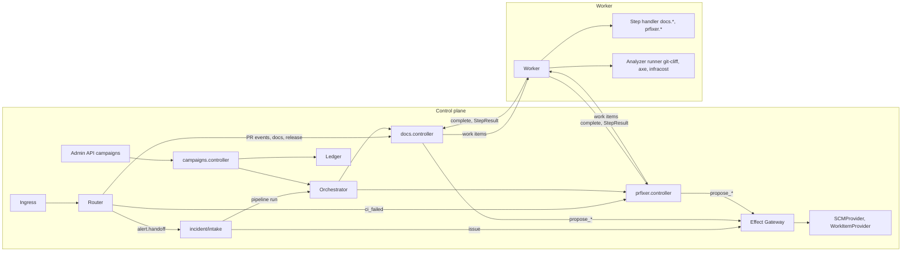
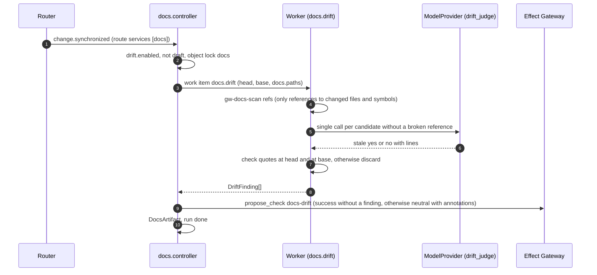
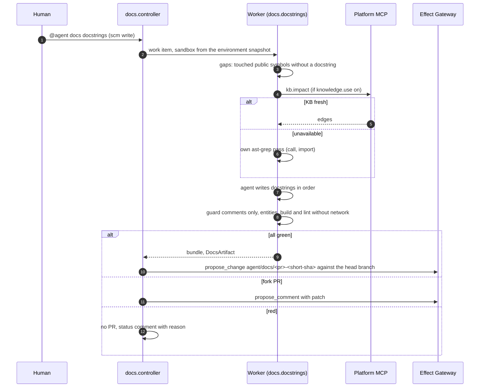
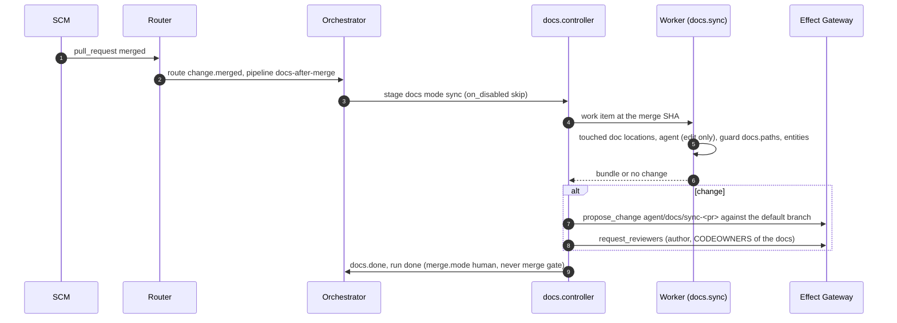
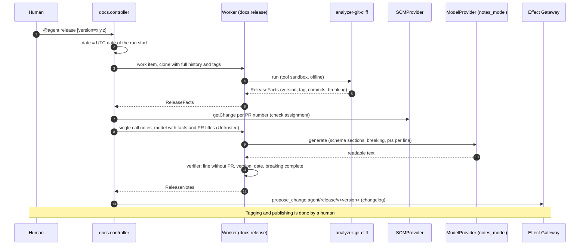
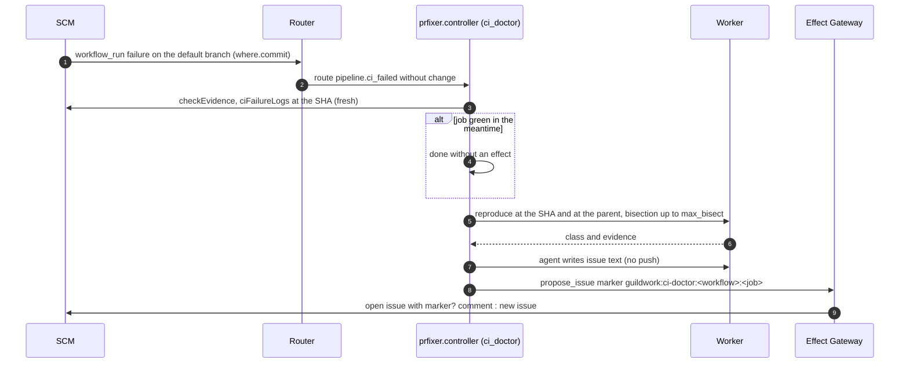
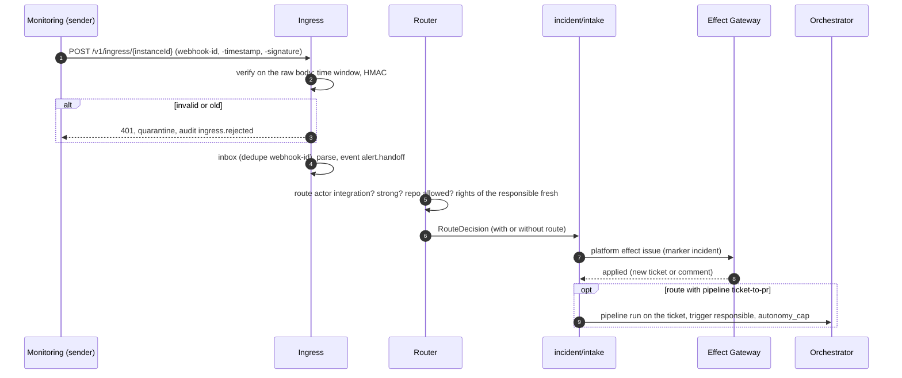
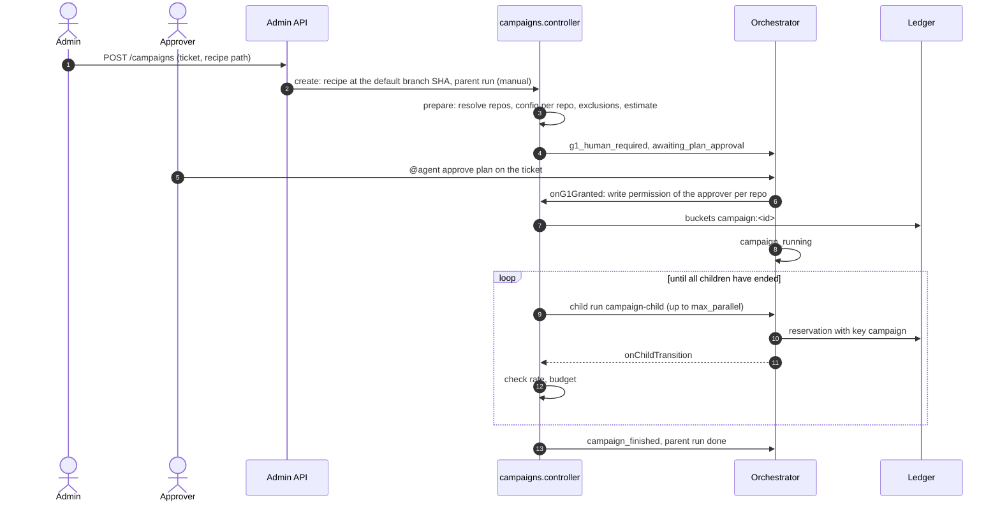

<!--
SPDX-License-Identifier: Apache-2.0
SPDX-FileCopyrightText: The Guildwork Authors
-->
# 15 Stage 10: Edge Layers

Detailed design for stage 10 from [08](../architecture/08-roadmap.md): service `docs`, PR fixer modes `dependency_update` and `ci_doctor` together with the executor `issue`, intake `incident-handoff` with `sentry`, analyzers axe-core and Infracost, campaigns across many repos, and the acceptance of the stage. It replaces the brief sections on stage 10 in [12](12-expansion.md) (FE-1500). Precedence, fixed choices (stack, package names) and required structure as in the [README](README.md); Rulings of this document: FE-1500 to FE-1599. Classifications VERIFIED, CLAIMED, DERIVED and "unverified" as in the [README of the architecture](../architecture/README.md).

**External tools and APIs:** All headers, fields, commands and output formats of third-party tools and services (Standard Webhooks, Sentry, git-cliff, release-please, ast-grep, axe-core, Infracost, package managers, GitHub extensions) are **unverified** in this document unless a source from the architecture is named explicitly. They are verified by the task that adds the contract suite with recorded real responses or real tool runs; if the recording differs, the recording applies, and this file is adjusted in the same PR.

## 1. Purpose and Sources

| Building block | Epic | Section here | Architecture sources |
|---|---|---|---|
| Service `docs`: drift check, docstrings, docs sync, release notes | 10-E01 | 2.3, 4.1 to 4.4 | [02](../architecture/02-services.md) sections 0 and 10; [04](../architecture/04-configuration-and-limits.md) section 3 (`docs`, `docs-after-merge`, consistency rule `merge.mode`); [10](../architecture/10-standards-per-layer.md) section 11; [07](../architecture/07-eval.md) section 3.10; ADR-46, ADR-40, ADR-50 |
| PR fixer modes `dependency_update` and `ci_doctor`, executor `issue` | 10-E02 | 2.4, 4.5, 4.6 | [02](../architecture/02-services.md) section 6; [10](../architecture/10-standards-per-layer.md) sections 8 and 15; [07](../architecture/07-eval.md) section 3.6 (F4); detailed design [04](04-effects-audit-credentials.md) section 2.1.5, [11](11-qa-prfix-automerge.md) section 2.4; ADR-06, ADR-50, ADR-64 |
| Intake `incident-handoff` and `sentry` | 10-E03 | 2.5, 4.7 | [01](../architecture/01-plugin-interfaces.md) sections 2 and 3; [02](../architecture/02-services.md) section 11; [10](../architecture/10-standards-per-layer.md) section 15; ADR-49 |
| Analyzers axe-core and Infracost | 10-E04 | 2.6 | [01](../architecture/01-plugin-interfaces.md) section 12; [02](../architecture/02-services.md) section 5; [07](../architecture/07-eval.md) section 3.8 (AN1); [10](../architecture/10-standards-per-layer.md) sections 13 and 15; ADR-40, ADR-50 |
| Campaigns | 10-E05 | 2.7, 3.1, 4.8, 4.9 | [03](../architecture/03-flow-and-orchestration.md) sections 2.1, 6 and 7; [04](../architecture/04-configuration-and-limits.md) section 6; ADR-67, ADR-68 |
| Eval sets and acceptance of stage 10 | 10-E01-T05, 10-E02-T03, 10-E06 | 2.8, 8.6 | [07](../architecture/07-eval.md) sections 3.6, 3.8, 3.10 and 5; [10](../architecture/10-standards-per-layer.md) sections 1.2 item 6, 11, 15; [09](../architecture/09-decisions.md) section 4; [08](../architecture/08-roadmap.md) stage 10 |

**Done criteria of the stage** ([08](../architecture/08-roadmap.md) stage 10) and where they are covered here:

| Done criterion | Section | Task |
|---|---|---|
| DO1 to DO4 per 10 (release notes: 0 lines without a PR) | 2.8, 8.1, 8.6 | 10-E01-T05 |
| `docs` "done with Gate B open", license request CodeWikiBench and DocAgent | 2.8, 10 | 10-E01-T05, 10-E01-T06 |
| F4 green | 2.8, 8.2 | 10-E02-T03 |
| E2E for `incident-handoff` with a signed fixture | 4.7, 8.3 | 10-E03-T03 |
| AN1 green for each new analyzer | 2.6.4, 8.4 | 10-E04-T03, 10-E01-T04 (git-cliff) |
| Stage report, S8 with upgrade, release | 8.6 | 10-E06-T01 |

### 1.1 Consequences of the Stage Graph

Stage 10 depends on 3 and 4 and thereby on 2, 1, 0 and R; 6, 7a, 7, 8, 9 and 0b do **not** precede it ([08](../architecture/08-roadmap.md) section 3). From this follow the Rulings already made in [12](12-expansion.md), which apply here and are not repeated:

| Ruling (in 12) | Content | Effect here |
|---|---|---|
| FE-1236 | Campaign children are normal pipeline runs with `campaign_id`, not coder child runs from stage 9 | Section 2.7 |
| FE-1237 | No deep scan in stage 10 | Note in the stage report (10-E06-T01) |
| FE-1238 | `docs` uses L1 only if the knowledge base for the repo is `fresh`, otherwise its own ast-grep pass | Section 2.3.4, FE-1506 |
| FE-1239 | `CREATE_ISSUE` from 7-E05; if it is not merged, 10-E02-T05 builds the method | Section 2.4.3 (Backlog M152) |
| FE-1240 | Standard Webhooks signature, time window 5 minutes, dedupe via `webhook-id` | Section 2.5.1 |
| FE-1241 | New acceptance Epic 10-E06 | Section 2.8 |
| FE-1249 | `incident-handoff` only via routes with `actor: integration` and a named `responsible`; without a route only a ticket | Section 2.5.3, FE-1522 |

Further consequences of this document: stage 6 building blocks (analytics, auto-approve) and stage 9 building blocks (Slack notifier, MicroVM, subprocess plugins) are not presupposed; where they are present at runtime, stage 10 uses them only through existing contracts (for example `notify` via the instance `comment-on-source`).

### 1.2 Boundaries with Other Detailed Design Documents

- The PR fixer core (collecting, classifying, prohibitions, delivery, round counter) is in [11](11-qa-prfix-automerge.md) section 2.4; this document only adds the two modes.
- Effect catalog, gateway, dispatcher and the shared part of the executors are in [04](04-effects-audit-credentials.md) sections 2.1.1 to 2.1.5; here is only what the executor `issue` specifies beyond that.
- Plugin contracts `v1alpha1` are in [05](05-plugins-and-contracts.md) section 2.11; the analyzer contract and the analyzer runner in [10](10-planner-architect-coder.md) section 2.14. This document implements against them and does not change them; what is missing is listed as a need in section 2.2 and as an open point in section 10.
- Run state machine, router, policy and ledger are in [02](02-control-plane.md); the additive extensions of this stage are in section 2.2 with the task that builds them.
- Agent run shell, environment snapshot, registry cache and `propose_dependency` are in [10](10-planner-architect-coder.md) sections 2.3, 2.6 and 2.7.
- Eval package, set format, gate files and suites are in [07](07-eval-and-qualification.md).
- Tables of stages 7 to 9 and the Rulings FE-1201 to FE-1255 are in [12](12-expansion.md); the tables of stage 10 are here with DDL (FE-1500).

## 2. Modules and Responsibility

### 2.1 Directories

```text
packages/contracts/src/artifacts/
  docs.ts                    # DocsRequest, DocsArtifact, DriftFinding, DocPatch, ReleaseFacts, ReleaseNotes (TypeBox)
  incident.ts                # IncidentHandoffBodyV1 (TypeBox, published schema)
  campaign.ts                # CampaignRecipe, CampaignPlan, CampaignView (TypeBox)
packages/sarif/src/bags/     # Schemas of the properties bags: release-facts.ts, cost-diff.ts, a11y.ts (01 section 12 rule 6)
services/docs/               # @guildwork/service-docs
  src/manifest.ts            # ServiceManifest (section 2.3.1)
  src/controller/
    controller.ts            # DocsController: intake, step plan, result, output
    intake.ts                # event, command, pipeline stage -> DocsRequest or Skipped
    output.ts                # follow-up PR, docs PR, changelog PR, comment fallback chain
    check.ts                 # check docs-drift (only success or neutral, FE-1501)
    release-prs.ts           # PR assignment of the commits via getChange (FE-1513)
  src/jobs/
    work.ts                  # DocsWorkInput, DocsStepResult, DocsNext (section 2.3.2, FE-1542)
    drift.handler.ts         # docs.drift: gw-docs-scan refs, then single call drift_judge
    docstrings.handler.ts    # docs.docstrings: gap search, order, agent, guard, check phase, entities
    sync.handler.ts          # docs.sync: find doc locations, agent, path guard, verifier
    release.handler.ts       # docs.release: analyzer git-cliff, single call notes_model, verifier
  src/verify/
    entities.ts              # every named entity exists (L1 or symbol table)
    comments-only.ts         # guard "only comment nodes changed" (FE-1504)
    release-notes.ts         # line without PR, invented version or date, breaking complete (FE-1511)
  tool/                      # gw-docs-scan, bundled Node script in the image sandbox-base (like gw-review-context, 08 FE-806)
    src/main.ts  refs.ts  symbols.ts  gaps.ts  order.ts  comments-only.ts  entities.ts
    rules/<language>/*.yml    # ast-grep rules for symbols and docstring gaps, each with a test case
  prompts/                   # docstrings.md, sync.md, drift-judge.md, release-notes.md; prompt_v per stage
  test/
services/prfixer/src/modes/
  mode.ts                    # PrFixerMode, CiDoctorRequest, CiDoctorPlan (section 2.4, FE-1543)
  dependency-update.ts       # intake, package set, delivery as stacked PR (section 2.4.1)
  ci-doctor.ts               # classification on the default branch, issue text, updating (section 2.4.2)
services/prfixer/src/lockfiles/
  regenerate.ts              # package manager commands per ecosystem (table 2.4.1), check of the package set
apps/control-plane/src/effects/executors/issue.ts     # executor issue (section 2.4.3)
apps/control-plane/src/router/route-actors.ts         # route actors integration and bot_allowlist (section 2.2)
apps/control-plane/src/incident/intake.ts             # ticket, handover to pipeline or prfixer (section 2.5.3)
apps/control-plane/src/campaigns/
  recipe.ts                  # load and check the recipe (base SHA of the ticket repo)
  prepare.ts                 # build the campaign plan (deterministic, state planning)
  controller.ts              # start children, failure rate, budget, stop
  state.ts                   # states campaigns.state and campaign_children.state (section 4.9)
  child-plan.ts              # PlanArtifact per repo from the recipe (FE-1532)
  api.ts                     # Admin API /admin/api/v1/campaigns*
apps/admin-ui/src/pages/campaigns/   # list, detail, actions stop and resume
plugins/incident-handoff/    # TriggerSource incident-handoff (section 2.5.1)
plugins/sentry/              # TriggerSource sentry (section 2.5.2)
plugins/analyzer-git-cliff/  # analyzer for release facts (section 2.3.6)
plugins/analyzer-axe/        # analyzer axe-core (section 2.6.1)
plugins/analyzer-infracost/  # analyzer Infracost (section 2.6.2)
deploy/images/analyzer-git-cliff/, analyzer-axe/, analyzer-infracost/
eval/sets/do1/ do2/ do3/ do4/ f4/ cd1/   # sets per 07 section 2.2 (FE-1537)
eval/gates/docs.gates.json               # Gate A and report parts for docs
eval/adapters/docs/                       # adapter DocsArtifact -> scoring DO1, DO3, DO4
packages/testkit/src/contract/fixtures/analyzer-an1/axe/, infracost/, git-cliff/   # 20 fixture repos each (AN1)
```

Dependency direction as in [00](00-codebase-and-conventions.md): plugins never import `db`, `apps/*` or other plugins; `services/docs` imports `@guildwork/agent-step`, `@guildwork/sarif` and `@guildwork/contracts`, never `services/reviewer` or `services/prfixer`.

### 2.2 Shared Extensions of the Core

These extensions are additive and belong to the area that defines them; the building task adds them there in the same PR (follow-up list in section 10).

| No. | Extension | Area and location | built by |
|---|---|---|---|
| K1 | Route actor `integration` with required field `responsible` (exactly one login) and required `signature.strength = strong`; route actor `bot_allowlist`; actors of kind `app` and `automation` trigger only via these two route kinds (FE-1515, FE-1522) | [02](02-control-plane.md) section 4.3 (router, rights G0), schema `routing[]` in `packages/config` | 10-E03-T01 (`integration`), 10-E02-T01 (`bot_allowlist`) |
| K2 | Expression context `incident.*` (`severity`, `repo`, `source`) for `filter` of the route `alert.handoff` | 02 FE-207, `packages/config/src/expr/contexts.ts` | 10-E03-T01 |
| K3 | Platform effect `issue` (origin `platform`, reason `incident_handoff`) with policy rule `orchestrator.incident_ticket` (FE-1521) | [04](04-effects-audit-credentials.md) section 2.1.1 (`PlatformEffectInput`), 02 section 4.7 | 10-E03-T01 |
| K4 | Bucket kind `campaign` in the ledger (`BucketKeyKind`, column `buckets.key_kind`) (FE-1534) | 02 sections 2.2 and 4.8, [01](01-data-model.md) section 3.6 | 10-E05-T01 |
| K5 | Run state machine version n+1: state `campaign_running`, transitions of the pipeline `campaign`, actions `start_campaign_children`, `cancel_campaign_children`; mapping of the previous version identical (FE-1530) | 02 section 4.4 (`run-automaton.v1.json`), [03](../architecture/03-flow-and-orchestration.md) section 2.1 | 10-E05-T01 |
| K6 | `runs.state` extended by `campaign_running`, `runs.object_kind` by `campaign_child` and `repo_branch`, column `runs.campaign_id` (section 3.1) | 01 section 3.4 | 10-E05-T01 (migration 1001), 10-E02-T02 (`repo_branch`, migration 1002) |
| K7 | Pipelines `docs-after-merge` (04 section 3), `campaign` and `campaign-child`; `PipelineDef.id` as a list of known IDs instead of only `ticket-to-pr` | [10](10-planner-architect-coder.md) section 2.17, 02 `orchestrator/pipelines.ts` | 10-E01-T03 (`docs-after-merge`), 10-E05-T01 (`campaign`, `campaign-child`) |
| K8 | `AgentStage` extended by `docs.docstrings`, `docs.sync`, `prfixer.dependency_update`, `prfixer.ci_doctor` (FE-1514) | 10 section 2.3 | 10-E01-T02, 10-E01-T03, 10-E02-T01, 10-E02-T02 |
| K9 | `AnalyzerSandboxSpec.network` extended by `"item_app"` (only the item's network to the started app) and `"allowlist"` (hosts from the manifest via the egress proxy) (FE-1525, FE-1528) | 10 section 2.14 | 10-E04-T01 (`item_app`), 10-E04-T02 (`allowlist`) |
| K10 | Event field `where.commit?: { sha: string; ref: string }` for `pipeline` events without a PR and the GitHub mapping of `workflow_run.completed` with a failure on the default branch: present since 0-E13-T02 and 0-E14-T04 respectively ([05](05-plugins-and-contracts.md) FE-556, test `github.parse.where-commit`); stage 10 only uses the field (route `pipeline.ci_failed` without `change`) | [05](05-plugins-and-contracts.md) sections 2.11.1 and 2.14.3 | 10-E02-T02 (use only) |
| K11 | Prohibition exception for manifest and lockfile in the profile `dependency_update`, only for output of the package manager (FE-1516) | [11](11-qa-prfix-automerge.md) FE-1125, `services/prfixer/src/policy/forbidden-changes.ts`, gateway path rule | 10-E02-T01 |
| K12 | The section "tool context" of the reviewer summary renders known properties bags (`guildwork/cost-diff@1`) deterministically, without prompt content (FE-1528) | [08](08-reviewer.md) `controller/post/summary.ts` | 10-E04-T02 |
| K13 | QA E2E step `e2e_a11y` after `e2e_generate` (FE-1526) | [11](11-qa-prfix-automerge.md) section 2.3 | 10-E04-T01 |
| K14 | Event field `incident?: { severity; key; title }`: present in the schema since 0-E13-T02 ([05](05-plugins-and-contracts.md) FE-556); stage 10 only sets it, and only in `incident-handoff` and `sentry`; source of the expression context K2 and of the ticket marker (FE-1540) | [05](05-plugins-and-contracts.md) section 2.11.1 (`TriggerEvent`) | 10-E03-T01 (setting only) |
| K15 | Manifest of `prfixer` extended by `propose_dependency` in `platformMcpTools`; the policy rule `prfixer.dependency_update` allows the tool only in runs with `FixRequest.source = dependency_update`, otherwise `forbidden` (10 section 2.7 allows `prfixer` in later stages but names no stage) | [11](11-qa-prfix-automerge.md) section 2.4 (manifest), [10](10-planner-architect-coder.md) section 2.7 | 10-E02-T01 |
| K16 | Egress proxy: header relay for tool sandboxes with `network: "allowlist"`. A CONNECT tunnel does not allow inserting a header; therefore the tool addresses the price endpoint in plain text, as with the credential relay, via a relay port of the proxy in the item network, the proxy establishes TLS to the upstream and sets the header from the SecretStore (`ItemRegistration.headerRelay?: { upstream: { host; port: 443 }; header: string; value: string }`, in memory only, value never in the sandbox); without `api_key_ref` no relay, only CONNECT to the allowlist (FE-1545) | [03](03-execution.md) sections 2.9.1 (`ItemRegistration`) and 2.10 (relay pattern) | 10-E04-T02 |

K3 presupposes the catalog entry `issue` from 10-E02-T05 (`catalog.ts`, origin there only `propose_issue`); 10-E03-T01 adds the origin `platform` with reason `incident_handoff` and therefore depends on 10-E02-T05 in the plan.

```ts
// packages/config/src/schema/org.ts (excerpt route, addition of this stage)
export type RouteActor = "any" | "item_author" | "integration" | "bot_allowlist";   // if not specified: human with command (G0)
export interface RouteDef {
  on: string; source: string | string[];
  services?: ServiceId[]; pipeline?: string; commands?: CommandName[];
  filter?: string; enabled?: boolean;
  min_permission?: PermissionRequirement;
  actor?: RouteActor;
  responsible?: string;          // required for actor "integration": login at the SCM of the target repo (FE-1522)
  autonomy_cap?: "low" | "medium";   // only for actor "integration"; default and maximum "medium" (FE-1523)
}

// apps/control-plane/src/ledger/reserve.ts (addition K4)
export type BucketKeyKind = "org" | "repo_group" | "repo" | "user" | "service" | "provider" | "pool" | "campaign";
```

### 2.3 Docs Service (10-E01)

**Responsibility:** keep documentation up to date without changing code: drift check on PRs, docstrings for touched symbols as a follow-up PR, docs PR after merge, release notes deterministically plus readable text as a changelog PR. The service writes to the repo only via `propose_change` on `docs.paths`, docstrings of touched symbols and the changelog file; merge always by a human ([02](../architecture/02-services.md) section 10, ADR-46). It uses the knowledge base only if it is `fresh` for the repo (FE-1238).

#### 2.3.1 Manifest and Commands

```ts
// services/docs/src/manifest.ts
export const docsManifest: ServiceManifest = {
  apiVersion: "guildwork-dev.github.io/v1alpha1",
  kind: "Service",
  id: "docs",
  version: "0.1.0",
  license: "Apache-2.0",
  distribution: "bundled",
  trust: "first_party",
  controller: { transport: "in_process" },
  commands: [],                        // built-in commands docs and release (CommandName, 01 section 2); rights from command_permissions (04)
  subscribes: [
    { subject: "pr", action: "created" },          // drift check (mode drift, FE-1501)
    { subject: "pr", action: "synchronized" },
    { subject: "pr", action: "ready_for_review" },
    { subject: "pr", action: "merged" },           // only via the pipeline docs-after-merge (mode sync)
  ],
  inputSchema: DocsRequestSchema,
  outputSchema: DocsArtifactSchema,
  requires: [
    { plugin: "SCMProvider", caps: ["CHECK_RUN", "CHECK_ANNOTATIONS", "DRAFT_CHANGE"], level: "fallback" },
    { plugin: "AgentRuntime", caps: ["STRUCTURED_OUTPUT", "NATIVE_TOOLS_LOCKABLE", "BUDGET_ABORT"], level: "native" },
    { plugin: "ModelProvider", caps: ["STRICT_SCHEMA"], level: "fallback" },
    { plugin: "Analyzer", caps: ["SARIF_NATIVE"], level: "fallback" },    // analyzer-git-cliff, mode release only
  ],
  effects: ["propose_change", "propose_check", "propose_comment"],
  jobs: [
    { nativeTools: "none", minIsolation: "gvisor", egress: ["<llm>", "<control>"] },                  // docs.drift
    { nativeTools: "edit+shell", minIsolation: "gvisor", egress: ["<llm>", "<control>"] },            // docs.docstrings (check phase without network, FE-1507)
    { nativeTools: "edit", minIsolation: "gvisor", egress: ["<llm>", "<control>"] },                  // docs.sync
    { nativeTools: "none", minIsolation: "gvisor", egress: ["<llm>", "<control>"], analyzers: ["git-cliff"] },   // docs.release
  ],
  platformMcpTools: ["change_get", "kb.symbol_context", "kb.impact"],   // kb_* answer unavailable without a fresh KB; if they are missing (without stage 7), the same applies (FE-1544)
  qualification: { evalSuite: "docs", gateA: true, gateB: { reference: "10#11-docs-docs-adr-46" } },
  configSchema: DocsConfigSchema,
  contractSuite: { version: "1", passedAt: "<at build>", fixturesHash: "<at build>" },
};
```

| Trigger | Mode | Condition | Run |
|---|---|---|---|
| Route `change.opened`, `change.synchronized`, `change.ready_for_review` with `services: [docs]` | `drift` | `services.docs.drift.enabled: true`, `!change.draft` | Single-service run, check `docs-drift` |
| `@agent docs` or `@agent docs docstrings` on an open PR | `docstrings` | `docstrings` in `services.docs.modes` | Single-service run, follow-up PR |
| `@agent docs sync` on a merged PR | `sync` | `sync` in `modes` | Single-service run, docs PR |
| Route `change.merged` with `pipeline: docs-after-merge` | `sync` | Route `enabled: true` (off by default, 04) | Pipeline run with one stage |
| `@agent release [version=x.y.z]` in an issue or PR of the repo | `release` | `release` in `modes` | Single-service run, changelog PR |
| `@agent docs` with an unknown argument | | | `Skipped(invalid_args)` with the reply "allowed: docstrings, sync" |

Rights: `command_permissions.docs` and `.release` (`scm: write`, [04](../architecture/04-configuration-and-limits.md) section 3). Runs of `docs` and `release` open their PR and end in `done`; the PR never goes into the merge gate ([03](../architecture/03-flow-and-orchestration.md) section 2.1). The consistency rule "`merge.mode` of a pipeline with `docs` is always `human`" exists as `packages/config/src/consistency/docs-merge-human.ts` from 0-E06; 10-E01-T01 checks it with the real pipeline `docs-after-merge`.

#### 2.3.2 Types

```ts
// packages/contracts/src/artifacts/docs.ts
export type DocsMode = "docstrings" | "sync" | "release";      // modes from 02 section 10, individually switchable
export type DocsRunMode = DocsMode | "drift";                    // drift: internal mode without a command (FE-1501)

export interface DocsRequest {
  mode: DocsRunMode;
  change?: ChangeRef;                                            // drift, docstrings (open PR), sync (merged PR)
  range?: { repo: RepoRef; fromTag: string | null; toSha: string; requestedVersion?: string };   // release
  trigger: { kind: "event" | "command" | "pipeline"; actor: Actor; eventId: string };
}

export interface DriftFinding {
  id: string;                                                    // sha256(kind, doc.path, doc.lines, ref)
  kind: "broken_path" | "broken_symbol" | "broken_anchor" | "stale_description" | "stale_example";
  doc: { path: string; lines: [number, number]; quoteHash: string };
  code?: { path: string; lines: [number, number]; sha: string; quoteHash: string };   // required for stale_*
  ref: string;                                                   // the reference in the doc text (path, symbol, anchor)
  reason: string;                                                // short, without foreign text
  evidence: "deterministic" | "model_verified";
}

export interface DocPatch {
  path: string;
  kind: "docstring" | "doc_page" | "changelog";
  symbols?: string[];                                            // for docstring: qualified names
  addedLines: number; removedLines: number;
}

export interface ReleaseFacts {                                  // bag guildwork/release-facts@1 from analyzer-git-cliff
  schema: "guildwork/release-facts@1";
  version: string;                                               // SemVer without prefix, deterministic (FE-1510)
  tag: string;                                                   // per release.tag_pattern, for example "v1.4.0"
  date: string;                                                  // YYYY-MM-DD, UTC date of the run start from the control plane
  previousTag: string | null;
  commits: { sha: string; type: string; scope?: string; breaking: boolean; subject: string; pr: number | null }[];
  breaking: { sha: string; pr: number | null; note: string }[];
  toolVersion: string; configSource: "repo_cliff_toml" | "builtin";
}

export interface ReleaseNotes {
  version: string; date: string; tag: string;
  sections: { title: string; lines: { text: string; prs: number[] }[] }[];
  breaking: { text: string; prs: number[] }[];
  unassigned: { sha: string; subject: string }[];                // commits without a PR: never in the readable text (FE-1513)
  factsRef: string;                                              // BlobStore, ReleaseFacts
  droppedLines: { text: string; reason: "no_pr" | "unknown_pr" | "invented_version" | "invented_date" }[];
}

export interface DocsVerifierReport {
  entities: { checked: number; missing: string[] };              // docstrings and sync: 0 invented entities
  commentsOnly?: { ok: boolean; violations: { path: string; line: number }[] };   // docstrings
  pathsOnly?: { ok: boolean; outside: string[] };                // sync: only docs.paths
  build?: { status: "passed" | "failed" | "skipped"; logRef?: string };
  lint?: { status: "passed" | "failed" | "skipped"; logRef?: string };
  releaseNotes?: { linesWithoutPr: number; inventedVersions: number; inventedDates: number; breakingComplete: boolean };
}

export interface DocsArtifact {
  artifactVersion: 1;
  runId: string;
  mode: DocsRunMode;
  headSha: string;
  patches: DocPatch[];
  driftFindings: DriftFinding[];
  releaseNotes?: ReleaseNotes;
  skippedSymbols: { symbol: string; reason: "no_language_support" | "generated" | "over_budget" | "kb_and_pass_failed" }[];
  verifier: DocsVerifierReport;
  output: { kind: "pr" | "comment" | "check" | "none"; branch?: string; changeNumber?: number; reason?: string };
  untrustedInputs: ProvenanceEntry[];                            // for foreign_input_seen (10 section 2.8)
}
```

```ts
// services/docs/src/controller/controller.ts
export interface DocsController {
  accept(ev: ResolvedEvent | PipelineStageCall, snap: ConfigSnapshot): Promise<DocsRequest | Skipped>;
  plan(req: DocsRequest): Promise<DocsPlan>;
  onStepResult(runId: string, r: DocsStepResult): Promise<DocsNext>;   // deterministic, never from model text
  finalize(runId: string): Promise<DocsArtifact>;
}
export interface DocsPlan {
  steps: ("drift" | "docstrings" | "sync" | "release_facts" | "release_notes" | "release_prs" | "output")[];
  output: { mode: "follow_up_pr" | "doc_pr" | "changelog_pr" | "check" | "comment_fallback"; branch?: string; base?: string };
}
```

Work items between controller (Z0) and worker (Z1) go through the Work API ([03](03-execution.md)); input and result are schema JSON, repo contents reach Z0 only in this form (FE-1542):

```ts
// services/docs/src/jobs/work.ts
export type DocsWorkKind = "docs.drift" | "docs.docstrings" | "docs.sync" | "docs.release";
export interface DocsWorkInput {
  kind: DocsWorkKind;
  repo: RepoRef; headSha: string; baseSha?: string;              // sync: headSha = merge SHA; release: headSha = toSha
  paths: string[];                                               // services.docs.paths from the ConfigSnapshot
  limits: { maxDocFiles?: number; maxJudgeCalls?: number; maxSymbols?: number; maxFiles?: number; styleExamples?: number };
  languages?: string[];                                          // docstrings
  kb: { use: "off" | "on" };                                     // FE-1238; whether L1 is fresh, the worker asks via kb.* (unavailable)
  release?: { phase: "facts" | "notes"; config: GitCliffConfig; fromTag: string | null;
              factsRef?: string; prTitles?: { pr: number; title: Untrusted }[] };   // notes: facts and checked PRs from release_prs
  models: { driftJudge?: string; notesModel?: string };          // references from services.docs.models or .release
}
export type DocsStepResult =
  | { kind: "docs.drift"; findings: DriftFinding[]; notChecked: string[]; dropped: number; error?: string }
  | { kind: "docs.docstrings"; bundleRef: string | null; patches: DocPatch[]; skipped: DocsArtifact["skippedSymbols"];
      verifier: DocsVerifierReport; fork: boolean }
  | { kind: "docs.sync"; bundleRef: string | null; patches: DocPatch[]; verifier: DocsVerifierReport }
  | { kind: "docs.release"; phase: "facts"; report: AnalyzerReport; factsRef: string | null }
  | { kind: "docs.release"; phase: "notes"; notes: ReleaseNotes; verifier: DocsVerifierReport };
export type DocsNext =
  | { kind: "work_item"; input: DocsWorkInput }
  | { kind: "controller_step"; step: "release_prs" | "output" }
  | { kind: "done"; artifact: DocsArtifact };
```

Output schemas of the model and agent calls (TypeBox with `additionalProperties: false`, `services/docs/src/jobs/schemas.ts`); an output that misses the schema is retried once with the error message and after that treated like a tool error (drift: candidate in `notChecked`; docstrings, sync: end without a PR with reason `schema_invalid`; release: reply "readable text cannot be generated", no PR):

```ts
// services/docs/src/jobs/schemas.ts
export interface DriftJudgeOutput {                              // single call drift_judge, per candidate
  stale: boolean;
  kind?: "stale_description" | "stale_example";                  // required if stale
  docLines?: [number, number]; codeLines?: [number, number];     // required if stale; quote check FE-1502
  reason: string;                                                // at most 300 characters
}
export interface DocstringsAgentOutput {                         // AgentStage docs.docstrings
  written: { symbol: string; path: string; line: number }[];
  skipped: { symbol: string; reason: string }[];
}
export interface SyncAgentOutput {                               // AgentStage docs.sync
  edits: { path: string; lines: [number, number]; reason: string; codeRefs: { path: string; line: number }[] }[];   // codeRefs at least 1
}
export interface ReleaseNotesModelOutput {                       // single call notes_model
  sections: { title: string; lines: { text: string; prs: number[] }[] }[];
  breaking: { text: string; prs: number[] }[];
}
```

#### 2.3.3 Drift Check (Mode drift)

One single-service run per PR state with the work item `docs.drift` (kind `agent` without a harness turn, only tool plus single calls):

1. **References** (`gw-docs-scan refs`, deterministic in the sandbox at head): Markdown files from `docs.paths` are read with `remark-parse` (mdast, as in [12](12-expansion.md) FE-1224). Candidates are inline code and links that look like repo paths (`src/x.ts`, `./docs/a.md#anker`), qualified symbols (`Foo.bar`, `pkg.func()`) or code blocks with a file header. Only doc locations are checked whose reference points to a file changed, renamed or deleted in the PR or to a symbol defined there (limited to the diff). Result: `broken_path`, `broken_symbol`, `broken_anchor` with `evidence: deterministic`.
2. **Description** (single call `services.docs.models.drift_judge`, ADR-58): for each doc location that names a changed symbol and has no broken reference, the doc paragraph and the code before and after the diff go into the call as `Untrusted`; output `{ stale: boolean, kind, docLines, codeLines, reason }`. A finding counts only if both quotes exist at head and at the base SHA respectively (`quoteHash`), otherwise it is discarded (FE-1502).
3. **Check:** `docs-drift` at the head SHA: without findings `success`, with findings `neutral` with annotations (doc file and line, text "Reference to `<ref>` no longer matches: <reason>"), on a run error `neutral` with a reason. Never `failure`, for no configuration (FE-1501). Without `CHECK_RUN` comment fallback chain with the list of findings (01 section 5).

Limits: at most `services.docs.drift.max_doc_files` doc files and `max_judge_calls` single calls per run; anything beyond that appears as "not checked" in the check text.

#### 2.3.4 Mode docstrings

Work item `docs.docstrings` (kind `agent`), sandbox from the environment snapshot of the repo ([10](10-planner-architect-coder.md) section 2.6):

1. **Gap search** (`gw-docs-scan gaps`, ast-grep rules per language under `tool/rules/`): touched symbols are functions, methods, classes and exported types whose definition span at head overlaps with changed lines of the diff and that are public (TypeScript and JavaScript: exported; Python: name without a leading underscore at module level or in a public class; Go: capitalized; Java: `public` or `protected`). A gap means: no docstring in the form of the language (JSDoc `/** */` directly before; Python first string expression in the body; Go comment directly before the declaration; Javadoc). Generated files (`linguist-generated`, header line "generated") and languages outside the starting set (`services.docs.docstrings.languages`) go to `skippedSymbols` (FE-1505).
2. **Style examples:** up to `docstrings.style_examples` existing docstrings of the same file, otherwise of the same directory, as an `Untrusted` block; from these the agent derives language, tags and length.
3. **Order** (`gw-docs-scan order`): with `services.docs.knowledge.use: on` and L1 `fresh` via `kb.impact` or `kb.symbol_context` of the platform MCP; if a tool answers `unavailable` or the platform MCP does not offer the tool (stage 7 does not precede stage 10 in the stage graph, without it the `kb.*` tools are missing entirely, FE-1544), its own ast-grep pass over call and import edges within the touched files and their direct imports. Topological order (callee before caller), cycles are broken by qualified name (FE-1506). Reason: docstrings of the called symbols are already available to the agent at the caller (DocAgent pattern, [02](../architecture/02-services.md) section 10).
4. **Agent** (`AgentStage` `docs.docstrings`, `nativeTools: "edit+shell"`, shell only for `gw-docs-scan` and reading): task "write docstrings exactly for these symbols in this order, change nothing else"; output `{ written: { symbol, path, line }[], skipped: { symbol, reason }[] }`.
5. **Guard "comments only"** (`comments-only.ts`, deterministic in the worker, FE-1504): for each changed file the syntax tree before and after the agent is compared without comment and docstring nodes (token sequence equal). Any deviation discards the change to this file; the symbols go to `skippedSymbols` with reason `kb_and_pass_failed` or into the report. For Python the first string expression in the body counts as a docstring node.
6. **Check phase** (`check`, without network, FE-1507): `commands.build` and `commands.lint` of the blueprint on the result; red means no PR, `verifier.build.status = failed`, run `done` with the status comment "Docstrings discarded: build or lint red" and a log reference.
7. **Entities** (`entities.ts`): every identifier in inline code, `@param`, `@throws`, `:param`, `Args:` and `See` of a new docstring must exist as a parameter of the symbol or as a symbol in the symbol table (L1 or ast-grep pass); otherwise the docstring is removed (DO3 "0 invented entities").
8. **Output:** bundle, `propose_change` with branch `agent/docs/<pr>-<short-sha>` against the head branch of the PR (origin branch), title "Docstrings for #<pr>", text with the symbol list and the note "created by an AI agent". PR from a fork or SCM without a branch workflow: fallback chain `propose_comment` with a collapsed patch on the PR (FE-1508). Never a commit on the PR branch.

#### 2.3.5 Mode sync

Work item `docs.sync` (kind `agent`, `nativeTools: "edit"`), input merged PR with merge SHA:

1. **Touched doc locations** (`gw-docs-scan refs --changed <paths>` at the merge SHA): paragraphs in `docs.paths` that name a changed path, a changed symbol or a changed configuration key (key names from changed schema and config files); at most `sync.max_files` files.
2. **Agent** (`AgentStage` `docs.sync`): changes only these paragraphs; output `{ edits: { path, lines, reason, codeRefs[] }[] }`; each change names at least one code location of the PR.
3. **Guard:** changed paths must lie in `docs.paths` (`pathsOnly`), otherwise the file is discarded; entities as in 2.3.4 item 7; each change has a valid code location of the PR.
4. **Output:** `propose_change` on `agent/docs/sync-<pr>` against the default branch, title "Docs for #<pr>", then platform effect `request_reviewers` with the author of the PR and CODEOWNERS of the doc paths ([04](04-effects-audit-credentials.md) section 2.1.5). Without a change: no PR, run `done` without an effect (silence is valid, 02 section 0 rule 3). Never the merge gate.

#### 2.3.6 Mode release and Analyzer `git-cliff`

**Analyzer `analyzer-git-cliff`** (`plugins/analyzer-git-cliff`): manifest `kind: ["Analyzer"]`, `distribution: bundled` only if the license of git-cliff is green in the license gate (unverified, 10-E01-T04), otherwise `operator_supplied`.

```ts
// plugins/analyzer-git-cliff/src/index.ts
export const manifestExt: AnalyzerManifestExt = {
  image: "<digest>", languages: ["*"], filePatterns: ["**"], runsRepoCode: false, needsBuild: false,
  offline: true, cost: "free",
};
// describe(): { languages: ["*"], filePatterns: ["**"], output: "sarif-2.1.0", network: "none", cost: "free" }
// run(sb, { scope: "full", baseSha: <fromTag SHA or root>, headSha: toSha, config: GitCliffConfig }):
//   1. workspace with full history and tags (worker clones for this item without depth, FE-1510)
//   2. git-cliff with cliff.toml from the base SHA of the repo, otherwise built-in configuration (Conventional Commits)
//   3. JSON context of git-cliff (output format unverified) -> ReleaseFacts
//   4. AnalyzerReport with findings: [] and SARIF run.properties["guildwork/release-facts@1"] = ReleaseFacts
export interface GitCliffConfig { tagPattern: string; requestedVersion?: string; date: string }   // date is set by the control plane
```

Version rule (deterministic, FE-1510): if `requestedVersion` is set, it applies if it is valid SemVer and greater than the last tag, otherwise `Skipped(invalid_version)`; if not specified, major on a breaking change, minor on `feat`, otherwise patch (pre-1.0 rule: breaking bumps minor). `date` is the UTC date of the run start, which the control plane writes into the configuration; model and tool never determine it.

**Flow** (section 4.4): `release_facts` (analyzer in the tool sandbox), `release_prs` (controller in Z0: per commit `pr` from the commit message, squash suffix `(#n)` or merge commit "Merge pull request #n", checked with `SCMProvider.getChange`, FE-1513), `release_notes` (single call `services.docs.release.notes_model` with `ReleaseFacts` and the PR titles as `Untrusted`; schema `{ sections, breaking }` with `prs[]` per line), verifier (2.3.7), output `propose_change` on `agent/release/v<version>` against the default branch: new section at the top of `docs.release.changelog_path`, PR title "Release v<version>", PR text with the `unassigned` list. Tagging and publishing is done by a human (FE-1512).

#### 2.3.7 Verifier

| Check | Mode | Rule | Consequence of a violation |
|---|---|---|---|
| Line without PR | release | every line in `sections` and `breaking` has at least one PR from `ReleaseFacts.commits[].pr` | Line removed, `droppedLines` with `no_pr` or `unknown_pr` |
| Invented version | release | every SemVer pattern in the text is `version` or appears in a quoted PR title | Line removed (`invented_version`) |
| Invented date | release | every date pattern (ISO, `TT.MM.JJJJ`, month names with year) is `date` | Line removed (`invented_date`) |
| Breaking complete | release | every entry from `ReleaseFacts.breaking` with a PR appears in `breaking` | missing entries are added deterministically with commit subject and PR (FE-1511) |
| Entities | docstrings, sync | 2.3.4 item 7 | Docstring or paragraph removed |
| Comments only | docstrings | 2.3.4 item 5 | File discarded |
| Only `docs.paths` | sync | 2.3.5 item 3 | File discarded |
| Quote exists | drift | 2.3.3 item 2 | Finding discarded |

#### 2.3.8 Tool gw-docs-scan

Bundled Node script in the image `sandbox-base` (like `gw-review-context`, [08](08-reviewer.md) FE-806), called only by the step handlers `docs.*` in the sandbox; deterministic, without network, without a model. Each subcommand reads arguments, writes exactly one JSON document to `--out` and ends with exit code 0 (ok), 2 (invalid input, reason on stderr) or 3 (internal error); the handler maps 2 and 3 to `neutral` or `Skipped` with a reason (FE-1541). Options and formats are specified by this document; the ast-grep calls underneath are unverified (10-E01-T02).

```text
gw-docs-scan refs          --root <dir> --paths <glob>... --changed <path>... [--base <sha>] [--max-files <n>] --out <json>   -> RefsOutput
gw-docs-scan gaps          --root <dir> --changed-lines <json> --languages <list> [--max-symbols <n>] --out <json>        -> GapsOutput
gw-docs-scan order         --root <dir> --symbols <json> [--kb-edges <json>] --out <json>                                   -> OrderOutput
gw-docs-scan comments-only --before <dir> --after <dir> --files <json> --out <json>                                        -> CommentsOnlyOutput
gw-docs-scan entities      --root <dir> --docstrings <json> --out <json>                                                    -> EntitiesOutput
```

```ts
// services/docs/tool/src/main.ts (output formats)
export interface RefsOutput { candidates: { doc: { path: string; lines: [number, number]; quoteHash: string }; ref: string;
  refKind: "path" | "symbol" | "anchor" | "code_block"; status: "ok" | "broken" | "changed" }[]; notChecked: string[] }
export interface GapsOutput { symbols: { qname: string; path: string; lines: [number, number]; language: string }[];
  skipped: { qname: string; reason: "no_language_support" | "generated" | "over_budget" }[] }
export interface OrderOutput { order: string[]; source: "kb" | "ast_grep"; brokenCycles: string[][] }
export interface CommentsOnlyOutput { ok: boolean; violations: { path: string; line: number }[] }
export interface EntitiesOutput { checked: number; missing: { qname: string; entity: string; path: string; line: number }[] }
```

### 2.4 PR Fixer Modes dependency_update and ci_doctor (10-E02)

Both modes are parts of the service `prfixer` from [11](11-qa-prfix-automerge.md) section 2.4 with the same controller; they have their own parts for Gate B (10 section 1.2 item 3: `scope: dependency_update`, `scope: ci_doctor`). `services.prfixer.modes` switches them on (default `[]`).

```ts
// packages/contracts/src/artifacts/fix-result.ts (addition, additive; FixSource already contains dependency_update)
export type CiDoctorClass = "caused_by_commit" | "flaky" | "infra" | "unknown";
export interface DependencyUpdateFacts {
  botLogin: string;                                    // author of the update PR, freshly from getChange
  updateBranch: string; updateHeadSha: string;
  ecosystem: "npm" | "pypi" | "go" | "other";
  updatedPackages: { name: string; from: string; to: string }[];   // from the lockfile diff base..head (parser from 2-E01)
  affectedSet: string[];                               // updatedPackages plus approved propose_dependency packages
}
export interface CiDoctorReport {
  artifactVersion: 1;
  runId: string; repo: RepoRef; branch: string; sha: string;
  workflow: string; job: string;                       // workflow file and job name, normalized (FE-1519)
  class: CiDoctorClass;
  culprit?: { sha: string; parentSha: string; files: string[]; evidence: string };   // caused_by_commit only
  reproduction: { command: string[]; redAtSha: boolean; greenAtParent: boolean | null; logRef: string };
  marker: string;                                      // guildwork:ci-doctor:<workflow>:<job>
  issue: { action: "created" | "appended" | "none"; ref?: WorkItemRef };
}
```

The modes are strategies of the one `PrFixerController` from [11](11-qa-prfix-automerge.md) section 2.4 (FE-1543): after the core sources, `accept` queries the enabled modes; `dependency_update` returns a normal `FixRequest` with `source: "dependency_update"` and `FixPlan.delivery.mode = "stacked_pr"`, `ci_doctor` its own request without a `ChangeRef`, because no PR exists on the default branch.

```ts
// services/prfixer/src/modes/mode.ts
export type PrFixerModeId = "dependency_update" | "ci_doctor";
export interface CiDoctorRequest {
  mode: "ci_doctor";
  repo: RepoRef; branch: string; sha: string;              // from where.commit (K10)
  workflow: string; job: string;                           // normalized like the marker (FE-1519)
  trigger: { eventId: string; kind: "pipeline" };
}
export interface CiDoctorPlan {
  steps: ("evidence" | "reproduce" | "bisect" | "write_issue" | "issue")[];
  maxBisect: number; marker: string;
}
export interface PrFixerMode<Req, Plan> {
  id: PrFixerModeId;
  accept(ev: ResolvedEvent, snap: ConfigSnapshot): Promise<Req | Skipped | null>;   // null: mode not responsible
  plan(req: Req, snap: ConfigSnapshot): Promise<Plan>;
}
export const dependencyUpdateMode: PrFixerMode<FixRequest, FixPlan>;
export const ciDoctorMode: PrFixerMode<CiDoctorRequest, CiDoctorPlan>;
// from stage 10 on, PrFixerController.accept returns FixRequest | CiDoctorRequest | Skipped; finalize returns CiDoctorReport for ci_doctor
```

#### 2.4.1 Profile dependency_update

**Intake:** (a) route `pipeline.ci_failed` with `actor: bot_allowlist` and `services: [prfixer]`: the PR author, freshly read (`getChange`), is in `services.prfixer.bot_allowlist` and is not the platform's own app; (b) `@agent fix` from a human with write permission on such a PR. Other bots trigger nothing (`Skipped(bot_not_allowlisted)`, FE-1515). If an open stacked PR of the platform exists for the same update PR, delivery goes into it.

**Package set:** `updatedPackages` from the lockfile diff base..head of the update PR (parser from `@guildwork/registry-cache`, [10](10-planner-architect-coder.md) section 2.6). The registry cache of the item contains the artifacts of the update head (filled in the setup phase from the lockfile of the head).

**Agent** (`AgentStage` `prfixer.dependency_update`): receives the error output of the reproduction, `updatedPackages` and the changelog excerpts of the packages only as `Untrusted`, if present in the registry cache; it changes only code. If the fix needs an accompanying update (for example type packages), it files `propose_dependency` ([10](10-planner-architect-coder.md) section 2.7, enabled for this mode via K15); only after approval (`dependency_requests.state = available`) does the package belong to `affectedSet`.

**Package manager step** (`lockfiles/regenerate.ts`, check phase with registry cache, without any other network, FE-1516): if the agent has requested an accompanying update and had it approved, the worker runs the command from the table; otherwise manifest and lockfile remain unchanged.

| Ecosystem | Command (unverified, 10-E02-T01) | Allowed files |
|---|---|---|
| npm | `npm install --package-lock-only --ignore-scripts <name>@<version>` | `package.json`, `package-lock.json` |
| pnpm | `pnpm add --lockfile-only --ignore-scripts <name>@<version>` | `package.json`, `pnpm-lock.yaml` |
| PyPI (uv) | `uv add --frozen=false <name>==<version>` with the index of the registry cache | `pyproject.toml`, `uv.lock` |
| Go | `go get <module>@<version>` and `go mod tidy` with `GOPROXY` of the registry cache, `GOFLAGS=-mod=mod` | `go.mod`, `go.sum` |
| other | no step; if the fix needs a lockfile change, `cannot_fix` with reason `ecosystem_unsupported` | none |

Afterwards the worker checks: manifest and lockfile in the bundle are **byte-identical** to the output of the command (second run on a fresh copy, determinism), and the lockfile diff against the update head changes only packages from `affectedSet` together with their transitive dependencies according to the lockfile. Violation: parts removed from the bundle, `OutOfScopeSuggestion` with reason `lockfile` or `manifest`. The Effect Gateway allows manifest and lockfile in the profile `dependency_update` only if the bundle carries the check note `lockfile_regenerated: <hash>` (K11).

**Delivery:** always a stacked PR `agent/fix/<pr>-deps` against the update branch, even if the bot PR is in the same repo (FE-1517); the PR text names `updatedPackages`, the cause of the failure and "Merging into the update branch does not stop its maintenance by the bot, as long as the bot does not rebase again" (note from [02](../architecture/02-services.md) section 6, [renovate-rebase] CLAIMED). If the bot rebases its branch, the stacked PR is outdated; the next red run on the new head starts a new round in the same `roundScope = auto`.

#### 2.4.2 Mode ci_doctor

**Intake:** route `pipeline.ci_failed` with filter `!change && commit.ref == repo.default_branch` and `services: [prfixer]`, mode `ci_doctor`; event with `where.commit` (K10). Object lock per repo: `object_kind = 'repo_branch'`, `object_key = ci:<plugin_instance_id>:<repo_provider_id>:<default-branch>` (migration 1002); a second red event during a run is merged into the follow-up job (ADR-68).

**Steps** (`AgentStage` `prfixer.ci_doctor`, no write requests except `propose_issue`):
1. `checkEvidence(repo, sha)` and `ciFailureLogs(repo, sha, services.prfixer.max_log_bytes)` (key from [11](11-qa-prfix-automerge.md) section 7) freshly in Z0; only workflows from `ci_doctor.workflows`, others result in `Skipped(workflow_not_watched)` without audit; if the job has meanwhile turned green at the current head, the run ends `done` without an effect.
2. Exact CI command from the workflow at the **same SHA** (a default branch has no base SHA; the workflow state is the checked commit, [11](11-qa-prfix-automerge.md) FE-1121 analogously).
3. Classification (FE-1518), deterministic in this order, the first matching rule applies (FE-1546):
   1. `infra`: the log of the red job matches an infrastructure pattern as in 11 table 2.4 step 2 (`prfixer-quellen` `ci-classifier.ts`).
   2. `flaky`: at the same SHA the job is evidenced both red and green, either in `checkEvidence` (several attempts of the same run) or in the reproduction, which runs the CI command at the SHA `ci_doctor.repro_attempts` times (change without a code change).
   3. `caused_by_commit`: all reproductions at the SHA red and the reproduction at the first parent green; `culprit` is the SHA.
   4. red at SHA and parent: bisection backward along the first-parent chain, at most `ci_doctor.max_bisect` commits; the first commit whose parent is green becomes `culprit` (`caused_by_commit`); no green state within the limit results in `unknown`.
   5. otherwise (not reproducible as red at the SHA, command cannot be derived, reproduction aborted): `unknown`.
4. The agent writes the cause, evidence (file, line, log excerpt redacted) and a proposal as issue text according to the template (`CiDoctorAgentOutput`); no push, no rerun, no `propose_change`.
5. Effect `issue` with marker `guildwork:ci-doctor:<workflow>:<job>`: for `caused_by_commit` and `unknown` always; for `flaky` and `infra` only if an open issue with this marker already exists (then updating), otherwise only metric and audit.

```ts
// services/prfixer/src/modes/ci-doctor.ts (output schema of the AgentStage prfixer.ci_doctor)
export interface CiDoctorAgentOutput {
  summary: string;                                   // at most 300 characters, becomes the end of the title
  cause: string;                                     // Markdown, at most 10,000 characters
  evidence: { path?: string; line?: number; logExcerpt?: string }[];   // logExcerpt redacted, at most 40 lines per entry
  proposal: string;                                  // proposal for humans, never as a patch
}
```

**Issue template** (`services/prfixer/src/modes/ci-doctor-issue.md`, filled deterministically; only `summary`, `cause`, `evidence` and `proposal` come from the agent and appear as quoted blocks): title `[ci-doctor] <workflow> / <job> rot auf <branch>`; the title prefix `[ci-doctor]` is the executor's search path (FE-1519). Text: class, SHA and link, `culprit` with files (only `caused_by_commit`), reproduction command, evidence, proposal, the note "created by an AI agent", followed by the hidden marker. Updating: comment with class, new SHA and evidence; title and labels remain.

#### 2.4.3 Executor `issue`

Draft in [04](04-effects-audit-credentials.md) section 2.1.5 (stage 10). Additions of this stage:

```ts
// apps/control-plane/src/effects/executors/issue.ts
export const issueExecutor: EffectExecutor = {
  type: "issue",
  profile: "labels",
  async execute(ctx, e, token) {
    // 1. WorkItemProvider of the instance of the target repo; capabilities() CREATE_ISSUE: none -> unsupported
    // 2. findOpenByMarker(e.payload.marker): search("label:<label> state:open in:title <title prefix>")
    //    and check of the marker in the text via getItem (search over HTML comments is unverified, FE-1519)
    // 3. found: addComment(ref, bodyMd, { marker: "gw-effect:<effectId>" })  -> result { action: "appended", ref }
    //    otherwise: createItem(project, { title, bodyMd, labels, marker })   -> result { action: "created", ref }
  },
  async reconcile(ctx, e, token) {
    // searches from dispatch_started_at for the effect marker in the new issue or in the comment; found -> applied
  },
};
```

- **Origin:** `propose_issue` of the service `prfixer` in the mode `ci_doctor` (policy rule `prfixer.ci_doctor_issue`) and platform effect `issue` for `incident-handoff` (K3, policy rule `orchestrator.incident_ticket`).
- **Labels:** `services.prfixer.ci_doctor.issue_labels` or the instance configuration `ticket.labels` of `incident-handoff`; reserved labels (`agent:*`, `agent-risk`) are rejected by the policy ([12](12-expansion.md) FE-1218).
- **`createItem`:** if 7-E05-T03 is not merged at build time, 10-E02-T05 builds the method in the plugin `github-issues` per [12](12-expansion.md) section 2.7 with the contract cases `create issue idempotent über marker` (FE-1239, Backlog M152: the task first checks whether the method exists).
- **Catalog:** entry `issue` in `catalog.ts` with `stage: "10"`, `usedIn: ["10"]`, `task: "10-E02-T05"` (FE-428); the guard test from 0-E09-T10 runs without `issue` in the list "planned".

### 2.5 Intake incident-handoff and sentry (10-E03)

No dedicated SRE agent (ADR-49): both plugins are `TriggerSource`s that deliver an event `alert.handoff`. From it arises at most a ticket (platform effect `issue`) or, via a route with a responsible person, a fix job to `coder` or `prfixer` with the same rights, limit and policy checks as any intake ([01](../architecture/01-plugin-interfaces.md) section 2).

#### 2.5.1 Plugin incident-handoff

```ts
// packages/contracts/src/artifacts/incident.ts (published schema, apiVersion via field v)
export interface IncidentHandoffBodyV1 {
  v: 1;
  title: string;                      // at most 200 characters
  cause: string;                      // at most 20,000 characters
  plan?: string;                      // at most 20,000 characters
  links: { url: string; kind?: "incident" | "trace" | "dashboard" | "pr" | "commit" | "other" }[];   // at most 20
  repo: string;                       // "<owner>/<name>" at the SCM of the instance
  severity: "critical" | "high" | "medium" | "low" | "info";
  incident_key?: string;              // optional, stable ID at the sender; otherwise sha256(repo, title) (FE-1520)
}

// plugins/incident-handoff/src/index.ts
export interface IncidentHandoffConfig {
  instance: string;
  secret_ref: string;                 // secret://..., key of the Standard Webhooks signature
  scm: string;                        // plugin instance of the SCMProvider that repo points to
  repos: string[];                    // allowlist of target repos; others result in Skipped(repo_not_allowed)
  tolerance_s: number;                // 300 (FE-1240), symmetric into the past and future
  ticket: { enabled: boolean; labels: string[]; min_severity: IncidentHandoffBodyV1["severity"] };
}
// TriggerSource implementation (05 section 2.11.2)
// describe(): { modes: ["webhook"], events: ["incident.handoff"], ackDeadlineMs: 10000 }
// verify(headers, rawBody, secret):
//   webhook-id, webhook-timestamp, webhook-signature required; |now - timestamp| <= tolerance_s, otherwise reason "timestamp_outside_window";
//   signature = HMAC-SHA256 over "<id>.<timestamp>.<rawBody>" with the key, Base64, header form "v1,<sig>" with
//   several values separated by spaces (format of the specification unverified, 10-E03-T01); comparison timingSafeEqual;
//   result scheme "standard_webhooks", strength "strong"
// parse(headers, rawBody): only after verify (ingress order, 02 section 4.1); Ajv against IncidentHandoffBodyV1;
//   error -> Skipped("invalid_body:<path>"); event:
//   { id: webhook-id, what: { subject: "incident", action: "handoff" }, actor: { kind: "app", login: "incident-handoff:<instance>",
//     providerId: "<instance>" }, where: { repo }, text: Untrusted(title + cause + plan), links: { urls: links[].url },
//     incident: { severity, key: incident_key ?? sha256(repo, title), title } }   (K14, FE-1540)
// ack(): result unsupported (no return channel), never a precondition for the run
// isSelf(): false; poll, reconcile, install, renew: not present (WEBHOOK, WEBHOOK_HMAC native; rest none)
```

Repetition: the same `webhook-id` produces only one row via the inbox uniqueness (`plugin_instance_id`, `delivery_id`) ([02](02-control-plane.md) section 4.1); a timestamp outside the window is rejected by `verify` before parsing (quarantine, 401). The same incident with a new `webhook-id` lands in the same ticket via the ticket marker (updating) and with the same run via the object lock.

#### 2.5.2 Plugin sentry

```ts
// plugins/sentry/src/index.ts
export interface SentryConfig {
  instance: string;
  client_secret_ref: string;          // signing key of the Sentry integration (unverified, 10-E03-T02)
  scm: string;
  project_repos: Record<string, string>;   // Sentry project slug -> "<owner>/<name>"; without an entry Skipped(project_unmapped)
  tolerance_s: number;                // 300, only effective if a signed timestamp is evidenced
  ticket: IncidentHandoffConfig["ticket"];
}
// verify: HMAC-SHA256 hex over the raw body, header "sentry-hook-signature" (unverified); strength "strong" only if
//   10-E03-T02 evidences a signed timestamp or a unique delivery ID, otherwise "weak" (FE-1524)
// parse: only Seer events with a cause or proposed solution (resource and field names unverified); mapping to
//   IncidentHandoffBodyV1 { title: issue title, cause: cause, plan: proposed solution, links: issue URL, repo: project_repos,
//   severity: from the level (fatal->critical, error->high, warning->medium, info->info), incident_key: "sentry:<issue-id>" }
//   and the same event as incident-handoff (subject incident, action handoff, field incident per K14)
```

#### 2.5.3 Route with a Responsible Person and Handover

```yaml
# Org configuration (example)
routing:
  - { on: "alert.handoff", source: [incident-in, sentry-in], actor: integration, responsible: "alice",
      filter: "incident.severity in ['critical', 'high']", pipeline: ticket-to-pr,
      min_permission: { work_item: write, scm: write }, autonomy_cap: medium }
```

**Router** (extension K1): an event with an actor of kind `app` or `automation` can be routed only via a route with `actor: integration` or `actor: bot_allowlist`. For `integration` the following applies: `source.signature.strength = strong` (otherwise `Skipped(weak_signature)` for code runs, ticket only), target repo in `repos` of the instance, rights per `min_permission` freshly for `responsible` at the SCMProvider of the target repo (for GitHub Issues the same identity for ticket and repo); if not met: `Skipped(permission)` with audit, and the flow falls back to "ticket only". The resolved trigger is `Actor { login: responsible, kind: "human", viaRule: "<route-index>:<instance>" }`; `foreign_input_seen` is always set (the text does not come from a human with write permission), so never auto-merge (condition 12).

**Handover** (`apps/control-plane/src/incident/intake.ts`):

```ts
// packages/contracts/src/events/trigger-event.ts (field since 0-E13-T02, 05 FE-556; here only as a reminder)
export interface TriggerEvent { /* ... */ incident?: { severity: IncidentHandoffBodyV1["severity"]; key: string; title: Untrusted } }

// apps/control-plane/src/incident/intake.ts
export interface IncidentIntake {
  // runs in the job orchestrator-intake; route = null means no matching route (ticket only)
  handle(tx: Tx, ev: ResolvedEvent, route: RouteDecision | null): Promise<IncidentIntakeResult>;
  // after effect.applied of the ticket: create a pipeline run or deliver to the running run (ADR-68)
  onTicketApplied(tx: Tx, effectId: string): Promise<{ runId: string } | { deliveredTo: string } | null>;
}
export type IncidentIntakeResult =
  | { kind: "ticket"; effectId: string; marker: string; followUp: "none" | "pipeline";
      downgraded?: "permission" | "weak_signature" }                 // fallback "ticket only" with a note in the ticket
  | { kind: "fix_request"; effectId: string; runId: string }        // FixRequest to prfixer on the linked PR
  | { kind: "skipped"; reason: "no_route" | "repo_not_allowed" | "below_min_severity" };   // nothing external, audit
```

| Case | Effect |
|---|---|
| No matching route, `ticket.enabled`, severity at least `ticket.min_severity` | Platform effect `issue` on the target repo (marker `guildwork:incident:<instance>:<key>`, title `[incident] <severity>: <title>` with title prefix `[incident]` as the executor's search path, labels from `ticket.labels`, text with cause, plan and links as a quoted `Untrusted` block), no run (FE-1521) |
| Route with `pipeline: ticket-to-pr` | Effect `issue` as above; after `effect.applied` the orchestrator creates a pipeline run on the ticket (`trigger` = responsible person, autonomy at most `autonomy_cap`, G1 always by humans) (FE-1523) |
| Route with `services: [prfixer]` and `links` names an open PR in the target repo with red CI at head | Fix job `FixRequest { source: ci_failure, scope: pr, trigger: pipeline }` to this PR (delivery per 11 FE-1127); otherwise like the row above without a pipeline (ticket only) |
| Ticket with the same marker open | Updating as a comment; if a run is already running on the ticket, the event is delivered to it (ADR-68) |
| `ticket.enabled: false` and no route | `Skipped(no_route)` with audit, nothing external |

### 2.6 Analyzers axe-core and Infracost (10-E04)

#### 2.6.1 analyzer-axe

```ts
// plugins/analyzer-axe/src/index.ts
export const manifestExt: AnalyzerManifestExt = {
  image: "<digest>",                  // axe-core (MPL-2.0, 01 section 12), Playwright and Chromium; licenses in the license gate
  languages: ["*"], filePatterns: ["**/*.{html,tsx,jsx,vue,svelte,css}"],
  runsRepoCode: false,                // the app runs in the E2E item, not in the tool sandbox
  needsBuild: false, offline: true, cost: "free",
};
export interface AxeConfig {
  baseUrl: string;                    // from qa.apps[].base_url, set by the QA controller
  routes: string[];                   // at most qa.e2e.a11y.max_routes; selection section 4 (touched routes plus start page)
  tags: string[];                     // default ["wcag2a", "wcag2aa"] (rule selection of axe-core, names unverified)
  timeoutMsPerRoute: number;          // 30000
}
// describe(): { languages: ["*"], filePatterns: [...], output: "sarif-2.1.0", network: "none", cost: "free" }
//   (network "none" applies to the internet; access only to the app via network "item_app", K9)
// run(sb, { scope: "diff", baseSha, headSha, config: AxeConfig }):
//   per route open Chromium headless, run axe-core, violations -> SARIF:
//   ruleId = axe rule ID; level from impact (critical, serious -> error; moderate -> warning; minor -> note);
//   artifactLocation.uri = "@route:<path>" (pseudo path, FE-1525), region.startLine = 1;
//   properties["guildwork/a11y@1"] = { route, selector, impact, helpUrl }; message = Untrusted
//   fingerprint = sha256(ruleId, route, normalized selector)
```

Integration into QA (K13): step `e2e_a11y` after `e2e_generate`, only with `qa.e2e.a11y.enabled: true` and a pool with `BROWSER`. The analyzer runs in its tool sandbox in the network of the E2E item and reaches only the started app (`network: "item_app"`). Result: `findings` with `source: "analyzer:axe"`, `kind: "flag"`, severity from `impact` (critical P1, serious P2, otherwise P3), visible in the annotations of `ai-qa` and in the finding list of the reviewer summary; the `QAReport.verdict` never changes (FE-1526). Baseline: stored base from `analyzer_baselines` with the same `toolVersion` and `rulesHash`; with `qa.e2e.a11y.baseline: run` additionally an app start at the base SHA; without a base the findings carry `baselineState: "new"` and the report the note `baseline_missing` (FE-1527). Crash, timeout, app not reachable: `gate.status: "neutral"` with a reason (01 section 12 rule 4).

#### 2.6.2 analyzer-infracost

```ts
// plugins/analyzer-infracost/src/index.ts
export const manifestExt: AnalyzerManifestExt = {
  image: "<digest>",                  // Infracost Apache-2.0 (01 section 12)
  languages: ["hcl"], filePatterns: ["**/*.tf", "**/*.tf.json", "**/*.tfvars"],
  runsRepoCode: false, needsBuild: false,
  offline: false,                     // pricing data via an API (account requirement unverified, Backlog M35)
  cost: "byo_license",                // until 10-E04-T02 VERIFIES the account question; after that free or byo_license (FE-1528)
};
export interface InfracostConfig {
  api_key_ref?: string;               // secret://...; without a key neutral with reason no_pricing_access, if the API requires one
  pricing_endpoint?: string;          // operator endpoint (self-hosted pricing API, unverified); goes into the egress allowlist
  currency: string;                   // "USD"
}
// describe(): { ..., network: "allowlist", cost: "byo_license" }; egress only to the price endpoint via the egress proxy (K9);
//   with api_key_ref via the header relay (K16): the runner sets the tool's pricing API address to
//   http://<relay>:<port> (Infracost variable or switch for this unverified, 10-E04-T02)
// run(sb, { scope: "diff", baseSha, headSha, config }): cost estimate at base and head from the HCL files
//   (without terraform plan; whether that suffices is unverified), findings: [] and
//   SARIF run.properties["guildwork/cost-diff@1"] = CostDiffBag
export interface CostDiffBag {
  schema: "guildwork/cost-diff@1";
  currency: string;
  baseMonthly: string | null; headMonthly: string; diffMonthly: string;      // decimal numbers as text
  resources: { address: string; path: string; line?: number; baseMonthly: string | null; headMonthly: string | null }[];
  unsupported: string[];              // resource kinds without a price
  toolVersion: string; pricingSource: "api" | "self_hosted" | "none";
}
```

Integration: like every analyzer, Infracost is in the allowlist of the installation and in `analyzers` of the org; the reviewer runs it via the mode `run` from 2-E05-T08 only if the diff matches `filePatterns`. The cost diff appears as a deterministic section "cost diff" of the reviewer summary (K12); it does not go into prompts and does not change the qualification profile of the reviewer (FE-1528).

#### 2.6.3 Shared Rules of the Three New Analyzers

- Run only in the tool sandbox ([10](10-planner-architect-coder.md) section 2.14 rule 1); configuration from the base SHA; no silent green.
- `distribution: bundled` only with a green license gate for engine and image (ADR-50); license note in the manifest.
- Contract suite of kind `Analyzer` with the failure cases crash, timeout, required field missing, network not reachable (ends `neutral` with a reason).

#### 2.6.4 AN1

AN1 per [07](../architecture/07-eval.md) section 3.8 for each new analyzer: 20 fixture repos under `packages/testkit/src/contract/fixtures/analyzer-an1/<analyzer>/`; SARIF of our execution (tool sandbox, platform fingerprint) against the direct call of the same tool version in the same image; rule 100 % identical fingerprints. For `git-cliff` and `infracost` AN1 additionally compares the properties bag (canonical JSON equal; Infracost with recorded pricing responses). For `axe` each fixture supplies a static app (HTML files and a small server in the fixture), which the test starts in the item.

### 2.7 Campaigns (10-E05)

**Responsibility:** one change by recipe across many repos: parent run with plan and recipe list, per repo a normal pipeline run with all gates (FE-1236), shared budget in the ledger key `campaign`, abort on failure rate, no auto-merge ([03](../architecture/03-flow-and-orchestration.md) section 7).

#### 2.7.1 Types and Recipe

```ts
// packages/contracts/src/artifacts/campaign.ts
export interface CampaignRecipe {                        // file .agents/campaigns/<name>.yaml in the ticket repo, at the default branch SHA (FE-1529)
  apiVersion: "guildwork-dev.github.io/v1alpha1";
  kind: "CampaignRecipe";
  name: string;                                          // ^[a-z0-9-]{1,63}$
  description: string;
  targets: { repos: string[] };                          // "<owner>/<name>", at most campaign.max_repos; no selectors (FE-1529)
  steps: { id: string; instruction: string; acceptance: string[]; paths?: string[] }[];   // recipe list, order = plan phases
  kind_of_change: "feature" | "bugfix" | "refactor";
  budget: { usd?: number; tokens: number };              // required: tokens; usd only with a cost source
  max_parallel?: number;                                 // at most campaign.max_parallel
  max_failure_rate?: number;                             // at most campaign.max_failure_rate (only tightening)
}
export interface CampaignPlan {                          // artifact of the parent run, G1 binds its hash
  schema: "guildwork-dev.github.io/v1alpha1/CampaignPlan";
  campaignId: string; recipeRef: { repo: RepoRef; path: string; sha: string; sha256: string };
  hash: string;
  children: { repoKey: string; repo: RepoRef; baseRef: string; baseSha: string;
              status: "planned" | "excluded"; excludedReason?: CampaignExclusion;
              childPlan?: { planId: string; hash: string } }[];
  estimate: { tokens: number; usd?: number; basis: "history" | "heuristic" };
}
export type CampaignExclusion = "repo_unknown" | "not_installed" | "archived" | "coder_off" | "no_safe_ci"
  | "external_code_without_microvm" | "approver_no_write" | "duplicate";
export interface CampaignView {                          // Admin API
  id: string; name: string; state: CampaignState; ticket: WorkItemRef; parentRunId: string;
  counts: Record<ChildState, number>; failureRate: number | null; maxFailureRate: number; minChildrenForRate: number;
  budget: { key: string; usd?: { limit: number; used: number; reserved: number }; tokens: { limit: number; used: number; reserved: number } };
  children: { repoKey: string; state: ChildState; runId?: string; changeNumber?: number; endReason?: string }[];
}
export type CampaignState = "planned" | "running" | "halted_failure_rate" | "halted_budget" | "stopped" | "done" | "failed";
export type ChildState = "pending" | "running" | "succeeded" | "failed" | "skipped" | "cancelled";
```

#### 2.7.2 Controller, Ledger, Automaton

```ts
// apps/control-plane/src/campaigns/controller.ts
export interface CampaignController {
  create(tx: Tx, req: { ticket: WorkItemRef; recipePath: string; createdBy: string }): Promise<{ campaignId: string; parentRunId: string } | Skipped>;
  prepare(tx: Tx, campaignId: string): Promise<CampaignPlan>;          // state planning, deterministic (section 4.8)
  onG1Granted(tx: Tx, campaignId: string, approver: Actor): Promise<void>;   // repos without write permission of the approver: skipped
  tick(tx: Tx, campaignId: string): Promise<void>;                     // start children up to max_parallel, check rate and budget
  onChildTransition(tx: Tx, childRunId: string, t: RunTransition): Promise<void>;
  stop(tx: Tx, campaignId: string, actor: Actor): Promise<void>;       // stop on the parent run (command or Admin UI)
  resume(tx: Tx, campaignId: string, actor: string, newMaxFailureRate: number): Promise<void | { rejected: "rate_not_above_current" }>;
}
```

- **Parent run:** `kind = 'pipeline'`, `pipeline = 'campaign'`, object is the campaign ticket (`object_kind = 'ticket'`), created with a stored event of the operating mode `manual` from the Admin API. States: `received` → `planning` (deterministic step `campaign.prepare` without a work item, like `proposing`) → `awaiting_plan_approval` (G1 on `CampaignPlan.hash`) → `campaign_running` (new, waiting, K5) → `done`; status comment on the ticket with counters and a link into the Admin UI.
- **Child run:** `kind = 'pipeline'`, `pipeline = 'campaign-child'`, `object_kind = 'campaign_child'`, `object_key = campaign:<campaignId>:<repo_key>`, `campaign_id` set, `work_item_ref` = campaign ticket (PR text "Part of campaign #n", never "Closes"). Stages: `coder` (`on_disabled: fail`), in parallel `reviewer` (`human`) and `qa` (`skip`), `prfixer` (`human`, `until`, `max_rounds` as in `ticket-to-pr`); `merge.mode` fixed to `human` (FE-1532). The child run starts in `queued` and moves with the lease to `coding` (pipeline without planner, 03 section 2.1). Plan: `PlanArtifact` per repo from `child-plan.ts` (`planId = hash(tenant, campaignId, repo)`, phases = recipe steps, `acceptance` from the recipe, `humanEdited: false`); G1 applies via the approval of the parent plan (`approvals.bound_subject = campaign:<campaignId>:<planHash>`). All other gates (policy, `security.agent_ci`, isolation by repo class, G4, hard gates, self-check, limits) run unchanged.
- **Ledger** (K4, FE-1534): on the transition to `campaign_running` the controller creates buckets `campaign:<campaignId>` with `metric` `tokens` (and `usd`, if set), `window_kind = none`. Every reservation of a child run additionally carries this key; the check remains atomic across all keys ([04](../architecture/04-configuration-and-limits.md) section 6). If the ledger rejects only because of the key `campaign`, no further child starts; the campaign goes to `halted_budget`, the parent run to `paused_budget` (`resume_state = campaign_running`). `@agent continue` on the ticket (G5) resumes only after an admin has raised the budget (`PATCH .../budget`), otherwise the reply "Budget of the campaign exhausted".
- **Failure rate** (FE-1533): `failed / (succeeded + failed)`, checked at every child end as soon as `succeeded + failed >= min_children_for_rate`. `succeeded`: child run reaches `awaiting_human_review` from `verifying` (green) or `merged`/`done`. `failed`: end state `failed` or `expired`, or `awaiting_human_review` from `fixing` (rounds exhausted, conflict rejected). `skipped` and `cancelled` do not count. Above the threshold: `halted_failure_rate`, no new children, running children run to completion, alarm `campaign_halted_failure_rate`.
- **Parallelism:** at most `max_parallel` children in `running`; order as in `targets.repos` (FE-1536).

#### 2.7.3 Admin API and Admin UI

| Method and path | Role | Request | Response | Errors |
|---|---|---|---|---|
| `POST /admin/api/v1/campaigns` | admin | `{ ticket: { instance: string; key: string }, recipePath: string }` | `201 { campaignId, parentRunId }` | 400 `invalid` (recipe schema, path not under `.agents/campaigns/`), 404 `not_found` (ticket, file), 409 `conflict` (campaign active on the ticket) |
| `GET /admin/api/v1/campaigns` | viewer | `?state&cursor` | `{ items: CampaignView[]; next?: string }` | |
| `GET /admin/api/v1/campaigns/{id}` | viewer | | `CampaignView` | 404 |
| `POST /admin/api/v1/campaigns/{id}/stop` | approver | `{ reason: string }` | `202` | 404, 409 `conflict` (already ended) |
| `POST /admin/api/v1/campaigns/{id}/resume` | approver | `{ maxFailureRate: number; reason: string }` | `202` | 409 `conflict` (not `halted_failure_rate`, rate not below the new value) |
| `PATCH /admin/api/v1/campaigns/{id}/budget` | admin | `{ tokens?: number; usd?: number; reason: string }` | `200 CampaignView` | 400 (lowering below `used + reserved`), 404 |

Every change writes the audit `admin.campaign.<verb>` (06 section 2.6). The Admin UI shows under `/admin/campaigns` a list and a detail view with a child table (repo, state, run link, PR link, end reason), rate against threshold, budget bar and the actions `stop` and `resume`; `stop` requires a confirmation with a justification.

### 2.8 Eval and Acceptance (10-E01-T05, 10-E02-T03, 10-E06)

| Set | Service, part | Content and measurement | License, `origin` | Gate |
|---|---|---|---|---|
| DO1 | `docs` drift | merged PRs of public repos with and without doc changes; ground truth: the human doc change shows drift at the location; precision of the drift check against a simple prompt with the same model; references instead of copies | `own_public` | Gate A, required (10 section 1.4) |
| DO2 | `docs` repo docs | CodeWikiBench, rubric score | unverified; owner request 10-E01-T06 | B1 report, required part only after license clarification |
| DO3 | `docs` docstrings | DocAgent scoring (completeness, helpfulness, truthfulness); rule: build 100 % green, 0 invented entities | unverified, internal only, results not published | Rule Gate A (100 %), B2 report |
| DO4 | `docs` release notes | tag pairs of public repos with Conventional Commits; rule: 0 lines without a PR, 0 invented versions or dates, breaking list complete | `own_public` | Rule Gate A (100 %) |
| F4 | `prfixer` part `dependency_update` | BUMP subset (download only) plus own Renovate PRs with red CI; success build green; rule manifest and lockfile only through the package manager (0 violations) | BUMP code MIT, data unverified; own `own_public` | Gate A against the bare harness; B2 per 10 section 8 |
| CD1 | `prfixer` part `ci_doctor` | red runs on default branches of public repos with a cause confirmed by hand (commit and file); starting size 30 (estimate) | `own_public` | Gate A: cause correct, not worse than the bare harness; Gate B open (10 section 15) |
| AN1 | `analyzer-axe`, `analyzer-infracost`, `analyzer-git-cliff` | Section 2.6.4 | own fixtures | Contract suite, 100 % |

Storage per [07](07-eval-and-qualification.md) section 2.2 under `eval/sets/<id>/` (FE-1537); the gate file `eval/gates/docs.gates.json` carries `standards_ref: "10-standards-per-layer.md#11-docs-docs-adr-46"`; Gate B is "open" for `docs` and for the part `ci_doctor` and appears as such in the stage report. The set IDs DO1 to DO4 and CD1 are the IDs from 07 or from this file respectively (Backlog M26 for the docs part).

**Stage report** (`docs/berichte/stufe-10.md`, 10-E06-T01): for each done criterion from 08 stage 10 the evidence (command, output, report reference); the criteria are in `tools/acceptance/stage-10.toml` in the format of the acceptance matrix from [06](06-installation-operations-ui.md) section 8.10 (per criterion `id`, `text`, `tests`, `aufgabe` according to the table in section 1), `tools/acceptance/check.py --stage 10` proves every named test green on main, the collective run of the contract suites includes the new plugins `incident-handoff`, `sentry`, `analyzer-git-cliff`, `analyzer-axe` and `analyzer-infracost` (10-E06-T01 therefore depends on 0-E22-T05 in the plan); `docs` as "done with Gate B open" with the status of the license request; part `ci_doctor` with a Gate A report; note FE-1237 (no deep scan); S8 with upgrade from the previous release (08 principle 5); guard test `effects/catalog every effect type has an executor or a planned stage` with `BUILT_STAGES` extended by `"10"`.

### 2.9 Who Calls Whom



| Caller | Called | Purpose | Path |
|---|---|---|---|
| Router | `incident/intake` | Ticket, run or fix job from `alert.handoff` | Job `orchestrator-intake` |
| Admin API | `campaigns.controller` | Create, stop, resume a campaign | Function call in the transaction of the request |
| `campaigns.controller` | Orchestrator | Create and stop child runs | `createRun` or control event `stop` |
| Orchestrator | `campaigns.controller` | `onChildTransition` | Function call after every transition of a run with `campaign_id` |
| `docs.controller` | Work API | `docs.drift`, `docs.docstrings`, `docs.sync`, `docs.release` | Work items |
| `docs.controller` | `SCMProvider.getChange` | PR assignment of the release commits | Profile `read` |
| Worker (`docs.release`) | Analyzer runner | `analyzer-git-cliff` | Tool sandbox |
| Worker (QA `e2e_a11y`) | Analyzer runner | `analyzer-axe` | Tool sandbox with `network: item_app` |
| Reviewer (2-E05-T08) | Analyzer runner | `analyzer-infracost` | Tool sandbox with `network: allowlist` |
| Effect Gateway | `WorkItemProvider.search`, `getItem`, `addComment`, `createItem` | Executor `issue` | Token profile `labels` |

## 3. Data

### 3.1 Tables of Stage 10 (DDL)

Migration block 1000 to 1099 ([01](01-data-model.md) section 3.1a). Conventions, row-level security and policy in the same file as in [01](01-data-model.md) sections 3.1 and 3.9. The columns of these tables are maintained by this document (FE-1500); 01 lists them in the table index.

```sql
-- 1001_campaigns.sql (10-E05-T01)
-- phase: expand
CREATE TABLE guildwork.campaigns (
  id                uuid PRIMARY KEY,
  tenant_id         uuid NOT NULL REFERENCES guildwork.tenants(id),
  name              text NOT NULL,
  parent_run_id     uuid NOT NULL REFERENCES guildwork.runs(id),
  ticket_ref        jsonb NOT NULL,                       -- WorkItemRef of the campaign ticket
  recipe_ref        jsonb NOT NULL,                       -- { repo, path, sha, sha256 }
  plan_artifact_id  uuid,                                 -- CampaignPlan in artifacts, set after prepare
  plan_hash         text,
  state             text NOT NULL CHECK (state IN ('planned','running','halted_failure_rate','halted_budget','stopped','done','failed')),
  max_failure_rate  numeric(4,3) NOT NULL CHECK (max_failure_rate > 0 AND max_failure_rate <= 1),
  min_children_for_rate integer NOT NULL CHECK (min_children_for_rate > 0),
  max_parallel      integer NOT NULL CHECK (max_parallel > 0),
  budget_key        text NOT NULL,                        -- "campaign:<id>"
  approved_by_identity_id uuid REFERENCES guildwork.identities(id),
  halted_reason     text,
  created_by        text NOT NULL,                        -- admin session subject
  created_at        timestamptz NOT NULL DEFAULT now(),
  updated_at        timestamptz NOT NULL DEFAULT now(),
  ended_at          timestamptz,
  CHECK ((state IN ('stopped','done','failed')) = (ended_at IS NOT NULL))
);
CREATE UNIQUE INDEX campaigns_active_by_ticket ON guildwork.campaigns (tenant_id, (ticket_ref->>'key'), (ticket_ref->>'instance'))
  WHERE ended_at IS NULL;

CREATE TABLE guildwork.campaign_children (
  campaign_id       uuid NOT NULL REFERENCES guildwork.campaigns(id),
  tenant_id         uuid NOT NULL REFERENCES guildwork.tenants(id),
  repo_key          text NOT NULL,                        -- FE-111
  position          integer NOT NULL,                     -- order from the recipe
  run_id            uuid REFERENCES guildwork.runs(id),   -- NULL while not started
  child_plan_hash   text,
  state             text NOT NULL CHECK (state IN ('pending','running','succeeded','failed','skipped','cancelled')),
  end_reason        text,                                 -- for example failed(fixing_exhausted), skipped(approver_no_write)
  change_number     integer,                              -- agent PR of the child
  started_at        timestamptz,
  ended_at          timestamptz,
  PRIMARY KEY (campaign_id, repo_key),
  CHECK ((state IN ('succeeded','failed','skipped','cancelled')) = (ended_at IS NOT NULL))
);
CREATE INDEX campaign_children_by_state ON guildwork.campaign_children (campaign_id, state);

ALTER TABLE guildwork.runs ADD COLUMN campaign_id uuid REFERENCES guildwork.campaigns(id);
CREATE INDEX runs_by_campaign ON guildwork.runs (campaign_id) WHERE campaign_id IS NOT NULL;

-- extensions of check constraints from 0003 and 0005 (expand: additional values only)
ALTER TABLE guildwork.runs DROP CONSTRAINT runs_state_check;
ALTER TABLE guildwork.runs ADD CONSTRAINT runs_state_check CHECK (state IN (
  'received','queued','triaging','planning','designing','awaiting_input','awaiting_plan_approval',
  'coding','awaiting_risk_approval','handed_off','proposing','verifying','fixing','merge_gate',
  'merging','awaiting_human_review','paused_budget','merged','campaign_running',
  'done','skipped','cancelled','expired','failed'));
ALTER TABLE guildwork.runs DROP CONSTRAINT IF EXISTS runs_object_kind_check;
ALTER TABLE guildwork.runs ADD CONSTRAINT runs_object_kind_check CHECK (object_kind IN ('ticket','pr','campaign_child','repo_branch'));
ALTER TABLE guildwork.buckets DROP CONSTRAINT buckets_key_kind_check;
ALTER TABLE guildwork.buckets ADD CONSTRAINT buckets_key_kind_check
  CHECK (key_kind IN ('org','repo_group','repo','user','service','provider','pool','campaign'));
-- RLS and policies for campaigns and campaign_children as in 01 section 3.9 in the same file
```

```sql
-- 1002_ci_doctor.sql (10-E02-T02)
-- phase: expand
-- object_kind 'repo_branch' for the object lock of ci_doctor (section 2.4.2). The list is the same as in 1001,
-- so that the rule is the same after both files, regardless of which task is merged first.
ALTER TABLE guildwork.runs DROP CONSTRAINT IF EXISTS runs_object_kind_check;
ALTER TABLE guildwork.runs ADD CONSTRAINT runs_object_kind_check CHECK (object_kind IN ('ticket','pr','campaign_child','repo_branch'));
```

The names of the existing check constraints (`runs_state_check` etc.) are set by Postgres from table and column; the migration test checks them before the `DROP` (unverified whether 0003 creates the constraints unnamed). The list of values of `object_kind` is only here; every migration that changes it writes the whole list.

**Read or written from earlier stages:** `runs`, `run_transitions`, `run_object_locks`, `steps`, `work_items`, `effects` (executor `issue`), `approvals` (G1 of the campaign, `bound_subject`), `artifacts` (`DocsArtifact`, `CiDoctorReport`, `FixResult`, `CampaignPlan`, `PlanArtifact` of the children), `findings` (`analyzer:axe`), `analyzer_runs`, `analyzer_baselines` (10 section 3.2), `dependency_requests` (accompanying updates), `prfix_rounds`, `buckets`, `reservations`, `reservation_lines`, `usage`, `events`, `inbox`, `audit`.

### 3.2 Artifacts, Events, Markers

| Name | Kind | Content | Producer | Consumer |
|---|---|---|---|---|
| `DocsArtifact` v1 | Artifact | Section 2.3.2 | docs | Status comment, Admin UI, eval adapter |
| `ReleaseFacts` | properties bag `guildwork/release-facts@1` and blob | Section 2.3.2 | `analyzer-git-cliff` | docs (release), AN1 |
| `CiDoctorReport` v1 | Artifact | Section 2.4 | prfixer (`ci_doctor`) | Issue text, CD1 |
| `CampaignPlan` | Artifact | Section 2.7.1 | campaigns.prepare | G1, child plans, Admin UI |
| `IncidentHandoffBodyV1` | Webhook body | Section 2.5.1; JSON Schema is published with each release | Sender | incident-handoff |
| `CostDiffBag` | properties bag `guildwork/cost-diff@1` | Section 2.6.2 | `analyzer-infracost` | Reviewer summary |
| `a11y` bag | properties bag `guildwork/a11y@1` per finding | Route, selector, impact | `analyzer-axe` | QA, reviewer finding list |
| `docs.done` | Internal event | `{ runId, mode, output }` | docs | Pipeline `docs-after-merge` |
| `campaign.child_ended` | Internal event | `{ campaignId, repoKey, state }` | campaigns | Admin UI, metrics |
| `campaign.halted` | Internal event | `{ campaignId, reason }` | campaigns | Alarm, status comment |
| Marker `guildwork:ci-doctor:<workflow>:<job>` | Hidden marker in the issue | Updating (FE-1519) | prfixer | Executor `issue` |
| Marker `guildwork:incident:<instance>:<key>` | Hidden marker in the issue | Updating (FE-1520) | incident/intake | Executor `issue` |
| Check `docs-drift` | Check | only `success` or `neutral` (FE-1501) | docs | Humans |

### 3.3 Effects of This Stage

| Effect | Origin | Policy rule | Permission profile | Test |
|---|---|---|---|---|
| `change` (follow-up PR, docs PR, changelog PR) | `propose_change` from `docs` | `docs.paths_only`: paths in `docs.paths`, docstring files only with the note `comments_only_ok`, changelog only `release.changelog_path` | `write_branch` | `sync ändert nur docs paths` |
| `check` `docs-drift` | `propose_check` from `docs` | Name from the list of the service; result only `success` or `neutral` | `review` | `docs drift check nie blockierend ohne konfiguration` |
| `comment` (fallback chain) | `propose_comment` from `docs` | Command or route covers `docs` | `review` | `docstrings auf fork pr als kommentar` |
| `change` (stacked PR on the update branch) | `propose_change` from `prfixer` (`dependency_update`) | `prfixer.dependency_update`: base is the bot branch, manifest and lockfile only with the note `lockfile_regenerated` (K11) | `write_branch` | `dependency update liefert stacked pr` |
| `issue` | `propose_issue` from `prfixer` (`ci_doctor`) | `prfixer.ci_doctor_issue` | `labels` | `ci doctor schreibt dasselbe issue fort` |
| `issue` | Platform (`incident-handoff`, K3) | `orchestrator.incident_ticket`: repo in `repos` of the instance, labels not reserved | `labels` | `ohne route nur ein ticket` |
| `request_reviewers` | Platform after docs PR | `orchestrator.request_reviewers` | `review` | `sync öffnet doku pr an menschen` |
| `status_comment` | Platform (parent run, children) | `orchestrator.status_comment` | `comment_issue` or `review` | `kampagne hält bei fehlerquote an` |

## 4. Flows

### 4.1 Drift Check on a PR



### 4.2 Docstrings



### 4.3 Docs Sync after Merge



### 4.4 Release



### 4.5 dependency_update

```mermaid
sequenceDiagram
  autonumber
  participant B as Bot PR (Renovate, Dependabot)
  participant R as Router
  participant FC as prfixer.controller
  participant W as Worker
  participant G as Effect Gateway
  B->>R: ci_failed on the bot PR
  R->>R: route actor bot_allowlist: author freshly in bot_allowlist
  R->>FC: FixRequest source dependency_update
  FC->>W: reproduce at the update head (registry cache with head lockfile)
  W->>W: agent changes only code; accompanying update only via propose_dependency
  opt accompanying update approved
    W->>W: package manager in the check step, second run byte-identical, package set checked
  end
  W->>W: prohibitions, repro green, self-check
  W-->>FC: bundle with note lockfile_regenerated (if lockfile changed)
  FC->>G: propose_change agent/fix/<pr>-deps against the update branch
```

### 4.6 ci_doctor



### 4.7 incident-handoff



### 4.8 Campaign



### 4.9 States

**Run state machine, addition K5** (version n+1; tables A and B from [02](02-control-plane.md) section 4.4 otherwise remain unchanged):

| State | Event | Guard | Target | Actions |
|---|---|---|---|---|
| `received` | `accepted` | `run.pipeline == 'campaign'` | `planning` | `acquire_object_locks` (ticket, service `campaign`) |
| `planning` | `g1_human_required` | `run.pipeline == 'campaign'` | `awaiting_plan_approval` | `request_approval` G1 on `CampaignPlan.hash` |
| `planning` | `campaign_empty` | | `done` | `end_reason = done(no_children)` |
| `awaiting_plan_approval` | `g1_granted` | `run.pipeline == 'campaign'` | `campaign_running` | `start_campaign_children` |
| `campaign_running` | `campaign_finished` | all children ended | `done` | `status_comment` |
| `campaign_running` | `campaign_budget_exhausted` | | `paused_budget`, `resume_state = campaign_running` | `neutral_status` with a note on budget and `@agent continue` |
| `paused_budget` | `continue` | `run.pipeline == 'campaign'` and budget raised | `$resume` | `start_campaign_children` |

Required events for `campaign_running` (waiting): `stop` → `cancelled` with action `cancel_campaign_children` (running children receive `stop`, children in `pending` become `cancelled`); `budget_exhausted` is dropped (the parent run consumes nothing; budget of the children via `campaign_budget_exhausted`); `error_after_retries` → `failed` with `cancel_campaign_children`; `deadline` → `expired` after `campaign.max_days` with `cancel_campaign_children`. The mapping of the previous version is the identity (no run of the previous version is in `campaign_running`).

**Campaign** (`campaigns.state`):

| State | Event | To |
|---|---|---|
| `planned` | G1 granted | `running` |
| `planned` | Parent run `expired`, `cancelled` or `failed` | `stopped` or `failed` |
| `running` | Child ends, rate above `max_failure_rate` with at least `min_children_for_rate` counted children | `halted_failure_rate` |
| `running` | Reservation of a child rejected only at the key `campaign` | `halted_budget` |
| `halted_budget` | `@agent continue` (G5) after a budget increase | `running` |
| `halted_failure_rate` | `resume` with a new `max_failure_rate` above the current rate | `running` |
| `running`, `halted_*` | `@agent stop` on the ticket or Admin UI `stop` | `stopped` (running children `cancelled`) |
| `running` | All children in an end state | `done` |
| Every non-end state | Parent run `failed` | `failed` |

**Child** (`campaign_children.state`):

| State | Event | To |
|---|---|---|
| `pending` | Controller starts run | `running` |
| `pending` | Exclusion at G1 (`approver_no_write`) or in `prepare` | `skipped` |
| `pending`, `running` | Campaign `stopped` | `cancelled` |
| `running` | Run `verifying` → `awaiting_human_review` (green), `merged` or `done` | `succeeded` |
| `running` | Run `failed` or `expired`, or `fixing` → `awaiting_human_review` | `failed` |
| `running` | Run `cancelled` by a human on the child PR | `cancelled` |

**Run of the docs service** (phases in the controller):

| Phase | Next phase | Condition |
|---|---|---|
| `intake` | `drift`, `docstrings`, `sync`, `release_facts` | Mode; mode not in `modes`: `Skipped(mode_disabled)` |
| `drift` | `output` | Findings (also empty) |
| `docstrings`, `sync` | `output` or end | Guard and check phase green; otherwise end without a PR with status |
| `release_facts` | `release_prs` | Facts valid; no commits since the last tag: end with the reply "nothing to publish" |
| `release_prs` | `release_notes` | |
| `release_notes` | `output` | Verifier done |
| `output` | End (`done`) | Effect applied or `shadowed` |

## 5. Failure and Abort Paths

Principle as in [03](../architecture/03-flow-and-orchestration.md) section 5: no silent green, every abort with reason and time in the audit. "Audit yes" means an entry in `audit` with the run ID; every row has the named test (section 8).

| Failure or abort | Stored | Audit | Log and metric | What the user sees | Test |
|---|---|---|---|---|---|
| docs: mode not in `services.docs.modes` or service `off` | Event `Skipped(mode_disabled)` or `service_disabled` | yes | `router_skipped{reason}` | Reply "Mode X is off for this repo" | `docs modus aus antwortet sichtbar` |
| Drift: run fails (timeout, tool error, model not reachable) | Step `failed`, `DocsArtifact.output.reason` | yes | `docs_drift_errors_total{reason}` | Check `docs-drift` `neutral` with reason, never `failure` | `docs drift check nie blockierend ohne konfiguration` |
| Drift: finding without a valid quote | discarded, counter in the artifact | no | `docs_drift_dropped_total` | does not appear | `drift befund ohne gültiges zitat wird verworfen` |
| Drift: above `max_doc_files` or `max_judge_calls` | List "not checked" in the artifact | no | Counter | Check text names files not checked | `drift grenze wird im check genannt` |
| Docstrings: no environment snapshot or snapshot red | Run `done`, `verifier.build.status = skipped`, reason `no_snapshot` | yes | `docs_docstrings_blocked_total{reason}` | Status comment "no build state for the repo" | `docstrings ohne snapshot öffnen keinen pr` |
| Docstrings: guard finds a code change | File discarded, violations in the artifact | yes | `docs_comments_only_violation_total` | PR text names discarded files | `docstrings wächter verwirft code änderungen` |
| Docstrings: build or lint red | Logs in the BlobStore, no bundle | yes | `docs_build_failed_total` | Status comment with log link, no PR | `docstrings mit rotem build öffnen keinen pr` |
| Docstrings: invented entity | Docstring removed, `entities.missing` | no | `docs_entity_missing_total` | PR text names removed docstrings | `docstrings ohne erfundene entitäten` |
| Docstrings: fork PR or SCM without a branch workflow | Comment fallback chain, `output.kind = comment` | yes (`capability.fallback`) | `fallback_used_total{what="docs_follow_up_pr"}` | Comment with a collapsed patch | `docstrings auf fork pr als kommentar` |
| docs: model or agent output misses the schema also on the second attempt | Drift: candidate in `notChecked`; otherwise no bundle, `output.reason = schema_invalid` | yes | `docs_schema_invalid_total{step}` | Drift: check text names locations not checked; otherwise status comment "Output invalid, no PR" | `docs ausgabe ohne gültiges schema öffnet keinen pr` |
| Sync: file outside `docs.paths` | File discarded; the gateway rejects if it is in the bundle anyway (`rejected_policy`, rule `docs.paths_only`) | yes | `policy_rejected_total{rule}` | PR text or status names the discarded file | `sync ändert nur docs paths` |
| Sync: no change needed | Run `done` without an effect | no | `docs_sync_noop_total` | nothing | `sync ohne betroffene doku öffnet keinen pr` |
| Release: no commits since the last tag | Run `done` | no | Counter | Reply "nothing to publish since <tag>" | `release ohne neue commits antwortet` |
| Release: `version` invalid or not greater than the last tag | `Skipped(invalid_version)` | yes | Counter | Reply with the last tag and the rule | `release lehnt kleinere version ab` |
| Release: analyzer crashes or times out | Report `neutral` with reason, no readable text | yes | `analyzer_neutral_total{analyzer="git-cliff"}` | Reply "Release facts cannot be determined: <reason>" | `git cliff absturz endet neutral` |
| Release: line without PR, invented version or invented date | Line in `droppedLines` | no | `docs_release_dropped_lines_total{reason}` | PR text lists removed lines | `release notes ohne zeile ohne pr`, `release notes ohne erfundene version oder datum` |
| Release: PR number does not exist (`getChange` `not_found`) | Commit to `unassigned` | no | Counter | PR text lists commits without a PR | `commit mit unbekannter pr nummer erscheint nicht im lesetext` |
| Release: breaking list from the model incomplete | Deterministic addition | no | `docs_release_breaking_filled_total` | Breaking section complete | `breaking liste wird deterministisch ergänzt` |
| Pipeline with `docs` and `merge.mode` not equal to `human` | Load error with key | yes | `config_rejected_total{rule="docs_merge_human"}` | Admin UI or config note on the PR | `docs pipeline nur mit merge mode human` |
| dependency_update: bot not in `bot_allowlist` | `Skipped(bot_not_allowlisted)` | yes | `prfix_skipped_total{reason}` | nothing | `nur bots aus der allowlist lösen aus` |
| dependency_update: agent changes manifest or lockfile | Parts removed, `OutOfScopeSuggestion` | yes | `prfix_forbidden_change_total{reason}` | Comment with a suggestion | `manifest und lockfile nur durch den paketmanager` |
| dependency_update: package manager not deterministic or package outside `affectedSet` | No lockfile in the bundle, reason `lockfile_nondeterministic` or `lockfile_scope` | yes | `prfix_lockfile_rejected_total{reason}` | Comment with reason; `cannot_fix` if the fix is not green without the lockfile | `lockfile außerhalb der paketmenge wird verworfen` |
| dependency_update: ecosystem without offline support | `cannot_fix` with `ecosystem_unsupported` | yes | Counter | Reply with reason | `nicht unterstütztes ökosystem endet cannot fix` |
| dependency_update: bot has recreated the branch (`expectedOldSha` does not match) | Effect `failed` (`conflict`) | yes | `effect_failed_total{code="conflict"}` | nothing; next red run anew | `dependency update nach bot rebase startet neu` |
| ci_doctor: job at head green in the meantime | Run `done` without an effect | no | `ci_doctor_recovered_total` | nothing | `ci doctor ohne roten head schreibt nichts` |
| ci_doctor: workflow not in `ci_doctor.workflows` | `Skipped(workflow_not_watched)`, no run | no | `prfix_skipped_total{reason}` | nothing | `ci doctor ohne roten head schreibt nichts` (second case) |
| ci_doctor: `flaky` or `infra` without an open issue | `CiDoctorReport` with `issue.action = none` | yes | `ci_doctor_class_total{class}` | nothing | `ci doctor flaky ohne issue schreibt keins` |
| ci_doctor: attempt at a push or a change | Policy rejects (`rejected_policy`, rule `prfixer.ci_doctor_no_push`) | yes | `policy_rejected_total{rule}` | nothing external | `ci doctor pusht nie` |
| Executor `issue`: without `CREATE_ISSUE` | Effect `failed` (`unsupported`) | yes | `effect_unsupported{type="issue"}` | Status comment (ci_doctor) or Admin UI (incident) names the cause | `effects/executors/issue failure path stores audits and logs` |
| Executor `issue`: crash after the call | `reconcile` finds the marker, `applied` | yes | `effect_reconciled_total` | one issue | `effects/executors/issue reconcile after crash finds marker` |
| incident: signature wrong or missing | Raw body in quarantine, no event | yes (`ingress.rejected`) | `ingress_rejected_total{plugin="incident-handoff"}`, alarm on accumulation | Sender receives 401 | `incident handoff falsche signatur vor dem parsen abgelehnt` |
| incident: timestamp outside the window | as above, reason `timestamp_outside_window` | yes | as above | 401 | `incident handoff wiederholung wird abgelehnt` |
| incident: same `webhook-id` again | nothing new | no | `ingress_duplicate_total` | 200 `duplicate` | `incident handoff wiederholung wird abgelehnt` |
| incident: body invalid | `Skipped(invalid_body:<path>)` | yes | Counter | nothing | `incident handoff ungültiger körper wird übersprungen` |
| incident: repo not in `repos` | `Skipped(repo_not_allowed)` | yes | Counter | nothing | `incident handoff fremdes repo wird abgelehnt` |
| incident: no route | Ticket only (or nothing with `ticket.enabled: false`) | yes | `incident_ticket_only_total` | Ticket with cause | `ohne route nur ein ticket` |
| incident: responsible person without the right | `Skipped(permission)`, fallback ticket only | yes | `incident_responsible_denied_total` | Ticket with the note "no code run: responsible person without write permission" | S2 `S2-incident-responsible-without-write` |
| incident: signature `weak` on route `integration` | `Skipped(weak_signature)`, ticket only | yes | Counter | Ticket with a note | `schwache signatur löst keinen code lauf aus` |
| sentry: project without a mapping | `Skipped(project_unmapped)` | yes | Counter | nothing | Contract suite `sentry` |
| Analyzer axe: app not reachable, crash, timeout | Report `neutral` with reason, QA verdict unchanged | yes | `analyzer_neutral_total{analyzer="axe",reason}` | Line in the `ai-qa` report "Accessibility not checked: <reason>" | `axe absturz und zeitlimit enden neutral` |
| Analyzer axe: no stored base | Findings `new`, note `baseline_missing` | no | Counter | Report names the missing base | `axe ohne basis markiert baseline missing` |
| Analyzer Infracost: no pricing access | Report `neutral`, reason `no_pricing_access` | yes | `analyzer_neutral_total{analyzer="infracost"}` | Summary "Cost diff not available" | `infracost ohne preiszugang endet neutral` |
| Campaign: recipe invalid or path outside `.agents/campaigns/` | No parent run | yes (`admin.campaign.rejected`) | Counter | 400 with path and key | `kampagne mit ungültigem rezept wird abgelehnt` |
| Campaign: repo excluded in `prepare` | Child `skipped` with `CampaignExclusion` | yes | `campaign_child_skipped_total{reason}` | Admin UI and G1 comment list exclusions | `kampagne schließt repos ohne coder aus` |
| Campaign: approver without write permission in a target repo | Child `skipped(approver_no_write)` | yes | Counter | Status comment names repos | `kampagne startet kein kind ohne schreibrecht des freigebenden` |
| Campaign: failure rate above the threshold | `halted_failure_rate`, no new children | yes | Alarm `campaign_halted_failure_rate` | Status on the parent run with current state | `kampagne hält bei fehlerquote an` |
| Campaign: budget key exhausted | `halted_budget`, parent run `paused_budget` | yes | Alarm `campaign_halted_budget` | Status with a note on budget and `@agent continue` | `kampagnen budget greift über alle kinder` |
| Campaign: `stop` | `stopped`, children `cancelled` | yes | `campaign_stopped_total` | Status "stopped by @x", child PRs remain as drafts | `stop am eltern run beendet laufende kinder` |
| Campaign: upgrade with a running campaign | Parent run and children lifted (ADR-67) | yes (per run) | `doctor` names lifted runs | nothing | S6 `S6-campaign-upgrade-lifts-runs` |

### 5.1 Metrics of This Stage

All counters are listed with kind, unit and allowed attributes in the metric catalog `METRICS` of `@guildwork/core` ([00](00-codebase-and-conventions.md)); the building task enters them there in the same PR. Counters that an earlier area already maintains (for example the router's counter of skipped events, `policy_rejected_total`, `effect_failed_total`, `fallback_used_total`, `analyzer_neutral_total`, the ingress counters) only get new attribute values here; if they have a different name in the catalog, the catalog name applies and this table is adjusted in the same PR.

| Metric | Kind | Attributes (values) | Task |
|---|---|---|---|
| `docs_drift_errors_total` | Counter | `reason` (`timeout`, `tool_error`, `model_unavailable`) | 10-E01-T01 |
| `docs_drift_dropped_total` | Counter | none | 10-E01-T01 |
| `docs_drift_not_checked_total` | Counter | `limit` (`max_doc_files`, `max_judge_calls`) | 10-E01-T01 |
| `docs_schema_invalid_total` | Counter | `step` (`drift_judge`, `docstrings`, `sync`, `release_notes`) | 10-E01-T01 |
| `docs_docstrings_blocked_total` | Counter | `reason` (`no_snapshot`, `snapshot_red`) | 10-E01-T02 |
| `docs_comments_only_violation_total` | Counter | `language` | 10-E01-T02 |
| `docs_build_failed_total` | Counter | `phase` (`build`, `lint`) | 10-E01-T02 |
| `docs_entity_missing_total` | Counter | `mode` (`docstrings`, `sync`) | 10-E01-T02 |
| `docs_sync_noop_total` | Counter | none | 10-E01-T03 |
| `docs_release_skipped_total` | Counter | `reason` (`no_commits`, `invalid_version`) | 10-E01-T04 |
| `docs_release_dropped_lines_total` | Counter | `reason` (`no_pr`, `unknown_pr`, `invented_version`, `invented_date`) | 10-E01-T04 |
| `docs_release_unassigned_total` | Counter | none | 10-E01-T04 |
| `docs_release_breaking_filled_total` | Counter | none | 10-E01-T04 |
| `prfix_lockfile_rejected_total` | Counter | `reason` (`lockfile_nondeterministic`, `lockfile_scope`, `ecosystem_unsupported`) | 10-E02-T01 |
| `ci_doctor_recovered_total` | Counter | none | 10-E02-T02 |
| `ci_doctor_class_total` | Counter | `class` (`caused_by_commit`, `flaky`, `infra`, `unknown`), `issue` (`created`, `appended`, `none`) | 10-E02-T02 |
| `incident_ticket_only_total` | Counter | `plugin` (`incident-handoff`, `sentry`) | 10-E03-T01 |
| `incident_responsible_denied_total` | Counter | `reason` (`permission`, `weak_signature`) | 10-E03-T01 |
| `incident_skipped_total` | Counter | `reason` (`invalid_body`, `repo_not_allowed`, `below_min_severity`, `no_route`, `project_unmapped`) | 10-E03-T01 |
| `analyzer_baseline_missing_total` | Counter | `analyzer` | 10-E04-T01 |
| `campaign_rejected_total` | Counter | `reason` (`invalid`, `not_found`, `conflict`) | 10-E05-T01 |
| `campaign_child_skipped_total` | Counter | `reason` (values of `CampaignExclusion`) | 10-E05-T01 |
| `campaign_stopped_total` | Counter | `by` (`command`, `admin_ui`) | 10-E05-T02 |

New attribute values of existing counters: `prfix_skipped_total{reason="bot_not_allowlisted"}` and `prfix_forbidden_change_total{reason="manifest"|"lockfile"}` (10-E02-T01), `policy_rejected_total{rule}` with `docs.paths_only`, `prfixer.dependency_update`, `prfixer.ci_doctor_issue`, `prfixer.ci_doctor_no_push`, `orchestrator.incident_ticket`, `analyzer_neutral_total{analyzer}` with `git-cliff`, `axe`, `infracost`.

### 5.2 Alarm Rules of This Stage

Form as `AlertRule` in [00](00-codebase-and-conventions.md) (alert state machine); `subject` is the campaign ID.

| Rule ID | Source | Condition | Severity | `pendingFor` | Resolution | Task |
|---|---|---|---|---|---|---|
| `campaign_halted_failure_rate` | `campaigns.state` | State `halted_failure_rate` | warning | 0 | State leaves `halted_failure_rate` | 10-E05-T02 |
| `campaign_halted_budget` | `campaigns.state` | State `halted_budget` | warning | 0 | State leaves `halted_budget` | 10-E05-T02 |

Accumulated rejected signatures of `incident-handoff` and `sentry` are reported by the existing ingress alarms via `ingress.reject_alarm_per_min` ([02](02-control-plane.md) sections 5 and 7); there is no separate rule for this.

### 5.3 Audit Actions of This Stage

Actions in dot notation in the catalog of the `AuditWriter` ([04](04-effects-audit-credentials.md)); details without repo content and without foreign text, only IDs, reasons and counters.

| Action | When | Details | Task |
|---|---|---|---|
| `docs.run_failed` | Drift, docstrings, sync or release run ends with an error or `schema_invalid` | `runId`, `mode`, `reason` | 10-E01-T01 |
| `docs.file_rejected` | Guard discards a file (`comments_only`, `paths_only`) | `runId`, `path`, `rule` | 10-E01-T02 |
| `docs.build_failed` | Check phase red or no snapshot | `runId`, `phase`, `logRef` | 10-E01-T02 |
| `docs.release_rejected` | `invalid_version` or analyzer `neutral` | `runId`, `reason`, `lastTag` | 10-E01-T04 |
| `prfixer.lockfile_rejected` | Lockfile or manifest removed from the bundle, `ecosystem_unsupported` | `runId`, `reason`, `packages` (names) | 10-E02-T01 |
| `prfixer.ci_doctor_classified` | Every `ci_doctor` run with a result | `runId`, `class`, `issueAction`, `marker` | 10-E02-T02 |
| `incident.ticket_only` | Fallback to ticket only (no route, `permission`, `weak_signature`) | `eventId`, `reason`, `marker` | 10-E03-T01 |
| `incident.skipped` | `invalid_body`, `repo_not_allowed`, `below_min_severity`, `no_route` without a ticket, `project_unmapped` | `eventId`, `plugin`, `reason` | 10-E03-T01 |
| `admin.campaign.created`, `.rejected`, `.stopped`, `.resumed`, `.budget_changed` | Admin API (section 2.7.3) and `@agent stop` | `campaignId`, actor, `reason`, old and new values | 10-E05-T01 (`created`, `rejected`), 10-E05-T02 (the rest) |
| `campaign.child_skipped` | Exclusion in `prepare` or at G1 | `campaignId`, `repoKey`, `reason` | 10-E05-T01 |
| `campaign.halted` | `halted_failure_rate` or `halted_budget` | `campaignId`, `reason`, rate or bucket | 10-E05-T02 |

Existing actions that this stage also uses: `ingress.rejected`, `capability.fallback`, router skips and the effect and policy entries of the Effect Gateway.

## 6. Security

**Trust boundaries:**
- **docs:** writes only via `propose_change` (path policy in the gateway, not only in the worker), `propose_check`, `propose_comment`. Docstrings only with a green guard "comments only" (note in the bundle, the gateway checks it). Doc texts, PR titles and commit messages are `Untrusted`; the readable text of the release notes comes from a single call without tools and is checked deterministically against the facts. Repo contents reach the control plane only as schema JSON from work items ([08](08-reviewer.md) section 2.2). Egress of the docs sandbox as in [04](../architecture/04-configuration-and-limits.md) `security.egress.docs` (control plane, LLM), check phase without network.
- **PR fixer modes:** manifest and lockfile only from the package manager, only for the package set, only via the registry cache (ADR-64); new packages only via `propose_dependency` with a name allowlist and an osv comparison. Bot PRs are foreign content (`Untrusted`, `foreign_input_seen`), delivery only as a stacked PR to humans. `ci_doctor` has no write request other than `propose_issue`; CI logs are `Untrusted` and are redacted before storage.
- **incident-handoff and sentry:** signature before parsing, time window, dedupe; the sender is an `app` actor without write permission. Code runs only via a route with `actor: integration`, a strong signature and a responsible person whose rights are checked freshly; autonomy at most `medium`, G1 by humans, never auto-merge (condition 12). The webhook body never becomes an instruction; in the ticket it appears as a quoted block. Whoever holds the webhook secret can at most create tickets in the allowed repos (FE-1249).
- **Analyzers:** tool sandbox, configuration from the base SHA, results `Untrusted`. axe reaches only the app of the item, Infracost only the price endpoint; the API key of Infracost is in the SecretStore and never reaches the tool sandbox; the egress proxy sets it as a header in the header relay (K16, like the credential relay, [03](03-execution.md) section 2.10; whether Infracost accepts a header key is unverified).
- **Campaigns:** start only by admins, recipe only from a file checked via PR at the default branch SHA, G1 only by humans with write permission on the ticket and in every target repo. Every child run passes through all gates of its repo (repo class, isolation, `security.agent_ci`, G4, limits); no auto-merge. The budget of the campaign is an additional limit, never a replacement for the limits of the repos.

**Secrets of this stage:** key of `incident-handoff` (per instance), client secret of the Sentry integration, optionally the API key of Infracost. All via the `SecretStore`, never in repo files, never in logs.

**Permission profiles:** no new ones. Used: `write_branch` (follow-up, docs, changelog, stacked PR), `review` (check, comment on the PR), `labels` (executor `issue`), `comment_issue` (status comment on the ticket), `read` (`getChange`, logs).

## 7. Configuration

Keys in the notation of [04](../architecture/04-configuration-and-limits.md); layer I = `installation.yaml`, O = org, G = repo group, R = repo; "x-q" means `x-qualification: true` (ADR-66). Starting values without evidence are estimates and are measured in the acceptance.

| Key | Type | Default | Layer | Effect |
|---|---|---|---|---|
| `services.docs.mode` | `off \| shadow \| live` | `off` | O, G, R | Service mode |
| `services.docs.runtime`, `.model_hint` | Reference, text | Org | O, R; x-q (runtime) | Harness of the agent steps |
| `services.docs.modes` | List of `docstrings`, `sync`, `release` | all three | O, G, R, lowering only | Individually switchable modes (02 section 10) |
| `services.docs.paths` | Globs | `["docs/**", "README.md"]` | O, R | Only paths for `sync` and the drift check |
| `services.docs.models.drift_judge` | Reference `models` | Required with `drift.enabled` | O; x-q | Single call drift (ADR-58) |
| `services.docs.drift.enabled` | bool | `false` | O, G, R | Drift check on PRs |
| `services.docs.drift.max_doc_files`, `.max_judge_calls` | Number | `200`, `30` | O; x-q | Limits per run |
| `services.docs.docstrings.languages` | List | `[typescript, javascript, python, go, java]` | O, R, lowering only; x-q | Languages of the gap search |
| `services.docs.docstrings.max_symbols` | Number | `50` | O, R; x-q | At most this many symbols per run |
| `services.docs.docstrings.style_examples` | Number | `5` | O; x-q | Style examples in the prompt |
| `services.docs.sync.max_files` | Number | `20` | O; x-q | Doc files per sync |
| `services.docs.release.tool` | `git-cliff` | `git-cliff` | O | Only value in stage 10 (FE-1510) |
| `services.docs.release.notes_model` | Reference `models` | Required with `release` in `modes` | O; x-q | Readable text (04 `release.notes_model`) |
| `services.docs.release.changelog_path` | Path | `CHANGELOG.md` | R | Target of the changelog PR |
| `services.docs.release.tag_pattern` | Text with `{version}` | `v{version}` | R | Tag form |
| `services.docs.knowledge.use` | `off \| on` | `off` | O, G, R; x-q | L1 for the order ([12](12-expansion.md) FE-1210) |
| `routing[]` with `on: change.merged`, `pipeline: docs-after-merge` | Route | `enabled: false` | O, R | Docs sync after merge (04) |
| `pipelines.docs-after-merge.merge.mode` | `human` | `human` | O | Every other value is rejected at load time |
| `services.prfixer.modes` | List of `dependency_update`, `ci_doctor` | `[]` | O, R | Modes of this stage |
| `services.prfixer.bot_allowlist` | List | `[self]` | O, additive only | Bots whose PRs trigger `dependency_update` (for example `renovate[bot]`, `dependabot[bot]`, names unverified) |
| `services.prfixer.dependency_update.ecosystems` | List of `npm`, `pnpm`, `pypi`, `go` | all | O, R, lowering only | Ecosystems with a package manager step |
| `services.prfixer.ci_doctor.issue_labels` | List | `["ci-doctor"]` | O, R | Labels of the issue; reserved ones rejected |
| `services.prfixer.ci_doctor.max_bisect` | Number | `5` | O | Bisection backward |
| `services.prfixer.ci_doctor.repro_attempts` | Number 1 to 5 | `2` (estimate) | O; x-q | Repetitions of the reproduction at the SHA for the class `flaky` (FE-1546) |
| `services.prfixer.ci_doctor.workflows` | Globs | `[".github/workflows/**"]` | R | Only these workflows |
| `plugins.triggers[incident-handoff].*` | `IncidentHandoffConfig` | `tolerance_s: 300`, `ticket: { enabled: true, labels: ["incident"], min_severity: "medium" }` | O | Intake (2.5.1) |
| `plugins.triggers[sentry].*` | `SentryConfig` | as above | O | Intake (2.5.2) |
| `routing[].actor` | `any \| item_author \| integration \| bot_allowlist` | none (human with command) | O, R | Route actor (K1) |
| `routing[].responsible` | Login | no value | O | Required with `actor: integration` |
| `routing[].autonomy_cap` | `low \| medium` | `medium` | O | Only `actor: integration` |
| `services.qa.e2e.a11y` | `{ enabled: bool, max_routes: int, baseline: stored_only \| run, tags: string[] }` | `{ false, 10, stored_only, [wcag2a, wcag2aa] }` | O, R; x-q | axe in the QA E2E stage |
| `analyzers[axe]`, `analyzers[infracost]`, `analyzers[git-cliff]` | Analyzer instance | not set | O (selection from allowlist I) | Activation (04 section 3) |
| `campaign.max_failure_rate` | Number 0 to 1 | `0.2` | O, only tightening in the recipe | Abort threshold ([03](../architecture/03-flow-and-orchestration.md) section 7 "threshold open") |
| `campaign.min_children_for_rate` | Number | `5` | O | Minimum number of counted children |
| `campaign.max_parallel` | Number | `3` | O | Upper limit of concurrent children |
| `campaign.max_repos` | Number | `100` | I | Upper limit of target repos per campaign |
| `campaign.max_days` | Number | `30` | O | Deadline of the state `campaign_running` |

## 8. Tests

Vitest; Postgres as a real container; third-party HTTP responses as recorded fixtures ([README](README.md) section 2). Test names are the Vitest names; the tasks name them in `done`.

### 8.1 Docs (10-E01)

| Test | Checks | Task |
|---|---|---|
| `docs drift check nie blockierend ohne konfiguration` | every combination of findings, errors, `drift.enabled` and repo configuration results in `success` or `neutral`, never `failure` | 10-E01-T01 |
| `docs pipeline nur mit merge mode human` (resolver) | `docs-after-merge` with `auto` or `shadow` is rejected at load time | 10-E01-T01 |
| S4 case `docs allein an` | only `docs` on: drift check runs, other services silent | 10-E01-T01 |
| `docs manifest erlaubt nur drei schreibwünsche` | Manifest schema and policy | 10-E01-T01 |
| `docs modus aus antwortet sichtbar` | | 10-E01-T01 |
| `drift befund ohne gültiges zitat wird verworfen` | | 10-E01-T01 |
| `drift grenze wird im check genannt` | | 10-E01-T01 |
| `docstrings nur für berührte symbole` | Fixture with changed and unchanged public symbols per language | 10-E01-T02 |
| `docstrings ohne kb nutzen eigenen ast grep pass` | `kb.impact` answers `unavailable`, and second case: platform MCP without `kb.*` tools (FE-1544); order from the pass, callee before caller | 10-E01-T02 |
| `docs ausgabe ohne gültiges schema öffnet keinen pr` | Agent fixture misses `DocstringsAgentOutput` twice: no bundle, `schema_invalid`, audit `docs.run_failed` | 10-E01-T02 |
| `docstrings mit frischer kb nutzen l1 kanten` | | 10-E01-T02 |
| `docstrings wächter verwirft code änderungen` | Agent fixture changes a condition in the code | 10-E01-T02 |
| `docstrings mit rotem build öffnen keinen pr` | | 10-E01-T02 |
| `docstrings ohne snapshot öffnen keinen pr` | | 10-E01-T02 |
| `docstrings ohne erfundene entitäten` | `@param` with an unknown name is removed | 10-E01-T02 |
| `docstrings auf fork pr als kommentar` | | 10-E01-T02 |
| `ast grep regeln je sprache mit testfall` | per rule under `tool/rules/` a positive and a negative case | 10-E01-T02 |
| `sync öffnet doku pr an menschen` | Docs PR against the default branch, `request_reviewers`, run `done`, no merge gate | 10-E01-T03 |
| `sync ändert nur docs paths` | Worker guard and gateway rule `docs.paths_only` | 10-E01-T03 |
| `sync ohne betroffene doku öffnet keinen pr` | | 10-E01-T03 |
| `release notes ohne zeile ohne pr` | Model fixture with lines without a PR: 0 lines without a PR in the result | 10-E01-T04 |
| `release notes ohne erfundene version oder datum` | Model fixture with a wrong version and a wrong date | 10-E01-T04 |
| `breaking liste wird deterministisch ergänzt` | | 10-E01-T04 |
| `commit mit unbekannter pr nummer erscheint nicht im lesetext` | `getChange` returns `not_found` | 10-E01-T04 |
| `release ohne neue commits antwortet` | | 10-E01-T04 |
| `release lehnt kleinere version ab` | | 10-E01-T04 |
| `release datum kommt aus der steuerzentrale` | Controlled clock, the model names a different date | 10-E01-T04 |
| `git cliff absturz endet neutral` | | 10-E01-T04 |
| AN1 `analyzer-git-cliff` | 20 fixture repos, facts equal to the direct call | 10-E01-T04 |
| License note git-cliff | LICENSE read, manifest field `license` set | 10-E01-T04 |

### 8.2 PR Fixer Modes and Executor issue (10-E02)

| Test | Checks | Task |
|---|---|---|
| `manifest und lockfile nur durch den paketmanager` | Agent fixture changes `package-lock.json` by hand: removed, suggestion; package manager output is accepted | 10-E02-T01 |
| `dependency update liefert stacked pr` | Base is the bot branch, head `agent/fix/<pr>-deps`, never a commit on the bot branch | 10-E02-T01 |
| `nur bots aus der allowlist lösen aus` | Bot outside the list, own app, human without the right | 10-E02-T01 |
| `lockfile außerhalb der paketmenge wird verworfen` | | 10-E02-T01 |
| `nicht unterstütztes ökosystem endet cannot fix` | | 10-E02-T01 |
| `dependency update nach bot rebase startet neu` | | 10-E02-T01 |
| `ci doctor schreibt dasselbe issue fort` | Second red run of the same job: comment on the existing issue, no second issue | 10-E02-T02 |
| `ci doctor pusht nie` | Policy rejects `propose_push`, `propose_change`, `propose_rerun` in the mode `ci_doctor` | 10-E02-T02 |
| `ci doctor ohne roten head schreibt nichts` | | 10-E02-T02 |
| `ci doctor flaky ohne issue schreibt keins` | | 10-E02-T02 |
| `ci doctor findet verursachenden commit per bisektion` | | 10-E02-T02 |
| `ci doctor klassifiziert nach fester reihenfolge` | Table test per rule from 2.4.2 step 3 (infra before flaky before caused_by_commit, bisection without a green state results in unknown); issue title with prefix `[ci-doctor]` | 10-E02-T02 |
| Migration test `1002_ci_doctor` | Check constraint `object_kind` after 1001 and 1002 the same in both orders | 10-E02-T02 |
| Gate A `ci_doctor` on CD1 | Cause confirmed by hand, report in the PR | 10-E02-T02 |
| F4 | Gate A against the bare harness, violations 0; data license BUMP noted | 10-E02-T03 |
| `effects/executors/issue live against recorded github responses` | Mode `live` against recorded responses: search, creation with marker, comment on the found issue | 10-E02-T05 |
| `effects/executors/issue failure path stores audits and logs` | without `CREATE_ISSUE` `unsupported`; state and `error` on the effect, audit, metric, status comment of the PR fixer | 10-E02-T05 |
| `effects/executors/issue reconcile after crash finds marker` | Crash after the call, no second call | 10-E02-T05 |
| Contract case `create issue idempotent über marker` | only if 10-E02-T05 builds the method (FE-1239) | 10-E02-T05 |
| Guard test from 0-E09-T10 | Catalog entry `issue` with `stage`, `usedIn`, executor file | 10-E02-T05 |

### 8.3 incident-handoff (10-E03)

| Test | Checks | Task |
|---|---|---|
| `incident handoff wiederholung wird abgelehnt` | old timestamp results in 401 before parsing; same `webhook-id` results in `duplicate` | 10-E03-T01 |
| `incident handoff falsche signatur vor dem parsen abgelehnt` | invalid JSON with a wrong signature: no parse call (spy), quarantine | 10-E03-T01 |
| `ohne route nur ein ticket` | Effect `issue` with marker, no run | 10-E03-T01 |
| `incident handoff ungültiger körper wird übersprungen` | | 10-E03-T01 |
| `incident handoff fremdes repo wird abgelehnt` | | 10-E03-T01 |
| `schwache signatur löst keinen code lauf aus` | | 10-E03-T01 |
| `zweites incident mit gleichem schlüssel schreibt das ticket fort` | | 10-E03-T01 |
| Contract suite `incident-handoff` | `verify`, `parse`, failure cases | 10-E03-T01 |
| Contract suite `sentry` | Recorded Seer events, signature, project mapping | 10-E03-T02 |
| E2E `incident handoff mit signiertem fixture` | Signed fixture through to ticket and draft PR via `ticket-to-pr` with a responsible person | 10-E03-T03 |
| S2 `S2-incident-responsible-without-write` | Responsible person without write permission results in 0 code runs | 10-E03-T03 |
| S1 `S1-incident-body-injection` | Instructions in the body ("merge", "set label agent:auto") result in 0 effects outside the job | 10-E03-T03 |

### 8.4 Analyzers (10-E04)

| Test | Checks | Task |
|---|---|---|
| Contract suite `analyzer-axe` | SARIF required fields, pseudo path, fingerprint | 10-E04-T01 |
| `axe absturz und zeitlimit enden neutral` | Crash and timeout end `neutral` with a reason | 10-E04-T01 |
| `axe ohne basis markiert baseline missing` | | 10-E04-T01 |
| `axe befunde ändern das qa verdict nicht` | | 10-E04-T01 |
| `axe erreicht nur die app des items` | Network probe from the tool sandbox | 10-E04-T01 |
| License gate `analyzer-axe` | Image and engine | 10-E04-T01 |
| Contract suite `analyzer-infracost` | Cost diff bag against recorded pricing responses | 10-E04-T02 |
| `infracost ohne preiszugang endet neutral` | | 10-E04-T02 |
| `infracost schlüssel erreicht die sandbox nie` | Header relay (K16): key only in the proxy, secret scan over the sandbox file system, environment and logs without hits | 10-E04-T02 |
| `kosten diff erscheint in der zusammenfassung ohne prompt änderung` | `prompt_v` and profile unchanged | 10-E04-T02 |
| Note M35 | Account question VERIFIED with a source location | 10-E04-T02 |
| AN1 `axe`, AN1 `infracost` | 20 fixtures per analyzer, 100 % identical fingerprints | 10-E04-T03 |

### 8.5 Campaigns (10-E05)

| Test | Checks | Task |
|---|---|---|
| `kampagnen budget greift über alle kinder` | Sum of the children reaches the key `campaign`: next child rejected, `halted_budget`, parent run `paused_budget`; counters before and after | 10-E05-T01 |
| `kind run durchläuft alle gates` | Child with `protected_paths` goes to G4; repo without `security.agent_ci` stays `no_safe_ci`; limits of the repo apply | 10-E05-T01 |
| `kampagne mit ungültigem rezept wird abgelehnt` | | 10-E05-T01 |
| `kampagne schließt repos ohne coder aus` | | 10-E05-T01 |
| `kampagne startet kein kind ohne schreibrecht des freigebenden` | | 10-E05-T01 |
| `automat campaign running vollständig` | Required events and transitions from 4.9 | 10-E05-T01 |
| Migration test `1001_campaigns` | Expand, check constraints extended | 10-E05-T01 |
| `kampagne hält bei fehlerquote an` | 5 children, 2 `failed`: rate 0.4 above 0.2, no new children, alarm `campaign_halted_failure_rate` fires, audit `campaign.halted` | 10-E05-T02 |
| `kampagne ohne auto merge` | Child pipeline with `merge.mode: auto` in the org is forced to `human` | 10-E05-T02 |
| `stop am eltern run beendet laufende kinder` | | 10-E05-T02 |
| `resume nur mit höherer schwelle` | | 10-E05-T02 |
| UI test campaign page | List, detail, actions with role | 10-E05-T02 |
| S5 `S5-campaign-child-fails`, `S5-campaign-budget-exhausted`, `S5-campaign-stop` | Chain with recorded provider responses | 10-E05-T03 |
| S6 `S6-campaign-upgrade-lifts-runs` | Upgrade N-1 to N with a running campaign, lifted parent and child runs | 10-E05-T03 |

### 8.6 Suites and Acceptance (10-E06)

| Suite or test | Cases | Task |
|---|---|---|
| DO1 | Gate A precision of drift against a simple prompt (10 section 1.4) | 10-E01-T05 |
| DO3, DO4 | Rules 100 % each | 10-E01-T05 |
| S1 | Injection via doc text, commit message, bot PR text, CI log on the default branch, incident body | 10-E01-T05, 10-E02-T03, 10-E03-T03 |
| S2 | Pipeline with `docs` and `merge.mode` not equal to `human`; responsible person without write permission | 10-E01-T01, 10-E03-T03 |
| S4 | `docs` alone on; `prfixer` with only `ci_doctor` on | 10-E01-T01, 10-E02-T02 |
| S8 | Upgrade from the previous release with data | 10-E06-T01 |
| Guard test `effects/catalog every effect type has an executor or a planned stage` | `BUILT_STAGES` with `"10"` | 10-E06-T01 |

## 9. Rulings

| No. | Decision | Reason | Rejected alternative |
|---|---|---|---|
| FE-1500 | Stage 10 is fully described in this document, including the DDL of the stage 10 tables; [12](12-expansion.md) refers here, its Rulings FE-1236 to FE-1241 and FE-1249 continue to apply. | 12 was only brief for stage 10; one home per stage keeps the task references unambiguous | Extend 12 with further sections |
| FE-1501 | The drift check is an internal mode `drift` without its own command, triggered by PR routes; the check `docs-drift` is only `success` or `neutral` for every configuration. | 02 section 10 verbatim; the command list in 03 remains unchanged (like 11 FE-1115) | Opt-in `failure` via configuration |
| FE-1502 | Drift findings in two stages: deterministic reference check, then a single call only for doc locations that name changed paths or symbols; a finding needs valid quotes on both sides. | DO1 measures precision; limiting to the diff keeps costs and false alarms low | Free model view over all the docs |
| FE-1503 | Drift findings are only in the `DocsArtifact` and as check annotations, not in `findings`. | `FindingSource` from 08 knows no docs source; the address rate for docs is not a gate | `findings` with a new source |
| FE-1504 | Docstring changes count only if the syntax tree without comment and docstring nodes is unchanged (deterministic guard). | "docstrings only" must not depend on the prompt | Trust in the instruction to the agent |
| FE-1505 | Touched symbols: public definitions whose span at head intersects changed lines; starting set TypeScript, JavaScript, Python, Go, Java (as in 12 FE-1203); generated files excluded. | 02 section 10 "touched symbols"; the same language set as L1 | All symbols of changed files |
| FE-1506 | Order from L1 only with `knowledge.use: on` and `fresh`, otherwise its own ast-grep pass over call and import edges of the touched files; cycles broken by name. | Concretizes FE-1238; deterministic and without stage 7 | Order by file name |
| FE-1507 | Build and lint of the docstrings run in the check phase from the environment snapshot without network and without registry cache; without a snapshot no PR. | 04 gives `docs` no registry cache in the egress; the snapshot contains the dependencies | Registry cache for docs (deviation from 04) |
| FE-1508 | Follow-up PR on `agent/docs/<pr>-<short-sha>` against the head branch of the PR; fork PRs and SCMs without a branch workflow get a comment with a patch. | 02 section 10 fallback chain; no push into foreign forks | Commit on the PR branch |
| FE-1509 | Sync only from `change.merged` (pipeline `docs-after-merge`) and from `@agent docs sync` on a merged PR; `push.default` is not routed in stage 10. | The event `pushed_default` carries no range; 04 names `change.merged` | Sync on every push to the default branch |
| FE-1510 | Release facts from `analyzer-git-cliff` as a properties bag without findings; version per a fixed SemVer rule or a checked specification, date from the clock of the control plane; clone with full history and tags only for this item; release-please is only license-checked, not built. | 01 section 12 rule 6; deterministic source for version and date (10 section 11) | Version and date from the model; build both tools |
| FE-1511 | Readable text as a single call with schema `prs[]` per line; the verifier removes lines without a PR and with a foreign version or foreign date and adds missing breaking entries deterministically. | DO4 rules 100 % each without a second model round | Second model call for correction |
| FE-1512 | `release` only delivers a changelog PR; tag and release at the host are created by a human. | 05 has no method for release drafts; "only a human publishes" (task 10-E01-T04) | Release draft via a new SCM method |
| FE-1513 | PR assignment of a commit line from the commit message, checked with `getChange`; commits without a PR are in `unassigned`, never in the readable text. | 0 lines without a PR; no new SCM method for "PR for commit" | Assignment via a new search at the host |
| FE-1514 | `AgentStage` is extended by `docs.docstrings`, `docs.sync`, `prfixer.dependency_update`, `prfixer.ci_doctor`; release readable text and drift judgment are single calls without an agent step. | Prompt version per stage in the qualification profile (ADR-66) | One shared stage name per service |
| FE-1515 | `dependency_update` starts via a route actor `bot_allowlist` (PR author freshly read) or `@agent fix` from a human with write permission. | The router otherwise discards bots in step 1 (02 section 4.3); the allowlist protects against bot loops (02 section 6) | Allow bots in general |
| FE-1516 | Manifest and lockfile are changed only by the package manager in the check step via the registry cache, only for the package set from the update plus approved `propose_dependency`; the second run must be byte-identical. | 02 section 6 "deterministic, only affected packages"; ADR-64 | Allow lockfile changes by the agent after a check |
| FE-1517 | Delivery of `dependency_update` always as a stacked PR against the update branch. | 02 section 6; a foreign commit on the bot branch stops its maintenance | Commit on the bot branch if it is in the same repo |
| FE-1518 | `ci_doctor` classes `caused_by_commit`, `flaky`, `infra`, `unknown`; issue for `caused_by_commit` and `unknown`, for `flaky` and `infra` only updating an open issue; no rerun. | 02: only cause and `propose_issue`; avoid noise from flakes | Rerun on flakes; issue for every class |
| FE-1519 | Marker `guildwork:ci-doctor:<workflow>:<job>` with workflow file path and job name; search via label and title prefix, marker check via `getItem`. | Updating the same issue (02); whether the search finds HTML comments is unverified | Search only for the marker text |
| FE-1520 | `IncidentHandoffBodyV1` gets the optional field `incident_key`; ticket marker `guildwork:incident:<instance>:<key>` with fallback `sha256(repo, title)`. | "at most one ticket" across repetitions with a new `webhook-id` | Separate table for incidents |
| FE-1521 | The ticket without a route is the platform effect `issue` with policy rule `orchestrator.incident_ticket` (need in 04 and 02). | No service stands behind the intake; the effect catalog is the only home for effects | Ticket through a pseudo service |
| FE-1522 | `responsible` is exactly one login in stage 10; rights are checked freshly for it; routes with `actor: integration` require a strong signature. | `SCMProvider.getPermission` checks individual actors; FE-1249 names "human or group", groups need a membership call | Team as responsible (open, section 10) |
| FE-1523 | A code run from an incident is ticket plus `ticket-to-pr` with autonomy at most `medium` (G1 by humans); `prfixer` only if `links` names an open PR with red CI in the repo. | `CodeRequest` needs a ticket; the trigger is not a human | Coder run without a ticket; full autonomy via the route |
| FE-1524 | `sentry` reports `strength: strong` only with evidenced replay protection, otherwise `weak` (then ticket only). | Signature details are unverified; FE-1522 requires `strong` for code runs | Sentry always as `strong` |
| FE-1525 | axe findings carry the pseudo path `@route:<path>` with line 1, selector in the bag `guildwork/a11y@1`; the tool sandbox reaches only the app of the item (`network: item_app`). | `AnalyzerFinding` requires path and lines; axe checks pages, not files | New location type in the analyzer contract |
| FE-1526 | Accessibility findings never block in stage 10: `findings` as `flag`, `QAReport.verdict` unchanged. | The gate for axe is parity only (10 section 15); no eval for blocking | a11y as a failure of `ai-qa` |
| FE-1527 | Baseline for axe from `analyzer_baselines`; app start at the base SHA only with `baseline: run`; without a base the note `baseline_missing`. | A second app start doubles the E2E time | Always measure the base anew |
| FE-1528 | Infracost remains `cost: byo_license` until M35 is verified; the cost diff appears as a deterministic section of the reviewer summary, not in the prompt. | The qualification profile of the reviewer stays the same (ADR-66) | Cost diff as prompt context |
| FE-1529 | Campaigns start only via the Admin API with a campaign ticket and recipe `.agents/campaigns/<name>.yaml` at the default branch SHA of the ticket repo; targets only as a list. | No new `CommandName` (05); recipe checked via PR (ADR-17) | Command `@agent campaign`; selectors over repo properties |
| FE-1530 | The parent run is a pipeline run `campaign` on the ticket with a new waiting state `campaign_running` (automaton n+1, mapping identical). | ADR-67: every run is in the automaton; no existing state means "children are running" | Campaign state only outside the automaton with an ending parent run |
| FE-1531 | G1 of a campaign always by a human on the ticket; in addition the approver needs write permission in every target repo, otherwise the child is skipped. | An approval across many repos must not reach further than the rights of the approver | Approval only with the right on the ticket |
| FE-1532 | Child pipeline `campaign-child` (coder, reviewer and qa, prfixer) with a plan per repo from the recipe and inherited G1 via `bound_subject`; `merge.mode` fixed to `human`. | 03 section 7 "normal pipeline with all gates" without a planner per repo | `ticket-to-pr` with a ticket per repo |
| FE-1533 | Failure rate = `failed / (succeeded + failed)` from `min_children_for_rate`; `succeeded` means a green agent PR with the human. | Measurable without waiting for human merges | Rate only after merge |
| FE-1534 | Budget as bucket kind `campaign` with metric `tokens` (required) and `usd` (optional), window `none`; exhaustion pauses the parent run (`paused_budget`). | 03 section 7 limit key `campaign`; tokens measurable even without a cost source | Budget as a sum outside the ledger |
| FE-1535 | After `halted_failure_rate` it continues only by an admin action with a higher threshold (audit), otherwise `stop`. | Without a new threshold the campaign would halt again immediately | `@agent continue` resumes |
| FE-1536 | At most `max_parallel` children at the same time, order as in the recipe. | Few children first make the rate meaningful early | All children at once |
| FE-1537 | Sets DO1 to DO4, F4 and CD1 are stored per 07 under `eval/sets/<id>/`; the tasks 10-E01-T05, 10-E02-T03 and 10-E04-T03 name this storage (aligned). | 07 section 2.2 is the home of the set format; suites there are S1 to S8 | Second storage under `eval/suites` |
| FE-1538 | `ci_doctor` measures Gate A on its own set CD1 (cause confirmed by hand) against the bare harness. | 10 section 15 "cause confirmed by hand on own set" | Gate A only by sampling without a set |
| FE-1539 | OpenRewrite as an analyzer for campaigns is not built in stage 10; recipes are agent instructions. | 08 stage 10 does not name OpenRewrite; no Epic, license of the recipes unverified | OpenRewrite analyzer in 10-E05 |
| FE-1540 | `incident-handoff` and `sentry` set the event field `incident { severity, key, title }` (K14, field from 05 FE-556); router context `incident.*`, ticket marker and ticket title come only from it. | The field exists in the `TriggerEvent` since 0-E13-T02 (05 FE-556), stage 10 only sets it; reading the raw body from `rawRef` again would mean parsing the Sentry and Standard formats twice in Z0 | Parse the raw body from `rawRef` again in the router |
| FE-1541 | `gw-docs-scan` has five subcommands, each with one JSON output and fixed exit codes 0, 2, 3; the step handlers call only these. | Output format as a contract between tool and handler, testable without a model | One subcommand with a mode switch |
| FE-1542 | Docs work items have a shared `DocsWorkInput` and one `DocsStepResult` per kind; `docs.release` runs in two phases (`facts`, `notes`) with the controller step `release_prs` in between. | `getChange` belongs in Z0 (profile `read`), the readable text in the worker (single call in the sandbox) | Two separate work item kinds for facts and readable text |
| FE-1543 | `dependency_update` and `ci_doctor` are strategies (`PrFixerMode`) of the one `PrFixerController`; `ci_doctor` has its own `CiDoctorRequest` without a `ChangeRef` and returns `CiDoctorReport` instead of `FixResult`. | 02 section 6: modes of the same service; on the default branch there is no PR | Separate service `ci-doctor` |
| FE-1544 | If the platform MCP does not offer a `kb.*` tool (stage 7 not built or indexer off), the docs handler treats this like the answer `unavailable` and takes its own ast-grep pass; `docs` does not depend on stage 7 in the plan. | Stage 7 does not precede stage 10 in the stage graph (section 1.1); FE-1238 requires the fallback anyway | Build `docs` only after stage 7; fake of the `kb.*` tools in stage 10 |
| FE-1545 | The API key of Infracost goes via a header relay of the egress proxy (K16) instead of as an environment variable into the tool sandbox. | Same pattern as the credential relay ([03](03-execution.md) section 2.10): the sandbox never sees the real key; the tool sandbox reads repo content (HCL), which otherwise could not protect the key beyond the price endpoint; no header can be inserted into a CONNECT tunnel | Key as an environment variable; TLS interception in the proxy |
| FE-1546 | The `ci_doctor` classes are checked in the fixed order `infra`, `flaky`, `caused_by_commit`, bisection, `unknown`; `flaky` means red and green at the same SHA (`checkEvidence` or `repro_attempts` reproductions). | Make "red/green change without a code change" from 02 section 6 deterministically checkable; bisection only if no flake is present | Flake detection via the runs of earlier commits (needs a run history that `SCMProvider` does not offer) |

## 10. Open Points

| Point | Kind | Clarified by |
|---|---|---|
| License of ast-grep (engine and Napi binding) and coverage of the docstring rules per language | unverified | 10-E01-T02 |
| Licenses of git-cliff and release-please (09 section 4); JSON output of git-cliff and behavior without `cliff.toml` | unverified | 10-E01-T04 |
| Data licenses CodeWikiBench (DO2) and DocAgent (DO3); request to the authors | Owner step (acts externally) | 10-E01-T06 |
| Package manager commands per ecosystem for deterministic lockfile generation against the registry cache (table 2.4.1) | unverified | 10-E02-T01 |
| GitHub: does `workflow_run.completed` on the default branch carry head SHA and branch; search for issues with a marker in the text; labels and title prefix as the search path | unverified | 10-E02-T02, 10-E02-T05 |
| Data license BUMP (F4) | unverified | 10-E02-T03 |
| Assess Renovate (AGPL-3.0) in our own container legally | owner decision | 10-E02-T04 |
| Standard Webhooks: signature format (`v1,<base64>`, key form) and time window recommendation against the specification | unverified | 10-E03-T01 |
| Sentry: signature header, timestamp, Seer events and fields; cassettes from the public docs (05 FE-564), an account for recordings only as an optional owner run (owner decision O28) | unverified | 10-E03-T02 |
| Team as the responsible party of an incident route (FE-1522) | after stage 10, no task | (report the need; membership call in the SCMProvider required) |
| axe-core in the image: licenses of Chromium and Playwright in the license gate; rule tags; network `item_app` under gVisor | unverified | 10-E04-T01 |
| Infracost: account requirement for pricing data (Backlog M35), key as a header via the egress proxy, estimate from HCL without `terraform plan` | unverified | 10-E04-T02 |
| Names of the existing check constraints in 0003 and 0005 for the expand migration | unverified | 10-E05-T01 |
| Starting value `campaign.max_failure_rate` 0.2 (03 section 7 "threshold open") | estimate, measurement | 10-E05-T03 |
| Does the service manifest load with `kb.symbol_context` and `kb.impact` in `platformMcpTools` as long as the platform MCP has not registered these tools (stage 7 missing)? Otherwise 10-E01-T01 removes the entries from the manifest until stage 7, the fallback per FE-1544 remains | unverified against the manifest loader from 0-E16 | 10-E01-T01 |
| Infracost: switch or variable for a custom pricing API address (header relay K16) | unverified | 10-E04-T02 |
| GitHub: does `checkEvidence` return several attempts of the same run at the same SHA (source for `flaky`, FE-1546)? Otherwise only the reproduction counts | unverified | 10-E02-T02 |

**Follow-up list of this document** (locations outside that the building task adjusts in the same PR; this document does not change them, except 12 and the table index in 01): [02](02-control-plane.md) sections 2.2 (`BucketKeyKind`), 4.3 (route actors K1, context K2), 4.4 (automaton K5), 4.7 (policy rules `orchestrator.incident_ticket`, `docs.paths_only`, `prfixer.dependency_update`, `prfixer.ci_doctor_issue`, `prfixer.ci_doctor_no_push`); [04](04-effects-audit-credentials.md) section 2.1.1 (origin platform for `issue`, `PlatformEffectInput`); [05](05-plugins-and-contracts.md) sections 2.11.1 and 2.14.3 (`where.commit`, field `incident` per K14, `workflow_run` on the default branch); [10](10-planner-architect-coder.md) sections 2.3 (`AgentStage`), 2.7 (`propose_dependency` for `prfixer` from stage 10 on, K15), 2.14 (`network`), 2.17 (`PipelineDef.id`); [11](11-qa-prfix-automerge.md) section 2.3 (step `e2e_a11y`), section 2.4 (`PrFixerController.accept` and `finalize` with `CiDoctorRequest` or `CiDoctorReport`, FE-1543; manifest extended by `propose_dependency` and `propose_issue`, K15) and FE-1125 (exception `dependency_update`); [03](03-execution.md) section 2.9.1 (`ItemRegistration.headerRelay`, K16); [00](00-codebase-and-conventions.md) metric catalog and alarm rule table (sections 5.1 and 5.2); catalog of audit actions ([04](04-effects-audit-credentials.md), section 5.3); [08](08-reviewer.md) `post/summary.ts` (tool context); [01](01-data-model.md) sections 3.4 and 3.6 (check constraints, column `campaign_id`); architecture [03](../architecture/03-flow-and-orchestration.md) section 2.1 (state `campaign_running`) and section 7 (replace the sketch with a reference to here); [09](../architecture/09-decisions.md) section 4 (deep scan: FE-1237 as decided); `backlog-minors.md` (mark M26 docs part, M35, M152 as done as soon as the tasks are merged).
