<!--
SPDX-License-Identifier: Apache-2.0
SPDX-FileCopyrightText: The Guildwork Authors
-->
# Work plan: overview

**Generated** by `tools/plan/plan.py generate` from `docs/plan/tasks/stage-*.toml`. Do not edit by hand; rules in [README.md](README.md).

Hours are estimates (unverified) and are measured again after each stage ([README.md](README.md) section 6).

## 1. Stages

| Stage | Title | depends on | Core | Epics | Tasks | Subtasks | Estimate h | done |
|---|---|---|---|---|---|---|---|---|
| R | Repo foundation | - | yes | 5 | 50 | 149 | 307 | 37 of 50 |
| 0 | Foundation and installability | R | yes | 22 | 236 | 782 | 1901 | 2 of 236 |
| 0b | Bases: azure and OpenTofu | 0 | no | 3 | 20 | 48 | 123 | 0 of 20 |
| 1 | Reviewer core, GitHub, local Claude Code | 0 | yes | 10 | 86 | 220 | 671 | 0 of 86 |
| 2 | Planner, Architect, Coder | 1 | no | 8 | 82 | 271 | 831 | 0 of 82 |
| 3 | QA | 2 | no | 7 | 40 | 114 | 358 | 0 of 40 |
| 4 | PR-Fix | 2 | no | 6 | 28 | 83 | 269 | 0 of 28 |
| 5 | Autonomous run and auto-merge | 3, 4 | no | 5 | 24 | 71 | 225 | 0 of 24 |
| 6 | Reviewer companion features and developer loop | 1 | yes | 7 | 50 | 145 | 397 | 0 of 50 |
| 7a | Learnings | 6 | yes | 3 | 19 | 52 | 158 | 0 of 19 |
| 7 | Knowledge base, standards, triage | 7a | no | 6 | 43 | 138 | 390 | 0 of 43 |
| 8 | Jira, further providers and bases | 2, 0b | no | 6 | 40 | 119 | 382 | 0 of 40 |
| 9 | Breadth and hardening | 7, 8 | no | 8 | 39 | 101 | 438 | 0 of 39 |
| 10 | Edge layers | 3, 4 | no | 6 | 21 | 54 | 203 | 0 of 21 |

## 2. Critical path

- **Core** (stages R, 0, 1, 6, 7a): 897 h over 110 tasks, with unlimited parallelism; the real duration depends on the number of parallel agents.
- **All stages:** 1340 h over 148 tasks.

Core path: `R-E01-T01` → `R-E01-T03` → `R-E01-T05` → `R-E01-T06` → `R-E01-T08` → `R-E02-T02` → `R-E02-T08` → `R-E02-T01` → `R-E02-T11` → `R-E03-T01` → `R-E03-T02` → `R-E03-T05` → `R-E04-T01` → `R-E04-T03` → `R-E04-T04` → `R-E04-T07` → `R-E04-T11` → `R-E04-T12` → `R-E04-T13` → `R-E04-T14` → `R-E05-T01` → `R-E05-T03` → `R-E05-T04` → `R-E05-T05` → `R-E05-T06` → `R-E05-T09` → `R-E05-T10` → `R-E05-T11` → `0-E01-T01` → `0-E01-T04` → `0-E01-T07` → `0-E01-T08` → `0-E01-T09` → `0-E13-T01` → `0-E13-T02` → `0-E13-T03` → `0-E13-T05` → `0-E13-T07` → `0-E13-T06` → `0-E13-T10` → `0-E03-T01` → `0-E03-T03` → `0-E02-T10` → `0-E20-T01` → `0-E20-T02` → `0-E20-T03` → `0-E20-T04` → `0-E20-T17` → `0-E06-T09` → `0-E10-T01` → `0-E10-T03` → `0-E10-T05` → `0-E09-T02` → `0-E04-T05` → `0-E04-T06` → `0-E04-T08` → `0-E14-T01` → `0-E14-T02` → `0-E14-T03` → `0-E14-T06` → `0-E14-T07` → `0-E11-T07` → `0-E12-T01` → `0-E12-T02` → `0-E12-T03` → `0-E12-T08` → `0-E12-T07` → `0-E12-T09` → `0-E15-T01` → `0-E15-T03` → `0-E15-T04` → `0-E15-T05` → `0-E15-T06` → `0-E15-T07` → `0-E16-T01` → `0-E16-T02` → `0-E16-T04` → `0-E16-T05` → `1-E01-T01` → `1-E01-T02` → `1-E01-T04` → `1-E02-T03` → `1-E02-T04` → `1-E02-T07` → `1-E02-T08` → `1-E03-T01` → `1-E03-T05` → `1-E03-T06` → `1-E03-T07` → `1-E04-T02` → `1-E04-T03` → `1-E04-T05` → `1-E04-T07` → `1-E04-T08` → `1-E05-T01` → `1-E05-T02` → `1-E05-T07` → `6-E01-T05` → `6-E01-T01` → `6-E03-T02` → `7a-E01-T01` → `7a-E01-T03` → `7a-E01-T07` → `7a-E01-T08` → `7a-E01-T09` → `7a-E02-T03` → `7a-E02-T04` → `7a-E02-T05` → `7a-E03-T01` → `7a-E03-T05`

## 3. Ready now

Tasks with status `open` whose dependencies are all `done` or `dropped`:

- `R-E04-T12` Create the root commit with the allowed identity (owner, 1 h)

## 4. Epics per stage

### Stage R: Repo foundation

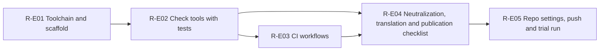

| ID | Task | depends on | owner | h | Status |
|---|---|---|---|---|---|
| **R-E01** | **Toolchain and scaffold** | - | | | |
| R-E01-T01 | V0: chain of rights to the employer verified | - | owner | 1 | done |
| R-E01-T02 | Product repo and ops repo created as private | - | owner | 1 | done |
| R-E01-T03 | Build repo, required and community files | R-E01-T01 | agent | 8 | done |
| R-E01-T04 | Python toolchain of the check tools and binary bootstrap | R-E01-T03 | agent | 8 | done |
| R-E01-T05 | TypeScript toolchain and package core as a placeholder | R-E01-T03 | agent | 10 | done |
| R-E01-T06 | Makefile with bootstrap, check and gates.toml | R-E01-T04, R-E01-T05 | agent | 6 | done |
| R-E01-T07 | toolchain.md: check licenses and terms of the tools at the source | R-E01-T05 | agent | 6 | done |
| R-E01-T08 | Layer check and package generator | R-E01-T06 | agent | 8 | done |
| **R-E02** | **Check tools with tests** | R-E01 | | | |
| R-E02-T01 | Text rules and link check | R-E02-T08 | agent | 10 | done |
| R-E02-T02 | Commit check with Conventional Commits and DCO | - | agent | 6 | done |
| R-E02-T03 | gitleaks with a rule for Anthropic credentials | - | agent | 4 | done |
| R-E02-T04 | Opengrep rules with rule tests | - | agent | 10 | done |
| R-E02-T05 | Workflow policy with actionlint and zizmor | - | agent | 12 | done |
| R-E02-T06 | License gate with SPDX headers, allowlist and ADR-39 counter-test | - | agent | 12 | done |
| R-E02-T07 | ScanCode via git archive with a policy | R-E02-T06 | agent | 6 | done |
| R-E02-T08 | Deny list scanner | R-E02-T02 | agent | 14 | done |
| R-E02-T10 | osv-scanner with PR diff mode | - | agent | 5 | done |
| R-E02-T11 | Review gate, pre-commit hooks and quality documentation | R-E02-T01, R-E02-T02, R-E02-T03, R-E02-T04, R-E02-T05, R-E02-T06, R-E02-T08, R-E02-T10 | agent | 8 | done |
| **R-E03** | **CI workflows** | R-E02 | | | |
| R-E03-T01 | ci.yml with the jobs ts, tools, security and ci-ok | - | agent | 10 | done |
| R-E03-T02 | Deny jobs in ci.yml and denylist-main.yml | R-E03-T01 | agent | 6 | done |
| R-E03-T03 | codeql.yml, scorecard.yml, advisories.yml | R-E03-T01 | agent | 5 | done |
| R-E03-T04 | renovate.json | R-E03-T01 | agent | 3 | done |
| R-E03-T05 | R4: workflow set locally against the policy and dry run | R-E03-T02, R-E03-T03, R-E03-T04 | agent | 4 | done |
| **R-E04** | **Neutralization, translation and publication checklist** | R-E03 | | | |
| R-E04-T01 | Publication manifest and export tool in the ops repo | - | agent | 10 | done |
| R-E04-T02 | Neutralize architecture: README and 01 to 06 | R-E04-T01, R-E04-T15 | agent | 12 | done |
| R-E04-T03 | Neutralize architecture: 07 to 12, backlog, research files | R-E04-T01, R-E04-T15 | agent | 14 | done |
| R-E04-T04 | Translate architecture, ADRs as MADR, DECISIONS.md | R-E04-T02, R-E04-T03 | agent | 16 | done |
| R-E04-T05 | Translate detailed design | R-E04-T01 | agent | 16 | done |
| R-E04-T06 | Translate plan, plan tool to tools/plan | R-E04-T01 | agent | 12 | done |
| R-E04-T07 | V1: placeholders and decisions | R-E04-T04, R-E04-T05, R-E04-T06 | agent | 2 | done |
| R-E04-T08 | V1: register search for the trademark Guildwork | - | owner | 2 | done |
| R-E04-T09 | V8: list of secrets to rotate | - | agent | 3 | done |
| R-E04-T10 | V8: rotate secrets | R-E04-T09 | owner | 2 | done |
| R-E04-T11 | Prepare the root commit (V5) | R-E04-T07, R-E04-T08, R-E04-T10, R-E04-T15 | agent | 4 | done |
| R-E04-T12 | Create the root commit with the allowed identity | R-E04-T11 | owner | 1 | open |
| R-E04-T13 | Verify V2 to V7 in a fresh clone of the root commit | R-E04-T12, R-E04-T16 | agent | 8 | open |
| R-E04-T14 | V9: Red Team over the whole state and go sheet for V10 | R-E04-T13 | agent | 4 | open |
| R-E04-T15 | Private deny list and allow-authors.txt in the ops repo | - | agent+owner | 4 | done |
| R-E04-T16 | Switch issues, labels, milestones and project to English | R-E04-T06, R-E02-T01 | agent | 6 | done |
| **R-E05** | **Repo settings, push and trial run** | - | | | |
| R-E05-T01 | Decision sheet for repo settings with open evidence | R-E04 | agent | 4 | open |
| R-E05-T02 | Create the organization to secure the API group | - | owner | 0.5 | done |
| R-E05-T03 | V10: environment denylist, push of the root commit, make public | R-E05-T01, R-E05-T02 | owner | 1 | open |
| R-E05-T04 | Verify the first runs on main | R-E05-T03 | agent | 3 | open |
| R-E05-T05 | Ruleset for main, SHA pinning, environment release | R-E05-T04 | owner | 1 | open |
| R-E05-T06 | Read back the settings and compare them with the target | R-E05-T05 | agent | 4 | open |
| R-E05-T07 | Decision sheet for the Renovate app | R-E04 | agent | 2 | open |
| R-E05-T08 | Install the Renovate app | R-E05-T07, R-E05-T05 | owner | 0.5 | open |
| R-E05-T09 | R9: trial PRs from the repo, from a fork and without sign-off | R-E05-T06, R-E05-T08 | agent+owner | 5 | open |
| R-E05-T10 | Measure waiting time and concurrency of the CI | R-E05-T09 | agent | 4 | open |
| R-E05-T11 | Stage report R with all done criteria | R-E05-T04, R-E05-T09, R-E05-T10 | agent+owner | 3 | open |

### Stage 0: Foundation and installability

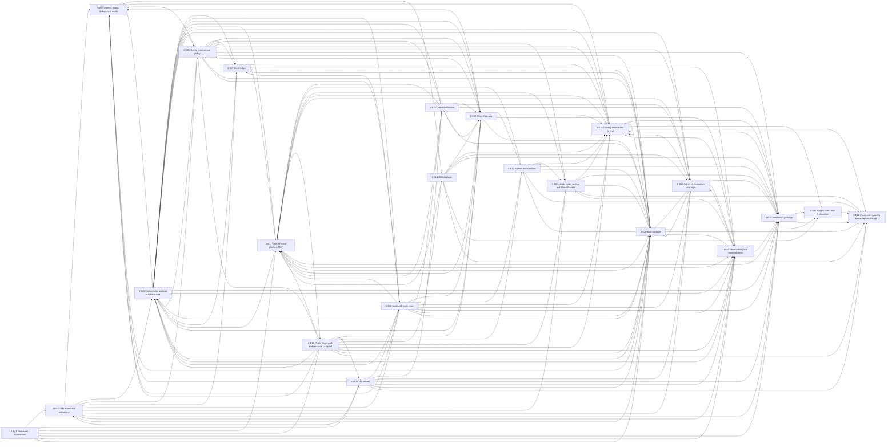

| ID | Task | depends on | owner | h | Status |
|---|---|---|---|---|---|
| **0-E01** | **Codebase foundations** | R-E01, R-E05 | | | |
| 0-E01-T01 | core: Result, AppError, problem+json, exit codes | - | agent | 6 | open |
| 0-E01-T02 | core: IDs (UUIDv7), slugs, hash, canonical JSON | 0-E01-T01, 0-E01-T03 | agent | 5 | open |
| 0-E01-T03 | core: Clock, timestamps, durations, Random, SecretValue | - | agent | 5 | open |
| 0-E01-T04 | core: logger with redaction | 0-E01-T01, 0-E01-T03 | agent | 10 | open |
| 0-E01-T05 | core: metrics and trace facade with catalog | 0-E01-T01 | agent | 5 | open |
| 0-E01-T06 | contracts: skeleton with schema factory and API version | 0-E01-T01 | agent | 5 | open |
| 0-E01-T07 | testkit: Postgres, fixtures, clock, logs, secrets, network lock | 0-E01-T03, 0-E01-T04, 0-E01-T06 | agent | 12 | open |
| 0-E01-T08 | config: installation configuration loader | 0-E01-T02, 0-E01-T04, 0-E01-T06, 0-E01-T07 | agent | 14 | open |
| 0-E01-T09 | config: publish schema and generate reference | 0-E01-T08 | agent | 4 | open |
| **0-E02** | **Data model and migrations** | 0-E01 | | | |
| 0-E02-T01 | Package @guildwork/db: connection and test Postgres | - | agent | 4 | open |
| 0-E02-T02 | Migrator: file format, checksum, lock, apply | 0-E02-T01 | agent | 10 | open |
| 0-E02-T03 | Gates of the migrator and schema check at start | 0-E02-T02, 0-E02-T08 | agent | 8 | open |
| 0-E02-T04 | Migration 0001: foundations, tenants, plugin instances, identities | 0-E02-T02 | agent | 6 | open |
| 0-E02-T05 | Migrations 0002 and 0003: intake and flow | 0-E02-T04 | agent | 10 | open |
| 0-E02-T06 | Migration 0004: effects, approvals, artifacts, policy decisions, findings | 0-E02-T05 | agent | 6 | open |
| 0-E02-T07 | Migration 0005: ledger and configuration | 0-E02-T06 | agent | 6 | open |
| 0-E02-T08 | Migrations 0006 and 0007: audit, merge gate, operations | 0-E02-T07 | agent | 8 | open |
| 0-E02-T09 | Tenant separation: row-level security, tenant context, secret scan of the tables | 0-E02-T08 | agent | 8 | open |
| 0-E02-T10 | Partition maintenance and deletion job for retention periods | 0-E02-T09, 0-E03-T02, 0-E03-T03 | agent | 10 | open |
| 0-E02-T11 | Kysely types, schema alignment test and repository scaffold | 0-E02-T09 | agent | 6 | open |
| 0-E02-T12 | Expand/contract: migration linter and probe N-1 against N | 0-E02-T03, 0-E02-T11 | agent | 6 | open |
| 0-E02-T13 | pg-boss foundation: pin the version, start in schema pgboss, send within the transaction | 0-E02-T02, 0-E02-T04 | agent | 6 | open |
| **0-E03** | **Core drivers** | 0-E01, 0-E13 | | | |
| 0-E03-T01 | Load drivers, capabilities via probe, health and contract suite skeleton | - | agent | 6 | open |
| 0-E03-T02 | BlobStore fs | 0-E03-T01 | agent | 6 | open |
| 0-E03-T03 | BlobStore s3 against SeaweedFS and Garage | 0-E03-T01 | agent | 12 | open |
| 0-E03-T04 | SecretStore file (encrypted, with versions) | 0-E03-T01 | agent | 8 | open |
| 0-E03-T05 | SecretStore env (read only) | 0-E03-T01 | agent | 3 | open |
| 0-E03-T06 | CloudIdentity self-issuer with key ring | 0-E03-T01, 0-E03-T04 | agent | 10 | open |
| 0-E03-T07 | Check: Object Lock and presigned URLs in SeaweedFS | 0-E03-T03 | agent | 3 | open |
| **0-E04** | **Ingress, inbox, dedupe and router** | 0-E02 | | | |
| 0-E04-T01 | Event schema, routing names, object and dedupe keys, JCS | - | agent | 6 | dropped |
| 0-E04-T02 | Ingress endpoint with signature verification before parsing | 0-E13, 0-E03-T02, 0-E08-T02 | agent | 8 | open |
| 0-E04-T03 | Inbox and dedupe via delivery ID and dedupeKey | 0-E04-T02 | agent | 6 | open |
| 0-E04-T04 | Ingress processing: parsing, normalizing, identities | 0-E04-T03 | agent | 6 | open |
| 0-E04-T05 | Router: filter stages, repo assignment, TOCTOU, route selection | 0-E04-T04, 0-E06-T05, 0-E09-T02 | agent | 10 | open |
| 0-E04-T06 | Permission check G0 with command_permissions | 0-E04-T05 | agent | 8 | open |
| 0-E04-T07 | Reconcile and poll into the same inbox | 0-E04-T04 | agent | 5 | open |
| 0-E04-T08 | Suite cases and metrics for ingress and router (S2, S6) | 0-E04-T06, 0-E04-T07, 0-E20-T29 | agent | 6 | open |
| **0-E05** | **Orchestrator and run state machine** | 0-E02 | | | |
| 0-E05-T01 | Run state machine as a file with schema, generator and completeness test | - | agent | 10 | open |
| 0-E05-T02 | Transition engine in one transaction | 0-E05-T01, 0-E05-T05, 0-E06-T02, 0-E08-T02, 0-E09-T02 | agent | 10 | open |
| 0-E05-T03 | Intake: run creation, object lock, delivery, follow-up job | 0-E05-T02, 0-E06-T07, 0-E06-T09, 0-E07-T02, 0-E04-T06, 0-E20-T29 | agent | 10 | open |
| 0-E05-T04 | Assign control commands to the matching run | 0-E05-T03, 0-E20-T29 | agent | 8 | open |
| 0-E05-T05 | Queues: definitions, schedules, dead letter, registration of the handlers | 0-E04-T04, 0-E04-T05, 0-E04-T07 | agent | 5 | open |
| 0-E05-T06 | Deadlines, sweeper, stop with lease revocation, budget_exhausted | 0-E05-T02, 0-E07-T04, 0-E11-T02 | agent | 8 | open |
| 0-E05-T07 | Status comment with compare-and-swap | 0-E05-T02 | agent | 8 | open |
| 0-E05-T08 | Lifting open runs on upgrade | 0-E05-T02 | agent | 6 | open |
| 0-E05-T09 | Pipelines, single-service runs, steps and work items | 0-E05-T03, 0-E11-T01, 0-E11-T02, 0-E13-T11 | agent | 10 | open |
| 0-E05-T10 | Roles web and orchestrator: start, readiness, shutdown | 0-E05-T05, 0-E02-T03, 0-E04-T02, 0-E19-T01 | agent | 6 | open |
| 0-E05-T11 | S6 cases per cell of the run state machine | 0-E05-T04, 0-E05-T06, 0-E05-T07, 0-E05-T09, 0-E20-T29 | agent | 12 | open |
| 0-E05-T12 | Check the DBOS license and the comparison with the own engine | - | agent | 3 | open |
| 0-E05-T13 | Alarm rules of the control plane | 0-E19-T04, 0-E05-T05, 0-E04-T06, 0-E07-T04 | agent | 4 | open |
| **0-E06** | **Config resolver and policy** | 0-E02 | | | |
| 0-E06-T01 | JSON Schemas installation, org, repo with x-qualification and x-merge | - | agent | 14 | open |
| 0-E06-T02 | Expression language for filter, required_if, auto_if, until, when | - | agent | 6 | open |
| 0-E06-T03 | Loader: read and check files at the base SHA | 0-E06-T01, 0-E06-T02, 0-E13-T03, 0-E13-T08, 0-E08-T01 | agent | 8 | open |
| 0-E06-T04 | Merging the hierarchy, tightening only, repo_overrides last | 0-E06-T03 | agent | 10 | open |
| 0-E06-T05 | Fail closed on an invalid config file (ADR-65) | 0-E06-T04, 0-E08-T02, 0-E20-T29 | agent | 6 | open |
| 0-E06-T06 | Consistency checks at load time | 0-E06-T04, 0-E20-T29 | agent | 12 | open |
| 0-E06-T07 | Snapshot and qualification_key | 0-E06-T04, 0-E20-T05 | agent | 6 | open |
| 0-E06-T08 | Policy engine: deny by default, command covers effect, decision log | 0-E06-T07, 0-E05-T01, 0-E09-T01, 0-E13-T11 | agent | 10 | open |
| 0-E06-T09 | Service mode with qualification check | 0-E06-T08, 0-E20-T17, 0-E20-T29 | agent | 6 | open |
| 0-E06-T10 | Service for repo_overrides | 0-E06-T04 | agent | 4 | open |
| **0-E07** | **Limit ledger** | 0-E02 | | | |
| 0-E07-T01 | Key chain and buckets from the snapshot | 0-E06-T01 | agent | 6 | open |
| 0-E07-T02 | Reservation atomically over all keys | 0-E07-T01, 0-E07-T05 | agent | 10 | open |
| 0-E07-T03 | Consumption during the run: book heartbeat and relay, abort | 0-E07-T02, 0-E05-T02 | agent | 8 | open |
| 0-E07-T04 | Settlement and release after the run | 0-E07-T03, 0-E08-T02 | agent | 8 | open |
| 0-E07-T05 | Time windows: hour, day, month, rolling 5 hours | 0-E07-T01 | agent | 6 | open |
| 0-E07-T06 | Suite S3: hard abort at every layer | 0-E07-T04, 0-E05-T04, 0-E05-T06, 0-E20-T29 | agent | 8 | open |
| **0-E08** | **Audit with hash chain** | 0-E02, 0-E03 | | | |
| 0-E08-T01 | Redaction rules and Markdown sanitization | - | agent | 6 | open |
| 0-E08-T02 | Audit writer with hash chain | 0-E08-T01 | agent | 10 | open |
| 0-E08-T03 | Check tool audit-verify | 0-E08-T02, 0-E05-T10 | agent | 6 | open |
| 0-E08-T04 | Daily anchor with sink blob (Object Lock) and check functions for doctor | 0-E08-T03, 0-E03-T03, 0-E05-T05 | agent | 8 | open |
| 0-E08-T05 | Secret scan helper over DB, envelopes, snapshots, logs and BlobStore | 0-E08-T01 | agent | 5 | open |
| **0-E09** | **Effect Gateway** | 0-E08-T01, 0-E08-T02, 0-E08-T05, 0-E13 | | | |
| 0-E09-T01 | Effect catalog and write request schema | - | agent | 5 | open |
| 0-E09-T02 | Acceptance of write requests: policy, content check, idempotency, audit | 0-E09-T01, 0-E08-T01, 0-E08-T02, 0-E10-T05, 0-E06 | agent | 12 | open |
| 0-E09-T03 | Modes record and shadow with storage and test helper | 0-E09-T02 | agent | 5 | open |
| 0-E09-T04 | Outbox dispatcher with retry, ordering and reconciliation after crash | 0-E09-T02, 0-E10-T03, 0-E05-T02, 0-E05-T05 | agent | 10 | open |
| 0-E09-T05 | Executors comment, status_comment, check and lint rule only write path | 0-E09-T04, 0-E14-T08, 0-E14-T14, 0-E05-T07 | agent | 10 | open |
| 0-E09-T06 | Platform effect audit_anchor: daily anchor via SCMProvider | 0-E09-T04, 0-E08-T04 | agent | 10 | open |
| 0-E09-T07 | Executor ack | 0-E09-T04, 0-E14-T04 | agent | 4 | open |
| 0-E09-T08 | Executor push with push check | 0-E09-T04, 0-E14-T09 | agent | 8 | open |
| 0-E09-T09 | Executor change with bundle and draft PR | 0-E09-T08, 0-E14-T08 | agent | 6 | open |
| 0-E09-T10 | Guard test effect catalog: executor per type, stage before every use | 0-E09-T01 | agent | 4 | open |
| **0-E10** | **Credential Broker** | 0-E03, 0-E06 | | | |
| 0-E10-T01 | Broker core: secrets with audit and PluginContext.secrets | 0-E08-T02 | agent | 8 | open |
| 0-E10-T02 | OIDC endpoints and rotation job | 0-E10-T01, 0-E05-T10, 0-E05-T05 | agent | 6 | open |
| 0-E10-T03 | SCM tokens per effect and per clone | 0-E10-T01, 0-E09-T01, 0-E08-T05 | agent | 8 | open |
| 0-E10-T04 | Issue and verify item token | 0-E10-T01 | agent | 5 | open |
| 0-E10-T05 | LLM grants per item and bundle for the claim | 0-E10-T03, 0-E10-T04, 0-E11-T01 | agent | 6 | open |
| 0-E10-T06 | Create, verify, revoke pool keys | 0-E10-T01 | agent | 5 | open |
| **0-E11** | **Work API and platform MCP** | - | | | |
| 0-E11-T01 | Envelope, result, errors and grants as schemas | 0-E13-T03, 0-E01 | agent | 5 | open |
| 0-E11-T02 | WorkItemService: enqueue, revoke, step events, blocked check | 0-E11-T01, 0-E05-T02, 0-E05-T05, 0-E10 | agent | 8 | open |
| 0-E11-T03 | Claim with long poll, capability matching, version N-1, drain and grants | 0-E11-T02, 0-E10-T05, 0-E10-T06 | agent | 12 | open |
| 0-E11-T04 | Lease: heartbeat, extension, expiry, revocation, usage to the ledger | 0-E11-T03, 0-E07-T03 | agent | 10 | open |
| 0-E11-T05 | complete, fail and artifact upload with rescan | 0-E11-T04, 0-E08-T01, 0-E08-T02 | agent | 10 | open |
| 0-E11-T06 | Platform MCP: server, item token verification, run.context and propose_* | 0-E11-T03, 0-E09-T02, 0-E10-T04 | agent | 10 | open |
| 0-E11-T07 | MCP read tools for repo, change and ticket | 0-E11-T06, 0-E14-T06, 0-E14-T07, 0-E14-T10 | agent | 8 | open |
| **0-E12** | **Worker and sandbox** | 0-E11, 0-E13 | | | |
| 0-E12-T01 | Worker skeleton: configuration, Work API client, claim loop | - | agent | 8 | open |
| 0-E12-T02 | Socket proxy with allowlist and body check | 0-E12-T01 | agent | 12 | open |
| 0-E12-T03 | ExecutionBackend docker-sysbox and docker-gvisor with contract suite | 0-E12-T02 | agent | 16 | open |
| 0-E12-T04 | Egress proxy: CONNECT with allowlist per item, binding, control API, air gap | 0-E12-T01 | agent | 12 | open |
| 0-E12-T05 | Credential relay in the egress proxy | 0-E12-T04 | agent | 12 | open |
| 0-E12-T06 | Sandbox without DNS: minimum Docker version, resolv.conf, S1 case | 0-E12-T03, 0-E12-T04, 0-E20-T29 | agent | 5 | open |
| 0-E12-T07 | Verified capabilities (WorkerCaps.verified) | 0-E12-T03, 0-E12-T04, 0-E12-T08 | agent | 8 | open |
| 0-E12-T08 | Harness environment from allowlist and start path subscription (worker side) | 0-E12-T01, 0-E08-T05, 0-E12-T03 | agent | 6 | open |
| 0-E12-T09 | Lifecycle of an item in the worker with destroy in the failure path | 0-E12-T03, 0-E12-T05, 0-E12-T07, 0-E12-T08, 0-E09-T03 | agent | 14 | open |
| 0-E12-T10 | Separation on single-host: check functions and S6 case | 0-E12-T02, 0-E12-T03, 0-E12-T04, 0-E20-T29 | agent | 8 | open |
| 0-E12-T11 | Contract test: rootless daemon with Sysbox or gVisor | 0-E12-T03 | agent | 4 | open |
| **0-E13** | **Plugin framework and contracts v1alpha1** | 0-E01 | | | |
| 0-E13-T01 | Package contracts: base types, Untrusted and API snapshot | 0-E01 | agent | 8 | open |
| 0-E13-T02 | Event schema, command parser, dedupe and routing keys | 0-E13-T01, 0-E01-T02 | agent | 6 | open |
| 0-E13-T03 | Contracts of the five plugin kinds and capability catalogs | 0-E13-T01, 0-E13-T02 | agent | 8 | open |
| 0-E13-T04 | Driver contracts and sketches | 0-E13-T03 | agent | 4 | open |
| 0-E13-T05 | Manifest schema and validation | 0-E13-T01, 0-E13-T03 | agent | 6 | open |
| 0-E13-T06 | Loader: registry, load conditions, instance states | 0-E13-T05, 0-E13-T07, 0-E13-T09 | agent | 12 | open |
| 0-E13-T07 | Contract harness: cassettes, replay, recording without external effect, attestation | 0-E13-T01, 0-E13-T05 | agent | 12 | open |
| 0-E13-T08 | Abstract contract suites per kind with reference fakes | 0-E13-T03, 0-E13-T04, 0-E13-T07 | agent | 12 | open |
| 0-E13-T09 | Capability resolver, fallback level log and retry model | 0-E13-T03 | agent | 8 | open |
| 0-E13-T10 | In-process transport with timeout, error encapsulation and write guard | 0-E13-T06, 0-E13-T04 | agent | 6 | open |
| 0-E13-T11 | Package sdk-service: service definition and controller contract (types only) | 0-E13-T03, 0-E11-T01, 0-E01, 0-E13-T05 | agent | 4 | open |
| **0-E14** | **GitHub plugin** | 0-E13, 0-E04 | | | |
| 0-E14-T01 | Check task: back GitHub API facts with the primary docs | - | agent | 4 | open |
| 0-E14-T02 | GitHub client: REST, GraphQL, error mapping, pagination, rate limit | 0-E13-T07, 0-E13-T09, 0-E14-T01 | agent | 8 | open |
| 0-E14-T03 | Manifests github and github-issues, configuration schema, init, health, capabilities | 0-E13-T05, 0-E13-T06, 0-E14-T02 | agent | 4 | open |
| 0-E14-T04 | TriggerSource: verify, parse, isSelf, ack | 0-E13-T02, 0-E13-T08, 0-E14-T03 | agent | 12 | open |
| 0-E14-T05 | reconcile and poll | 0-E14-T04, 0-E14-T06 | agent | 8 | open |
| 0-E14-T06 | Auth: app JWT, mintToken per permission profile, cloneSpec | 0-E14-T03 | agent | 8 | open |
| 0-E14-T07 | SCM read: file, compare, permissions, CODEOWNERS, change, threads, merge status, checks, repo info, CI logs | 0-E14-T02, 0-E14-T03, 0-E14-T06 | agent | 14 | open |
| 0-E14-T08 | SCM write: summary, review with fallback chain, threads, checks, change, reviewers, labels | 0-E14-T06, 0-E14-T07 | agent | 14 | open |
| 0-E14-T09 | push via Git bundle without force | 0-E14-T06, 0-E13-T03 | agent | 8 | open |
| 0-E14-T10 | github-issues read | 0-E14-T02, 0-E14-T03 | agent | 6 | open |
| 0-E14-T11 | GitHub App via manifest flow: build, state, code exchange, storage in the SecretStore | 0-E14-T06, 0-E13-T04 | agent | 8 | open |
| 0-E14-T12 | Owner: test account, test repo and test app for recordings | 0-E14-T11 | owner | 2 | open |
| 0-E14-T13 | Real recording of the GitHub fixtures and contract suite green with attestation | 0-E14-T12, 0-E14-T04, 0-E14-T05, 0-E14-T07, 0-E14-T08, 0-E14-T09, 0-E14-T10, 0-E14-T14 | agent+owner | 8 | open |
| 0-E14-T14 | github-issues write: addComment and updateComment | 0-E14-T06, 0-E14-T10 | agent | 4 | open |
| **0-E15** | **claude-code runtime and ModelProvider** | 0-E13, 0-E12 | | | |
| 0-E15-T01 | Check spike: back Claude Code facts and flag combination with evidence | - | agent+owner | 6 | open |
| 0-E15-T02 | Harness installation at the operator with pin, checksum and cache | 0-E15-T01, 0-E13-T03, 0-E12-T03, 0-E12-T08, 0-E06-T05, 0-E06-T06 | agent | 8 | open |
| 0-E15-T03 | Start path builder: argv, environment from allowlist, managed settings, MCP configuration, config directory, prompt | 0-E15-T01, 0-E13-T03, 0-E12-T08, 0-E19-T01 | agent | 10 | open |
| 0-E15-T04 | Run: spawn, NDJSON parser, result, schema check, budget, abort, OTel | 0-E15-T03, 0-E13-T08, 0-E13-T06, 0-E12-T03 | agent | 12 | open |
| 0-E15-T05 | Start path subscription: constraints in the run, token expiry, cost source | 0-E15-T04 | agent | 6 | open |
| 0-E15-T06 | Contract suite AgentRuntime offline with fake-claude and attestation | 0-E15-T04, 0-E15-T05 | agent | 4 | open |
| 0-E15-T07 | Contract test 'start with subscription' against the real CLI with secret scan | 0-E15-T05, 0-E15-T06, 0-E11, 0-E02, 0-E12 | agent+owner | 6 | open |
| 0-E15-T08 | ModelProvider anthropic-api on the Vercel AI SDK | 0-E13-T08, 0-E13-T06 | agent | 10 | open |
| 0-E15-T09 | ModelProvider claude-cli | 0-E15-T03, 0-E15-T04, 0-E15-T05 | agent | 8 | open |
| 0-E15-T10 | Resolver rule: reachability of the ModelProviders | 0-E06-T05, 0-E06-T06, 0-E13-T06 | agent | 4 | open |
| 0-E15-T11 | Cassettes for anthropic-api from the public docs, suite and attestation | 0-E15-T08, 0-E12-T05 | agent | 4 | open |
| **0-E16** | **Dummy service end to end** | 0-E09, 0-E12, 0-E14, 0-E15, 0-E07 | | | |
| 0-E16-T01 | Dummy manifest, route and controller | 0-E13, 0-E05, 0-E06 | agent | 6 | open |
| 0-E16-T02 | Sandbox job of the dummy | 0-E16-T01, 0-E11-T06, 0-E11-T07 | agent | 6 | open |
| 0-E16-T03 | E2E test setup for the chain | 0-E12, 0-E14, R-E03-T01, 0-E18-T01 | agent | 10 | open |
| 0-E16-T04 | E2E happy path: comment to effect record | 0-E16-T02, 0-E16-T03, 0-E09, 0-E08-T03, 0-E19-T01 | agent | 8 | open |
| 0-E16-T05 | E2E failure paths: lease expiry, dedupe, effect idempotency | 0-E16-T04, 0-E04, 0-E11 | agent | 8 | open |
| 0-E16-T06 | E2E failure paths: limit abort, reservation, sandbox teardown, stop | 0-E16-T04, 0-E07, 0-E05 | agent | 8 | open |
| 0-E16-T07 | Harness mode of the dummy against a fake LLM upstream | 0-E16-T04, 0-E15-T02, 0-E15-T04 | agent | 8 | open |
| 0-E16-T08 | Probe run of the setup wizard with the dummy | 0-E16-T04, 0-E17-T05, 0-E17-T07 | agent | 8 | open |
| **0-E17** | **Admin UI foundation and login** | 0-E02, 0-E06 | | | |
| 0-E17-T01 | Admin API skeleton in the role web | 0-E02-T11, 0-E08-T02, 0-E05-T10 | agent | 8 | open |
| 0-E17-T02 | Generic OIDC login | 0-E17-T01, 0-E03-T04, 0-E03-T05, 0-E03-T06, 0-E06, 0-E10-T01 | agent | 10 | open |
| 0-E17-T03 | Emergency admin with one-time code and TOTP | 0-E17-T01, 0-E19-T04, 0-E03-T04, 0-E03-T05 | agent | 12 | open |
| 0-E17-T04 | Admin UI SPA skeleton | 0-E17-T02, 0-E17-T03 | agent | 10 | open |
| 0-E17-T05 | Setup wizard: state, overlay, steps 1 and 2 | 0-E17-T04, 0-E06 | agent | 10 | open |
| 0-E17-T06 | Setup step 3: GitHub App via manifest flow | 0-E17-T05, 0-E14-T11, 0-E03-T04 | agent | 10 | open |
| 0-E17-T07 | Setup steps 4 and 5: model access and first pool | 0-E17-T05, 0-E11-T03 | agent | 8 | open |
| 0-E17-T08 | Status page with version age and audit anchor | 0-E17-T05, 0-E08-T04 | agent | 8 | open |
| 0-E17-T09 | Pages pools, services and audit | 0-E17-T04, 0-E11-T03, 0-E08-T04, 0-E20-T17 | agent | 8 | open |
| **0-E18** | **Installation package** | 0-E12, 0-E14, 0-E17 | | | |
| 0-E18-T01 | Images control-plane and sandbox-base, multi-architecture build | R-E03, 0-E01 | agent | 10 | open |
| 0-E18-T02 | Images agent-worker and egress-proxy | 0-E18-T01, 0-E12 | agent | 6 | open |
| 0-E18-T03 | Compose bundle: services, networks, volumes, healthchecks | 0-E18-T02, 0-E19-T03, 0-E12 | agent | 12 | open |
| 0-E18-T04 | Compose profiles s3, pitr, observability | 0-E18-T03, 0-E03-T03, 0-E03-T07 | agent | 10 | open |
| 0-E18-T05 | CLI skeleton: SEA binary, options, output, bundle check | 0-E01, R-E03 | agent | 10 | open |
| 0-E18-T06 | Command guildwork install | 0-E18-T05, 0-E18-T03, 0-E17-T03, 0-E18-T07 | agent | 12 | open |
| 0-E18-T07 | doctor: framework and basic checks D01 to D10, D30, D31 | 0-E18-T05, 0-E03, 0-E02-T03, 0-E10-T02 | agent | 10 | open |
| 0-E18-T08 | doctor: isolation, separation, DNS, air gap, egress, clock, public URL | 0-E18-T07, 0-E18-T03, 0-E12 | agent | 12 | open |
| 0-E18-T09 | doctor: operations checks D18 to D29 | 0-E18-T07, 0-E08-T04, 0-E15-T02, 0-E11-T03, 0-E05-T08, 0-E18-T10, 0-E18-T16 | agent | 10 | open |
| 0-E18-T10 | guildwork backup and role ops | 0-E18-T03, 0-E08-T02, 0-E19-T07, 0-E03, 0-E18-T05 | agent | 12 | open |
| 0-E18-T11 | guildwork restore and automatic restore test | 0-E18-T10, 0-E08-T03 | agent | 12 | open |
| 0-E18-T12 | guildwork upgrade, migrate locks and way back | 0-E18-T10, 0-E18-T06, 0-E02, 0-E05-T08, 0-E05-T10, 0-E11-T04 | agent | 12 | open |
| 0-E18-T13 | guildwork worker register and worker package | 0-E18-T06, 0-E11-T03 | agent | 10 | open |
| 0-E18-T14 | guildwork github-app create | 0-E18-T05, 0-E14-T11, 0-E03-T04 | agent | 8 | open |
| 0-E18-T15 | Commands admin break-glass, admin login, admin session, config validate, version | 0-E18-T05, 0-E17-T03, 0-E17-T02, 0-E06-T03 | agent | 4 | open |
| 0-E18-T16 | Telemetry off, preview and update hint | 0-E18-T03, 0-E06 | agent | 8 | open |
| 0-E18-T17 | Air gap mode in the bundle | 0-E18-T06, 0-E18-T16, 0-E12, 0-E16-T04, 0-E16-T07 | agent | 10 | open |
| 0-E18-T18 | Prepare the host: host-prepare.sh | 0-E18-T08 | agent | 6 | open |
| 0-E18-T19 | Measure and set minimum values | 0-E18-T08, 0-E16-T04 | agent | 4 | open |
| 0-E18-T20 | Operator docs installation and Hetzner via Compose | 0-E18-T06, 0-E18-T12, 0-E18-T11, 0-E18-T18 | agent | 6 | open |
| 0-E18-T21 | Owner: decision on the receiver of product telemetry | 0-E18-T16 | owner | 1 | open |
| **0-E19** | **Observability and required alerts** | 0-E01 | | | |
| 0-E19-T01 | telemetry: SDK start per role and harness environment | - | agent | 10 | open |
| 0-E19-T02 | telemetry: instruments from the catalog and cardinality protection | 0-E19-T01 | agent | 5 | open |
| 0-E19-T03 | Collector configuration and Compose fragment | 0-E19-T01 | agent | 8 | open |
| 0-E19-T04 | Alert state machine: rules, state, evaluation, meta alert | 0-E19-T02, 0-E02-T11, 0-E02-T13, 0-E05-T05, 0-E05-T10 | agent | 12 | open |
| 0-E19-T05 | Alert sinks log, webhook, notifier | 0-E19-T04, 0-E03-T04, 0-E03-T05, 0-E09-T02 | agent | 7 | open |
| 0-E19-T06 | Alert rules from queue, leases, provider errors and budget | 0-E19-T04, 0-E07-T04, 0-E11-T04 | agent | 8 | open |
| 0-E19-T07 | Alert rules for audit chain, emergency admin and backup | 0-E19-T04, 0-E08-T04, 0-E17-T03 | agent | 7 | open |
| 0-E19-T08 | Health query and alert rules for webhooks, tokens, drivers, worker version | 0-E19-T04, 0-E03-T01, 0-E11-T03, 0-E13 | agent | 9 | open |
| 0-E19-T09 | Alert API and display in the admin UI | 0-E19-T04, 0-E19-T07, 0-E17-T01, 0-E17-T03, 0-E17-T04, 0-E08-T02, 0-E19-T05 | agent | 8 | open |
| 0-E19-T10 | Alert rules from database signals and app_too_old | 0-E19-T04, 0-E19-T05, 0-E02-T03, 0-E02-T10 | agent | 6 | open |
| **0-E20** | **Eval package** | 0-E02 | | | |
| 0-E20-T01 | Package skeleton and schemas for set, case, labels and references | 0-E01 | agent | 8 | open |
| 0-E20-T02 | Statistics core: metrics, random numbers, quantile, cluster bootstrap | 0-E20-T01 | agent | 12 | open |
| 0-E20-T03 | Decision rules: non-inferiority, minimum power, sample size, upper bound at zero errors | 0-E20-T02 | agent | 10 | open |
| 0-E20-T04 | Gate definitions as data and gate evaluation | 0-E20-T03 | agent | 10 | open |
| 0-E20-T05 | Qualification profile and qualification_key | 0-E01-T02, 0-E01-T08 | agent | 8 | open |
| 0-E20-T06 | Eval tables: migration and repositories | 0-E02-T11 | agent | 8 | open |
| 0-E20-T07 | Admission per case: origin lock, license rule, data path (ADR-70) | 0-E20-T01, 0-E20-T06, 0-E06, 0-E08-T02, 0-E13-T03, 0-E13-T08 | agent | 10 | open |
| 0-E20-T08 | Eval run: automaton, platform runs in record mode, repetitions, budget, ledger | 0-E20-T05, 0-E20-T07, 0-E05, 0-E07, 0-E09-T03, 0-E16-T01, 0-E20-T28 | agent | 14 | open |
| 0-E20-T09 | Eval API with permissions | 0-E20-T08, 0-E17, 0-E20-T17 | agent | 8 | open |
| 0-E20-T10 | Fetcher with pin and checksum, cache, check tool against foreign data in the repo | 0-E20-T01 | agent | 8 | open |
| 0-E20-T11 | Adapter ReviewBench | 0-E20-T01, 0-E20-T27, 0-E13, 0-E09-T01, 0-E20-T28 | agent | 12 | open |
| 0-E20-T12 | Set R2 (Martian offline): pin, scoring per scored judge, reference per judge | 0-E20-T04, 0-E20-T10, 0-E20-T11, 0-E20-T16 | agent | 12 | open |
| 0-E20-T13 | Set R4 (ReviewBench): pin, leaderboard judge, three runs, leave-producer-out | 0-E20-T04, 0-E20-T10, 0-E20-T11, 0-E20-T16 | agent | 10 | open |
| 0-E20-T14 | Set R5 (SWE-PRBench, AACR-Bench): pins and recall against human feedback | 0-E20-T04, 0-E20-T10, 0-E20-T11, 0-E20-T16 | agent | 10 | open |
| 0-E20-T15 | Adapter Harbor with locked protocol | 0-E20-T01, 0-E20-T08, 0-E20-T27, 0-E12, 0-E16, 0-E20-T16 | agent | 12 | open |
| 0-E20-T16 | Judges: own and benchmark judges, multiple judges, calibration, outage | 0-E20-T02, 0-E20-T08, 0-E13, 0-E15, 0-E19-T04 | agent | 12 | open |
| 0-E20-T17 | Qualification matrix, validity and mode decision shadow and live | 0-E20-T04, 0-E20-T05, 0-E20-T06, 0-E08-T02 | agent | 12 | open |
| 0-E20-T18 | Export reference qualification | 0-E20-T17, 0-E20-T19, 0-E20-T09 | agent | 8 | open |
| 0-E20-T19 | Eval report: format, storage, publication filter | 0-E20-T04, 0-E20-T06, 0-E20-T05 | agent | 8 | open |
| 0-E20-T20 | Adoption of the reference qualification, remeasurement in shadow, online expiry | 0-E20-T09, 0-E20-T17, 0-E20-T18 | agent | 12 | open |
| 0-E20-T21 | Framework of the cross-cutting suites S1 to S8: lint, run, report | 0-E20-T29, 0-E20-T09, 0-E16-T03 | agent | 8 | open |
| 0-E20-T22 | Probes of the suites: effects, egress, secret scan, ledger, audit | 0-E20-T21, 0-E07-T04, 0-E08-T02, 0-E08-T05, 0-E09-T03, 0-E12-T04 | agent | 12 | open |
| 0-E20-T23 | End to end: eval run with dummy service and S2 cases on the data path | 0-E20-T08, 0-E20-T09, 0-E20-T11, 0-E20-T19, 0-E20-T21, 0-E20-T22, 0-E16, 0-E20-T12, 0-E20-T17 | agent | 10 | open |
| 0-E20-T24 | Label tool and case selection R1 | 0-E20-T01, 0-E20-T10 | agent | 10 | open |
| 0-E20-T25 | First labeling round R1 (human labels) | 0-E20-T24 | agent+owner | 16 | open |
| 0-E20-T26 | Decision sheet: account for eval, reference qualification and dogfooding | - | agent+owner | 3 | dropped |
| 0-E20-T27 | Read and verify unverified statements about benchmarks at the pinned state | - | agent | 6 | open |
| 0-E20-T28 | Fixture provider eval-fixture for case runs (SCMProvider and WorkItemReader from the BlobStore) | 0-E20-T01, 0-E13-T06, 0-E13-T08, 0-E03-T01, 0-E11-T05, 0-E12-T09, 0-E10-T02 | agent | 10 | open |
| 0-E20-T29 | Case contribution of the cross-cutting suites S1 to S8: defineSuiteCase and catalog | 0-E20-T01 | agent | 6 | open |
| **0-E21** | **Supply chain and first release** | 0-E18 | | | |
| 0-E21-T01 | Release manifest, bundle and checksums | 0-E18-T05, 0-E18-T03 | agent | 8 | open |
| 0-E21-T02 | Image license gate with counter-test | 0-E18-T02, R-E02-T06 | agent | 8 | open |
| 0-E21-T03 | Release workflow: digest, Trivy, SBOM, signature, attestation, tag | 0-E21-T01, 0-E21-T02, R-E05-T05, 0-E21-T05, 0-E20-T18, 0-E20-T21 | agent | 12 | open |
| 0-E21-T04 | Signature and digest check in install, upgrade, doctor | 0-E21-T01, 0-E18-T06 | agent | 6 | open |
| 0-E21-T05 | Portability test: fresh runner, installation, doctor, smoke | 0-E21-T01, 0-E21-T07, 0-E18-T18, 0-E18-T20, 0-E16-T04 | agent | 10 | open |
| 0-E21-T06 | Portability test: upgrade N-1 to N with data, backup and restore | 0-E21-T05, 0-E18-T12, 0-E18-T11 | agent | 10 | open |
| 0-E21-T07 | Fixture server as a container for smoke and air gap | 0-E16-T03, 0-E14 | agent | 6 | open |
| 0-E21-T08 | Air gap and telemetry cases in CI | 0-E21-T05, 0-E18-T17, 0-E18-T16 | agent | 8 | open |
| 0-E21-T09 | First signed release | 0-E21-T03, 0-E21-T04, 0-E21-T06, 0-E21-T08, 0-E21-T10, 0-E21-T11 | agent+owner | 4 | open |
| 0-E21-T10 | Owner: clarify that the container registry is public and free of charge | 0-E18-T01 | owner | 1 | open |
| 0-E21-T11 | Check the licenses of the bundle components | 0-E18-T04, R-E02-T06 | agent | 4 | open |
| **0-E22** | **Cross-cutting suites and acceptance stage 0** | 0-E16, 0-E21 | | | |
| 0-E22-T01 | Stage 0 cases in the suite framework S1 to S8 | 0-E20-T21 | agent | 8 | open |
| 0-E22-T02 | Acceptance matrix stage 0 | 0-E22-T01 | agent | 8 | open |
| 0-E22-T03 | S6 single-host: worker and sandbox do not reach secrets, Postgres and Docker socket | 0-E22-T01, 0-E18-T08, 0-E12 | agent | 10 | open |
| 0-E22-T04 | S8 stage 0 complete | 0-E22-T01, 0-E21-T06, 0-E21-T08, 0-E03 | agent | 8 | open |
| 0-E22-T05 | Collective run of the contract suites of stage 0 | 0-E22-T02, 0-E13, 0-E14, 0-E15, 0-E03 | agent | 4 | open |
| 0-E22-T06 | PITR or restore verified once | 0-E22-T01, 0-E18-T04, 0-E21-T06 | agent | 6 | open |
| 0-E22-T07 | Stage report stage 0 | 0-E22-T02, 0-E22-T03, 0-E22-T04, 0-E22-T05, 0-E22-T06, 0-E21-T09 | agent | 6 | open |

### Stage 0b: Bases: azure and OpenTofu

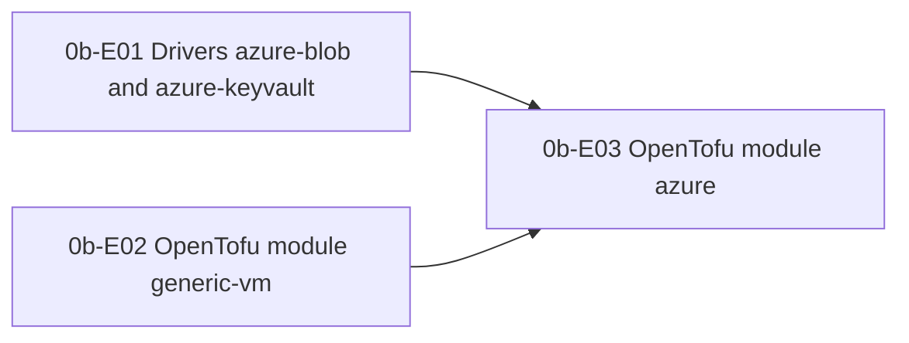

| ID | Task | depends on | owner | h | Status |
|---|---|---|---|---|---|
| **0b-E01** | **Drivers azure-blob and azure-keyvault** | 0-E03 | | | |
| 0b-E01-T01 | Check of Azurite and user delegation SAS | 0-E03 | agent | 4 | open |
| 0b-E01-T02 | Recording and replay for Azure SDK clients | 0-E13 | agent | 6 | open |
| 0b-E01-T03 | Driver azure-blob | 0b-E01-T01, 0b-E01-T02, 0-E03, 0-E13 | agent | 12 | open |
| 0b-E01-T04 | Driver azure-keyvault | 0b-E01-T02, 0-E03, 0-E13 | agent | 10 | open |
| 0b-E01-T05 | Owner: recording against real Azure | 0b-E01-T03, 0b-E01-T04 | owner | 2 | open |
| 0b-E01-T06 | Azure drivers in installation configuration and doctor | 0b-E01-T03, 0b-E01-T04, 0-E18 | agent | 4 | open |
| **0b-E02** | **OpenTofu module generic-vm** | 0-E18 | | | |
| 0b-E02-T01 | Module generic-vm: scaffold, variables, outputs, pins, state encryption | 0-E18 | agent | 6 | open |
| 0b-E02-T02 | generic-vm: cloud-init and SSH mode | 0b-E02-T01, 0-E18-T18, 0-E21-T01 | agent | 8 | open |
| 0b-E02-T03 | CI workflow tofu for generic-vm | 0b-E02-T02, R-E03 | agent | 4 | open |
| 0b-E02-T04 | generic-vm real apply in SSH mode on the runner | 0b-E02-T03, 0-E21-T05 | agent | 8 | open |
| 0b-E02-T05 | Guide Hetzner via Compose with generic-vm | 0b-E02-T02, 0-E18-T20 | agent | 3 | open |
| **0b-E03** | **OpenTofu module azure** | 0b-E01, 0-E18 | | | |
| 0b-E03-T01 | Module azure: network, NSG, control plane VM, identity | 0b-E02-T02 | agent | 10 | open |
| 0b-E03-T02 | Module azure: Flexible Server with vector | 0b-E03-T01, 0b-E03-T03 | agent | 8 | open |
| 0b-E03-T03 | Module azure: storage, Key Vault, roles | 0b-E03-T01, 0b-E01-T03, 0b-E01-T04 | agent | 8 | open |
| 0b-E03-T04 | Module azure: worker VM pool | 0b-E03-T01 | agent | 8 | open |
| 0b-E03-T05 | azure: validate, test and plan with fakes in CI | 0b-E03-T02, 0b-E03-T03, 0b-E03-T04, 0b-E02-T03 | agent | 6 | open |
| 0b-E03-T06 | Workflow azure-apply with apply, smoke, destroy | 0b-E03-T05, 0-E21-T05 | agent | 8 | open |
| 0b-E03-T07 | Owner: set up Azure account and environment azure-apply | 0b-E03-T06 | owner | 2 | open |
| 0b-E03-T08 | Owner: real apply with destroy | 0b-E03-T07, 0b-E03-T09, 0-E21-T09 | owner | 3 | open |
| 0b-E03-T09 | Check of nested virtualization and Container Apps | 0b-E03-T04 | agent | 3 | open |

### Stage 1: Reviewer core, GitHub, local Claude Code

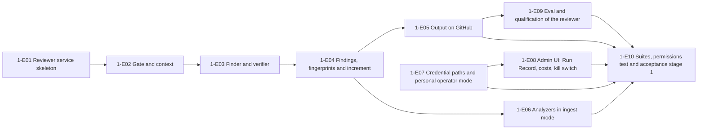

| ID | Task | depends on | owner | h | Status |
|---|---|---|---|---|---|
| **1-E01** | **Reviewer service skeleton** | 0-E16 | | | |
| 1-E01-T01 | Package scaffold, manifest and schemas | - | agent | 8 | open |
| 1-E01-T02 | Controller and step plan as a single-service run | 1-E01-T01 | agent | 12 | open |
| 1-E01-T03 | State per PR: review_pr_state | 1-E01-T01 | agent | 6 | open |
| 1-E01-T04 | Inputs and commands | 1-E01-T02, 1-E01-T03 | agent | 10 | open |
| 1-E01-T05 | Prompt storage, loader and lock | 1-E01-T01 | agent | 6 | open |
| 1-E01-T06 | Profile contribution to the qualification profile | 1-E01-T02, 1-E01-T05 | agent | 6 | open |
| **1-E02** | **Gate and context** | 1-E01 | | | |
| 1-E02-T01 | Deterministic gate rules G1 to G9 | 1-E01-T04 | agent | 8 | open |
| 1-E02-T02 | Reservation and budget split per step | 1-E02-T01 | agent | 6 | open |
| 1-E02-T03 | Context tool: diff, hunks, generated files | 1-E01-T02, 0-E18-T01 | agent | 12 | open |
| 1-E02-T04 | Neighborhood and callers via tree-sitter | 1-E02-T03 | agent | 12 | open |
| 1-E02-T05 | Guidelines loader stage 1 | 1-E02-T03 | agent | 8 | open |
| 1-E02-T06 | Ticket and CI context | 1-E01-T02 | agent | 6 | open |
| 1-E02-T07 | Prepare job with gate model | 1-E02-T03, 1-E02-T04, 1-E02-T05, 1-E02-T06 | agent | 10 | open |
| 1-E02-T08 | Router and context package with token budget | 1-E02-T07 | agent | 10 | open |
| **1-E03** | **Finder and verifier** | 1-E02 | | | |
| 1-E03-T01 | Finder framework | - | agent | 10 | open |
| 1-E03-T02 | Shared prompt parts and finders bugs_diff, bugs_introduced | 1-E03-T01 | agent | 10 | open |
| 1-E03-T03 | Finders standards and ticket | 1-E03-T01 | agent | 8 | open |
| 1-E03-T04 | Security finder | 1-E03-T01 | agent | 10 | open |
| 1-E03-T05 | Evidence check and prefilter before the verifier | 1-E03-T01 | agent | 6 | open |
| 1-E03-T06 | Verifier in mode read and recheck | 1-E03-T05 | agent | 12 | open |
| 1-E03-T07 | Build verifier and effective verifier mode | 1-E03-T06 | agent | 12 | open |
| **1-E04** | **Findings, fingerprints and increment** | 1-E03 | | | |
| 1-E04-T01 | Migration and repository for findings and finding_feedback | - | agent | 8 | open |
| 1-E04-T02 | Fingerprint v1 | - | agent | 8 | open |
| 1-E04-T03 | Code filter, caps, convention quote, dedupe, output limit | 1-E04-T02 | agent | 10 | open |
| 1-E04-T04 | Noise filter | 1-E04-T01, 1-E04-T03 | agent | 6 | open |
| 1-E04-T05 | Increment and finding lifecycle | 1-E04-T01, 1-E04-T02, 1-E04-T03 | agent | 14 | open |
| 1-E04-T06 | Feedback harvesting and completion at merge | 1-E04-T01, 1-E04-T05 | agent | 8 | open |
| 1-E04-T07 | Persistence, redaction and ReviewArtifact | 1-E04-T03, 1-E04-T05 | agent | 6 | open |
| 1-E04-T08 | Library reviewChange and ReviewExecutor | 1-E04-T07 | agent | 8 | open |
| **1-E05** | **Output on GitHub** | 1-E04 | | | |
| 1-E05-T01 | Rendering of the findings | - | agent | 8 | open |
| 1-E05-T02 | Post review via propose_review | 1-E05-T01, 1-E05-T08 | agent | 10 | open |
| 1-E05-T03 | Summary | 1-E05-T01, 1-E05-T08 | agent | 8 | open |
| 1-E05-T04 | Check run ai-review | 1-E05-T01 | agent | 6 | open |
| 1-E05-T05 | Thread reply and resolution | 1-E05-T01, 1-E05-T09 | agent | 6 | open |
| 1-E05-T06 | Status line and visible replies | - | agent | 4 | open |
| 1-E05-T07 | E2E and shadow mode against recorded GitHub responses | 1-E05-T02, 1-E05-T03, 1-E05-T04, 1-E05-T05, 1-E05-T06, 1-E05-T08, 1-E05-T09, 1-E05-T10 | agent | 8 | open |
| 1-E05-T08 | Executor review with the variants review and summary | 0-E09-T04, 0-E09-T05, 0-E14-T08 | agent | 8 | open |
| 1-E05-T09 | Executor thread_resolve | 0-E09-T04, 0-E14-T08 | agent | 5 | open |
| 1-E05-T10 | Executor reply | 0-E09-T04, 0-E14-T08 | agent | 4 | open |
| 1-E05-T11 | Executor notify with the instance comment-on-source | 0-E09-T05, 0-E14-T14 | agent | 4 | open |
| **1-E06** | **Analyzers in ingest mode** | 1-E04 | | | |
| 1-E06-T01 | SARIF parser and normalization in the context tool | - | agent | 10 | open |
| 1-E06-T02 | Source ci_artifact with waiting for the CI | 1-E06-T01 | agent | 10 | open |
| 1-E06-T03 | Check and optionally connect the source scm_code_scanning | 1-E06-T01 | agent | 6 | open |
| 1-E06-T04 | Analyzer candidates in finder and verifier | 1-E06-T01 | agent | 8 | open |
| 1-E06-T05 | Fixture tests per tool and S1 case SARIF | 1-E06-T02, 1-E06-T04, 0-E20-T21, 0-E20-T22 | agent | 6 | open |
| **1-E07** | **Credential paths and personal operator mode** | 0-E15 | | | |
| 1-E07-T01 | Resolver rules of the personal operator mode | 0-E06, 0-E15-T10, 0-E14-T07 | agent | 8 | open |
| 1-E07-T02 | Checks at claim: operator as trigger and ticket author, operator_repos freshly private | 1-E07-T01, 0-E05, 0-E11, 0-E14-T07 | agent | 8 | open |
| 1-E07-T03 | Inspection proxy for the LLM endpoint in the egress proxy | 0-E12, 0-E15 | agent | 14 | open |
| 1-E07-T04 | Contract test 'start with subscription behind the inspection proxy': CA trust and required paths | 1-E07-T03 | agent+owner | 6 | open |
| 1-E07-T05 | Contract test 'start with API key via the relay' | 0-E15, 0-E12 | agent | 6 | open |
| 1-E07-T06 | S1 cases: exfiltrating the subscription token and secret scan after a real run | 1-E07-T03, 1-E07-T04, 0-E16, 0-E20-T21 | agent+owner | 8 | open |
| 1-E07-T07 | S2 cases of the personal operator mode | 1-E07-T01, 1-E07-T02, 0-E16, 0-E20-T21 | agent | 8 | open |
| 1-E07-T08 | S4 case: service with a mandatory single call alone on with subscription | 0-E16, 0-E15-T09, 0-E15-T10, 0-E20-T21 | agent | 4 | open |
| 1-E07-T09 | Operator risk marker and token expiry alarm | 0-E17, 0-E19, 1-E07-T01, 0-E15-T05 | agent | 6 | open |
| **1-E08** | **Admin UI: Run Record, costs, kill switch** | 0-E17, 0-E07 | | | |
| 1-E08-T01 | Run Record read model and API | 0-E17, 0-E05, 0-E09, 0-E16 | agent | 10 | open |
| 1-E08-T02 | Pages Runs and Run Record | 1-E08-T01 | agent | 10 | open |
| 1-E08-T03 | Costs from the ledger | 0-E17, 0-E07 | agent | 8 | open |
| 1-E08-T04 | Kill switch: table, API and effect | 0-E17, 0-E04, 0-E05, 0-E11, 0-E19 | agent | 12 | open |
| 1-E08-T05 | Kill switch in the UI and end to end with the dummy | 1-E08-T04, 1-E08-T02 | agent | 6 | open |
| 1-E08-T06 | Markers per ADR-47 and condition 8 in the admin UI | 1-E08-T02, 1-E07 | agent | 6 | open |
| **1-E09** | **Eval and qualification of the reviewer** | 0-E20, 1-E05 | | | |
| 1-E09-T01 | Reviewer part of collect in the adapter reviewbench | - | agent | 8 | open |
| 1-E09-T02 | Bare arm as comparison arm | 1-E09-T01 | agent | 6 | open |
| 1-E09-T03 | R2 Martian offline on the reviewer | 1-E09-T01 | agent | 8 | open |
| 1-E09-T04 | R4 ReviewBench on the reviewer | 1-E09-T01 | agent | 8 | open |
| 1-E09-T05 | R5 on the reviewer and calibration of the judge review-match | 1-E09-T01 | agent | 10 | open |
| 1-E09-T06 | R1: scorer own-review and instructions | 1-E09-T01 | agent | 8 | open |
| 1-E09-T07 | R1: second person and agreement of the labels (owner) | 1-E09-T06 | owner | 8 | open |
| 1-E09-T08 | Read reference values and check judge availability | 1-E09-T09 | agent | 3 | open |
| 1-E09-T09 | Set up the subscription runtime of the project installation for eval | 0-E15-T05, 0-E15-T09 | agent+owner | 3 | open |
| 1-E09-T10 | Gate A run R1 and R5 | 1-E09-T02, 1-E09-T05, 1-E09-T07, 1-E09-T09 | agent | 8 | open |
| 1-E09-T11 | Gate B run R2 and R4 | 1-E09-T03, 1-E09-T04, 1-E09-T08, 1-E09-T09 | agent | 10 | open |
| 1-E09-T12 | Qualification row and reference qualification | 1-E09-T10, 1-E09-T11 | agent | 6 | open |
| 1-E09-T13 | Submission to public leaderboards (owner, O23) | 1-E09-T10, 1-E09-T11 | owner | 2 | open |
| **1-E10** | **Suites, permissions test and acceptance stage 1** | 1-E05, 1-E06, 1-E07, 1-E08, 1-E09, 0-E18, 0-E21 | | | |
| 1-E10-T01 | S1 cases of the reviewer | - | agent | 12 | open |
| 1-E10-T02 | S2 cases of the reviewer | - | agent | 10 | open |
| 1-E10-T03 | S4: reviewer alone on, also with subscription | - | agent | 8 | open |
| 1-E10-T04 | S1 and S2 cases of the personal operator mode | - | agent | 10 | open |
| 1-E10-T05 | S6 cases of the reviewer | - | agent | 10 | open |
| 1-E10-T06 | Test repo and test app for the permissions test (owner) | - | owner | 2 | open |
| 1-E10-T07 | Permissions test against the real app permissions | 1-E10-T06 | agent | 8 | open |
| 1-E10-T08 | S8: installation, smoke review in shadow, upgrade with finding data | - | agent | 8 | open |
| 1-E10-T09 | Project installation for dogfooding | - | agent+owner | 6 | open |
| 1-E10-T10 | Shadow mode on own repos and online metric | 1-E10-T09 | agent+owner | 8 | open |
| 1-E10-T11 | Decision live on the project repo | 1-E10-T10 | agent+owner | 2 | open |
| 1-E10-T12 | Release of stage 1 | 1-E10-T01, 1-E10-T02, 1-E10-T03, 1-E10-T04, 1-E10-T05, 1-E10-T07, 1-E10-T08 | agent+owner | 6 | open |
| 1-E10-T13 | Stage report stage 1 | 1-E10-T11, 1-E10-T12 | agent | 6 | open |

### Stage 2: Planner, Architect, Coder

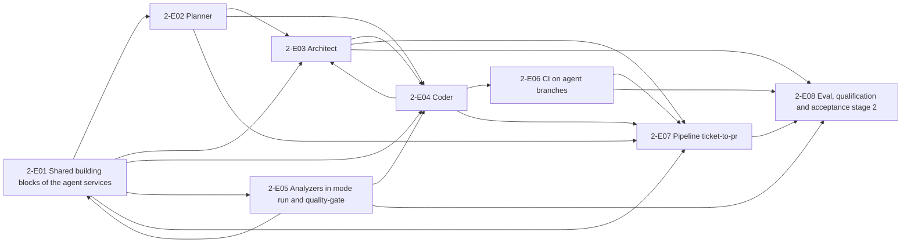

| ID | Task | depends on | owner | h | Status |
|---|---|---|---|---|---|
| **2-E01** | **Shared building blocks of the agent services** | 1-E01 | | | |
| 2-E01-T01 | Reconciliation of the interfaces with the detailed designs of stages 0 and 1 | 0-E02, 0-E05, 0-E09, 0-E11, 0-E12, 0-E13, 1-E04 | agent | 3 | open |
| 2-E01-T02 | Spike: DNS in sandbox networks, offline registry protocols, offline databases | 0-E12 | agent | 8 | open |
| 2-E01-T03 | Package @guildwork/agent-step: run shell of the agent steps | 0-E11, 0-E13, 0-E15, 2-E01-T01, 2-E01-T04, 2-E05-T01 | agent | 10 | open |
| 2-E01-T04 | Package @guildwork/blueprint: schema, parser, devcontainer subset, snapshotKey | 0-E01, 0-E18, 2-E01-T01 | agent | 10 | open |
| 2-E01-T05 | Setup phase and agent phase in the worker with phase probe | 2-E01-T04, 2-E01-T07, 2-E01-T03 | agent | 12 | open |
| 2-E01-T06 | Environment snapshot per repo with post_build, baseline test list and secret scan | 2-E01-T04, 2-E01-T05, 2-E05-T05 | agent | 12 | open |
| 2-E01-T07 | Egress policy per service and phase, connection log | 0-E12, 0-E11 | agent | 10 | open |
| 2-E01-T08 | Sandbox without DNS resolver | 0-E12, 2-E01-T02 | agent | 8 | open |
| 2-E01-T09 | Write request propose_dependency with exact allowlist, osv and human approval | 2-E01-T10, 2-E01-T11, 0-E06, 0-E11, 0-E04, 2-E01-T08, 2-E01-T14 | agent | 14 | open |
| 2-E01-T10 | Registry cache: lockfile parser and filling from the lockfile | 2-E01-T02, 2-E01-T04, 2-E01-T03, 2-E01-T06 | agent | 14 | open |
| 2-E01-T11 | Registry cache: server per item, only from the index, never upstream | 2-E01-T10, 2-E01-T07, 0-E21-T02 | agent | 12 | open |
| 2-E01-T12 | Attribute foreign_input_seen in the Run Record | 2-E01-T03, 1-E08, 0-E11 | agent | 10 | open |
| 2-E01-T13 | Work-state snapshot and restore | 2-E01-T05, 2-E01-T06 | agent | 12 | open |
| 2-E01-T14 | Executor human_input | 0-E09-T05, 0-E14-T14 | agent | 4 | open |
| 2-E01-T15 | Executor ready_for_review | 0-E09-T04, 0-E14-T08 | agent | 3 | open |
| 2-E01-T16 | Executor request_reviewers | 0-E09-T04, 0-E14-T08 | agent | 3 | open |
| 2-E01-T17 | Executor ticket_transition with linkExternal and transition for GitHub Issues | 0-E09-T04, 0-E14-T14 | agent | 6 | open |
| **2-E02** | **Planner** | 2-E01 | | | |
| 2-E02-T01 | Package @guildwork/clarity: clarity gate | 0-E15 | agent | 8 | open |
| 2-E02-T02 | Planner scaffold: manifest, controller, steps, inputs, repo resolution | 2-E01-T03, 0-E06 | agent | 10 | open |
| 2-E02-T03 | PlanArtifact: schema, versions, round-trip format, admin API | 2-E02-T02, 0-E02 | agent | 12 | open |
| 2-E02-T04 | Research read-only with citation check | 2-E02-T02, 2-E01-T07, 2-E01-T12, 2-E01-T14 | agent | 12 | open |
| 2-E02-T05 | Clarity gate in the planner, consistency analysis and synthesis | 2-E02-T03, 2-E02-T04, 2-E02-T01 | agent | 10 | open |
| 2-E02-T06 | Plan verifier: static in Z0 and with a fresh model | 2-E02-T05 | agent | 12 | open |
| 2-E02-T07 | Plan critique by a fresh model | 2-E02-T06 | agent | 8 | open |
| 2-E02-T08 | Publishing, human editing, persisting | 2-E02-T06, 0-E09, 0-E14, 2-E02-T11 | agent | 10 | open |
| 2-E02-T09 | G1 by hand and automatic, shadow measurement S7 c | 2-E02-T07, 2-E02-T08, 0-E05, 0-E06, 0-E07 | agent | 14 | open |
| 2-E02-T10 | Planner suite: mandatory properties, alone on, failure paths | 2-E02-T09, 0-E20-T21 | agent | 8 | open |
| 2-E02-T11 | Executor plan | 0-E09-T04, 0-E14-T14 | agent | 4 | open |
| **2-E03** | **Architect** | 2-E01 | | | |
| 2-E03-T01 | Architect scaffold: manifest, steps, artifact, routes, write permissions | 2-E01-T03, 0-E06, 0-E04 | agent | 10 | open |
| 2-E03-T02 | Mode review with check ai-design-review | 2-E03-T01, 2-E03-T03, 2-E03-T04 | agent | 14 | open |
| 2-E03-T03 | Package @guildwork/method-check: EARS, MADR, C4 checklist | 0-E01 | agent | 12 | open |
| 2-E03-T04 | Architect verifier: citations and Mermaid | 2-E03-T01, 0-E21-T02 | agent | 10 | open |
| 2-E03-T05 | Mode spec with EARS, design and tasks | 2-E03-T02, 2-E03-T03, 2-E02-T03 | agent | 12 | open |
| 2-E03-T06 | Mode adr per MADR | 2-E03-T05 | agent | 8 | open |
| 2-E03-T07 | Mode threat_model per STRIDE | 2-E03-T05 | agent | 12 | open |
| 2-E03-T08 | Mode conformance as a library in the reviewer | 2-E03-T05, 2-E02-T03, 1-E04, 1-E05, 2-E04-T01 | agent | 12 | open |
| 2-E03-T09 | Architect suite: alone on, method conformance, failure paths | 2-E03-T02, 2-E03-T06, 2-E03-T07, 2-E03-T08, 0-E20-T21 | agent | 8 | open |
| 2-E03-T10 | Architect review in shadow on architecture PRs of the project repo | 2-E03-T09, 1-E10 | agent+owner | 4 | open |
| **2-E04** | **Coder** | 2-E01, 1-E04 | | | |
| 2-E04-T01 | Coder scaffold: manifest, steps, artifacts, configuration, resolver rules | 2-E01-T03, 0-E06, 1-E07 | agent | 10 | open |
| 2-E04-T02 | Agent phase per plan phase with plan reminder and budget per phase | 2-E04-T01, 2-E01-T05, 2-E01-T06, 2-E01-T11, 2-E02-T03, 2-E03-T01 | agent | 12 | open |
| 2-E04-T03 | Self-check bundle deterministic in the worker | 2-E04-T02, 2-E05-T02, 2-E05-T07 | agent | 14 | open |
| 2-E04-T04 | Hard gates in the worker and authoritative in the Effect Gateway | 2-E04-T03, 0-E09, 2-E05-T05 | agent | 14 | open |
| 2-E04-T05 | Self-review with the reviewer library and repair rounds | 2-E04-T03, 1-E04, 1-E03 | agent | 10 | open |
| 2-E04-T06 | Normalize commits, bundle, PR text from the repo template | 2-E04-T05, 2-E02-T08 | agent | 12 | open |
| 2-E04-T07 | Draft PR, agent-approval-check and ticket linking | 2-E04-T06, 2-E04-T04, 0-E09, 0-E14, 0-E09-T08, 0-E09-T09, 2-E01-T17 | agent | 10 | open |
| 2-E04-T08 | G4 before the push: protected paths and test deletion | 2-E04-T06, 0-E05 | agent | 10 | open |
| 2-E04-T09 | Question during coding (L1) with snapshot, continuation, deadline and rate limit pause | 2-E04-T02, 2-E01-T13, 2-E04-T06, 2-E04-T04, 2-E01-T14 | agent | 12 | open |
| 2-E04-T10 | Steering with @agent say (L2) | 2-E04-T09, 0-E04 | agent | 10 | open |
| 2-E04-T11 | Agent-led environment setup (L4) | 2-E04-T07, 2-E01-T06, 2-E04-T09 | agent | 14 | open |
| 2-E04-T12 | Coder suite: hard gates, alone on, failure paths | 2-E04-T04, 2-E04-T07, 2-E04-T08, 2-E04-T10, 2-E04-T11, 0-E20-T21 | agent | 10 | open |
| **2-E05** | **Analyzers in mode run and quality-gate** | 1-E06 | | | |
| 2-E05-T01 | Analyzer contract v1alpha1 binding and package @guildwork/sarif | 0-E13 | agent | 10 | open |
| 2-E05-T02 | Analyzers in their own tool sandbox | 2-E05-T01, 0-E12, 2-E01-T03 | agent | 12 | open |
| 2-E05-T03 | Baseline: base against head with the same version | 2-E05-T02, 2-E01-T05 | agent | 10 | open |
| 2-E05-T04 | Plugin analyzer-opengrep with its own default rule set | 2-E05-T02, 2-E05-T03, 0-E21-T02 | agent | 12 | open |
| 2-E05-T05 | Plugins analyzer-gitleaks and analyzer-osv-scanner | 2-E05-T02, 2-E05-T03, 2-E01-T02, 0-E21-T02 | agent | 12 | open |
| 2-E05-T06 | Plugin analyzer-trivy | 2-E05-T05, 0-E21-T02 | agent | 8 | open |
| 2-E05-T07 | Platform gate quality-gate | 2-E05-T03 | agent | 12 | open |
| 2-E05-T08 | Gate B1 fixtures of the platform gate and analyzer findings as candidates in the reviewer | 2-E05-T07, 2-E05-T04, 1-E04 | agent | 8 | open |
| **2-E06** | **CI on agent branches** | 2-E04 | | | |
| 2-E06-T01 | Package @guildwork/workflow-guard: analysis of the workflow files | 0-E14 | agent | 14 | open |
| 2-E06-T02 | Variant agent_fork: fork creation by the operator, push and PR from the fork | 2-E06-T01, 0-E09, 0-E14, 0-E18, 0-E21-T01 | agent | 14 | open |
| 2-E06-T03 | Check in doctor and per claim, failure path no_safe_ci | 2-E06-T01, 2-E06-T02, 0-E05, 0-E18 | agent | 10 | open |
| 2-E06-T04 | Owner: provide the test environment for the real contract test agent_fork | - | owner | 2 | open |
| 2-E06-T05 | Real contract test agent_fork against GitHub | 2-E06-T02, 2-E06-T04 | agent+owner | 6 | open |
| 2-E06-T06 | S1 case CI on agent branches and S2 case no_safe_ci | 2-E06-T03, 2-E06-T05, 0-E20-T21 | agent | 8 | open |
| **2-E07** | **Pipeline ticket-to-pr** | 2-E02, 2-E04 | | | |
| 2-E07-T01 | PipelineRunner: stages, on_disabled, unbuilt services, merge.mode | 0-E05, 0-E06 | agent | 12 | open |
| 2-E07-T02 | Triggers from GitHub Issues: @agent code and label agent:auto | 2-E07-T01, 0-E04, 0-E14 | agent | 10 | open |
| 2-E07-T03 | Transitions from planning to awaiting_human_review | 2-E07-T01, 1-E05 | agent | 12 | open |
| 2-E07-T04 | Orchestrator effects with their own policy rules | 2-E07-T03, 2-E04-T07, 2-E01-T12, 2-E01-T15, 2-E01-T16, 2-E01-T17 | agent | 10 | open |
| 2-E07-T05 | Architect in the pipeline | 2-E07-T03, 2-E03-T05, 2-E02-T09 | agent | 8 | open |
| 2-E07-T06 | Shadow mode of the chain in stage 2 | 2-E07-T03 | agent | 8 | open |
| 2-E07-T07 | S5: E2E ticket to draft PR from GitHub Issues | 2-E07-T02, 2-E07-T04, 2-E07-T05, 2-E07-T06, 2-E06-T03, 2-E04-T12, 0-E20-T21 | agent | 12 | open |
| **2-E08** | **Eval, qualification and acceptance stage 2** | 2-E03, 2-E05, 2-E06, 2-E07 | | | |
| 2-E08-T01 | Read reference values and data licenses before the first Gate B run | - | agent | 6 | open |
| 2-E08-T02 | Owner: license requests and eval runtime of stage 2 on the subscription | 2-E08-T01 | agent+owner | 2 | open |
| 2-E08-T03 | Sets P1 to P4 and adapters Loc-Bench, LocAgent | 2-E08-T01 | agent | 16 | open |
| 2-E08-T04 | Sets AR1 to AR4 and adapters DevBench, STRIDE GPT | 2-E08-T01 | agent | 16 | open |
| 2-E08-T05 | Set C1p from permissively licensed public repos | 2-E08-T01 | agent | 16 | open |
| 2-E08-T06 | Coder basket B1 to B4 via Harbor, measure costs per task | 2-E08-T01, 2-E08-T02 | agent | 12 | open |
| 2-E08-T07 | Gate A runs planner, architect, coder | 2-E08-T02, 2-E08-T03, 2-E08-T04, 2-E08-T05 | agent | 12 | open |
| 2-E08-T08 | Measure and report the Gate B required parts | 2-E08-T06, 2-E08-T07 | agent | 14 | open |
| 2-E08-T09 | Cross-cutting suites of stage 2: S1, S2, S6 and hard gates | - | agent | 12 | open |
| 2-E08-T10 | S7 c: measure automatic plan approval in shadow against humans | 2-E08-T09 | agent | 8 | open |
| 2-E08-T11 | Stage report, reference qualification and release stage 2 | 2-E08-T08, 2-E08-T09, 2-E08-T10, 0-E21, 0-E22-T02 | agent | 8 | open |

### Stage 3: QA

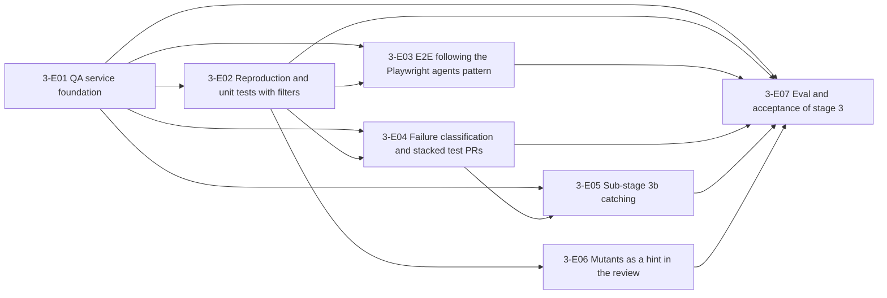

| ID | Task | depends on | owner | h | Status |
|---|---|---|---|---|---|
| **3-E01** | **QA service foundation** | 2-E07 | | | |
| 3-E01-T01 | Artifact contracts QARequest and QAReport | 0-E13 | agent | 6 | open |
| 3-E01-T02 | Service scaffold qa: controller, routes, single-service run | 3-E01-T01, 0-E05, 0-E16, 0-E20-T21 | agent | 12 | open |
| 3-E01-T03 | Mapping to apps, test command and existing tests | 3-E01-T02, 0-E12 | agent | 8 | open |
| 3-E01-T04 | Path policy of QA in the Effect Gateway | 3-E01-T01, 0-E09, 3-E01-T09 | agent | 8 | open |
| 3-E01-T05 | Discovery check via JUnit report | 3-E01-T03 | agent | 10 | open |
| 3-E01-T06 | Report as check ai-qa and comment | 3-E01-T02, 0-E09 | agent | 8 | open |
| 3-E01-T07 | Coverage of changed lines before and after | 3-E01-T03 | agent | 8 | open |
| 3-E01-T08 | Provenance of the QA inputs (foreign_input_seen) | 3-E01-T02, 2-E01 | agent | 4 | open |
| 3-E01-T09 | Configuration key services.qa in the schema | 0-E06 | agent | 6 | open |
| **3-E02** | **Reproduction and unit tests with filters** | 3-E01 | | | |
| 3-E02-T01 | Agent step generate_unit: generate candidates | 3-E01-T02, 2-E01 | agent | 10 | open |
| 3-E02-T02 | Filter chain in a fresh check sandbox | 3-E01-T05, 2-E05, 3-E02-T01 | agent | 14 | open |
| 3-E02-T03 | Mutation adapters with normal form | 3-E01-T03 | agent | 14 | open |
| 3-E02-T04 | Value filter with equivalence judge | 3-E02-T02, 3-E02-T03, 3-E01-T07, 0-E15 | agent | 8 | open |
| 3-E02-T05 | Reproduction test (scope repro) | 3-E02-T02 | agent | 10 | open |
| 3-E02-T06 | Repair of own candidates without weakening | 3-E02-T02 | agent | 6 | open |
| **3-E03** | **E2E following the Playwright agents pattern** | 3-E01 | | | |
| 3-E03-T01 | E2E sandbox image and contract test BROWSER | 3-E01-T02, 0-E12, 0-E21 | agent | 8 | open |
| 3-E03-T02 | App start, seed and evidence | 3-E03-T01 | agent | 10 | open |
| 3-E03-T03 | E2E planner | 3-E03-T02 | agent | 12 | open |
| 3-E03-T04 | E2E generator | 3-E03-T03, 3-E02-T02 | agent | 10 | open |
| 3-E03-T05 | Healer with deterministic heal guard | 3-E03-T04 | agent | 14 | open |
| 3-E03-T06 | E2E smoke library for the coder | 3-E03-T02, 2-E04 | agent | 8 | open |
| **3-E04** | **Failure classification and stacked test PRs** | 3-E02 | | | |
| 3-E04-T01 | Failure classification | 3-E02-T02, 0-E15 | agent | 12 | open |
| 3-E04-T02 | Quarantine proposals with approval by humans | 3-E04-T01, 1-E08 | agent | 12 | open |
| 3-E04-T03 | Output as a commit or stacked test PR | 3-E01-T04, 3-E02-T02, 2-E06 | agent | 10 | open |
| 3-E04-T04 | Verdict rules and integration into verifying | 3-E04-T01, 2-E07, 0-E20-T21 | agent | 8 | open |
| **3-E05** | **Sub-stage 3b catching** | 3-E04 | | | |
| 3-E05-T01 | Generate and check catch candidates | 3-E04-T01 | agent | 12 | open |
| 3-E05-T02 | Catch checker and findings | 3-E05-T01, 1-E04 | agent | 12 | open |
| 3-E05-T03 | Catch mode shadow and live, gate B per part | 3-E05-T02, 3-E01-T09 | agent | 6 | open |
| **3-E06** | **Mutants as a hint in the review** | 3-E02 | | | |
| 3-E06-T01 | QA scope mutants_hint | 3-E02-T03, 1-E04 | agent | 10 | open |
| 3-E06-T02 | Presentation in the reviewer summary | 3-E06-T01, 1-E05 | agent | 6 | open |
| **3-E07** | **Eval and acceptance of stage 3** | 3-E03, 3-E05, 3-E06 | | | |
| 3-E07-T01 | Q1: adapter TDD-Bench Verified and gate A paired | 3-E02-T05, 0-E20 | agent | 12 | open |
| 3-E07-T02 | Gate B Q1: read the reference value, measure, report | 3-E07-T01 | agent | 4 | open |
| 3-E07-T03 | Q2 mutation and Q5 unit tests public | 3-E02-T04, 0-E20 | agent | 8 | open |
| 3-E07-T04 | Q3 own web app and false healing 0 | 3-E03-T05, 0-E20 | agent | 12 | open |
| 3-E07-T05 | Q4 catch set and catch precision | 3-E05-T03, 0-E20 | agent | 12 | open |
| 3-E07-T06 | Filters 100 %, discovery 100 %, flake rate over 20 runs | 3-E04-T04, 3-E02-T06, 0-E20-T21 | agent | 6 | open |
| 3-E07-T07 | Owner: license request SWT-bench and XRepoTest data | 3-E07-T03 | owner | 2 | open |
| 3-E07-T08 | SWT-bench Verified internally as a report part | 3-E07-T01 | agent | 6 | open |
| 3-E07-T09 | Measure the acceptance rate of the test PRs | 3-E04-T03 | agent+owner | 4 | open |
| 3-E07-T10 | Suites for QA, stage report and release | 3-E07-T01, 3-E07-T02, 3-E07-T03, 3-E07-T04, 3-E07-T05, 3-E07-T06, 3-E07-T07, 3-E07-T08, 3-E07-T09, 3-E01-T08 | agent | 10 | open |

### Stage 4: PR-Fix

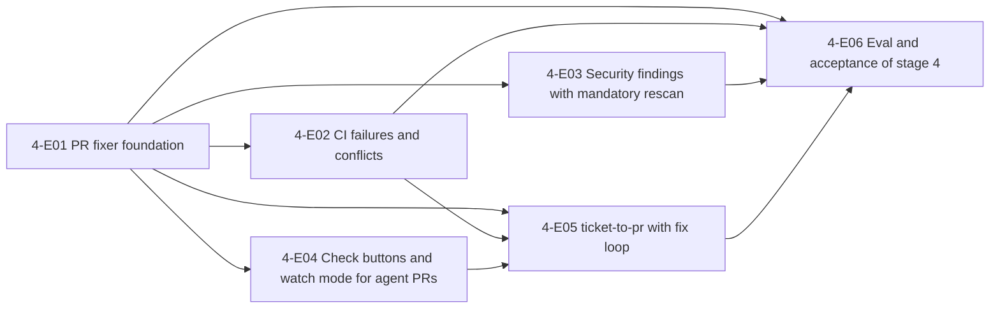

| ID | Task | depends on | owner | h | Status |
|---|---|---|---|---|---|
| **4-E01** | **PR fixer foundation** | 2-E07 | | | |
| 4-E01-T01 | Contracts FixRequest and FixResult, manifest, schema | 0-E13, 0-E06 | agent | 6 | open |
| 4-E01-T02 | Service scaffold prfixer, command fix, check ai-fix | 4-E01-T01, 0-E05, 0-E16, 0-E20-T21 | agent | 12 | open |
| 4-E01-T03 | Trigger filter, bot loop protection and provenance | 4-E01-T02, 2-E01 | agent | 8 | open |
| 4-E01-T04 | Round counter and recovery | 4-E01-T02, 0-E02 | agent | 8 | open |
| 4-E01-T05 | Source review_threads: collect, fix, reply | 4-E01-T03, 1-E04, 1-E05-T10 | agent | 14 | open |
| 4-E01-T06 | Prohibitions, diff policy and suggestions instead of a commit | 4-E01-T02, 0-E09, 2-E04 | agent | 12 | open |
| 4-E01-T07 | Delivery: commit on the agent branch or stacked PR | 4-E01-T04, 2-E06 | agent | 10 | open |
| 4-E01-T08 | No-op and self-check before the push | 4-E01-T07 | agent | 6 | open |
| **4-E02** | **CI failures and conflicts** | 4-E01 | | | |
| 4-E02-T01 | Collect CI failures and exact command | 4-E01-T02, 0-E14 | agent | 12 | open |
| 4-E02-T02 | CI classification | 4-E02-T01 | agent | 12 | open |
| 4-E02-T03 | Reproduction, fix and waiting for real CI | 4-E02-T02, 4-E01-T08 | agent | 14 | open |
| 4-E02-T04 | Rerun at most once per commit, contract test permissions | 4-E02-T02, 0-E14, 0-E10 | agent | 8 | open |
| 4-E02-T05 | Merge conflicts | 4-E01-T07 | agent | 14 | open |
| 4-E02-T06 | Executor rerun | 4-E02-T04, 0-E09-T04 | agent | 4 | open |
| **4-E03** | **Security findings with mandatory rescan** | 4-E01 | | | |
| 4-E03-T01 | Source static_analysis | 4-E01-T02, 2-E05 | agent | 8 | open |
| 4-E03-T02 | Mandatory rescan | 4-E03-T01, 4-E01-T08 | agent | 12 | open |
| 4-E03-T03 | Set F5 as a hard fix rule | 4-E03-T02, 0-E20 | agent | 6 | open |
| **4-E04** | **Check buttons and watch mode for agent PRs** | 4-E01 | | | |
| 4-E04-T01 | Check actions on ai-fix and ai-review | 4-E01-T02, 0-E14 | agent | 8 | open |
| 4-E04-T02 | Watch mode for agent PRs | 4-E04-T01, 4-E01-T04 | agent | 10 | open |
| **4-E05** | **ticket-to-pr with fix loop** | 4-E02, 4-E04 | | | |
| 4-E05-T01 | Pipeline stage prfixer in the orchestrator | 4-E02-T03, 4-E04-T02, 2-E07, 4-E02-T06 | agent | 10 | open |
| 4-E05-T02 | S6 cases of the PR fixer failure paths | 4-E05-T01, 4-E02-T05, 4-E01-T06, 0-E20-T21 | agent | 8 | open |
| **4-E06** | **Eval and acceptance of stage 4** | 4-E03, 4-E05 | | | |
| 4-E06-T01 | Sets F1 and F1x | 4-E01-T05, 0-E20 | agent | 14 | open |
| 4-E06-T02 | Sets F2 and F6 | 4-E02-T03, 4-E02-T04, 0-E20 | agent | 12 | open |
| 4-E06-T03 | Set F3 conflicts | 4-E02-T05, 0-E20 | agent | 10 | open |
| 4-E06-T04 | Set F4 without profile dependency_update | 4-E02-T03, 4-E01-T06, 0-E20 | agent | 10 | open |
| 4-E06-T05 | Gate A paired, prohibitions, rounds, no-op, gate B status | 4-E06-T01, 4-E06-T02, 4-E06-T03, 4-E06-T04, 4-E03-T03, 4-E01-T04, 4-E01-T08 | agent | 10 | open |
| 4-E06-T06 | Owner: license request for public PR fix sets | 4-E01-T01 | owner | 3 | open |
| 4-E06-T07 | Suites for the PR fixer, stage report and release | 4-E06-T05, 4-E06-T06, 4-E05-T02, 4-E03-T01, 0-E21-T03 | agent | 8 | open |

### Stage 5: Autonomous run and auto-merge

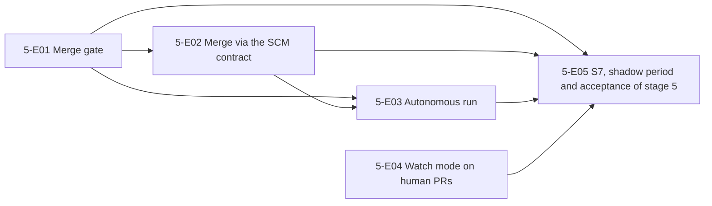

| ID | Task | depends on | owner | h | Status |
|---|---|---|---|---|---|
| **5-E01** | **Merge gate** | 3-E07, 4-E06 | | | |
| 5-E01-T01 | Types, table merge_gate_decisions, pure evaluation | 0-E02, 0-E05 | agent | 6 | open |
| 5-E01-T02 | Load facts, fail closed | 5-E01-T01, 0-E14 | agent | 10 | open |
| 5-E01-T03 | Conditions C00, C01, C02 | 5-E01-T02, 0-E06 | agent | 12 | open |
| 5-E01-T04 | Conditions C03 to C07 | 5-E01-T02, 3-E04-T04, 3-E05-T03, 2-E05 | agent | 12 | open |
| 5-E01-T05 | Conditions C08, C10, C11 | 5-E01-T02 | agent | 10 | open |
| 5-E01-T06 | Condition C12 provenance | 5-E01-T02, 2-E01, 3-E01-T08, 4-E01-T03 | agent | 8 | open |
| 5-E01-T07 | Condition C09: waiting window and re-check | 5-E01-T03, 5-E01-T04, 5-E01-T05, 5-E01-T06 | agent | 10 | open |
| **5-E02** | **Merge via the SCM contract** | 5-E01 | | | |
| 5-E02-T01 | SCM method merge in the GitHub plugin, verification task merge queue | 0-E14 | agent | 10 | open |
| 5-E02-T02 | Effects of the orchestrator: agent-approval-check and merge with fencing | 5-E01-T07, 5-E02-T01, 0-E09, 0-E10 | agent | 12 | open |
| 5-E02-T03 | States merge_gate and merging in the orchestrator | 5-E02-T02, 5-E02-T07 | agent | 10 | open |
| 5-E02-T04 | Post-merge watch and revert PR | 5-E02-T03, 0-E12, 0-E19, 0-E09-T09, 2-E01-T15, 2-E01-T16, 1-E05-T11 | agent | 14 | open |
| 5-E02-T05 | Fallback to human via repo_overrides | 5-E02-T04, 1-E08, 0-E06 | agent | 8 | open |
| 5-E02-T06 | Permission test against the real app: merge only at the checked SHA | 5-E02-T02 | agent+owner | 6 | open |
| 5-E02-T07 | Executor merge with fencing | 5-E02-T01, 5-E02-T02, 0-E09-T04 | agent | 5 | open |
| **5-E03** | **Autonomous run** | 5-E02 | | | |
| 5-E03-T01 | Resolver and evidence for autonomy full and merge.mode | 5-E01-T03, 0-E06 | agent | 10 | open |
| 5-E03-T02 | Shadow mode of the merge gate | 5-E01-T07, 1-E08 | agent | 12 | open |
| 5-E03-T03 | Verification task branch protection without bypass and condition C13 | 5-E01-T02, 0-E18 | agent+owner | 10 | open |
| **5-E04** | **Watch mode on human PRs** | 4-E04 | | | |
| 5-E04-T01 | Opt-in via @agent fix watch and unwatch | 4-E04-T02, 4-E01-T07 | agent | 10 | open |
| 5-E04-T02 | Security cases watch on human PRs | 5-E04-T01, 0-E20-T21 | agent | 6 | open |
| **5-E05** | **S7, shadow period and acceptance of stage 5** | 5-E03, 5-E04 | | | |
| 5-E05-T01 | S7 (a): one failing case per condition | 5-E03-T01, 5-E03-T03, 5-E02-T03 | agent | 12 | open |
| 5-E05-T02 | S7 (b) and (d): attacks and post-merge watch | 5-E01-T06, 5-E02-T04, 5-E02-T05, 5-E03-T03 | agent | 12 | open |
| 5-E05-T03 | E2E ticket to merge on a test repo | 5-E05-T01, 5-E05-T02, 5-E02-T06 | agent+owner | 8 | open |
| 5-E05-T04 | Shadow period: at least 100 agent PRs | 5-E03-T02, 5-E03-T01 | agent+owner | 6 | open |
| 5-E05-T05 | Stage report and release of stage 5 | 5-E05-T03, 5-E05-T04, 5-E04-T02 | agent | 6 | open |

### Stage 6: Reviewer companion features and developer loop

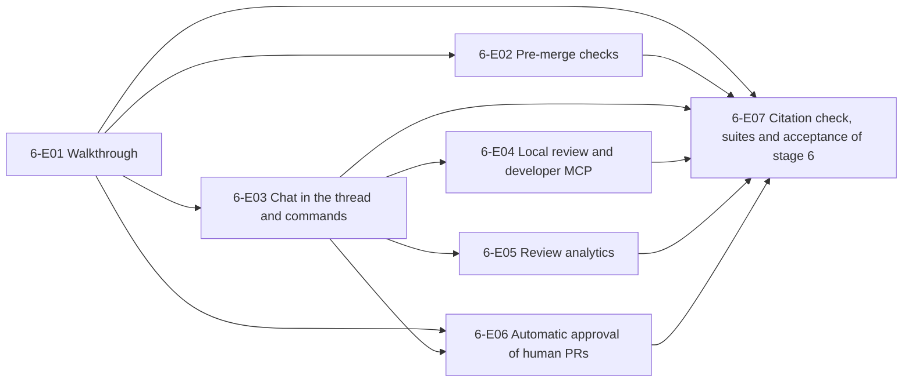

| ID | Task | depends on | owner | h | Status |
|---|---|---|---|---|---|
| **6-E01** | **Walkthrough** | 1-E05 | | | |
| 6-E01-T01 | Types, schema and configuration of the companion outputs | 0-E06, 6-E01-T05 | agent | 6 | open |
| 6-E01-T02 | Companion job reviewer.companions with single calls | 6-E01-T01, 0-E11, 0-E15, 0-E20-T21 | agent | 10 | open |
| 6-E01-T03 | Walkthrough and change table with validator | 6-E01-T02 | agent | 6 | open |
| 6-E01-T04 | Sequence diagram from DiagramSpec | 6-E01-T02 | agent | 10 | open |
| 6-E01-T05 | Visibility function and reference finder | 0-E01 | agent | 6 | open |
| 6-E01-T06 | Related issues and PRs | 6-E01-T02, 6-E01-T05, 0-E14 | agent | 10 | open |
| 6-E01-T07 | Labels and reviewer suggestions | 6-E01-T02, 0-E09, 6-E01-T09 | agent | 8 | open |
| 6-E01-T08 | Effort, risk level and presentation in the summary | 6-E01-T03, 6-E01-T04, 6-E01-T06, 6-E01-T07 | agent | 8 | open |
| 6-E01-T09 | Executor labels | 0-E09-T04, 0-E14-T08 | agent | 4 | open |
| **6-E02** | **Pre-merge checks** | 1-E05 | | | |
| 6-E02-T01 | Configuration and types of the pre-merge checks | 0-E06 | agent | 5 | open |
| 6-E02-T02 | Built-in checks title, description, issue linked | 6-E02-T01, 6-E01-T05 | agent | 6 | open |
| 6-E02-T03 | Built-in check docstring coverage | 6-E02-T01, 1-E02 | agent | 10 | open |
| 6-E02-T04 | Custom checks in natural language with mandatory evidence | 6-E02-T01, 6-E01-T02 | agent | 10 | open |
| 6-E02-T05 | Check run ai-pre-merge-checks and presentation | 6-E02-T02, 6-E02-T03, 6-E02-T04, 6-E01-T08 | agent | 6 | open |
| 6-E02-T06 | R6 cases for pre-merge checks | 6-E02-T05, 0-E20 | agent | 8 | open |
| **6-E03** | **Chat in the thread and commands** | 1-E05 | | | |
| 6-E03-T01 | Detection of thread replies and commands | 0-E04 | agent | 8 | open |
| 6-E03-T02 | Chat reply and finding feedback | 6-E03-T01, 1-E04, 1-E05-T10, 6-E01-T01 | agent | 12 | open |
| 6-E03-T03 | Pause state manual and automatic | 6-E03-T01, 1-E02 | agent | 8 | open |
| 6-E03-T04 | Resume via @agent review | 6-E03-T03, 0-E05 | agent | 6 | open |
| 6-E03-T05 | @agent remember with storage as a candidate | 6-E03-T01, 0-E09, 0-E02 | agent | 10 | open |
| **6-E04** | **Local review and developer MCP** | 1-E04 | | | |
| 6-E04-T01 | Reviewer library with local input | - | agent | 10 | open |
| 6-E04-T02 | CLI guildwork review --local with NDJSON | 6-E04-T01, 0-E18-T05 | agent | 10 | open |
| 6-E04-T03 | Remote execution via the Work API | 6-E04-T02, 6-E04-T04, 0-E11, 0-E03, 0-E20-T28 | agent | 10 | open |
| 6-E04-T04 | Developer identity and dev token | 0-E14, 0-E10, 0-E02, 0-E18-T05 | agent | 10 | open |
| 6-E04-T05 | Developer MCP read tools | 6-E04-T04, 1-E04, 6-E04-T01 | agent | 10 | open |
| 6-E04-T06 | Mark as fixed and verification | 6-E04-T05, 6-E03-T02 | agent | 8 | open |
| **6-E05** | **Review analytics** | 1-E08 | | | |
| 6-E05-T01 | Metrics as SQL views and daily rows | 0-E07 | agent | 10 | open |
| 6-E05-T02 | Address rate and recall per the Martian definition | 6-E05-T01, 6-E03-T02 | agent | 12 | open |
| 6-E05-T03 | Reconciliation against the ledger | 6-E05-T01 | agent | 6 | open |
| 6-E05-T04 | Analytics API and CSV export | 6-E05-T01, 6-E05-T02 | agent | 6 | open |
| 6-E05-T05 | Admin UI review analytics | 6-E05-T04, 6-E05-T03, 0-E17 | agent | 10 | open |
| 6-E05-T06 | Scheduled report via the notifier | 6-E05-T04, 0-E09, 1-E05-T11 | agent | 6 | open |
| **6-E06** | **Automatic approval of human PRs** | 1-E05 | | | |
| 6-E06-T01 | SCM contract approve, withdrawApprove, approvalProtection in the GitHub plugin | 0-E14, 0-E13 | agent | 10 | open |
| 6-E06-T02 | Provide test repo and app installation for approve tests | - | owner | 2 | open |
| 6-E06-T03 | Contract test approvalProtection and dismissal against GitHub | 6-E06-T01, 6-E06-T02 | agent | 6 | open |
| 6-E06-T04 | Agent PR detection | 0-E09 | agent | 6 | open |
| 6-E06-T05 | Condition check for the approval | 6-E06-T04, 6-E03-T02, 6-E03-T04, 6-E01-T08, 6-E06-T01 | agent | 12 | open |
| 6-E06-T06 | Effect approve_human via the Effect Gateway | 6-E06-T01, 6-E06-T05, 0-E09, 0-E06, 6-E06-T09 | agent | 8 | open |
| 6-E06-T07 | Withdrawal on every push and on new P0/P1 | 6-E06-T06, 6-E06-T10 | agent | 8 | open |
| 6-E06-T08 | doctor check and visible hints | 6-E06-T03, 6-E06-T05, 0-E18 | agent | 6 | open |
| 6-E06-T09 | Executor approve_human | 6-E06-T01, 0-E09-T04 | agent | 6 | open |
| 6-E06-T10 | Executor withdraw_approve | 6-E06-T01, 0-E09-T04 | agent | 4 | open |
| **6-E07** | **Citation check, suites and acceptance of stage 6** | 6-E01, 6-E02, 6-E03, 6-E04, 6-E05, 6-E06 | | | |
| 6-E07-T01 | Quote and reference check in the Effect Gateway | 0-E09 | agent | 12 | open |
| 6-E07-T02 | S1 cases visibility | 6-E07-T01, 0-E22 | agent | 6 | open |
| 6-E07-T03 | S1 cases CLI and MCP input | 0-E22 | agent | 6 | open |
| 6-E07-T04 | S1 cases auto-approve | 0-E22 | agent | 8 | open |
| 6-E07-T05 | R6 suite and runner | 0-E20 | agent | 10 | open |
| 6-E07-T06 | R6 measurement and regression of the reviewer | 6-E07-T05, 1-E09 | agent | 8 | open |
| 6-E07-T07 | Permission test approve against the real app | 6-E06-T02 | agent | 8 | open |
| 6-E07-T08 | Stage report, release and follow-up list of stage 6 | 6-E07-T01, 6-E07-T02, 6-E07-T03, 6-E07-T04, 6-E07-T06, 6-E07-T07, 1-E10 | agent | 6 | open |

### Stage 7a: Learnings

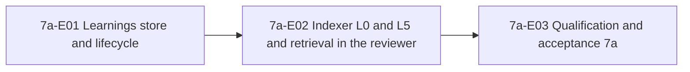

| ID | Task | depends on | owner | h | Status |
|---|---|---|---|---|---|
| **7a-E01** | **Learnings store and lifecycle** | 6-E03 | | | |
| 7a-E01-T01 | Migration of the lifecycle tables | 0-E02 | agent | 6 | open |
| 7a-E01-T02 | Configuration knowledge.learnings | 0-E06 | agent | 4 | open |
| 7a-E01-T03 | KnowledgeStore pg-kb with capability LEARNINGS | 7a-E01-T01, 0-E13 | agent | 10 | open |
| 7a-E01-T04 | Scope, visibility and PR binding | 7a-E01-T03, 6-E01-T05 | agent | 10 | open |
| 7a-E01-T05 | Approval delay and approval | 7a-E01-T03, 7a-E01-T02 | agent | 8 | open |
| 7a-E01-T06 | Voting and expiry | 7a-E01-T03, 7a-E01-T02, 6-E03-T02, 6-E04-T04 | agent | 10 | open |
| 7a-E01-T07 | Secret redaction and citation check | 7a-E01-T03, 0-E09 | agent | 10 | open |
| 7a-E01-T08 | Import and export | 7a-E01-T07, 6-E04-T04 | agent | 10 | open |
| 7a-E01-T09 | Admin UI learnings with approval view and metrics | 7a-E01-T05, 7a-E01-T06, 0-E17, 7a-E01-T08 | agent | 10 | open |
| **7a-E02** | **Indexer L0 and L5 and retrieval in the reviewer** | 7a-E01 | | | |
| 7a-E02-T01 | Indexer skeleton with L0 | 0-E05, 0-E04, 0-E20-T21 | agent | 10 | open |
| 7a-E02-T02 | L5 increment on merge and watermark | 7a-E02-T01, 7a-E01-T04, 7a-E01-T07 | agent | 12 | open |
| 7a-E02-T03 | Retrieval per repo and path | 7a-E01-T04, 7a-E01-T07 | agent | 8 | open |
| 7a-E02-T04 | Integration into the reviewer context | 7a-E02-T03, 1-E02, 6-E04-T05 | agent | 8 | open |
| 7a-E02-T05 | Protection against injection via learnings | 7a-E02-T04 | agent | 8 | open |
| **7a-E03** | **Qualification and acceptance 7a** | 7a-E02 | | | |
| 7a-E03-T01 | Learnings suite | 0-E20-T21 | agent | 8 | open |
| 7a-E03-T02 | Citation validity 100 % | - | agent | 6 | open |
| 7a-E03-T03 | S1 with injection via learnings | 0-E22 | agent | 8 | open |
| 7a-E03-T04 | Reviewer gates with learnings | 1-E09 | agent | 8 | open |
| 7a-E03-T05 | Stage report, release and follow-up list 7a | 7a-E03-T01, 7a-E03-T02, 7a-E03-T03, 7a-E03-T04, 6-E07 | agent | 4 | open |

### Stage 7: Knowledge base, standards, triage

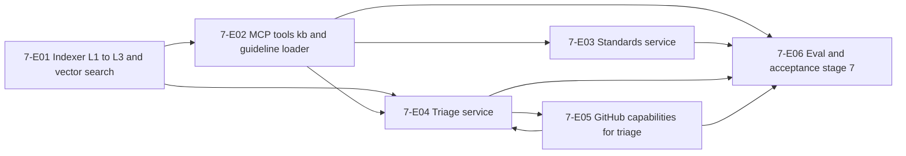

| ID | Task | depends on | owner | h | Status |
|---|---|---|---|---|---|
| **7-E01** | **Indexer L1 to L3 and vector search** | 7a-E03 | | | |
| 7-E01-T01 | Spike: embedding model, runtime and K5 | - | agent | 8 | open |
| 7-E01-T02 | KB schema L1 to L3 and repository layer | - | agent | 10 | open |
| 7-E01-T03 | Indexer job frame, LayerDelta and watermark | 7-E01-T02, 0-E11 | agent | 12 | open |
| 7-E01-T04 | L1 parser with tree-sitter | 7-E01-T03 | agent | 14 | open |
| 7-E01-T05 | L1 queries repoMap, symbolContext, impact | 7-E01-T04 | agent | 10 | open |
| 7-E01-T06 | L2 summaries | 7-E01-T04 | agent | 12 | open |
| 7-E01-T07 | Embedder service and ModelProvider local-embed | 7-E01-T01 | agent | 12 | open |
| 7-E01-T08 | L3 full text, vectors and hybrid search | 7-E01-T03, 7-E01-T07 | agent | 12 | open |
| 7-E01-T09 | Item index for issues and PRs | 7-E01-T08 | agent | 8 | open |
| 7-E01-T10 | Learnings via vector search | 7-E01-T08 | agent | 6 | open |
| **7-E02** | **MCP tools kb and guideline loader** | 7-E01 | | | |
| 7-E02-T01 | Platform MCP tools kb.* | 7-E01-T05, 7-E01-T08 | agent | 10 | open |
| 7-E02-T02 | Ask flow and command @agent ask | 7-E02-T01, 1-E05-T10 | agent | 14 | open |
| 7-E02-T03 | Guideline loader: formats and scope | 1-E02 | agent | 12 | open |
| 7-E02-T04 | Guideline loader: rule IDs, disabling, budget, verbose | 7-E02-T03 | agent | 8 | open |
| 7-E02-T05 | KB use per service in the qualification profile | 7-E02-T01 | agent | 6 | open |
| 7-E02-T06 | External KB MCP endpoint | 7-E02-T01, 7-E02-T02, 6-E04 | agent | 8 | open |
| **7-E03** | **Standards service** | 7-E02 | | | |
| 7-E03-T01 | Spike: test formats of Opengrep and ast-grep | - | agent | 4 | open |
| 7-E03-T02 | Rule metrics per rule_id | 1-E04 | agent | 10 | open |
| 7-E03-T03 | Candidate miner | 7-E03-T02, 7-E02-T03 | agent | 14 | open |
| 7-E03-T04 | Rule PR and activation | 7-E03-T03, 0-E09-T09 | agent | 10 | open |
| 7-E03-T05 | Rule compilation with test cases | 7-E03-T01, 7-E03-T04 | agent | 14 | open |
| 7-E03-T06 | Decay and withdrawal PR | 7-E03-T02, 7-E03-T04 | agent | 6 | open |
| **7-E04** | **Triage service** | 7-E01 | | | |
| 7-E04-T01 | Triage service skeleton and gate | - | agent | 10 | open |
| 7-E04-T02 | Duplicate and related search with visibility | 7-E04-T01, 7-E01-T09, 7-E02-T01, 7-E02-T05, 7-E05-T04 | agent | 10 | open |
| 7-E04-T03 | Classification and clarity gate | 7-E04-T01 | agent | 12 | open |
| 7-E04-T04 | Spam and slop | 7-E04-T03, 7-E05-T07 | agent | 6 | open |
| 7-E04-T05 | Verifier and publication per property | 7-E04-T02, 7-E04-T03, 7-E04-T04, 7-E05-T05, 7-E05-T06 | agent | 10 | open |
| 7-E04-T06 | auto_close as a repo opt-in | 7-E04-T05, 7-E05-T06 | agent | 8 | open |
| **7-E05** | **GitHub capabilities for triage** | 7a-E03 | | | |
| 7-E05-T01 | Owner: test repo and app installation for recordings | - | owner | 2 | open |
| 7-E05-T02 | Record fixtures and evidence capabilities | 7-E05-T01 | agent | 6 | open |
| 7-E05-T03 | SET_LABELS and CREATE_ISSUE | 7-E05-T02 | agent | 8 | open |
| 7-E05-T04 | LINK_ITEMS, RELATED_SEARCH, CLOSE_AS_DUPLICATE | 7-E05-T02 | agent | 8 | open |
| 7-E05-T05 | Profile labels and derivation of the write requests | 7-E05-T03, 7-E05-T04, 7-E04-T01 | agent | 6 | open |
| 7-E05-T06 | Executor link with closing as duplicate | 7-E05-T04, 0-E09-T04, 7-E05-T05 | agent | 4 | open |
| 7-E05-T07 | Executor comment action hide | 7-E05-T02, 0-E09-T05 | agent | 4 | open |
| **7-E06** | **Eval and acceptance stage 7** | 7-E03, 7-E04, 7-E05 | | | |
| 7-E06-T01 | Sets T1 and T2 | - | agent | 16 | open |
| 7-E06-T02 | K1 for the reviewer and KB approval | 7-E02-T05 | agent | 10 | open |
| 7-E06-T03 | K4 and K3: adapters and reference agents | 7-E02-T02 | agent | 14 | open |
| 7-E06-T04 | ST1 | 7-E03-T05 | agent | 8 | open |
| 7-E06-T05 | gh-aw: check license and re-measure T1 | 7-E06-T01 | agent | 8 | open |
| 7-E06-T06 | Owner: license requests for the reference measurement | - | owner | 2 | open |
| 7-E06-T07 | Cross-cutting suites of stage 7 | 7-E04-T06 | agent | 10 | open |
| 7-E06-T08 | Stage report, qualification and release stage 7 | 7-E06-T02, 7-E06-T03, 7-E06-T04, 7-E06-T05, 7-E06-T07 | agent | 8 | open |

### Stage 8: Jira, further providers and bases

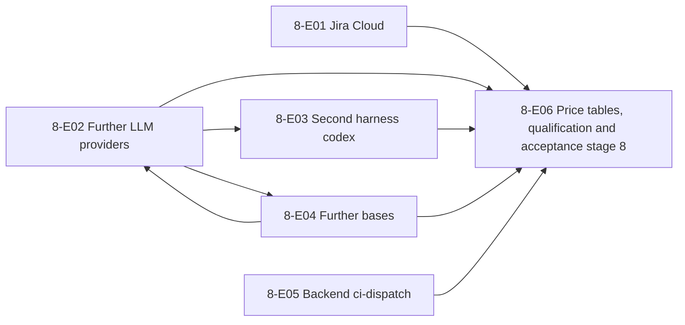

| ID | Task | depends on | owner | h | Status |
|---|---|---|---|---|---|
| **8-E01** | **Jira Cloud** | 2-E07 | | | |
| 8-E01-T01 | Jira cassettes and fixtures from the public documentation; test site optional | - | agent | 4 | open |
| 8-E01-T02 | Spike: Jira input, signature, permissions API, fixtures | 8-E01-T01 | agent | 8 | open |
| 8-E01-T03 | ADF renderer and ADF reader | - | agent | 10 | open |
| 8-E01-T04 | TriggerSource jira-cloud | 8-E01-T02, 8-E01-T03 | agent | 12 | open |
| 8-E01-T05 | WorkItemProvider jira-cloud read | 8-E01-T02, 8-E01-T03 | agent | 10 | open |
| 8-E01-T06 | WorkItemProvider jira-cloud write | 8-E01-T05 | agent | 10 | open |
| 8-E01-T07 | identity_links via OAuth confirmation | 8-E01-T02 | agent | 12 | open |
| 8-E01-T08 | permission AND check in the router | 8-E01-T05, 8-E01-T07 | agent | 8 | open |
| 8-E01-T09 | Out of order, repetition and catching up | 8-E01-T04, 8-E01-T05 | agent | 8 | open |
| 8-E01-T10 | E2E: Jira mention equals GitHub mention (S5) | 8-E01-T04, 8-E01-T06, 8-E01-T08, 8-E01-T09, 0-E20-T21 | agent | 10 | open |
| **8-E02** | **Further LLM providers** | 2-E07 | | | |
| 8-E02-T01 | Cassettes for Claude API WIF, Bedrock, Vertex, Foundry and cloud drivers from the documentation; accounts optional | - | agent | 6 | open |
| 8-E02-T02 | Spike: federation and start paths | 8-E02-T01 | agent | 8 | open |
| 8-E02-T03 | Start with wif | 8-E02-T02 | agent | 10 | open |
| 8-E02-T04 | Bedrock | 8-E02-T02, 8-E04-T03 | agent | 12 | open |
| 8-E02-T05 | Vertex | 8-E02-T02, 8-E04-T03 | agent | 10 | open |
| 8-E02-T06 | Foundry | 8-E02-T02, 8-E04-T03 | agent | 10 | open |
| 8-E02-T07 | Data path policy per provider resolution | 8-E02-T03, 8-E02-T04, 8-E02-T05, 8-E02-T06 | agent | 6 | open |
| **8-E03** | **Second harness codex** | 2-E07 | | | |
| 8-E03-T01 | Spike: Codex CLI | - | agent | 6 | open |
| 8-E03-T02 | AgentRuntime codex | 8-E03-T01 | agent | 14 | open |
| 8-E03-T03 | Credential kinds openai and chatgpt | 8-E03-T02, 8-E02-T04 | agent | 8 | open |
| 8-E03-T04 | Contract suite codex | 8-E03-T02, 8-E03-T03 | agent | 8 | open |
| **8-E04** | **Further bases** | 0b-E03 | | | |
| 8-E04-T01 | BlobStore gcs | 8-E04-T03, 8-E02-T01 | agent | 10 | open |
| 8-E04-T02 | SecretStore aws-secretsmanager and gcp-secretmanager | 8-E04-T03, 8-E02-T01 | agent | 10 | open |
| 8-E04-T03 | CloudIdentity azure-managed-identity, aws, gcp | 8-E02-T01 | agent | 12 | open |
| 8-E04-T04 | Helm chart | 8-E04-T11 | agent | 16 | open |
| 8-E04-T05 | Helm in S8 on kind and k3d | 8-E04-T04, 8-E04-T11, 0-E20-T21 | agent | 10 | open |
| 8-E04-T06 | Host preparation as cloud-init | - | agent | 6 | open |
| 8-E04-T07 | OpenTofu aws | 8-E04-T02, 8-E04-T03, 8-E04-T06 | agent | 12 | open |
| 8-E04-T08 | OpenTofu gcp | 8-E04-T01, 8-E04-T02, 8-E04-T03, 8-E04-T06 | agent | 12 | open |
| 8-E04-T09 | OpenTofu hetzner | 8-E04-T06 | agent | 8 | open |
| 8-E04-T10 | Apply workflows aws, gcp, hetzner; real applies optional | 8-E04-T07, 8-E04-T08, 8-E04-T09 | agent | 6 | open |
| 8-E04-T11 | ExecutionBackend k8s | - | agent | 16 | open |
| **8-E05** | **Backend ci-dispatch** | 2-E01 | | | |
| 8-E05-T01 | Owner: runner repo, dispatch app, runners | - | owner | 2 | open |
| 8-E05-T02 | Dispatch app and profile dispatch | 8-E05-T01 | agent | 8 | open |
| 8-E05-T03 | Runner workflow and OIDC sign-in | 8-E05-T02 | agent | 10 | open |
| 8-E05-T04 | Nested setup and mandatory proxy | 8-E05-T03, 0-E20-T21, 0-E20-T22 | agent | 14 | open |
| 8-E05-T05 | Slot limit, wait time, failure | 8-E05-T04 | agent | 8 | open |
| **8-E06** | **Price tables, qualification and acceptance stage 8** | 8-E01, 8-E02, 8-E03, 8-E04, 8-E05 | | | |
| 8-E06-T01 | Price tables | - | agent | 10 | open |
| 8-E06-T02 | Qualification per new combination | 8-E06-T01, 0-E20-T09, 0-E20-T19, 0-E20-T20 | agent | 12 | open |
| 8-E06-T03 | Suites, stage report and release stage 8 | 8-E06-T02, 0-E20-T21, 0-E20-T22 | agent | 10 | open |

### Stage 9: Breadth and hardening

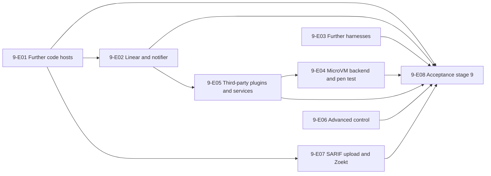

| ID | Task | depends on | owner | h | Status |
|---|---|---|---|---|---|
| **9-E01** | **Further code hosts** | 8-E06 | | | |
| 9-E01-T01 | Cassettes GitLab, Azure DevOps, Bitbucket, Linear from the documentation; test accounts optional | - | agent | 6 | open |
| 9-E01-T02 | Spike: open host facts | 9-E01-T01 | agent | 6 | open |
| 9-E01-T03 | GitLab: input and reading | 9-E01-T02 | agent | 14 | open |
| 9-E01-T04 | GitLab: writing with fallback chains and E2E | 9-E01-T03 | agent | 14 | open |
| 9-E01-T05 | Contract revision after the second host | 9-E01-T04 | agent | 8 | open |
| 9-E01-T06 | Azure DevOps | 9-E01-T05 | agent | 16 | open |
| 9-E01-T07 | Bitbucket Cloud | 9-E01-T05 | agent | 16 | open |
| 9-E01-T08 | Gitea and Forgejo | 9-E01-T05 | agent | 14 | open |
| **9-E02** | **Linear and notifier** | 8-E06 | | | |
| 9-E02-T01 | Linear | 9-E01-T01 | agent | 16 | open |
| 9-E02-T02 | Notifier Slack | 1-E05-T11, 6-E05-T06 | agent | 14 | open |
| 9-E02-T03 | E2E ask from Jira and Linear | 9-E02-T01, 8-E01, 7-E02 | agent | 6 | open |
| 9-E02-T04 | Health notifications for drivers | 9-E02-T02 | agent | 4 | open |
| **9-E03** | **Further harnesses** | 8-E06 | | | |
| 9-E03-T01 | Spike and licenses of the harnesses | - | agent | 6 | open |
| 9-E03-T02 | Harness openhands-sdk | 9-E03-T01 | agent | 16 | open |
| 9-E03-T03 | Harness opencode | 9-E03-T01 | agent | 14 | open |
| 9-E03-T04 | Harness gemini-cli | 9-E03-T01, 0-E20-T21 | agent | 12 | open |
| **9-E04** | **MicroVM backend and pen test** | 8-E06 | | | |
| 9-E04-T01 | Spike: Kata as Docker runtime and KVM in CI | - | agent | 6 | open |
| 9-E04-T02 | Backend microvm | 9-E04-T01 | agent | 16 | open |
| 9-E04-T03 | Routing external_code and suites under MicroVM | 9-E04-T02, 0-E20-T21 | agent | 12 | open |
| 9-E04-T04 | Prepare the pen test | 9-E04-T03, 9-E05-T02 | agent | 8 | open |
| 9-E04-T05 | Owner: commission the pen test | 9-E04-T04 | owner | 4 | open |
| 9-E04-T06 | Fix the findings of the pen test | 9-E04-T05 | agent | 12 | open |
| **9-E05** | **Third-party plugins and services** | 8-E06, 7-E06 | | | |
| 9-E05-T01 | Trust level assigned by the installation and signature | - | agent | 10 | open |
| 9-E05-T02 | Subprocess transport gRPC | 9-E05-T01 | agent | 16 | open |
| 9-E05-T03 | Published schemas and internal events | 1-E04-T07, 2-E02-T03, 2-E03-T01, 2-E04-T01, 7-E04-T01, 7-E02-T02 | agent | 12 | open |
| 9-E05-T04 | Distribution as an OCI artifact | 9-E05-T01, 9-E05-T03 | agent | 10 | open |
| 9-E05-T05 | Example plugin and example service | 9-E05-T02, 9-E05-T03, 9-E05-T04, 9-E02-T02 | agent | 12 | open |
| **9-E06** | **Advanced control** | 7-E06, 8-E06 | | | |
| 9-E06-T01 | Injection detector | - | agent | 10 | open |
| 9-E06-T02 | handoff and resume | - | agent | 14 | open |
| 9-E06-T03 | Child runs | - | agent | 16 | open |
| 9-E06-T04 | Best-of-N | 2-E08-T05 | agent | 10 | open |
| 9-E06-T05 | Triage as a stage of ticket-to-pr | - | agent | 8 | open |
| **9-E07** | **SARIF upload and Zoekt** | 7-E06 | | | |
| 9-E07-T01 | SARIF upload | 9-E01-T04, 2-E05-T04 | agent | 12 | open |
| 9-E07-T02 | Zoekt as a KnowledgeStore | 8-E04-T04 | agent | 16 | open |
| 9-E07-T03 | K1 for the coder | 2-E08-T05 | agent | 10 | open |
| 9-E07-T04 | Confluence as a KB source | 8-E01 | agent | 12 | open |
| 9-E07-T05 | Analyzer ast-grep for repo rules | 2-E05-T04, 2-E05-T08, 7-E03-T01, 7-E03-T05 | agent | 12 | open |
| **9-E08** | **Acceptance stage 9** | 9-E01, 9-E02, 9-E03, 9-E04, 9-E05, 9-E06, 9-E07 | | | |
| 9-E08-T01 | Capability matrix in the admin UI | - | agent | 8 | open |
| 9-E08-T02 | Suites, stage report and release stage 9 | 9-E08-T01 | agent | 10 | open |

### Stage 10: Edge layers

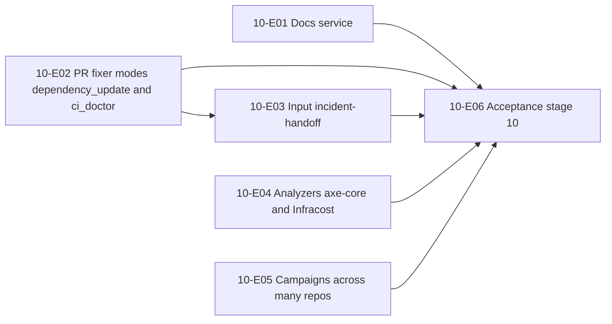

| ID | Task | depends on | owner | h | Status |
|---|---|---|---|---|---|
| **10-E01** | **Docs service** | 3-E07, 4-E06 | | | |
| 10-E01-T01 | docs scaffold and drift check | - | agent | 12 | open |
| 10-E01-T02 | Mode docstrings | 10-E01-T01 | agent | 14 | open |
| 10-E01-T03 | Mode sync | 10-E01-T01 | agent | 10 | open |
| 10-E01-T04 | Mode release with git-cliff | 10-E01-T01 | agent | 12 | open |
| 10-E01-T05 | Sets DO1 to DO4 and Gate A | 10-E01-T02, 10-E01-T03, 10-E01-T04 | agent | 14 | open |
| 10-E01-T06 | Owner: license request CodeWikiBench and DocAgent | - | owner | 2 | open |
| **10-E02** | **PR fixer modes dependency_update and ci_doctor** | 4-E06 | | | |
| 10-E02-T01 | Profile dependency_update | - | agent | 14 | open |
| 10-E02-T02 | Mode ci_doctor | 10-E02-T05 | agent | 10 | open |
| 10-E02-T03 | Set F4 and gate | 10-E02-T01 | agent | 12 | open |
| 10-E02-T04 | Owner: assessment of Renovate (AGPL) | - | owner | 2 | open |
| 10-E02-T05 | Executor issue | 0-E09-T04 | agent | 5 | open |
| **10-E03** | **Input incident-handoff** | 4-E06 | | | |
| 10-E03-T01 | Generic signed webhook incident-handoff | 10-E02-T05 | agent | 10 | open |
| 10-E03-T02 | TriggerSource sentry | 10-E03-T01 | agent | 10 | open |
| 10-E03-T03 | Handoff to coder and prfixer, E2E | 10-E03-T01, 10-E03-T02 | agent | 8 | open |
| **10-E04** | **Analyzers axe-core and Infracost** | 3-E07 | | | |
| 10-E04-T01 | Analyzer axe-core | - | agent | 10 | open |
| 10-E04-T02 | Analyzer Infracost | - | agent | 10 | open |
| 10-E04-T03 | AN1 per analyzer | 10-E04-T01, 10-E04-T02 | agent | 10 | open |
| **10-E05** | **Campaigns across many repos** | 4-E06 | | | |
| 10-E05-T01 | Campaign model and ledger key | 3-E04-T04 | agent | 14 | open |
| 10-E05-T02 | Abort rule, status and admin UI | 10-E05-T01 | agent | 10 | open |
| 10-E05-T03 | Failure path and chain tests | 10-E05-T02 | agent | 6 | open |
| **10-E06** | **Acceptance stage 10** | 10-E01, 10-E02, 10-E03, 10-E04, 10-E05 | | | |
| 10-E06-T01 | Stage report and release stage 10 | 0-E22-T05 | agent | 8 | open |

## 5. Order (topological, across all stages)

Each task comes after all tasks it depends on; within a wave the order is free.

1. `R-E01-T01`, `R-E01-T02`, `R-E05-T02`
2. `R-E01-T03`
3. `R-E01-T04`, `R-E01-T05`
4. `R-E01-T06`, `R-E01-T07`
5. `R-E01-T08`
6. `R-E02-T02`, `R-E02-T03`, `R-E02-T04`, `R-E02-T05`, `R-E02-T06`, `R-E02-T10`
7. `R-E02-T07`, `R-E02-T08`
8. `R-E02-T01`
9. `R-E02-T11`
10. `R-E03-T01`
11. `R-E03-T02`, `R-E03-T03`, `R-E03-T04`
12. `R-E03-T05`
13. `R-E04-T01`, `R-E04-T08`, `R-E04-T09`, `R-E04-T15`
14. `R-E04-T02`, `R-E04-T03`, `R-E04-T05`, `R-E04-T06`, `R-E04-T10`
15. `R-E04-T04`, `R-E04-T16`
16. `R-E04-T07`
17. `R-E04-T11`
18. `R-E04-T12`
19. `R-E04-T13`
20. `R-E04-T14`
21. `R-E05-T01`, `R-E05-T07`
22. `R-E05-T03`
23. `R-E05-T04`
24. `R-E05-T05`
25. `R-E05-T06`, `R-E05-T08`
26. `R-E05-T09`
27. `R-E05-T10`
28. `R-E05-T11`
29. `0-E01-T01`, `0-E01-T03`
30. `0-E01-T02`, `0-E01-T04`, `0-E01-T05`, `0-E01-T06`
31. `0-E01-T07`
32. `0-E01-T08`
33. `0-E01-T09`
34. `0-E02-T01`, `0-E13-T01`, `0-E19-T01`
35. `0-E02-T02`, `0-E13-T02`, `0-E19-T02`, `0-E19-T03`
36. `0-E02-T04`, `0-E13-T03`
37. `0-E02-T05`, `0-E02-T13`, `0-E11-T01`, `0-E13-T04`, `0-E13-T05`, `0-E13-T09`
38. `0-E02-T06`, `0-E13-T07`, `0-E13-T11`
39. `0-E02-T07`, `0-E13-T06`, `0-E13-T08`
40. `0-E02-T08`, `0-E13-T10`
41. `0-E02-T03`, `0-E02-T09`, `0-E03-T01`
42. `0-E02-T11`, `0-E03-T02`, `0-E03-T03`, `0-E03-T04`, `0-E03-T05`
43. `0-E02-T10`, `0-E02-T12`, `0-E03-T06`, `0-E03-T07`
44. `0-E04-T01`, `0-E05-T01`, `0-E05-T12`, `0-E06-T01`, `0-E06-T02`, `0-E08-T01`, `0-E20-T01`, `0-E20-T05`, `0-E20-T06`, `0-E20-T26`, `0-E20-T27`, `0b-E01-T01`, `0b-E01-T02`
45. `0-E06-T03`, `0-E07-T01`, `0-E08-T02`, `0-E08-T05`, `0-E20-T02`, `0-E20-T10`, `0-E20-T29`, `0b-E01-T03`, `0b-E01-T04`
46. `0-E04-T02`, `0-E06-T04`, `0-E07-T05`, `0-E09-T01`, `0-E20-T03`, `0-E20-T24`, `0b-E01-T05`
47. `0-E04-T03`, `0-E06-T05`, `0-E06-T06`, `0-E06-T07`, `0-E06-T10`, `0-E07-T02`, `0-E09-T10`, `0-E20-T04`, `0-E20-T25`
48. `0-E04-T04`, `0-E06-T08`, `0-E20-T17`, `0-E20-T19`
49. `0-E04-T07`, `0-E06-T09`
50. `0-E10-T01`, `0-E20-T07`
51. `0-E10-T03`, `0-E10-T04`, `0-E10-T06`
52. `0-E10-T05`
53. `0-E09-T02`
54. `0-E04-T05`, `0-E09-T03`
55. `0-E04-T06`, `0-E05-T05`
56. `0-E04-T08`, `0-E05-T02`, `0-E05-T10`
57. `0-E05-T03`, `0-E05-T07`, `0-E05-T08`, `0-E07-T03`, `0-E08-T03`, `0-E09-T04`, `0-E10-T02`, `0-E14-T01`, `0-E17-T01`, `0-E19-T04`
58. `0-E05-T04`, `0-E07-T04`, `0-E08-T04`, `0-E11-T02`, `0-E14-T02`, `0-E17-T02`, `0-E17-T03`, `0-E19-T05`
59. `0-E05-T06`, `0-E05-T09`, `0-E05-T13`, `0-E09-T06`, `0-E11-T03`, `0-E14-T03`, `0-E17-T04`, `0-E19-T07`, `0-E19-T10`
60. `0-E05-T11`, `0-E07-T06`, `0-E11-T04`, `0-E11-T06`, `0-E14-T04`, `0-E14-T06`, `0-E14-T10`, `0-E17-T05`, `0-E17-T09`, `0-E19-T08`, `0-E19-T09`
61. `0-E09-T07`, `0-E11-T05`, `0-E14-T05`, `0-E14-T07`, `0-E14-T09`, `0-E14-T11`, `0-E14-T14`, `0-E17-T07`, `0-E17-T08`, `0-E19-T06`
62. `0-E09-T08`, `0-E11-T07`, `0-E14-T08`, `0-E14-T12`, `0-E17-T06`
63. `0-E09-T05`, `0-E09-T09`, `0-E12-T01`, `0-E14-T13`, `1-E08-T03`, `1-E08-T04`
64. `0-E12-T02`, `0-E12-T04`
65. `0-E12-T03`, `0-E12-T05`
66. `0-E12-T06`, `0-E12-T08`, `0-E12-T10`, `0-E12-T11`
67. `0-E12-T07`
68. `0-E12-T09`
69. `0-E15-T01`, `0-E15-T08`, `0-E15-T10`, `0-E18-T01`, `0-E18-T05`, `0-E20-T28`
70. `0-E15-T02`, `0-E15-T03`, `0-E15-T11`, `0-E18-T02`, `0-E18-T07`, `0-E18-T14`, `0-E18-T15`, `0-E20-T11`
71. `0-E15-T04`, `0-E18-T03`
72. `0-E15-T05`, `0-E18-T04`, `0-E18-T06`, `0-E18-T08`, `0-E18-T10`, `0-E18-T16`
73. `0-E15-T06`, `0-E15-T09`, `0-E18-T09`, `0-E18-T11`, `0-E18-T12`, `0-E18-T13`, `0-E18-T18`, `0-E18-T21`
74. `0-E15-T07`, `0-E18-T20`
75. `0-E16-T01`, `0-E16-T03`, `1-E07-T01`, `1-E07-T03`, `1-E07-T05`
76. `0-E16-T02`, `0-E20-T08`, `1-E07-T02`, `1-E07-T04`, `1-E07-T09`
77. `0-E16-T04`, `0-E20-T09`, `0-E20-T16`
78. `0-E16-T05`, `0-E16-T06`, `0-E16-T07`, `0-E16-T08`, `0-E18-T19`, `0-E20-T12`, `0-E20-T13`, `0-E20-T14`, `0-E20-T18`, `0-E20-T21`
79. `0-E18-T17`, `0-E20-T15`, `0-E20-T20`, `0-E20-T22`, `1-E01-T01`, `1-E07-T06`, `1-E07-T07`, `1-E07-T08`, `1-E08-T01`
80. `0-E20-T23`, `0-E21-T01`, `0-E21-T02`, `0-E21-T07`, `0-E21-T10`, `0-E21-T11`, `0b-E01-T06`, `0b-E02-T01`, `1-E01-T02`, `1-E01-T03`, `1-E01-T05`, `1-E08-T02`
81. `0-E21-T04`, `0-E21-T05`, `0b-E02-T02`, `1-E01-T04`, `1-E01-T06`, `1-E08-T05`, `1-E08-T06`
82. `0-E21-T03`, `0-E21-T06`, `0-E21-T08`, `0b-E02-T03`, `0b-E02-T05`, `0b-E03-T01`, `1-E02-T01`, `1-E02-T03`, `1-E02-T06`, `2-E01-T02`, `2-E01-T07`, `2-E01-T14`, `2-E01-T15`, `2-E01-T16`, `2-E01-T17`, `6-E05-T01`
83. `0-E21-T09`, `0b-E02-T04`, `0b-E03-T03`, `0b-E03-T04`, `1-E02-T02`, `1-E02-T04`, `1-E02-T05`, `2-E01-T08`, `6-E05-T03`
84. `0-E22-T01`, `0b-E03-T02`, `0b-E03-T09`, `1-E02-T07`
85. `0-E22-T02`, `0-E22-T03`, `0-E22-T04`, `0-E22-T06`, `0b-E03-T05`, `1-E02-T08`
86. `0-E22-T05`, `0b-E03-T06`, `1-E03-T01`
87. `0-E22-T07`, `0b-E03-T07`, `1-E03-T02`, `1-E03-T03`, `1-E03-T04`, `1-E03-T05`
88. `0b-E03-T08`, `1-E03-T06`
89. `1-E03-T07`, `8-E04-T06`, `8-E04-T11`
90. `1-E04-T01`, `1-E04-T02`, `8-E04-T04`, `8-E04-T09`
91. `1-E04-T03`, `8-E04-T05`
92. `1-E04-T04`, `1-E04-T05`
93. `1-E04-T06`, `1-E04-T07`
94. `1-E04-T08`
95. `1-E05-T01`, `1-E05-T06`, `1-E05-T08`, `1-E05-T09`, `1-E05-T10`, `1-E05-T11`, `1-E06-T01`, `2-E01-T01`, `6-E04-T01`, `6-E04-T04`
96. `1-E05-T02`, `1-E05-T03`, `1-E05-T04`, `1-E05-T05`, `1-E06-T02`, `1-E06-T03`, `1-E06-T04`, `2-E01-T04`, `6-E04-T02`, `6-E04-T05`
97. `1-E05-T07`, `1-E06-T05`, `6-E04-T03`
98. `1-E09-T01`, `1-E09-T09`, `2-E05-T01`, `6-E01-T05`, `6-E01-T09`, `6-E02-T01`, `6-E03-T01`, `6-E06-T01`, `6-E06-T02`, `6-E06-T04`
99. `1-E09-T02`, `1-E09-T03`, `1-E09-T04`, `1-E09-T05`, `1-E09-T06`, `1-E09-T08`, `2-E01-T03`, `6-E01-T01`, `6-E02-T02`, `6-E02-T03`, `6-E03-T03`, `6-E03-T05`, `6-E06-T03`, `6-E06-T09`, `6-E06-T10`
100. `1-E09-T07`, `1-E09-T11`, `2-E01-T05`, `2-E01-T12`, `2-E05-T02`, `6-E01-T02`, `6-E03-T02`, `6-E03-T04`
101. `1-E09-T10`, `2-E05-T03`, `6-E01-T03`, `6-E01-T04`, `6-E01-T06`, `6-E01-T07`, `6-E02-T04`, `6-E04-T06`, `6-E05-T02`, `7a-E01-T01`, `7a-E01-T02`
102. `1-E09-T12`, `1-E09-T13`, `2-E05-T04`, `2-E05-T05`, `2-E05-T07`, `6-E01-T08`, `6-E05-T04`, `7a-E01-T03`
103. `1-E10-T01`, `1-E10-T02`, `1-E10-T03`, `1-E10-T04`, `1-E10-T05`, `1-E10-T06`, `1-E10-T08`, `1-E10-T09`, `2-E01-T06`, `2-E05-T06`, `2-E05-T08`, `6-E02-T05`, `6-E05-T05`, `6-E05-T06`, `6-E06-T05`, `7a-E01-T04`, `7a-E01-T05`, `7a-E01-T06`, `7a-E01-T07`
104. `1-E10-T07`, `1-E10-T10`, `2-E01-T10`, `2-E01-T13`, `6-E02-T06`, `6-E06-T06`, `6-E06-T08`, `7a-E01-T08`
105. `1-E10-T11`, `1-E10-T12`, `2-E01-T11`, `6-E06-T07`, `7a-E01-T09`
106. `1-E10-T13`, `2-E01-T09`, `6-E07-T01`, `6-E07-T03`, `6-E07-T04`, `6-E07-T05`, `6-E07-T07`, `7a-E02-T01`, `7a-E02-T03`
107. `2-E02-T01`, `2-E02-T02`, `2-E02-T11`, `2-E03-T01`, `2-E03-T03`, `2-E04-T01`, `6-E07-T02`, `6-E07-T06`, `7a-E02-T02`, `7a-E02-T04`, `8-E05-T01`
108. `2-E02-T03`, `2-E02-T04`, `2-E03-T04`, `6-E07-T08`, `7a-E02-T05`, `8-E05-T02`
109. `2-E02-T05`, `2-E03-T02`, `2-E04-T02`, `7a-E03-T01`, `7a-E03-T02`, `7a-E03-T03`, `7a-E03-T04`, `8-E05-T03`
110. `2-E02-T06`, `2-E03-T05`, `2-E04-T03`, `7a-E03-T05`, `8-E05-T04`
111. `2-E02-T07`, `2-E02-T08`, `2-E03-T06`, `2-E03-T07`, `2-E03-T08`, `2-E04-T04`, `2-E04-T05`, `7-E01-T01`, `7-E01-T02`, `7-E05-T01`, `8-E05-T05`
112. `2-E02-T09`, `2-E03-T09`, `2-E04-T06`, `7-E01-T03`, `7-E01-T07`, `7-E05-T02`
113. `2-E02-T10`, `2-E03-T10`, `2-E04-T07`, `2-E04-T08`, `2-E04-T09`, `7-E01-T04`, `7-E01-T08`, `7-E05-T03`, `7-E05-T04`, `7-E05-T07`
114. `2-E04-T10`, `2-E04-T11`, `7-E01-T05`, `7-E01-T06`, `7-E01-T09`, `7-E01-T10`
115. `2-E04-T12`, `7-E02-T01`, `7-E02-T03`, `7-E04-T01`
116. `2-E06-T01`, `2-E06-T04`, `2-E07-T01`, `7-E02-T02`, `7-E02-T04`, `7-E02-T05`, `7-E04-T03`, `7-E05-T05`
117. `2-E06-T02`, `2-E07-T02`, `2-E07-T03`, `7-E02-T06`, `7-E04-T02`, `7-E04-T04`, `7-E05-T06`
118. `2-E06-T03`, `2-E06-T05`, `2-E07-T04`, `2-E07-T05`, `2-E07-T06`, `7-E03-T01`, `7-E03-T02`, `7-E04-T05`
119. `2-E06-T06`, `2-E07-T07`, `7-E03-T03`, `7-E04-T06`
120. `2-E08-T01`, `2-E08-T09`, `3-E01-T01`, `3-E01-T09`, `4-E01-T01`, `7-E03-T04`, `8-E01-T01`, `8-E01-T03`, `8-E02-T01`, `8-E03-T01`
121. `2-E08-T02`, `2-E08-T03`, `2-E08-T04`, `2-E08-T05`, `2-E08-T10`, `3-E01-T02`, `3-E01-T04`, `4-E01-T02`, `7-E03-T05`, `7-E03-T06`, `8-E01-T02`, `8-E02-T02`, `8-E03-T02`, `8-E04-T03`
122. `2-E08-T06`, `2-E08-T07`, `3-E01-T03`, `3-E01-T06`, `3-E01-T08`, `4-E01-T03`, `4-E01-T04`, `4-E01-T06`, `7-E06-T01`, `7-E06-T02`, `7-E06-T03`, `7-E06-T04`, `7-E06-T06`, `7-E06-T07`, `8-E01-T04`, `8-E01-T05`, `8-E01-T07`, `8-E02-T03`, `8-E02-T04`, `8-E02-T05`, `8-E02-T06`, `8-E04-T01`, `8-E04-T02`
123. `2-E08-T08`, `3-E01-T05`, `3-E01-T07`, `4-E01-T05`, `4-E01-T07`, `7-E06-T05`, `8-E01-T06`, `8-E01-T08`, `8-E01-T09`, `8-E02-T07`, `8-E03-T03`, `8-E04-T07`, `8-E04-T08`
124. `2-E08-T11`, `3-E02-T01`, `3-E02-T03`, `3-E03-T01`, `4-E01-T08`, `7-E06-T08`, `8-E01-T10`, `8-E03-T04`, `8-E04-T10`
125. `3-E02-T02`, `3-E03-T02`, `4-E02-T01`, `4-E02-T05`, `4-E03-T01`, `4-E04-T01`, `8-E06-T01`, `9-E07-T02`, `9-E07-T03`, `9-E07-T04`, `9-E07-T05`
126. `3-E02-T04`, `3-E02-T05`, `3-E02-T06`, `3-E03-T03`, `3-E03-T06`, `4-E02-T02`, `4-E03-T02`, `4-E04-T02`, `8-E06-T02`
127. `3-E03-T04`, `3-E04-T01`, `3-E04-T03`, `3-E06-T01`, `4-E02-T03`, `4-E02-T04`, `4-E03-T03`, `5-E04-T01`, `8-E06-T03`
128. `3-E03-T05`, `3-E04-T02`, `3-E04-T04`, `3-E06-T02`, `4-E02-T06`, `5-E04-T02`, `9-E01-T01`, `9-E02-T02`, `9-E03-T01`, `9-E04-T01`, `9-E05-T01`, `9-E05-T03`, `9-E06-T01`, `9-E06-T02`, `9-E06-T03`, `9-E06-T04`, `9-E06-T05`
129. `3-E05-T01`, `4-E05-T01`, `9-E01-T02`, `9-E02-T01`, `9-E02-T04`, `9-E03-T02`, `9-E03-T03`, `9-E03-T04`, `9-E04-T02`, `9-E05-T02`, `9-E05-T04`
130. `3-E05-T02`, `4-E05-T02`, `9-E01-T03`, `9-E02-T03`, `9-E04-T03`, `9-E05-T05`
131. `3-E05-T03`, `4-E06-T01`, `4-E06-T02`, `4-E06-T03`, `4-E06-T04`, `4-E06-T06`, `9-E01-T04`, `9-E04-T04`
132. `3-E07-T01`, `3-E07-T03`, `3-E07-T04`, `3-E07-T05`, `3-E07-T06`, `3-E07-T09`, `4-E06-T05`, `9-E01-T05`, `9-E04-T05`, `9-E07-T01`
133. `3-E07-T02`, `3-E07-T07`, `3-E07-T08`, `4-E06-T07`, `9-E01-T06`, `9-E01-T07`, `9-E01-T08`, `9-E04-T06`
134. `3-E07-T10`, `9-E08-T01`, `10-E02-T01`, `10-E02-T04`, `10-E02-T05`, `10-E05-T01`
135. `5-E01-T01`, `9-E08-T02`, `10-E01-T01`, `10-E01-T06`, `10-E02-T02`, `10-E02-T03`, `10-E03-T01`, `10-E04-T01`, `10-E04-T02`, `10-E05-T02`
136. `5-E01-T02`, `10-E01-T02`, `10-E01-T03`, `10-E01-T04`, `10-E03-T02`, `10-E04-T03`, `10-E05-T03`
137. `5-E01-T03`, `5-E01-T04`, `5-E01-T05`, `5-E01-T06`, `10-E01-T05`, `10-E03-T03`
138. `5-E01-T07`, `10-E06-T01`
139. `5-E02-T01`
140. `5-E02-T02`
141. `5-E02-T06`, `5-E02-T07`
142. `5-E02-T03`
143. `5-E02-T04`
144. `5-E02-T05`
145. `5-E03-T01`, `5-E03-T02`, `5-E03-T03`
146. `5-E05-T01`, `5-E05-T02`, `5-E05-T04`
147. `5-E05-T03`
148. `5-E05-T05`
